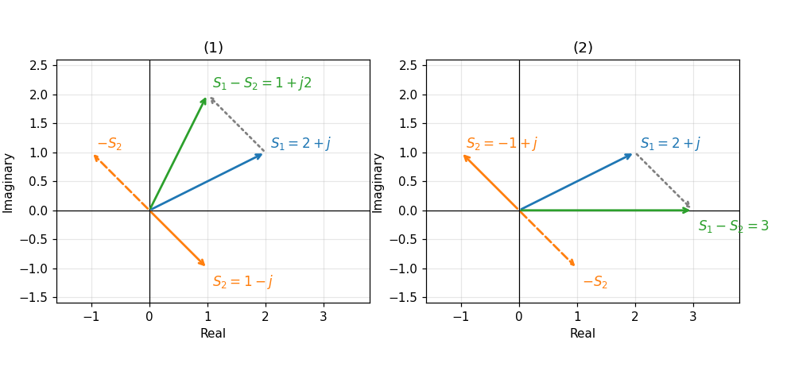
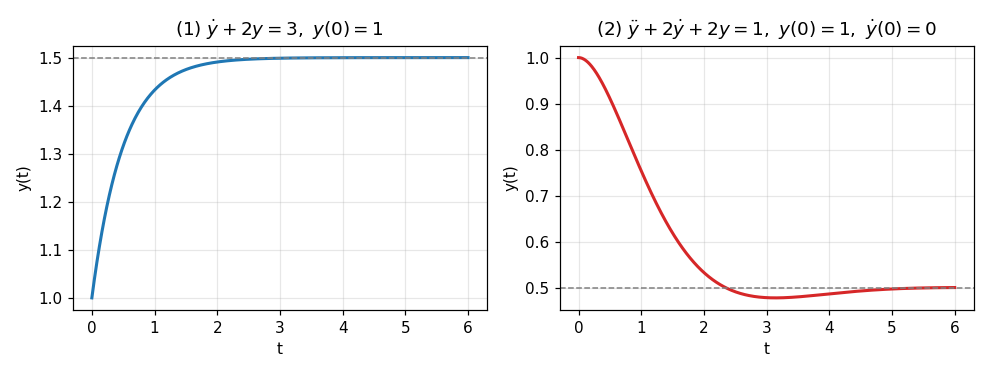

# HW1 과제 해설 — 복소수와 미분방정식

[레포지토리 안내](../../README.ko.md) | [English](Assignment-Explanation.md) | [한국어](Assignment-Explanation.ko.md)

> **최종 수정일:** 2026-11-04

> **학습 목표:**
> 1. 복소수를 극좌표 형식과 직각 좌표 형식 사이에서 변환하고, 복소수가 놓인 사분면에 맞는 편각을 구할 수 있다
> 2. 복소수의 뺄셈을 계산하고 그 결과를 복소평면 위 벡터의 합으로 해석할 수 있다
> 3. 복소수의 곱셈과 나눗셈을 두 형식으로 각각 계산하고 두 결과가 일치함을 보일 수 있다
> 4. 상수 계수 1계와 2계 선형 미분방정식을 동차해와 특수해로 나누어 풀고, 초기 조건으로 미정 계수를 정할 수 있다

---

## 목차

- [1. 과제 구성](#1-과제-구성)
- [2. 복소수의 표현](#2-복소수의-표현)
  - [2.1 복소수와 복소평면](#21-복소수와-복소평면)
  - [2.2 직각 좌표 형식과 극좌표 형식](#22-직각-좌표-형식과-극좌표-형식)
  - [2.3 오일러 공식과 지수 형식](#23-오일러-공식과-지수-형식)
- [3. 문제 1: 극좌표 형식에서 직각 좌표 형식으로](#3-문제-1-극좌표-형식에서-직각-좌표-형식으로)
- [4. 문제 2: 직각 좌표 형식에서 극좌표 형식으로](#4-문제-2-직각-좌표-형식에서-극좌표-형식으로)
- [5. 문제 3: 복소수의 뺄셈과 복소평면](#5-문제-3-복소수의-뺄셈과-복소평면)
- [6. 문제 4: 복소수의 곱셈과 나눗셈](#6-문제-4-복소수의-곱셈과-나눗셈)
  - [6.1 직각 좌표 형식을 이용한 계산](#61-직각-좌표-형식을-이용한-계산)
  - [6.2 극좌표 형식을 이용한 계산](#62-극좌표-형식을-이용한-계산)
- [7. 문제 5: 미분방정식의 풀이](#7-문제-5-미분방정식의-풀이)
  - [7.1 상수 계수 선형 미분방정식의 해](#71-상수-계수-선형-미분방정식의-해)
  - [7.2 1계 미분방정식](#72-1계-미분방정식)
  - [7.3 2계 미분방정식](#73-2계-미분방정식)
- [요약](#요약)
- [점검 문제](#점검-문제)

---

<br>

## 1. 과제 구성

복소수의 두 표현 형식과 사칙연산, 상수 계수 선형 미분방정식의 풀이를 연습하는 과제로, 2주차의 복소수와 미분방정식에 해당한다. 제어시스템의 해석에서 복소수는 전달함수의 극점과 주파수 응답을 나타내고 미분방정식은 시스템의 동적 거동을 나타내므로, 두 내용은 3주차 이후의 라플라스 변환과 전달함수의 기초가 된다.

```text
Coursework/HW01_Complex-Numbers-and-Differential-Equations/
├── Original/
│   └── hw1.pdf                    # 과제 안내문
└── Solution/
    └── Assignment-Report.pdf      # 제출한 풀이 (안내문 위에 손으로 쓴 풀이)
```

*그림 1. HW1 과제의 디렉토리 구성*

| 문제 | 내용 | 이 문서 |
|:-----|:-----|:-----|
| 1 | 극좌표 형식의 복소수 $2\angle(-45^\circ)$, $1\angle 90^\circ$, $1\angle 180^\circ$를 직각 좌표 형식으로 변환한다 | 3절 |
| 2 | 직각 좌표 형식의 복소수 $\sqrt{3} - j$, $-1 - j$, $-j$를 극좌표 형식으로 변환한다 | 4절 |
| 3 | (1) $S_1 = 2 + j$, $S_2 = 1 - j$와 (2) $S_1 = 2 + j$, $S_2 = -1 + j$에 대해 $S_1 - S_2$를 계산하고 복소평면에 그려 확인한다 | 5절 |
| 4 | $S_1 = 1\angle 120^\circ$, $S_2 = 2\angle 30^\circ$의 곱셈과 나눗셈을 (1) 직각 좌표 형식과 (2) 극좌표 형식으로 계산한다 | 6절 |
| 5 | (1) $\dot{y} + 2y = 3$, $y(0) = 1$과 (2) $\ddot{y} + 2\dot{y} + 2y = 1$, $y(0) = 1$, $\dot{y}(0) = 0$을 푼다 | 7절 |

*표 1. HW1의 문제와 이 문서에서 다루는 절*

---

<br>

## 2. 복소수의 표현

### 2.1 복소수와 복소평면

**복소수(complex number)** 는 두 실수 $a$, $b$와 **허수 단위(imaginary unit)** $j$($j^2 = -1$)로 $S = a + jb$처럼 쓰는 수이다. $a$를 **실수부(real part)** $\operatorname{Re}(S)$, $b$를 **허수부(imaginary part)** $\operatorname{Im}(S)$라 한다. 수학에서는 허수 단위를 $i$로 쓰지만 전기공학과 제어공학에서는 $i$가 전류를 뜻하므로 $j$를 쓰며, 이 문서도 과제 안내문을 따라 $j$를 쓴다.

실수부를 가로축, 허수부를 세로축으로 하는 평면을 **복소평면(complex plane)** 이라 한다. 복소수 $a + jb$는 이 평면의 점 $(a, b)$로, 또는 원점에서 그 점으로 가는 벡터로 나타낸다. 벡터로 보면 복소수의 덧셈과 뺄셈은 벡터의 덧셈과 뺄셈과 같다(5절).

허수부의 부호만 바꾼 수 $\bar{S} = a - jb$를 $S$의 **켤레 복소수(complex conjugate)** 라 한다. 복소평면에서 켤레 복소수는 실수축에 대해 대칭인 점이며, $S\bar{S} = (a + jb)(a - jb) = a^2 - j^2b^2 = a^2 + b^2$은 항상 0 이상의 실수이다. 이 성질은 직각 좌표 형식의 나눗셈에 쓰인다(6.1절).

### 2.2 직각 좌표 형식과 극좌표 형식

$S = a + jb$처럼 실수부와 허수부로 쓰는 표현을 **직각 좌표 형식(Cartesian form, rectangular form)** 이라 한다. 같은 점을 원점에서의 거리 $r$과 양의 실수축에서 시계 반대 방향으로 잰 각 $\theta$로 $S = r\angle\theta$처럼 쓸 수도 있으며, 이를 **극좌표 형식(polar form)** 이라 한다. $r = \vert S\vert$를 **크기(magnitude)**, $\theta = \angle S$를 **편각(argument)** 이라 한다.

직각삼각형의 관계에서 두 형식은 다음과 같이 서로 바뀐다.

$$
a = r\cos\theta, \qquad b = r\sin\theta, \qquad r = \sqrt{a^2 + b^2}, \qquad \tan\theta = \frac{b}{a}
$$

$\tan\theta = b/a$에서 $\theta = \tan^{-1}(b/a)$로 바로 구하면 안 되는 경우가 있다. 역탄젠트 함수는 $-90^\circ$와 $90^\circ$ 사이의 값만 돌려주므로 실수부가 양수인 1사분면과 4사분면의 점에서만 맞고, $a + jb$와 $-a - jb$처럼 원점에 대해 대칭인 두 점은 $b/a$가 같아 구별하지 못한다. 따라서 편각은 표 2처럼 점이 놓인 사분면을 보고 정한다. 이 규칙을 하나의 함수로 묶은 것이 프로그래밍 언어의 `atan2(b, a)`이다.

| 점의 위치 | 편각 $\theta$ |
|:-----|:-----|
| $a > 0$ (1, 4사분면) | $\tan^{-1}(b/a)$ |
| $a < 0$, $b \ge 0$ (2사분면과 음의 실수축) | $\tan^{-1}(b/a) + 180^\circ$ |
| $a < 0$, $b < 0$ (3사분면) | $\tan^{-1}(b/a) - 180^\circ$ |
| $a = 0$, $b > 0$ (양의 허수축) | $90^\circ$ |
| $a = 0$, $b < 0$ (음의 허수축) | $-90^\circ$ |

*표 2. 점의 위치에 따른 편각의 계산*

편각에 $360^\circ$의 정수배를 더해도 같은 점을 가리키므로 $\sqrt{2}\angle(-135^\circ)$와 $\sqrt{2}\angle 225^\circ$는 같은 복소수이다. 표 2는 편각을 $-180^\circ < \theta \le 180^\circ$ 범위로 나타내며, 이 범위의 값을 편각의 **주값(principal value)** 이라 한다. 원점 $0$은 크기가 0이고 방향이 없으므로 편각이 정의되지 않는다.

### 2.3 오일러 공식과 지수 형식

**오일러 공식(Euler's formula)** 은 지수 함수와 삼각 함수를 다음과 같이 잇는다.

$$
e^{j\theta} = \cos\theta + j\sin\theta
$$

이 공식을 쓰면 $r\angle\theta = r\cos\theta + jr\sin\theta = re^{j\theta}$이므로 극좌표 형식은 지수 형식 $re^{j\theta}$와 같다. 지수 법칙 $e^{j\theta_1}e^{j\theta_2} = e^{j(\theta_1 + \theta_2)}$에서 곱셈과 나눗셈의 규칙이 바로 나온다.

$$
(r_1\angle\theta_1)(r_2\angle\theta_2) = r_1r_2\angle(\theta_1 + \theta_2), \qquad \frac{r_1\angle\theta_1}{r_2\angle\theta_2} = \frac{r_1}{r_2}\angle(\theta_1 - \theta_2)
$$

즉 곱셈은 크기를 곱하고 편각을 더하며, 나눗셈은 크기를 나누고 편각을 뺀다. 반면 덧셈과 뺄셈은 직각 좌표 형식에서 실수부와 허수부를 따로 계산하는 편이 간단하다. 두 형식을 연산에 따라 골라 쓰는 것이 이 과제의 요점이다.

> **[미적분학]** 오일러 공식은 테일러 전개로 보일 수 있다. $e^x = \sum_{n=0}^{\infty} x^n/n!$에 $x = j\theta$를 넣으면 $j^2 = -1$, $j^3 = -j$, $j^4 = 1$이 되풀이되므로 짝수 차수 항은 $1 - \theta^2/2! + \theta^4/4! - \cdots = \cos\theta$로, 홀수 차수 항은 $j(\theta - \theta^3/3! + \theta^5/5! - \cdots) = j\sin\theta$로 모인다.

---

<br>

## 3. 문제 1: 극좌표 형식에서 직각 좌표 형식으로

$a = r\cos\theta$, $b = r\sin\theta$를 계산하면 된다. 코사인은 짝함수($\cos(-\theta) = \cos\theta$), 사인은 홀함수($\sin(-\theta) = -\sin\theta$)이므로 음의 각은 다음과 같이 처리한다.

$$
2\angle(-45^\circ) = 2\cos(-45^\circ) + j2\sin(-45^\circ) = 2\cdot\frac{\sqrt{2}}{2} - j2\cdot\frac{\sqrt{2}}{2} = \sqrt{2} - j\sqrt{2}
$$

$$
1\angle 90^\circ = \cos 90^\circ + j\sin 90^\circ = 0 + j1 = j
$$

$$
1\angle 180^\circ = \cos 180^\circ + j\sin 180^\circ = -1 + j0 = -1
$$

첫째 수는 4사분면에서 실수축과 $45^\circ$를 이루므로 실수부와 허수부의 크기가 같고, 허수부가 음수이다. 둘째와 셋째 결과는 허수 단위의 의미를 보여 준다. $j = 1\angle 90^\circ$이므로 어떤 복소수에 $j$를 곱하면 크기는 그대로이고 편각만 $90^\circ$ 늘어나며, 두 번 곱하면 $j^2 = 1\angle 180^\circ = -1$로 방향이 반대가 된다. 이는 $j^2 = -1$이라는 정의와 맞는다.

---

<br>

## 4. 문제 2: 직각 좌표 형식에서 극좌표 형식으로

크기는 $r = \sqrt{a^2 + b^2}$으로 구하고, 편각은 표 2에 따라 점의 사분면을 먼저 확인한 뒤 구한다.

**(1) $\sqrt{3} - j$.** $a = \sqrt{3} > 0$, $b = -1$이므로 4사분면의 점이다. 실수부가 양수이므로 역탄젠트 값을 그대로 쓴다.

$$
r = \sqrt{(\sqrt{3})^2 + (-1)^2} = \sqrt{4} = 2, \qquad \theta = \tan^{-1}\frac{-1}{\sqrt{3}} = -30^\circ \quad\Longrightarrow\quad \sqrt{3} - j = 2\angle(-30^\circ)
$$

**(2) $-1 - j$.** $a = -1$, $b = -1$이므로 3사분면의 점이다. $\tan^{-1}\big((-1)/(-1)\big) = \tan^{-1}1 = 45^\circ$는 1사분면의 점 $1 + j$의 편각이므로, 표 2에 따라 $180^\circ$를 뺀다.

$$
r = \sqrt{(-1)^2 + (-1)^2} = \sqrt{2}, \qquad \theta = 45^\circ - 180^\circ = -135^\circ \quad\Longrightarrow\quad -1 - j = \sqrt{2}\angle(-135^\circ)
$$

같은 수를 $\sqrt{2}\angle 225^\circ$로 써도 된다. $45^\circ$를 그대로 쓰면 $\sqrt{2}\angle 45^\circ = 1 + j$가 되어 부호가 반대인 수가 나온다.

**(3) $-j$.** $a = 0$, $b = -1$이므로 음의 허수축 위의 점이다. $b/a$의 분모가 0이어서 역탄젠트로는 구할 수 없고, 표 2에 따라 편각은 $-90^\circ$이다.

$$
r = \sqrt{0^2 + (-1)^2} = 1, \qquad \theta = -90^\circ \quad\Longrightarrow\quad -j = 1\angle(-90^\circ)
$$

$1\angle 270^\circ$로 써도 같은 수이다. 결과를 3절의 방법으로 되돌리면 검산할 수 있다. 예를 들어 $2\angle(-30^\circ) = 2\cos 30^\circ - j2\sin 30^\circ = \sqrt{3} - j$이다.

---

<br>

## 5. 문제 3: 복소수의 뺄셈과 복소평면

직각 좌표 형식의 뺄셈은 실수부끼리, 허수부끼리 뺀다.

$$
(a_1 + jb_1) - (a_2 + jb_2) = (a_1 - a_2) + j(b_1 - b_2)
$$

$$
\text{(1)}\quad S_1 - S_2 = (2 + j) - (1 - j) = (2 - 1) + j\big(1 - (-1)\big) = 1 + j2
$$

$$
\text{(2)}\quad S_1 - S_2 = (2 + j) - (-1 + j) = \big(2 - (-1)\big) + j(1 - 1) = 3
$$

복소평면에서는 뺄셈을 $S_1 - S_2 = S_1 + (-S_2)$로 보고 벡터의 덧셈으로 그린다. $-S_2$는 $S_2$를 원점에 대해 대칭으로 옮긴 벡터, 즉 $S_2$를 $180^\circ$ 돌린 벡터이다. $S_1$의 끝점에 $-S_2$의 시작점을 이어 붙이면 그 끝점이 $S_1 - S_2$이다. 그림 2의 (1)에서 $-S_2 = -1 + j$이므로 $S_1$의 끝점 $(2, 1)$에서 왼쪽으로 1, 위로 1 움직여 $(1, 2)$에 이르고, (2)에서 $-S_2 = 1 - j$이므로 $(2, 1)$에서 오른쪽으로 1, 아래로 1 움직여 실수축 위의 $(3, 0)$에 이른다. 두 끝점은 계산 결과 $1 + j2$, $3$과 일치한다.



*그림 2. 복소평면에서 본 두 뺄셈*

$S_1 - S_2$는 $S_2$의 끝점에서 $S_1$의 끝점으로 가는 벡터를 원점으로 평행 이동한 것이기도 하다. 따라서 $\vert S_1 - S_2\vert$는 복소평면에서 두 점 사이의 거리이며, (1)에서 $\sqrt{1^2 + 2^2} = \sqrt{5}$, (2)에서 $3$이다.

---

<br>

## 6. 문제 4: 복소수의 곱셈과 나눗셈

### 6.1 직각 좌표 형식을 이용한 계산

먼저 두 수를 직각 좌표 형식으로 바꾼다. $\cos 120^\circ = -1/2$, $\sin 120^\circ = \sqrt{3}/2$, $\cos 30^\circ = \sqrt{3}/2$, $\sin 30^\circ = 1/2$이다.

$$
S_1 = 1\angle 120^\circ = -\frac{1}{2} + j\frac{\sqrt{3}}{2}, \qquad S_2 = 2\angle 30^\circ = 2\cdot\frac{\sqrt{3}}{2} + j2\cdot\frac{1}{2} = \sqrt{3} + j
$$

곱셈은 분배 법칙으로 네 항을 전개하고 $j^2 = -1$을 쓴다. 일반식은 $(a_1 + jb_1)(a_2 + jb_2) = (a_1a_2 - b_1b_2) + j(a_1b_2 + a_2b_1)$이다.

$$
S_1S_2 = \left(-\frac{1}{2} + j\frac{\sqrt{3}}{2}\right)(\sqrt{3} + j) = -\frac{\sqrt{3}}{2} - j\frac{1}{2} + j\frac{3}{2} + j^2\frac{\sqrt{3}}{2} = \left(-\frac{\sqrt{3}}{2} - \frac{\sqrt{3}}{2}\right) + j\left(-\frac{1}{2} + \frac{3}{2}\right) = -\sqrt{3} + j
$$

나눗셈은 분모를 실수로 만들기 위해 분자와 분모에 분모의 켤레 복소수 $\bar{S}_2 = \sqrt{3} - j$를 곱한다. 분모는 2.1절의 성질에 따라 $(\sqrt{3})^2 + 1^2 = 4$가 된다.

$$
\frac{S_1}{S_2} = \frac{\left(-\frac{1}{2} + j\frac{\sqrt{3}}{2}\right)(\sqrt{3} - j)}{(\sqrt{3} + j)(\sqrt{3} - j)} = \frac{-\frac{\sqrt{3}}{2} + j\frac{1}{2} + j\frac{3}{2} - j^2\frac{\sqrt{3}}{2}}{4} = \frac{\left(-\frac{\sqrt{3}}{2} + \frac{\sqrt{3}}{2}\right) + j\left(\frac{1}{2} + \frac{3}{2}\right)}{4} = \frac{j2}{4} = j0.5
$$

### 6.2 극좌표 형식을 이용한 계산

2.3절의 규칙에 따라 크기는 곱하거나 나누고 편각은 더하거나 뺀다.

$$
S_1S_2 = (1 \cdot 2)\angle(120^\circ + 30^\circ) = 2\angle 150^\circ, \qquad \frac{S_1}{S_2} = \frac{1}{2}\angle(120^\circ - 30^\circ) = 0.5\angle 90^\circ
$$

두 결과를 직각 좌표 형식으로 바꾸면 $2\angle 150^\circ = 2\cos 150^\circ + j2\sin 150^\circ = -\sqrt{3} + j$, $0.5\angle 90^\circ = j0.5$로 6.1절의 결과와 일치한다. 같은 답을 얻지만 극좌표 형식의 계산은 한 줄로 끝나므로, 곱셈과 나눗셈이 많은 계산(예를 들어 여러 전달함수를 곱한 값의 크기와 위상)에는 극좌표 형식이 편리하다.

---

<br>

## 7. 문제 5: 미분방정식의 풀이

### 7.1 상수 계수 선형 미분방정식의 해

미지 함수 $y(t)$와 그 도함수에 대해 1차식이고 계수가 상수인 미분방정식

$$
a_n y^{(n)} + a_{n-1} y^{(n-1)} + \cdots + a_1\dot{y} + a_0 y = f(t)
$$

을 **상수 계수 선형 미분방정식(linear differential equation with constant coefficients)** 이라 한다. 입력 $f(t)$를 0으로 둔 방정식의 해를 **동차해(homogeneous solution)** $y_h$, 원래 방정식을 만족하는 해 하나를 **특수해(particular solution)** $y_p$라 하면, 선형성 때문에 일반해는 $y = y_h + y_p$이다.

동차해는 $y = e^{\lambda t}$로 놓고 구한다. $e^{\lambda t}$를 미분할 때마다 $\lambda$가 곱해지므로($\frac{d^k}{dt^k}e^{\lambda t} = \lambda^k e^{\lambda t}$) 동차 방정식은 $(a_n\lambda^n + \cdots + a_1\lambda + a_0)e^{\lambda t} = 0$이 되고, $e^{\lambda t} \ne 0$이므로 다음 **특성방정식(characteristic equation)** 을 얻는다.

$$
a_n\lambda^n + a_{n-1}\lambda^{n-1} + \cdots + a_1\lambda + a_0 = 0
$$

| 특성방정식의 근 | 동차해의 항 |
|:-----|:-----|
| 서로 다른 실근 $\lambda$ | $Ce^{\lambda t}$ |
| $k$번 겹친 실근 $\lambda$ | $(C_1 + C_2t + \cdots + C_kt^{k-1})e^{\lambda t}$ |
| 켤레 복소근 $\sigma \pm j\omega$ | $e^{\sigma t}(A\cos\omega t + B\sin\omega t)$ |

*표 3. 특성방정식의 근과 동차해의 항*

입력이 상수 $f(t) = c$이고 $a_0 \ne 0$이면 상수 $y_p = K$를 넣었을 때 도함수가 모두 0이 되어 $a_0K = c$이므로 특수해는 $y_p = c/a_0$이다. $n$차 방정식의 일반해에는 미정 계수가 $n$개 있으며, 초기 조건 $y(0), \dot{y}(0), \ldots, y^{(n-1)}(0)$의 $n$개 값으로 정한다. 특성방정식의 근은 5주차에서 전달함수의 극점으로 다시 나타나며, 근의 실수부가 음수이면 동차해가 시간이 지나며 사라진다.

### 7.2 1계 미분방정식

**(1) $\dot{y} + 2y = 3$, $y(0) = 1$.** 특성방정식은 $\lambda + 2 = 0$이므로 $\lambda = -2$이고, 동차해는 $y_h = Ce^{-2t}$이다. 입력이 상수 3이므로 특수해는 $2K = 3$에서 $y_p = 3/2$이다. 일반해에 초기 조건을 넣어 $C$를 정한다.

$$
y(t) = Ce^{-2t} + \frac{3}{2}, \qquad y(0) = C + \frac{3}{2} = 1 \quad\Longrightarrow\quad C = -\frac{1}{2}
$$

$$
y(t) = \frac{3}{2} - \frac{1}{2}e^{-2t}, \quad t \ge 0
$$

검산하면 $\dot{y} = e^{-2t}$이므로 $\dot{y} + 2y = e^{-2t} + 3 - e^{-2t} = 3$이고, $y(0) = 3/2 - 1/2 = 1$이다. 응답은 초기값 1에서 최종값 $3/2$로 지수적으로 다가가며(그림 3의 왼쪽), 지수의 계수 2의 역수 $0.5$가 이 접근의 빠르기를 나타내는 **시정수(time constant)** 이다(7주차).

### 7.3 2계 미분방정식

**(2) $\ddot{y} + 2\dot{y} + 2y = 1$, $y(0) = 1$, $\dot{y}(0) = 0$.** 특성방정식 $\lambda^2 + 2\lambda + 2 = 0$을 근의 공식으로 풀면 판별식이 $2^2 - 4 \cdot 2 = -4 < 0$이므로 켤레 복소근이 나온다.

$$
\lambda = \frac{-2 \pm \sqrt{-4}}{2} = -1 \pm j
$$

동차해를 복소 지수로 쓰면 $y_h = K_1e^{(-1+j)t} + K_2e^{(-1-j)t}$이다. 오일러 공식으로 $e^{(-1\pm j)t} = e^{-t}(\cos t \pm j\sin t)$를 넣어 정리하면

$$
y_h = e^{-t}\big[(K_1 + K_2)\cos t + j(K_1 - K_2)\sin t\big] = e^{-t}(A\cos t + B\sin t), \qquad A = K_1 + K_2, \quad B = j(K_1 - K_2)
$$

가 되어 표 3의 셋째 행을 얻는다. $y(t)$가 실수이려면 $K_1$과 $K_2$가 서로 켤레 복소수여야 하고, 그러면 $A$와 $B$는 실수이다. 특수해는 $2K = 1$에서 $y_p = 1/2$이므로 일반해와 그 도함수는 다음과 같다.

$$
y(t) = e^{-t}(A\cos t + B\sin t) + \frac{1}{2}, \qquad \dot{y}(t) = e^{-t}\big[(B - A)\cos t - (A + B)\sin t\big]
$$

도함수는 곱의 미분법으로 $-e^{-t}(A\cos t + B\sin t) + e^{-t}(-A\sin t + B\cos t)$를 정리한 것이다. 두 초기 조건을 넣는다.

$$
y(0) = A + \frac{1}{2} = 1 \;\Longrightarrow\; A = \frac{1}{2}, \qquad \dot{y}(0) = B - A = 0 \;\Longrightarrow\; B = \frac{1}{2}
$$

$$
y(t) = \frac{1}{2} + \frac{1}{2}e^{-t}(\cos t + \sin t) = \frac{1}{2} + \frac{\sqrt{2}}{2}e^{-t}\sin(t + 45^\circ), \quad t \ge 0
$$

마지막 꼴은 $\cos t + \sin t = \sqrt{2}\sin(t + 45^\circ)$를 쓴 것이다. 복소 지수 표현의 계수는 $K_1 = (A - jB)/2 = 0.25 - j0.25$, $K_2 = \bar{K}_1 = 0.25 + j0.25$이며, 이를 처음 식에 넣어도 같은 해가 나온다. 응답은 각진동수 1 rad/s로 진동하면서 포락선 $e^{-t}$를 따라 줄어들어 최종값 $1/2$에 다가간다(그림 3의 오른쪽). 진동 때문에 응답은 $\dot{y} = -e^{-t}\sin t$가 0이 되는 $t = \pi$에서 최종값보다 조금 낮은 $1/2 - e^{-\pi}/2 \approx 0.478$까지 내려갔다가 돌아온다. 특성근의 실수부 $-1$이 감쇠의 빠르기를, 허수부 $1$이 진동의 각진동수를 정하며, 이 관계는 7주차의 2차 시스템 응답에서 감쇠비와 고유 진동수로 다시 정리된다.



*그림 3. 문제 5의 두 해*

---

<br>

## 요약

| 개념 | 핵심 요약 |
|:-----|:-----|
| 두 형식의 변환 | $a + jb$와 $r\angle\theta$는 $a = r\cos\theta$, $b = r\sin\theta$, $r = \sqrt{a^2 + b^2}$로 서로 바뀐다. |
| 편각과 사분면 | $\tan^{-1}(b/a)$는 1, 4사분면의 값만 주므로 실수부가 음수이면 $180^\circ$를 더하거나 빼고, 실수부가 0이면 허수부의 부호에 따라 $\pm 90^\circ$로 정한다. |
| 덧셈과 뺄셈 | 실수부와 허수부를 따로 계산하며, 복소평면에서는 벡터의 합과 차이고 $\vert S_1 - S_2\vert$는 두 점 사이의 거리이다. |
| 곱셈과 나눗셈 | 극좌표 형식에서는 크기를 곱하거나 나누고 편각을 더하거나 빼며, 직각 좌표 형식의 나눗셈은 분모의 켤레 복소수를 분자와 분모에 곱한다. |
| 오일러 공식 | $e^{j\theta} = \cos\theta + j\sin\theta$이므로 $r\angle\theta = re^{j\theta}$이고, 곱셈과 나눗셈의 규칙은 지수 법칙에서 나온다. |
| 미분방정식의 해 | 상수 계수 선형 미분방정식의 해는 동차해와 특수해의 합이며, 동차해는 특성방정식의 근으로, 미정 계수는 초기 조건으로 정한다. |
| 켤레 복소근 | 특성근 $\sigma \pm j\omega$는 $e^{\sigma t}(A\cos\omega t + B\sin\omega t)$ 꼴의 진동을 만들고, $\sigma < 0$이면 진동이 줄어든다. |
| 문제 5의 해 | (1) $y = 3/2 - e^{-2t}/2$, (2) $y = 1/2 + e^{-t}(\cos t + \sin t)/2$이다. |

---

<br>

## 점검 문제

1. **편각의 사분면:** $-\sqrt{3} + j$를 극좌표 형식으로 바꾸라.

   <details>
   <summary>정답</summary>

   크기는 $\sqrt{3 + 1} = 2$이다. $\tan^{-1}\big(1/(-\sqrt{3})\big) = -30^\circ$이지만 점이 2사분면($a < 0$, $b > 0$)에 있으므로 $180^\circ$를 더해 $150^\circ$이다. 따라서 $-\sqrt{3} + j = 2\angle 150^\circ$이며, 이는 문제 4의 곱 $S_1S_2$와 같은 수이다.

   </details>

2. **$j$를 곱하는 의미:** $2 + j$에 $j$를 곱한 결과를 계산하고 복소평면에서 어떤 변화인지 설명하라.

   <details>
   <summary>정답</summary>

   $j(2 + j) = j2 + j^2 = -1 + j2$이다. $j = 1\angle 90^\circ$이므로 곱하면 크기는 $\sqrt{5}$ 그대로이고 편각만 $90^\circ$ 늘어난다. 즉 복소평면에서 원점을 중심으로 시계 반대 방향으로 $90^\circ$ 회전한다.

   </details>

3. **나눗셈:** $(1 + j)/(1 - j)$를 직각 좌표 형식과 극좌표 형식으로 각각 계산하라.

   <details>
   <summary>정답</summary>

   직각 좌표 형식에서는 분자와 분모에 $1 + j$를 곱해 $(1 + j)^2/(1^2 + 1^2) = (1 + j2 + j^2)/2 = j2/2 = j$이다. 극좌표 형식에서는 $\sqrt{2}\angle 45^\circ / \sqrt{2}\angle(-45^\circ) = 1\angle 90^\circ = j$로 같다.

   </details>

4. **최종값:** 문제 5의 두 해가 $t \to \infty$에서 다가가는 값을 해를 구하지 않고 미분방정식에서 바로 구하라. 이 방법이 성립하는 조건은 무엇인가?

   <details>
   <summary>정답</summary>

   응답이 일정한 값에 머물면 도함수가 모두 0이므로 (1)은 $2y = 3$에서 $3/2$, (2)는 $2y = 1$에서 $1/2$이다. 이 방법은 특성방정식의 모든 근의 실수부가 음수여서 동차해가 0으로 사라질 때만 성립하며, 두 문제의 근 $-2$와 $-1 \pm j$는 이 조건을 만족한다.

   </details>

5. **겹친 근:** $\ddot{y} + 2\dot{y} + y = 1$의 동차해는 어떤 꼴이며, 문제 5의 (2)와 응답이 어떻게 다른가?

   <details>
   <summary>정답</summary>

   특성방정식 $\lambda^2 + 2\lambda + 1 = (\lambda + 1)^2 = 0$은 $-1$이 두 번 겹친 실근을 가지므로 동차해는 $(C_1 + C_2t)e^{-t}$이다. 복소근이 없으므로 진동하지 않고 최종값 1에 다가가며, 이는 7주차에서 다루는 임계 감쇠의 경우이다.

   </details>
