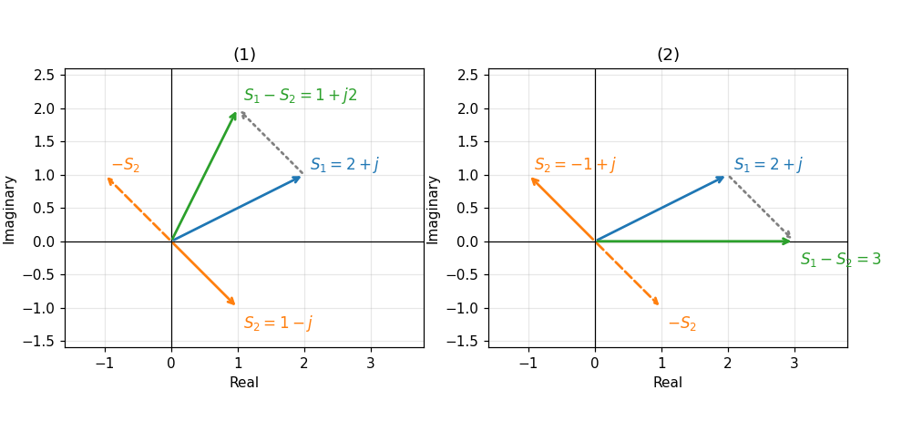
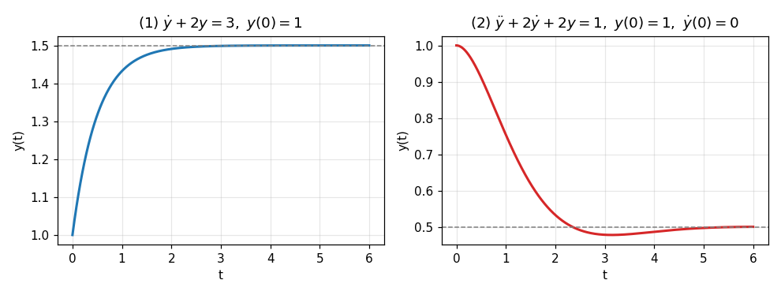

# HW1 Assignment Explanation — Complex Numbers and Differential Equations

[Repository Guide](../../README.md) | [English](Assignment-Explanation.md) | [한국어](Assignment-Explanation.ko.md)

> **Last Updated:** 2026-11-04

> **Learning Objectives:**
> 1. Convert complex numbers between polar form and Cartesian form, and find the argument that matches the quadrant in which a complex number lies
> 2. Compute the difference of complex numbers and interpret it as a sum of vectors in the complex plane
> 3. Compute the product and quotient of complex numbers in both forms and show that the two results agree
> 4. Solve first-order and second-order linear differential equations with constant coefficients by splitting them into homogeneous and particular solutions, and fix the unknown coefficients from the initial conditions

---

## Table of Contents

- [1. Assignment Layout](#1-assignment-layout)
- [2. Representing Complex Numbers](#2-representing-complex-numbers)
  - [2.1 Complex Numbers and the Complex Plane](#21-complex-numbers-and-the-complex-plane)
  - [2.2 Cartesian Form and Polar Form](#22-cartesian-form-and-polar-form)
  - [2.3 Euler's Formula and the Exponential Form](#23-eulers-formula-and-the-exponential-form)
- [3. Problem 1: Polar Form to Cartesian Form](#3-problem-1-polar-form-to-cartesian-form)
- [4. Problem 2: Cartesian Form to Polar Form](#4-problem-2-cartesian-form-to-polar-form)
- [5. Problem 3: Subtraction and the Complex Plane](#5-problem-3-subtraction-and-the-complex-plane)
- [6. Problem 4: Multiplication and Division](#6-problem-4-multiplication-and-division)
  - [6.1 Computing in Cartesian Form](#61-computing-in-cartesian-form)
  - [6.2 Computing in Polar Form](#62-computing-in-polar-form)
- [7. Problem 5: Solving Differential Equations](#7-problem-5-solving-differential-equations)
  - [7.1 Solutions of Linear Differential Equations with Constant Coefficients](#71-solutions-of-linear-differential-equations-with-constant-coefficients)
  - [7.2 First-Order Differential Equation](#72-first-order-differential-equation)
  - [7.3 Second-Order Differential Equation](#73-second-order-differential-equation)
- [Summary](#summary)
- [Self-Check Questions](#self-check-questions)

---

<br>

## 1. Assignment Layout

This assignment practices the two forms of complex numbers and their arithmetic, and the solution of linear differential equations with constant coefficients, which corresponds to complex numbers and differential equations in Week 2. In the analysis of control systems, complex numbers describe the poles and the frequency response of transfer functions, and differential equations describe the dynamic behavior of systems, so both topics are the foundation for the Laplace transform and transfer functions from Week 3 on.

```text
Coursework/HW01_Complex-Numbers-and-Differential-Equations/
├── Original/
│   └── hw1.pdf                    # assignment handout
└── Solution/
    └── Assignment-Report.pdf      # submitted solution (handwritten on the handout)
```

*Figure 1. Directory layout of HW1*

| Problem | Content | This Document |
|:-----|:-----|:-----|
| 1 | Convert the polar-form complex numbers $2\angle(-45^\circ)$, $1\angle 90^\circ$, and $1\angle 180^\circ$ to Cartesian form | Section 3 |
| 2 | Convert the Cartesian-form complex numbers $\sqrt{3} - j$, $-1 - j$, and $-j$ to polar form | Section 4 |
| 3 | Compute $S_1 - S_2$ for (1) $S_1 = 2 + j$, $S_2 = 1 - j$ and (2) $S_1 = 2 + j$, $S_2 = -1 + j$, and check it by drawing in the complex plane | Section 5 |
| 4 | Compute the product and quotient of $S_1 = 1\angle 120^\circ$ and $S_2 = 2\angle 30^\circ$ (1) in Cartesian form and (2) in polar form | Section 6 |
| 5 | Solve (1) $\dot{y} + 2y = 3$, $y(0) = 1$ and (2) $\ddot{y} + 2\dot{y} + 2y = 1$, $y(0) = 1$, $\dot{y}(0) = 0$ | Section 7 |

*Table 1. Problems of HW1 and the sections of this document that cover them*

---

<br>

## 2. Representing Complex Numbers

### 2.1 Complex Numbers and the Complex Plane

A **complex number** is a number written as $S = a + jb$ with two real numbers $a$, $b$ and the **imaginary unit** $j$ ($j^2 = -1$). $a$ is called the **real part** $\operatorname{Re}(S)$, and $b$ the **imaginary part** $\operatorname{Im}(S)$. Mathematics writes the imaginary unit as $i$, but electrical and control engineering use $j$ because $i$ denotes current, and this document follows the assignment handout in using $j$.

The plane whose horizontal axis is the real part and whose vertical axis is the imaginary part is called the **complex plane**. A complex number $a + jb$ is shown as the point $(a, b)$ in this plane, or as the vector from the origin to that point. Seen as vectors, addition and subtraction of complex numbers are the same as addition and subtraction of vectors (Section 5).

The number $\bar{S} = a - jb$, obtained by flipping only the sign of the imaginary part, is called the **complex conjugate** of $S$. In the complex plane the conjugate is the mirror point across the real axis, and $S\bar{S} = (a + jb)(a - jb) = a^2 - j^2b^2 = a^2 + b^2$ is always a real number of at least 0. This property is used for division in Cartesian form (Section 6.1).

### 2.2 Cartesian Form and Polar Form

The representation $S = a + jb$ by the real and imaginary parts is called the **Cartesian form** (rectangular form). The same point can also be written as $S = r\angle\theta$ with the distance $r$ from the origin and the angle $\theta$ measured counterclockwise from the positive real axis, which is called the **polar form**. $r = \vert S\vert$ is called the **magnitude**, and $\theta = \angle S$ the **argument**.

From the relations of a right triangle, the two forms convert into each other as follows.

$$
a = r\cos\theta, \qquad b = r\sin\theta, \qquad r = \sqrt{a^2 + b^2}, \qquad \tan\theta = \frac{b}{a}
$$

There are cases where $\theta$ must not be taken directly as $\tan^{-1}(b/a)$ from $\tan\theta = b/a$. The inverse tangent returns only values between $-90^\circ$ and $90^\circ$, so it is correct only for points in the first and fourth quadrants, where the real part is positive, and it cannot tell apart two points symmetric about the origin, such as $a + jb$ and $-a - jb$, because they have the same $b/a$. The argument is therefore determined from the quadrant of the point, as in Table 2. The function that bundles this rule into one is `atan2(b, a)` in programming languages.

| Position of the Point | Argument $\theta$ |
|:-----|:-----|
| $a > 0$ (quadrants 1 and 4) | $\tan^{-1}(b/a)$ |
| $a < 0$, $b \ge 0$ (quadrant 2 and the negative real axis) | $\tan^{-1}(b/a) + 180^\circ$ |
| $a < 0$, $b < 0$ (quadrant 3) | $\tan^{-1}(b/a) - 180^\circ$ |
| $a = 0$, $b > 0$ (positive imaginary axis) | $90^\circ$ |
| $a = 0$, $b < 0$ (negative imaginary axis) | $-90^\circ$ |

*Table 2. Computing the argument from the position of the point*

Adding an integer multiple of $360^\circ$ to the argument points to the same point, so $\sqrt{2}\angle(-135^\circ)$ and $\sqrt{2}\angle 225^\circ$ are the same complex number. Table 2 gives the argument in the range $-180^\circ < \theta \le 180^\circ$, and the value in this range is called the **principal value** of the argument.

### 2.3 Euler's Formula and the Exponential Form

**Euler's formula** connects the exponential function and the trigonometric functions as follows.

$$
e^{j\theta} = \cos\theta + j\sin\theta
$$

With this formula, $r\angle\theta = r\cos\theta + jr\sin\theta = re^{j\theta}$, so the polar form is the same as the exponential form $re^{j\theta}$. The rules for multiplication and division follow directly from the exponent law $e^{j\theta_1}e^{j\theta_2} = e^{j(\theta_1 + \theta_2)}$.

$$
(r_1\angle\theta_1)(r_2\angle\theta_2) = r_1r_2\angle(\theta_1 + \theta_2), \qquad \frac{r_1\angle\theta_1}{r_2\angle\theta_2} = \frac{r_1}{r_2}\angle(\theta_1 - \theta_2)
$$

That is, multiplication multiplies the magnitudes and adds the arguments, and division divides the magnitudes and subtracts the arguments. Addition and subtraction, on the other hand, are simpler in Cartesian form, where the real and imaginary parts are computed separately. Choosing the form according to the operation is the point of this assignment.

> **[Calculus]** Euler's formula can be shown with the Taylor expansion. Substituting $x = j\theta$ into $e^x = \sum_{n=0}^{\infty} x^n/n!$ makes $j^2 = -1$, $j^3 = -j$, $j^4 = 1$ repeat, so the even-order terms gather into $1 - \theta^2/2! + \theta^4/4! - \cdots = \cos\theta$ and the odd-order terms into $j(\theta - \theta^3/3! + \theta^5/5! - \cdots) = j\sin\theta$.

---

<br>

## 3. Problem 1: Polar Form to Cartesian Form

It suffices to compute $a = r\cos\theta$ and $b = r\sin\theta$. Cosine is an even function ($\cos(-\theta) = \cos\theta$) and sine an odd function ($\sin(-\theta) = -\sin\theta$), so a negative angle is handled as follows.

$$
2\angle(-45^\circ) = 2\cos(-45^\circ) + j2\sin(-45^\circ) = 2\cdot\frac{\sqrt{2}}{2} - j2\cdot\frac{\sqrt{2}}{2} = \sqrt{2} - j\sqrt{2}
$$

$$
1\angle 90^\circ = \cos 90^\circ + j\sin 90^\circ = 0 + j1 = j
$$

$$
1\angle 180^\circ = \cos 180^\circ + j\sin 180^\circ = -1 + j0 = -1
$$

The first number makes $45^\circ$ with the real axis in the fourth quadrant, so its real and imaginary parts have the same size and the imaginary part is negative. The second and third results show what the imaginary unit means. Since $j = 1\angle 90^\circ$, multiplying a complex number by $j$ keeps its magnitude and increases its argument by $90^\circ$, and multiplying twice gives $j^2 = 1\angle 180^\circ = -1$, which reverses the direction. This agrees with the definition $j^2 = -1$.

---

<br>

## 4. Problem 2: Cartesian Form to Polar Form

The magnitude is found from $r = \sqrt{a^2 + b^2}$, and the argument is found after first checking the quadrant of the point, following Table 2.

**(1) $\sqrt{3} - j$.** Since $a = \sqrt{3} > 0$ and $b = -1$, the point is in the fourth quadrant. The real part is positive, so the inverse tangent value is used as is.

$$
r = \sqrt{(\sqrt{3})^2 + (-1)^2} = \sqrt{4} = 2, \qquad \theta = \tan^{-1}\frac{-1}{\sqrt{3}} = -30^\circ \quad\Longrightarrow\quad \sqrt{3} - j = 2\angle(-30^\circ)
$$

**(2) $-1 - j$.** Since $a = -1$ and $b = -1$, the point is in the third quadrant. $\tan^{-1}\big((-1)/(-1)\big) = \tan^{-1}1 = 45^\circ$ is the argument of the first-quadrant point $1 + j$, so $180^\circ$ is subtracted, following Table 2.

$$
r = \sqrt{(-1)^2 + (-1)^2} = \sqrt{2}, \qquad \theta = 45^\circ - 180^\circ = -135^\circ \quad\Longrightarrow\quad -1 - j = \sqrt{2}\angle(-135^\circ)
$$

The same number may also be written $\sqrt{2}\angle 225^\circ$. Using $45^\circ$ as is would give $\sqrt{2}\angle 45^\circ = 1 + j$, the number with the opposite sign.

**(3) $-j$.** Since $a = 0$ and $b = -1$, the point lies on the negative imaginary axis. The denominator of $b/a$ is 0, so the inverse tangent cannot be used, and by Table 2 the argument is $-90^\circ$.

$$
r = \sqrt{0^2 + (-1)^2} = 1, \qquad \theta = -90^\circ \quad\Longrightarrow\quad -j = 1\angle(-90^\circ)
$$

$1\angle 270^\circ$ is the same number. Converting the results back with the method of Section 3 checks them. For example, $2\angle(-30^\circ) = 2\cos 30^\circ - j2\sin 30^\circ = \sqrt{3} - j$.

---

<br>

## 5. Problem 3: Subtraction and the Complex Plane

Subtraction in Cartesian form subtracts the real parts from each other and the imaginary parts from each other.

$$
(a_1 + jb_1) - (a_2 + jb_2) = (a_1 - a_2) + j(b_1 - b_2)
$$

$$
\text{(1)}\quad S_1 - S_2 = (2 + j) - (1 - j) = (2 - 1) + j\big(1 - (-1)\big) = 1 + j2
$$

$$
\text{(2)}\quad S_1 - S_2 = (2 + j) - (-1 + j) = \big(2 - (-1)\big) + j(1 - 1) = 3
$$

In the complex plane, the subtraction is viewed as $S_1 - S_2 = S_1 + (-S_2)$ and drawn as vector addition. $-S_2$ is the vector obtained by reflecting $S_2$ through the origin, that is, by rotating $S_2$ by $180^\circ$. Attaching the start of $-S_2$ to the end of $S_1$ gives $S_1 - S_2$ as the end point. In part (1) of Figure 2, $-S_2 = -1 + j$, so moving 1 to the left and 1 up from the end point $(2, 1)$ of $S_1$ reaches $(1, 2)$, and in part (2), $-S_2 = 1 - j$, so moving 1 to the right and 1 down from $(2, 1)$ reaches $(3, 0)$ on the real axis. The two end points agree with the computed results $1 + j2$ and $3$.



*Figure 2. The two subtractions seen in the complex plane*

$S_1 - S_2$ is also the vector from the end point of $S_2$ to the end point of $S_1$, translated to the origin. Therefore $\vert S_1 - S_2\vert$ is the distance between the two points in the complex plane, which is $\sqrt{1^2 + 2^2} = \sqrt{5}$ in (1) and $3$ in (2).

---

<br>

## 6. Problem 4: Multiplication and Division

### 6.1 Computing in Cartesian Form

First, the two numbers are converted to Cartesian form, using $\cos 120^\circ = -1/2$, $\sin 120^\circ = \sqrt{3}/2$, $\cos 30^\circ = \sqrt{3}/2$, and $\sin 30^\circ = 1/2$.

$$
S_1 = 1\angle 120^\circ = -\frac{1}{2} + j\frac{\sqrt{3}}{2}, \qquad S_2 = 2\angle 30^\circ = 2\cdot\frac{\sqrt{3}}{2} + j2\cdot\frac{1}{2} = \sqrt{3} + j
$$

Multiplication expands the four terms with the distributive law and uses $j^2 = -1$. The general formula is $(a_1 + jb_1)(a_2 + jb_2) = (a_1a_2 - b_1b_2) + j(a_1b_2 + a_2b_1)$.

$$
S_1S_2 = \left(-\frac{1}{2} + j\frac{\sqrt{3}}{2}\right)(\sqrt{3} + j) = -\frac{\sqrt{3}}{2} - j\frac{1}{2} + j\frac{3}{2} + j^2\frac{\sqrt{3}}{2} = \left(-\frac{\sqrt{3}}{2} - \frac{\sqrt{3}}{2}\right) + j\left(-\frac{1}{2} + \frac{3}{2}\right) = -\sqrt{3} + j
$$

For division, the numerator and denominator are multiplied by the conjugate of the denominator, $\bar{S}_2 = \sqrt{3} - j$, to make the denominator real. By the property in Section 2.1, the denominator becomes $(\sqrt{3})^2 + 1^2 = 4$.

$$
\frac{S_1}{S_2} = \frac{\left(-\frac{1}{2} + j\frac{\sqrt{3}}{2}\right)(\sqrt{3} - j)}{(\sqrt{3} + j)(\sqrt{3} - j)} = \frac{-\frac{\sqrt{3}}{2} + j\frac{1}{2} + j\frac{3}{2} - j^2\frac{\sqrt{3}}{2}}{4} = \frac{\left(-\frac{\sqrt{3}}{2} + \frac{\sqrt{3}}{2}\right) + j\left(\frac{1}{2} + \frac{3}{2}\right)}{4} = \frac{j2}{4} = j0.5
$$

### 6.2 Computing in Polar Form

By the rules of Section 2.3, the magnitudes are multiplied or divided and the arguments are added or subtracted.

$$
S_1S_2 = (1 \cdot 2)\angle(120^\circ + 30^\circ) = 2\angle 150^\circ, \qquad \frac{S_1}{S_2} = \frac{1}{2}\angle(120^\circ - 30^\circ) = 0.5\angle 90^\circ
$$

Converting the two results to Cartesian form gives $2\angle 150^\circ = 2\cos 150^\circ + j2\sin 150^\circ = -\sqrt{3} + j$ and $0.5\angle 90^\circ = j0.5$, which agree with Section 6.1. The answers are the same, but the polar-form computation takes one line, so the polar form is convenient for computations with many multiplications and divisions (for example, the magnitude and phase of a product of several transfer functions).

---

<br>

## 7. Problem 5: Solving Differential Equations

### 7.1 Solutions of Linear Differential Equations with Constant Coefficients

A differential equation that is of first degree in the unknown function $y(t)$ and its derivatives and has constant coefficients,

$$
a_n y^{(n)} + a_{n-1} y^{(n-1)} + \cdots + a_1\dot{y} + a_0 y = f(t)
$$

is called a **linear differential equation with constant coefficients**. If the solution of the equation with the input $f(t)$ set to 0 is called the **homogeneous solution** $y_h$, and one solution of the original equation is called a **particular solution** $y_p$, then by linearity the general solution is $y = y_h + y_p$.

The homogeneous solution is found by setting $y = e^{\lambda t}$. Each differentiation of $e^{\lambda t}$ multiplies it by $\lambda$ ($\frac{d^k}{dt^k}e^{\lambda t} = \lambda^k e^{\lambda t}$), so the homogeneous equation becomes $(a_n\lambda^n + \cdots + a_1\lambda + a_0)e^{\lambda t} = 0$, and since $e^{\lambda t} \ne 0$, the following **characteristic equation** results.

$$
a_n\lambda^n + a_{n-1}\lambda^{n-1} + \cdots + a_1\lambda + a_0 = 0
$$

| Root of the Characteristic Equation | Term of the Homogeneous Solution |
|:-----|:-----|
| Distinct real root $\lambda$ | $Ce^{\lambda t}$ |
| Real root $\lambda$ repeated $k$ times | $(C_1 + C_2t + \cdots + C_kt^{k-1})e^{\lambda t}$ |
| Complex conjugate roots $\sigma \pm j\omega$ | $e^{\sigma t}(A\cos\omega t + B\sin\omega t)$ |

*Table 3. Roots of the characteristic equation and the terms of the homogeneous solution*

If the input is a constant $f(t) = c$ and $a_0 \ne 0$, substituting a constant $y_p = K$ makes all derivatives 0, so $a_0K = c$ and the particular solution is $y_p = c/a_0$. The general solution of an $n$th-order equation has $n$ unknown coefficients, which are fixed by the $n$ initial values $y(0), \dot{y}(0), \ldots, y^{(n-1)}(0)$. The roots of the characteristic equation reappear in Week 5 as the poles of a transfer function, and if their real parts are negative, the homogeneous solution dies out over time.

### 7.2 First-Order Differential Equation

**(1) $\dot{y} + 2y = 3$, $y(0) = 1$.** The characteristic equation is $\lambda + 2 = 0$, so $\lambda = -2$ and the homogeneous solution is $y_h = Ce^{-2t}$. The input is the constant 3, so the particular solution is $y_p = 3/2$ from $2K = 3$. Substituting the initial condition into the general solution fixes $C$.

$$
y(t) = Ce^{-2t} + \frac{3}{2}, \qquad y(0) = C + \frac{3}{2} = 1 \quad\Longrightarrow\quad C = -\frac{1}{2}
$$

$$
y(t) = \frac{3}{2} - \frac{1}{2}e^{-2t}, \quad t \ge 0
$$

As a check, $\dot{y} = e^{-2t}$, so $\dot{y} + 2y = e^{-2t} + 3 - e^{-2t} = 3$, and $y(0) = 3/2 - 1/2 = 1$. The response approaches the final value $3/2$ exponentially from the initial value 1 (left of Figure 3), and $0.5$, the reciprocal of the exponent coefficient 2, is the **time constant** that measures how fast it approaches (Week 7).

### 7.3 Second-Order Differential Equation

**(2) $\ddot{y} + 2\dot{y} + 2y = 1$, $y(0) = 1$, $\dot{y}(0) = 0$.** Solving the characteristic equation $\lambda^2 + 2\lambda + 2 = 0$ with the quadratic formula gives the discriminant $2^2 - 4 \cdot 2 = -4 < 0$, so the roots are complex conjugates.

$$
\lambda = \frac{-2 \pm \sqrt{-4}}{2} = -1 \pm j
$$

Written with complex exponentials, the homogeneous solution is $y_h = K_1e^{(-1+j)t} + K_2e^{(-1-j)t}$. Substituting $e^{(-1\pm j)t} = e^{-t}(\cos t \pm j\sin t)$ from Euler's formula and rearranging gives

$$
y_h = e^{-t}\big[(K_1 + K_2)\cos t + j(K_1 - K_2)\sin t\big] = e^{-t}(A\cos t + B\sin t), \qquad A = K_1 + K_2, \quad B = j(K_1 - K_2)
$$

which is the third row of Table 3. For $y(t)$ to be real, $K_1$ and $K_2$ must be complex conjugates of each other, and then $A$ and $B$ are real. The particular solution is $y_p = 1/2$ from $2K = 1$, so the general solution and its derivative are as follows.

$$
y(t) = e^{-t}(A\cos t + B\sin t) + \frac{1}{2}, \qquad \dot{y}(t) = e^{-t}\big[(B - A)\cos t - (A + B)\sin t\big]
$$

The derivative comes from rearranging $-e^{-t}(A\cos t + B\sin t) + e^{-t}(-A\sin t + B\cos t)$, obtained with the product rule. The two initial conditions are substituted.

$$
y(0) = A + \frac{1}{2} = 1 \;\Longrightarrow\; A = \frac{1}{2}, \qquad \dot{y}(0) = B - A = 0 \;\Longrightarrow\; B = \frac{1}{2}
$$

$$
y(t) = \frac{1}{2} + \frac{1}{2}e^{-t}(\cos t + \sin t) = \frac{1}{2} + \frac{\sqrt{2}}{2}e^{-t}\sin(t + 45^\circ), \quad t \ge 0
$$

The last form uses $\cos t + \sin t = \sqrt{2}\sin(t + 45^\circ)$. The coefficients of the complex exponential form are $K_1 = (A - jB)/2 = 0.25 - j0.25$ and $K_2 = \bar{K}_1 = 0.25 + j0.25$, and substituting them into the first expression gives the same solution. The response oscillates at an angular frequency of 1 rad/s while shrinking along the envelope $e^{-t}$, approaching the final value $1/2$ (right of Figure 3). Because of the oscillation, the response dips to $1/2 - e^{-\pi}/2 \approx 0.478$, slightly below the final value, at $t = \pi$, where $\dot{y} = -e^{-t}\sin t$ becomes 0, and then returns. The real part $-1$ of the characteristic roots sets how fast the oscillation decays and the imaginary part $1$ sets its angular frequency, a relation that is restated with the damping ratio and natural frequency in the second-order system response of Week 7.



*Figure 3. The two solutions of Problem 5*

---

<br>

## Summary

| Concept | Key Summary |
|:-----|:-----|
| Converting the two forms | $a + jb$ and $r\angle\theta$ convert into each other through $a = r\cos\theta$, $b = r\sin\theta$, and $r = \sqrt{a^2 + b^2}$. |
| Argument and quadrant | $\tan^{-1}(b/a)$ gives only first- and fourth-quadrant values, so $180^\circ$ is added or subtracted when the real part is negative, and the argument is $\pm 90^\circ$ by the sign of the imaginary part when the real part is 0. |
| Addition and subtraction | The real and imaginary parts are computed separately; in the complex plane these are vector sums and differences, and $\vert S_1 - S_2\vert$ is the distance between the two points. |
| Multiplication and division | In polar form the magnitudes are multiplied or divided and the arguments added or subtracted, and division in Cartesian form multiplies the numerator and denominator by the conjugate of the denominator. |
| Euler's formula | $e^{j\theta} = \cos\theta + j\sin\theta$, so $r\angle\theta = re^{j\theta}$, and the rules for multiplication and division follow from the exponent law. |
| Solution of a differential equation | The solution of a linear differential equation with constant coefficients is the sum of the homogeneous and particular solutions; the homogeneous solution comes from the roots of the characteristic equation and the unknown coefficients from the initial conditions. |
| Complex conjugate roots | Characteristic roots $\sigma \pm j\omega$ produce oscillations of the form $e^{\sigma t}(A\cos\omega t + B\sin\omega t)$, which shrink when $\sigma < 0$. |
| Solutions of Problem 5 | (1) $y = 3/2 - e^{-2t}/2$ and (2) $y = 1/2 + e^{-t}(\cos t + \sin t)/2$. |

---

<br>

## Self-Check Questions

1. **Quadrant of the argument:** Convert $-\sqrt{3} + j$ to polar form.

   <details>
   <summary>Answer</summary>

   The magnitude is $\sqrt{3 + 1} = 2$. $\tan^{-1}\big(1/(-\sqrt{3})\big) = -30^\circ$, but the point lies in the second quadrant ($a < 0$, $b > 0$), so $180^\circ$ is added to give $150^\circ$. Therefore $-\sqrt{3} + j = 2\angle 150^\circ$, which is the same number as the product $S_1S_2$ in Problem 4.

   </details>

2. **Meaning of multiplying by $j$:** Compute the product of $2 + j$ and $j$, and explain what change it makes in the complex plane.

   <details>
   <summary>Answer</summary>

   $j(2 + j) = j2 + j^2 = -1 + j2$. Since $j = 1\angle 90^\circ$, the product keeps the magnitude $\sqrt{5}$ and increases only the argument by $90^\circ$. In other words, it is a $90^\circ$ counterclockwise rotation about the origin in the complex plane.

   </details>

3. **Division:** Compute $(1 + j)/(1 - j)$ in Cartesian form and in polar form.

   <details>
   <summary>Answer</summary>

   In Cartesian form, multiplying the numerator and denominator by $1 + j$ gives $(1 + j)^2/(1^2 + 1^2) = (1 + j2 + j^2)/2 = j2/2 = j$. In polar form, $\sqrt{2}\angle 45^\circ / \sqrt{2}\angle(-45^\circ) = 1\angle 90^\circ = j$, the same result.

   </details>

4. **Final value:** Find the values that the two solutions of Problem 5 approach as $t \to \infty$ directly from the differential equations, without solving them. Under what condition does this method hold?

   <details>
   <summary>Answer</summary>

   If the response stays at a constant value, all derivatives are 0, so (1) gives $3/2$ from $2y = 3$ and (2) gives $1/2$ from $2y = 1$. The method holds only when all roots of the characteristic equation have negative real parts so that the homogeneous solution dies out to 0, and the roots $-2$ and $-1 \pm j$ of the two problems satisfy this condition.

   </details>

5. **Repeated roots:** What form does the homogeneous solution of $\ddot{y} + 2\dot{y} + y = 1$ take, and how does its response differ from that of Problem 5 (2)?

   <details>
   <summary>Answer</summary>

   The characteristic equation $\lambda^2 + 2\lambda + 1 = (\lambda + 1)^2 = 0$ has $-1$ as a real root repeated twice, so the homogeneous solution is $(C_1 + C_2t)e^{-t}$. With no complex roots, the response approaches the final value 1 without oscillating, which is the critically damped case covered in Week 7.

   </details>
