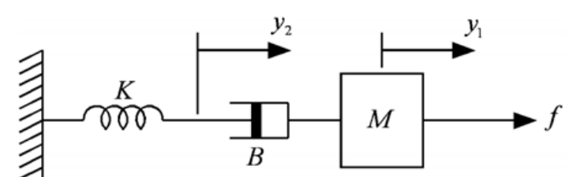
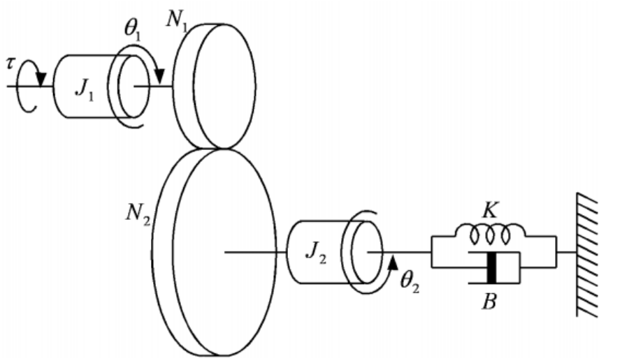
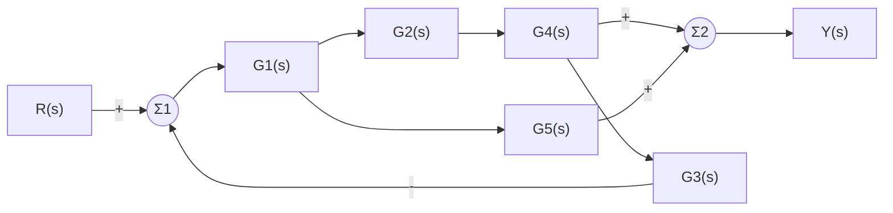

# HW2 과제 해설 — 라플라스 변환과 시스템 모델링

[레포지토리 안내](../../README.ko.md) | [English](Assignment-Explanation.md) | [한국어](Assignment-Explanation.ko.md)

> **최종 수정일:** 2026-11-04

> **학습 목표:**
> 1. 변환표와 라플라스 변환의 성질로 지수 함수, 삼각 함수와 그 곱의 라플라스 변환을 구할 수 있다
> 2. 서로 다른 극점, 중복 극점, 복소 극점이 있는 유리함수를 부분분수로 전개하여 역라플라스 변환을 구할 수 있다
> 3. 라플라스 변환으로 초기 조건이 있는 미분방정식을 대수 방정식으로 바꾸어 풀 수 있다
> 4. 질량, 스프링, 댐퍼와 기어로 이루어진 기계 시스템의 운동방정식을 세우고 전달함수를 유도할 수 있다
> 5. 피드백 루프와 병렬 경로가 있는 블록선도에서 전체 전달함수를 구할 수 있다

---

## 목차

- [1. 과제 구성](#1-과제-구성)
- [2. 라플라스 변환](#2-라플라스-변환)
  - [2.1 정의와 기본 변환 쌍](#21-정의와-기본-변환-쌍)
  - [2.2 주요 성질](#22-주요-성질)
- [3. 문제 1: 라플라스 변환](#3-문제-1-라플라스-변환)
- [4. 문제 2: 역라플라스 변환](#4-문제-2-역라플라스-변환)
  - [4.1 부분분수 전개](#41-부분분수-전개)
  - [4.2 네 함수의 역변환](#42-네-함수의-역변환)
- [5. 문제 3: 라플라스 변환을 이용한 미분방정식의 풀이](#5-문제-3-라플라스-변환을-이용한-미분방정식의-풀이)
- [6. 문제 4: 직선 운동 시스템](#6-문제-4-직선-운동-시스템)
  - [6.1 기계 요소의 힘](#61-기계-요소의-힘)
  - [6.2 운동방정식](#62-운동방정식)
  - [6.3 전달함수](#63-전달함수)
- [7. 문제 5: 기어로 연결한 회전 시스템](#7-문제-5-기어로-연결한-회전-시스템)
  - [7.1 기어의 관계식](#71-기어의-관계식)
  - [7.2 운동방정식](#72-운동방정식)
  - [7.3 전달함수](#73-전달함수)
- [8. 문제 6: 블록선도의 전달함수](#8-문제-6-블록선도의-전달함수)
- [요약](#요약)
- [점검 문제](#점검-문제)

---

<br>

## 1. 과제 구성

라플라스 변환과 역변환, 라플라스 변환을 이용한 미분방정식의 풀이(3주차), 기계 시스템의 모델링(4주차), 전달함수와 블록선도(5주차)를 다루는 과제이다. 앞의 세 문제는 시간 영역의 미분방정식을 $s$ 영역의 대수식으로 바꾸어 다루는 계산 도구를 익히고, 뒤의 세 문제는 이 도구로 물리 시스템을 전달함수로 나타낸다.

```text
Coursework/HW02_Laplace-Transforms-and-System-Modeling/
├── Original/
│   └── hw2.pdf                    # 과제 안내문
└── Solution/
    └── Assignment-Report.pdf      # 제출한 풀이 (안내문 위에 손으로 쓴 풀이)
```

*그림 1. HW2 과제의 디렉토리 구성*

| 문제 | 내용 | 이 문서 |
|:-----|:-----|:-----|
| 1 | $2e^{-2t} + 3e^{-3t}$, $te^{-5t}$, $\sin t + \cos 3t$, $e^{-2t}\sin 2t$의 라플라스 변환을 구한다 | 3절 |
| 2 | $\frac{1}{s(s+3)(s+4)}$, $\frac{10}{(s+1)^2(s+3)}$, $\frac{1}{s^2(s+2)}$, $\frac{2}{s(s^2+s+2)}$의 역라플라스 변환을 구한다 | 4절 |
| 3 | 초기 조건이 주어진 네 개의 2계 미분방정식을 라플라스 변환으로 푼다 | 5절 |
| 4 | 스프링, 댐퍼, 질량이 직렬로 이어진 직선 운동 시스템의 운동방정식과 전달함수 $Y_1(s)/F(s)$를 구한다 | 6절 |
| 5 | 기어로 연결한 두 회전 관성과 스프링, 댐퍼로 이루어진 시스템의 운동방정식과 전달함수 $\Theta_2(s)/T(s)$를 구한다 | 7절 |
| 6 | 피드백 루프와 병렬 경로가 있는 블록선도의 전달함수 $Y(s)/R(s)$를 구한다 | 8절 |

*표 1. HW2의 문제와 이 문서에서 다루는 절*

---

<br>

## 2. 라플라스 변환

### 2.1 정의와 기본 변환 쌍

$t \ge 0$에서 정의된 함수 $f(t)$의 **라플라스 변환(Laplace transform)** 은 복소 변수 $s = \sigma + j\omega$의 함수

$$
F(s) = \mathcal{L}\lbrace f(t)\rbrace= \int_0^\infty f(t)\,e^{-st}\,dt
$$

이다. 시간 함수는 소문자, 그 변환은 대문자로 쓴다. 적분은 $f(t)$가 지수적으로 너무 빨리 커지지 않고 $\operatorname{Re}(s)$가 충분히 클 때 수렴한다. 예를 들어 $f(t) = e^{-at}$이면

$$
\mathcal{L}\lbrace e^{-at}\rbrace= \int_0^\infty e^{-(s+a)t}\,dt = \left[\frac{-e^{-(s+a)t}}{s+a}\right]_0^\infty = \frac{1}{s+a}, \qquad \operatorname{Re}(s) > -a
$$

이다. 이와 같은 계산으로 얻은 기본 변환 쌍이 표 2이며, 이 과제의 모든 계산은 표 2와 2.2절의 성질로 이루어진다. 변환은 $t \ge 0$의 값만 쓰므로, 역변환으로 얻은 시간 함수도 $t \ge 0$에서의 값이다.

| $f(t)$, $t \ge 0$ | $F(s)$ |
|:-----|:-----|
| $1$ (단위 계단 함수 $u_s(t)$) | $\dfrac{1}{s}$ |
| $t$ | $\dfrac{1}{s^2}$ |
| $e^{-at}$ | $\dfrac{1}{s+a}$ |
| $te^{-at}$ | $\dfrac{1}{(s+a)^2}$ |
| $\sin\omega t$ | $\dfrac{\omega}{s^2+\omega^2}$ |
| $\cos\omega t$ | $\dfrac{s}{s^2+\omega^2}$ |
| $e^{-at}\sin\omega t$ | $\dfrac{\omega}{(s+a)^2+\omega^2}$ |
| $e^{-at}\cos\omega t$ | $\dfrac{s+a}{(s+a)^2+\omega^2}$ |

*표 2. 기본 라플라스 변환 쌍*

### 2.2 주요 성질

| 성질 | 식 |
|:-----|:-----|
| 선형성 | $\mathcal{L}\lbrace\alpha f(t) + \beta g(t)\rbrace= \alpha F(s) + \beta G(s)$ |
| 주파수 이동 | $\mathcal{L}\lbrace e^{-at}f(t)\rbrace= F(s+a)$ |
| $t$를 곱함 | $\mathcal{L}\lbrace tf(t)\rbrace= -\dfrac{dF(s)}{ds}$ |
| 1계 미분 | $\mathcal{L}\lbrace\dot{f}(t)\rbrace= sF(s) - f(0)$ |
| 2계 미분 | $\mathcal{L}\lbrace\ddot{f}(t)\rbrace= s^2F(s) - sf(0) - \dot{f}(0)$ |
| 최종값 정리 | $\lim_{t\to\infty} f(t) = \lim_{s\to 0} sF(s)$ ($sF(s)$의 극점이 모두 좌반평면에 있을 때) |

*표 3. 라플라스 변환의 주요 성질*

주파수 이동은 정의식에서 $e^{-at}e^{-st} = e^{-(s+a)t}$이므로 $s$ 자리에 $s + a$를 넣는 것과 같다는 데서 나온다. 미분 성질은 미분을 $s$의 곱셈으로 바꾸므로 미분방정식을 대수 방정식으로 바꾸어 주며, 초기 조건이 저절로 식에 들어간다는 장점이 있다.

> **[미적분학]** 1계 미분 성질은 정의식을 부분 적분하여 얻는다. $\int_0^\infty \dot{f}(t)e^{-st}dt = \big[f(t)e^{-st}\big]_0^\infty + s\int_0^\infty f(t)e^{-st}dt$에서 $t \to \infty$일 때 $f(t)e^{-st} \to 0$이면 우변은 $-f(0) + sF(s)$이고, 2계 미분 성질은 이를 $\dot{f}$에 한 번 더 적용한 것이다.

---

<br>

## 3. 문제 1: 라플라스 변환

**1.1) $2e^{-2t} + 3e^{-3t}$.** 선형성으로 각 항을 표 2의 $e^{-at}$로 변환한다. 통분하면 분자는 $2(s+3) + 3(s+2) = 5s + 12$이다.

$$
\mathcal{L}\lbrace2e^{-2t} + 3e^{-3t}\rbrace= \frac{2}{s+2} + \frac{3}{s+3} = \frac{5s+12}{(s+2)(s+3)}
$$

**1.2) $te^{-5t}$.** 두 가지 방법으로 같은 결과를 얻는다. 주파수 이동을 쓰면 $\mathcal{L}\lbrace t\rbrace= 1/s^2$의 $s$를 $s + 5$로 바꾸고, $t$를 곱하는 성질을 쓰면 $\mathcal{L}\lbrace e^{-5t}\rbrace= 1/(s+5)$를 미분하여 부호를 바꾼다.

$$
\mathcal{L}\lbrace te^{-5t}\rbrace= \frac{1}{s^2}\bigg\vert_{s \to s+5} = \frac{1}{(s+5)^2}, \qquad -\frac{d}{ds}\left(\frac{1}{s+5}\right) = \frac{1}{(s+5)^2}
$$

**1.3) $\sin t + \cos 3t$.** $\omega = 1$인 사인과 $\omega = 3$인 코사인의 변환을 더한다.

$$
\mathcal{L}\lbrace\sin t + \cos 3t\rbrace= \frac{1}{s^2+1} + \frac{s}{s^2+9} = \frac{s^3 + s^2 + s + 9}{(s^2+1)(s^2+9)}
$$

통분한 분자는 $(s^2 + 9) + s(s^2 + 1) = s^3 + s^2 + s + 9$이다. 두 항을 따로 둔 꼴이 역변환하기에는 더 편하다.

**1.4) $e^{-2t}\sin 2t$.** $\mathcal{L}\lbrace\sin 2t\rbrace= 2/(s^2+4)$에 주파수 이동을 적용하여 $s$를 $s + 2$로 바꾼다.

$$
\mathcal{L}\lbrace e^{-2t}\sin 2t\rbrace= \frac{2}{(s+2)^2+4} = \frac{2}{s^2+4s+8}
$$

분모의 근은 $-2 \pm j2$이며, 실수부 $-2$가 감쇠 지수 $e^{-2t}$를, 허수부 $2$가 진동의 각진동수를 나타낸다. 이처럼 극점의 위치가 시간 응답에 나타나는 항의 모양(감쇠의 빠르기와 진동의 각진동수)을 정한다는 점이 7주차와 9주차의 응답 해석의 바탕이다. 각 항의 크기는 부분분수 전개의 계수가 정한다.

---

<br>

## 4. 문제 2: 역라플라스 변환

### 4.1 부분분수 전개

분자의 차수가 분모의 차수보다 낮은 유리함수 $F(s) = N(s)/D(s)$는 분모의 인수에 따라 표 2에 있는 간단한 분수의 합으로 나눌 수 있으며, 이를 **부분분수 전개(partial fraction expansion)** 라 한다. 각 분수를 표 2로 되돌리면 역변환 $f(t) = \mathcal{L}^{-1}\lbrace F(s)\rbrace$를 얻는다. 분모를 0으로 만드는 $s$를 $F(s)$의 **극점(pole)** 이라 하며, 극점의 종류에 따라 계수를 구하는 방법이 다르다.

- **서로 다른 실수 극점** $p_i$: 항은 $K_i/(s - p_i)$이고, 계수는 $K_i = (s - p_i)F(s)\big\vert_{s=p_i}$이다. 양변에 $(s - p_i)$를 곱하고 $s = p_i$를 넣으면 다른 항이 모두 0이 되기 때문이다.
- **두 번 겹친 극점** $p$: 항은 $K_1/(s-p)^2 + K_2/(s-p)$이고, $K_1 = (s-p)^2F(s)\big\vert_{s=p}$, $K_2 = \dfrac{d}{ds}\big[(s-p)^2F(s)\big]\Big\vert_{s=p}$이다. $(s-p)^2F(s) = K_1 + K_2(s-p) + (\text{나머지 항})(s-p)^2$을 미분하고 $s = p$를 넣으면 $K_2$만 남는다.
- **켤레 복소 극점**: 2차 인수 $s^2 + bs + c$를 그대로 두고 항을 $(Bs + C)/(s^2 + bs + c)$로 놓는다. 분모를 $(s + \alpha)^2 + \omega^2$으로 완전제곱한 뒤, 분자를 $(s + \alpha)$에 비례하는 부분과 상수 부분으로 나누어 표 2의 $e^{-\alpha t}\cos\omega t$와 $e^{-\alpha t}\sin\omega t$로 되돌린다.

### 4.2 네 함수의 역변환

**2.1) $\dfrac{1}{s(s+3)(s+4)}$.** 극점 $0$, $-3$, $-4$가 서로 다르므로 각 계수를 바로 구한다.

$$
\frac{1}{s(s+3)(s+4)} = \frac{K_1}{s} + \frac{K_2}{s+3} + \frac{K_3}{s+4}, \qquad K_1 = \frac{1}{(3)(4)} = \frac{1}{12}, \quad K_2 = \frac{1}{(-3)(1)} = -\frac{1}{3}, \quad K_3 = \frac{1}{(-4)(-1)} = \frac{1}{4}
$$

$$
f(t) = \frac{1}{12} - \frac{1}{3}e^{-3t} + \frac{1}{4}e^{-4t}, \quad t \ge 0
$$

$K_2$는 $F(s)$에서 $(s+3)$을 가리고 남은 $1/[s(s+4)]$에 $s = -3$을 넣은 값이다. 검산으로 $f(0) = 1/12 - 4/12 + 3/12 = 0$이며, $t \to \infty$에서 $f(t) \to 1/12$는 최종값 정리 $\lim_{s\to 0} sF(s) = 1/12$와 같다.

**2.2) $\dfrac{10}{(s+1)^2(s+3)}$.** $-1$이 두 번 겹친 극점이다.

$$
\frac{10}{(s+1)^2(s+3)} = \frac{K_1}{(s+1)^2} + \frac{K_2}{s+1} + \frac{K_3}{s+3}
$$

$$
K_1 = \frac{10}{s+3}\bigg\vert_{s=-1} = 5, \qquad K_2 = \frac{d}{ds}\left(\frac{10}{s+3}\right)\bigg\vert_{s=-1} = -\frac{10}{(s+3)^2}\bigg\vert_{s=-1} = -\frac{5}{2}, \qquad K_3 = \frac{10}{(s+1)^2}\bigg\vert_{s=-3} = \frac{5}{2}
$$

$$
f(t) = 5te^{-t} - \frac{5}{2}e^{-t} + \frac{5}{2}e^{-3t}, \quad t \ge 0
$$

겹친 극점이 $te^{-t}$ 항을 만드는 것은 HW1의 겹친 특성근과 같은 현상이다.

**2.3) $\dfrac{1}{s^2(s+2)}$.** $0$이 두 번 겹친 극점이다. $s^2F(s) = 1/(s+2)$이므로

$$
K_1 = \frac{1}{s+2}\bigg\vert_{s=0} = \frac{1}{2}, \qquad K_2 = \frac{d}{ds}\left(\frac{1}{s+2}\right)\bigg\vert_{s=0} = -\frac{1}{4}, \qquad K_3 = \frac{1}{s^2}\bigg\vert_{s=-2} = \frac{1}{4}
$$

$$
\frac{1}{s^2(s+2)} = \frac{1/2}{s^2} - \frac{1/4}{s} + \frac{1/4}{s+2} \quad\Longrightarrow\quad f(t) = \frac{1}{2}t - \frac{1}{4} + \frac{1}{4}e^{-2t}, \quad t \ge 0
$$

$1/s^2$ 항이 $t$에 비례하여 커지는 항을 만들므로 $f(t)$는 일정한 값에 수렴하지 않는다. $F(s)$가 원점에 이중 극점을 가져 $sF(s)$에도 원점의 극점이 남으므로, 최종값 정리의 조건($sF(s)$의 극점이 모두 좌반평면에 있음)을 만족하지 않기 때문이다.

**2.4) $\dfrac{2}{s(s^2+s+2)}$.** $s^2 + s + 2$의 판별식은 $1 - 8 = -7 < 0$이므로 켤레 복소 극점이다. $K_1/s + (Bs + C)/(s^2+s+2)$로 놓으면 $K_1 = 2/(s^2+s+2)\big\vert_{s=0} = 1$이다. 양변에 분모를 곱하면

$$
2 = (s^2 + s + 2) + (Bs + C)s = (1 + B)s^2 + (1 + C)s + 2
$$

이므로 계수를 비교하여 $B = -1$, $C = -1$을 얻는다. 분모를 완전제곱하면 $s^2 + s + 2 = (s + \frac{1}{2})^2 + \frac{7}{4}$이므로 $\omega = \frac{\sqrt{7}}{2}$이고, 분자 $s + 1$을 $(s + \frac{1}{2}) + \frac{1}{2}$로 나눈다.

$$
F(s) = \frac{1}{s} - \frac{s + \frac{1}{2}}{(s + \frac{1}{2})^2 + \left(\frac{\sqrt{7}}{2}\right)^2} - \frac{1}{\sqrt{7}}\cdot\frac{\frac{\sqrt{7}}{2}}{(s + \frac{1}{2})^2 + \left(\frac{\sqrt{7}}{2}\right)^2}
$$

마지막 항은 사인 항의 분자 $\omega = \sqrt{7}/2$를 만들기 위해 $\frac{1}{2} = \frac{1}{\sqrt{7}}\cdot\frac{\sqrt{7}}{2}$로 쓴 것이다. 표 2로 되돌리면

$$
f(t) = 1 - e^{-t/2}\cos\frac{\sqrt{7}}{2}t - \frac{1}{\sqrt{7}}e^{-t/2}\sin\frac{\sqrt{7}}{2}t, \quad t \ge 0
$$

이다. $f(0) = 1 - 1 = 0$이고 $t \to \infty$에서 $f(t) \to 1$이며, 이는 최종값 정리 $\lim_{s\to 0} sF(s) = 2/2 = 1$과 같다.

---

<br>

## 5. 문제 3: 라플라스 변환을 이용한 미분방정식의 풀이

풀이 순서는 모두 같다. (1) 양변을 표 3의 미분 성질로 변환하며 초기 조건을 넣고, (2) $Y(s)$에 대해 대수적으로 풀고, (3) 부분분수 전개로 역변환한다. 과제 안내문의 $y^{(1)} = 0$은 1계 도함수의 초기값 $\dot{y}(0) = 0$을 뜻한다. $u_s(t)$는 단위 계단 함수이며 그 변환은 $1/s$이다.

**3.1) $\ddot{y} + 9y = 0$, $y(0) = 1$, $\dot{y}(0) = 0$.**

$$
s^2Y(s) - s\cdot 1 - 0 + 9Y(s) = 0 \quad\Longrightarrow\quad Y(s) = \frac{s}{s^2 + 9} = \frac{s}{s^2 + 3^2} \quad\Longrightarrow\quad y(t) = \cos 3t
$$

극점 $\pm j3$이 허수축 위에 있으므로 응답은 줄어들지 않고 진폭 1로 계속 진동한다.

**3.2) $\ddot{y} + 5\dot{y} + 4y = e^{-3t}$, $y(0) = 1$, $\dot{y}(0) = 0$.** 좌변의 변환은 $s^2Y - s + 5(sY - 1) + 4Y = (s^2 + 5s + 4)Y - (s + 5)$이다.

$$
(s^2 + 5s + 4)Y(s) = s + 5 + \frac{1}{s+3} = \frac{(s+5)(s+3) + 1}{s+3} = \frac{s^2 + 8s + 16}{s+3} = \frac{(s+4)^2}{s+3}
$$

$s^2 + 5s + 4 = (s+1)(s+4)$이므로 $(s + 4)$가 하나 약분된다.

$$
Y(s) = \frac{(s+4)^2}{(s+1)(s+4)(s+3)} = \frac{s+4}{(s+1)(s+3)} = \frac{3/2}{s+1} - \frac{1/2}{s+3}
$$

계수는 $(s+4)/(s+3)\big\vert_{s=-1} = 3/2$, $(s+4)/(s+1)\big\vert_{s=-3} = -1/2$이다.

$$
y(t) = \frac{3}{2}e^{-t} - \frac{1}{2}e^{-3t}, \quad t \ge 0
$$

검산하면 $y(0) = 1$, $\dot{y}(0) = -3/2 + 3/2 = 0$이고, $\ddot{y} + 5\dot{y} + 4y$에서 $e^{-t}$의 계수는 $\frac{3}{2} - \frac{15}{2} + 6 = 0$, $e^{-3t}$의 계수는 $-\frac{9}{2} + \frac{15}{2} - 2 = 1$이다. 특성근 $-4$에 해당하는 $e^{-4t}$ 항이 없는 것은 이 초기 조건과 입력의 조합에서 그 성분의 계수가 0이 되었기 때문이며, 식에서는 약분으로 나타난다.

**3.3) $\ddot{y} + 2\dot{y} + 2y = u_s(t)$, $y(0) = 0$, $\dot{y}(0) = 0$.**

$$
(s^2 + 2s + 2)Y(s) = \frac{1}{s} \quad\Longrightarrow\quad Y(s) = \frac{1}{s(s^2 + 2s + 2)}
$$

$K_1/s$의 계수는 $1/2$이다. $1 = \frac{1}{2}(s^2 + 2s + 2) + (Bs + C)s$에서 $s^2$의 계수 $\frac{1}{2} + B = 0$, $s$의 계수 $1 + C = 0$이므로 $B = -\frac{1}{2}$, $C = -1$이다. 분모를 $(s+1)^2 + 1$로 완전제곱하고 분자 $s + 2$를 $(s + 1) + 1$로 나눈다.

$$
Y(s) = \frac{1/2}{s} - \frac{1}{2}\cdot\frac{(s+1) + 1}{(s+1)^2 + 1} \quad\Longrightarrow\quad y(t) = \frac{1}{2} - \frac{1}{2}e^{-t}(\cos t + \sin t), \quad t \ge 0
$$

미분방정식은 HW1 문제 5의 (2)와 같고 초기 조건만 0이며, 이 해는 그 시스템의 **단위 계단 응답(unit step response)** 이다. 최종값 $1/2$은 최종값 정리 $\lim_{s\to 0} sY(s) = 1/2$와 같다.

**3.4) $\ddot{y} + 4y = u_s(t)$, $y(0) = 1$, $\dot{y}(0) = 0$.**

$$
s^2Y(s) - s + 4Y(s) = \frac{1}{s} \quad\Longrightarrow\quad Y(s) = \frac{s + \frac{1}{s}}{s^2 + 4} = \frac{s^2 + 1}{s(s^2 + 4)}
$$

$K_1 = (s^2+1)/(s^2+4)\big\vert_{s=0} = 1/4$이고, $s^2 + 1 = \frac{1}{4}(s^2 + 4) + (Bs + C)s$에서 $B = 3/4$, $C = 0$이다.

$$
Y(s) = \frac{1/4}{s} + \frac{3}{4}\cdot\frac{s}{s^2 + 2^2} \quad\Longrightarrow\quad y(t) = \frac{1}{4} + \frac{3}{4}\cos 2t, \quad t \ge 0
$$

$y(0) = 1/4 + 3/4 = 1$이다. 극점 $\pm j2$가 허수축 위에 있어 응답은 $1/4$을 중심으로 계속 진동하며 수렴하지 않으므로, 최종값 정리를 적용할 수 없다.

---

<br>

## 6. 문제 4: 직선 운동 시스템



*그림 2. 스프링, 댐퍼, 질량이 직렬로 이어진 직선 운동 시스템*

그림 2의 시스템은 벽에 고정된 스프링 $K$, 스프링과 질량 사이의 댐퍼 $B$, 외력 $f$를 받는 질량 $M$이 일렬로 이어져 있다. $y_1$은 질량의 변위, $y_2$는 스프링과 댐퍼가 만나는 연결점의 변위이며, 둘 다 오른쪽을 양의 방향으로 하고 평형 위치에서 잰다.

### 6.1 기계 요소의 힘

| 요소 | 직선 운동 | 회전 운동 |
|:-----|:-----|:-----|
| 관성 | 질량 $M$: $f = M\ddot{y}$ | 관성 모멘트 $J$: $\tau = J\ddot{\theta}$ |
| 댐퍼 (점성 마찰) | $f = B(\dot{y}_a - \dot{y}_b)$, 두 끝의 상대 속도에 비례 | $\tau = B(\dot{\theta}_a - \dot{\theta}_b)$ |
| 스프링 | $f = K(y_a - y_b)$, 두 끝의 상대 변위에 비례 | $\tau = K(\theta_a - \theta_b)$ |

*표 4. 기계 요소가 만드는 힘과 토크*

운동방정식은 각 질량(또는 관성)마다 **뉴턴의 제2법칙(Newton's second law)** $M\ddot{y} = \sum f$를 세워 얻는다. 질량이 없는 연결점은 관성이 없으므로 그 점에 작용하는 힘의 합이 0이다. 스프링은 늘어나거나 줄어든 길이에 맞서는 방향으로, 댐퍼는 늘어나거나 줄어드는 속도에 맞서는 방향으로 힘을 낸다.

### 6.2 운동방정식

**질량 $M$.** 외력 $f$가 오른쪽으로 작용하고, 질량이 연결점보다 빨리 오른쪽으로 움직이면($\dot{y}_1 > \dot{y}_2$) 댐퍼가 늘어나며 질량을 왼쪽으로 당긴다. 따라서

$$
M\frac{d^2y_1}{dt^2} = f - B\left(\frac{dy_1}{dt} - \frac{dy_2}{dt}\right)
$$

이다. **연결점 $y_2$.** 같은 댐퍼가 연결점을 오른쪽으로 $B(\dot{y}_1 - \dot{y}_2)$의 힘으로 당기고, 스프링은 늘어난 길이 $y_2$에 비례하는 힘 $Ky_2$로 연결점을 왼쪽으로 당긴다. 연결점은 질량이 없으므로 두 힘이 같다.

$$
B\left(\frac{dy_1}{dt} - \frac{dy_2}{dt}\right) = Ky_2
$$

이 식은 직렬로 이어진 스프링과 댐퍼가 같은 크기의 힘을 전달한다는 뜻이다.

### 6.3 전달함수

초기 조건을 모두 0으로 두고 두 식을 라플라스 변환한다.

$$
Ms^2Y_1(s) = F(s) - Bs\big(Y_1(s) - Y_2(s)\big), \qquad Bs\big(Y_1(s) - Y_2(s)\big) = KY_2(s)
$$

둘째 식을 $Y_2$에 대해 풀면 $Y_2(s) = \dfrac{Bs}{Bs + K}Y_1(s)$이다. 이를 대입하면 댐퍼의 힘은

$$
Bs\big(Y_1 - Y_2\big) = Bs\left(1 - \frac{Bs}{Bs + K}\right)Y_1 = \frac{BKs}{Bs + K}Y_1
$$

이 되고, 첫째 식은 $\left(Ms^2 + \dfrac{BKs}{Bs + K}\right)Y_1(s) = F(s)$가 된다. 분모를 정리하면 전달함수는 다음과 같다.

$$
\frac{Y_1(s)}{F(s)} = \frac{Bs + K}{Ms^2(Bs + K) + BKs} = \frac{Bs + K}{MBs^3 + MKs^2 + BKs} = \frac{Bs + K}{s\,(MBs^2 + MKs + BK)}
$$

전달함수의 분모를 양변에 곱하면 $(MBs^3 + MKs^2 + BKs)Y_1(s) = (Bs + K)F(s)$이고, $s$를 시간 미분으로 되돌리면 두 운동방정식에서 $y_2$를 소거한 하나의 3계 미분방정식 $MB\dddot{y}_1 + MK\ddot{y}_1 + BK\dot{y}_1 = B\dot{f} + Kf$를 얻는다. 이 식도 질량의 운동방정식이다. 두 극한으로 결과를 확인할 수 있다. $B \to \infty$이면 댐퍼가 막대처럼 굳어 질량이 스프링에 바로 이어지고, 전달함수는 $1/(Ms^2 + K)$가 된다. $K \to \infty$이면 스프링이 굳어 댐퍼가 벽에 바로 이어지고, 전달함수는 $1/[s(Ms + B)]$가 된다. 원점의 극점 $s = 0$은 일정한 힘을 계속 가하면 댐퍼가 끝없이 늘어나 질량의 변위가 한없이 커진다는 뜻이다.

---

<br>

## 7. 문제 5: 기어로 연결한 회전 시스템



*그림 3. 기어로 연결한 두 회전 관성과 스프링, 댐퍼*

그림 3에서 입력 토크 $\tau$가 관성 $J_1$의 축을 돌리고, 이 축의 기어(잇수 $N_1$)가 다른 축의 기어(잇수 $N_2$)와 맞물려 관성 $J_2$를 돌린다. $J_2$의 축은 비틀림 스프링 $K$와 회전 댐퍼 $B$로 벽에 이어져 있다. 과제 안내문은 $\tau_2$를 $J_2$의 회전으로 생기는 반력 토크, $\tau_1$을 기어를 통해 전달되는 반력 토크로 정의한다. 즉 $\tau_1$은 기어가 $J_1$ 축에 돌려주는 부하 토크이고, $\tau_2$는 기어가 $J_2$ 축을 돌리는 토크이다.

### 7.1 기어의 관계식

맞물린 두 기어는 접점에서 같은 호의 길이만큼 돌므로 $r_1\theta_1 = r_2\theta_2$이고, 잇수는 반지름에 비례하므로 다음이 성립한다.

$$
N_1\theta_1 = N_2\theta_2 \quad\Longrightarrow\quad \theta_2 = \frac{N_1}{N_2}\theta_1
$$

손실이 없는 이상적인 기어는 두 축에서 일률이 같으므로 $\tau_1\dot{\theta}_1 = \tau_2\dot{\theta}_2$이고, 따라서 토크의 비는 각도의 비의 역수이다.

$$
\frac{\tau_2}{\tau_1} = \frac{\theta_1}{\theta_2} = \frac{N_2}{N_1}
$$

큰 기어($N_2 > N_1$)로 감속하면 각도는 $N_1/N_2$배로 줄고 토크는 $N_2/N_1$배로 커진다.

### 7.2 운동방정식

$J_1$ 축에는 입력 토크 $\tau$와 반대 방향의 반력 토크 $\tau_1$이 작용하고, $J_2$ 축에서는 기어가 주는 토크 $\tau_2$가 관성, 댐퍼, 스프링의 토크와 균형을 이룬다(표 4의 회전 운동).

$$
J_1\frac{d^2\theta_1}{dt^2} = \tau - \tau_1, \qquad \tau_2 = J_2\frac{d^2\theta_2}{dt^2} + B\frac{d\theta_2}{dt} + K\theta_2
$$

이 두 식과 7.1절의 기어 관계식 $\tau_2 = (N_2/N_1)\tau_1$, $\theta_2 = (N_1/N_2)\theta_1$이 시스템의 운동방정식이다.

### 7.3 전달함수

$\tau_1$과 $\theta_1$을 소거한다. 기어 관계에서 $\tau_1 = (N_1/N_2)\tau_2$, $\theta_1 = (N_2/N_1)\theta_2$이므로 첫째 식은

$$
\tau = J_1\frac{N_2}{N_1}\ddot{\theta}_2 + \frac{N_1}{N_2}\left(J_2\ddot{\theta}_2 + B\dot{\theta}_2 + K\theta_2\right)
$$

가 된다. 양변에 $N_2/N_1$을 곱하면

$$
\frac{N_2}{N_1}\tau = \left[J_2 + \left(\frac{N_2}{N_1}\right)^2J_1\right]\ddot{\theta}_2 + B\dot{\theta}_2 + K\theta_2
$$

이고, 초기 조건을 0으로 두고 라플라스 변환하면 전달함수를 얻는다.

$$
\frac{\Theta_2(s)}{T(s)} = \frac{N_2/N_1}{\left[J_2 + \left(\frac{N_2}{N_1}\right)^2J_1\right]s^2 + Bs + K} = \frac{N_1N_2}{(N_1^2J_2 + N_2^2J_1)s^2 + N_1^2Bs + N_1^2K}
$$

두 번째 꼴은 분자와 분모에 $N_1^2$을 곱한 것이다. 이 식은 $J_1$을 $J_2$ 축으로 옮기면 $(N_2/N_1)^2$배가 된다는 **반사 관성(reflected inertia)** 의 원리를 보여 준다. 반대로 부하를 $J_1$ 축으로 옮겨 $\theta_1$에 대한 식을 세우면 $J_2$, $B$, $K$에 $(N_1/N_2)^2$이 곱해진 $\big[J_1 + (\tfrac{N_1}{N_2})^2J_2\big]s^2 + (\tfrac{N_1}{N_2})^2Bs + (\tfrac{N_1}{N_2})^2K$가 분모가 되고, $\Theta_2 = (N_1/N_2)\Theta_1$을 곱해 같은 전달함수를 얻는다. 검산으로 $N_1 = N_2$이면 두 관성이 한 축에 있는 것과 같아져 $1/[(J_1 + J_2)s^2 + Bs + K]$가 된다.

---

<br>

## 8. 문제 6: 블록선도의 전달함수

**블록선도(block diagram)** 는 전달함수를 상자로, 신호를 화살표로 나타낸 그림이다. 한 블록의 출력은 여러 곳으로 갈라질 수 있으며(인출점), 원 모양의 가합점은 들어오는 신호를 표시된 부호로 더한다. 과제의 블록선도는 그림 4와 같다. 가합점 $\Sigma_1$은 기준 입력 $R$에서 $G_3$을 거친 피드백 신호를 빼고, 그 결과가 $G_1$에 들어간다. $G_1$의 출력은 $G_2$와 $G_4$를 거치는 경로와 $G_5$를 거치는 경로로 갈라지며, 두 경로의 출력을 가합점 $\Sigma_2$에서 더한 것이 출력 $Y$이다. 피드백 신호는 $\Sigma_2$에 들어가기 전의 $G_4$ 출력에서 인출된다.



*그림 4. 문제 6의 블록선도*

$\Sigma_1$의 출력을 $E(s)$라 하면 $G_1$의 출력은 $G_1E$이고, 각 신호는 다음과 같다(이하 $(s)$ 생략).

$$
Y = G_2G_4(G_1E) + G_5(G_1E) = G_1(G_2G_4 + G_5)E, \qquad E = R - G_3G_2G_4(G_1E)
$$

둘째 식을 $E$에 대해 풀면 $E = \dfrac{R}{1 + G_1G_2G_3G_4}$이고, 첫째 식에 넣으면 전달함수를 얻는다.

$$
\frac{Y(s)}{R(s)} = \frac{G_1(G_2G_4 + G_5)}{1 + G_1G_2G_3G_4} = \frac{G_1G_2G_4 + G_1G_5}{1 + G_1G_2G_3G_4}
$$

블록선도 간소화로 보면, $G_5$ 경로의 시작점은 피드백 루프 안($G_1$ 뒤)에 있지만 끝점은 피드백 인출점 밖에 있으므로, $G_5$의 신호는 피드백되지 않고 출력에만 더해진다. 따라서 루프 이득 $G_1G_2G_3G_4$만 분모에 나타나고, 분자는 입력에서 출력으로 가는 두 경로의 곱 $G_1G_2G_4$와 $G_1G_5$의 합이다. 6주차의 메이슨 이득 공식으로도 같은 결과가 나온다. 전방향 경로는 $P_1 = G_1G_2G_4$와 $P_2 = G_1G_5$, 루프는 $L_1 = -G_1G_2G_3G_4$ 하나이므로 $\Delta = 1 + G_1G_2G_3G_4$이고, 두 경로가 모두 루프와 $G_1$을 공유하므로 $\Delta_1 = \Delta_2 = 1$이다. 따라서 $Y/R = (P_1 + P_2)/\Delta$로 위의 결과와 같다.

---

<br>

## 요약

| 개념 | 핵심 요약 |
|:-----|:-----|
| 라플라스 변환 | $F(s) = \int_0^\infty f(t)e^{-st}dt$이며, 표 2의 변환 쌍과 선형성, 주파수 이동, $t$를 곱하는 성질로 대부분의 함수를 변환한다. |
| 부분분수 전개 | 서로 다른 극점은 $(s-p)F(s)\vert_{s=p}$로, 겹친 극점은 미분으로, 복소 극점은 완전제곱 뒤 사인과 코사인 항으로 나누어 역변환한다. |
| 극점과 응답 | 실수 극점은 지수 함수, 겹친 극점은 $te^{pt}$, 복소 극점은 감쇠 진동, 허수축 위의 극점은 지속 진동, 원점의 겹친 극점은 발산하는 항을 만든다. |
| 미분방정식의 풀이 | 미분 성질로 초기 조건을 포함한 대수 방정식을 만들고 $Y(s)$를 구한 뒤 부분분수로 역변환한다. |
| 직선 운동 모델 | 질량마다 뉴턴의 제2법칙을 세우고 질량이 없는 연결점은 힘의 합을 0으로 두며, 문제 4의 전달함수는 $(Bs + K)/[s(MBs^2 + MKs + BK)]$이다. |
| 기어 | $N_1\theta_1 = N_2\theta_2$, $\tau_2/\tau_1 = N_2/N_1$이며, 관성과 마찰을 다른 축으로 옮기면 잇수비의 제곱이 곱해진다. |
| 기어 시스템의 전달함수 | $\Theta_2/T = N_1N_2/[(N_1^2J_2 + N_2^2J_1)s^2 + N_1^2Bs + N_1^2K]$이다. |
| 블록선도 | 피드백 루프 밖으로 나가는 병렬 경로는 분자에만 더해지며, 문제 6의 전달함수는 $G_1(G_2G_4 + G_5)/(1 + G_1G_2G_3G_4)$이다. |

---

<br>

## 점검 문제

1. **주파수 이동:** $e^{-3t}\cos 4t$의 라플라스 변환을 구하라.

   <details>
   <summary>정답</summary>

   $\mathcal{L}\lbrace\cos 4t\rbrace= s/(s^2 + 16)$의 $s$를 $s + 3$으로 바꾸어 $(s+3)/[(s+3)^2 + 16] = (s+3)/(s^2 + 6s + 25)$이다.

   </details>

2. **부분분수:** $\dfrac{s + 3}{(s+1)(s+2)}$의 역라플라스 변환을 구하라.

   <details>
   <summary>정답</summary>

   계수는 $(s+3)/(s+2)\vert_{s=-1} = 2$와 $(s+3)/(s+1)\vert_{s=-2} = -1$이므로 $F(s) = 2/(s+1) - 1/(s+2)$이고, $f(t) = 2e^{-t} - e^{-2t}$ ($t \ge 0$)이다.

   </details>

3. **최종값 정리의 조건:** 문제 3의 3.4)에 최종값 정리를 그대로 적용하면 어떤 값이 나오며, 그 값이 왜 틀렸는가?

   <details>
   <summary>정답</summary>

   $\lim_{s\to 0} sY(s) = (0 + 1)/(0 + 4) = 1/4$이 나온다. 그러나 $sY(s) = (s^2+1)/(s^2+4)$의 극점 $\pm j2$가 허수축 위에 있어 정리의 조건을 만족하지 않으며, 실제 응답 $1/4 + (3/4)\cos 2t$는 계속 진동하여 극한값이 없다. $1/4$은 진동의 중심값일 뿐이다.

   </details>

4. **질량이 없는 연결점:** 문제 4에서 스프링과 댐퍼의 위치를 바꾸어 벽, 댐퍼, 연결점, 스프링, 질량의 순서로 이으면 전달함수는 어떻게 되는가?

   <details>
   <summary>정답</summary>

   연결점 변위를 $y_2$라 하면 $B\dot{y}_2 = K(y_1 - y_2)$, $M\ddot{y}_1 = f - K(y_1 - y_2)$이다. 첫째 식에서 $Y_2 = KY_1/(Bs + K)$이므로 질량에 작용하는 스프링의 힘은 $K(Y_1 - Y_2) = \frac{BKs}{Bs + K}Y_1$로 6.3절의 댐퍼의 힘과 같고, 전달함수도 $(Bs + K)/[s(MBs^2 + MKs + BK)]$로 같다. 직렬로 이어진 두 요소는 같은 힘을 전달하므로 순서와 관계없이 질량이 받는 힘이 같으며, 연결점 변위의 식만 달라진다.

   </details>

5. **반사 관성:** 문제 5에서 $N_1 = 10$, $N_2 = 30$, $J_1 = 0.1$, $J_2 = 0.5$일 때 $J_2$ 축에서 본 전체 관성은 얼마인가?

   <details>
   <summary>정답</summary>

   $J_2 + (N_2/N_1)^2J_1 = 0.5 + 3^2 \times 0.1 = 0.5 + 0.9 = 1.4$이다. 작은 기어 쪽의 관성 $J_1$이 감속비의 제곱인 9배로 커져 보인다.

   </details>
