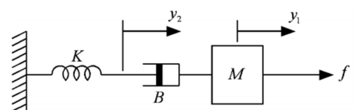
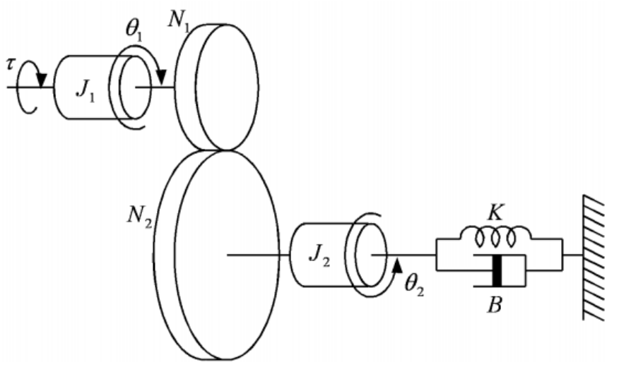
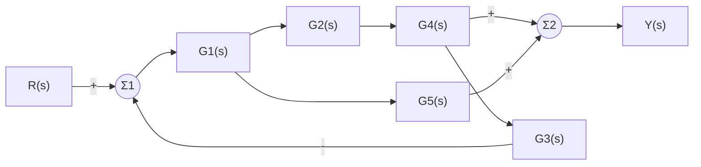

# HW2 Assignment Explanation — Laplace Transforms and System Modeling

[Repository Guide](../../README.md) | [English](Assignment-Explanation.md) | [한국어](Assignment-Explanation.ko.md)

> **Last Updated:** 2026-11-04

> **Learning Objectives:**
> 1. Find the Laplace transforms of exponential functions, trigonometric functions, and their products with a transform table and the properties of the Laplace transform
> 2. Find inverse Laplace transforms by partial fraction expansion of rational functions with distinct poles, repeated poles, and complex poles
> 3. Solve differential equations with initial conditions by turning them into algebraic equations with the Laplace transform
> 4. Set up the equations of motion of mechanical systems made of masses, springs, dampers, and gears, and derive their transfer functions
> 5. Find the overall transfer function of a block diagram with a feedback loop and a parallel path

---

## Table of Contents

- [1. Assignment Layout](#1-assignment-layout)
- [2. The Laplace Transform](#2-the-laplace-transform)
  - [2.1 Definition and Basic Transform Pairs](#21-definition-and-basic-transform-pairs)
  - [2.2 Main Properties](#22-main-properties)
- [3. Problem 1: Laplace Transforms](#3-problem-1-laplace-transforms)
- [4. Problem 2: Inverse Laplace Transforms](#4-problem-2-inverse-laplace-transforms)
  - [4.1 Partial Fraction Expansion](#41-partial-fraction-expansion)
  - [4.2 Inverse Transforms of the Four Functions](#42-inverse-transforms-of-the-four-functions)
- [5. Problem 3: Solving Differential Equations with the Laplace Transform](#5-problem-3-solving-differential-equations-with-the-laplace-transform)
- [6. Problem 4: Translational System](#6-problem-4-translational-system)
  - [6.1 Forces of Mechanical Elements](#61-forces-of-mechanical-elements)
  - [6.2 Equations of Motion](#62-equations-of-motion)
  - [6.3 Transfer Function](#63-transfer-function)
- [7. Problem 5: Rotational System Coupled by Gears](#7-problem-5-rotational-system-coupled-by-gears)
  - [7.1 Gear Relations](#71-gear-relations)
  - [7.2 Equations of Motion](#72-equations-of-motion)
  - [7.3 Transfer Function](#73-transfer-function)
- [8. Problem 6: Transfer Function of a Block Diagram](#8-problem-6-transfer-function-of-a-block-diagram)
- [Summary](#summary)
- [Self-Check Questions](#self-check-questions)

---

<br>

## 1. Assignment Layout

This assignment covers the Laplace transform and its inverse and solving differential equations with the Laplace transform (Week 3), modeling of mechanical systems (Week 4), and transfer functions and block diagrams (Week 5). The first three problems practice the computational tools that turn differential equations in the time domain into algebraic expressions in the $s$ domain, and the last three problems use these tools to describe physical systems by transfer functions.

```text
Coursework/HW02_Laplace-Transforms-and-System-Modeling/
├── Original/
│   └── hw2.pdf                    # assignment handout
└── Solution/
    └── Assignment-Report.pdf      # submitted solution (handwritten on the handout)
```

*Figure 1. Directory layout of HW2*

| Problem | Content | This Document |
|:-----|:-----|:-----|
| 1 | Find the Laplace transforms of $2e^{-2t} + 3e^{-3t}$, $te^{-5t}$, $\sin t + \cos 3t$, and $e^{-2t}\sin 2t$ | Section 3 |
| 2 | Find the inverse Laplace transforms of $\frac{1}{s(s+3)(s+4)}$, $\frac{10}{(s+1)^2(s+3)}$, $\frac{1}{s^2(s+2)}$, and $\frac{2}{s(s^2+s+2)}$ | Section 4 |
| 3 | Solve four second-order differential equations with given initial conditions by the Laplace transform | Section 5 |
| 4 | Find the equations of motion and the transfer function $Y_1(s)/F(s)$ of a translational system in which a spring, a damper, and a mass are connected in series | Section 6 |
| 5 | Find the equations of motion and the transfer function $\Theta_2(s)/T(s)$ of a system of two rotational inertias coupled by gears, with a spring and a damper | Section 7 |
| 6 | Find the transfer function $Y(s)/R(s)$ of a block diagram with a feedback loop and a parallel path | Section 8 |

*Table 1. Problems of HW2 and the sections of this document that cover them*

---

<br>

## 2. The Laplace Transform

### 2.1 Definition and Basic Transform Pairs

The **Laplace transform** of a function $f(t)$ defined for $t \ge 0$ is the function of the complex variable $s = \sigma + j\omega$

$$
F(s) = \mathcal{L}\lbrace f(t)\rbrace = \int_0^\infty f(t)\,e^{-st}\,dt
$$

Time functions are written in lowercase and their transforms in uppercase. The integral converges when $f(t)$ does not grow exponentially too fast and $\operatorname{Re}(s)$ is large enough. For example, if $f(t) = e^{-at}$,

$$
\mathcal{L}\lbrace e^{-at}\rbrace = \int_0^\infty e^{-(s+a)t}\,dt = \left[\frac{-e^{-(s+a)t}}{s+a}\right]_0^\infty = \frac{1}{s+a}, \qquad \operatorname{Re}(s) > -a
$$

The basic transform pairs obtained by computations like this one are in Table 2, and every computation in this assignment is built from Table 2 and the properties in Section 2.2. The transform uses only the values for $t \ge 0$, so a time function obtained by an inverse transform also gives the values for $t \ge 0$.

| $f(t)$, $t \ge 0$ | $F(s)$ |
|:-----|:-----|
| $1$ (unit step function $u_s(t)$) | $\dfrac{1}{s}$ |
| $t$ | $\dfrac{1}{s^2}$ |
| $e^{-at}$ | $\dfrac{1}{s+a}$ |
| $te^{-at}$ | $\dfrac{1}{(s+a)^2}$ |
| $\sin\omega t$ | $\dfrac{\omega}{s^2+\omega^2}$ |
| $\cos\omega t$ | $\dfrac{s}{s^2+\omega^2}$ |
| $e^{-at}\sin\omega t$ | $\dfrac{\omega}{(s+a)^2+\omega^2}$ |
| $e^{-at}\cos\omega t$ | $\dfrac{s+a}{(s+a)^2+\omega^2}$ |

*Table 2. Basic Laplace transform pairs*

### 2.2 Main Properties

| Property | Formula |
|:-----|:-----|
| Linearity | $\mathcal{L}\lbrace \alpha f(t) + \beta g(t)\rbrace = \alpha F(s) + \beta G(s)$ |
| Frequency shift | $\mathcal{L}\lbrace e^{-at}f(t)\rbrace = F(s+a)$ |
| Multiplication by $t$ | $\mathcal{L}\lbrace tf(t)\rbrace = -\dfrac{dF(s)}{ds}$ |
| First derivative | $\mathcal{L}\lbrace \dot{f}(t)\rbrace = sF(s) - f(0)$ |
| Second derivative | $\mathcal{L}\lbrace \ddot{f}(t)\rbrace = s^2F(s) - sf(0) - \dot{f}(0)$ |
| Final value theorem | $\lim_{t\to\infty} f(t) = \lim_{s\to 0} sF(s)$ (when all poles of $sF(s)$ lie in the left half-plane) |

*Table 3. Main properties of the Laplace transform*

The frequency shift follows from the definition because $e^{-at}e^{-st} = e^{-(s+a)t}$, which is the same as putting $s + a$ in place of $s$. The derivative properties turn differentiation into multiplication by $s$, so they turn a differential equation into an algebraic equation, with the advantage that the initial conditions enter the equation automatically.

> **[Calculus]** The first-derivative property is obtained by integrating the definition by parts. In $\int_0^\infty \dot{f}(t)e^{-st}dt = \big[f(t)e^{-st}\big]_0^\infty + s\int_0^\infty f(t)e^{-st}dt$, if $f(t)e^{-st} \to 0$ as $t \to \infty$, the right side is $-f(0) + sF(s)$, and the second-derivative property applies this once more to $\dot{f}$.

---

<br>

## 3. Problem 1: Laplace Transforms

**1.1) $2e^{-2t} + 3e^{-3t}$.** By linearity, each term is transformed with $e^{-at}$ in Table 2. Over a common denominator, the numerator is $2(s+3) + 3(s+2) = 5s + 12$.

$$
\mathcal{L}\lbrace 2e^{-2t} + 3e^{-3t}\rbrace = \frac{2}{s+2} + \frac{3}{s+3} = \frac{5s+12}{(s+2)(s+3)}
$$

**1.2) $te^{-5t}$.** Two methods give the same result. The frequency shift replaces $s$ with $s + 5$ in $\mathcal{L}\lbrace t\rbrace = 1/s^2$, and the multiplication-by-$t$ property differentiates $\mathcal{L}\lbrace e^{-5t}\rbrace = 1/(s+5)$ and flips the sign.

$$
\mathcal{L}\lbrace te^{-5t}\rbrace = \frac{1}{s^2}\bigg\vert_{s \to s+5} = \frac{1}{(s+5)^2}, \qquad -\frac{d}{ds}\left(\frac{1}{s+5}\right) = \frac{1}{(s+5)^2}
$$

**1.3) $\sin t + \cos 3t$.** The transforms of the sine with $\omega = 1$ and the cosine with $\omega = 3$ are added.

$$
\mathcal{L}\lbrace \sin t + \cos 3t\rbrace = \frac{1}{s^2+1} + \frac{s}{s^2+9} = \frac{s^3 + s^2 + s + 9}{(s^2+1)(s^2+9)}
$$

The numerator over the common denominator is $(s^2 + 9) + s(s^2 + 1) = s^3 + s^2 + s + 9$. The form with the two terms kept apart is easier to invert.

**1.4) $e^{-2t}\sin 2t$.** The frequency shift is applied to $\mathcal{L}\lbrace \sin 2t\rbrace = 2/(s^2+4)$, replacing $s$ with $s + 2$.

$$
\mathcal{L}\lbrace e^{-2t}\sin 2t\rbrace = \frac{2}{(s+2)^2+4} = \frac{2}{s^2+4s+8}
$$

The roots of the denominator are $-2 \pm j2$; the real part $-2$ gives the decaying exponential $e^{-2t}$, and the imaginary part $2$ gives the angular frequency of the oscillation. This one-to-one correspondence between pole locations and the shape of the time response is the basis of the response analysis in Weeks 7 and 9.

---

<br>

## 4. Problem 2: Inverse Laplace Transforms

### 4.1 Partial Fraction Expansion

A rational function $F(s) = N(s)/D(s)$ whose numerator has lower degree than its denominator can be split, according to the factors of the denominator, into a sum of simple fractions found in Table 2, which is called **partial fraction expansion**. Converting each fraction back with Table 2 gives the inverse transform $f(t) = \mathcal{L}^{-1}\lbrace F(s)\rbrace$. The values of $s$ that make the denominator 0 are called the **poles** of $F(s)$, and the way to find the coefficients depends on the kind of pole.

- **Distinct real poles** $p_i$: the term is $K_i/(s - p_i)$, and the coefficient is $K_i = (s - p_i)F(s)\big\vert_{s=p_i}$. Multiplying both sides by $(s - p_i)$ and substituting $s = p_i$ makes every other term 0.
- **Pole repeated twice** $p$: the terms are $K_1/(s-p)^2 + K_2/(s-p)$, with $K_1 = (s-p)^2F(s)\big\vert_{s=p}$ and $K_2 = \dfrac{d}{ds}\big[(s-p)^2F(s)\big]\Big\vert_{s=p}$. Differentiating $(s-p)^2F(s) = K_1 + K_2(s-p) + (\text{other terms})(s-p)^2$ and substituting $s = p$ leaves only $K_2$.
- **Complex conjugate poles**: the quadratic factor $s^2 + bs + c$ is kept as is, and the term is set to $(Bs + C)/(s^2 + bs + c)$. After completing the square of the denominator as $(s + \alpha)^2 + \omega^2$, the numerator is split into a part proportional to $(s + \alpha)$ and a constant part, which convert back to $e^{-\alpha t}\cos\omega t$ and $e^{-\alpha t}\sin\omega t$ in Table 2.

### 4.2 Inverse Transforms of the Four Functions

**2.1) $\dfrac{1}{s(s+3)(s+4)}$.** The poles $0$, $-3$, $-4$ are distinct, so each coefficient is found directly.

$$
\frac{1}{s(s+3)(s+4)} = \frac{K_1}{s} + \frac{K_2}{s+3} + \frac{K_3}{s+4}, \qquad K_1 = \frac{1}{(3)(4)} = \frac{1}{12}, \quad K_2 = \frac{1}{(-3)(1)} = -\frac{1}{3}, \quad K_3 = \frac{1}{(-4)(-1)} = \frac{1}{4}
$$

$$
f(t) = \frac{1}{12} - \frac{1}{3}e^{-3t} + \frac{1}{4}e^{-4t}, \quad t \ge 0
$$

$K_2$ is the value at $s = -3$ of $1/[s(s+4)]$, what remains of $F(s)$ after covering $(s+3)$. As a check, $f(0) = 1/12 - 4/12 + 3/12 = 0$, and $f(t) \to 1/12$ as $t \to \infty$ agrees with the final value theorem $\lim_{s\to 0} sF(s) = 1/12$.

**2.2) $\dfrac{10}{(s+1)^2(s+3)}$.** $-1$ is a pole repeated twice.

$$
\frac{10}{(s+1)^2(s+3)} = \frac{K_1}{(s+1)^2} + \frac{K_2}{s+1} + \frac{K_3}{s+3}
$$

$$
K_1 = \frac{10}{s+3}\bigg\vert_{s=-1} = 5, \qquad K_2 = \frac{d}{ds}\left(\frac{10}{s+3}\right)\bigg\vert_{s=-1} = -\frac{10}{(s+3)^2}\bigg\vert_{s=-1} = -\frac{5}{2}, \qquad K_3 = \frac{10}{(s+1)^2}\bigg\vert_{s=-3} = \frac{5}{2}
$$

$$
f(t) = 5te^{-t} - \frac{5}{2}e^{-t} + \frac{5}{2}e^{-3t}, \quad t \ge 0
$$

That a repeated pole produces a $te^{-t}$ term is the same phenomenon as the repeated characteristic root in HW1.

**2.3) $\dfrac{1}{s^2(s+2)}$.** $0$ is a pole repeated twice. Since $s^2F(s) = 1/(s+2)$,

$$
K_1 = \frac{1}{s+2}\bigg\vert_{s=0} = \frac{1}{2}, \qquad K_2 = \frac{d}{ds}\left(\frac{1}{s+2}\right)\bigg\vert_{s=0} = -\frac{1}{4}, \qquad K_3 = \frac{1}{s^2}\bigg\vert_{s=-2} = \frac{1}{4}
$$

$$
\frac{1}{s^2(s+2)} = \frac{1/2}{s^2} - \frac{1/4}{s} + \frac{1/4}{s+2} \quad\Longrightarrow\quad f(t) = \frac{1}{2}t - \frac{1}{4} + \frac{1}{4}e^{-2t}, \quad t \ge 0
$$

The $1/s^2$ term produces a term that grows in proportion to $t$, so $f(t)$ does not converge to a constant. This is because $F(s)$ has a double pole at the origin, so $sF(s)$ still has a pole at the origin and violates the condition of the final value theorem (all poles of $sF(s)$ in the left half-plane).

**2.4) $\dfrac{2}{s(s^2+s+2)}$.** The discriminant of $s^2 + s + 2$ is $1 - 8 = -7 < 0$, so the poles are complex conjugates. Setting $K_1/s + (Bs + C)/(s^2+s+2)$ gives $K_1 = 2/(s^2+s+2)\big\vert_{s=0} = 1$. Multiplying both sides by the denominator gives

$$
2 = (s^2 + s + 2) + (Bs + C)s = (1 + B)s^2 + (1 + C)s + 2
$$

and comparing coefficients gives $B = -1$ and $C = -1$. Completing the square gives $s^2 + s + 2 = (s + \frac{1}{2})^2 + \frac{7}{4}$, so $\omega = \frac{\sqrt{7}}{2}$, and the numerator $s + 1$ is split as $(s + \frac{1}{2}) + \frac{1}{2}$.

$$
F(s) = \frac{1}{s} - \frac{s + \frac{1}{2}}{(s + \frac{1}{2})^2 + \left(\frac{\sqrt{7}}{2}\right)^2} - \frac{1}{\sqrt{7}}\cdot\frac{\frac{\sqrt{7}}{2}}{(s + \frac{1}{2})^2 + \left(\frac{\sqrt{7}}{2}\right)^2}
$$

The last term writes $\frac{1}{2} = \frac{1}{\sqrt{7}}\cdot\frac{\sqrt{7}}{2}$ to create the numerator $\omega = \sqrt{7}/2$ of the sine term. Converting back with Table 2 gives

$$
f(t) = 1 - e^{-t/2}\cos\frac{\sqrt{7}}{2}t - \frac{1}{\sqrt{7}}e^{-t/2}\sin\frac{\sqrt{7}}{2}t, \quad t \ge 0
$$

$f(0) = 1 - 1 = 0$, and $f(t) \to 1$ as $t \to \infty$, which agrees with the final value theorem $\lim_{s\to 0} sF(s) = 2/2 = 1$.

---

<br>

## 5. Problem 3: Solving Differential Equations with the Laplace Transform

The procedure is the same for all four. (1) Transform both sides with the derivative properties of Table 3, inserting the initial conditions, (2) solve algebraically for $Y(s)$, and (3) invert by partial fraction expansion. The handout's $y^{(1)} = 0$ means the initial value of the first derivative, $\dot{y}(0) = 0$. $u_s(t)$ is the unit step function, whose transform is $1/s$.

**3.1) $\ddot{y} + 9y = 0$, $y(0) = 1$, $\dot{y}(0) = 0$.**

$$
s^2Y(s) - s\cdot 1 - 0 + 9Y(s) = 0 \quad\Longrightarrow\quad Y(s) = \frac{s}{s^2 + 9} = \frac{s}{s^2 + 3^2} \quad\Longrightarrow\quad y(t) = \cos 3t
$$

The poles $\pm j3$ lie on the imaginary axis, so the response keeps oscillating with amplitude 1 without decaying.

**3.2) $\ddot{y} + 5\dot{y} + 4y = e^{-3t}$, $y(0) = 1$, $\dot{y}(0) = 0$.** The transform of the left side is $s^2Y - s + 5(sY - 1) + 4Y = (s^2 + 5s + 4)Y - (s + 5)$.

$$
(s^2 + 5s + 4)Y(s) = s + 5 + \frac{1}{s+3} = \frac{(s+5)(s+3) + 1}{s+3} = \frac{s^2 + 8s + 16}{s+3} = \frac{(s+4)^2}{s+3}
$$

Since $s^2 + 5s + 4 = (s+1)(s+4)$, one factor $(s + 4)$ cancels.

$$
Y(s) = \frac{(s+4)^2}{(s+1)(s+4)(s+3)} = \frac{s+4}{(s+1)(s+3)} = \frac{3/2}{s+1} - \frac{1/2}{s+3}
$$

The coefficients are $(s+4)/(s+3)\big\vert_{s=-1} = 3/2$ and $(s+4)/(s+1)\big\vert_{s=-3} = -1/2$.

$$
y(t) = \frac{3}{2}e^{-t} - \frac{1}{2}e^{-3t}, \quad t \ge 0
$$

As a check, $y(0) = 1$, $\dot{y}(0) = -3/2 + 3/2 = 0$, and in $\ddot{y} + 5\dot{y} + 4y$ the coefficient of $e^{-t}$ is $\frac{3}{2} - \frac{15}{2} + 6 = 0$ and that of $e^{-3t}$ is $-\frac{9}{2} + \frac{15}{2} - 2 = 1$. The $e^{-4t}$ term belonging to the characteristic root $-4$ is absent because its coefficient becomes 0 for this combination of initial conditions and input, which appears in the expression as the cancellation.

**3.3) $\ddot{y} + 2\dot{y} + 2y = u_s(t)$, $y(0) = 0$, $\dot{y}(0) = 0$.**

$$
(s^2 + 2s + 2)Y(s) = \frac{1}{s} \quad\Longrightarrow\quad Y(s) = \frac{1}{s(s^2 + 2s + 2)}
$$

The coefficient of $K_1/s$ is $1/2$. In $1 = \frac{1}{2}(s^2 + 2s + 2) + (Bs + C)s$, the $s^2$ coefficient gives $\frac{1}{2} + B = 0$ and the $s$ coefficient gives $1 + C = 0$, so $B = -\frac{1}{2}$ and $C = -1$. The denominator is completed to $(s+1)^2 + 1$, and the numerator $s + 2$ is split as $(s + 1) + 1$.

$$
Y(s) = \frac{1/2}{s} - \frac{1}{2}\cdot\frac{(s+1) + 1}{(s+1)^2 + 1} \quad\Longrightarrow\quad y(t) = \frac{1}{2} - \frac{1}{2}e^{-t}(\cos t + \sin t), \quad t \ge 0
$$

The differential equation is the same as in HW1 Problem 5 (2) with zero initial conditions, and this solution is the **unit step response** of that system. The final value $1/2$ agrees with the final value theorem $\lim_{s\to 0} sY(s) = 1/2$.

**3.4) $\ddot{y} + 4y = u_s(t)$, $y(0) = 1$, $\dot{y}(0) = 0$.**

$$
s^2Y(s) - s + 4Y(s) = \frac{1}{s} \quad\Longrightarrow\quad Y(s) = \frac{s + \frac{1}{s}}{s^2 + 4} = \frac{s^2 + 1}{s(s^2 + 4)}
$$

$K_1 = (s^2+1)/(s^2+4)\big\vert_{s=0} = 1/4$, and from $s^2 + 1 = \frac{1}{4}(s^2 + 4) + (Bs + C)s$, $B = 3/4$ and $C = 0$.

$$
Y(s) = \frac{1/4}{s} + \frac{3}{4}\cdot\frac{s}{s^2 + 2^2} \quad\Longrightarrow\quad y(t) = \frac{1}{4} + \frac{3}{4}\cos 2t, \quad t \ge 0
$$

$y(0) = 1/4 + 3/4 = 1$. The poles $\pm j2$ lie on the imaginary axis, so the response keeps oscillating about $1/4$ without converging, and the final value theorem cannot be applied.

---

<br>

## 6. Problem 4: Translational System



*Figure 2. Translational system with a spring, a damper, and a mass connected in series*

In the system of Figure 2, a spring $K$ fixed to the wall, a damper $B$ between the spring and the mass, and a mass $M$ subject to an external force $f$ are connected in a line. $y_1$ is the displacement of the mass and $y_2$ that of the junction where the spring and the damper meet, both measured from equilibrium with rightward taken as positive.

### 6.1 Forces of Mechanical Elements

| Element | Translational Motion | Rotational Motion |
|:-----|:-----|:-----|
| Inertia | Mass $M$: $f = M\ddot{y}$ | Moment of inertia $J$: $\tau = J\ddot{\theta}$ |
| Damper (viscous friction) | $f = B(\dot{y}_a - \dot{y}_b)$, proportional to the relative velocity of the two ends | $\tau = B(\dot{\theta}_a - \dot{\theta}_b)$ |
| Spring | $f = K(y_a - y_b)$, proportional to the relative displacement of the two ends | $\tau = K(\theta_a - \theta_b)$ |

*Table 4. Forces and torques produced by mechanical elements*

The equations of motion are obtained by writing **Newton's second law** $M\ddot{y} = \sum f$ for each mass (or inertia). A massless junction has no inertia, so the forces acting on it sum to 0. A spring produces a force that opposes how much it is stretched or compressed, and a damper a force that opposes how fast it is stretched or compressed.

### 6.2 Equations of Motion

**Mass $M$.** The external force $f$ acts to the right, and when the mass moves right faster than the junction ($\dot{y}_1 > \dot{y}_2$), the damper stretches and pulls the mass to the left. Therefore

$$
M\frac{d^2y_1}{dt^2} = f - B\left(\frac{dy_1}{dt} - \frac{dy_2}{dt}\right)
$$

**Junction $y_2$.** The same damper pulls the junction to the right with the force $B(\dot{y}_1 - \dot{y}_2)$, and the spring pulls the junction to the left with the force $Ky_2$, proportional to its stretch $y_2$. The junction is massless, so the two forces are equal.

$$
B\left(\frac{dy_1}{dt} - \frac{dy_2}{dt}\right) = Ky_2
$$

This equation means that a spring and a damper connected in series transmit forces of the same magnitude.

### 6.3 Transfer Function

With all initial conditions set to 0, the two equations are Laplace transformed.

$$
Ms^2Y_1(s) = F(s) - Bs\big(Y_1(s) - Y_2(s)\big), \qquad Bs\big(Y_1(s) - Y_2(s)\big) = KY_2(s)
$$

Solving the second equation for $Y_2$ gives $Y_2(s) = \dfrac{Bs}{Bs + K}Y_1(s)$. Substituting it, the damper force becomes

$$
Bs\big(Y_1 - Y_2\big) = Bs\left(1 - \frac{Bs}{Bs + K}\right)Y_1 = \frac{BKs}{Bs + K}Y_1
$$

and the first equation becomes $\left(Ms^2 + \dfrac{BKs}{Bs + K}\right)Y_1(s) = F(s)$. Clearing the denominator gives the transfer function.

$$
\frac{Y_1(s)}{F(s)} = \frac{Bs + K}{Ms^2(Bs + K) + BKs} = \frac{Bs + K}{MBs^3 + MKs^2 + BKs} = \frac{Bs + K}{s\,(MBs^2 + MKs + BK)}
$$

Two limits confirm the result. As $B \to \infty$, the damper becomes rigid like a rod, the mass is attached directly to the spring, and the transfer function becomes $1/(Ms^2 + K)$. As $K \to \infty$, the spring becomes rigid, the damper is attached directly to the wall, and the transfer function becomes $1/[s(Ms + B)]$. The pole at the origin, $s = 0$, means that under a constant force the damper keeps stretching without end, so the displacement of the mass grows without bound.

---

<br>

## 7. Problem 5: Rotational System Coupled by Gears



*Figure 3. Two rotational inertias coupled by gears, with a spring and a damper*

In Figure 3, the input torque $\tau$ turns the shaft of the inertia $J_1$, and the gear on this shaft ($N_1$ teeth) meshes with the gear on the other shaft ($N_2$ teeth) to turn the inertia $J_2$. The shaft of $J_2$ is connected to the wall through a torsional spring $K$ and a rotational damper $B$. The handout defines $\tau_2$ as the reaction torque produced by the rotation of $J_2$ and $\tau_1$ as the reaction torque transmitted through the gears. That is, $\tau_1$ is the load torque that the gears return to the $J_1$ shaft, and $\tau_2$ is the torque with which the gears turn the $J_2$ shaft.

### 7.1 Gear Relations

Two meshing gears turn through the same arc length at the contact point, so $r_1\theta_1 = r_2\theta_2$, and since the number of teeth is proportional to the radius, the following holds.

$$
N_1\theta_1 = N_2\theta_2 \quad\Longrightarrow\quad \theta_2 = \frac{N_1}{N_2}\theta_1
$$

An ideal gear without losses has the same power on both shafts, $\tau_1\dot{\theta}_1 = \tau_2\dot{\theta}_2$, so the torque ratio is the reciprocal of the angle ratio.

$$
\frac{\tau_2}{\tau_1} = \frac{\theta_1}{\theta_2} = \frac{N_2}{N_1}
$$

Reducing speed with a larger gear ($N_2 > N_1$) scales the angle down by $N_1/N_2$ and the torque up by $N_2/N_1$.

### 7.2 Equations of Motion

The input torque $\tau$ and the opposing reaction torque $\tau_1$ act on the $J_1$ shaft, and on the $J_2$ shaft the torque $\tau_2$ from the gears balances the torques of the inertia, the damper, and the spring (rotational motion in Table 4).

$$
J_1\frac{d^2\theta_1}{dt^2} = \tau - \tau_1, \qquad \tau_2 = J_2\frac{d^2\theta_2}{dt^2} + B\frac{d\theta_2}{dt} + K\theta_2
$$

These two equations together with the gear relations of Section 7.1, $\tau_2 = (N_2/N_1)\tau_1$ and $\theta_2 = (N_1/N_2)\theta_1$, are the equations of motion of the system.

### 7.3 Transfer Function

$\tau_1$ and $\theta_1$ are eliminated. From the gear relations, $\tau_1 = (N_1/N_2)\tau_2$ and $\theta_1 = (N_2/N_1)\theta_2$, so the first equation becomes

$$
\tau = J_1\frac{N_2}{N_1}\ddot{\theta}_2 + \frac{N_1}{N_2}\left(J_2\ddot{\theta}_2 + B\dot{\theta}_2 + K\theta_2\right)
$$

Multiplying both sides by $N_2/N_1$ gives

$$
\frac{N_2}{N_1}\tau = \left[J_2 + \left(\frac{N_2}{N_1}\right)^2J_1\right]\ddot{\theta}_2 + B\dot{\theta}_2 + K\theta_2
$$

and the Laplace transform with zero initial conditions gives the transfer function.

$$
\frac{\Theta_2(s)}{T(s)} = \frac{N_2/N_1}{\left[J_2 + \left(\frac{N_2}{N_1}\right)^2J_1\right]s^2 + Bs + K} = \frac{N_1N_2}{(N_1^2J_2 + N_2^2J_1)s^2 + N_1^2Bs + N_1^2K}
$$

The second form multiplies the numerator and denominator by $N_1^2$. The expression shows the principle of **reflected inertia**: moving $J_1$ to the $J_2$ shaft multiplies it by $(N_2/N_1)^2$. Conversely, moving the load to the $J_1$ shaft and writing the equation in $\theta_1$ multiplies $J_2$, $B$, and $K$ by $(N_1/N_2)^2$, giving the denominator $\big[J_1 + (\tfrac{N_1}{N_2})^2J_2\big]s^2 + (\tfrac{N_1}{N_2})^2Bs + (\tfrac{N_1}{N_2})^2K$, and multiplying by $\Theta_2 = (N_1/N_2)\Theta_1$ gives the same transfer function. As a check, $N_1 = N_2$ is the same as putting both inertias on one shaft, giving $1/[(J_1 + J_2)s^2 + Bs + K]$.

---

<br>

## 8. Problem 6: Transfer Function of a Block Diagram

A **block diagram** shows transfer functions as boxes and signals as arrows. The output of a block can branch to several places (takeoff points), and a circular summing point adds the incoming signals with the indicated signs. The block diagram of the assignment is shown in Figure 4. Summing point $\Sigma_1$ subtracts the feedback signal through $G_3$ from the reference input $R$, and the result enters $G_1$. The output of $G_1$ branches into a path through $G_2$ and $G_4$ and a path through $G_5$, and the sum of the two path outputs at summing point $\Sigma_2$ is the output $Y$. The feedback signal is taken off at the output of $G_4$, before it enters $\Sigma_2$.



*Figure 4. Block diagram of Problem 6*

Let $E(s)$ be the output of $\Sigma_1$. Then the output of $G_1$ is $G_1E$, and the signals are as follows (with $(s)$ omitted from here on).

$$
Y = G_2G_4(G_1E) + G_5(G_1E) = G_1(G_2G_4 + G_5)E, \qquad E = R - G_3G_2G_4(G_1E)
$$

Solving the second equation for $E$ gives $E = \dfrac{R}{1 + G_1G_2G_3G_4}$, and substituting it into the first gives the transfer function.

$$
\frac{Y(s)}{R(s)} = \frac{G_1(G_2G_4 + G_5)}{1 + G_1G_2G_3G_4} = \frac{G_1G_2G_4 + G_1G_5}{1 + G_1G_2G_3G_4}
$$

From the viewpoint of block diagram reduction, the $G_5$ path starts inside the feedback loop (after $G_1$) but ends outside the feedback takeoff point, so the $G_5$ signal is not fed back and is only added to the output. Therefore only the loop gain $G_1G_2G_3G_4$ appears in the denominator, and the numerator is the sum of the products along the two paths from input to output, $G_1G_2G_4$ and $G_1G_5$. Mason's gain formula from Week 6 gives the same result. The forward paths are $P_1 = G_1G_2G_4$ and $P_2 = G_1G_5$, and there is one loop $L_1 = -G_1G_2G_3G_4$, so $\Delta = 1 + G_1G_2G_3G_4$, and since both paths share $G_1$ with the loop, $\Delta_1 = \Delta_2 = 1$. Therefore $Y/R = (P_1 + P_2)/\Delta$, the same as above.

---

<br>

## Summary

| Concept | Key Summary |
|:-----|:-----|
| Laplace transform | $F(s) = \int_0^\infty f(t)e^{-st}dt$, and most functions are transformed with the pairs of Table 2 and linearity, the frequency shift, and the multiplication-by-$t$ property. |
| Partial fraction expansion | Distinct poles are handled with $(s-p)F(s)\vert_{s=p}$, repeated poles with differentiation, and complex poles by completing the square and splitting into sine and cosine terms before inverting. |
| Poles and responses | Real poles produce exponentials, repeated poles $te^{pt}$, complex poles damped oscillations, poles on the imaginary axis sustained oscillations, and repeated poles at the origin growing terms. |
| Solving differential equations | The derivative properties produce an algebraic equation that includes the initial conditions, $Y(s)$ is found, and it is inverted by partial fractions. |
| Translational model | Newton's second law is written for each mass and the forces on a massless junction are summed to 0; the transfer function of Problem 4 is $(Bs + K)/[s(MBs^2 + MKs + BK)]$. |
| Gears | $N_1\theta_1 = N_2\theta_2$ and $\tau_2/\tau_1 = N_2/N_1$, and moving an inertia or friction to the other shaft multiplies it by the square of the tooth ratio. |
| Transfer function of the gear system | $\Theta_2/T = N_1N_2/[(N_1^2J_2 + N_2^2J_1)s^2 + N_1^2Bs + N_1^2K]$. |
| Block diagram | A parallel path that leaves the feedback loop is added only to the numerator, and the transfer function of Problem 6 is $G_1(G_2G_4 + G_5)/(1 + G_1G_2G_3G_4)$. |

---

<br>

## Self-Check Questions

1. **Frequency shift:** Find the Laplace transform of $e^{-3t}\cos 4t$.

   <details>
   <summary>Answer</summary>

   Replacing $s$ with $s + 3$ in $\mathcal{L}\lbrace \cos 4t\rbrace = s/(s^2 + 16)$ gives $(s+3)/[(s+3)^2 + 16] = (s+3)/(s^2 + 6s + 25)$.

   </details>

2. **Partial fractions:** Find the inverse Laplace transform of $\dfrac{s + 3}{(s+1)(s+2)}$.

   <details>
   <summary>Answer</summary>

   The coefficients are $(s+3)/(s+2)\vert_{s=-1} = 2$ and $(s+3)/(s+1)\vert_{s=-2} = -1$, so $F(s) = 2/(s+1) - 1/(s+2)$ and $f(t) = 2e^{-t} - e^{-2t}$ ($t \ge 0$).

   </details>

3. **Condition of the final value theorem:** What value results from applying the final value theorem directly to 3.4) of Problem 3, and why is that value wrong?

   <details>
   <summary>Answer</summary>

   $\lim_{s\to 0} sY(s) = (0 + 1)/(0 + 4) = 1/4$ results. However, the poles $\pm j2$ of $sY(s) = (s^2+1)/(s^2+4)$ lie on the imaginary axis, which violates the condition of the theorem, and the actual response $1/4 + (3/4)\cos 2t$ keeps oscillating and has no limit. $1/4$ is only the center of the oscillation.

   </details>

4. **Massless junction:** In Problem 4, if the spring and damper swap places so that the order is wall, damper, junction, spring, mass, what is the transfer function?

   <details>
   <summary>Answer</summary>

   With $y_2$ the junction displacement, $B\dot{y}_2 = K(y_1 - y_2)$ and $M\ddot{y}_1 = f - K(y_1 - y_2)$. The first equation gives $Y_2 = KY_1/(Bs + K)$, so the spring force on the mass is $K(Y_1 - Y_2) = \frac{BKs}{Bs + K}Y_1$, the same as the damper force in Section 6.3, and the transfer function is also the same, $(Bs + K)/[s(MBs^2 + MKs + BK)]$. Two elements connected in series transmit the same force, so the force on the mass does not depend on their order, and only the expression for the junction displacement changes.

   </details>

5. **Reflected inertia:** In Problem 5, with $N_1 = 10$, $N_2 = 30$, $J_1 = 0.1$, and $J_2 = 0.5$, what is the total inertia seen from the $J_2$ shaft?

   <details>
   <summary>Answer</summary>

   $J_2 + (N_2/N_1)^2J_1 = 0.5 + 3^2 \times 0.1 = 0.5 + 0.9 = 1.4$. The inertia $J_1$ on the small-gear side appears 9 times larger, the square of the reduction ratio.

   </details>
