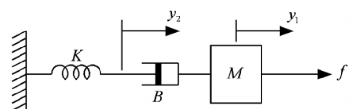
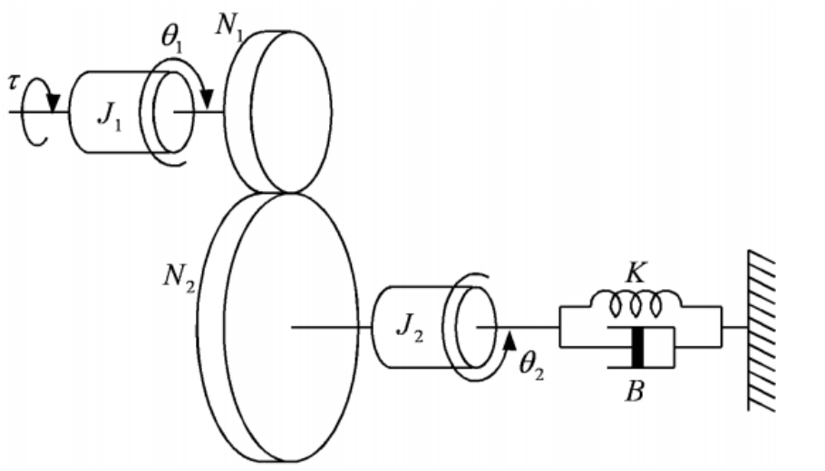
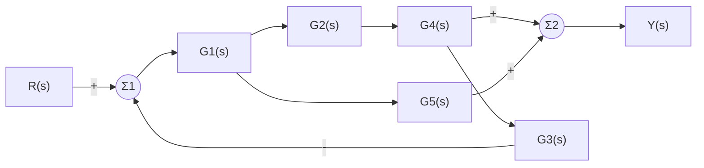

# HW2 과제 안내문 — 라플라스 변환과 시스템 모델링

[레포지토리 안내](../../../README.ko.md) | [English](Assignment.md) | [한국어](Assignment.ko.md)

> **최종 수정일:** 2026-11-24

인공신경망제어시스템 2차 과제이다. 3주차의 라플라스 변환, 4주차의 기계 시스템 모델링, 5주차의 전달함수와 블록선도를 다룬다.

---

 

## 문제 1. 라플라스 변환 (10점)

다음 함수의 라플라스 변환을 구하라.

- 1.1) $2e^{-2t} + 3e^{-3t}$
- 1.2) $te^{-5t}$
- 1.3) $\sin t + \cos 3t$
- 1.4) $e^{-2t}\sin 2t$

---

 

## 문제 2. 역라플라스 변환 (10점)

다음 함수의 역라플라스 변환을 구하라.

- 2.1) $\dfrac{1}{s(s+3)(s+4)}$
- 2.2) $\dfrac{10}{(s+1)^2(s+3)}$
- 2.3) $\dfrac{1}{s^2(s+2)}$
- 2.4) $\dfrac{2}{s(s^2+s+2)}$

---

 

## 문제 3. 미분방정식의 풀이 (20점)

라플라스 변환을 이용하여 다음 미분방정식의 해를 구하라.

- 3.1) $\dfrac{d^2y}{dt^2} + 9y = 0$, $y(0) = 1$, $y^{(1)} = 0$
- 3.2) $\dfrac{d^2y}{dt^2} + 5\dfrac{dy}{dt} + 4y = e^{-3t}$, $y(0) = 1$, $y^{(1)} = 0$
- 3.3) $\dfrac{d^2y}{dt^2} + 2\dfrac{dy}{dt} + 2y = u_s(t)$, $y(0) = 0$, $y^{(1)} = 0$
- 3.4) $\dfrac{d^2y}{dt^2} + 4y = u_s(t)$, $y(0) = 1$, $y^{(1)} = 0$

$y^{(1)} = 0$은 1계 도함수의 초기값이 0($`\dot{y}(0) = 0`$)이라는 뜻이고, $u_s(t)$는 단위 계단 함수이다.

---

 

## 문제 4. 직선 운동 시스템 (25점)

아래 그림에 제시된 시스템과 관련하여 다음 질문에 답하라.

*그림 1. 스프링, 댐퍼, 질량이 직렬로 이어진 직선 운동 시스템*

- 4.1) 이 시스템의 운동방정식(equation of motion)을 유도하라. (10점)
- 4.2) 모든 초기 조건(initial conditions)이 0이라고 가정할 때, 시스템의 전달함수 $Y_1(s)/F(s)$를 구하라. (15점)

---

 

## 문제 5. 기어로 연결한 회전 시스템 (25점)

아래 그림에 제시된 시스템과 관련하여 다음 질문에 답하라. $\tau_2$는 $J_2$의 회전에 의해 발생하는 반력 토크(reaction torque)이고, $\tau_1$은 기어를 통해 전달되는 반력 토크(reaction torque)이다.

*그림 2. 기어로 연결한 두 회전 관성과 스프링, 댐퍼*

- 5.1) 이 시스템의 운동방정식을 유도하라. (10점)
- 5.2) 모든 초기 조건(initial conditions)이 0이라고 가정할 때, 시스템의 전달함수 $\Theta_2(s)/T(s)$를 구하라. (15점)

---

 

## 문제 6. 블록선도의 전달함수 (10점)

다음 블록선도(block diagram)의 전달함수 $Y(s)/R(s)$를 구하라. 가합점 $\Sigma_1$, $\Sigma_2$의 부호는 화살표에 적었다.

*그림 3. 문제 6의 블록선도*

---

 

문제를 풀어 본 뒤 [과제 해설](../Assignment-Explanation.ko.md)에서 정답과 풀이를 볼 수 있다.
