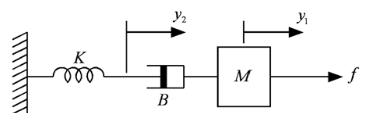
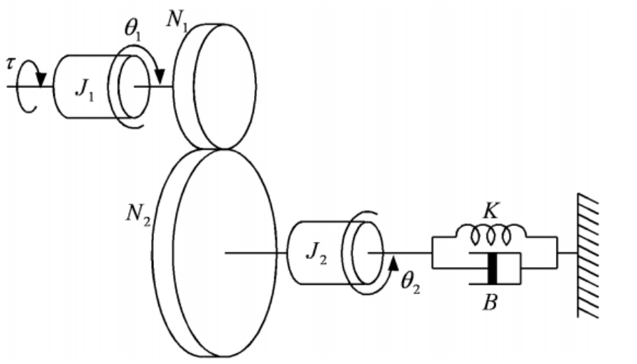
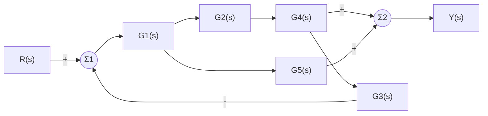

# HW2 Assignment Handout — Laplace Transforms and System Modeling

[Repository Guide](../../../README.md) | [English](Assignment.md) | [한국어](Assignment.ko.md)

> **Last Updated:** 2026-11-24

This is the second assignment of Neural Network Control Systems. It covers the Laplace transform from Week 3, modeling of mechanical systems from Week 4, and transfer functions and block diagrams from Week 5.

---

 

## Problem 1. Laplace Transforms (10 points)

Find the Laplace transforms of the following functions.

- 1.1) $2e^{-2t} + 3e^{-3t}$
- 1.2) $te^{-5t}$
- 1.3) $\sin t + \cos 3t$
- 1.4) $e^{-2t}\sin 2t$

---

 

## Problem 2. Inverse Laplace Transforms (10 points)

Find the inverse Laplace transforms of the following functions.

- 2.1) $\dfrac{1}{s(s+3)(s+4)}$
- 2.2) $\dfrac{10}{(s+1)^2(s+3)}$
- 2.3) $\dfrac{1}{s^2(s+2)}$
- 2.4) $\dfrac{2}{s(s^2+s+2)}$

---

 

## Problem 3. Solving Differential Equations (20 points)

Find the solutions of the following differential equations using the Laplace transform.

- 3.1) $\dfrac{d^2y}{dt^2} + 9y = 0$, $y(0) = 1$, $y^{(1)} = 0$
- 3.2) $\dfrac{d^2y}{dt^2} + 5\dfrac{dy}{dt} + 4y = e^{-3t}$, $y(0) = 1$, $y^{(1)} = 0$
- 3.3) $\dfrac{d^2y}{dt^2} + 2\dfrac{dy}{dt} + 2y = u_s(t)$, $y(0) = 0$, $y^{(1)} = 0$
- 3.4) $\dfrac{d^2y}{dt^2} + 4y = u_s(t)$, $y(0) = 1$, $y^{(1)} = 0$

$y^{(1)} = 0$ means that the initial value of the first derivative is 0 ($`\dot{y}(0) = 0`$), and $u_s(t)$ is the unit step function.

---

 

## Problem 4. Translational System (25 points)

Answer the following questions about the system shown in the figure below.

*Figure 1. Translational system of a spring, a damper, and a mass connected in series*

- 4.1) Derive the equation of motion of this system. (10 points)
- 4.2) Assuming that all initial conditions are 0, find the transfer function $Y_1(s)/F(s)$ of the system. (15 points)

---

 

## Problem 5. Rotational System Coupled by Gears (25 points)

Answer the following questions about the system shown in the figure below. $\tau_2$ is the reaction torque produced by the rotation of $J_2$, and $\tau_1$ is the reaction torque transmitted through the gears.

*Figure 2. Two rotational inertias coupled by gears, with a spring and a damper*

- 5.1) Derive the equations of motion of this system. (10 points)
- 5.2) Assuming that all initial conditions are 0, find the transfer function $\Theta_2(s)/T(s)$ of the system. (15 points)

---

 

## Problem 6. Transfer Function of a Block Diagram (10 points)

Find the transfer function $Y(s)/R(s)$ of the following block diagram. The signs at the summing points $\Sigma_1$ and $\Sigma_2$ are written on the arrows.

*Figure 3. Block diagram of Problem 6*

---

 

After solving the problems, see the [assignment explanation](../Assignment-Explanation.md) for the answers and solutions.
