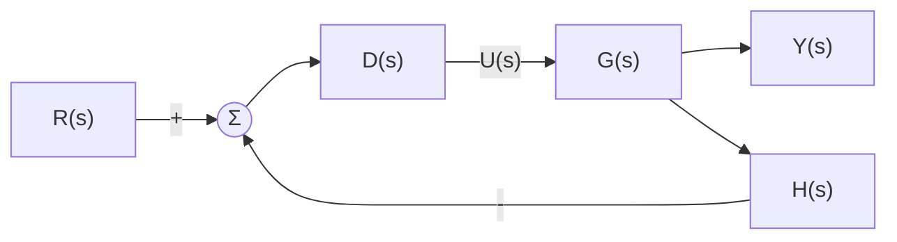
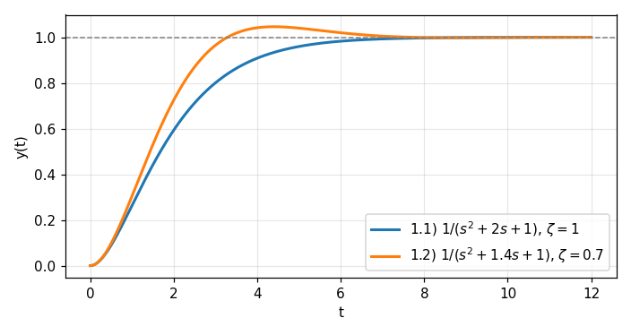

# HW3 과제 해설 — 과도 응답, 안정도, 정상 상태 오차

[레포지토리 안내](../../README.ko.md) | [English](Assignment-Explanation.md) | [한국어](Assignment-Explanation.ko.md)

> **최종 수정일:** 2026-11-04

> **학습 목표:**
> 1. 폐루프 특성방정식을 2차 표준형과 비교하여 감쇠비와 고유 진동수를 구하고 감쇠 유형을 판별할 수 있다
> 2. 원하는 감쇠비와 고유 진동수를 만족하도록 PD 제어기의 두 이득을 정할 수 있다
> 3. 특성방정식의 근으로 안정성을 판정하고, Routh-Hurwitz 판별법으로 우반평면 근의 개수와 안정한 이득의 범위를 구할 수 있다
> 4. 시스템 타입과 오차 상수로 계단, 경사, 포물선 입력에 대한 정상 상태 오차를 계산할 수 있다
> 5. 피드백 경로에 전달함수가 있는 시스템의 타입을 오차의 정의에서 판별할 수 있다

---

## 목차

- [1. 과제 구성](#1-과제-구성)
- [2. 폐루프 전달함수와 2차 시스템](#2-폐루프-전달함수와-2차-시스템)
  - [2.1 폐루프 전달함수와 특성방정식](#21-폐루프-전달함수와-특성방정식)
  - [2.2 2차 표준형과 감쇠 유형](#22-2차-표준형과-감쇠-유형)
- [3. 문제 1: 감쇠 유형의 판별](#3-문제-1-감쇠-유형의-판별)
- [4. 문제 2: PD 제어기의 이득 설계](#4-문제-2-pd-제어기의-이득-설계)
- [5. 문제 3: 극점과 안정도](#5-문제-3-극점과-안정도)
- [6. 문제 4: Routh-Hurwitz 판별법](#6-문제-4-routh-hurwitz-판별법)
  - [6.1 Routh 표](#61-routh-표)
  - [6.2 두 특성방정식의 판별](#62-두-특성방정식의-판별)
- [7. 문제 5: 안정한 이득의 범위](#7-문제-5-안정한-이득의-범위)
- [8. 정상 상태 오차와 시스템 타입](#8-정상-상태-오차와-시스템-타입)
  - [8.1 정상 상태 오차](#81-정상-상태-오차)
  - [8.2 시스템 타입과 오차 상수](#82-시스템-타입과-오차-상수)
- [9. 문제 6, 7, 8: 단위 피드백 시스템의 정상 상태 오차](#9-문제-6-7-8-단위-피드백-시스템의-정상-상태-오차)
- [10. 문제 9: 피드백 경로가 있는 시스템의 타입](#10-문제-9-피드백-경로가-있는-시스템의-타입)
- [요약](#요약)
- [점검 문제](#점검-문제)

---

<br>

## 1. 과제 구성

2차 시스템의 과도 응답(7주차), 응답 속도와 극점의 위치, 안정도와 Routh-Hurwitz 판별법(9주차), 정상 상태 성능과 시스템 타입(10주차)을 다루는 과제이다. 모든 문제는 하나의 피드백 구조에서 제어기와 플랜트, 피드백 경로의 전달함수만 바꾸어 나온다.

```text
Coursework/HW03_Transient-Response-Stability-and-Steady-State-Error/
├── Original/
│   └── hw3.pdf                    # 과제 안내문
└── Solution/
    └── Assignment-Report.pdf      # 제출한 풀이 (안내문 위에 손으로 쓴 풀이)
```

*그림 1. HW3 과제의 디렉토리 구성*

| 문제 | 내용 | 이 문서 |
|:-----|:-----|:-----|
| 1 | $G(s) = \frac{1}{s(s+2)}$와 $G(s) = \frac{1}{s(s+1.4)}$, $K = 1$인 단위 피드백 시스템의 감쇠 유형을 판별한다 | 3절 |
| 2 | $G(s) = \frac{1}{s(10s+1)}$과 PD 제어기 $K_1 + K_2s$로 $\omega_n = 5\pi$, $\zeta = 1/\sqrt{2}$를 만드는 $K_1$, $K_2$를 구한다 | 4절 |
| 3 | 특성방정식 $s^3 + 2s^2 + 2s + 1 = 0$과 $s^3 + 1 = 0$의 극점을 구하고 안정성을 평가한다 | 5절 |
| 4 | Routh-Hurwitz 방법으로 $s^4 + 2s^3 + 2s^2 + 3s + 1 = 0$과 $s^4 + 2s^3 + 4s^2 + 3s + 1 = 0$의 우반평면 근의 개수를 구한다 | 6절 |
| 5 | $G(s) = \frac{1}{s(s+1)}$과 $G(s) = \frac{1}{(s+1)^3}$인 폐루프 시스템이 안정한 $K$의 범위를 구한다 | 7절 |
| 6 | $G(s) = \frac{4}{s(s+2)}$인 단위 피드백 시스템의 계단, 경사, 포물선 입력에 대한 정상 상태 오차를 구한다 | 9절 |
| 7 | $G(s) = \frac{4}{s^2+2s+2}$, $K = 1$인 시스템의 타입과 단위 계단 입력에 대한 정상 상태 오차를 구한다 | 9절 |
| 8 | $G(s) = \frac{4}{s^2+s}$, $K = 1$인 시스템의 타입과 단위 경사 입력에 대한 정상 상태 오차를 구한다 | 9절 |
| 9 | $G(s) = \frac{4}{s^2+s}$, $D(s) = 1$, $H(s) = s + 1$인 시스템의 타입을 판별한다 | 10절 |

*표 1. HW3의 문제와 이 문서에서 다루는 절*

---

<br>

## 2. 폐루프 전달함수와 2차 시스템

### 2.1 폐루프 전달함수와 특성방정식

과제의 모든 블록선도는 그림 2의 구조이다. 기준 입력 $R$에서 피드백 신호를 뺀 값이 제어기 $D(s)$에 들어가고, 제어기의 출력 $U$가 제어 대상인 **플랜트(plant)** $G(s)$를 움직여 출력 $Y$를 만든다. 출력은 피드백 경로 $H(s)$를 거쳐 다시 가합점으로 돌아온다. 문제 1, 5, 7, 8의 제어기는 상수 이득 $K$, 문제 2는 $K_1 + K_2s$이고, 문제 6과 9는 $D(s) = 1$이다. $H(s) = 1$인 경우를 **단위 피드백(unity feedback)** 이라 하며, 문제 9만 $H(s) = s + 1$이다.



*그림 2. 과제의 공통 피드백 구조*

가합점의 출력을 $E_a = R - HY$라 하면 $Y = DGE_a$이므로 $Y = DG(R - HY)$이고, 이를 $Y$에 대해 풀면 **폐루프 전달함수(closed-loop transfer function)** 를 얻는다.

$$
T(s) = \frac{Y(s)}{R(s)} = \frac{D(s)G(s)}{1 + D(s)G(s)H(s)}
$$

분모를 0으로 놓은 $1 + D(s)G(s)H(s) = 0$을 폐루프 시스템의 **특성방정식(characteristic equation)** 이라 하며, 그 근이 폐루프 극점이다. 폐루프 응답의 모양과 안정성은 이 극점이 정한다.

### 2.2 2차 표준형과 감쇠 유형

분모가 2차인 폐루프 전달함수는 다음 **2차 표준형(standard second-order form)** 과 비교한다.

$$
T(s) = \frac{\omega_n^2}{s^2 + 2\zeta\omega_n s + \omega_n^2}, \qquad s = -\zeta\omega_n \pm \omega_n\sqrt{\zeta^2 - 1}
$$

$\omega_n$을 **고유 진동수(natural frequency)**, $\zeta$를 **감쇠비(damping ratio)** 라 한다. 극점의 식에서 근호 안의 부호가 $\zeta$와 1의 대소로 정해지므로 응답은 표 2의 네 유형으로 나뉜다.

| 감쇠비 | 유형 | 극점 | 계단 응답 |
|:-----|:-----|:-----|:-----|
| $\zeta > 1$ | 과감쇠(overdamped) | 서로 다른 두 음의 실근 | 진동 없이 느리게 수렴 |
| $\zeta = 1$ | 임계 감쇠(critically damped) | 겹친 실근 $-\omega_n$ | 진동 없이 수렴하는 경우 중 가장 빠름 |
| $0 < \zeta < 1$ | 부족 감쇠(underdamped) | 켤레 복소근 $-\zeta\omega_n \pm j\omega_n\sqrt{1 - \zeta^2}$ | 목표값을 넘었다가 진동하며 수렴 |
| $\zeta = 0$ | 비감쇠(undamped) | 허수축 위의 $\pm j\omega_n$ | 진폭이 줄지 않는 진동 |

*표 2. 감쇠비에 따른 2차 시스템의 응답 유형*

부족 감쇠 응답의 **최대 초과량(maximum overshoot)** 은 $M_p = e^{-\pi\zeta/\sqrt{1 - \zeta^2}}$이고, 최댓값에 이르는 시간은 $t_p = \pi/(\omega_n\sqrt{1 - \zeta^2})$이다(9주차).

---

<br>

## 3. 문제 1: 감쇠 유형의 판별

$K = 1$인 단위 피드백이므로 $T = G/(1 + G)$이다. $G = 1/[s(s+a)]$의 분자와 분모에 $s(s+a)$를 곱하면 $T = 1/[s(s+a) + 1]$이다.

**1.1) $G(s) = \dfrac{1}{s(s+2)}$.**

$$
T(s) = \frac{1}{s^2 + 2s + 1}, \qquad \omega_n^2 = 1 \;\Rightarrow\; \omega_n = 1, \qquad 2\zeta\omega_n = 2 \;\Rightarrow\; \zeta = 1
$$

$\zeta = 1$이므로 **임계 감쇠**이다. 극점은 $s^2 + 2s + 1 = (s+1)^2$의 겹친 근 $-1$이다.

**1.2) $G(s) = \dfrac{1}{s(s+1.4)}$.**

$$
T(s) = \frac{1}{s^2 + 1.4s + 1}, \qquad \omega_n = 1, \qquad 2\zeta\omega_n = 1.4 \;\Rightarrow\; \zeta = 0.7
$$

$0 < \zeta < 1$이므로 **부족 감쇠**이다. 극점은 $-0.7 \pm j\sqrt{1 - 0.49} = -0.7 \pm j0.714$이고, 최대 초과량은 $e^{-0.7\pi/\sqrt{0.51}} \approx 0.046$, 즉 약 4.6%이며 $t_p = \pi/\sqrt{0.51} \approx 4.40$에서 나타난다. 두 시스템은 플랜트 극점의 위치 $-2$와 $-1.4$만 다르지만, 극점이 원점에 가까워져 감쇠가 줄어든 1.2)는 목표값을 조금 넘는다(그림 3).



*그림 3. 문제 1의 두 폐루프 시스템의 단위 계단 응답*

---

<br>

## 4. 문제 2: PD 제어기의 이득 설계

제어기 $D(s) = K_1 + K_2s$는 오차에 비례하는 항과 오차의 변화율에 비례하는 항을 더하는 **PD 제어기(proportional-derivative controller)** 이다(11주차). 특성방정식 $1 + D(s)G(s) = 0$에 $G(s) = 1/[s(10s+1)]$을 넣고 분모 $s(10s + 1)$을 곱한다.

$$
s(10s + 1) + K_1 + K_2s = 0 \quad\Longrightarrow\quad 10s^2 + (1 + K_2)s + K_1 = 0 \quad\Longrightarrow\quad s^2 + \frac{1 + K_2}{10}s + \frac{K_1}{10} = 0
$$

원하는 극점은 $\omega_n = 5\pi$, $\zeta = 1/\sqrt{2}$인 표준형의 분모 $s^2 + 2\zeta\omega_ns + \omega_n^2 = s^2 + 2\cdot\frac{1}{\sqrt{2}}\cdot 5\pi\, s + 25\pi^2 = s^2 + 5\sqrt{2}\pi s + 25\pi^2$의 근이다. 두 식의 계수를 같게 놓는다.

$$
\frac{K_1}{10} = 25\pi^2 \;\Longrightarrow\; K_1 = 250\pi^2 \approx 2467.4, \qquad \frac{1 + K_2}{10} = 5\sqrt{2}\pi \;\Longrightarrow\; K_2 = 50\sqrt{2}\pi - 1 \approx 221.1
$$

$K_1$은 고유 진동수를, $K_2$는 감쇠를 정한다. 플랜트만으로는 $s$의 계수가 1로 고정되지만 미분 이득 $K_2$가 그 계수를 키워 감쇠를 원하는 만큼 늘린다. 이때 폐루프 극점은 $-\zeta\omega_n \pm j\omega_n\sqrt{1 - \zeta^2} = -11.11 \pm j11.11$이다.

> **주의:** PD 제어기는 폐루프 전달함수에 영점도 만든다. $T(s) = (K_2s + K_1)/[10s^2 + (1 + K_2)s + K_1]$의 분자는 $s = -K_1/K_2 \approx -11.16$에서 0이 되며, 이 영점이 극점의 실수부와 가까워 계단 응답의 최대 초과량은 $\zeta = 1/\sqrt{2}$인 표준형의 약 4.3%보다 큰 약 21%가 된다. 문제는 특성방정식, 즉 극점의 위치만 지정하므로 위의 이득이 답이지만, 영점이 있으면 표 2와 $M_p$ 공식이 응답을 정확히 예측하지 못한다는 점에 유의해야 한다.

---

<br>

## 5. 문제 3: 극점과 안정도

유계인 입력에 대해 출력이 항상 유계인 시스템을 **BIBO 안정(bounded-input bounded-output stable)** 하다고 한다. 전달함수가 유리함수인 선형 시불변 시스템은 모든 극점의 실수부가 음수일 때(모든 극점이 좌반평면에 있을 때) BIBO 안정하다. 실수부가 양수인 극점이 하나라도 있으면 그 극점이 만드는 $e^{pt}$ 항이 커지므로 불안정하고, 나머지 극점이 모두 좌반평면에 있고 허수축 위에 겹치지 않는 극점이 있으면 진동이 줄지 않아 **임계 안정(marginally stable)** 이며 BIBO 안정하지 않다.

**3.1) $s^3 + 2s^2 + 2s + 1 = 0$.** $s = -1$을 넣으면 $-1 + 2 - 2 + 1 = 0$이므로 $(s + 1)$이 인수이다. 나누면 $s^3 + 2s^2 + 2s + 1 = (s + 1)(s^2 + s + 1)$이고, 2차 인수의 근은 근의 공식으로 구한다.

$$
s = -1, \qquad s = \frac{-1 \pm \sqrt{1 - 4}}{2} = -\frac{1}{2} \pm j\frac{\sqrt{3}}{2}
$$

세 극점의 실수부 $-1$, $-1/2$, $-1/2$이 모두 음수이므로 **안정**하다.

**3.2) $s^3 + 1 = 0$.** 세제곱의 합 공식 $a^3 + b^3 = (a + b)(a^2 - ab + b^2)$로 인수분해한다.

$$
s^3 + 1 = (s + 1)(s^2 - s + 1) = 0 \quad\Longrightarrow\quad s = -1, \qquad s = \frac{1 \pm \sqrt{1 - 4}}{2} = \frac{1}{2} \pm j\frac{\sqrt{3}}{2}
$$

켤레 복소 극점 $\frac{1}{2} \pm j\frac{\sqrt{3}}{2}$의 실수부가 양수이므로 **불안정**하며, 응답에 $e^{t/2}$로 커지는 진동이 나타난다. 이 특성방정식은 $s^2$과 $s$의 계수가 0이어서 6.1절의 필요조건(모든 계수가 같은 부호이고 0이 아님)을 만족하지 않으므로, 근을 구하기 전에도 안정하지 않음을 알 수 있다.

---

<br>

## 6. 문제 4: Routh-Hurwitz 판별법

### 6.1 Routh 표

차수가 높은 특성방정식은 근을 직접 구하기 어렵다. **Routh-Hurwitz 판별법(Routh-Hurwitz criterion)** 은 근을 구하지 않고 계수만으로 우반평면(실수부가 양수인 영역)에 있는 근의 개수를 알려 준다. 특성방정식 $a_ns^n + a_{n-1}s^{n-1} + \cdots + a_1s + a_0 = 0$에 대해 다음 순서로 Routh 표를 만든다.

1. 첫 행($s^n$ 행)에 $a_n, a_{n-2}, a_{n-4}, \ldots$를, 둘째 행($s^{n-1}$ 행)에 $a_{n-1}, a_{n-3}, a_{n-5}, \ldots$를 적는다. 없는 계수는 0으로 둔다.
2. 셋째 행부터는 바로 위 두 행으로 계산한다. 위 두 행을 $(x_1, x_2, x_3, \ldots)$와 $(y_1, y_2, y_3, \ldots)$라 하면 새 행의 $k$번째 값은 $(y_1x_{k+1} - x_1y_{k+1})/y_1$이다.
3. $s^0$ 행까지 계산한 뒤 첫째 열의 부호가 바뀌는 횟수를 센다. 이 횟수가 우반평면 근의 개수이며, 첫째 열이 모두 같은 부호이면 시스템은 안정하다.

모든 근이 좌반평면에 있으려면 모든 계수가 0이 아니고 같은 부호여야 한다는 필요조건도 있다. 이 조건은 2차 이하의 다항식에서는 충분조건이기도 하지만, 3차 이상에서는 충분하지 않으므로 Routh 표가 필요하다.

### 6.2 두 특성방정식의 판별

**4.1) $s^4 + 2s^3 + 2s^2 + 3s + 1 = 0$.** 모든 계수가 양수이므로 필요조건은 만족한다. $s^2$ 행은 $(2 \cdot 2 - 1 \cdot 3)/2 = 1/2$, $(2 \cdot 1 - 1 \cdot 0)/2 = 1$이고, $s^1$ 행은 $(\frac{1}{2}\cdot 3 - 2 \cdot 1)/\frac{1}{2} = -1$, $s^0$ 행은 $(-1 \cdot 1 - \frac{1}{2}\cdot 0)/(-1) = 1$이다.

| 행 | 1열 | 2열 | 3열 |
|:-----|:-----|:-----|:-----|
| $s^4$ | $1$ | $2$ | $1$ |
| $s^3$ | $2$ | $3$ | $0$ |
| $s^2$ | $1/2$ | $1$ | |
| $s^1$ | $-1$ | | |
| $s^0$ | $1$ | | |

*표 3. 4.1)의 Routh 표*

첫째 열 $1, 2, \frac{1}{2}, -1, 1$은 $\frac{1}{2} \to -1$에서 한 번, $-1 \to 1$에서 한 번, 모두 두 번 부호가 바뀐다. 따라서 **우반평면 근은 2개**이고 시스템은 불안정하다. 실제 근은 $0.036 \pm j1.212$, $-0.408$, $-1.664$로, 실수부가 양수인 켤레 복소근 한 쌍이 있다. 모든 계수가 양수여도 불안정할 수 있다는 예이다.

**4.2) $s^4 + 2s^3 + 4s^2 + 3s + 1 = 0$.** $s^2$ 행은 $(2 \cdot 4 - 1 \cdot 3)/2 = 5/2$, $(2 \cdot 1 - 0)/2 = 1$이고, $s^1$ 행은 $(\frac{5}{2}\cdot 3 - 2 \cdot 1)/\frac{5}{2} = 11/5$, $s^0$ 행은 $1$이다.

| 행 | 1열 | 2열 | 3열 |
|:-----|:-----|:-----|:-----|
| $s^4$ | $1$ | $4$ | $1$ |
| $s^3$ | $2$ | $3$ | $0$ |
| $s^2$ | $5/2$ | $1$ | |
| $s^1$ | $11/5$ | | |
| $s^0$ | $1$ | | |

*표 4. 4.2)의 Routh 표*

첫째 열 $1, 2, \frac{5}{2}, \frac{11}{5}, 1$은 모두 양수이므로 **우반평면 근은 0개**이고 시스템은 안정하다. 실제 근은 $-0.5 \pm j1.539$와 $-0.5 \pm j0.363$이다. 4.1)과 $s^2$의 계수만 2에서 4로 다른데, 이 계수가 커지면서 우반평면에 있던 두 근이 왼쪽으로 옮겨 갔다.

---

<br>

## 7. 문제 5: 안정한 이득의 범위

그림 2에서 $D = K$, $H = 1$이므로 특성방정식은 $1 + KG(s) = 0$이다. $G$의 분모를 곱해 다항식으로 만들고 Routh 표의 첫째 열이 모두 양수인 조건을 구한다.

**5.1) $G(s) = \dfrac{1}{s(s+1)}$.** 특성방정식은 $s(s + 1) + K = s^2 + s + K = 0$이다.

| 행 | 1열 | 2열 |
|:-----|:-----|:-----|
| $s^2$ | $1$ | $K$ |
| $s^1$ | $1$ | $0$ |
| $s^0$ | $K$ | |

*표 5. 5.1)의 Routh 표*

첫째 열이 모두 양수이려면 $K > 0$이다. 2차 다항식이므로 모든 계수가 양수라는 조건과 같다. $K = 0$이면 원점에 극점이 생겨 안정하지 않다.

**5.2) $G(s) = \dfrac{1}{(s+1)^3}$.** 특성방정식은 $(s + 1)^3 + K = s^3 + 3s^2 + 3s + (1 + K) = 0$이다. $s^1$ 행은 $(3 \cdot 3 - 1 \cdot (1 + K))/3 = (8 - K)/3$이다.

| 행 | 1열 | 2열 |
|:-----|:-----|:-----|
| $s^3$ | $1$ | $3$ |
| $s^2$ | $3$ | $1 + K$ |
| $s^1$ | $(8 - K)/3$ | $0$ |
| $s^0$ | $1 + K$ | |

*표 6. 5.2)의 Routh 표*

첫째 열이 모두 양수이려면 $8 - K > 0$이고 $1 + K > 0$이어야 하므로, 안정한 범위는 **$-1 < K < 8$** 이다. 이득을 양수로만 쓰는 보통의 경우에는 $0 < K < 8$이다. 경계에서 무슨 일이 생기는지도 표에서 읽을 수 있다. $K = 8$이면 $s^1$ 행 전체가 0이 되며, 바로 위 $s^2$ 행으로 만든 보조 방정식 $3s^2 + 9 = 0$의 근 $s = \pm j\sqrt{3}$이 폐루프 극점이 되어 각진동수 $\sqrt{3} \approx 1.73$ rad/s로 지속 진동한다. $K = -1$이면 상수항이 0이 되어 $s = 0$에 극점이 생긴다.

---

<br>

## 8. 정상 상태 오차와 시스템 타입

### 8.1 정상 상태 오차

**정상 상태 오차(steady-state error)** 는 과도 응답이 사라진 뒤 기준 입력과 출력의 차이 $e(t) = r(t) - y(t)$가 다가가는 값이다. 폐루프 시스템이 안정하면 최종값 정리로 $s$ 영역에서 바로 구한다.

$$
e_{ss} = \lim_{t\to\infty} e(t) = \lim_{s\to 0} sE(s), \qquad E(s) = R(s) - Y(s) = \big[1 - T(s)\big]R(s)
$$

시험 입력으로는 단위 계단 $r = 1$ ($R = 1/s$), 단위 경사(램프) $r = t$ ($R = 1/s^2$), 단위 포물선 $r = t^2/2$ ($R = 1/s^3$)을 쓴다(7주차). 단위 피드백($H = 1$)이면 $1 - T = 1/(1 + DG)$이므로 $E(s) = R(s)/[1 + D(s)G(s)]$이다.

### 8.2 시스템 타입과 오차 상수

단위 피드백 시스템에서 개루프 전달함수 $D(s)G(s)$가 원점에 가진 극점의 개수 $N$을 **시스템 타입(system type)** 이라 한다. 즉 $D(s)G(s) = K_0\dfrac{(\cdots)}{s^N(\cdots)}$이면 타입 $N$이다. 세 시험 입력에 대한 오차는 다음 **오차 상수(error constant)** 로 정리된다.

$$
K_p = \lim_{s\to 0} D(s)G(s), \qquad K_v = \lim_{s\to 0} sD(s)G(s), \qquad K_a = \lim_{s\to 0} s^2D(s)G(s)
$$

$$
e_{ss,\text{step}} = \frac{1}{1 + K_p}, \qquad e_{ss,\text{ramp}} = \frac{1}{K_v}, \qquad e_{ss,\text{parabola}} = \frac{1}{K_a}
$$

예를 들어 경사 입력이면 $e_{ss} = \lim_{s\to 0} s\cdot\frac{1}{s^2}\cdot\frac{1}{1 + DG} = \lim_{s\to 0}\frac{1}{s + sDG} = \frac{1}{K_v}$이다. 원점의 극점이 하나 늘 때마다 한 단계 높은 차수의 입력까지 오차 없이 따라간다.

| 타입 | 계단 입력 | 경사 입력 | 포물선 입력 |
|:-----|:-----|:-----|:-----|
| 0 | $1/(1 + K_p)$ | $\infty$ | $\infty$ |
| 1 | $0$ | $1/K_v$ | $\infty$ |
| 2 | $0$ | $0$ | $1/K_a$ |

*표 7. 시스템 타입과 정상 상태 오차*

피드백 경로가 있어 $H \ne 1$이면 이 표를 그대로 쓸 수 없다. 이때는 타입을 오차 $E = R - Y$로 정의한다. 입력이 $t^k/k!$일 때 정상 상태 오차가 0이 아닌 유한한 값이 되는 $k$가 시스템 타입이다. 단위 피드백에서는 이 정의가 원점 극점의 개수와 같아진다.

---

<br>

## 9. 문제 6, 7, 8: 단위 피드백 시스템의 정상 상태 오차

세 문제 모두 폐루프 특성방정식이 $s^2 + 2s + 4$, $s^2 + 2s + 6$, $s^2 + s + 4$로 계수가 모두 양수인 2차식이므로 안정하고, 최종값 정리를 쓸 수 있다.

**문제 6) $G(s) = \dfrac{4}{s(s+2)}$.** 원점에 극점이 하나 있으므로 **타입 1**이다.

$$
K_p = \lim_{s\to 0}\frac{4}{s(s+2)} = \infty, \qquad K_v = \lim_{s\to 0}\frac{4s}{s(s+2)} = 2, \qquad K_a = \lim_{s\to 0}\frac{4s^2}{s(s+2)} = 0
$$

따라서 단위 계단 입력의 오차는 $1/(1 + \infty) = 0$, 단위 경사 입력의 오차는 $1/K_v = 1/2$, 단위 포물선 입력의 오차는 $1/K_a = \infty$이다. 경사 입력의 경우를 직접 계산하면 $E/R = 1/(1 + G) = s(s+2)/(s^2 + 2s + 4)$이므로 $e_{ss} = \lim_{s\to 0} s\cdot\frac{1}{s^2}\cdot\frac{s(s+2)}{s^2 + 2s + 4} = \frac{2}{4} = \frac{1}{2}$로 같다. 출력은 경사 입력을 같은 기울기로 따라가지만 $1/2$만큼 뒤처진다.

**문제 7) $G(s) = \dfrac{4}{s^2 + 2s + 2}$, $K = 1$.** 분모 $s^2 + 2s + 2$는 $s = 0$에서 0이 아니므로 원점 극점이 없고 **타입 0**이다.

$$
K_p = \lim_{s\to 0}\frac{4}{s^2 + 2s + 2} = 2, \qquad e_{ss,\text{step}} = \frac{1}{1 + K_p} = \frac{1}{3}
$$

출력은 $1$이 아니라 $1 - 1/3 = 2/3$에 머문다. 이는 폐루프의 직류 이득 $T(0) = 4/(2 + 4) = 2/3$과 같다. 타입 0 시스템은 이득 $K$를 키우면 $K_p$가 커져 오차가 줄지만 0이 되지는 않는다.

**문제 8) $G(s) = \dfrac{4}{s^2 + s} = \dfrac{4}{s(s+1)}$, $K = 1$.** 원점에 극점이 하나 있으므로 **타입 1**이다.

$$
K_v = \lim_{s\to 0} s\cdot\frac{4}{s(s+1)} = 4, \qquad e_{ss,\text{ramp}} = \frac{1}{K_v} = \frac{1}{4}
$$

---

<br>

## 10. 문제 9: 피드백 경로가 있는 시스템의 타입

$H(s) = s + 1 \ne 1$이므로 8.2절의 정의대로 $E = R - Y$로 판별한다. 먼저 폐루프 전달함수를 구한다.

$$
T(s) = \frac{DG}{1 + DGH} = \frac{\frac{4}{s^2 + s}}{1 + \frac{4(s+1)}{s^2 + s}} = \frac{4}{s^2 + s + 4s + 4} = \frac{4}{s^2 + 5s + 4} = \frac{4}{(s+1)(s+4)}
$$

극점 $-1$, $-4$가 모두 좌반평면에 있으므로 안정하다. 오차의 전달함수는

$$
\frac{E(s)}{R(s)} = 1 - T(s) = \frac{s^2 + 5s + 4 - 4}{s^2 + 5s + 4} = \frac{s(s + 5)}{(s+1)(s+4)}
$$

이고, 각 시험 입력에 최종값 정리를 적용한다.

$$
\text{계단: } \lim_{s\to 0} s\cdot\frac{1}{s}\cdot\frac{s(s+5)}{(s+1)(s+4)} = 0, \qquad \text{경사: } \lim_{s\to 0} s\cdot\frac{1}{s^2}\cdot\frac{s(s+5)}{(s+1)(s+4)} = \frac{5}{4}, \qquad \text{포물선: } \infty
$$

단위 경사 입력에서 처음으로 0이 아닌 유한한 오차 $5/4$가 나오므로 **타입 1**이다.

> **주의:** 개루프 전달함수 $DGH = \frac{4(s+1)}{s(s+1)} = \frac{4}{s}$만 보아도 원점 극점이 하나여서 이 문제의 타입은 같게 나오지만, 표 7의 $1/K_v = 1/4$은 기준 입력과 출력의 오차가 아니다. 그 값은 가합점 출력 $E_a = R - HY = R/(1 + DGH)$의 정상 상태 값이며, 실제 추종 오차 $R - Y$는 $5/4$이다. $H \ne 1$이면 출력이 아니라 $H$를 거친 신호가 기준 입력과 비교되므로, 타입과 오차는 $E = R - Y$로 직접 구해야 한다.

---

<br>

## 요약

| 개념 | 핵심 요약 |
|:-----|:-----|
| 폐루프 전달함수 | $T = DG/(1 + DGH)$이며 특성방정식 $1 + DGH = 0$의 근이 폐루프 극점이다. |
| 감쇠 유형 | 2차 표준형 $s^2 + 2\zeta\omega_ns + \omega_n^2$과 비교하여 $\zeta > 1$은 과감쇠, $\zeta = 1$은 임계 감쇠, $0 < \zeta < 1$은 부족 감쇠이며, 문제 1은 각각 임계 감쇠와 부족 감쇠($\zeta = 0.7$)이다. |
| PD 이득 설계 | 특성방정식 $s^2 + \frac{1+K_2}{10}s + \frac{K_1}{10}$의 계수를 표준형과 맞추어 $K_1 = 250\pi^2$, $K_2 = 50\sqrt{2}\pi - 1$을 얻으며, PD 제어기가 만드는 영점은 초과량을 키운다. |
| BIBO 안정도 | 모든 극점의 실수부가 음수이면 안정하고, 실수부가 양수인 극점이 있으면 불안정하며, 계수가 빠지거나 부호가 다르면 근을 구하지 않아도 안정하지 않다. |
| Routh-Hurwitz 판별법 | Routh 표의 첫째 열의 부호가 바뀌는 횟수가 우반평면 근의 개수이며, 4.1)은 2개, 4.2)는 0개이다. |
| 안정한 이득의 범위 | 첫째 열이 모두 양수인 조건에서 5.1)은 $K > 0$, 5.2)는 $-1 < K < 8$이고, $K = 8$에서는 보조 방정식의 근 $\pm j\sqrt{3}$으로 지속 진동한다. |
| 시스템 타입 | 단위 피드백에서는 개루프 전달함수의 원점 극점의 개수이며, 일반적으로는 $t^k/k!$ 입력의 오차가 유한한 0이 아닌 값이 되는 $k$이다. |
| 오차 상수 | $e_{ss}$는 계단에서 $1/(1 + K_p)$, 경사에서 $1/K_v$, 포물선에서 $1/K_a$이며, 문제 6은 $0, 1/2, \infty$, 문제 7은 $1/3$, 문제 8은 $1/4$이다. |
| 피드백 경로가 있는 시스템 | $H \ne 1$이면 $E = R - Y = (1 - T)R$로 직접 계산하며, 문제 9는 경사 오차가 $5/4$인 타입 1이다. |

---

<br>

## 점검 문제

1. **감쇠비의 경계:** 문제 1의 구조에서 $G(s) = 1/[s(s + a)]$, $K = 1$일 때 과감쇠가 되는 $a$의 범위를 구하라.

   <details>
   <summary>정답</summary>

   특성방정식은 $s^2 + as + 1 = 0$이므로 $\omega_n = 1$, $\zeta = a/2$이다. 과감쇠는 $\zeta > 1$이므로 $a > 2$이다. $a = 2$는 문제 1.1)의 임계 감쇠이다.

   </details>

2. **설계 사양의 변경:** 문제 2에서 감쇠비는 그대로 두고 고유 진동수만 두 배($10\pi$)로 바꾸면 $K_1$과 $K_2$는 어떻게 되는가?

   <details>
   <summary>정답</summary>

   $K_1/10 = \omega_n^2 = 100\pi^2$에서 $K_1 = 1000\pi^2$로 네 배가 되고, $(1 + K_2)/10 = 2\zeta\omega_n = 10\sqrt{2}\pi$에서 $K_2 = 100\sqrt{2}\pi - 1 \approx 443.3$으로 약 두 배가 된다.

   </details>

3. **Routh 표:** $s^3 + s^2 + 2s + 8 = 0$의 우반평면 근의 개수를 구하라.

   <details>
   <summary>정답</summary>

   $s^3$ 행은 $1, 2$, $s^2$ 행은 $1, 8$, $s^1$ 행은 $(1 \cdot 2 - 1 \cdot 8)/1 = -6$, $s^0$ 행은 $8$이다. 첫째 열 $1, 1, -6, 8$의 부호가 두 번 바뀌므로 우반평면 근은 2개이다. 실제 근은 $-2$와 $0.5 \pm j1.936$이다.

   </details>

4. **타입을 높이는 제어기:** 문제 7의 시스템에서 단위 계단 입력의 정상 상태 오차를 0으로 만들려면 제어기를 어떻게 바꾸어야 하는가?

   <details>
   <summary>정답</summary>

   개루프 전달함수에 원점 극점을 하나 더해 타입 1로 만들면 된다. 예를 들어 적분 동작이 있는 PI 제어기 $D(s) = K_P + K_I/s$를 쓰면 $K_p = \infty$가 되어 계단 오차가 0이 된다. 다만 극점이 늘어 폐루프가 불안정해질 수 있으므로 이득의 범위를 Routh 표로 다시 확인해야 한다.

   </details>

5. **비단위 피드백:** 문제 9에서 $H(s) = 1$로 바꾸면 단위 경사 입력에 대한 정상 상태 오차는 얼마인가?

   <details>
   <summary>정답</summary>

   단위 피드백이 되어 문제 8과 같은 시스템이므로 $K_v = 4$이고 오차는 $1/4$이다. 같은 플랜트에서도 피드백 경로가 $5/4$와 $1/4$처럼 추종 오차를 바꾼다.

   </details>
