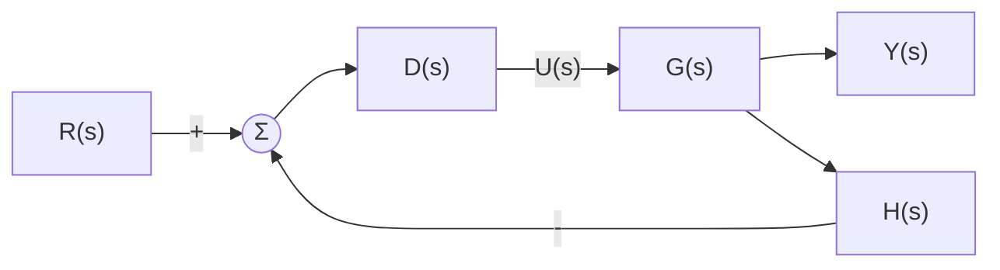
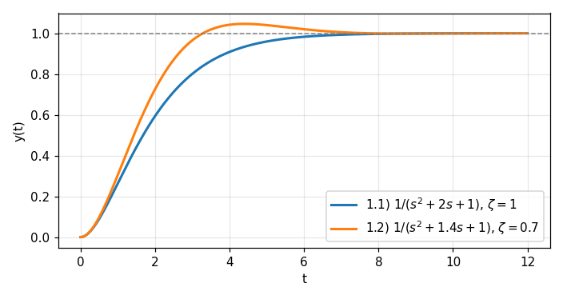

# HW3 Assignment Explanation — Transient Response, Stability, and Steady-State Error

[Repository Guide](../../README.md) | [English](Assignment-Explanation.md) | [한국어](Assignment-Explanation.ko.md)

> **Last Updated:** 2026-11-04

> **Learning Objectives:**
> 1. Find the damping ratio and natural frequency by comparing a closed-loop characteristic equation with the standard second-order form, and determine the damping type
> 2. Choose the two gains of a PD controller so that a desired damping ratio and natural frequency are met
> 3. Judge stability from the roots of the characteristic equation, and find the number of right-half-plane roots and the range of stable gains with the Routh-Hurwitz criterion
> 4. Compute the steady-state errors for step, ramp, and parabolic inputs from the system type and the error constants
> 5. Determine the type of a system with a transfer function in the feedback path from the definition of the error

---

## Table of Contents

- [1. Assignment Layout](#1-assignment-layout)
- [2. Closed-Loop Transfer Functions and Second-Order Systems](#2-closed-loop-transfer-functions-and-second-order-systems)
  - [2.1 Closed-Loop Transfer Function and Characteristic Equation](#21-closed-loop-transfer-function-and-characteristic-equation)
  - [2.2 Standard Second-Order Form and Damping Types](#22-standard-second-order-form-and-damping-types)
- [3. Problem 1: Determining the Damping Type](#3-problem-1-determining-the-damping-type)
- [4. Problem 2: Gain Design of a PD Controller](#4-problem-2-gain-design-of-a-pd-controller)
- [5. Problem 3: Poles and Stability](#5-problem-3-poles-and-stability)
- [6. Problem 4: The Routh-Hurwitz Criterion](#6-problem-4-the-routh-hurwitz-criterion)
  - [6.1 The Routh Array](#61-the-routh-array)
  - [6.2 Judging the Two Characteristic Equations](#62-judging-the-two-characteristic-equations)
- [7. Problem 5: Range of Stable Gains](#7-problem-5-range-of-stable-gains)
- [8. Steady-State Error and System Type](#8-steady-state-error-and-system-type)
  - [8.1 Steady-State Error](#81-steady-state-error)
  - [8.2 System Type and Error Constants](#82-system-type-and-error-constants)
- [9. Problems 6, 7, and 8: Steady-State Error of Unity Feedback Systems](#9-problems-6-7-and-8-steady-state-error-of-unity-feedback-systems)
- [10. Problem 9: Type of a System with a Feedback Path](#10-problem-9-type-of-a-system-with-a-feedback-path)
- [Summary](#summary)
- [Self-Check Questions](#self-check-questions)

---

<br>

## 1. Assignment Layout

This assignment covers the transient response of second-order systems (Week 7), response speed, pole locations, stability, and the Routh-Hurwitz criterion (Week 9), and steady-state performance and system type (Week 10). Every problem uses one feedback structure, changing only the transfer functions of the controller, the plant, and the feedback path.

```text
Coursework/HW03_Transient-Response-Stability-and-Steady-State-Error/
├── Original/
│   └── hw3.pdf                    # assignment handout
└── Solution/
    └── Assignment-Report.pdf      # submitted solution (handwritten on the handout)
```

*Figure 1. Directory layout of HW3*

| Problem | Content | This Document |
|:-----|:-----|:-----|
| 1 | Determine the damping type of unity feedback systems with $G(s) = \frac{1}{s(s+2)}$ and $G(s) = \frac{1}{s(s+1.4)}$, $K = 1$ | Section 3 |
| 2 | Find $K_1$ and $K_2$ that give $\omega_n = 5\pi$ and $\zeta = 1/\sqrt{2}$ with $G(s) = \frac{1}{s(10s+1)}$ and the PD controller $K_1 + K_2s$ | Section 4 |
| 3 | Find the poles of the characteristic equations $s^3 + 2s^2 + 2s + 1 = 0$ and $s^3 + 1 = 0$ and evaluate their stability | Section 5 |
| 4 | Find the number of right-half-plane roots of $s^4 + 2s^3 + 2s^2 + 3s + 1 = 0$ and $s^4 + 2s^3 + 4s^2 + 3s + 1 = 0$ with the Routh-Hurwitz method | Section 6 |
| 5 | Find the range of $K$ for which the closed-loop systems with $G(s) = \frac{1}{s(s+1)}$ and $G(s) = \frac{1}{(s+1)^3}$ are stable | Section 7 |
| 6 | Find the steady-state errors of the unity feedback system with $G(s) = \frac{4}{s(s+2)}$ for step, ramp, and parabolic inputs | Section 9 |
| 7 | Find the type of the system with $G(s) = \frac{4}{s^2+2s+2}$, $K = 1$ and its steady-state error for a unit step input | Section 9 |
| 8 | Find the type of the system with $G(s) = \frac{4}{s^2+s}$, $K = 1$ and its steady-state error for a unit ramp input | Section 9 |
| 9 | Determine the type of the system with $G(s) = \frac{4}{s^2+s}$, $D(s) = 1$, and $H(s) = s + 1$ | Section 10 |

*Table 1. Problems of HW3 and the sections of this document that cover them*

---

<br>

## 2. Closed-Loop Transfer Functions and Second-Order Systems

### 2.1 Closed-Loop Transfer Function and Characteristic Equation

Every block diagram in the assignment has the structure of Figure 2. The reference input $R$ minus the feedback signal enters the controller $D(s)$, and the controller output $U$ drives the controlled object, the **plant** $G(s)$, to produce the output $Y$. The output returns to the summing point through the feedback path $H(s)$. The controller is a constant gain $K$ in Problems 1, 5, 7, and 8 and $K_1 + K_2s$ in Problem 2, and $D(s) = 1$ in Problems 6 and 9. The case $H(s) = 1$ is called **unity feedback**, and only Problem 9 has $H(s) = s + 1$.



*Figure 2. Common feedback structure of the assignment*

If the output of the summing point is $E_a = R - HY$, then $Y = DGE_a$, so $Y = DG(R - HY)$, and solving for $Y$ gives the **closed-loop transfer function**.

```math
T(s) = \frac{Y(s)}{R(s)} = \frac{D(s)G(s)}{1 + D(s)G(s)H(s)}
```

Setting the denominator to 0, $1 + D(s)G(s)H(s) = 0$, gives the **characteristic equation** of the closed-loop system, whose roots are the closed-loop poles. These poles determine the shape and stability of the closed-loop response.

### 2.2 Standard Second-Order Form and Damping Types

A closed-loop transfer function with a second-order denominator is compared with the following **standard second-order form**.

```math
T(s) = \frac{\omega_n^2}{s^2 + 2\zeta\omega_n s + \omega_n^2}, \qquad s = -\zeta\omega_n \pm \omega_n\sqrt{\zeta^2 - 1}
```

$\omega_n$ is called the **natural frequency** and $\zeta$ the **damping ratio**. In the pole formula, the sign under the square root is set by whether $\zeta$ is larger or smaller than 1, so the response falls into the four types of Table 2.

| Damping Ratio | Type | Poles | Step Response |
|:-----|:-----|:-----|:-----|
| $\zeta > 1$ | Overdamped | Two distinct negative real roots | Converges slowly without oscillation |
| $\zeta = 1$ | Critically damped | Repeated real root $-\omega_n$ | Fastest among responses that converge without oscillation for the same $\omega_n$ |
| $0 < \zeta < 1$ | Underdamped | Complex conjugate roots $-\zeta\omega_n \pm j\omega_n\sqrt{1 - \zeta^2}$ | Exceeds the target and converges while oscillating |
| $\zeta = 0$ | Undamped | $\pm j\omega_n$ on the imaginary axis | Oscillation whose amplitude does not shrink |

*Table 2. Response types of second-order systems by damping ratio*

The **maximum overshoot** of an underdamped response is $M_p = e^{-\pi\zeta/\sqrt{1 - \zeta^2}}$, and the time to reach the peak is $t_p = \pi/(\omega_n\sqrt{1 - \zeta^2})$ (Week 9).

---

<br>

## 3. Problem 1: Determining the Damping Type

With unity feedback and $K = 1$, $T = G/(1 + G)$. Multiplying the numerator and denominator of $G = 1/[s(s+a)]$ by $s(s+a)$ gives $T = 1/[s(s+a) + 1]$.

**1.1) $G(s) = \dfrac{1}{s(s+2)}$.**

```math
T(s) = \frac{1}{s^2 + 2s + 1}, \qquad \omega_n^2 = 1 \;\Rightarrow\; \omega_n = 1, \qquad 2\zeta\omega_n = 2 \;\Rightarrow\; \zeta = 1
```

Since $\zeta = 1$, the system is **critically damped**. The poles are the repeated root $-1$ of $s^2 + 2s + 1 = (s+1)^2$.

**1.2) $G(s) = \dfrac{1}{s(s+1.4)}$.**

```math
T(s) = \frac{1}{s^2 + 1.4s + 1}, \qquad \omega_n = 1, \qquad 2\zeta\omega_n = 1.4 \;\Rightarrow\; \zeta = 0.7
```

Since $0 < \zeta < 1$, the system is **underdamped**. The poles are $-0.7 \pm j\sqrt{1 - 0.49} = -0.7 \pm j0.714$, and the maximum overshoot is $e^{-0.7\pi/\sqrt{0.51}} \approx 0.046$, about 4.6%, occurring at $t_p = \pi/\sqrt{0.51} \approx 4.40$. The two systems differ only in the plant pole location, $-2$ versus $-1.4$, but in 1.2), where the pole has moved closer to the origin and the damping has decreased, the response slightly exceeds the target (Figure 3).



*Figure 3. Unit step responses of the two closed-loop systems of Problem 1*

---

<br>

## 4. Problem 2: Gain Design of a PD Controller

The controller $D(s) = K_1 + K_2s$ is a **PD controller** (proportional-derivative controller) that adds a term proportional to the error and a term proportional to the rate of change of the error (Week 11). $G(s) = 1/[s(10s+1)]$ is substituted into the characteristic equation $1 + D(s)G(s) = 0$, and both sides are multiplied by the denominator $s(10s + 1)$.

```math
s(10s + 1) + K_1 + K_2s = 0 \quad\Longrightarrow\quad 10s^2 + (1 + K_2)s + K_1 = 0 \quad\Longrightarrow\quad s^2 + \frac{1 + K_2}{10}s + \frac{K_1}{10} = 0
```

The desired poles are the roots of the standard-form denominator with $\omega_n = 5\pi$ and $\zeta = 1/\sqrt{2}$, $`s^2 + 2\zeta\omega_ns + \omega_n^2 = s^2 + 2\cdot\frac{1}{\sqrt{2}}\cdot 5\pi\, s + 25\pi^2 = s^2 + 5\sqrt{2}\pi s + 25\pi^2`$. The coefficients of the two expressions are set equal.

```math
\frac{K_1}{10} = 25\pi^2 \;\Longrightarrow\; K_1 = 250\pi^2 \approx 2467.4, \qquad \frac{1 + K_2}{10} = 5\sqrt{2}\pi \;\Longrightarrow\; K_2 = 50\sqrt{2}\pi - 1 \approx 221.1
```

$K_1$ sets the natural frequency and $K_2$ the damping. With the plant alone, the coefficient of $s$ is fixed at 1, but the derivative gain $K_2$ raises that coefficient and increases the damping as much as desired. The closed-loop poles are then $-\zeta\omega_n \pm j\omega_n\sqrt{1 - \zeta^2} = -11.11 \pm j11.11$.

> **Caution:** A PD controller also creates a zero in the closed-loop transfer function. The numerator of $T(s) = (K_2s + K_1)/[10s^2 + (1 + K_2)s + K_1]$ is 0 at $s = -K_1/K_2 \approx -11.16$, and since this zero lies close to the real part of the poles, the maximum overshoot of the step response becomes about 21%, larger than the about 4.3% of the standard form with $\zeta = 1/\sqrt{2}$. The problem specifies only the characteristic equation, that is, the pole locations, so the gains above are the answer, but note that with a zero present, Table 2 and the $M_p$ formula do not predict the response exactly.

---

<br>

## 5. Problem 3: Poles and Stability

A system whose output is always bounded for every bounded input is called **BIBO stable** (bounded-input bounded-output stable). A linear time-invariant system with a rational transfer function is BIBO stable when the real parts of all its poles are negative (all poles lie in the left half-plane). If even one pole has a positive real part, the $e^{pt}$ term it produces grows, so the system is unstable, and if there are non-repeated poles on the imaginary axis and all other poles lie in the left half-plane, the response keeps a constant (a pole at the origin) or an oscillation of constant amplitude (conjugate poles on the imaginary axis) that does not shrink to 0, so the system is **marginally stable** and not BIBO stable.

**3.1) $s^3 + 2s^2 + 2s + 1 = 0$.** Substituting $s = -1$ gives $-1 + 2 - 2 + 1 = 0$, so $(s + 1)$ is a factor. Dividing gives $s^3 + 2s^2 + 2s + 1 = (s + 1)(s^2 + s + 1)$, and the roots of the quadratic factor come from the quadratic formula.

```math
s = -1, \qquad s = \frac{-1 \pm \sqrt{1 - 4}}{2} = -\frac{1}{2} \pm j\frac{\sqrt{3}}{2}
```

The real parts $-1$, $-1/2$, and $-1/2$ of the three poles are all negative, so the system is **stable**.

**3.2) $s^3 + 1 = 0$.** The sum-of-cubes formula $a^3 + b^3 = (a + b)(a^2 - ab + b^2)$ factors it.

```math
s^3 + 1 = (s + 1)(s^2 - s + 1) = 0 \quad\Longrightarrow\quad s = -1, \qquad s = \frac{1 \pm \sqrt{1 - 4}}{2} = \frac{1}{2} \pm j\frac{\sqrt{3}}{2}
```

The complex conjugate poles $\frac{1}{2} \pm j\frac{\sqrt{3}}{2}$ have a positive real part, so the system is **unstable**, and its response contains an oscillation that grows like $e^{t/2}$. This characteristic equation has zero coefficients for $s^2$ and $s$, so it fails the necessary condition of Section 6.1 (all coefficients nonzero and of the same sign), and one can tell it is not stable even before finding the roots.

---

<br>

## 6. Problem 4: The Routh-Hurwitz Criterion

### 6.1 The Routh Array

The roots of high-order characteristic equations are hard to find directly. The **Routh-Hurwitz criterion** tells the number of roots in the right half-plane (the region with positive real part) from the coefficients alone, without finding the roots. For the characteristic equation $a_ns^n + a_{n-1}s^{n-1} + \cdots + a_1s + a_0 = 0$, the Routh array is built in the following steps.

1. Write $a_n, a_{n-2}, a_{n-4}, \ldots$ in the first row (the $s^n$ row) and $a_{n-1}, a_{n-3}, a_{n-5}, \ldots$ in the second row (the $s^{n-1}$ row). Missing coefficients are set to 0.
2. From the third row on, compute from the two rows directly above. If those two rows are $(x_1, x_2, x_3, \ldots)$ and $(y_1, y_2, y_3, \ldots)$, the $`k`$th value of the new row is $(y_1x_{k+1} - x_1y_{k+1})/y_1$.
3. After computing down to the $s^0$ row, count the sign changes in the first column. This count is the number of right-half-plane roots, and if the first column has a single sign, the system is stable. The special cases in which a 0 appears in the first column or an entire row becomes 0 are treated in Week 9, and an example of an entire zero row is $K = 8$ in Section 7.

There is also a necessary condition: for all roots to lie in the left half-plane, all coefficients must be nonzero and of the same sign. For polynomials of degree 2 or lower this condition is also sufficient, but for degree 3 and higher it is not, so the Routh array is needed.

### 6.2 Judging the Two Characteristic Equations

**4.1) $s^4 + 2s^3 + 2s^2 + 3s + 1 = 0$.** All coefficients are positive, so the necessary condition holds. The $s^2$ row is $(2 \cdot 2 - 1 \cdot 3)/2 = 1/2$ and $(2 \cdot 1 - 1 \cdot 0)/2 = 1$, the $s^1$ row is $(\frac{1}{2}\cdot 3 - 2 \cdot 1)/\frac{1}{2} = -1$, and the $s^0$ row is $(-1 \cdot 1 - \frac{1}{2}\cdot 0)/(-1) = 1$.

| Row | Column 1 | Column 2 | Column 3 |
|:-----|:-----|:-----|:-----|
| $s^4$ | $1$ | $2$ | $1$ |
| $s^3$ | $2$ | $3$ | $0$ |
| $s^2$ | $1/2$ | $1$ | |
| $s^1$ | $-1$ | | |
| $s^0$ | $1$ | | |

*Table 3. Routh array of 4.1)*

The first column $1, 2, \frac{1}{2}, -1, 1$ changes sign once at $\frac{1}{2} \to -1$ and once at $-1 \to 1$, twice in total. Therefore there are **2 right-half-plane roots**, and the system is unstable. The actual roots are $0.036 \pm j1.212$, $-0.408$, and $-1.664$, including one pair of complex conjugate roots with positive real part. This example shows that a system can be unstable even when all coefficients are positive.

**4.2) $s^4 + 2s^3 + 4s^2 + 3s + 1 = 0$.** The $s^2$ row is $(2 \cdot 4 - 1 \cdot 3)/2 = 5/2$ and $(2 \cdot 1 - 0)/2 = 1$, the $s^1$ row is $(\frac{5}{2}\cdot 3 - 2 \cdot 1)/\frac{5}{2} = 11/5$, and the $s^0$ row is $1$.

| Row | Column 1 | Column 2 | Column 3 |
|:-----|:-----|:-----|:-----|
| $s^4$ | $1$ | $4$ | $1$ |
| $s^3$ | $2$ | $3$ | $0$ |
| $s^2$ | $5/2$ | $1$ | |
| $s^1$ | $11/5$ | | |
| $s^0$ | $1$ | | |

*Table 4. Routh array of 4.2)*

The first column $1, 2, \frac{5}{2}, \frac{11}{5}, 1$ is all positive, so there are **0 right-half-plane roots**, and the system is stable. The actual roots are $-0.5 \pm j1.539$ and $-0.5 \pm j0.363$. Only the $s^2$ coefficient differs from 4.1), 4 instead of 2, and as this coefficient grows, the two right-half-plane roots move to the left.

---

<br>

## 7. Problem 5: Range of Stable Gains

In Figure 2, $D = K$ and $H = 1$, so the characteristic equation is $1 + KG(s) = 0$. Multiplying by the denominator of $G$ turns it into a polynomial, and the condition that the first column of the Routh array is all positive is found.

**5.1) $G(s) = \dfrac{1}{s(s+1)}$.** The characteristic equation is $s(s + 1) + K = s^2 + s + K = 0$.

| Row | Column 1 | Column 2 |
|:-----|:-----|:-----|
| $s^2$ | $1$ | $K$ |
| $s^1$ | $1$ | $0$ |
| $s^0$ | $K$ | |

*Table 5. Routh array of 5.1)*

For the first column to be all positive, $K > 0$. Since the polynomial is of second order, this is the same as the condition that all coefficients are positive. If $K = 0$, a pole appears at the origin and the system is not stable.

**5.2) $G(s) = \dfrac{1}{(s+1)^3}$.** The characteristic equation is $(s + 1)^3 + K = s^3 + 3s^2 + 3s + (1 + K) = 0$. The $s^1$ row is $(3 \cdot 3 - 1 \cdot (1 + K))/3 = (8 - K)/3$.

| Row | Column 1 | Column 2 |
|:-----|:-----|:-----|
| $s^3$ | $1$ | $3$ |
| $s^2$ | $3$ | $1 + K$ |
| $s^1$ | $(8 - K)/3$ | $0$ |
| $s^0$ | $1 + K$ | |

*Table 6. Routh array of 5.2)*

For the first column to be all positive, $8 - K > 0$ and $1 + K > 0$, so the stable range is **$-1 < K < 8$**. In the usual case where only positive gains are used, it is $0 < K < 8$. The array also shows what happens at the boundaries. At $K = 8$, the whole $s^1$ row becomes 0, and the roots $s = \pm j\sqrt{3}$ of the auxiliary equation $3s^2 + 9 = 0$, formed from the $s^2$ row just above, become closed-loop poles, producing a sustained oscillation at an angular frequency of $\sqrt{3} \approx 1.73$ rad/s. At $K = -1$, the constant term becomes 0 and a pole appears at $s = 0$.

---

<br>

## 8. Steady-State Error and System Type

### 8.1 Steady-State Error

The **steady-state error** is the value approached by the difference between the reference input and the output, $e(t) = r(t) - y(t)$, after the transient response has died out. If the closed-loop system is stable, the final value theorem gives it directly in the $s$ domain.

```math
e_{ss} = \lim_{t\to\infty} e(t) = \lim_{s\to 0} sE(s), \qquad E(s) = R(s) - Y(s) = \big[1 - T(s)\big]R(s)
```

The test inputs are the unit step $r = 1$ ($`R = 1/s`$), the unit ramp $r = t$ ($`R = 1/s^2`$), and the unit parabola $r = t^2/2$ ($`R = 1/s^3`$) (Week 7). With unity feedback ($`H = 1`$), $1 - T = 1/(1 + DG)$, so $E(s) = R(s)/[1 + D(s)G(s)]$.

### 8.2 System Type and Error Constants

In a unity feedback system, the number $N$ of poles at the origin of the open-loop transfer function $D(s)G(s)$ is called the **system type**. That is, if $D(s)G(s) = K_0\dfrac{(\cdots)}{s^N(\cdots)}$, the system is of type $N$. The errors for the three test inputs are expressed with the following **error constants**.

```math
K_p = \lim_{s\to 0} D(s)G(s), \qquad K_v = \lim_{s\to 0} sD(s)G(s), \qquad K_a = \lim_{s\to 0} s^2D(s)G(s)
```

```math
e_{ss,\text{step}} = \frac{1}{1 + K_p}, \qquad e_{ss,\text{ramp}} = \frac{1}{K_v}, \qquad e_{ss,\text{parabola}} = \frac{1}{K_a}
```

For example, for a ramp input $e_{ss} = \lim_{s\to 0} s\cdot\frac{1}{s^2}\cdot\frac{1}{1 + DG} = \lim_{s\to 0}\frac{1}{s + sDG} = \frac{1}{K_v}$. Each additional pole at the origin lets the system follow inputs of one higher order without error.

| Type | Step Input | Ramp Input | Parabolic Input |
|:-----|:-----|:-----|:-----|
| 0 | $1/(1 + K_p)$ | $\infty$ | $\infty$ |
| 1 | $0$ | $1/K_v$ | $\infty$ |
| 2 | $0$ | $0$ | $1/K_a$ |

*Table 7. System type and steady-state error*

If there is a feedback path with $H \ne 1$, this table cannot be used as is. In that case the type is defined with the error $E = R - Y$: the system type is the $k$ for which the steady-state error for the input $t^k/k!$ is a nonzero finite value. With unity feedback this definition coincides with the number of poles at the origin.

---

<br>

## 9. Problems 6, 7, and 8: Steady-State Error of Unity Feedback Systems

In all three problems the closed-loop characteristic polynomials, $s^2 + 2s + 4$, $s^2 + 2s + 6$, and $s^2 + s + 4$, are second-order with all coefficients positive, so the systems are stable and the final value theorem can be used.

**Problem 6) $G(s) = \dfrac{4}{s(s+2)}$.** There is one pole at the origin, so the system is **type 1**.

```math
K_p = \lim_{s\to 0}\frac{4}{s(s+2)} = \infty, \qquad K_v = \lim_{s\to 0}\frac{4s}{s(s+2)} = 2, \qquad K_a = \lim_{s\to 0}\frac{4s^2}{s(s+2)} = 0
```

Therefore the error is $1/(1 + \infty) = 0$ for a unit step input, $1/K_v = 1/2$ for a unit ramp input, and $1/K_a = \infty$ for a unit parabolic input. Computing the ramp case directly, $E/R = 1/(1 + G) = s(s+2)/(s^2 + 2s + 4)$, so $e_{ss} = \lim_{s\to 0} s\cdot\frac{1}{s^2}\cdot\frac{s(s+2)}{s^2 + 2s + 4} = \frac{2}{4} = \frac{1}{2}$, the same. The output follows the ramp with the same slope but lags behind by $1/2$.

**Problem 7) $G(s) = \dfrac{4}{s^2 + 2s + 2}$, $K = 1$.** The denominator $s^2 + 2s + 2$ is not 0 at $s = 0$, so there is no pole at the origin and the system is **type 0**.

```math
K_p = \lim_{s\to 0}\frac{4}{s^2 + 2s + 2} = 2, \qquad e_{ss,\text{step}} = \frac{1}{1 + K_p} = \frac{1}{3}
```

The output settles at $1 - 1/3 = 2/3$ rather than $1$. This equals the DC gain of the closed loop, $T(0) = 4/(2 + 4) = 2/3$. In a type 0 system, raising the gain $K$ increases $K_p$ and reduces the error, but never to 0.

**Problem 8) $G(s) = \dfrac{4}{s^2 + s} = \dfrac{4}{s(s+1)}$, $K = 1$.** There is one pole at the origin, so the system is **type 1**.

```math
K_v = \lim_{s\to 0} s\cdot\frac{4}{s(s+1)} = 4, \qquad e_{ss,\text{ramp}} = \frac{1}{K_v} = \frac{1}{4}
```

---

<br>

## 10. Problem 9: Type of a System with a Feedback Path

Since $H(s) = s + 1 \ne 1$, the type is determined with $E = R - Y$, following the definition in Section 8.2. First, the closed-loop transfer function is found.

```math
T(s) = \frac{DG}{1 + DGH} = \frac{\frac{4}{s^2 + s}}{1 + \frac{4(s+1)}{s^2 + s}} = \frac{4}{s^2 + s + 4s + 4} = \frac{4}{s^2 + 5s + 4} = \frac{4}{(s+1)(s+4)}
```

The poles $-1$ and $-4$ both lie in the left half-plane, so the system is stable. The transfer function of the error is

```math
\frac{E(s)}{R(s)} = 1 - T(s) = \frac{s^2 + 5s + 4 - 4}{s^2 + 5s + 4} = \frac{s(s + 5)}{(s+1)(s+4)}
```

and the final value theorem is applied to each test input.

```math
\text{step: } \lim_{s\to 0} s\cdot\frac{1}{s}\cdot\frac{s(s+5)}{(s+1)(s+4)} = 0, \qquad \text{ramp: } \lim_{s\to 0} s\cdot\frac{1}{s^2}\cdot\frac{s(s+5)}{(s+1)(s+4)} = \frac{5}{4}, \qquad \text{parabola: } \infty
```

The unit ramp input is the first to give a nonzero finite error, $5/4$, so the system is **type 1**.

> **Caution:** Looking only at the open-loop transfer function $DGH = \frac{4(s+1)}{s(s+1)} = \frac{4}{s}$ also shows one pole at the origin, so the type comes out the same in this problem, but $1/K_v = 1/4$ from Table 7 is not the error between the reference input and the output. That value is the steady-state value of the summing-point output $E_a = R - HY = R/(1 + DGH)$, while the actual tracking error $R - Y$ is $5/4$. When $H \ne 1$, the signal compared with the reference input is the output passed through $H$, not the output itself, so the type and the error must be found directly from $E = R - Y$.

---

<br>

## Summary

| Concept | Key Summary |
|:-----|:-----|
| Closed-loop transfer function | $T = DG/(1 + DGH)$, and the roots of the characteristic equation $1 + DGH = 0$ are the closed-loop poles. |
| Damping types | Compared with the standard form $s^2 + 2\zeta\omega_ns + \omega_n^2$, $\zeta > 1$ is overdamped, $\zeta = 1$ critically damped, and $0 < \zeta < 1$ underdamped; Problem 1 gives critically damped and underdamped ($`\zeta = 0.7`$). |
| PD gain design | Matching the coefficients of the characteristic equation $s^2 + \frac{1+K_2}{10}s + \frac{K_1}{10}$ with the standard form gives $K_1 = 250\pi^2$ and $K_2 = 50\sqrt{2}\pi - 1$, and the zero created by the PD controller increases the overshoot. |
| BIBO stability | A system is stable if all poles have negative real parts and unstable if any pole has a positive real part, and missing coefficients or mixed signs show it is not stable without finding the roots. |
| Routh-Hurwitz criterion | The number of sign changes in the first column of the Routh array is the number of right-half-plane roots: 2 for 4.1) and 0 for 4.2). |
| Range of stable gains | From the condition that the first column is all positive, 5.1) gives $K > 0$ and 5.2) gives $-1 < K < 8$, and at $K = 8$ the system oscillates steadily at the roots $\pm j\sqrt{3}$ of the auxiliary equation. |
| System type | With unity feedback it is the number of poles at the origin of the open-loop transfer function, and in general it is the $k$ for which the error for the input $t^k/k!$ is a nonzero finite value. |
| Error constants | $e_{ss}$ is $1/(1 + K_p)$ for a step, $1/K_v$ for a ramp, and $1/K_a$ for a parabola; Problem 6 gives $0, 1/2, \infty$, Problem 7 gives $1/3$, and Problem 8 gives $1/4$. |
| System with a feedback path | When $H \ne 1$, the error is computed directly from $E = R - Y = (1 - T)R$, and Problem 9 is type 1 with ramp error $5/4$. |

---

<br>

## Self-Check Questions

1. **Boundary of the damping ratio:** In the structure of Problem 1 with $G(s) = 1/[s(s + a)]$ and $K = 1$, find the range of $a$ for which the system is overdamped.

   <details>
   <summary>Answer</summary>

   The characteristic equation is $s^2 + as + 1 = 0$, so $\omega_n = 1$ and $\zeta = a/2$. Overdamping means $\zeta > 1$, so $a > 2$. $a = 2$ is the critically damped case of Problem 1.1).

   </details>

2. **Changing the design specification:** In Problem 2, if the damping ratio is kept and only the natural frequency is doubled ($`10\pi`$), what happens to $K_1$ and $K_2$?

   <details>
   <summary>Answer</summary>

   From $K_1/10 = \omega_n^2 = 100\pi^2$, $K_1 = 1000\pi^2$, four times larger, and from $(1 + K_2)/10 = 2\zeta\omega_n = 10\sqrt{2}\pi$, $K_2 = 100\sqrt{2}\pi - 1 \approx 443.3$, about twice as large.

   </details>

3. **Routh array:** Find the number of right-half-plane roots of $s^3 + s^2 + 2s + 8 = 0$.

   <details>
   <summary>Answer</summary>

   The $s^3$ row is $1, 2$, the $s^2$ row is $1, 8$, the $s^1$ row is $(1 \cdot 2 - 1 \cdot 8)/1 = -6$, and the $s^0$ row is $8$. The first column $1, 1, -6, 8$ changes sign twice, so there are 2 right-half-plane roots. The actual roots are $-2$ and $0.5 \pm j1.936$.

   </details>

4. **Controller that raises the type:** How should the controller of the system in Problem 7 be changed to make the steady-state error for a unit step input 0?

   <details>
   <summary>Answer</summary>

   Adding one more pole at the origin to the open-loop transfer function makes the system type 1. For example, a PI controller $D(s) = K_P + K_I/s$ with integral action makes $K_p = \infty$, so the step error becomes 0. However, the added pole can make the closed loop unstable, so the gain range must be rechecked with the Routh array.

   </details>

5. **Non-unity feedback:** If $H(s)$ in Problem 9 is changed to $1$, what is the steady-state error for a unit ramp input?

   <details>
   <summary>Answer</summary>

   It becomes unity feedback, the same system as Problem 8, so $K_v = 4$ and the error is $1/4$. Even with the same plant, the feedback path changes the tracking error, $5/4$ versus $1/4$.

   </details>
