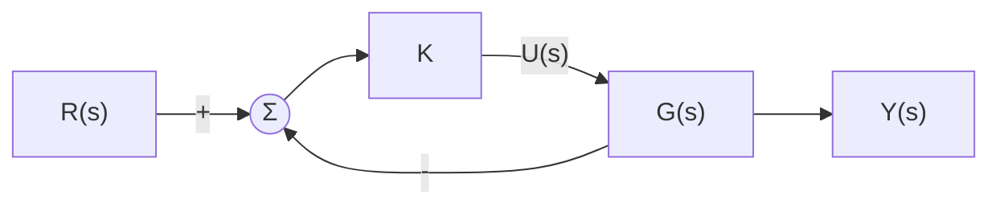
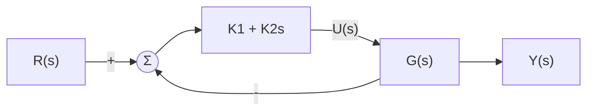
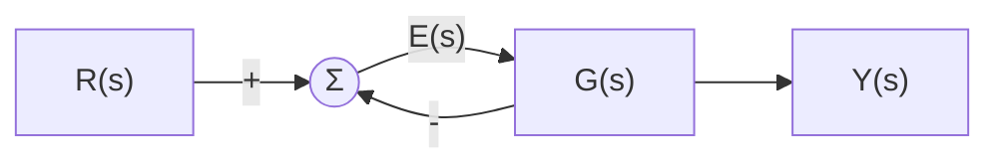
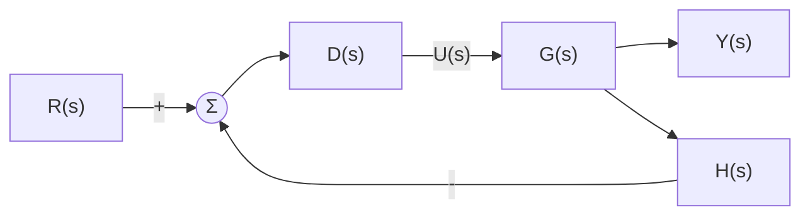

# HW3 과제 안내문 — 과도 응답, 안정도, 정상 상태 오차

[레포지토리 안내](../../../README.ko.md) | [English](Assignment.md) | [한국어](Assignment.ko.md)

> **최종 수정일:** 2026-11-24

인공신경망제어시스템 3차 과제이다. 7주차의 2차 시스템 과도 응답, 9주차의 극점과 안정도, 10주차의 정상 상태 성능과 시스템 타입을 다룬다. 모든 그림에서 가합점은 기준 입력 $R(s)$를 더하고 피드백 신호를 뺀다.

---

 

## 문제 1. 감쇠 유형 (각 5점)

아래 그림에 주어진 제어시스템의 감쇠 유형(damping type)을 판별하라.

*그림 1. 문제 1의 제어시스템*

- 1.1) $G(s) = \dfrac{1}{s(s+2)}$, $K = 1$
- 1.2) $G(s) = \dfrac{1}{s(s+1.4)}$, $K = 1$

---

 

## 문제 2. 제어기의 이득 (10점)

아래 그림에 제시된 제어시스템에 대하여 시스템이 $\omega_n = 5\pi$, $\zeta = 1/\sqrt{2}$를 만족하도록 하는 $K_1$과 $K_2$를 구하라.

그림의 전달함수는 $G(s) = \dfrac{1}{s(10s+1)}$이다.

*그림 2. 문제 2의 제어시스템*

---

 

## 문제 3. 극점과 안정성 (각 5점)

다음 특성방정식들에 대하여 시스템의 극점(pole)을 구하고 안정성을 평가하라.

- 3.1) $s^3 + 2s^2 + 2s + 1 = 0$
- 3.2) $s^3 + 1 = 0$

---

 

## 문제 4. 우반평면 근의 개수 (각 10점)

Routh-Hurwitz 방법을 사용하여, 각 특성방정식에 대해 우반평면(right-half plane)에 위치한 근의 개수를 구하라.

- 4.1) $s^4 + 2s^3 + 2s^2 + 3s + 1 = 0$
- 4.2) $s^4 + 2s^3 + 4s^2 + 3s + 1 = 0$

---

 

## 문제 5. 안정한 이득의 범위 (각 5점)

Routh-Hurwitz 방법을 사용하여, 주어진 전달함수를 기반으로 아래 그림에 제시된 폐루프(closed-loop) 시스템이 안정하게 유지되는 $K$의 범위를 구하라.

*그림 3. 문제 5의 폐루프 시스템*

- 5.1) $G(s) = \dfrac{1}{s(s+1)}$
- 5.2) $G(s) = \dfrac{1}{(s+1)^3}$

---

 

## 문제 6. 세 기준 입력의 정상 상태 오차 (10점)

아래 그림에 주어진 전달함수 $G(s) = \dfrac{4}{s(s+2)}$를 갖는 시스템에 대하여, 기준 입력(reference input)이 각각 단위 계단(unit step), 단위 램프(unit ramp), 단위 포물선(unit parabolic) 함수일 때의 정상 상태 오차(steady-state error)를 계산하라.

*그림 4. 문제 6의 시스템*

---

 

## 문제 7. 시스템 타입과 계단 입력의 정상 상태 오차 (10점)

아래 그림에 주어진 전달함수 $G(s) = \dfrac{4}{s^2 + 2s + 2}$와 제어기 이득(controller gain) $K = 1$을 바탕으로, 해당 시스템에 대한 다음 질문들에 답하라.

*그림 5. 문제 7의 제어시스템*

- 7.1) 시스템의 타입을 판별하라. (5점)
- 7.2) 단위 계단 입력(unit step input)에 대한 정상 상태 오차(steady-state error)를 계산하라. (5점)

---

 

## 문제 8. 시스템 타입과 램프 입력의 정상 상태 오차 (10점)

아래 그림에 주어진 전달함수 $G(s) = \dfrac{4}{s^2 + s}$와 제어기 이득(controller gain) $K = 1$을 바탕으로, 해당 시스템에 대한 다음 질문들에 답하라.

*그림 6. 문제 8의 제어시스템*

- 8.1) 시스템의 타입을 판별하라. (5점)
- 8.2) 단위 램프 입력(unit ramp input)에 대한 정상 상태 오차를 계산하라. (5점)

---

 

## 문제 9. 피드백 경로가 있는 시스템의 타입 (10점)

아래 그림에 제시된 전달함수 $G(s) = \dfrac{4}{s^2 + s}$, $D(s) = 1$, $H(s) = s + 1$에 대하여, 시스템의 타입을 판별하라.

*그림 7. 문제 9의 시스템*

---

 

문제를 풀어 본 뒤 [과제 해설](../Assignment-Explanation.ko.md)에서 정답과 풀이를 볼 수 있다.
