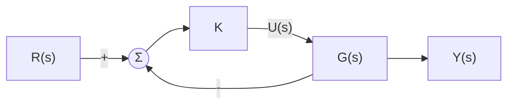
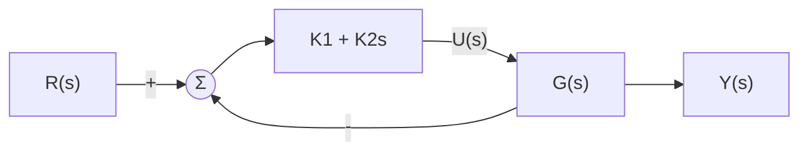
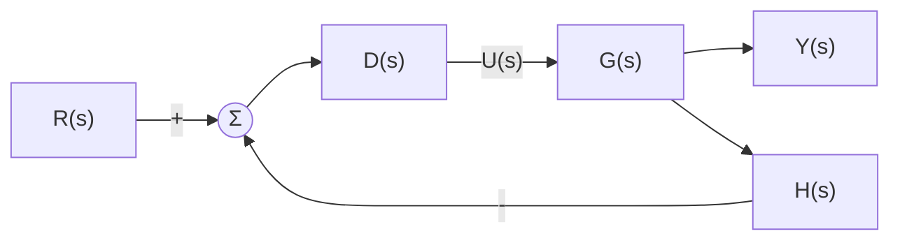

# HW3 Assignment Handout — Transient Response, Stability, and Steady-State Error

[Repository Guide](../../../README.md) | [English](Assignment.md) | [한국어](Assignment.ko.md)

> **Last Updated:** 2026-11-24

This is the third assignment of Neural Network Control Systems. It covers the transient response of second-order systems from Week 7, poles and stability from Week 9, and steady-state performance and system type from Week 10. In every figure, the summing point adds the reference input $R(s)$ and subtracts the feedback signal.

---

 

## Problem 1. Damping Type (5 points each)

Determine the damping type of the control system given in the figure below.

*Figure 1. Control system of Problem 1*

- 1.1) $G(s) = \dfrac{1}{s(s+2)}$, $K = 1$
- 1.2) $G(s) = \dfrac{1}{s(s+1.4)}$, $K = 1$

---

 

## Problem 2. Controller Gains (10 points)

For the control system shown in the figure below, find $K_1$ and $K_2$ such that the system satisfies $\omega_n = 5\pi$ and $\zeta = 1/\sqrt{2}$.

The transfer function in the figure is $G(s) = \dfrac{1}{s(10s+1)}$.

*Figure 2. Control system of Problem 2*

---

 

## Problem 3. Poles and Stability (5 points each)

For the following characteristic equations, find the poles of the system and evaluate its stability.

- 3.1) $s^3 + 2s^2 + 2s + 1 = 0$
- 3.2) $s^3 + 1 = 0$

---

 

## Problem 4. Number of Right Half-Plane Roots (10 points each)

Using the Routh-Hurwitz method, find the number of roots located in the right half-plane for each characteristic equation.

- 4.1) $s^4 + 2s^3 + 2s^2 + 3s + 1 = 0$
- 4.2) $s^4 + 2s^3 + 4s^2 + 3s + 1 = 0$

---

 

## Problem 5. Range of Stable Gains (5 points each)

Using the Routh-Hurwitz method, find the range of $K$ for which the closed-loop system shown in the figure below remains stable, based on the given transfer function.

*Figure 3. Closed-loop system of Problem 5*

- 5.1) $G(s) = \dfrac{1}{s(s+1)}$
- 5.2) $G(s) = \dfrac{1}{(s+1)^3}$

---

 

## Problem 6. Steady-State Error for Three Reference Inputs (10 points)

For the system with the transfer function $G(s) = \dfrac{4}{s(s+2)}$ given in the figure below, compute the steady-state error when the reference input is a unit step, a unit ramp, and a unit parabolic function.

*Figure 4. System of Problem 6*

---

 

## Problem 7. System Type and Steady-State Error for a Step Input (10 points)

Based on the transfer function $G(s) = \dfrac{4}{s^2 + 2s + 2}$ and the controller gain $K = 1$ given in the figure below, answer the following questions about the system.

*Figure 5. Control system of Problem 7*

- 7.1) Determine the type of the system. (5 points)
- 7.2) Compute the steady-state error for a unit step input. (5 points)

---

 

## Problem 8. System Type and Steady-State Error for a Ramp Input (10 points)

Based on the transfer function $G(s) = \dfrac{4}{s^2 + s}$ and the controller gain $K = 1$ given in the figure below, answer the following questions about the system.

*Figure 6. Control system of Problem 8*

- 8.1) Determine the type of the system. (5 points)
- 8.2) Compute the steady-state error for a unit ramp input. (5 points)

---

 

## Problem 9. Type of a System with a Feedback Path (10 points)

For the transfer functions $G(s) = \dfrac{4}{s^2 + s}$, $D(s) = 1$, and $H(s) = s + 1$ shown in the figure below, determine the type of the system.

*Figure 7. System of Problem 9*

---

 

After solving the problems, see the [assignment explanation](../Assignment-Explanation.md) for the answers and solutions.
