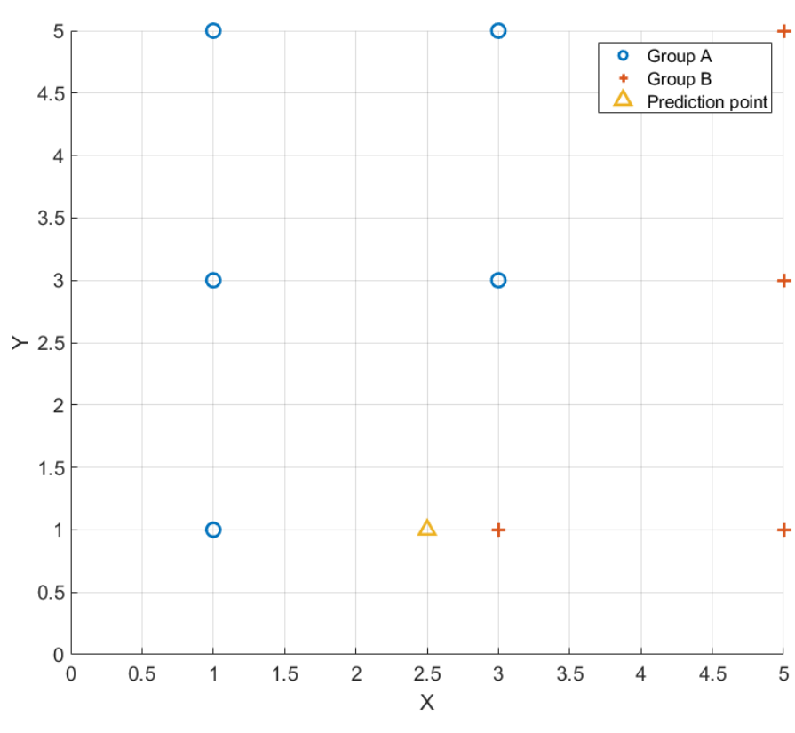
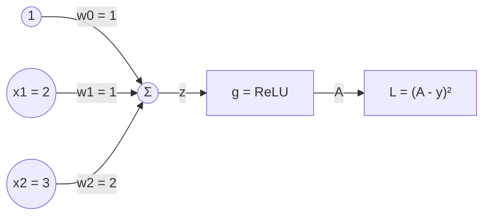

# HW4 과제 해설 — 기계 학습과 인공신경망 제어

[레포지토리 안내](../../README.ko.md) | [English](Assignment-Explanation.md) | [한국어](Assignment-Explanation.ko.md)

> **최종 수정일:** 2026-11-04

> **학습 목표:**
> 1. k-최근접 이웃 분류에서 거리를 계산하고 $k$에 따라 예측이 달라지는 이유를 설명할 수 있다
> 2. 최소제곱법으로 단순 선형 회귀 모델을 구하고 결정계수와 RMSE로 평가할 수 있다
> 3. 퍼셉트론의 순전파를 계산하고 연쇄 법칙으로 손실의 가중치에 대한 기울기를 구할 수 있다
> 4. 이산 시간 상태 방정식을 반복 대입하여 목표 상태에 이르는 입력을 구할 수 있다
> 5. 신경망 예측 제어와 NARMA-L2 제어의 원리로 플랜트 모델에서 제어 입력을 계산할 수 있다

---

## 목차

- [1. 과제 구성](#1-과제-구성)
- [2. 문제 1: k-최근접 이웃 분류](#2-문제-1-k-최근접-이웃-분류)
  - [2.1 k-NN 분류](#21-k-nn-분류)
  - [2.2 예측 점의 분류](#22-예측-점의-분류)
- [3. 문제 2: 선형 회귀와 모델 평가](#3-문제-2-선형-회귀와-모델-평가)
  - [3.1 최소제곱 선형 회귀](#31-최소제곱-선형-회귀)
  - [3.2 결정계수](#32-결정계수)
  - [3.3 새 샘플에 대한 RMSE](#33-새-샘플에-대한-rmse)
- [4. 문제 3: 퍼셉트론의 기울기](#4-문제-3-퍼셉트론의-기울기)
  - [4.1 퍼셉트론과 ReLU](#41-퍼셉트론과-relu)
  - [4.2 연쇄 법칙으로 구한 기울기](#42-연쇄-법칙으로-구한-기울기)
- [5. 문제 4: 이산 시간 시스템의 입력 결정](#5-문제-4-이산-시간-시스템의-입력-결정)
- [6. 문제 5: 신경망 예측 제어](#6-문제-5-신경망-예측-제어)
  - [6.1 신경망 예측 제어의 원리](#61-신경망-예측-제어의-원리)
  - [6.2 제어 입력의 계산](#62-제어-입력의-계산)
- [7. 문제 6: NARMA-L2 제어](#7-문제-6-narma-l2-제어)
  - [7.1 NARMA-L2 모델과 제어 법칙](#71-narma-l2-모델과-제어-법칙)
  - [7.2 제어 입력의 계산](#72-제어-입력의-계산)
- [요약](#요약)
- [점검 문제](#점검-문제)
- [참고 문헌](#참고-문헌)

---

<br>

## 1. 과제 구성

인공지능의 학습 방법(12주차), 인공신경망과 그 학습(13주차), 인공신경망 기반 제어(14주차)를 다루는 과제이다. 문제 1, 2는 지도 학습의 분류와 회귀, 문제 3은 신경망 학습의 핵심인 기울기 계산, 문제 4는 이산 시간 시스템의 입력 설계이며, 문제 5, 6은 신경망으로 만든 플랜트 모델을 써서 제어 입력을 정하는 두 방법이다.

```text
Coursework/HW04_Machine-Learning-and-Neural-Network-Control/
├── Original/
│   └── hw4.pdf                    # 과제 안내문
└── Solution/
    └── Assignment-Report.pdf      # 제출한 풀이 (안내문 위에 손으로 쓴 풀이)
```

*그림 1. HW4 과제의 디렉토리 구성*

| 문제 | 내용 | 이 문서 |
|:-----|:-----|:-----|
| 1 | 두 그룹의 샘플이 주어질 때 예측 점 $(2.5, 1)$의 그룹을 1-NN, 3-NN, 5-NN으로 추정한다 | 2절 |
| 2 | 샘플 $(0, 0)$, $(1, 3)$, $(2, 4)$로 선형 회귀를 하여 $x = 1/3$의 예측값, $R^2$, 두 추가 샘플에 대한 RMSE를 구한다 | 3절 |
| 3 | 입력 $x_1 = 2$, $x_2 = 3$, 목표값 $y = 10$, ReLU 활성화 함수를 쓰는 퍼셉트론에서 ReLU의 도함수와 $\partial L/\partial w_0$, $\partial L/\partial w_1$, $\partial L/\partial w_2$를 구한다 | 4절 |
| 4 | $x(k+1) = Ax(k) + Bu(k)$에서 $x(k) = [1, 1]^T$를 $x(k+2) = [2, 2]^T$로 보내는 입력 $u(k)$, $u(k+1)$을 구한다 | 5절 |
| 5 | 신경망 모델 $\hat{y}(k+1) = \big(y(k) + 2u(k)\big)^2$과 $\rho = 0$인 신경망 예측 제어로 $y_r(1) = 4$, $y_r(2) = 9$를 만드는 $u(0)$, $u(1)$을 구한다 | 6절 |
| 6 | 신경망 모델 $\hat{y}(k+1) = y(k)\big(1 + u(k)\big) + u(k-1)\big(2 + u(k)\big)$과 NARMA-L2 제어로 $y_r(2) = 5$, $y_r(3) = 13$을 만드는 $u(1)$, $u(2)$를 구한다 | 7절 |

*표 1. HW4의 문제와 이 문서에서 다루는 절*

---

<br>

## 2. 문제 1: k-최근접 이웃 분류

### 2.1 k-NN 분류

**k-최근접 이웃(k-nearest neighbors, k-NN)** 분류는 그룹(클래스)이 알려진 학습 샘플을 모두 저장해 두었다가, 새 점이 들어오면 그 점에서 가장 가까운 $k$개의 학습 샘플을 찾아 다수결로 그룹을 정하는 지도 학습 방법이다(12주차). 학습 단계에서 모델의 매개변수를 따로 구하지 않고 예측할 때 거리를 계산하므로 게으른 학습(lazy learning)이라고도 한다. 거리는 보통 **유클리드 거리(Euclidean distance)** 를 쓴다.

$$
d\big((x_1, y_1), (x_2, y_2)\big) = \sqrt{(x_1 - x_2)^2 + (y_1 - y_2)^2}
$$

$k$가 작으면 예측이 가장 가까운 소수의 샘플, 특히 잡음이 섞인 샘플에 민감하고, $k$가 크면 경계가 매끄러워지지만 멀리 있는 다른 그룹의 샘플까지 투표에 참여한다. 두 그룹을 분류할 때는 동률을 피하려고 $k$를 홀수로 고르는 경우가 많다.

### 2.2 예측 점의 분류



*그림 2. 두 그룹의 샘플과 예측 점*

그림 2에서 그룹 A(원)는 $(1, 1)$, $(1, 3)$, $(1, 5)$, $(3, 3)$, $(3, 5)$의 다섯 점이고, 그룹 B(십자)는 $(3, 1)$, $(5, 1)$, $(5, 3)$, $(5, 5)$의 네 점이다. 예측 점 $(2.5, 1)$에서 각 샘플까지의 거리를 가까운 순서로 정리하면 표 2와 같다.

| 순위 | 샘플 | 그룹 | 거리의 제곱 | 거리 |
|:-----|:-----|:-----|:-----|:-----|
| 1 | $(3, 1)$ | B | $0.5^2 + 0^2 = 0.25$ | $0.5$ |
| 2 | $(1, 1)$ | A | $1.5^2 + 0^2 = 2.25$ | $1.5$ |
| 3 | $(3, 3)$ | A | $0.5^2 + 2^2 = 4.25$ | $2.062$ |
| 4 | $(1, 3)$ | A | $1.5^2 + 2^2 = 6.25$ | $2.5$ |
| 4 | $(5, 1)$ | B | $2.5^2 + 0^2 = 6.25$ | $2.5$ |
| 6 | $(5, 3)$ | B | $2.5^2 + 2^2 = 10.25$ | $3.202$ |
| 7 | $(3, 5)$ | A | $0.5^2 + 4^2 = 16.25$ | $4.031$ |
| 8 | $(1, 5)$ | A | $1.5^2 + 4^2 = 18.25$ | $4.272$ |
| 9 | $(5, 5)$ | B | $2.5^2 + 4^2 = 22.25$ | $4.717$ |

*표 2. 예측 점에서 각 샘플까지의 거리*

- **1-NN:** 가장 가까운 샘플 $(3, 1)$이 B이므로 **그룹 B**이다.
- **3-NN:** 가까운 세 샘플 $(3, 1)$, $(1, 1)$, $(3, 3)$의 그룹이 B, A, A이므로 A가 2표, B가 1표로 **그룹 A**이다.
- **5-NN:** 넷째와 다섯째 샘플 $(1, 3)$과 $(5, 1)$은 거리가 2.5로 같지만, 두 점이 모두 다섯 이웃에 들어가므로 순서는 결과에 영향이 없다. 다섯 이웃의 그룹은 B, A, A, A, B로 A가 3표, B가 2표이므로 **그룹 A**이다.

예측 점에 가장 가까운 점은 B이지만 주변에 A가 더 많아 $k$가 커지면 결과가 A로 바뀐다. 같은 데이터에서도 $k$가 예측을 바꾸므로, $k$는 검증 데이터나 교차 검증으로 고르는 **초매개변수(hyperparameter)** 이다.

> **[기계학습]** k-NN은 특성의 단위에 민감하다. 한 특성의 값 범위가 다른 특성보다 훨씬 크면 거리가 그 특성에 의해 거의 정해지므로, 보통 각 특성을 표준화하거나 같은 범위로 정규화한 뒤 거리를 계산한다. 이 문제는 두 좌표의 범위가 같아 정규화가 필요 없다.

---

<br>

## 3. 문제 2: 선형 회귀와 모델 평가

### 3.1 최소제곱 선형 회귀

**선형 회귀(linear regression)** 는 입력 $x$와 출력 $y$의 관계를 직선 $\hat{y} = ax + b$로 근사하는 지도 학습 방법이다. 기울기 $a$와 절편 $b$는 **잔차(residual)** $e_i = y_i - \hat{y}_i$의 제곱합 $\text{SSE} = \sum_i (y_i - ax_i - b)^2$을 최소로 하도록 정하며, 이를 **최소제곱법(least squares method)** 이라 한다. SSE를 $a$와 $b$로 각각 편미분하여 0으로 놓으면 **정규 방정식(normal equations)** 을 얻는다.

$$
\frac{\partial\,\text{SSE}}{\partial a} = -2\sum_i x_i(y_i - ax_i - b) = 0, \qquad \frac{\partial\,\text{SSE}}{\partial b} = -2\sum_i (y_i - ax_i - b) = 0
$$

정리하면 $a\sum x_i^2 + b\sum x_i = \sum x_iy_i$와 $a\sum x_i + nb = \sum y_i$이다. 세 샘플에서 $n = 3$, $\sum x_i = 0 + 1 + 2 = 3$, $\sum x_i^2 = 0 + 1 + 4 = 5$, $\sum y_i = 0 + 3 + 4 = 7$, $\sum x_iy_i = 0 + 3 + 8 = 11$이므로

$$
5a + 3b = 11, \qquad 3a + 3b = 7 \quad\Longrightarrow\quad 2a = 4, \quad a = 2, \quad b = \frac{7 - 6}{3} = \frac{1}{3}
$$

이다. 같은 결과를 평균으로 쓴 공식 $a = \sum(x_i - \bar{x})(y_i - \bar{y})/\sum(x_i - \bar{x})^2$, $b = \bar{y} - a\bar{x}$로도 얻는다. $\bar{x} = 1$, $\bar{y} = 7/3$이므로 분자는 $(-1)(-\frac{7}{3}) + 0 + (1)(\frac{5}{3}) = 4$, 분모는 $1 + 0 + 1 = 2$로 $a = 2$이고, $b = \frac{7}{3} - 2 = \frac{1}{3}$이다. 회귀식은 $\hat{y} = 2x + \frac{1}{3}$이며, $x = \frac{1}{3}$에서의 예측값은 $\hat{y} = \frac{2}{3} + \frac{1}{3} = 1$이다.

### 3.2 결정계수

**결정계수(coefficient of determination)** $R^2$은 출력의 전체 변동 가운데 모델이 설명하는 비율이다. 전체 제곱합 $\text{SST} = \sum(y_i - \bar{y})^2$과 잔차 제곱합 SSE로 다음과 같이 정의한다.

$$
R^2 = 1 - \frac{\text{SSE}}{\text{SST}}
$$

| $x_i$ | $y_i$ | $\hat{y}_i = 2x_i + \frac{1}{3}$ | 잔차 $y_i - \hat{y}_i$ | $y_i - \bar{y}$ |
|:-----|:-----|:-----|:-----|:-----|
| $0$ | $0$ | $1/3$ | $-1/3$ | $-7/3$ |
| $1$ | $3$ | $7/3$ | $2/3$ | $2/3$ |
| $2$ | $4$ | $13/3$ | $-1/3$ | $5/3$ |

*표 3. 학습 샘플의 예측값과 잔차*

$$
\text{SSE} = \frac{1}{9} + \frac{4}{9} + \frac{1}{9} = \frac{2}{3}, \qquad \text{SST} = \frac{49}{9} + \frac{4}{9} + \frac{25}{9} = \frac{26}{3}, \qquad R^2 = 1 - \frac{2/3}{26/3} = 1 - \frac{1}{13} = \frac{12}{13} \approx 0.923
$$

모델이 출력 변동의 약 92.3%를 설명한다. 절편이 있는 단순 선형 회귀에서 $R^2$은 $x$와 $y$의 상관계수 $r$의 제곱과 같으며, 이 데이터에서 $r = \sqrt{12/13} \approx 0.961$이다. 12주차의 R 값은 예측값과 목표값 사이의 상관계수인데, 단순 선형 회귀의 예측값 $\hat{y}$는 $x$의 1차 함수이고 이 데이터에서 기울기가 양수이므로 그 값도 $r$과 같으며, 1에 가까울수록 예측과 목표가 잘 맞는다.

### 3.3 새 샘플에 대한 RMSE

**평균 제곱근 오차(root mean square error, RMSE)** 는 $\text{RMSE} = \sqrt{\frac{1}{n}\sum_i (y_i - \hat{y}_i)^2}$로, 출력과 같은 단위로 예측 오차의 크기를 나타낸다. 두 추가 샘플은 회귀식을 구할 때 쓰지 않은 데이터이므로, 그 RMSE는 모델이 처음 보는 데이터에서의 성능, 즉 시험 오차를 나타낸다.

$$
x = -\frac{1}{3}: \;\hat{y} = -\frac{2}{3} + \frac{1}{3} = -\frac{1}{3}, \quad y - \hat{y} = 0 + \frac{1}{3} = \frac{1}{3}, \qquad x = \frac{1}{3}: \;\hat{y} = 1, \quad y - \hat{y} = \frac{4}{3} - 1 = \frac{1}{3}
$$

$$
\text{RMSE} = \sqrt{\frac{1}{2}\left[\left(\frac{1}{3}\right)^2 + \left(\frac{1}{3}\right)^2\right]} = \sqrt{\frac{1}{9}} = \frac{1}{3}
$$

학습 샘플의 RMSE는 $\sqrt{\text{SSE}/3} = \sqrt{2/9} \approx 0.471$이므로 이 경우 새 샘플의 오차가 더 작지만, 일반적으로는 모델이 학습 데이터에 맞추어져 있어 새 데이터의 오차가 더 크다. 모델의 성능을 학습에 쓰지 않은 데이터로 평가하는 이유이다(12주차의 학습, 검증, 시험 데이터).

---

<br>

## 4. 문제 3: 퍼셉트론의 기울기

### 4.1 퍼셉트론과 ReLU

**퍼셉트론(perceptron)** 은 입력의 가중합을 활성화 함수에 통과시켜 출력을 내는 인공뉴런이다(13주차). 이 문제의 퍼셉트론은 그림 3처럼 상수 입력 1(편향)과 두 입력 $x_1$, $x_2$에 가중치 $w_0$, $w_1$, $w_2$를 곱해 더하고, 활성화 함수 $g$를 거쳐 출력 $A$를 낸다. 손실은 목표값 $y$와의 제곱 오차 $L = (A - y)^2$이다.



*그림 3. 문제 3의 퍼셉트론과 손실*

**ReLU(rectified linear unit)** 는 $g(z) = \max(0, z)$로, 양수는 그대로 통과시키고 음수는 0으로 만든다. 도함수는 구간마다 직선의 기울기이다.

$$
g'(z) = \begin{cases} 1, & z > 0 \\ 0, & z < 0 \end{cases}
$$

$z = 0$에서는 왼쪽 기울기 0과 오른쪽 기울기 1이 달라 미분할 수 없다. 실제 구현에서는 이 점의 값을 0이나 1 중 하나로 정해 쓰며, 입력이 정확히 0이 되는 경우는 드물어 어느 쪽을 골라도 학습에 거의 영향이 없다.

### 4.2 연쇄 법칙으로 구한 기울기

먼저 **순전파(forward propagation)** 로 각 값을 구한다.

$$
z = w_0 \cdot 1 + w_1x_1 + w_2x_2 = 1 + 1 \cdot 2 + 2 \cdot 3 = 9, \qquad A = g(9) = 9, \qquad L = (9 - 10)^2 = 1
$$

손실은 $L(A(z(w)))$처럼 함수가 겹쳐 있으므로, 각 가중치에 대한 기울기는 **연쇄 법칙(chain rule)** 으로 바깥 함수의 도함수부터 차례로 곱해 구한다.

$$
\frac{\partial L}{\partial w_i} = \frac{\partial L}{\partial A}\cdot\frac{\partial A}{\partial z}\cdot\frac{\partial z}{\partial w_i}, \qquad \frac{\partial L}{\partial A} = 2(A - y) = -2, \qquad \frac{\partial A}{\partial z} = g'(9) = 1, \qquad \frac{\partial z}{\partial w_i} = x_i \;(x_0 = 1)
$$

$$
\frac{\partial L}{\partial w_0} = (-2)(1)(1) = -2, \qquad \frac{\partial L}{\partial w_1} = (-2)(1)(2) = -4, \qquad \frac{\partial L}{\partial w_2} = (-2)(1)(3) = -6
$$

세 기울기가 모두 음수이므로 가중치를 늘리면 손실이 줄어든다. 출력 9가 목표 10보다 작으니 가중합을 키워야 한다는 뜻이며, 가중치에 곱해지는 입력이 클수록 그 가중치가 출력에 주는 영향이 커서 기울기의 크기도 크다. **경사 하강법(gradient descent)** 은 학습률 $\eta$로 $w_i \leftarrow w_i - \eta\,\partial L/\partial w_i$를 반복한다. 예를 들어 $\eta = 0.01$이면 가중치가 $(1.02, 1.04, 2.06)$이 되고, 가중합은 $1.02 + 2.08 + 6.18 = 9.28$, 손실은 $(9.28 - 10)^2 \approx 0.518$로 줄어든다. 이처럼 출력에서 입력 쪽으로 도함수를 곱해 나가는 계산을 여러 층으로 확장한 것이 13주차의 **역전파(backpropagation)** 이다.

---

<br>

## 5. 문제 4: 이산 시간 시스템의 입력 결정

$x(k+1) = Ax(k) + Bu(k)$는 상태 $x(k)$와 입력 $u(k)$로 다음 시각의 상태를 정하는 **이산 시간 상태 방정식(discrete-time state equation)** 이다. 한 단계 식을 다시 한 번 대입하면 두 단계 뒤의 상태를 현재 상태와 두 입력으로 쓸 수 있다.

$$
x(k+2) = Ax(k+1) + Bu(k+1) = A\big[Ax(k) + Bu(k)\big] + Bu(k+1) = A^2x(k) + ABu(k) + Bu(k+1)
$$

필요한 행렬과 벡터를 계산한다.

$$
A^2 = \begin{bmatrix} 1 & 2 \\ 2 & 1 \end{bmatrix}\begin{bmatrix} 1 & 2 \\ 2 & 1 \end{bmatrix} = \begin{bmatrix} 5 & 4 \\ 4 & 5 \end{bmatrix}, \qquad A^2x(k) = \begin{bmatrix} 9 \\ 9 \end{bmatrix}, \qquad AB = \begin{bmatrix} 1 & 2 \\ 2 & 1 \end{bmatrix}\begin{bmatrix} 2 \\ 1 \end{bmatrix} = \begin{bmatrix} 4 \\ 5 \end{bmatrix}
$$

목표 상태를 넣으면 두 입력에 대한 연립일차방정식이 된다.

$$
\begin{bmatrix} 2 \\ 2 \end{bmatrix} = \begin{bmatrix} 9 \\ 9 \end{bmatrix} + \begin{bmatrix} 4 \\ 5 \end{bmatrix}u(k) + \begin{bmatrix} 2 \\ 1 \end{bmatrix}u(k+1) \quad\Longrightarrow\quad \begin{bmatrix} 4 & 2 \\ 5 & 1 \end{bmatrix}\begin{bmatrix} u(k) \\ u(k+1) \end{bmatrix} = \begin{bmatrix} -7 \\ -7 \end{bmatrix}
$$

계수 행렬의 행렬식은 $4 \cdot 1 - 2 \cdot 5 = -6 \ne 0$이므로 해가 하나뿐이다. 둘째 식에서 $u(k+1) = -7 - 5u(k)$를 첫째 식에 넣으면 $4u(k) - 14 - 10u(k) = -7$, 즉 $-6u(k) = 7$이다.

$$
u(k) = -\frac{7}{6}, \qquad u(k+1) = -7 - 5\left(-\frac{7}{6}\right) = -\frac{7}{6}
$$

검산하면 $x(k+1) = [3, 3]^T + [2, 1]^T(-\frac{7}{6}) = [\frac{2}{3}, \frac{11}{6}]^T$이고, $x(k+2) = A[\frac{2}{3}, \frac{11}{6}]^T + [2, 1]^T(-\frac{7}{6}) = [\frac{13}{3} - \frac{7}{3}, \frac{19}{6} - \frac{7}{6}]^T = [2, 2]^T$이다. 모델로 미래 상태를 예측하고 그 예측이 목표와 같아지도록 앞으로의 입력을 정한다는 점에서, 이 문제는 6절의 예측 제어를 선형 모델로 푼 것과 같다.

> **참고:** 계수 행렬 $[AB \;\; B]$가 가역이면 어떤 목표 상태든 두 단계 만에 도달할 수 있다. 일반적으로 $n$차 시스템에서 행렬 $[B \;\; AB \;\; \cdots \;\; A^{n-1}B]$의 랭크(rank)가 $n$이면 임의의 상태에서 임의의 상태로 $n$단계 안에 옮길 수 있으며, 이 성질을 가제어성(controllability)이라 한다.

---

<br>

## 6. 문제 5: 신경망 예측 제어

### 6.1 신경망 예측 제어의 원리

**신경망 예측 제어(neural network predictive control)** 는 두 단계로 이루어진다(14주차). 먼저 플랜트의 입출력 데이터로 신경망을 학습하여 다음 출력을 예측하는 플랜트 모델 $\hat{y}(k+1)$을 만든다(시스템 식별). 그다음 매 시각 이 모델로 미래 출력을 예측하고, 다음 성능 지표 $J$를 최소로 하는 미래 입력을 최적화로 찾는다.

$$
J = \sum_{j=N_1}^{N_2}\big(y_r(k+j) - \hat{y}(k+j)\big)^2 + \rho\sum_{j=1}^{N_u}\big(u(k+j-1) - u(k+j-2)\big)^2
$$

첫째 항은 예측 구간 동안 기준 응답 $y_r$과 예측 출력의 오차이고, 둘째 항은 입력의 변화량에 대한 벌점이며, $\rho$가 두 항의 가중치를 정한다. 최적화로 얻은 입력열 가운데 첫 입력만 플랜트에 가하고, 다음 시각에 새 측정값으로 같은 최적화를 되풀이한다. 이를 **이동 구간(receding horizon)** 방식이라 한다.

### 6.2 제어 입력의 계산

$\rho = 0$이면 입력 변화의 벌점이 없으므로, 예측 출력이 기준 응답과 정확히 같아지는 입력이 $J = 0$으로 최소이다. 둘째 단계의 예측에는 첫 단계의 예측값 $\hat{y}(1) = y_r(1) = 4$를 $y(1)$로 쓴다.

$$
\hat{y}(1) = \big(y(0) + 2u(0)\big)^2 = \big(1 + 2u(0)\big)^2 = 4 \quad\Longrightarrow\quad 1 + 2u(0) = \pm 2 \quad\Longrightarrow\quad u(0) = \frac{1}{2} \;\text{또는}\; -\frac{3}{2}
$$

$$
\hat{y}(2) = \big(y(1) + 2u(1)\big)^2 = \big(4 + 2u(1)\big)^2 = 9 \quad\Longrightarrow\quad 4 + 2u(1) = \pm 3 \quad\Longrightarrow\quad u(1) = -\frac{1}{2} \;\text{또는}\; -\frac{7}{2}
$$

$\hat{y}(2)$는 $u(0)$과 관계없이 $y(1) = 4$로만 정해지므로, $u(0)$의 두 값과 $u(1)$의 두 값을 어떻게 짝지어도 $J = 0$이다. 따라서 $\rho = 0$에서는 $(u(0), u(1)) = (\frac{1}{2}, -\frac{1}{2})$, $(\frac{1}{2}, -\frac{7}{2})$, $(-\frac{3}{2}, -\frac{1}{2})$, $(-\frac{3}{2}, -\frac{7}{2})$의 네 조합이 모두 해이다. 해가 여럿인 것은 모델이 입력에 대해 제곱 꼴이어서 같은 출력을 내는 입력이 두 개씩 있기 때문이다. $\rho > 0$이면 입력의 변화량에 벌점이 붙으므로 네 조합의 $J$가 더 이상 같지 않고, 최적 입력은 추종 오차와 입력 변화 사이의 절충으로 정해진다. 네 조합 가운데 $(\frac{1}{2}, -\frac{1}{2})$은 입력의 크기가 가장 작고 $u(0)$에서 $u(1)$로의 변화량도 가장 작아(변화량 1은 $(-\frac{3}{2}, -\frac{1}{2})$과 같다) 실제 구동기에 부담이 가장 적으므로, 하나를 골라야 하면 이 조합이 알맞다.

---

<br>

## 7. 문제 6: NARMA-L2 제어

### 7.1 NARMA-L2 모델과 제어 법칙

비선형 이산 시간 시스템은 과거 출력과 입력의 비선형 함수 $\hat{y}(k+1) = N\big[y(k), y(k-1), \ldots, u(k), u(k-1), \ldots\big]$로 나타낼 수 있으며, 이를 **NARMA(nonlinear autoregressive moving average)** 모델이라 한다. 이 모델에서 $y_r(k+1)$을 만드는 $u(k)$를 구하려면 비선형 방정식을 풀어야 하므로, **NARMA-L2** 는 모델을 현재 입력 $u(k)$에 대해 선형인 꼴로 근사한다[1].

$$
\hat{y}(k+1) = f\big[y(k), \ldots, u(k-1), \ldots\big] + g\big[y(k), \ldots, u(k-1), \ldots\big]\cdot u(k)
$$

$f$와 $g$는 각각 신경망으로 학습하며, 둘 다 현재 입력 $u(k)$를 포함하지 않는다. $\hat{y}(k+1) = y_r(k+1)$로 놓으면 제어 입력이 식 하나로 바로 나온다.

$$
u(k) = \frac{y_r(k+1) - f\big[y(k), \ldots, u(k-1), \ldots\big]}{g\big[y(k), \ldots, u(k-1), \ldots\big]}, \qquad g \ne 0
$$

6절의 예측 제어가 매 시각 최적화를 풀어야 하는 것과 달리, NARMA-L2 제어는 나눗셈 한 번으로 입력을 계산하므로 계산량이 적다. 대신 $g$가 0에 가까우면 입력이 매우 커지므로 실제 구현에서는 입력을 제한한다.

### 7.2 제어 입력의 계산

주어진 모델을 전개하여 $u(k)$가 들어 있는 항과 없는 항으로 나눈다.

$$
\hat{y}(k+1) = y(k) + y(k)u(k) + 2u(k-1) + u(k-1)u(k) = \underbrace{y(k) + 2u(k-1)}_{f} + \underbrace{\big(y(k) + u(k-1)\big)}_{g}u(k)
$$

모델이 이미 NARMA-L2 꼴이므로 $f = y(k) + 2u(k-1)$, $g = y(k) + u(k-1)$이다. **$k = 1$:** $y(1) = 1$, $u(0) = 1$이므로 $f = 1 + 2 = 3$, $g = 1 + 1 = 2$이다.

$$
u(1) = \frac{y_r(2) - f}{g} = \frac{5 - 3}{2} = 1
$$

이 입력으로 출력이 $y(2) = y_r(2) = 5$가 된다고 보고 다음 단계를 계산한다. **$k = 2$:** $y(2) = 5$, $u(1) = 1$이므로 $f = 5 + 2 = 7$, $g = 5 + 1 = 6$이다.

$$
u(2) = \frac{y_r(3) - f}{g} = \frac{13 - 7}{6} = 1
$$

검산하면 $\hat{y}(2) = 1 \cdot (1 + 1) + 1 \cdot (2 + 1) = 5$, $\hat{y}(3) = 5 \cdot (1 + 1) + 1 \cdot (2 + 1) = 13$으로 두 기준 응답이 모두 맞는다.

| 항목 | 신경망 예측 제어 | NARMA-L2 제어 |
|:-----|:-----|:-----|
| 플랜트 모델 | 일반적인 비선형 신경망 모델 | 현재 입력에 대해 선형인 $f + g\,u(k)$ 꼴의 근사 모델 |
| 입력의 계산 | 성능 지표 $J$를 매 시각 수치 최적화 | $u(k) = (y_r - f)/g$의 대수식 |
| 계산량 | 많음 | 적음 |
| 입력 크기의 조절 | $\rho$로 입력 변화에 벌점 | 따로 없으며 $g$가 작으면 입력이 커짐 |

*표 4. 신경망 예측 제어와 NARMA-L2 제어의 비교*

---

<br>

## 요약

| 개념 | 핵심 요약 |
|:-----|:-----|
| k-NN 분류 | 가장 가까운 $k$개 학습 샘플의 다수결로 그룹을 정하며, 문제 1은 1-NN에서 B, 3-NN과 5-NN에서 A이다. |
| 최소제곱 선형 회귀 | 잔차 제곱합을 최소로 하는 정규 방정식에서 $\hat{y} = 2x + 1/3$을 얻고, $x = 1/3$의 예측값은 1이다. |
| 결정계수 | $R^2 = 1 - \text{SSE}/\text{SST} = 12/13 \approx 0.923$이며, 단순 선형 회귀에서는 상관계수의 제곱과 같다. |
| RMSE | 학습에 쓰지 않은 두 샘플의 RMSE는 $1/3$이며, 처음 보는 데이터에서의 예측 오차를 나타낸다. |
| ReLU와 그 도함수 | $g(z) = \max(0, z)$이고 $g'(z)$는 $z > 0$에서 1, $z < 0$에서 0이며, $z = 0$에서는 미분할 수 없어 관례로 값을 정한다. |
| 퍼셉트론의 기울기 | 연쇄 법칙 $\partial L/\partial w_i = 2(A - y)\,g'(z)\,x_i$에서 $(-2, -4, -6)$이며, 음의 기울기는 가중치를 늘려야 손실이 줄어든다는 뜻이다. |
| 이산 시간 시스템의 입력 | $x(k+2) = A^2x(k) + ABu(k) + Bu(k+1)$을 목표 상태와 같게 놓아 $u(k) = u(k+1) = -7/6$을 얻는다. |
| 신경망 예측 제어 | 예측 오차와 입력 변화의 벌점으로 이루어진 $J$를 최소로 하는 입력을 찾으며, $\rho = 0$인 문제 5는 $u(0) = 1/2$ 또는 $-3/2$와 $u(1) = -1/2$ 또는 $-7/2$의 네 조합이 모두 해이다. |
| NARMA-L2 제어 | 모델을 $f + g\,u(k)$로 근사하여 $u(k) = (y_r - f)/g$로 입력을 바로 구하며, 문제 6은 $u(1) = u(2) = 1$이다. |

---

<br>

## 점검 문제

1. **k의 선택:** 문제 1에서 7-NN을 쓰면 예측 점은 어느 그룹으로 분류되는가?

   <details>
   <summary>정답</summary>

   표 2에서 거리 순서로 일곱 샘플은 B, A, A, A, B, B, A이다. A가 4표, B가 3표이므로 그룹 A이다.

   </details>

2. **잔차의 성질:** 문제 2의 학습 샘플 잔차 $-1/3$, $2/3$, $-1/3$의 합이 0인 이유를 정규 방정식으로 설명하라.

   <details>
   <summary>정답</summary>

   $b$에 대한 정규 방정식 $\sum(y_i - ax_i - b) = 0$이 바로 잔차의 합이 0이라는 조건이다. 절편이 있는 최소제곱 회귀에서는 잔차의 합이 항상 0이며, 회귀 직선이 점 $(\bar{x}, \bar{y}) = (1, 7/3)$을 지난다.

   </details>

3. **비활성 뉴런:** 문제 3에서 가중치가 $w_0 = -10$, $w_1 = 1$, $w_2 = 2$라면 세 기울기는 얼마이며, 경사 하강법으로 학습이 진행되는가?

   <details>
   <summary>정답</summary>

   $z = -10 + 2 + 6 = -2 < 0$이므로 $A = 0$이고 $g'(z) = 0$이다. 연쇄 법칙의 곱에 0이 들어가 세 기울기가 모두 0이므로 가중치가 바뀌지 않는다. 손실 $(0 - 10)^2 = 100$이 큰데도 학습이 멈추며, 이처럼 ReLU의 입력이 계속 음수인 뉴런을 죽은 ReLU(dying ReLU)라 한다.

   </details>

4. **한 단계 도달:** 문제 4의 시스템에서 한 단계 만에 $x(k+1) = [2, 2]^T$로 보낼 수 있는가?

   <details>
   <summary>정답</summary>

   $x(k+1) = Ax(k) + Bu(k) = [3, 3]^T + [2, 1]^Tu(k)$이다. 첫째 성분에서 $3 + 2u = 2$이면 $u = -1/2$, 둘째 성분에서 $3 + u = 2$이면 $u = -1$로 두 값이 달라 해가 없다. 입력이 하나이고 상태가 둘이므로 한 단계로는 $B$ 방향으로만 움직일 수 있고, 두 단계를 써야 임의의 목표에 도달한다.

   </details>

5. **NARMA-L2의 한계:** 문제 6에서 $y(k) = -u(k-1)$이 되는 순간에는 어떤 문제가 생기는가?

   <details>
   <summary>정답</summary>

   $g = y(k) + u(k-1) = 0$이 되어 제어 법칙의 분모가 0이 된다. 이때 $\hat{y}(k+1) = f$로 출력이 입력과 무관해지므로 어떤 $u(k)$로도 출력을 바꿀 수 없고, $g$가 0에 가까우면 필요한 입력이 매우 커진다.

   </details>

---

<br>

## 참고 문헌

1. K. S. Narendra and S. Mukhopadhyay, "Adaptive control using neural networks and approximate models," *IEEE Transactions on Neural Networks*, vol. 8, no. 3, pp. 475-485, 1997.
