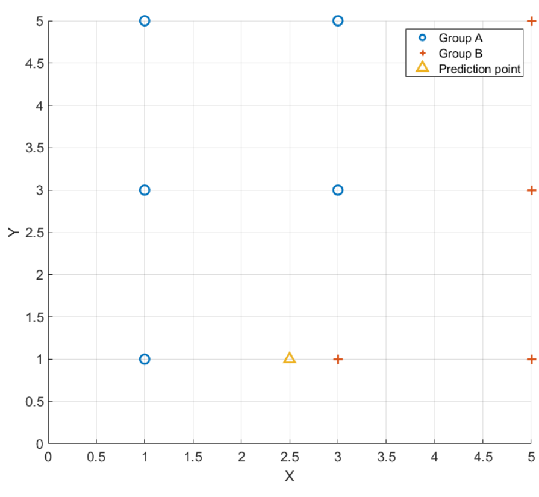
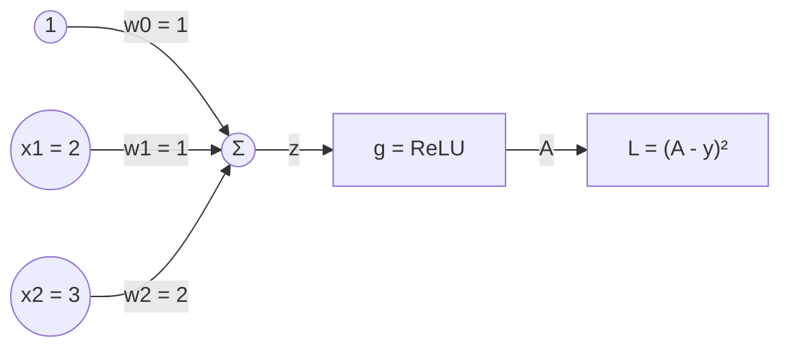

# HW4 Assignment Explanation — Machine Learning and Neural Network Control

[Repository Guide](../../README.md) | [English](Assignment-Explanation.md) | [한국어](Assignment-Explanation.ko.md)

> **Last Updated:** 2026-11-04

> **Learning Objectives:**
> 1. Compute distances in k-nearest neighbor classification and explain why the prediction changes with $k$
> 2. Fit a simple linear regression model by least squares and evaluate it with the coefficient of determination and RMSE
> 3. Compute the forward pass of a perceptron and find the gradients of the loss with respect to the weights with the chain rule
> 4. Find the inputs that bring a discrete-time state equation to a target state by repeated substitution
> 5. Compute control inputs from a plant model with the principles of neural network predictive control and NARMA-L2 control

---

## Table of Contents

- [1. Assignment Layout](#1-assignment-layout)
- [2. Problem 1: k-Nearest Neighbor Classification](#2-problem-1-k-nearest-neighbor-classification)
  - [2.1 k-NN Classification](#21-k-nn-classification)
  - [2.2 Classifying the Prediction Point](#22-classifying-the-prediction-point)
- [3. Problem 2: Linear Regression and Model Evaluation](#3-problem-2-linear-regression-and-model-evaluation)
  - [3.1 Least Squares Linear Regression](#31-least-squares-linear-regression)
  - [3.2 Coefficient of Determination](#32-coefficient-of-determination)
  - [3.3 RMSE on New Samples](#33-rmse-on-new-samples)
- [4. Problem 3: Gradients of a Perceptron](#4-problem-3-gradients-of-a-perceptron)
  - [4.1 The Perceptron and ReLU](#41-the-perceptron-and-relu)
  - [4.2 Gradients by the Chain Rule](#42-gradients-by-the-chain-rule)
- [5. Problem 4: Input Design for a Discrete-Time System](#5-problem-4-input-design-for-a-discrete-time-system)
- [6. Problem 5: Neural Network Predictive Control](#6-problem-5-neural-network-predictive-control)
  - [6.1 Principle of Neural Network Predictive Control](#61-principle-of-neural-network-predictive-control)
  - [6.2 Computing the Control Inputs](#62-computing-the-control-inputs)
- [7. Problem 6: NARMA-L2 Control](#7-problem-6-narma-l2-control)
  - [7.1 The NARMA-L2 Model and Control Law](#71-the-narma-l2-model-and-control-law)
  - [7.2 Computing the Control Inputs](#72-computing-the-control-inputs)
- [Summary](#summary)
- [Self-Check Questions](#self-check-questions)
- [References](#references)

---

<br>

## 1. Assignment Layout

This assignment covers the learning methods of artificial intelligence (Week 12), artificial neural networks and their training (Week 13), and neural-network-based control (Week 14). Problems 1 and 2 are classification and regression in supervised learning, Problem 3 is the gradient computation at the heart of neural network training, Problem 4 is input design for a discrete-time system, and Problems 5 and 6 are two methods that set control inputs with a plant model built from a neural network.

```text
Coursework/HW04_Machine-Learning-and-Neural-Network-Control/
├── Original/
│   └── hw4.pdf                    # assignment handout
└── Solution/
    └── Assignment-Report.pdf      # submitted solution (handwritten on the handout)
```

*Figure 1. Directory layout of HW4*

| Problem | Content | This Document |
|:-----|:-----|:-----|
| 1 | Given samples of two groups, estimate the group of the prediction point $(2.5, 1)$ with 1-NN, 3-NN, and 5-NN | Section 2 |
| 2 | Fit a linear regression to the samples $(0, 0)$, $(1, 3)$, $(2, 4)$ and find the prediction at $x = 1/3$, $R^2$, and the RMSE on two additional samples | Section 3 |
| 3 | For a perceptron with inputs $x_1 = 2$, $x_2 = 3$, target $y = 10$, and the ReLU activation function, find the derivative of ReLU and $\partial L/\partial w_0$, $\partial L/\partial w_1$, $\partial L/\partial w_2$ | Section 4 |
| 4 | For $x(k+1) = Ax(k) + Bu(k)$, find the inputs $u(k)$ and $u(k+1)$ that bring $x(k) = [1, 1]^T$ to $x(k+2) = [2, 2]^T$ | Section 5 |
| 5 | With the neural network model $\hat{y}(k+1) = \big(y(k) + 2u(k)\big)^2$ and neural network predictive control with $\rho = 0$, find $u(0)$ and $u(1)$ that produce $y_r(1) = 4$ and $y_r(2) = 9$ | Section 6 |
| 6 | With the neural network model $\hat{y}(k+1) = y(k)\big(1 + u(k)\big) + u(k-1)\big(2 + u(k)\big)$ and NARMA-L2 control, find $u(1)$ and $u(2)$ that produce $y_r(2) = 5$ and $y_r(3) = 13$ | Section 7 |

*Table 1. Problems of HW4 and the sections of this document that cover them*

---

<br>

## 2. Problem 1: k-Nearest Neighbor Classification

### 2.1 k-NN Classification

**k-nearest neighbors (k-NN)** classification is a supervised learning method that stores all training samples with known groups (classes) and, when a new point arrives, finds the $k$ training samples closest to it and decides its group by majority vote (Week 12). It does not compute model parameters in a training step but computes distances at prediction time, so it is also called lazy learning. The distance is usually the **Euclidean distance**.

```math
d\big((x_1, y_1), (x_2, y_2)\big) = \sqrt{(x_1 - x_2)^2 + (y_1 - y_2)^2}
```

With a small $k$, the prediction is sensitive to the few closest samples, especially noisy ones, and with a large $k$ the boundary becomes smoother but samples of the other group farther away also take part in the vote. When classifying two groups, $k$ is often chosen odd to avoid ties.

### 2.2 Classifying the Prediction Point



*Figure 2. Samples of the two groups and the prediction point*

In Figure 2, group A (circles) consists of the five points $(1, 1)$, $(1, 3)$, $(1, 5)$, $(3, 3)$, $(3, 5)$, and group B (crosses) of the four points $(3, 1)$, $(5, 1)$, $(5, 3)$, $(5, 5)$. The distances from the prediction point $(2.5, 1)$ to the samples, in order of closeness, are given in Table 2.

| Rank | Sample | Group | Squared Distance | Distance |
|:-----|:-----|:-----|:-----|:-----|
| 1 | $(3, 1)$ | B | $0.5^2 + 0^2 = 0.25$ | $0.5$ |
| 2 | $(1, 1)$ | A | $1.5^2 + 0^2 = 2.25$ | $1.5$ |
| 3 | $(3, 3)$ | A | $0.5^2 + 2^2 = 4.25$ | $2.062$ |
| 4 | $(1, 3)$ | A | $1.5^2 + 2^2 = 6.25$ | $2.5$ |
| 4 | $(5, 1)$ | B | $2.5^2 + 0^2 = 6.25$ | $2.5$ |
| 6 | $(5, 3)$ | B | $2.5^2 + 2^2 = 10.25$ | $3.202$ |
| 7 | $(3, 5)$ | A | $0.5^2 + 4^2 = 16.25$ | $4.031$ |
| 8 | $(1, 5)$ | A | $1.5^2 + 4^2 = 18.25$ | $4.272$ |
| 9 | $(5, 5)$ | B | $2.5^2 + 4^2 = 22.25$ | $4.717$ |

*Table 2. Distances from the prediction point to the samples*

- **1-NN:** The closest sample $(3, 1)$ is B, so the answer is **group B**.
- **3-NN:** The three closest samples $(3, 1)$, $(1, 1)$, $(3, 3)$ belong to B, A, A, giving A 2 votes and B 1 vote, so the answer is **group A**.
- **5-NN:** The fourth and fifth samples $(1, 3)$ and $(5, 1)$ have the same distance 2.5, but both are among the five neighbors, so their order does not affect the result. The five neighbors belong to B, A, A, A, B, giving A 3 votes and B 2 votes, so the answer is **group A**.

The point closest to the prediction point is B, but there are more A points around it, so the result changes to A as $k$ grows. Since $k$ changes the prediction on the same data, $k$ is a **hyperparameter** chosen with validation data or cross-validation.

> **[Machine Learning]** k-NN is sensitive to the units of the features. If one feature has a much larger range than the others, it nearly determines the distance by itself, so each feature is usually standardized or normalized to the same range before computing distances. In this problem the two coordinates have the same range, so no normalization is needed.

---

<br>

## 3. Problem 2: Linear Regression and Model Evaluation

### 3.1 Least Squares Linear Regression

**Linear regression** is a supervised learning method that approximates the relation between an input $x$ and an output $y$ by a line $\hat{y} = ax + b$. The slope $a$ and intercept $b$ are chosen to minimize the sum of squared **residuals** $`e_i = y_i - \hat{y}_i`$, $\text{SSE} = \sum_i (y_i - ax_i - b)^2$, which is called the **least squares method**. Taking the partial derivatives of SSE with respect to $a$ and $b$ and setting them to 0 gives the **normal equations**.

```math
\frac{\partial\,\text{SSE}}{\partial a} = -2\sum_i x_i(y_i - ax_i - b) = 0, \qquad \frac{\partial\,\text{SSE}}{\partial b} = -2\sum_i (y_i - ax_i - b) = 0
```

Rearranged, these are $a\sum x_i^2 + b\sum x_i = \sum x_iy_i$ and $a\sum x_i + nb = \sum y_i$. For the three samples, $n = 3$, $\sum x_i = 0 + 1 + 2 = 3$, $\sum x_i^2 = 0 + 1 + 4 = 5$, $\sum y_i = 0 + 3 + 4 = 7$, and $\sum x_iy_i = 0 + 3 + 8 = 11$, so

```math
5a + 3b = 11, \qquad 3a + 3b = 7 \quad\Longrightarrow\quad 2a = 4, \quad a = 2, \quad b = \frac{7 - 6}{3} = \frac{1}{3}
```

The same result follows from the formulas written with means, $a = \sum(x_i - \bar{x})(y_i - \bar{y})/\sum(x_i - \bar{x})^2$ and $b = \bar{y} - a\bar{x}$. With $\bar{x} = 1$ and $\bar{y} = 7/3$, the numerator is $(-1)(-\frac{7}{3}) + 0 + (1)(\frac{5}{3}) = 4$ and the denominator $1 + 0 + 1 = 2$, so $a = 2$ and $b = \frac{7}{3} - 2 = \frac{1}{3}$. The regression line is $\hat{y} = 2x + \frac{1}{3}$, and the prediction at $x = \frac{1}{3}$ is $\hat{y} = \frac{2}{3} + \frac{1}{3} = 1$.

### 3.2 Coefficient of Determination

The **coefficient of determination** $R^2$ is the fraction of the total variation of the output that the model explains. It is defined with the total sum of squares $\text{SST} = \sum(y_i - \bar{y})^2$ and the residual sum of squares SSE as follows.

```math
R^2 = 1 - \frac{\text{SSE}}{\text{SST}}
```

| $x_i$ | $y_i$ | $`\hat{y}_i = 2x_i + \frac{1}{3}`$ | Residual $`y_i - \hat{y}_i`$ | $y_i - \bar{y}$ |
|:-----|:-----|:-----|:-----|:-----|
| $0$ | $0$ | $1/3$ | $-1/3$ | $-7/3$ |
| $1$ | $3$ | $7/3$ | $2/3$ | $2/3$ |
| $2$ | $4$ | $13/3$ | $-1/3$ | $5/3$ |

*Table 3. Predictions and residuals of the training samples*

```math
\text{SSE} = \frac{1}{9} + \frac{4}{9} + \frac{1}{9} = \frac{2}{3}, \qquad \text{SST} = \frac{49}{9} + \frac{4}{9} + \frac{25}{9} = \frac{26}{3}, \qquad R^2 = 1 - \frac{2/3}{26/3} = 1 - \frac{1}{13} = \frac{12}{13} \approx 0.923
```

The model explains about 92.3% of the output variation. In simple linear regression with an intercept, $R^2$ equals the square of the correlation coefficient $r$ between $x$ and $y$, and for this data $r = \sqrt{12/13} \approx 0.961$. The R value of Week 12 is the correlation coefficient between the predictions and the targets; in simple linear regression the prediction $\hat{y}$ is a linear function of $x$, and the slope is positive for this data, so that value also equals $r$, and the closer it is to 1, the better the predictions match the targets.

### 3.3 RMSE on New Samples

The **root mean square error (RMSE)**, $`\text{RMSE} = \sqrt{\frac{1}{n}\sum_i (y_i - \hat{y}_i)^2}`$, gives the size of the prediction error in the same units as the output. The two additional samples were not used to fit the regression line, so their RMSE shows the performance on data the model has not seen, that is, the test error.

```math
x = -\frac{1}{3}: \;\hat{y} = -\frac{2}{3} + \frac{1}{3} = -\frac{1}{3}, \quad y - \hat{y} = 0 + \frac{1}{3} = \frac{1}{3}, \qquad x = \frac{1}{3}: \;\hat{y} = 1, \quad y - \hat{y} = \frac{4}{3} - 1 = \frac{1}{3}
```

```math
\text{RMSE} = \sqrt{\frac{1}{2}\left[\left(\frac{1}{3}\right)^2 + \left(\frac{1}{3}\right)^2\right]} = \sqrt{\frac{1}{9}} = \frac{1}{3}
```

The RMSE on the training samples is $\sqrt{\text{SSE}/3} = \sqrt{2/9} \approx 0.471$, so here the error on the new samples is smaller, but in general the error on new data is larger because the model has been fitted to the training data. This is why model performance is evaluated on data not used for training (training, validation, and test data in Week 12).

---

<br>

## 4. Problem 3: Gradients of a Perceptron

### 4.1 The Perceptron and ReLU

A **perceptron** is an artificial neuron that passes the weighted sum of its inputs through an activation function to produce an output (Week 13). As in Figure 3, the perceptron of this problem multiplies the constant input 1 (bias) and the two inputs $x_1$, $x_2$ by the weights $w_0$, $w_1$, $w_2$, adds them, and produces the output $A$ through the activation function $g$. The loss is the squared error from the target $y$, $L = (A - y)^2$.



*Figure 3. Perceptron and loss of Problem 3*

**ReLU (rectified linear unit)** is $g(z) = \max(0, z)$, which passes positive values unchanged and turns negative values into 0. Its derivative is the slope of the line on each interval.

```math
g'(z) = \begin{cases} 1, & z > 0 \\ 0, & z < 0 \end{cases}
```

At $z = 0$ the left slope 0 and the right slope 1 differ, so the function is not differentiable there. Implementations fix the value at this point to either 0 or 1, and since the input is rarely exactly 0, either choice has almost no effect on training.

### 4.2 Gradients by the Chain Rule

First, the **forward propagation** computes each value.

```math
z = w_0 \cdot 1 + w_1x_1 + w_2x_2 = 1 + 1 \cdot 2 + 2 \cdot 3 = 9, \qquad A = g(9) = 9, \qquad L = (9 - 10)^2 = 1
```

The loss is a composition of functions, $L(A(z(w)))$, so the gradient with respect to each weight is found with the **chain rule**, multiplying the derivatives starting from the outermost function.

```math
\frac{\partial L}{\partial w_i} = \frac{\partial L}{\partial A}\cdot\frac{\partial A}{\partial z}\cdot\frac{\partial z}{\partial w_i}, \qquad \frac{\partial L}{\partial A} = 2(A - y) = -2, \qquad \frac{\partial A}{\partial z} = g'(9) = 1, \qquad \frac{\partial z}{\partial w_i} = x_i \;(x_0 = 1)
```

```math
\frac{\partial L}{\partial w_0} = (-2)(1)(1) = -2, \qquad \frac{\partial L}{\partial w_1} = (-2)(1)(2) = -4, \qquad \frac{\partial L}{\partial w_2} = (-2)(1)(3) = -6
```

All three gradients are negative, so increasing the weights decreases the loss. This means the weighted sum must grow because the output 9 is below the target 10, and the larger the input multiplying a weight, the more that weight affects the output, so the larger its gradient. **Gradient descent** repeats $`w_i \leftarrow w_i - \eta\,\partial L/\partial w_i`$ with a learning rate $\eta$. For example, with $\eta = 0.01$ the weights become $(1.02, 1.04, 2.06)$, the weighted sum $1.02 + 2.08 + 6.18 = 9.28$, and the loss decreases to $(9.28 - 10)^2 \approx 0.518$. Extending this computation, which multiplies derivatives from the output toward the input, to several layers is the **backpropagation** of Week 13.

---

<br>

## 5. Problem 4: Input Design for a Discrete-Time System

$x(k+1) = Ax(k) + Bu(k)$ is a **discrete-time state equation** that determines the next state from the state $x(k)$ and the input $u(k)$. Substituting the one-step equation once more writes the state two steps ahead in terms of the current state and the two inputs.

```math
x(k+2) = Ax(k+1) + Bu(k+1) = A\big[Ax(k) + Bu(k)\big] + Bu(k+1) = A^2x(k) + ABu(k) + Bu(k+1)
```

The needed matrices and vectors are computed.

```math
A^2 = \begin{bmatrix} 1 & 2 \\ 2 & 1 \end{bmatrix}\begin{bmatrix} 1 & 2 \\ 2 & 1 \end{bmatrix} = \begin{bmatrix} 5 & 4 \\ 4 & 5 \end{bmatrix}, \qquad A^2x(k) = \begin{bmatrix} 9 \\ 9 \end{bmatrix}, \qquad AB = \begin{bmatrix} 1 & 2 \\ 2 & 1 \end{bmatrix}\begin{bmatrix} 2 \\ 1 \end{bmatrix} = \begin{bmatrix} 4 \\ 5 \end{bmatrix}
```

Inserting the target state gives a system of linear equations in the two inputs.

```math
\begin{bmatrix} 2 \\ 2 \end{bmatrix} = \begin{bmatrix} 9 \\ 9 \end{bmatrix} + \begin{bmatrix} 4 \\ 5 \end{bmatrix}u(k) + \begin{bmatrix} 2 \\ 1 \end{bmatrix}u(k+1) \quad\Longrightarrow\quad \begin{bmatrix} 4 & 2 \\ 5 & 1 \end{bmatrix}\begin{bmatrix} u(k) \\ u(k+1) \end{bmatrix} = \begin{bmatrix} -7 \\ -7 \end{bmatrix}
```

The determinant of the coefficient matrix is $4 \cdot 1 - 2 \cdot 5 = -6 \ne 0$, so the solution is unique. Substituting $u(k+1) = -7 - 5u(k)$ from the second equation into the first gives $4u(k) - 14 - 10u(k) = -7$, that is, $-6u(k) = 7$.

```math
u(k) = -\frac{7}{6}, \qquad u(k+1) = -7 - 5\left(-\frac{7}{6}\right) = -\frac{7}{6}
```

As a check, $x(k+1) = [3, 3]^T + [2, 1]^T(-\frac{7}{6}) = [\frac{2}{3}, \frac{11}{6}]^T$, and $x(k+2) = A[\frac{2}{3}, \frac{11}{6}]^T + [2, 1]^T(-\frac{7}{6}) = [\frac{13}{3} - \frac{7}{3}, \frac{19}{6} - \frac{7}{6}]^T = [2, 2]^T$. Since it predicts future states with a model and chooses the upcoming inputs so that the prediction equals the target, this problem is the predictive control of Section 6 solved with a linear model.

> **Note:** If the coefficient matrix $`[AB \;\; B]`$ is invertible, any target state can be reached in two steps. In general, if the matrix $`[B \;\; AB \;\; \cdots \;\; A^{n-1}B]`$ of an $`n`$th-order system has rank $n$, any state can be moved to any other state within $n$ steps, and this property is called controllability.

---

<br>

## 6. Problem 5: Neural Network Predictive Control

### 6.1 Principle of Neural Network Predictive Control

**Neural network predictive control** consists of two stages (Week 14). First, a neural network is trained on input-output data of the plant to build a plant model $\hat{y}(k+1)$ that predicts the next output (system identification). Then, at every time step, this model predicts future outputs, and optimization finds the future inputs that minimize the following performance index $J$.

```math
J = \sum_{j=N_1}^{N_2}\big(y_r(k+j) - \hat{y}(k+j)\big)^2 + \rho\sum_{j=1}^{N_u}\big(u(k+j-1) - u(k+j-2)\big)^2
```

The first term is the error between the reference response $y_r$ and the predicted output over the prediction horizon, the second term is a penalty on changes of the input, and $\rho$ sets the weighting between the two terms. Of the input sequence found by the optimization, only the first input is applied to the plant, and the same optimization is repeated at the next time step with the new measurement. This is called the **receding horizon** approach.

### 6.2 Computing the Control Inputs

With $\rho = 0$ there is no penalty on input changes, so the inputs that make the predicted output exactly equal to the reference response minimize $J$ at $J = 0$. The second-step prediction uses the first-step prediction $\hat{y}(1) = y_r(1) = 4$ as $y(1)$.

```math
\hat{y}(1) = \big(y(0) + 2u(0)\big)^2 = \big(1 + 2u(0)\big)^2 = 4 \quad\Longrightarrow\quad 1 + 2u(0) = \pm 2 \quad\Longrightarrow\quad u(0) = \frac{1}{2} \;\text{or}\; -\frac{3}{2}
```

```math
\hat{y}(2) = \big(y(1) + 2u(1)\big)^2 = \big(4 + 2u(1)\big)^2 = 9 \quad\Longrightarrow\quad 4 + 2u(1) = \pm 3 \quad\Longrightarrow\quad u(1) = -\frac{1}{2} \;\text{or}\; -\frac{7}{2}
```

$\hat{y}(2)$ is set by $y(1) = 4$ alone regardless of $u(0)$, so any pairing of the two values of $u(0)$ with the two values of $u(1)$ gives $J = 0$. Therefore, with $\rho = 0$, all four combinations $(u(0), u(1)) = (\frac{1}{2}, -\frac{1}{2})$, $(\frac{1}{2}, -\frac{7}{2})$, $(-\frac{3}{2}, -\frac{1}{2})$, $(-\frac{3}{2}, -\frac{7}{2})$ are solutions. There are several solutions because the model is quadratic in the input, so two inputs give the same output at each step. With $\rho > 0$, the penalty on input changes makes the four combinations no longer have the same $J$, and the optimal inputs are set by a trade-off between tracking error and input change. Among the four combinations, $(\frac{1}{2}, -\frac{1}{2})$ has the smallest input magnitudes and also the smallest change from $u(0)$ to $u(1)$ (the change of 1 equals that of $`(-\frac{3}{2}, -\frac{1}{2})`$), placing the least load on a real actuator, so it is the suitable choice when one combination must be picked.

---

<br>

## 7. Problem 6: NARMA-L2 Control

### 7.1 The NARMA-L2 Model and Control Law

A nonlinear discrete-time system can be described as a nonlinear function of past outputs and inputs, $\hat{y}(k+1) = N\big[y(k), y(k-1), \ldots, u(k), u(k-1), \ldots\big]$, which is called a **NARMA (nonlinear autoregressive moving average)** model. Finding the $u(k)$ that produces $y_r(k+1)$ in this model requires solving a nonlinear equation, so **NARMA-L2** approximates the model in a form that is linear in the current input $u(k)$ [1].

```math
\hat{y}(k+1) = f\big[y(k), \ldots, u(k-1), \ldots\big] + g\big[y(k), \ldots, u(k-1), \ldots\big]\cdot u(k)
```

$f$ and $g$ are each learned by a neural network, and neither contains the current input $u(k)$. Setting $\hat{y}(k+1) = y_r(k+1)$ gives the control input directly in a single expression.

```math
u(k) = \frac{y_r(k+1) - f\big[y(k), \ldots, u(k-1), \ldots\big]}{g\big[y(k), \ldots, u(k-1), \ldots\big]}, \qquad g \ne 0
```

Unlike the predictive control of Section 6, which must solve an optimization at every time step, NARMA-L2 control computes the input with a single division, so it needs little computation. On the other hand, the input becomes very large when $g$ is close to 0, so implementations limit the input.

### 7.2 Computing the Control Inputs

The given model is expanded and split into the terms with and without $u(k)$.

```math
\hat{y}(k+1) = y(k) + y(k)u(k) + 2u(k-1) + u(k-1)u(k) = \underbrace{y(k) + 2u(k-1)}_{f} + \underbrace{\big(y(k) + u(k-1)\big)}_{g}u(k)
```

The model is already in NARMA-L2 form, so $f = y(k) + 2u(k-1)$ and $g = y(k) + u(k-1)$. **$k = 1$:** since $y(1) = 1$ and $u(0) = 1$, $f = 1 + 2 = 3$ and $g = 1 + 1 = 2$.

```math
u(1) = \frac{y_r(2) - f}{g} = \frac{5 - 3}{2} = 1
```

Assuming this input makes the output $y(2) = y_r(2) = 5$, the next step is computed. **$k = 2$:** since $y(2) = 5$ and $u(1) = 1$, $f = 5 + 2 = 7$ and $g = 5 + 1 = 6$.

```math
u(2) = \frac{y_r(3) - f}{g} = \frac{13 - 7}{6} = 1
```

As a check, $\hat{y}(2) = 1 \cdot (1 + 1) + 1 \cdot (2 + 1) = 5$ and $\hat{y}(3) = 5 \cdot (1 + 1) + 1 \cdot (2 + 1) = 13$, matching both reference responses.

| Item | Neural Network Predictive Control | NARMA-L2 Control |
|:-----|:-----|:-----|
| Plant model | General nonlinear neural network model | Approximate model $`f + g\,u(k)`$, linear in the current input |
| Computing the input | Numerical optimization of the performance index $J$ at every time step | Algebraic expression $u(k) = (y_r - f)/g$ |
| Computation | Heavy | Light |
| Controlling the input size | Penalty on input changes through $\rho$ | None by itself; the input grows when $g$ is small |

*Table 4. Comparison of neural network predictive control and NARMA-L2 control*

---

<br>

## Summary

| Concept | Key Summary |
|:-----|:-----|
| k-NN classification | The group is decided by majority vote of the $k$ closest training samples; Problem 1 gives B for 1-NN and A for 3-NN and 5-NN. |
| Least squares linear regression | The normal equations that minimize the sum of squared residuals give $\hat{y} = 2x + 1/3$, and the prediction at $x = 1/3$ is 1. |
| Coefficient of determination | $R^2 = 1 - \text{SSE}/\text{SST} = 12/13 \approx 0.923$, which equals the square of the correlation coefficient in simple linear regression. |
| RMSE | The RMSE on the two samples not used for training is $1/3$, representing the prediction error on unseen data. |
| ReLU and its derivative | $g(z) = \max(0, z)$, and $g'(z)$ is 1 for $z > 0$ and 0 for $z < 0$; it is not differentiable at $z = 0$, where a value is fixed by convention. |
| Gradients of the perceptron | The chain rule $`\partial L/\partial w_i = 2(A - y)\,g'(z)\,x_i`$ gives $(-2, -4, -6)$, and negative gradients mean that increasing the weights decreases the loss. |
| Inputs of a discrete-time system | Setting $x(k+2) = A^2x(k) + ABu(k) + Bu(k+1)$ equal to the target state gives $u(k) = u(k+1) = -7/6$. |
| Neural network predictive control | The inputs minimize $J$, made of the prediction error and a penalty on input changes; Problem 5 with $\rho = 0$ has four solutions, $u(0) = 1/2$ or $-3/2$ combined with $u(1) = -1/2$ or $-7/2$. |
| NARMA-L2 control | The model is approximated as $`f + g\,u(k)`$ and the input is found directly as $u(k) = (y_r - f)/g$; Problem 6 gives $u(1) = u(2) = 1$. |

---

<br>

## Self-Check Questions

1. **Choosing k:** In Problem 1, which group does 7-NN assign to the prediction point?

   <details>
   <summary>Answer</summary>

   In order of distance in Table 2, the seven samples belong to B, A, A, A, B, B, A. A has 4 votes and B 3, so the point is assigned to group A.

   </details>

2. **Property of residuals:** Explain with the normal equations why the training residuals of Problem 2, $-1/3$, $2/3$, $-1/3$, sum to 0.

   <details>
   <summary>Answer</summary>

   The normal equation for $b$, $\sum(y_i - ax_i - b) = 0$, is exactly the condition that the residuals sum to 0. In least squares regression with an intercept the residuals always sum to 0, and the regression line passes through the point $(\bar{x}, \bar{y}) = (1, 7/3)$.

   </details>

3. **Inactive neuron:** In Problem 3, if the weights were $w_0 = -10$, $w_1 = 1$, $w_2 = 2$, what would the three gradients be, and would gradient descent make progress?

   <details>
   <summary>Answer</summary>

   $z = -10 + 2 + 6 = -2 < 0$, so $A = 0$ and $g'(z) = 0$. The factor 0 in the chain rule makes all three gradients 0, so the weights do not change. Training stops even though the loss $(0 - 10)^2 = 100$ is large, and a neuron whose ReLU input stays negative like this is called a dying ReLU.

   </details>

4. **Reaching in one step:** Can the system of Problem 4 be brought to $x(k+1) = [2, 2]^T$ in a single step?

   <details>
   <summary>Answer</summary>

   $x(k+1) = Ax(k) + Bu(k) = [3, 3]^T + [2, 1]^Tu(k)$. The first component requires $3 + 2u = 2$, so $u = -1/2$, and the second requires $3 + u = 2$, so $u = -1$; the two values differ, so there is no solution. With one input and two states, a single step can move only along the direction of $B$, and two steps are needed to reach an arbitrary target.

   </details>

5. **Limitation of NARMA-L2:** In Problem 6, what problem arises at the moment when $y(k) = -u(k-1)$?

   <details>
   <summary>Answer</summary>

   $g = y(k) + u(k-1) = 0$, so the denominator of the control law is 0. Then $\hat{y}(k+1) = f$ and the output no longer depends on the input, so no $u(k)$ can change the output, and when $g$ is close to 0 the required input becomes very large.

   </details>

---

<br>

## References

1. K. S. Narendra and S. Mukhopadhyay, "Adaptive control using neural networks and approximate models," *IEEE Transactions on Neural Networks*, vol. 8, no. 3, pp. 475-485, 1997.
