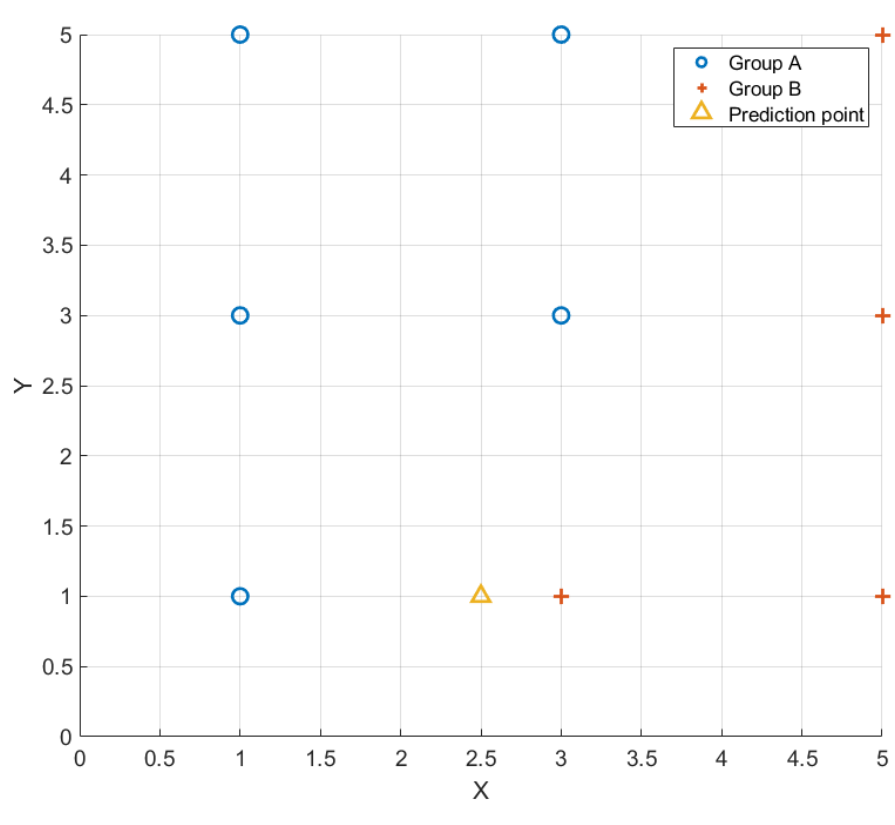
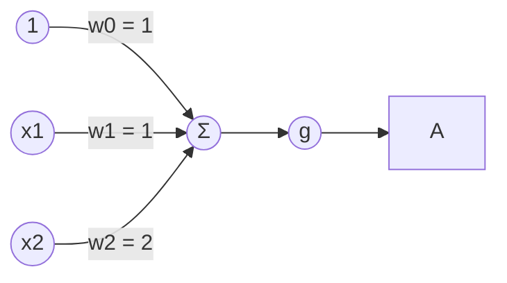

# HW4 과제 안내문 — 기계 학습과 인공신경망 제어

[레포지토리 안내](../../../README.ko.md) | [English](Assignment.md) | [한국어](Assignment.ko.md)

> **최종 수정일:** 2026-11-16

인공신경망제어시스템 4차 과제이다. 12주차의 학습 방법, 13주차의 인공신경망과 그 학습, 14주차의 인공신경망 기반 제어를 다룬다.

- **제출 기한:** 2025-12-05 (금)

---

<br>

## 문제 1. k-최근접 이웃 (10점)

아래 그림과 같이 두 그룹의 샘플들이 주어져 있다. 주어진 예측 점 $(2.5, 1)$에 대하여, 1-nearest neighbor, 3-nearest neighbor, 5-nearest neighbor를 사용하여 해당 예측 점이 속하는 그룹을 각각 추정하라.



*그림 1. 두 그룹의 샘플과 예측 점*

그림의 좌표는 그룹 A(원)가 $(1, 1)$, $(1, 3)$, $(1, 5)$, $(3, 3)$, $(3, 5)$이고, 그룹 B(십자)가 $(3, 1)$, $(5, 1)$, $(5, 3)$, $(5, 5)$이며, 예측 점(삼각형)이 $(2.5, 1)$이다.

---

<br>

## 문제 2. 선형 회귀 (30점)

세 개의 샘플 $(0, 0)$, $(1, 3)$, $(2, 4)$가 주어져 있다.

- A. 선형 회귀(linear regression)를 수행하고, $x = \frac{1}{3}$일 때의 예측값을 계산하라. (10점)
- B. $R^2$ 값을 계산하라. (10점)
- C. 두 개의 추가 샘플 $(-\frac{1}{3}, 0)$, $(\frac{1}{3}, \frac{4}{3})$에 대해 RMSE를 계산하라. (10점)

---

<br>

## 문제 3. 퍼셉트론 (20점)

아래 그림과 같은 퍼셉트론(perceptron)이 주어져 있다. 입력 데이터는 $x_1 = 2$, $x_2 = 3$이며, 목표값(target data)은 $y = 10$으로 주어져 있다. 활성화 함수는 ReLU(Rectified Linear Unit)이다.



*그림 2. 퍼셉트론*

손실은 $L = (A - y)^2$이다. ReLU의 그래프는 음의 입력에서 $y = 0$, 양의 입력에서 $y = x$인 두 직선으로 이루어진다.

- A. ReLU의 도함수를 구하라. (5점)
- B. $\dfrac{\partial L}{\partial w_0}$, $\dfrac{\partial L}{\partial w_1}$, $\dfrac{\partial L}{\partial w_2}$를 계산하라. (15점)

---

<br>

## 문제 4. 동적 시스템의 입력 (10점)

다음과 같은 동적 시스템을 고려하라.

```math
x(k+1) = Ax(k) + Bu(k), \qquad A = \begin{bmatrix} 1 & 2 \\ 2 & 1 \end{bmatrix}, \quad B = \begin{bmatrix} 2 \\ 1 \end{bmatrix}
```

현재 상태가 $x(k) = [1, 1]^T$이고, 달성하고자 하는 목표 상태가 $x(k+2) = [2, 2]^T$일 때, 두 개의 시스템 입력 $u(k)$, $u(k+1)$을 구하라.

---

<br>

## 문제 5. 신경망 예측 제어 (15점)

다음과 같은 플랜트의 신경망 모델을 고려하라.

```math
\hat{y}(k+1) = \big(y(k) + 2u(k)\big)^2
```

현재 시스템의 응답은 $y(0) = 1$로 주어져 있을 때, $\rho = 0$으로 주어진 신경망 예측 제어(neural network predictive control)의 관점에서, 원하는 응답 $y_r(1) = 4$, $y_r(2) = 9$를 달성하기 위한 제어 입력 $u(0)$과 $u(1)$을 구하라.

---

<br>

## 문제 6. NARMA-L2 제어 (15점)

다음과 같은 플랜트의 신경망 모델을 고려하라.

```math
\hat{y}(k+1) = y(k)\big(1 + u(k)\big) + u(k-1)\big(2 + u(k)\big)
```

현재 시스템의 응답은 $y(1) = 1$이고, 이전 제어 입력은 $u(0) = 1$로 주어져 있다. NARMA-L2 제어의 관점에서, 원하는 응답이 $y_r(2) = 5$, $y_r(3) = 13$일 때, 필요한 제어 입력 $u(1)$과 $u(2)$를 구하라.

---

<br>

문제를 풀어 본 뒤 [과제 해설](../Assignment-Explanation.ko.md)에서 정답과 풀이를 볼 수 있다.
