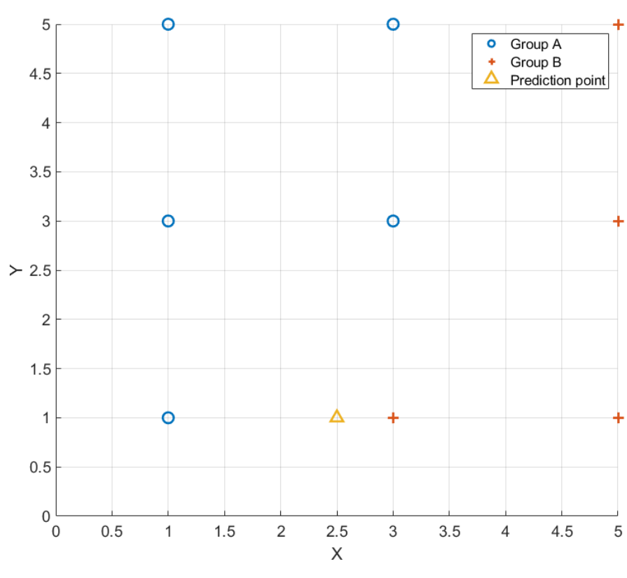
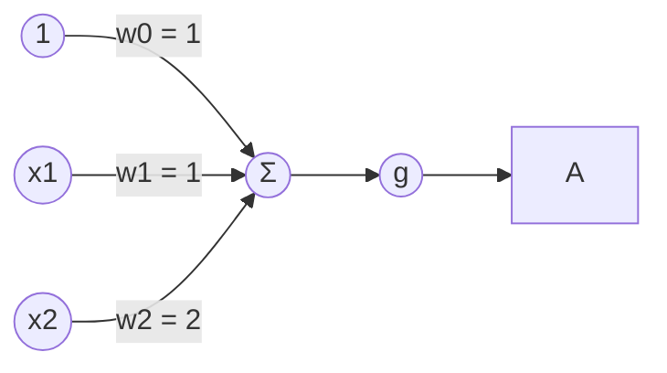

# HW4 Assignment Handout — Machine Learning and Neural Network Control

[Repository Guide](../../../README.md) | [English](Assignment.md) | [한국어](Assignment.ko.md)

> **Last Updated:** 2026-11-16

This is the fourth assignment of Neural Network Control Systems. It covers learning methods from Week 12, artificial neural networks and their training from Week 13, and neural-network-based control from Week 14.

- **Deadline:** 2025-12-05 (Fri)

---

<br>

## Problem 1. k-Nearest Neighbors (10 points)

Samples of two groups are given as in the figure below. For the given prediction point $(2.5, 1)$, estimate the group to which the prediction point belongs using 1-nearest neighbor, 3-nearest neighbor, and 5-nearest neighbor, respectively.



*Figure 1. Samples of two groups and the prediction point*

The coordinates in the figure are $(1, 1)$, $(1, 3)$, $(1, 5)$, $(3, 3)$, and $(3, 5)$ for Group A (circles), $(3, 1)$, $(5, 1)$, $(5, 3)$, and $(5, 5)$ for Group B (crosses), and $(2.5, 1)$ for the prediction point (triangle).

---

<br>

## Problem 2. Linear Regression (30 points)

Three samples $(0, 0)$, $(1, 3)$, and $(2, 4)$ are given.

- A. Perform linear regression and compute the prediction at $x = \frac{1}{3}$. (10 points)
- B. Compute the value of $R^2$. (10 points)
- C. Compute the RMSE on the two additional samples $(-\frac{1}{3}, 0)$ and $(\frac{1}{3}, \frac{4}{3})$. (10 points)

---

<br>

## Problem 3. Perceptron (20 points)

A perceptron is given as in the figure below. The input data are $x_1 = 2$ and $x_2 = 3$, and the target data is $y = 10$. The activation function is ReLU (Rectified Linear Unit).



*Figure 2. Perceptron*

The loss is $L = (A - y)^2$. The graph of ReLU consists of two lines, $y = 0$ for negative inputs and $y = x$ for positive inputs.

- A. Find the derivative of ReLU. (5 points)
- B. Compute $\dfrac{\partial L}{\partial w_0}$, $\dfrac{\partial L}{\partial w_1}$, and $\dfrac{\partial L}{\partial w_2}$. (15 points)

---

<br>

## Problem 4. Inputs of a Dynamic System (10 points)

Consider the following dynamic system.

```math
x(k+1) = Ax(k) + Bu(k), \qquad A = \begin{bmatrix} 1 & 2 \\ 2 & 1 \end{bmatrix}, \quad B = \begin{bmatrix} 2 \\ 1 \end{bmatrix}
```

When the current state is $x(k) = [1, 1]^T$ and the target state to be reached is $x(k+2) = [2, 2]^T$, find the two system inputs $u(k)$ and $u(k+1)$.

---

<br>

## Problem 5. Neural Network Predictive Control (15 points)

Consider the following neural network model of a plant.

```math
\hat{y}(k+1) = \big(y(k) + 2u(k)\big)^2
```

The current response of the system is given as $y(0) = 1$. From the viewpoint of neural network predictive control with $\rho = 0$, find the control inputs $u(0)$ and $u(1)$ that achieve the desired responses $y_r(1) = 4$ and $y_r(2) = 9$.

---

<br>

## Problem 6. NARMA-L2 Control (15 points)

Consider the following neural network model of a plant.

```math
\hat{y}(k+1) = y(k)\big(1 + u(k)\big) + u(k-1)\big(2 + u(k)\big)
```

The current response of the system is $y(1) = 1$, and the previous control input is given as $u(0) = 1$. From the viewpoint of NARMA-L2 control, when the desired responses are $y_r(2) = 5$ and $y_r(3) = 13$, find the required control inputs $u(1)$ and $u(2)$.

---

<br>

After solving the problems, see the [assignment explanation](../Assignment-Explanation.md) for the answers and solutions.
