# 1주차 이론 — 인공신경망 제어시스템 소개

[레포지토리 안내](../../README.ko.md) | [English](Concepts_Lecture.md) | [한국어](Concepts_Lecture.ko.md)

> **최종 수정일:** 2026-11-04

> **학습 목표:**
> 1. 시스템과 제어시스템을 정의하고, 개루프 제어시스템과 폐루프 제어시스템을 피드백의 유무로 구분할 수 있다
> 2. 물레방아, 헤론의 공, 크테시비오스의 물시계, 와트의 원심 조속기를 예로 들어 제어시스템의 역사를 설명할 수 있다
> 3. 인공뉴런과 다층 인공신경망의 구조를 설명하고, 인공신경망이 제어시스템 안에서 쓰이는 방식을 설명할 수 있다
> 4. 제어 이론의 주요 개념(모델링, 피드백, 제어기, 안정성, 성능)과 제어 입력, 외란, 상태의 관계를 설명할 수 있다
> 5. 선형 시스템의 두 조건을 쓰고, 개루프 제어와 폐루프 제어의 장단점을 예제로 비교할 수 있다
> 6. 드론 고도 제어 예제에서 비례 제어기의 정상 상태 오차를 계산하고, 적분 경로와 미분 경로가 각각 하는 일을 설명할 수 있다

---

## 목차

- [1. 인공신경망 제어시스템](#1-인공신경망-제어시스템)
  - [1.1 시스템의 정의](#11-시스템의-정의)
  - [1.2 제어시스템](#12-제어시스템)
  - [1.3 개루프와 폐루프](#13-개루프와-폐루프)
  - [1.4 역사 속의 제어시스템](#14-역사-속의-제어시스템)
  - [1.5 인공신경망](#15-인공신경망)
  - [1.6 인공신경망 제어시스템](#16-인공신경망-제어시스템)
  - [1.7 과목의 학습 흐름](#17-과목의-학습-흐름)
- [2. 제어 이론](#2-제어-이론)
  - [2.1 제어 이론과 제어의 목표](#21-제어-이론과-제어의-목표)
  - [2.2 제어 이론의 주요 개념](#22-제어-이론의-주요-개념)
  - [2.3 제어 입력, 외란, 상태](#23-제어-입력-외란-상태)
  - [2.4 개루프 제어시스템](#24-개루프-제어시스템)
  - [2.5 폐루프 제어시스템](#25-폐루프-제어시스템)
  - [2.6 선형 제어시스템과 비선형 제어시스템](#26-선형-제어시스템과-비선형-제어시스템)
  - [2.7 개루프 제어의 예](#27-개루프-제어의-예)
  - [2.8 폐루프 제어의 구성 요소](#28-폐루프-제어의-구성-요소)
- [3. 제어시스템: 피드백 제어 구조와 PID 제어기](#3-제어시스템-피드백-제어-구조와-pid-제어기)
  - [3.1 피드백 제어시스템의 구조](#31-피드백-제어시스템의-구조)
  - [3.2 예제 1: 위치 제어](#32-예제-1-위치-제어)
  - [3.3 예제 2: 드론 고도 제어와 비례 제어기](#33-예제-2-드론-고도-제어와-비례-제어기)
  - [3.4 비례 적분 제어기](#34-비례-적분-제어기)
  - [3.5 비례 적분 미분 제어기](#35-비례-적분-미분-제어기)
- [개념 적용](#개념-적용)
- [요약](#요약)
- [점검 문제](#점검-문제)
- [참고 문헌](#참고-문헌)

---

<br>

## 1. 인공신경망 제어시스템

### 1.1 시스템의 정의

> **용어 정의:** **시스템(system)** 은 인간이나 자연에 의해 결합되어 하나의 통합적이고 복잡한 전체를 이루는 사물의 집합체이다. 공학의 관점에서 시스템은 특정 목표를 수행하기 위해 함께 작동하는 많은 구성 요소 또는 기능 단위의 상호 연결로 정의된다.

자동차, 로봇, 비행기는 모두 공학적 시스템이다. 자동차를 예로 들면 엔진, 변속기, 바퀴, 조향 장치, 제동 장치가 서로 연결되어 사람을 원하는 곳으로 옮긴다는 하나의 목표를 수행한다. 구성 요소 하나만으로는 이 목표를 이룰 수 없고, 요소들이 정해진 방식으로 상호 작용할 때 비로소 전체가 의미 있는 기능을 한다.

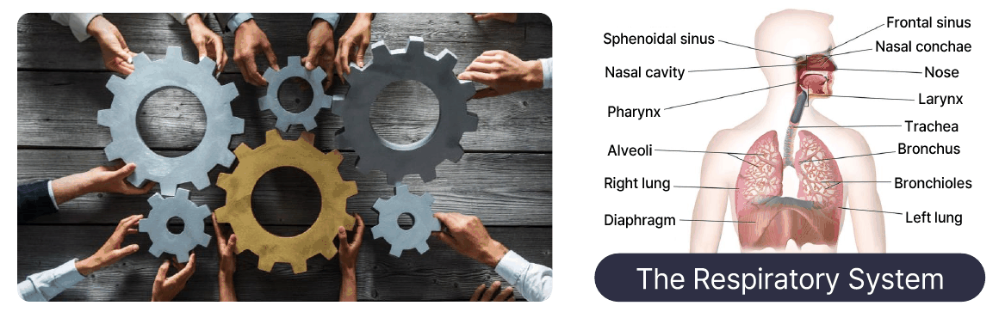

*그림 1. 서로 맞물린 톱니바퀴와 인체의 호흡계*

그림 1의 왼쪽은 여러 사람이 각자 톱니바퀴를 맞물려 하나의 기계 장치를 이루는 모습으로, 구성 요소가 연결되어 함께 움직인다는 시스템의 뜻을 상징한다. 오른쪽의 호흡계는 자연이 만든 시스템의 예이다. 코와 비강, 인두, 후두, 기관, 기관지, 세기관지, 폐포, 횡격막이 연결되어 공기를 들이마시고 내쉬며, 산소를 받아들이고 이산화탄소를 내보내는 하나의 기능을 수행한다.

### 1.2 제어시스템

> **용어 정의:** **제어시스템(control system)** 은 제어 루프를 사용하여 다른 장치나 시스템의 동작을 관리, 명령, 지시 또는 규제함으로써 목표하는 결과나 값을 얻는 시스템이다.

제어시스템의 규모는 매우 다양하다. 가정용 보일러의 온도를 조절하는 난방 컨트롤러처럼 작은 것부터, 화학 공정이나 생산 설비 전체를 다루는 대형 산업용 제어시스템까지 모두 제어시스템이다. 가장 단순하게 보면 제어시스템은 입력을 받아 출력을 내는 하나의 블록이다.


*그림 2. 입력과 출력으로 본 제어시스템*

여기서 **입력(input)** 은 제어시스템에 가해지는 자극이고, **출력(output)** 은 그 자극에 대한 시스템의 응답이다. 예를 들어 난방 컨트롤러에서는 사용자가 정한 설정 온도가 입력이고, 그 결과로 보일러가 만들어 내는 실내 온도가 출력이다.

### 1.3 개루프와 폐루프

제어시스템은 출력의 정보를 다시 제어에 쓰는지에 따라 **개루프(open-loop)** 제어시스템과 **폐루프(closed-loop)** 제어시스템으로 나뉜다. 개루프와 폐루프는 각각 개방루프, 폐쇄루프라고도 한다. 출력을 측정하여 입력 쪽으로 되돌려 보내는 것을 **피드백(feedback)** 이라고 한다.


*그림 3. 개루프 제어시스템의 구조*

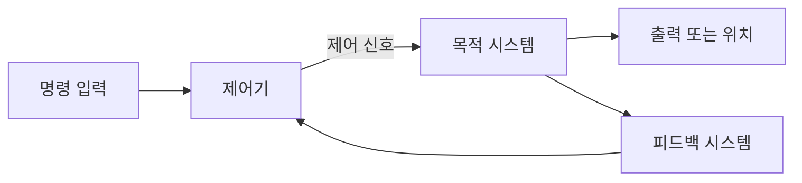

*그림 4. 폐루프 제어시스템의 구조*

두 구조에 공통인 구성 요소는 다음과 같다. **명령 입력(command input)** 은 시스템이 따라야 할 목표이고, **제어기(controller)** 는 명령 입력을 받아 **제어 신호(control signal)** 를 계산한다. **목적 시스템(target system)** 은 제어 신호를 받아 실제로 움직이는 대상이며, 그 결과가 출력이다. 폐루프 구조에는 출력을 측정하여 제어기로 되돌려 주는 **피드백 시스템(feedback system)** 이 더해진다.

| 구분 | 개루프 제어시스템 | 폐루프 제어시스템 |
|:-----|:-----|:-----|
| 피드백 | 없음 | 있음 |
| 제어 신호와 출력의 관계 | 제어기의 제어 신호가 목적 시스템의 출력과 무관하다 | 제어기의 제어 신호가 목적 시스템의 출력에 따라 달라진다 |
| 예 | 타이머로 제어되는 중앙 보일러 | 건물의 온도에 따라 제어되는 중앙 보일러 |
| 예의 동작 | 정해진 시간에 켜지고 꺼지므로 건물의 온도와 상관없이 열이 일정하게 공급된다 | 건물의 온도가 제어기로 피드백되어 설정 온도가 유지되도록 보일러가 조절된다 |

*표 1. 개루프 제어시스템과 폐루프 제어시스템의 비교*

타이머 보일러는 바깥이 추워져 실내 온도가 떨어져도 정해진 양의 열만 공급하므로 실내 온도가 설정값에서 벗어날 수 있다. 온도 피드백 보일러는 실내 온도를 측정하여 설정 온도보다 낮으면 가열하고 높으면 가열을 멈추므로, 바깥 날씨가 바뀌어도 설정 온도를 유지한다. 두 구조의 차이는 2.4절과 2.5절에서 다시 자세히 다룬다.

### 1.4 역사 속의 제어시스템

제어시스템은 현대에 처음 나타난 것이 아니다. 고대부터 사람들은 자연의 힘을 원하는 방향으로 이용하는 장치를 만들었고, 그 가운데 일부는 피드백을 이용하는 폐루프 장치였다 [1].

**물레방아(water wheel).** 기원전 20년경의 기록에 처음 언급된 물레방아는 흐르는 물의 힘으로 바퀴를 돌려 회전 운동의 원동력으로 쓰는 장치이다. 물레방아의 회전 상태는 물의 공급량에 아무런 영향을 주지 않으므로, 물레방아는 피드백이 없는 개루프 제어시스템이다.

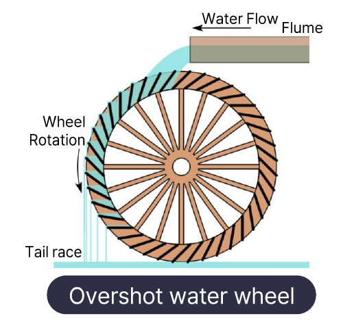

*그림 5. 위에서 물을 받는 물레방아의 구조*

그림 5는 위에서 물을 받는 방식(overshot)의 물레방아이다. 물이 수로(flume)를 따라 흘러와 바퀴 꼭대기의 물받이에 채워지면, 물의 무게 때문에 바퀴가 회전한다. 바닥까지 내려온 물받이의 물은 방수로(tail race)로 빠져나간다. 바퀴가 빨리 돌든 느리게 돌든 수로의 물은 같은 양으로 흘러 들어온다.

**헤론의 공(aeolipile).** 그리스의 수학자이자 기술자인 헤론(기원후 10\~70년경)이 고안한 장치로, 증기기관의 시초로 여겨진다. 아래쪽 용기의 물을 가열하면 증기가 관을 따라 위쪽 구체로 들어가고, 구체 양쪽에 반대 방향으로 구부러져 달린 노즐로 증기가 뿜어져 나오면서 그 반작용으로 구체가 회전한다. 구체의 회전이 가열이나 증기의 양에 피드백되지 않으므로 헤론의 공도 개루프 제어시스템이다.

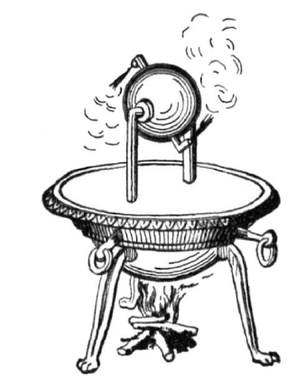

*그림 6. 헤론의 공*

**크테시비오스의 물시계(water clock).** 기원전 270년경 이집트 알렉산드리아에서 활동한 발명가 크테시비오스가 만든 물시계는 물 위에 떠 있는 인형이 오르내리며 시간을 가리킨다. 물시계가 정확하려면 측정 용기로 흘러드는 물의 양이 일정해야 하고, 그러려면 물을 공급하는 용기의 수위가 일정해야 한다. 크테시비오스는 공급 용기에 부표(float)를 띄워, 수위가 올라가면 부표가 유입구를 막고 수위가 내려가면 유입구를 여는 방식으로 수위를 일정하게 유지했다 [1]. 높이(수위)를 측정하여 그 정보로 유입량을 조절하므로 이 물시계는 폐루프 제어시스템이며, 기록에 남은 가장 오래된 피드백 제어 장치로 꼽힌다.

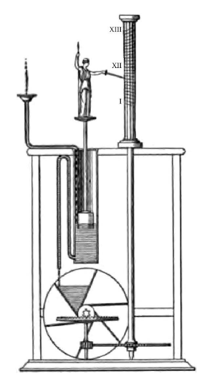

*그림 7. 크테시비오스의 물시계*

**와트의 원심 조속기(centrifugal governor).** 제임스 와트가 1788년에 증기기관에 적용한 원심 조속기는 증기기관의 회전 속도에 따라 증기 밸브를 조절한다. 기관이 돌리는 축에 두 개의 금속 공이 매달려 있어, 회전이 빨라지면 원심력 때문에 공이 바깥쪽 위로 벌어지고, 이 움직임이 연결 막대를 통해 증기 밸브(throttle valve)를 닫아 증기의 공급을 줄인다. 반대로 회전이 느려지면 공이 내려오면서 밸브가 열린다. 회전 속도를 측정하여 증기량에 되먹이므로 폐루프 제어시스템이다.

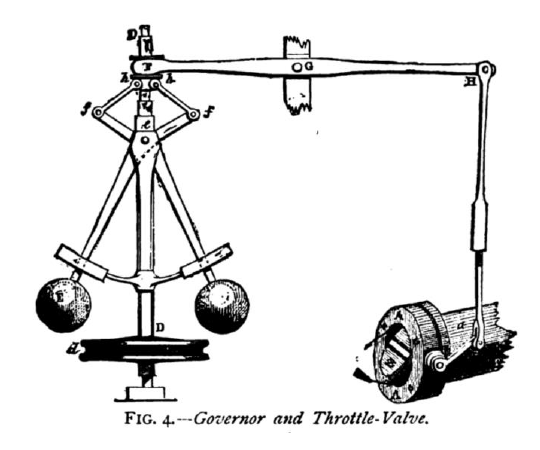

*그림 8. 와트의 원심 조속기와 증기 밸브*

| 장치 | 시기 | 원리 | 구조 |
|:-----|:-----|:-----|:-----|
| 물레방아 | 기원전 20년경 첫 기록 | 물의 무게나 흐름으로 바퀴를 돌린다 | 개루프 |
| 헤론의 공 | 기원후 1세기 | 증기의 분사 반작용으로 구체를 돌린다 | 개루프 |
| 크테시비오스의 물시계 | 기원전 270년경 | 부표가 수위를 측정하여 유입량을 조절한다 | 폐루프 |
| 와트의 원심 조속기 | 1788년 | 회전하는 공이 속도를 측정하여 증기 밸브를 조절한다 | 폐루프 |

*표 2. 역사 속의 제어시스템*

> **핵심:** 네 장치를 가르는 기준은 장치의 복잡함이 아니라 **출력(회전, 수위, 속도)을 측정하여 입력(물, 증기)의 조절에 되먹이는가**이다. 크테시비오스의 물시계와 와트의 조속기는 이 피드백 덕분에 외부 조건이 바뀌어도 원하는 값을 스스로 유지한다.

### 1.5 인공신경망

**인공신경망(artificial neural network)** 은 생물의 신경 세포(뉴런)가 정보를 처리하는 방식을 본뜬 계산 모델이다. 생물학적 뉴런은 가지돌기(dendrite)로 다른 뉴런의 신호를 받아 모으고, 모인 자극이 충분히 크면 축삭(axon)을 따라 신호를 축삭 말단(axon terminal)으로 내보낸다. **인공뉴런(artificial neuron)** 은 이 과정을 다음과 같이 흉내 낸다.

1. 입력 $x_1, x_2, \ldots, x_n$을 받는다.
2. 각 입력에 **가중치(weight)** $w_1, w_2, \ldots, w_n$을 곱하여 더한 **가중합(weighted sum)** $\sum_{i=1}^{n} w_i x_i$를 구한다.
3. 가중합을 **활성화 함수(activation function)** $f$에 통과시켜 출력 $y$를 낸다. 활성화 함수는 가중합이 출력에 전달되는 정도를 결정한다.

```math
y = f\left(\sum_{i=1}^{n} w_i x_i\right)
```

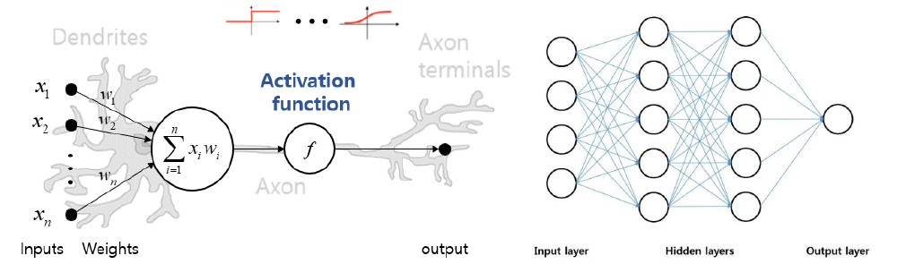

*그림 9. 인공뉴런과 다층 인공신경망*

그림 9의 왼쪽은 인공뉴런 하나를 생물학적 뉴런 위에 겹쳐 그린 것으로, 입력과 가중치가 가지돌기에, 가중합 $\sum x_i w_i$와 활성화 함수 $f$가 세포체에, 출력이 축삭 말단에 대응한다. 오른쪽은 인공뉴런을 여러 층으로 쌓은 **다층 인공신경망(multilayer neural network)** 으로, 데이터를 받는 **입력층(input layer)**, 중간 계산을 하는 하나 이상의 **은닉층(hidden layer)**, 결과를 내는 **출력층(output layer)** 으로 이루어진다. 그림의 신경망은 한 층의 모든 뉴런이 다음 층의 모든 뉴런과 연결된 구조이다.

> **핵심:** 인공신경망은 데이터를 바탕으로 입력과 출력 사이의 관계를 학습하여, 수식으로 정확히 쓰기 어려운 복잡한 시스템을 근사한다. 학습이란 주어진 입력에 대해 원하는 출력이 나오도록 가중치를 조정하는 과정이다.

> **참고:** 실제 인공뉴런은 가중합에 **편향(bias)** $b$를 더한 $y = f\left(\sum_i w_i x_i + b\right)$를 쓰는 것이 일반적이다. 인공뉴런의 구조와 활성화 함수, 학습 방법은 13주차에서 자세히 다룬다.

인공신경망은 입력과 출력의 관계를 데이터에서 배울 수 있는 곳이면 어디든 쓰인다.

| 응용 | 학습하는 데이터 | 하는 일 |
|:-----|:-----|:-----|
| 필기 인식 | 손으로 쓴 글씨의 이미지와 그 글자 | 손글씨 이미지를 보고 "Sure", "During", "presented", "few" 같은 단어를 알아본다 |
| 교통량 예측 | 날짜, 시간, 날씨별 교통 데이터 | 주어진 날짜, 시간, 날씨의 교통량을 예측한다 |
| 병명 진단 | X선 영상 데이터와 진단 결과 | 새 X선 영상에서 병명을 진단한다 |
| 주식 가격 예측 | 주식 거래 데이터 | 앞으로의 주식 가격을 예측한다 |

*표 3. 인공신경망의 응용 예*

### 1.6 인공신경망 제어시스템

**인공신경망 제어시스템(neural network control system)** 은 1.3절의 폐루프 제어시스템에서 일부 구성 요소를 인공신경망으로 나타내거나 구현한 시스템이다. 인공신경망은 두 자리에 들어갈 수 있다.

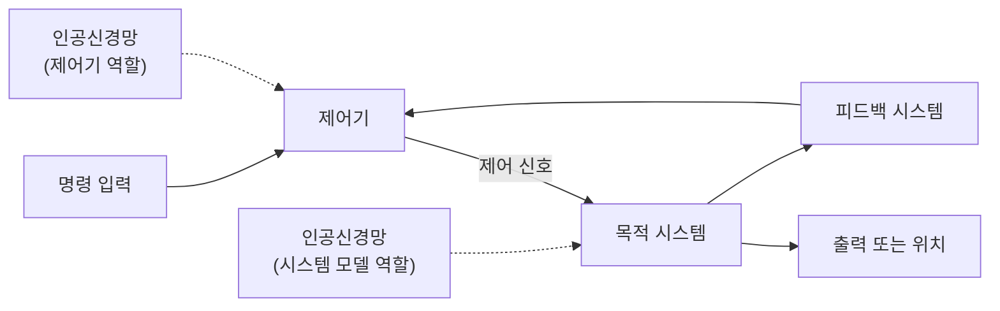

*그림 10. 인공신경망을 이용한 제어시스템*

- **제어기 자리:** 인공신경망이 명령 입력과 피드백을 받아 제어 신호를 직접 계산한다. 사람이 제어 규칙을 수식으로 설계하는 대신, 좋은 제어 신호를 내도록 신경망을 학습시킨다.
- **목적 시스템 자리:** 인공신경망이 목적 시스템의 입력과 출력 데이터를 학습하여 시스템의 동작을 흉내 내는 모델이 된다. 수식으로 모델링하기 어려운 복잡한 시스템도 데이터만 있으면 모델을 얻을 수 있고, 제어기는 이 모델을 이용하여 설계된다.

두 방식은 14주차에서 각각 직접 방식(direct method)과 간접 방식(indirect method)이라는 이름으로 자세히 다룬다.

### 1.7 과목의 학습 흐름

인공신경망 제어시스템을 이해하려면 먼저 제어시스템 자체를 이해하고, 시스템을 수식으로 나타내는 방법(모델링)을 익힌 뒤, 인공신경망을 배우고, 마지막으로 둘을 결합해야 한다.


*그림 11. 과목의 학습 흐름*

| 단계 | 주차 | 내용 |
|:-----|:-----|:-----|
| 제어시스템 이해 | 1\~2주차 | 제어시스템의 개념, 개루프와 폐루프, 피드백 제어 구조 |
| 기초 수학 | 2\~3주차 | 복소수, 미분방정식, 라플라스 변환, 행렬 |
| 제어시스템 모델링 | 4\~6주차 | 직선 운동, 회전 운동, 전기 회로의 모델링, 전달함수, 블록선도, 신호 흐름도, 상태 변수 방정식 |
| 제어시스템 성능 | 7, 9, 10주차 | 과도 응답, 안정도, 정상 상태 오차 |
| 제어기 설계 | 11주차 | PID 제어와 최적화 기반 이득 조정 |
| 인공신경망 이해 | 12\~13주차 | 인공지능의 역사, 학습의 종류, 인공뉴런, 역전파 |
| 인공신경망 제어시스템 | 14주차 | 인공신경망 기반 제어기 |

*표 4. 단계별 학습 내용과 주차*

---

<br>

## 2. 제어 이론

### 2.1 제어 이론과 제어의 목표

> **용어 정의:** **제어 이론(control theory)** 은 자동화 시스템을 이룩하는 데 필요한 수학적 프레임워크로, 동적 시스템의 동작을 분석하고 제어하는 수학적 이론과 기술의 모음이다.

여기서 **동적 시스템(dynamic system)** 은 현재의 출력이 현재의 입력뿐 아니라 과거의 입력과 상태에도 영향을 받는 시스템이다. 달리는 자동차의 속도는 지금 밟은 가속 페달만이 아니라 지금까지의 가속과 감속에 따라 정해지므로 자동차는 동적 시스템이다.

제어시스템의 목표는 **원하는 출력을 얻기 위해 올바른 입력을 만들어 내는 것**이다. 자율주행에서는 차선을 따라 원하는 경로로 달리도록 조향, 가속, 제동 입력을 정해야 하고, 건물의 온도 제어에서는 실내 온도가 설정값이 되도록 냉난방 장치의 입력을 정해야 한다.

### 2.2 제어 이론의 주요 개념

| 개념 | 의미 |
|:-----|:-----|
| 모델링(modeling) | 시스템의 동작을 설명하는 수학적 모델을 만드는 일이다. 모델은 시스템의 입력, 출력, 상태 사이의 관계를 나타내며 제어 알고리즘을 설계하는 데 쓰인다. |
| 피드백(feedback) | 시스템의 출력을 입력 쪽으로 되돌려 시스템의 동작을 제어하는 방법이다. |
| 제어기(controller) | 입력과 출력 사이의 원하는 관계를 유지하도록 시스템에 가할 제어 신호를 만드는 장치나 알고리즘이다. |
| 안정성(stability) | 제어시스템이 원하는 동작을 유지하고 외부 변화에 견고하게 반응하는 능력이다. 안정성 분석은 시스템이 안정적인 동작을 유지하는지 판단하는 데 중요하다. |
| 성능(performance) | 제어시스템이 원하는 목표를 얼마나 효과적으로 달성하는지를 나타낸다. 목표값을 넘어서는 정도인 오버슈트(overshoot), 목표에 도달하는 데 걸리는 응답 시간(response time) 같은 지표로 측정한다. |

*표 5. 제어 이론의 주요 개념*

다섯 개념은 서로 이어져 있다. 모델링으로 시스템을 수식으로 나타내고, 그 모델을 바탕으로 피드백을 쓰는 제어기를 설계한 뒤, 설계된 시스템이 안정한지와 성능이 충분한지를 평가한다. 모델링은 4\~6주차, 성능은 7, 9, 10주차, 안정성은 9주차에서 자세히 다룬다.

### 2.3 제어 입력, 외란, 상태

자동차를 예로 들어 제어 대상 시스템에 드나드는 신호를 나누어 보면 그림 12와 같다.

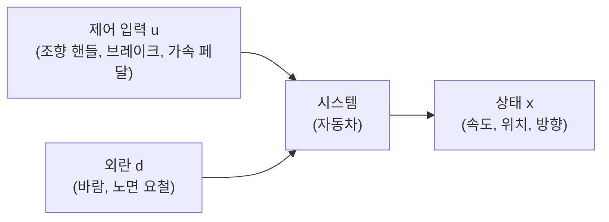

*그림 12. 제어 입력, 외란, 상태*

| 신호 | 기호 | 의미 | 자동차의 예 |
|:-----|:-----|:-----|:-----|
| 제어 입력(control input) | $u$ | 제어시스템에 주어지는 명령이나 신호로, 시스템을 제어하거나 조작하기 위해 원하는 동작을 지정한다 | 조향 핸들, 브레이크, 가속 페달 |
| 외란(disturbance) | $d$ | 제어할 수 없는 외부의 영향으로, 시스템의 동작을 원하는 것에서 벗어나게 한다 | 바람, 노면의 요철 |
| 상태(state) | $x$ | 입력에 대한 반응으로 생기는 결과로, 제어시스템이 제어하는 프로세스나 시스템의 동작을 나타낸다 | 속도, 위치, 진행 방향 |

*표 6. 제어 입력, 외란, 상태의 의미*

제어 입력과 외란은 모두 시스템에 영향을 주지만, 제어 입력은 제어기가 정할 수 있고 외란은 정할 수 없다는 점이 다르다. 제어의 어려움은 대부분 외란과, 시스템을 정확히 알지 못해 생기는 오차에서 온다.

### 2.4 개루프 제어시스템

> **용어 정의:** **개루프 제어시스템(open-loop control system)** 은 피드백이 없는 구조의 제어시스템이다. 목표값에 따라 출력을 직접 조작하고, 그 조작 결과가 시스템에 바로 적용된다.

개루프 시스템은 피드백 루프가 없으므로 외부 요인의 영향을 받을 수 있고, 시스템의 현재 상태에 따른 조절이 이루어지지 않는다. 주요 특징은 다음과 같다.

- **피드백 부재:** 출력이나 결과를 측정하여 입력으로 되돌려 주지 않는다.
- **외부 요인에 취약:** 외부 환경의 변화나 시스템 내부의 불확실성에 영향을 받는다.
- **제어 기준 변경의 어려움:** 시스템의 목표값이나 작동 조건이 바뀌어도 자동으로 조절되지 않으므로, 제어 기준을 바꾸려면 제어기를 다시 설계하거나 조정해야 한다.
- **간단한 설계:** 피드백 루프가 없으므로 센서가 필요 없고 설계가 비교적 간단하다.

### 2.5 폐루프 제어시스템

> **용어 정의:** **폐루프 제어시스템(closed-loop control system)** 은 **피드백 루프(feedback loop)** 를 사용하여 시스템의 출력을 측정하고, 그 측정 결과로 시스템의 동작을 조절하는 제어시스템이다. 제어기는 측정한 출력을 원하는 목표값과 비교하여 **오차(error)** 를 계산하고, 이 오차를 줄이는 방향으로 제어한다.

주요 특징은 다음과 같다.

- **피드백 루프의 존재:** 시스템의 출력이 측정되어 다시 입력 쪽으로 되돌아오는 루프가 있다.
- **오차 감소:** 목표값과 측정된 출력값 사이의 오차를 줄이도록 제어기가 시스템을 조절한다.
- **안정성 향상:** 출력이 원하는 목표에 가까워질 때까지 계속 조절되므로, 외부 환경이 바뀌어도 시스템이 강건하게(robust) 동작할 수 있다.
- **정확한 제어:** 출력을 직접 확인하면서 조절하므로 출력을 정확하게 제어할 수 있다.

| 기준 | 개루프 | 폐루프 |
|:-----|:-----|:-----|
| 출력의 측정 | 하지 않는다 | 센서로 측정한다 |
| 외란과 모델 오차 | 보정하지 못한다 | 오차로 나타나므로 보정한다 |
| 구조와 비용 | 간단하고 저렴하다 | 센서와 비교기가 필요하여 복잡하다 |
| 안정성 문제 | 시스템 자체가 안정하면 생기지 않는다 | 잘못 설계하면 진동하거나 발산할 수 있다 |

*표 7. 개루프 제어와 폐루프 제어의 장단점*

> **주의:** 폐루프가 언제나 더 안정한 것은 아니다. 피드백은 외란에 대한 강건성을 높이지만, 제어기를 잘못 설계하면 오히려 안정한 시스템을 진동시키거나 발산시킬 수 있다(2.8절). "폐루프는 안정성을 향상한다"는 말은 적절히 설계된 피드백을 전제로 한다.

### 2.6 선형 제어시스템과 비선형 제어시스템

제어시스템은 입력과 출력의 관계가 선형인지에 따라 **선형(linear) 제어시스템**과 **비선형(nonlinear) 제어시스템**으로도 나뉜다. 선형(linear)이라는 말은 직선(line)에서 왔으며, 함수나 시스템이 입력과 출력 사이에 다음 두 조건을 만족하는 관계를 갖는 경우를 가리킨다.

```math
f(x + y) = f(x) + f(y)
```

```math
f(ax) = a f(x)
```

첫째 조건인 **가산성(additivity)** 은 입력의 합에 대한 출력이 각 출력의 합과 같다는 뜻이고, 둘째 조건인 **동차성(homogeneity)** 은 입력을 상수배하면 출력도 같은 상수배가 된다는 뜻이다. 두 조건을 합쳐 **중첩의 원리(superposition principle)** 라고 한다.

- $f(x) = 3x$는 선형이다. $f(x + y) = 3x + 3y = f(x) + f(y)$이고 $f(ax) = 3ax = a f(x)$이기 때문이다.
- $f(x) = x^2$은 비선형이다. 예를 들어 $f(1 + 2) = 9$이지만 $f(1) + f(2) = 1 + 4 = 5$이다.
- $f(x) = 2x + 1$은 그래프가 직선이지만 이 정의에서는 선형이 아니다. $f(0 + 0) = 1$이지만 $f(0) + f(0) = 2$이기 때문이다.

> **참고:** 실제 시스템은 대부분 비선형이다. 그러나 선형 시스템은 중첩의 원리 덕분에 분석과 설계가 훨씬 쉬우므로, 비선형 시스템도 동작점 근처에서 선형으로 근사(선형화)하여 다루는 경우가 많다 [2]. 이 과목의 3\~11주차는 주로 선형 시스템을 다루고, 14주차의 인공신경망 제어는 비선형 시스템을 다루는 방법의 하나이다.

### 2.7 개루프 제어의 예

**예시 1: 시속 30 km 유지 제어.** 자동차를 시속 30 km로 달리게 하는 개루프 제어를 생각한다. 목표값(reference)은 30 km/h, 제어 입력 $u$는 가속 페달의 각도, 시스템은 자동차, 상태 $x$는 속도이다.

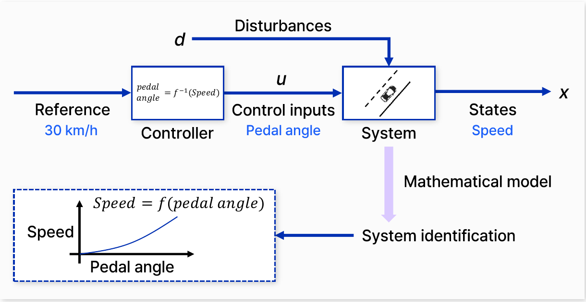

*그림 13. 시속 30 km 유지를 위한 개루프 제어와 시스템 식별*

개루프 제어기를 만들려면 페달 각도와 속도의 관계를 미리 알아야 한다. 여러 페달 각도에서 도달하는 속도를 측정하여 $\text{Speed} = f(\text{pedal angle})$이라는 **수학적 모델(mathematical model)** 을 얻는 과정을 **시스템 식별(system identification)** 이라고 한다. 그림 13의 아래쪽 그래프가 이렇게 얻은 페달 각도와 속도의 관계이다. 모델을 얻으면 제어기는 그 역함수로 필요한 페달 각도를 계산한다.

```math
\text{pedal angle} = f^{-1}(\text{Speed}) = f^{-1}(30\ \text{km/h})
```

이 방식은 모델이 정확하고 외란이 없을 때만 30 km/h를 정확히 유지한다. 오르막길이나 맞바람(외란 $`d`$)을 만나거나, 탑승 인원이 늘어 모델 $f$가 실제와 달라지면 속도가 30 km/h에서 벗어나지만, 제어기는 속도를 측정하지 않으므로 이를 알아차리지 못한다.

**예시 2: 자율주행 제어.** 출발점에서 목적지까지의 경로를 미리 계산하고, 몇 초 동안 가속하고 몇 초 동안 제동하며 어느 지점에서 핸들을 몇 도 돌린다는 식의 명령을 순서대로 미리 정해 두는 개루프 방식을 생각한다.

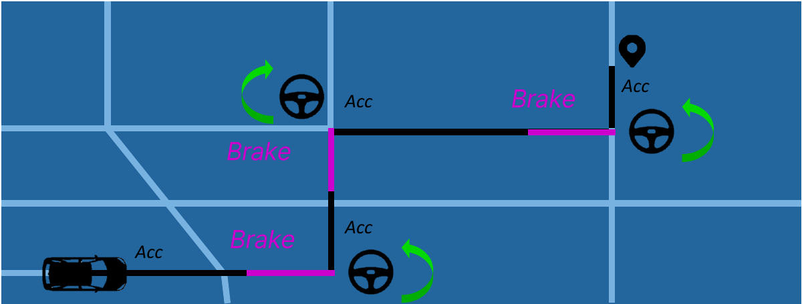

*그림 14. 미리 정한 명령으로 경로를 따르는 개루프 자율주행*

그림 14에서 검은 선은 가속(Acc) 구간, 분홍 선은 제동(Brake) 구간, 핸들 그림은 회전 지점을 나타낸다. 시스템을 완벽히 파악한 뒤 사전에 제어 명령을 내리더라도, 노면 상태, 타이어의 미끄러짐, 모델의 작은 오차 같은 미세한 오차가 시간이 지날수록 누적되어 차량이 예상하지 못한 위치에 도착하게 된다. 회전 지점에서 조금만 어긋나도 그 뒤의 모든 명령이 어긋난 위치에서 실행되기 때문이다.

### 2.8 폐루프 제어의 구성 요소

폐루프 제어는 스스로 오차를 고치는 메커니즘(self-correcting mechanism)이다. 시스템과 환경을 정확히 이해하지 못해서 생기는 오차를 매 순간 측정하여 보정한다.

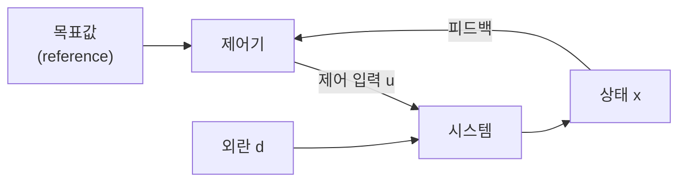

*그림 15. 외란이 있는 폐루프 제어*

**폐루프 제어의 위험.** 폐루프 제어는 시스템의 **역학(dynamics)**, 곧 시간에 따라 상태가 어떻게 변하는지를 바꾸므로 다소 위험할 수 있다. 시스템의 역학은 다음과 같은 형태로 나타낸다.

```math
\dot{x} = f(x)
```

여기서 $x$는 현재 상태이고 $\dot{x} = dx/dt$는 상태의 변화율이다. 이 식은 현재 상태가 상태의 변화, 곧 미래 상태에 영향을 끼친다는 뜻이며, 시간에 따라 상태가 어떻게 변하는지 분석하고 예측하는 방법론을 제공한다. 제어 입력이 있으면 $\dot{x} = f(x, u)$가 되고, 피드백으로 상태에 따라 입력을 정하면($`u = k(x)`$) 폐루프의 역학은 $\dot{x} = f(x, k(x))$로 바뀐다. 피드백 규칙 $k$를 잘못 고르면 원래 안정하던 시스템도 진동하거나 발산할 수 있으므로, 폐루프 설계에서는 **시스템의 안정성을 유지하는 것이 중요하다.**

**계획(planning).** 폐루프의 목표값은 **계획** 단계에서 정해진다. 목표값은 레버나 조이스틱이 가리켜야 할 각도, 속도계 바늘이 가리켜야 할 속도, 차량이 따라가야 할 경로처럼 여러 형태를 가진다.

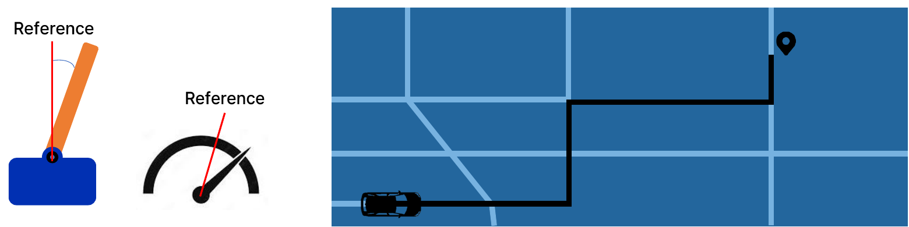

*그림 16. 계획 단계에서 정하는 다양한 목표값*

**관측(observation).** 피드백을 하려면 현재 상태를 측정해야 하며, 이를 **관측**이라고 한다. 관측에는 다양한 센서가 쓰인다.

| 센서 | 측정하는 물리량 | 쓰임의 예 |
|:-----|:-----|:-----|
| 온도계(thermometer) | 온도 | 냉난방 제어 |
| 습도 센서(humidity sensor) | 습도 | 제습기와 가습기 제어 |
| 가속도계(accelerometer) | 가속도 | 드론과 스마트폰의 자세 추정 |
| 적외선 센서(infrared sensor) | 적외선의 세기, 물체와의 거리 | 장애물 감지, 근접 감지 |

*표 8. 상태 관측에 쓰이는 센서의 예*

**잡음(noise)과 필터.** 센서가 측정한 값에는 실제 상태와 무관한 무작위 변동인 **잡음**이 섞인다. 잡음이 섞인 측정값을 그대로 피드백하면 제어기가 잡음에 반응하여 불필요한 동작을 하므로, 각종 **필터(filter)** 로 잡음을 제거한 뒤 피드백한다.

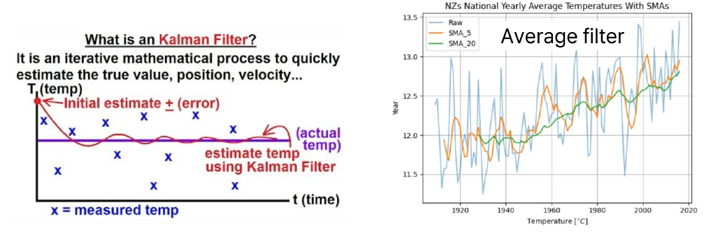

*그림 17. 칼만 필터와 이동 평균 필터*

- **이동 평균 필터(moving average filter):** 최근 $N$개 측정값의 평균을 현재의 추정값으로 쓴다. $k$번째 시점의 추정값은 $`\bar{x}_k = \frac{1}{N} \sum_{i=0}^{N-1} x_{k-i}`$이다. 그림 17의 오른쪽은 뉴질랜드의 연평균 기온(Raw)에 5년(SMA_5)과 20년(SMA_20) 단순 이동 평균을 적용한 결과로(가로축이 연도, 세로축이 기온(°C)이며 그래프의 두 축 이름표는 서로 바뀌어 있다), $N$이 클수록 그래프가 매끄러워지지만 변화를 늦게 따라간다.
- **칼만 필터(Kalman filter):** 시스템의 모델로 예측한 값과 잡음이 섞인 측정값을 각각의 불확실성에 따라 가중 평균하는 계산을 반복하여 참값(위치, 속도, 온도 등)을 빠르게 추정하는 방법이다 [3]. 그림 17의 왼쪽에서 × 표시는 측정한 온도이고, 초기 추정값에서 출발한 추정 곡선이 반복 계산을 거치며 실제 온도에 빠르게 수렴한다.

계획, 제어, 관측, 잡음, 필터를 모두 포함한 폐루프의 전체 구조는 다음과 같다.

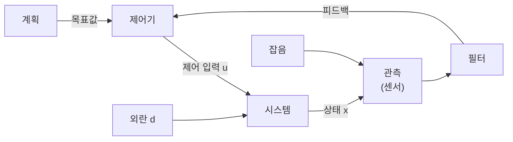

*그림 18. 계획, 관측, 필터를 포함한 폐루프 제어*

---

<br>

## 3. 제어시스템: 피드백 제어 구조와 PID 제어기

### 3.1 피드백 제어시스템의 구조

폐루프 제어에서 제어기에 들어가는 신호는 목표값 그 자체가 아니라 목표값과 측정값의 차이인 **오차(error)** 이다. 이 차이를 계산하는 지점을 **가합점(summing point)** 이라고 하며, 목표값에는 $+$, 피드백되는 측정값에는 $-$ 부호가 붙는다.

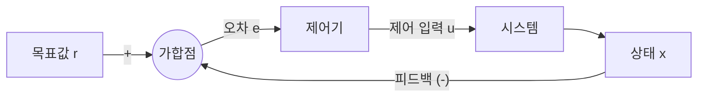

*그림 19. 피드백 제어시스템의 구조*

```math
e(t) = r(t) - x(t)
```

목표값 $r$은 달성하려는 값이고, 원하는 것은 오차가 0이 되는 것이다. 따라서 제어기 설계의 핵심 질문은 **시간이 지나면서 오차를 어떻게 0으로 만들 것인가**이다. 이후의 두 예제는 이 질문에 대한 가장 기본적인 답들을 차례로 보여 준다.

### 3.2 예제 1: 위치 제어

운동장의 0 m 지점에 서 있는 사람이 50 m 지점까지 걸어가는 상황을 피드백 제어로 나타낸다. 목표값은 50 m, 제어기는 사람의 뇌, 제어 입력은 걷는 속도, 시스템은 사람의 몸, 상태는 현재 위치이다.

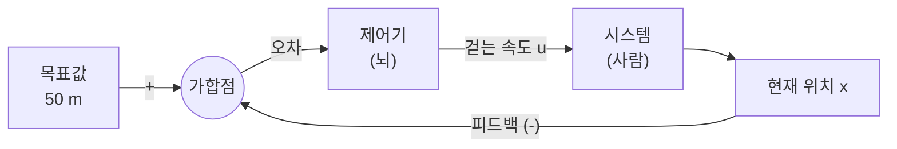

*그림 20. 위치 제어의 피드백 구조*

출발할 때 오차는 $50 - 0 = 50$ m이다. 가장 자연스러운 전략은 **오차에 비례하여** 걷는 속도를 정하는 것이다. 멀리 있으면 빨리 걷고, 가까워지면 천천히 걷는다. 이렇게 오차에 이득(gain) $K_P$를 곱하여 제어 입력을 정하는 제어기를 **비례 제어기(proportional controller, P 제어기)** 라고 한다.

```math
u(t) = K_P\, e(t) = K_P \left( 50 - x(t) \right)
```

이득이 $K_P = 0.1$이면 출발할 때의 걷는 속도는 $0.1 \times 50 = 5$ m/s이다. 걷는 속도는 위치의 변화율이므로 $\dot{x} = u$이고, 다음 미분방정식을 얻는다.

```math
\dot{x}(t) = 0.1 \left( 50 - x(t) \right), \qquad x(0) = 0
```

2주차 3.2절의 방법으로 이 식을 풀면 다음과 같다.

```math
x(t) = 50 \left( 1 - e^{-0.1 t} \right), \qquad u(t) = 0.1 \left( 50 - x(t) \right) = 5 e^{-0.1 t}
```

예를 들어 10초 뒤의 위치는 $50(1 - e^{-1}) \approx 31.6$ m이고 걷는 속도는 $5 e^{-1} \approx 1.84$ m/s이다. 오차가 줄어들수록 속도도 줄어들어, 사람은 목표 지점에 부드럽게 다가간다.

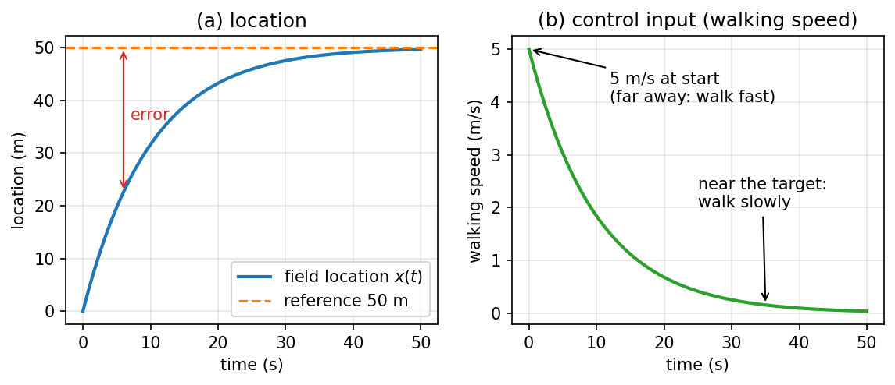

*그림 21. 비례 제어에 따른 위치와 걷는 속도의 변화*

### 3.3 예제 2: 드론 고도 제어와 비례 제어기

지상(0 m)에 있는 드론을 지상 50 m 높이에서 정지 비행(hovering)하게 만드는 고도 제어를 생각한다. 제어기는 드론의 CPU, 제어 입력은 프로펠러 회전 속도(rpm), 시스템은 드론, 상태는 고도이다. 드론은 프로펠러가 **100 rpm**으로 돌 때 양력과 무게가 같아져 제자리에 떠 있고, 100 rpm보다 빠르면 상승하며 느리면 하강한다고 가정한다.

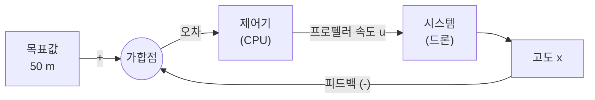

*그림 22. 드론 고도 제어의 피드백 구조*

비례 제어기 $u = K_P e$를 쓰면 출발할 때의 오차는 $50 - 0 = 50$이므로 프로펠러 속도는 $50 K_P$이다. 이득에 따라 결과가 어떻게 달라지는지 차례로 계산한다.

- **$K_P = 2$:** $u = 50 \times 2 = 100$ rpm이다. 지상에서 이미 정지 비행 속도가 되므로 드론은 떠오르지 못하고 지상에 머문다.
- **$K_P = 5$:** $u = 50 \times 5 = 250$ rpm으로 드론이 상승한다. 상승할수록 오차와 회전 속도가 줄어들고, 지상 30 m에 도달하면 오차가 $50 - 30 = 20$이므로 $u = 20 \times 5 = 100$ rpm이 되어 30 m에서 정지 비행한다.
- **$K_P = 10$:** 지상 40 m에서 오차가 10이므로 $u = 10 \times 10 = 100$ rpm이 되어 40 m에서 멈춘다.
- **$K_P = 100$:** 지상 49 m에서 오차가 1이므로 $u = 1 \times 100 = 100$ rpm이 되어 49 m에서 멈춘다.

일반적으로 드론은 $u = 100$ rpm이 되는 고도에서 멈추므로, 멈출 때의 오차 $e_{ss}$와 고도 $x_{ss}$는 다음과 같다.

```math
K_P\, e_{ss} = 100 \quad \Rightarrow \quad e_{ss} = \frac{100}{K_P}, \qquad x_{ss} = 50 - \frac{100}{K_P}
```

| 이득 $K_P$ | 출발 시 회전 속도 (rpm) | 멈추는 고도 $x_{ss}$ (m) | 남는 오차 $e_{ss}$ (m) |
|:-----|:-----|:-----|:-----|
| 2 | 100 | 0 | 50 |
| 5 | 250 | 30 | 20 |
| 10 | 500 | 40 | 10 |
| 100 | 5000 | 49 | 1 |

*표 9. 비례 제어기의 이득에 따른 드론의 최종 고도*

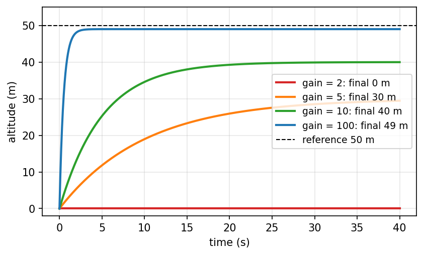

*그림 23. 비례 제어기의 이득에 따른 드론 고도의 변화*

그림 23은 드론의 상승 속도가 프로펠러 회전 속도와 정지 비행 속도의 차이에 비례한다고 단순화한 모델 $`\dot{x} = c\,(u - 100)`$, $c = 0.02$ (m/s)/rpm에서 각 이득의 고도 변화를 그린 것이다. 이득이 커질수록 오차가 점점 더 작아지지만 **오차가 0이 되지는 않는다.** 오차가 0이면 $u = K_P \times 0 = 0$ rpm이 되어 드론이 떠 있을 수 없기 때문이다. 이처럼 충분한 시간이 지난 뒤에도 남는 오차를 **정상 상태 오차(steady-state error)** 라고 하며, 비례 제어기만으로는 이 문제를 해결할 수 없다.

> **주의:** 이득을 키우면 정상 상태 오차는 줄지만 무한정 키울 수는 없다. 표 9에서 $K_P = 100$이면 출발할 때 5000 rpm이 필요한데, 실제 모터에는 최대 회전 속도가 있어 그 이상은 낼 수 없다(포화). 또한 관성이 있는 실제 시스템에서 이득이 지나치게 크면 목표값을 지나쳐 진동하거나 불안정해질 수 있다. 정상 상태 오차의 체계적인 분석은 10주차에서 다룬다.

### 3.4 비례 적분 제어기

정상 상태 오차를 없애려면, 오차가 남아 있는 한 제어 입력을 계속 키우는 경로가 필요하다. 이를 위해 비례 경로에 **적분(integral)** 경로를 나란히 더한 제어기를 **비례 적분 제어기(PI controller)** 라고 한다.

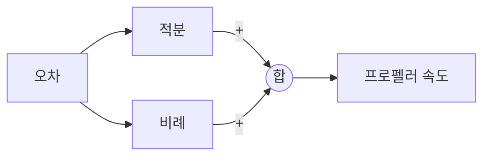

*그림 24. 비례 적분 제어기의 구조*

```math
u(t) = K_P\, e(t) + K_I \int_0^t e(\tau)\, d\tau
```

적분 경로는 시간이 지남에 따라 입력 신호(오차)의 총량을 누적한다. 오차 그래프 아래의 넓이가 적분값이다. 드론이 원하는 고도보다 낮은 곳에서 정상 상태에 머물면 0이 아닌 오차가 계속 누적되어 적분값이 커지고, 그만큼 프로펠러 속도가 증가하여 드론이 다시 상승한다.

비례 경로와 적분 경로가 함께 작동하여 오차를 0으로 낮춘다. 드론이 목표 고도 50 m에 머물 때는 오차가 0이므로 비례 경로의 출력은 0이다. 적분 경로는 오차가 남아 있는 동안 계속 변하다가, 오차가 0이 되면 그때까지 누적된 값을 유지한다. 따라서 적분 경로의 출력이 정확히 100 rpm이 된 상태에서 변화를 멈추고, 드론은 오차 없이 50 m에서 정지 비행한다.

```math
e = 0, \quad K_P\, e = 0, \quad K_I \int_0^t e(\tau)\, d\tau = 100\ \text{rpm}
```

그러나 적분 경로에는 부작용이 있다. 드론이 50 m에 도달한 순간에도 드론은 여전히 상승하는 중이고, 그때까지 누적된 적분값 때문에 프로펠러 속도가 100 rpm을 넘을 수 있다. 그러면 드론은 50 m를 지나쳐 더 올라가는데, 이를 **오버슈트(overshoot)** 라고 하며, 오버슈트의 최댓값을 **최대 초과량(maximum overshoot)** 이라고 한다(7주차). 50 m를 넘으면 오차가 음수가 되어 적분값이 줄어들고, 적분 경로가 초과된 프로펠러 속도를 제거하면서 드론은 50 m로 되돌아온다.

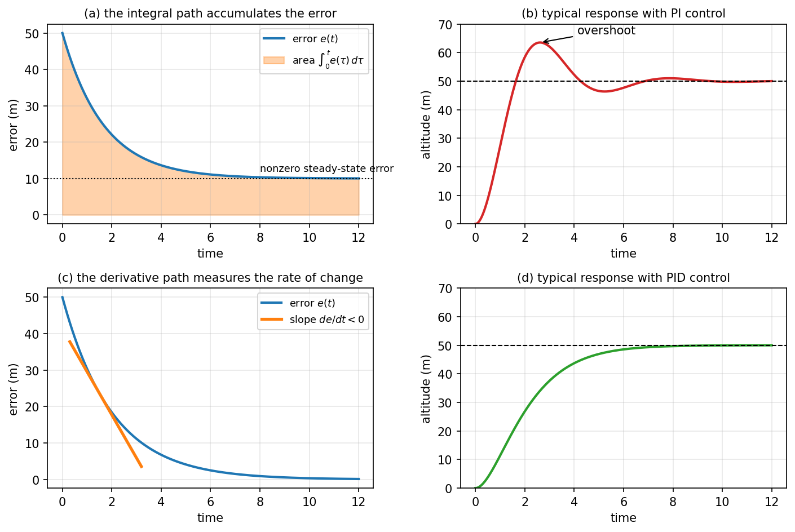

*그림 25. 적분 경로와 미분 경로의 역할에 대한 개념도*

그림 25의 (a)는 비례 제어만으로 오차가 10 m에 머물 때 오차 그래프 아래의 넓이(적분값)가 시간에 따라 계속 커지는 모습이고, (b)는 비례 적분 제어에서 흔히 나타나는 오버슈트가 있는 응답의 모양이다.

### 3.5 비례 적분 미분 제어기

오버슈트를 줄이려면 목표에 다가가는 **속도**를 보고 미리 감속하는 경로가 필요하다. 비례 경로와 적분 경로에 **미분(derivative)** 경로를 더한 제어기를 **비례 적분 미분 제어기(PID controller)** 라고 한다.

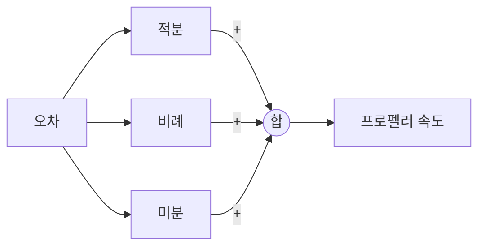

*그림 26. 비례 적분 미분 제어기의 구조*

미분 경로는 오차의 변화율 $de/dt$를 계산한다. 드론이 50 m를 향해 빠르게 상승하면 오차가 빠르게 줄어들므로 변화율이 음수이고, 미분 경로는 음의 값을 내어 프로펠러 출력을 줄인다. 목표에 빨리 다가갈수록 더 크게 감속하므로 감쇠가 커져 오버슈트가 줄어든다. 미분 경로는 오차가 앞으로 어떻게 변할지를 현재의 변화 추세로 예측하여 목표에 도달하는 속도에 대응한다고 볼 수 있다. 그림 25의 (c)는 오차 곡선의 음의 기울기를, (d)는 미분 경로를 더했을 때 기대하는 오버슈트 없는 응답의 모양을 보여 준다.

세 경로에 각각의 이득 $K_P$, $K_I$, $K_D$를 곱하여 더한 PID 제어기와 드론을 연결한 전체 피드백 구조는 다음과 같다.

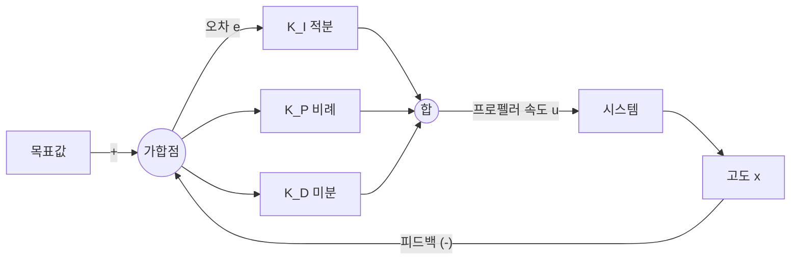

*그림 27. PID 제어기를 쓰는 드론 고도 제어시스템*

```math
u(t) = K_P\, e(t) + K_I \int_0^t e(\tau)\, d\tau + K_D \frac{de(t)}{dt}
```

| 경로 | 이득 | 보는 오차 | 하는 일 |
|:-----|:-----|:-----|:-----|
| 비례(P) | $K_P$ | 현재의 오차 $e(t)$ | 오차가 클수록 강하게 제어한다 |
| 적분(I) | $K_I$ | 과거 오차의 누적 $`\int_0^t e\, d\tau`$ | 남아 있는 오차를 계속 쌓아 정상 상태 오차를 없앤다 |
| 미분(D) | $K_D$ | 오차의 변화율 $de/dt$ (미래 오차의 예측) | 오차가 빠르게 줄어들면 미리 감속하여 오버슈트를 줄인다 |

*표 10. PID 제어기의 세 경로*

PID 제어기는 현재 오차, 과거 오차, 미래 오차에 대한 예측을 함께 사용하여 성공적이고 안정적인 제어를 수행한다 [2]. 각 경로의 기여도인 이득 $K_P$, $K_I$, $K_D$를 정하는 일을 **제어기 튜닝(controller tuning)** 이라고 한다.

> **참고:** 미분 경로는 오차의 변화율에 반응하므로 측정값에 섞인 빠른 잡음도 크게 증폭한다. 그래서 실제 PID 제어기는 미분 경로 앞에 저역 통과 필터를 두는 경우가 많다 [2]. 세 이득이 응답에 주는 영향과 최적화를 이용한 튜닝 방법은 11주차에서 자세히 다룬다.

---

<br>

## 개념 적용

다음은 일상의 장치를 피드백의 유무로 분류한 것이다.

| 장치 | 출력 | 피드백 | 분류 |
|:-----|:-----|:-----|:-----|
| 타이머로 굽는 토스터 | 빵이 구워진 정도 | 굽기 정도를 측정하지 않고 정해진 시간만 가열한다 | 개루프 |
| 정해진 순서로 바뀌는 신호등 | 신호 | 실제 교통량을 보지 않는다 | 개루프 |
| 온도 조절기가 있는 에어컨 | 실내 온도 | 실내 온도를 측정하여 냉방 세기를 조절한다 | 폐루프 |
| 자동차의 정속 주행 장치 | 속도 | 속도를 측정하여 스로틀을 조절한다 | 폐루프 |
| 차선을 보며 운전하는 사람 | 진행 방향 | 눈으로 차선과의 차이를 보고 핸들을 돌린다 | 폐루프 |

*표 11. 일상의 제어 장치 분류*

**T/F 점검:**

| 문장 | 판단과 근거 |
|:-----|:-----|
| 헤론의 공은 증기를 이용하므로 폐루프 제어시스템이다. | **F.** 구체의 회전이 가열이나 증기의 양에 피드백되지 않으므로 개루프이다. 동력원이 무엇인지는 루프의 종류와 관계가 없다. |
| $f(x) = 2x + 1$은 그래프가 직선이므로 중첩의 원리를 만족한다. | **F.** $f(0 + 0) = 1$이지만 $f(0) + f(0) = 2$이므로 가산성을 만족하지 않는다. |
| 비례 제어기의 이득을 충분히 키우면 드론 고도 제어의 정상 상태 오차를 정확히 0으로 만들 수 있다. | **F.** 정상 상태 오차는 $100/K_P$로 이득이 유한한 한 0이 되지 않는다. |
| PI 제어기에서 드론이 목표 고도에 머물 때 프로펠러 속도는 적분 경로가 모두 만든다. | **T.** 정상 상태에서 오차가 0이므로 비례 경로의 출력은 0이고, 적분 경로가 누적한 100 rpm만 남는다. |
| 개루프 자율주행에서 경로를 완벽하게 계산했다면 차량은 항상 목적지에 정확히 도착한다. | **F.** 실행 중에 생기는 미세한 오차가 누적되어도 측정하지 않으므로 보정되지 않는다. |

---

<br>

## 요약

| 개념 | 핵심 요약 |
|:-----|:-----|
| 시스템 | 특정 목표를 수행하기 위해 함께 작동하는 구성 요소의 상호 연결이다. |
| 제어시스템 | 제어 루프로 다른 장치나 시스템의 동작을 조절하여 목표하는 결과를 얻는 시스템이다. |
| 개루프 제어 | 출력을 측정하지 않고 제어하므로 설계가 간단하지만 외란과 모델 오차를 보정하지 못한다. |
| 폐루프 제어 | 출력을 피드백하여 목표값과의 오차를 줄이므로 정확하고 강건하지만 안정성을 고려하여 설계해야 한다. |
| 역사 속의 제어시스템 | 물레방아와 헤론의 공은 개루프, 크테시비오스의 물시계와 와트의 원심 조속기는 폐루프이다. |
| 인공뉴런 | 입력의 가중합을 활성화 함수에 통과시켜 출력을 내며, 데이터로 가중치를 학습한다. |
| 인공신경망 제어시스템 | 인공신경망이 제어기나 시스템 모델의 역할을 하는 제어시스템이다. |
| 제어 입력, 외란, 상태 | 제어 입력은 제어기가 정하고, 외란은 정할 수 없는 외부 영향이며, 상태는 시스템의 반응이다. |
| 선형 시스템 | 가산성과 동차성, 곧 중첩의 원리를 만족하는 시스템이다. |
| 폐루프의 구성 요소 | 계획이 목표값을 정하고, 센서가 상태를 관측하며, 필터가 잡음을 제거한 뒤 피드백한다. |
| 비례 제어기 | 오차에 비례하는 입력을 내며, 드론 예제에서는 $100/K_P$의 정상 상태 오차가 남는다. |
| 비례 적분 제어기 | 오차를 누적하는 적분 경로가 정상 상태 오차를 없애지만 오버슈트를 일으킬 수 있다. |
| 비례 적분 미분 제어기 | 오차의 변화율에 반응하는 미분 경로를 더해 오버슈트를 줄이며, 세 이득을 정하는 일이 튜닝이다. |

---

<br>

## 점검 문제

1. **루프의 구분:** 개루프 제어시스템과 폐루프 제어시스템을 구분하는 기준을 쓰고, 중앙 보일러를 예로 들어 설명하라.

   <details>
   <summary>정답</summary>

   기준은 피드백의 유무, 곧 제어기의 제어 신호가 목적 시스템의 출력에 따라 달라지는지이다. 타이머로 제어되는 보일러는 건물의 온도와 상관없이 정해진 시간에 열을 공급하므로 개루프이고, 건물의 온도를 측정하여 설정 온도와 비교해 가열을 조절하는 보일러는 폐루프이다.

   </details>

2. **역사 속의 피드백:** 크테시비오스의 물시계가 폐루프 제어시스템인 이유를 설명하라.

   <details>
   <summary>정답</summary>

   물을 공급하는 용기의 부표가 수위를 측정하여, 수위가 오르면 유입구를 막고 내려가면 여는 방식으로 유입량을 조절한다. 출력인 수위를 측정하여 입력인 유입량의 조절에 되먹이므로 폐루프이며, 이 덕분에 수위와 유량이 일정해져 인형이 일정한 속도로 올라가며 시간을 가리킨다.

   </details>

3. **인공뉴런의 계산:** 입력 $x_1 = 1$, $x_2 = 2$, 가중치 $w_1 = 0.5$, $w_2 = -0.25$이고 활성화 함수가 $f(z) = \max(0, z)$인 인공뉴런의 출력을 구하라.

   <details>
   <summary>정답</summary>

   가중합은 $0.5 \times 1 + (-0.25) \times 2 = 0.5 - 0.5 = 0$이므로 출력은 $f(0) = \max(0, 0) = 0$이다.

   </details>

4. **선형성 판정:** $f(x) = 4x$와 $g(x) = x^3$이 선형인지 판정하라.

   <details>
   <summary>정답</summary>

   $f(x + y) = 4x + 4y = f(x) + f(y)$이고 $f(ax) = 4ax = a f(x)$이므로 $f$는 선형이다. $g(1 + 1) = 8$이지만 $g(1) + g(1) = 2$이므로 $g$는 가산성을 만족하지 않아 비선형이다.

   </details>

5. **개루프 속도 제어의 한계:** 시스템 식별로 얻은 모델 $\text{Speed} = f(\text{pedal angle})$을 이용하는 개루프 정속 제어가 오르막길에서 실패하는 이유를 설명하라.

   <details>
   <summary>정답</summary>

   모델은 평지에서 측정한 페달 각도와 속도의 관계이므로, 오르막길이라는 외란이 생기면 같은 페달 각도에서도 속도가 30 km/h보다 낮아진다. 개루프 제어기는 속도를 측정하지 않으므로 이 차이를 알지 못하고 같은 페달 각도를 유지하여 속도가 목표에서 벗어난 채로 남는다.

   </details>

6. **정상 상태 오차:** 드론 고도 제어에서 정지 비행 회전 속도가 100 rpm이고 목표 고도가 50 m일 때, 비례 이득 $K_P = 4$와 $K_P = 20$에서 드론이 멈추는 고도를 각각 구하라.

   <details>
   <summary>정답</summary>

   멈추는 고도는 $x_{ss} = 50 - 100/K_P$이다. $K_P = 4$이면 $50 - 25 = 25$ m이고, $K_P = 20$이면 $50 - 5 = 45$ m이다. 각각 오차가 25, 5일 때 $u = 4 \times 25 = 100$, $u = 20 \times 5 = 100$ rpm이 되어 정지 비행한다.

   </details>

7. **위치 제어의 풀이:** 3.2절의 위치 제어에서 이득을 $K_P = 0.2$로 바꾸면 출발할 때의 걷는 속도와 5초 뒤의 위치는 얼마인가?

   <details>
   <summary>정답</summary>

   출발할 때의 속도는 $0.2 \times 50 = 10$ m/s이다. $\dot{x} = 0.2(50 - x)$, $x(0) = 0$의 해는 $x(t) = 50(1 - e^{-0.2t})$이므로 5초 뒤의 위치는 $50(1 - e^{-1}) \approx 31.6$ m이다.

   </details>

8. **세 경로의 역할:** PID 제어기의 비례, 적분, 미분 경로가 각각 어떤 오차를 보고 어떤 문제를 해결하는지 드론 예제로 설명하라.

   <details>
   <summary>정답</summary>

   비례 경로는 현재 오차에 비례하는 회전 속도를 내어 드론을 목표 쪽으로 움직이지만 $100/K_P$의 정상 상태 오차를 남긴다. 적분 경로는 과거 오차를 누적하여 오차가 남아 있는 한 회전 속도를 키우므로 정상 상태 오차를 없애고, 목표에서는 누적값 100 rpm을 유지한다. 미분 경로는 오차의 변화율을 보고, 오차가 빠르게 줄어드는 상승 중에 음의 값을 내어 회전 속도를 줄이므로 적분 경로가 일으키는 오버슈트를 줄인다.

   </details>

9. **폐루프의 위험:** 폐루프 제어가 시스템의 역학을 바꾼다는 말의 뜻을 $\dot{x} = f(x, u)$로 설명하라.

   <details>
   <summary>정답</summary>

   피드백 제어는 입력을 상태의 함수 $u = k(x)$로 정하므로 폐루프의 역학은 $\dot{x} = f(x, k(x))$가 되어 원래 시스템과 다른 미분방정식을 따른다. 따라서 피드백 규칙을 잘못 고르면 원래 안정하던 시스템도 진동하거나 발산할 수 있으므로 안정성을 확인하며 설계해야 한다.

   </details>

---

<br>

## 참고 문헌

1. O. Mayr, *The Origins of Feedback Control*. Cambridge, MA, USA: MIT Press, 1970.
2. K. J. Åström and R. M. Murray, *Feedback Systems: An Introduction for Scientists and Engineers*, 2nd ed. Princeton, NJ, USA: Princeton University Press, 2021.
3. R. E. Kalman, "A New Approach to Linear Filtering and Prediction Problems," *Journal of Basic Engineering*, vol. 82, no. 1, pp. 35-45, 1960.
