# Week 1 Lecture — Introduction to Neural Network Control Systems

[Repository Guide](../../README.md) | [English](Concepts_Lecture.md) | [한국어](Concepts_Lecture.ko.md)

> **Last Updated:** 2026-11-04

> **Learning Objectives:**
> 1. Define systems and control systems, and distinguish open-loop from closed-loop control systems by the presence of feedback
> 2. Explain the history of control systems with the water wheel, Heron's ball, the water clock of Ctesibius, and Watt's centrifugal governor as examples
> 3. Explain the structure of an artificial neuron and of a multilayer neural network, and explain how neural networks are used inside control systems
> 4. Explain the key concepts of control theory (modeling, feedback, controller, stability, performance) and the relation among control inputs, disturbances, and states
> 5. Write the two conditions of a linear system, and compare the strengths and weaknesses of open-loop and closed-loop control with examples
> 6. Compute the steady-state error of a proportional controller in the drone altitude control example, and explain what the integral path and the derivative path each do

---

## Table of Contents

- [1. Neural Network Control Systems](#1-neural-network-control-systems)
  - [1.1 Definition of a System](#11-definition-of-a-system)
  - [1.2 Control Systems](#12-control-systems)
  - [1.3 Open Loop and Closed Loop](#13-open-loop-and-closed-loop)
  - [1.4 Control Systems in History](#14-control-systems-in-history)
  - [1.5 Artificial Neural Networks](#15-artificial-neural-networks)
  - [1.6 Neural Network Control Systems](#16-neural-network-control-systems)
  - [1.7 Learning Path of the Course](#17-learning-path-of-the-course)
- [2. Control Theory](#2-control-theory)
  - [2.1 Control Theory and the Goal of Control](#21-control-theory-and-the-goal-of-control)
  - [2.2 Key Concepts of Control Theory](#22-key-concepts-of-control-theory)
  - [2.3 Control Inputs, Disturbances, and States](#23-control-inputs-disturbances-and-states)
  - [2.4 Open-Loop Control Systems](#24-open-loop-control-systems)
  - [2.5 Closed-Loop Control Systems](#25-closed-loop-control-systems)
  - [2.6 Linear and Nonlinear Control Systems](#26-linear-and-nonlinear-control-systems)
  - [2.7 Examples of Open-Loop Control](#27-examples-of-open-loop-control)
  - [2.8 Components of Closed-Loop Control](#28-components-of-closed-loop-control)
- [3. Control Systems: The Feedback Control Structure and PID Controllers](#3-control-systems-the-feedback-control-structure-and-pid-controllers)
  - [3.1 Structure of a Feedback Control System](#31-structure-of-a-feedback-control-system)
  - [3.2 Example 1: Position Control](#32-example-1-position-control)
  - [3.3 Example 2: Drone Altitude Control and the Proportional Controller](#33-example-2-drone-altitude-control-and-the-proportional-controller)
  - [3.4 The Proportional-Integral Controller](#34-the-proportional-integral-controller)
  - [3.5 The Proportional-Integral-Derivative Controller](#35-the-proportional-integral-derivative-controller)
- [Concept Applications](#concept-applications)
- [Summary](#summary)
- [Self-Check Questions](#self-check-questions)
- [References](#references)

---

 

## 1. Neural Network Control Systems

### 1.1 Definition of a System

> **Definition:** A **system** is a collection of things joined by people or by nature to form a unified, complex whole. From an engineering point of view, a system is defined as the interconnection of many components or functional units that work together to perform a specific goal.

Cars, robots, and airplanes are all engineering systems. In a car, for example, the engine, transmission, wheels, steering, and brakes are connected to perform the single goal of moving people where they want to go. No component can achieve this goal alone; the whole performs a meaningful function only when the components interact in a defined way.

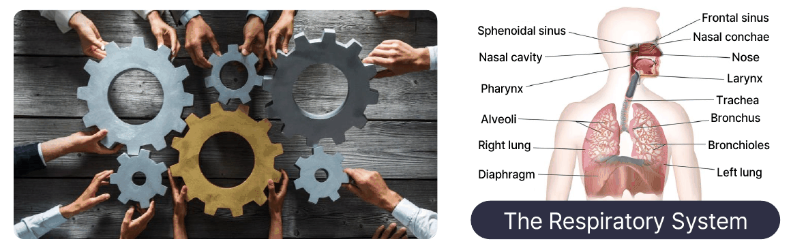

*Figure 1. Interlocking gears and the human respiratory system*

The left side of Figure 1 shows several people each holding a gear so that the gears mesh into one mechanism, a symbol of the idea that a system consists of connected components that move together. The respiratory system on the right is an example of a system made by nature. The nose and nasal cavity, pharynx, larynx, trachea, bronchi, bronchioles, alveoli, and diaphragm are connected to inhale and exhale air, performing the single function of taking in oxygen and releasing carbon dioxide.

### 1.2 Control Systems

> **Definition:** A **control system** is a system that uses a control loop to manage, command, direct, or regulate the behavior of other devices or systems in order to obtain a desired result or value.

Control systems vary greatly in scale. They range from small ones, such as a heating controller that regulates the temperature of a household boiler, to large industrial control systems that handle an entire chemical process or production facility. In the simplest view, a control system is a single block that takes an input and produces an output.

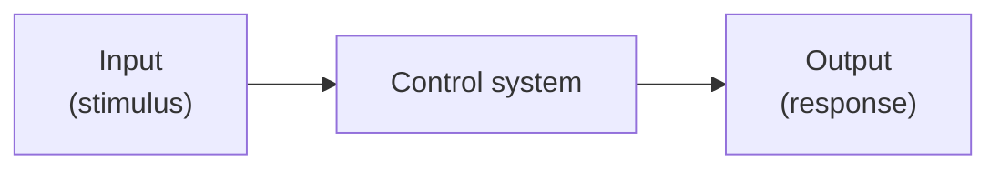

*Figure 2. A control system seen in terms of input and output*

Here the **input** is the stimulus applied to the control system, and the **output** is the response of the system to that stimulus. In a heating controller, for example, the set temperature chosen by the user is the input, and the room temperature that the boiler produces as a result is the output.

### 1.3 Open Loop and Closed Loop

Control systems are divided into **open-loop** and **closed-loop** control systems depending on whether information about the output is used again for control. Measuring the output and sending it back to the input side is called **feedback**.

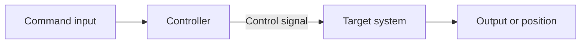

*Figure 3. Structure of an open-loop control system*

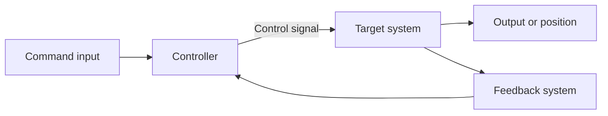

*Figure 4. Structure of a closed-loop control system*

The components common to both structures are as follows. The **command input** is the goal the system should follow, and the **controller** takes the command input and computes a **control signal**. The **target system** is the object that receives the control signal and actually moves, and its result is the output. The closed-loop structure adds a **feedback system** that measures the output and returns it to the controller.

| Item | Open-loop control system | Closed-loop control system |
|:-----|:-----|:-----|
| Feedback | None | Present |
| Relation between control signal and output | The control signal of the controller is independent of the output of the target system | The control signal of the controller depends on the output of the target system |
| Example | A central boiler controlled by a timer | A central boiler controlled by the temperature of the building |
| How the example works | It turns on and off at fixed times, so heat is supplied at a constant rate regardless of the temperature of the building | The temperature of the building is fed back to the controller, and the boiler is adjusted so that the set temperature is maintained |

*Table 1. Comparison of open-loop and closed-loop control systems*

A timer boiler supplies only a fixed amount of heat even when the outside gets colder and the room temperature drops, so the room temperature can drift away from the set value. A boiler with temperature feedback measures the room temperature, heats when it is below the set temperature, and stops heating when it is above, so it maintains the set temperature even when the weather changes. The difference between the two structures is discussed again in detail in Sections 2.4 and 2.5.

### 1.4 Control Systems in History

Control systems did not first appear in modern times. Since antiquity people have built devices that use the forces of nature in a desired way, and some of them were closed-loop devices that used feedback [1].

**The water wheel.** First mentioned in records from around 20 BC, the water wheel is a device that turns a wheel with the force of flowing water and uses it as a source of rotational motion. The rotation of the wheel has no effect on the amount of water supplied, so the water wheel is an open-loop control system without feedback.

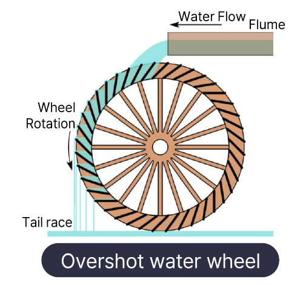

*Figure 5. Structure of an overshot water wheel*

Figure 5 shows an overshot water wheel, which receives water from above. Water flows along the flume and fills the buckets at the top of the wheel, and the weight of the water turns the wheel. When the buckets reach the bottom, the water drains into the tail race. Whether the wheel turns fast or slowly, the same amount of water flows in through the flume.

**Heron's ball (aeolipile).** This device was devised by Heron, a Greek mathematician and engineer (around AD 10-70), and is regarded as the forerunner of the steam engine. When water in the lower vessel is heated, steam travels through tubes into the sphere above, and as the steam jets out of nozzles bent in opposite directions on both sides of the sphere, the reaction makes the sphere rotate. The rotation of the sphere is not fed back to the heating or to the amount of steam, so Heron's ball is also an open-loop control system.

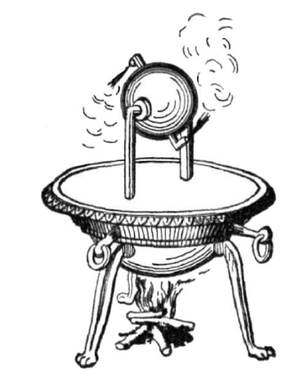

*Figure 6. Heron's ball*

**The water clock of Ctesibius.** In the water clock made around 270 BC by Ctesibius, an inventor who worked in Alexandria, Egypt, a figure floating on the water rises and falls to indicate the time. For the clock to be accurate, the flow of water into the measuring vessel must be constant, and for that the water level in the supply vessel must be constant. Ctesibius placed a float in the supply vessel that closes the inlet when the level rises and opens it when the level falls, keeping the level constant [1]. Because it measures the height (water level) and uses that information to regulate the inflow, this water clock is a closed-loop control system and is regarded as the oldest recorded feedback control device.

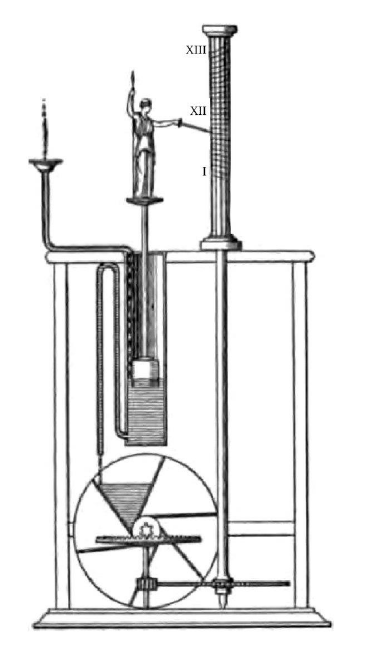

*Figure 7. The water clock of Ctesibius*

**Watt's centrifugal governor.** The centrifugal governor that James Watt applied to the steam engine in 1788 adjusts the steam valve according to the rotational speed of the engine. Two metal balls hang from a shaft driven by the engine. When the rotation speeds up, centrifugal force swings the balls outward and upward, and this motion closes the steam valve (throttle valve) through linkage rods, reducing the steam supply. Conversely, when the rotation slows down, the balls drop and the valve opens. Because it measures the rotational speed and feeds it back to the amount of steam, it is a closed-loop control system.

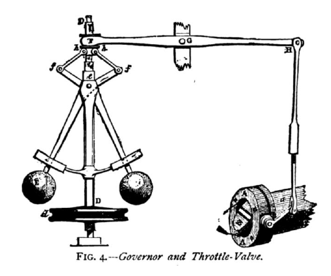

*Figure 8. Watt's centrifugal governor and the steam valve*

| Device | Period | Principle | Structure |
|:-----|:-----|:-----|:-----|
| Water wheel | First recorded around 20 BC | The weight or flow of water turns the wheel | Open loop |
| Heron's ball | 1st century AD | The reaction of jetting steam turns the sphere | Open loop |
| Water clock of Ctesibius | Around 270 BC | A float measures the water level and regulates the inflow | Closed loop |
| Watt's centrifugal governor | 1788 | Rotating balls measure the speed and adjust the steam valve | Closed loop |

*Table 2. Control systems in history*

> **Key Point:** What separates the four devices is not their complexity but **whether they measure the output (rotation, water level, speed) and feed it back to the regulation of the input (water, steam)**. Thanks to this feedback, the water clock of Ctesibius and Watt's governor maintain the desired value by themselves even when external conditions change.

### 1.5 Artificial Neural Networks

An **artificial neural network** is a computational model that imitates the way biological nerve cells (neurons) process information. A biological neuron collects signals from other neurons through its dendrites, and when the collected stimulus is large enough, it sends a signal along the axon to the axon terminals. An **artificial neuron** imitates this process as follows.

1. It receives inputs $x_1, x_2, \ldots, x_n$.
2. It multiplies each input by a **weight** $w_1, w_2, \ldots, w_n$ and adds them to obtain the **weighted sum** $\sum_{i=1}^{n} w_i x_i$.
3. It passes the weighted sum through an **activation function** $f$ to produce the output $y$. The activation function determines how much of the weighted sum is passed on to the output.

$$
y = f\left(\sum_{i=1}^{n} w_i x_i\right)
$$

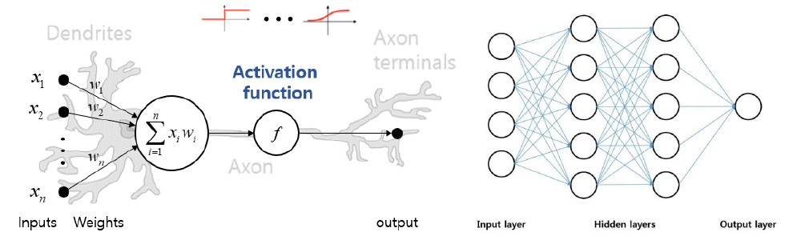

*Figure 9. An artificial neuron and a multilayer neural network*

The left side of Figure 9 draws a single artificial neuron over a biological neuron: the inputs and weights correspond to the dendrites, the weighted sum $\sum x_i w_i$ and the activation function $f$ to the cell body, and the output to the axon terminals. The right side is a **multilayer neural network** that stacks artificial neurons in several layers. It consists of an **input layer** that receives data, one or more **hidden layers** that perform intermediate computation, and an **output layer** that produces the result. Every neuron in one layer is connected to every neuron in the next layer.

> **Key Point:** A neural network learns the relation between input and output from data and approximates complex systems that are hard to write down exactly as equations. Learning is the process of adjusting the weights so that the desired output is produced for the given input.

> **Note:** A practical artificial neuron usually adds a **bias** $b$ to the weighted sum and uses $y = f\left(\sum_i w_i x_i + b\right)$. The structure of artificial neurons, activation functions, and learning methods are covered in detail in Week 13.

Neural networks are used wherever the relation between input and output can be learned from data.

| Application | Training data | Task |
|:-----|:-----|:-----|
| Handwriting recognition | Images of handwritten text and the corresponding letters | Recognize words such as "Sure", "During", "presented", and "few" from handwriting images |
| Traffic prediction | Traffic data by date, time, and weather | Predict the traffic volume for a given date, time, and weather |
| Disease diagnosis | X-ray image data and diagnoses | Diagnose diseases from new X-ray images |
| Stock price prediction | Stock trading data | Predict future stock prices |

*Table 3. Examples of neural network applications*

### 1.6 Neural Network Control Systems

A **neural network control system** is a system in which some components of the closed-loop control system of Section 1.3 are represented or implemented by neural networks. A neural network can take one of two places.

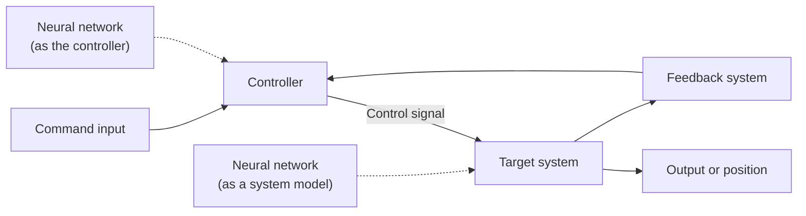

*Figure 10. A control system that uses neural networks*

- **In place of the controller:** The neural network receives the command input and the feedback and computes the control signal directly. Instead of a person designing control rules as equations, the network is trained to produce good control signals.
- **In place of the target system:** The neural network learns from the input and output data of the target system and becomes a model that imitates the behavior of the system. Even for complex systems that are hard to model with equations, a model can be obtained as long as data exist, and the controller is designed using this model.

These two approaches are covered in detail in Week 14 under the names direct method and indirect method, respectively.

### 1.7 Learning Path of the Course

To understand neural network control systems, one must first understand control systems themselves, learn how to describe a system with equations (modeling), then learn neural networks, and finally combine the two.

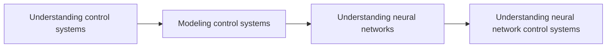

*Figure 11. Learning path of the course*

| Stage | Weeks | Content |
|:-----|:-----|:-----|
| Understanding control systems | Weeks 1-2 | The concept of control systems, open loop and closed loop, the feedback control structure |
| Basic mathematics | Weeks 2-3 | Complex numbers, differential equations, the Laplace transform, matrices |
| Modeling control systems | Weeks 4-6 | Modeling of translational motion, rotational motion, and electric circuits, transfer functions, block diagrams, signal flow graphs, state variable equations |
| Performance of control systems | Weeks 7, 9, 10 | Transient response, stability, steady-state error |
| Controller design | Week 11 | PID control and optimization-based gain tuning |
| Understanding neural networks | Weeks 12-13 | History of artificial intelligence, types of learning, artificial neurons, backpropagation |
| Neural network control systems | Week 14 | Neural-network-based controllers |

*Table 4. Learning content and weeks by stage*

---

 

## 2. Control Theory

### 2.1 Control Theory and the Goal of Control

> **Definition:** **Control theory** is the mathematical framework needed to achieve automated systems, a collection of mathematical theories and techniques for analyzing and controlling the behavior of dynamic systems.

Here a **dynamic system** is a system whose present output depends not only on the present input but also on past inputs and states. The speed of a moving car is determined not only by how far the accelerator is pressed now but by all the acceleration and deceleration so far, so a car is a dynamic system.

The goal of a control system is **to generate the right input in order to obtain the desired output**. In autonomous driving, the steering, acceleration, and braking inputs must be chosen so that the car follows the desired path along the lane; in building temperature control, the inputs to the heating and cooling equipment must be chosen so that the room temperature reaches the set value.

### 2.2 Key Concepts of Control Theory

| Concept | Meaning |
|:-----|:-----|
| Modeling | Building a mathematical model that describes the behavior of the system. The model expresses the relations among the inputs, outputs, and states of the system and is used to design control algorithms. |
| Feedback | A method of controlling the behavior of a system by returning its output to the input side. |
| Controller | A device or algorithm that generates the control signal applied to the system so as to maintain the desired relation between input and output. |
| Stability | The ability of a control system to maintain the desired behavior and to respond robustly to external changes. Stability analysis is important for determining whether a system maintains stable behavior. |
| Performance | How effectively a control system achieves the desired goal. It is measured with indicators such as overshoot, the amount by which the output exceeds the target value, and response time, the time taken to reach the target. |

*Table 5. Key concepts of control theory*

The five concepts are linked. Modeling describes the system with equations, a controller that uses feedback is designed on the basis of that model, and then the designed system is evaluated for stability and for sufficient performance. Modeling is covered in detail in Weeks 4-6, performance in Weeks 7, 9, and 10, and stability in Week 9.

### 2.3 Control Inputs, Disturbances, and States

Taking a car as an example, the signals entering and leaving the controlled system can be divided as in Figure 12.

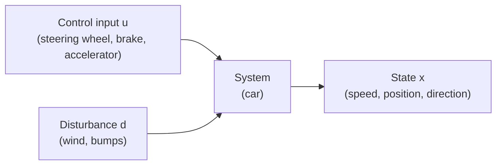

*Figure 12. Control inputs, disturbances, and states*

| Signal | Symbol | Meaning | Example in a car |
|:-----|:-----|:-----|:-----|
| Control input | $u$ | A command or signal given to the control system that specifies the desired action in order to control or manipulate the system | Steering wheel, brake, accelerator |
| Disturbance | $d$ | An external influence that cannot be controlled and that pushes the behavior of the system away from the desired one | Wind, bumps on the road |
| State | $x$ | The result produced in response to the input, which describes the behavior of the process or system that the control system controls | Speed, position, direction of travel |

*Table 6. Meaning of control inputs, disturbances, and states*

Both control inputs and disturbances affect the system, but they differ in that the controller can choose the control input and cannot choose the disturbance. Most of the difficulty of control comes from disturbances and from errors caused by not knowing the system exactly.

### 2.4 Open-Loop Control Systems

> **Definition:** An **open-loop control system** is a control system with no feedback. It manipulates the output directly according to the target value, and the result of the manipulation is applied to the system immediately.

Because an open-loop system has no feedback loop, it can be affected by external factors, and no adjustment is made according to the current state of the system. Its main characteristics are as follows.

- **No feedback:** It does not measure the output or result and return it to the input.
- **Vulnerable to external factors:** It is affected by changes in the external environment and by uncertainty inside the system.
- **Hard to change the control reference:** It does not adjust automatically when the target value or operating conditions of the system change, so changing the control reference requires redesigning or retuning the controller.
- **Simple design:** Having no feedback loop, it needs no sensor and its design is relatively simple.

### 2.5 Closed-Loop Control Systems

> **Definition:** A **closed-loop control system** is a control system that uses a **feedback loop** to measure the output of the system and uses the measurement to adjust the behavior of the system. The controller compares the measured output with the desired target value, computes the **error**, and controls the system in the direction that reduces this error.

Its main characteristics are as follows.

- **A feedback loop exists:** There is a loop through which the output of the system is measured and returned to the input side.
- **Error reduction:** The controller adjusts the system so as to reduce the error between the target value and the measured output.
- **Improved stability:** Because the output keeps being adjusted until it approaches the desired target, the system can operate robustly even when the external environment changes.
- **Accurate control:** Because it adjusts while checking the output directly, it can control the output accurately.

| Criterion | Open loop | Closed loop |
|:-----|:-----|:-----|
| Measuring the output | Not done | Measured with a sensor |
| Disturbances and model errors | Not corrected | Corrected because they appear as error |
| Structure and cost | Simple and inexpensive | More complex because sensors and a comparator are needed |
| Stability issues | Do not arise if the system itself is stable | Oscillation or divergence can occur if poorly designed |

*Table 7. Strengths and weaknesses of open-loop and closed-loop control*

> **Caution:** A closed loop is not always more stable. Feedback increases robustness against disturbances, but a poorly designed controller can make a stable system oscillate or diverge (Section 2.8). The statement "a closed loop improves stability" assumes properly designed feedback.

### 2.6 Linear and Nonlinear Control Systems

Control systems are also divided into **linear control systems** and **nonlinear control systems** according to whether the relation between input and output is linear. The word linear comes from line, and it refers to a function or system whose input-output relation satisfies the following two conditions.

$$
f(x + y) = f(x) + f(y)
$$

$$
f(ax) = a f(x)
$$

The first condition, **additivity**, means that the output for a sum of inputs equals the sum of the individual outputs, and the second, **homogeneity**, means that scaling the input by a constant scales the output by the same constant. The two conditions together are called the **superposition principle**.

- $f(x) = 3x$ is linear, because $f(x + y) = 3x + 3y = f(x) + f(y)$ and $f(ax) = 3ax = a f(x)$.
- $f(x) = x^2$ is nonlinear. For example, $f(1 + 2) = 9$, but $f(1) + f(2) = 1 + 4 = 5$.
- $f(x) = 2x + 1$ has a straight-line graph but is not linear under this definition, because $f(0 + 0) = 1$ while $f(0) + f(0) = 2$.

> **Note:** Most real systems are nonlinear. Linear systems, however, are much easier to analyze and design thanks to the superposition principle, so nonlinear systems are often handled by approximating them as linear near an operating point (linearization) [2]. Weeks 3-11 of this course mainly deal with linear systems, and the neural network control of Week 14 is one way of handling nonlinear systems.

### 2.7 Examples of Open-Loop Control

**Example 1: holding 30 km/h.** Consider open-loop control that makes a car run at 30 km/h. The target value (reference) is 30 km/h, the control input $u$ is the angle of the accelerator pedal, the system is the car, and the state $x$ is the speed.

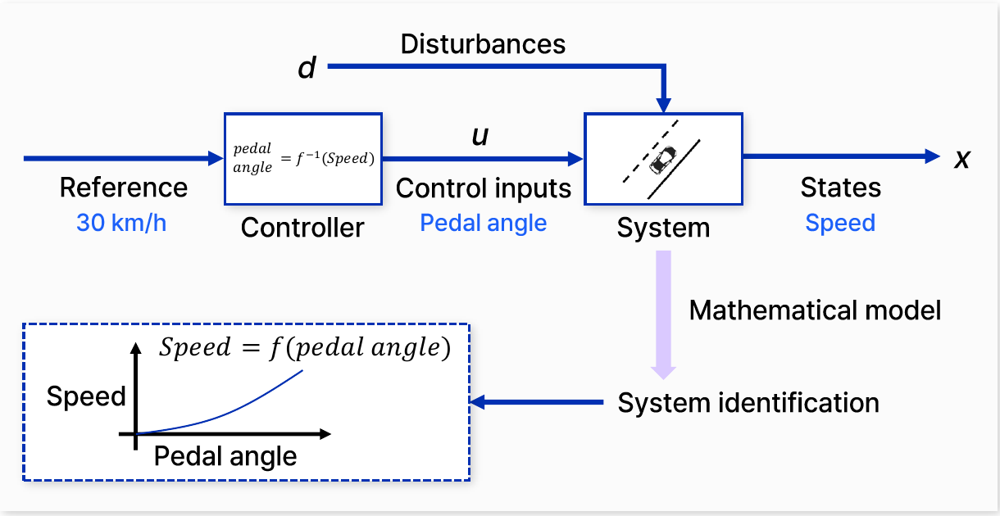

*Figure 13. Open-loop control for holding 30 km/h and system identification*

To build an open-loop controller, the relation between pedal angle and speed must be known in advance. The process of measuring the speed reached at various pedal angles to obtain a **mathematical model** $\text{Speed} = f(\text{pedal angle})$ is called **system identification**. The graph at the bottom of Figure 13 is the relation between pedal angle and speed obtained in this way. Once the model is available, the controller computes the required pedal angle with its inverse function.

$$
\text{pedal angle} = f^{-1}(\text{Speed}) = f^{-1}(30\ \text{km/h})
$$

This method holds 30 km/h exactly only when the model is accurate and there is no disturbance. If the car meets an uphill road or a headwind (disturbance $d$), or if more passengers make the model $f$ differ from reality, the speed drifts away from 30 km/h, but the controller does not notice because it does not measure the speed.

**Example 2: autonomous driving control.** Consider an open-loop approach that computes the route from the start to the destination in advance and fixes, in order, commands such as accelerating for a few seconds, braking for a few seconds, and turning the wheel by some degrees at a certain point.

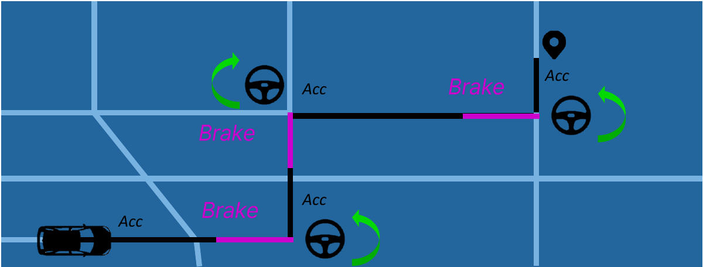

*Figure 14. Open-loop autonomous driving that follows a route with predetermined commands*

In Figure 14, the black lines are acceleration (Acc) segments, the pink lines are braking (Brake) segments, and the steering-wheel icons mark turning points. Even if the system is understood perfectly and the commands are issued in advance, small errors such as road conditions, tire slip, and small model errors accumulate over time, and the vehicle arrives at an unexpected place. Even a slight misalignment at a turning point means that every later command is executed from the wrong position.

### 2.8 Components of Closed-Loop Control

Closed-loop control is a self-correcting mechanism. It measures and corrects, moment by moment, the errors that arise because the system and its environment are not understood exactly.

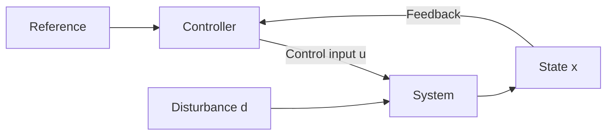

*Figure 15. Closed-loop control with a disturbance*

**The risk of closed-loop control.** Closed-loop control can be somewhat risky because it changes the **dynamics** of the system, that is, how its state changes over time. The dynamics of a system are expressed in the following form.

$$
\dot{x} = f(x)
$$

Here $x$ is the current state and $\dot{x} = dx/dt$ is the rate of change of the state. The equation says that the current state affects the change of the state, and hence the future state, and it provides a methodology for analyzing and predicting how the state changes over time. With a control input the equation becomes $\dot{x} = f(x, u)$, and when feedback chooses the input according to the state ($u = k(x)$), the closed-loop dynamics become $\dot{x} = f(x, k(x))$. If the feedback rule $k$ is chosen badly, even an originally stable system can oscillate or diverge, so in closed-loop design **maintaining the stability of the system is important.**

**Planning.** The reference of a closed loop is set in the **planning** stage. References take many forms, such as the angle a lever or joystick should point to, the speed a speedometer needle should indicate, or the path a vehicle should follow.

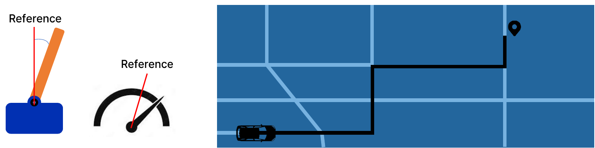

*Figure 16. Various references set in the planning stage*

**Observation.** Feedback requires measuring the current state, which is called **observation**. Various sensors are used for observation.

| Sensor | Measured quantity | Example of use |
|:-----|:-----|:-----|
| Thermometer | Temperature | Heating and cooling control |
| Humidity sensor | Humidity | Control of dehumidifiers and humidifiers |
| Accelerometer | Acceleration | Attitude estimation in drones and smartphones |
| Infrared sensor | Infrared intensity, distance to an object | Obstacle detection, proximity sensing |

*Table 8. Examples of sensors used to observe the state*

**Noise and filters.** Values measured by sensors contain **noise**, random fluctuations unrelated to the actual state. If noisy measurements are fed back as they are, the controller reacts to the noise and performs unnecessary actions, so the noise is removed with various **filters** before feedback.

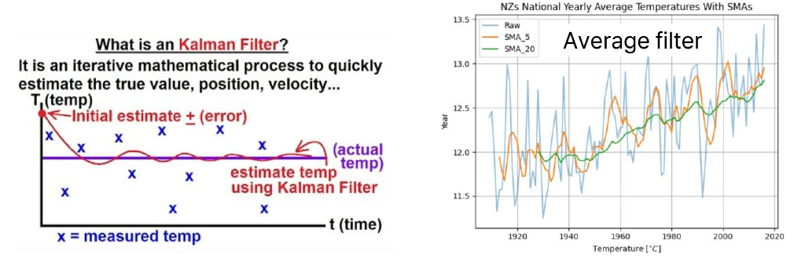

*Figure 17. A Kalman filter and a moving average filter*

- **Moving average filter:** It uses the average of the most recent $N$ measurements as the current estimate. The estimate at time step $k$ is $\bar{x}_k = \frac{1}{N} \sum_{i=0}^{N-1} x_{k-i}$. The right side of Figure 17 applies 5-year (SMA_5) and 20-year (SMA_20) simple moving averages to the yearly average temperatures of New Zealand (Raw); the larger $N$ is, the smoother the curve, but the more slowly it follows changes.
- **Kalman filter:** It quickly estimates the true value (position, velocity, temperature, and so on) by repeating a computation that takes a weighted average of the value predicted by a model of the system and the noisy measurement, according to their respective uncertainties [3]. On the left side of Figure 17, the × marks are measured temperatures, and the estimate curve, starting from an initial estimate, converges quickly to the actual temperature through repeated computation.

The overall structure of the closed loop, including planning, control, observation, noise, and filtering, is as follows.

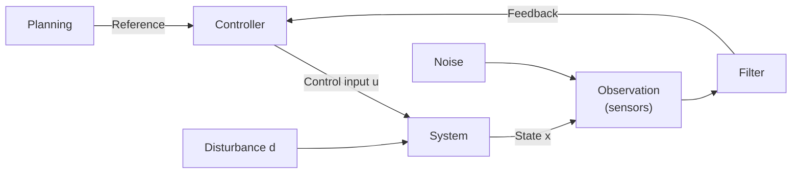

*Figure 18. Closed-loop control including planning, observation, and filtering*

---

 

## 3. Control Systems: The Feedback Control Structure and PID Controllers

### 3.1 Structure of a Feedback Control System

In closed-loop control, the signal that enters the controller is not the reference itself but the **error**, the difference between the reference and the measurement. The point where this difference is computed is called the **summing point**; the reference enters with a $+$ sign and the fed-back measurement with a $-$ sign.

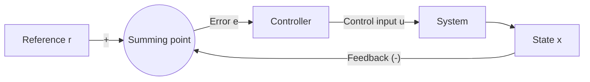

*Figure 19. Structure of a feedback control system*

$$
e(t) = r(t) - x(t)
$$

The reference $r$ is the value to be achieved, and what is wanted is zero error. The key question of controller design is therefore **how to drive the error to zero over time**. The two examples that follow show the most basic answers to this question in turn.

### 3.2 Example 1: Position Control

Consider a person standing at the 0 m point of a field who walks to the 50 m point, described as feedback control. The reference is 50 m, the controller is the person's brain, the control input is the walking speed, the system is the person's body, and the state is the current location.

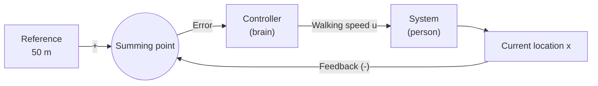

*Figure 20. Feedback structure of position control*

At the start the error is $50 - 0 = 50$ m. The most natural strategy is to choose the walking speed **in proportion to the error**: walk fast when far away and slowly when close. A controller that determines the control input by multiplying the error by a gain $K_P$ is called a **proportional controller (P controller)**.

$$
u(t) = K_P\, e(t) = K_P \left( 50 - x(t) \right)
$$

With gain $K_P = 0.1$, the walking speed at the start is $0.1 \times 50 = 5$ m/s. The walking speed is the rate of change of the location, so $\dot{x} = u$, which gives the following differential equation.

$$
\dot{x}(t) = 0.1 \left( 50 - x(t) \right), \qquad x(0) = 0
$$

Solving it with the method of Section 3.2 of Week 2 gives the following.

$$
x(t) = 50 \left( 1 - e^{-0.1 t} \right), \qquad u(t) = 0.1 \left( 50 - x(t) \right) = 5 e^{-0.1 t}
$$

For example, after 10 seconds the location is $50(1 - e^{-1}) \approx 31.6$ m and the walking speed is $5 e^{-1} \approx 1.84$ m/s. As the error decreases, the speed also decreases, and the person approaches the target point smoothly.

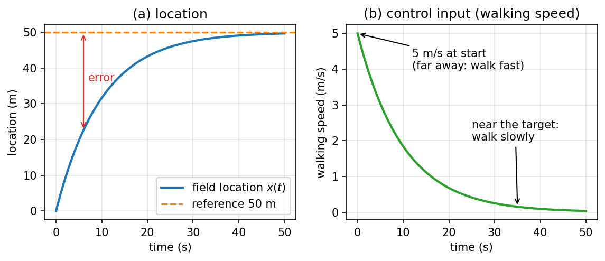

*Figure 21. Location and walking speed under proportional control*

### 3.3 Example 2: Drone Altitude Control and the Proportional Controller

Consider altitude control that makes a drone on the ground (0 m) hover 50 m above the ground. The controller is the drone's CPU, the control input is the propeller speed (rpm), the system is the drone, and the state is the altitude. Assume that the drone stays in place when the propellers turn at **100 rpm**, because lift then equals weight; it rises when the speed is above 100 rpm and descends when it is below.

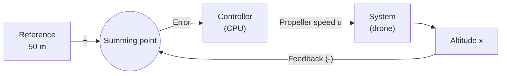

*Figure 22. Feedback structure of drone altitude control*

With the proportional controller $u = K_P e$, the error at the start is $50 - 0 = 50$, so the propeller speed is $50 K_P$. Let us compute in turn how the result changes with the gain.

- **$K_P = 2$:** $u = 50 \times 2 = 100$ rpm. This is already the hovering speed on the ground, so the drone cannot lift off and stays on the ground.
- **$K_P = 5$:** $u = 50 \times 5 = 250$ rpm, so the drone rises. As it rises, the error and the propeller speed decrease; at 30 m the error is $50 - 30 = 20$, so $u = 20 \times 5 = 100$ rpm and the drone hovers at 30 m.
- **$K_P = 10$:** At 40 m the error is 10, so $u = 10 \times 10 = 100$ rpm and the drone stops at 40 m.
- **$K_P = 100$:** At 49 m the error is 1, so $u = 1 \times 100 = 100$ rpm and the drone stops at 49 m.

In general the drone stops at the altitude where $u = 100$ rpm, so the error $e_{ss}$ and altitude $x_{ss}$ at which it stops are as follows.

$$
K_P\, e_{ss} = 100 \quad \Rightarrow \quad e_{ss} = \frac{100}{K_P}, \qquad x_{ss} = 50 - \frac{100}{K_P}
$$

| Gain $K_P$ | Propeller speed at start (rpm) | Final altitude $x_{ss}$ (m) | Remaining error $e_{ss}$ (m) |
|:-----|:-----|:-----|:-----|
| 2 | 100 | 0 | 50 |
| 5 | 250 | 30 | 20 |
| 10 | 500 | 40 | 10 |
| 100 | 5000 | 49 | 1 |

*Table 9. Final altitude of the drone for each gain of the proportional controller*

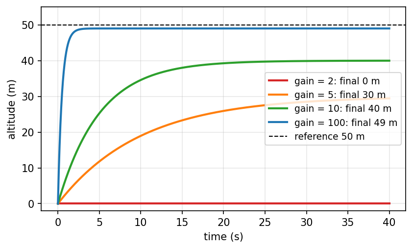

*Figure 23. Drone altitude for different gains of the proportional controller*

Figure 23 plots the altitude for each gain in a simplified model in which the climb rate of the drone is proportional to the difference between the propeller speed and the hovering speed, $\dot{x} = c\,(u - 100)$ with $c = 0.02$ (m/s)/rpm. As the gain grows the error becomes smaller and smaller, but **the error never becomes zero.** If the error were zero, then $u = K_P \times 0 = 0$ rpm and the drone could not stay in the air. Such an error that remains after a sufficiently long time is called the **steady-state error**, and a proportional controller alone cannot remove it.

> **Caution:** Increasing the gain reduces the steady-state error, but the gain cannot be increased without limit. In Table 9, $K_P = 100$ requires 5000 rpm at the start, but a real motor has a maximum speed and cannot exceed it (saturation). In addition, in a real system with inertia, an excessively large gain can make the output pass the target and oscillate or become unstable. Steady-state error is analyzed systematically in Week 10.

### 3.4 The Proportional-Integral Controller

To remove the steady-state error, a path is needed that keeps increasing the control input as long as an error remains. A controller that adds an **integral** path in parallel with the proportional path is called a **proportional-integral controller (PI controller)**.

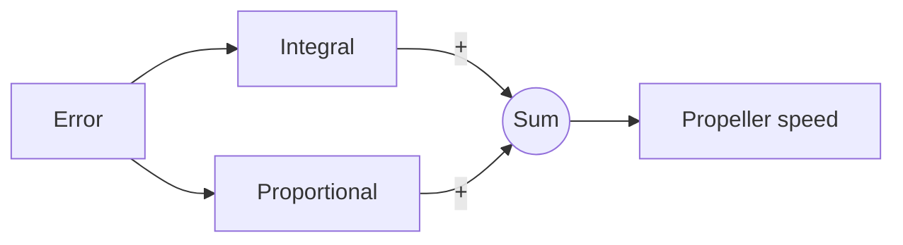

*Figure 24. Structure of a proportional-integral controller*

$$
u(t) = K_P\, e(t) + K_I \int_0^t e(\tau)\, d\tau
$$

The integral path accumulates the total amount of the input signal (the error) over time. The area under the error curve is the value of the integral. If the drone settles in a steady state below the desired altitude, a nonzero error keeps accumulating, the integral grows, the propeller speed increases accordingly, and the drone rises again.

The proportional path and the integral path work together to bring the error down to zero. When the drone stays at the target altitude of 50 m, the error is zero, so the output of the proportional path is zero. The integral path keeps changing as long as an error remains, and once the error becomes zero it holds the value accumulated so far. The output of the integral path therefore stops changing exactly when it reaches 100 rpm, and the drone hovers at 50 m with no error.

$$
e = 0, \quad K_P\, e = 0, \quad K_I \int_0^t e(\tau)\, d\tau = 100\ \text{rpm}
$$

The integral path, however, has a side effect. At the moment the drone reaches 50 m it is still rising, and because of the integral accumulated so far, the propeller speed can exceed 100 rpm. The drone then passes 50 m and climbs further, which is called **overshoot**; its maximum value is called the **maximum overshoot** (Week 7). Above 50 m the error becomes negative and the integral decreases, and as the integral path removes the excess propeller speed, the drone returns to 50 m.

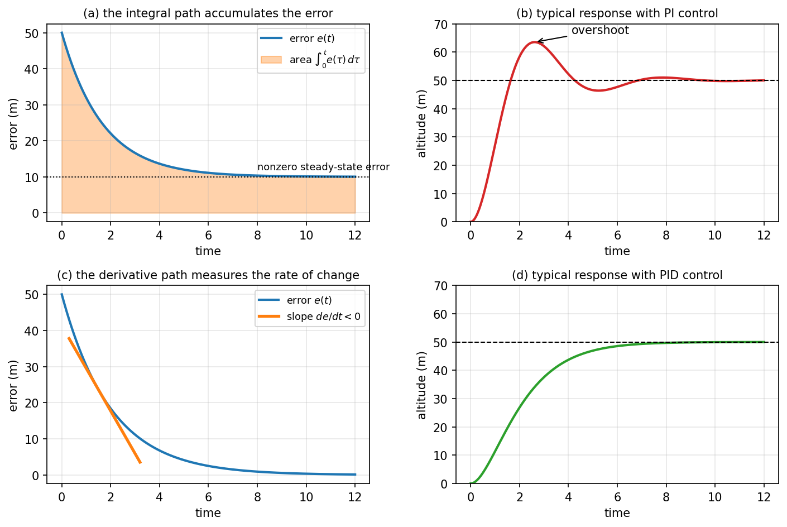

*Figure 25. Conceptual diagram of the roles of the integral path and the derivative path*

Panel (a) of Figure 25 shows how the area under the error curve (the integral) keeps growing over time when the error stays at 10 m under proportional control alone, and panel (b) shows the shape of a response with overshoot that often appears under proportional-integral control.

### 3.5 The Proportional-Integral-Derivative Controller

To reduce overshoot, a path is needed that looks at the **speed** of approach to the target and slows down in advance. A controller that adds a **derivative** path to the proportional and integral paths is called a **proportional-integral-derivative controller (PID controller)**.

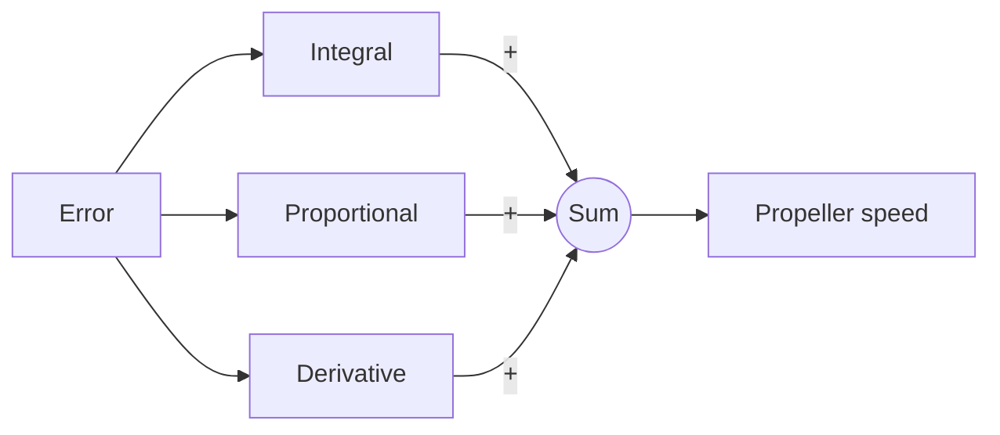

*Figure 26. Structure of a proportional-integral-derivative controller*

The derivative path computes the rate of change of the error, $de/dt$. When the drone climbs quickly toward 50 m, the error decreases quickly, so the rate of change is negative, and the derivative path outputs a negative value that reduces the propeller output. The faster the drone approaches the target, the more strongly it slows down, so the damping increases and overshoot is reduced. The derivative path can be seen as predicting how the error will change from its current trend and responding to the speed at which the target is approached. Panel (c) of Figure 25 shows the negative slope of the error curve, and panel (d) shows the expected shape of a response without overshoot when the derivative path is added.

The overall feedback structure that connects a PID controller, which multiplies the three paths by their gains $K_P$, $K_I$, and $K_D$ and adds them, to the drone is as follows.

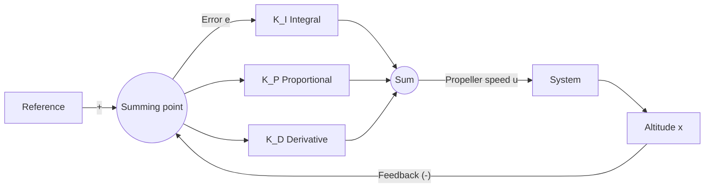

*Figure 27. Drone altitude control system with a PID controller*

$$
u(t) = K_P\, e(t) + K_I \int_0^t e(\tau)\, d\tau + K_D \frac{de(t)}{dt}
$$

| Path | Gain | Error it looks at | What it does |
|:-----|:-----|:-----|:-----|
| Proportional (P) | $K_P$ | The present error $e(t)$ | Controls more strongly when the error is larger |
| Integral (I) | $K_I$ | The accumulation of past errors $\int_0^t e\, d\tau$ | Keeps accumulating the remaining error to remove the steady-state error |
| Derivative (D) | $K_D$ | The rate of change of the error $de/dt$ (a prediction of future error) | Slows down in advance when the error decreases quickly, reducing overshoot |

*Table 10. The three paths of a PID controller*

A PID controller uses the present error, the past error, and a prediction of the future error together to perform successful and stable control [2]. Choosing the gains $K_P$, $K_I$, and $K_D$, which set the contribution of each path, is called **controller tuning**.

> **Note:** Because the derivative path responds to the rate of change of the error, it also strongly amplifies fast noise in the measurement. Practical PID controllers therefore often place a low-pass filter before the derivative path [2]. The effect of the three gains on the response and tuning methods based on optimization are covered in detail in Week 11.

---

 

## Concept Applications

The following classifies everyday devices by the presence of feedback.

| Device | Output | Feedback | Classification |
|:-----|:-----|:-----|:-----|
| A toaster with a timer | How well the bread is toasted | Heats for a fixed time without measuring the toasting | Open loop |
| A traffic light that changes in a fixed sequence | The signal | Does not look at the actual traffic | Open loop |
| An air conditioner with a thermostat | Room temperature | Measures the room temperature and adjusts the cooling | Closed loop |
| The cruise control of a car | Speed | Measures the speed and adjusts the throttle | Closed loop |
| A person driving while watching the lane | Direction of travel | Sees the deviation from the lane and turns the wheel | Closed loop |

*Table 11. Classification of everyday control devices*

**True/False Check:**

| Statement | Judgment and Reason |
|:-----|:-----|
| Heron's ball uses steam, so it is a closed-loop control system. | **F.** The rotation of the sphere is not fed back to the heating or to the amount of steam, so it is open loop. The power source has nothing to do with the type of loop. |
| $f(x) = 2x + 1$ has a straight-line graph, so it satisfies the superposition principle. | **F.** $f(0 + 0) = 1$ but $f(0) + f(0) = 2$, so it does not satisfy additivity. |
| If the gain of a proportional controller is made large enough, the steady-state error of drone altitude control can be made exactly zero. | **F.** The steady-state error is $100/K_P$, which does not become zero as long as the gain is finite. |
| With a PI controller, when the drone stays at the target altitude, the propeller speed is produced entirely by the integral path. | **T.** In steady state the error is zero, so the proportional path outputs zero, and only the 100 rpm accumulated by the integral path remains. |
| In open-loop autonomous driving, if the route is computed perfectly, the vehicle always arrives exactly at the destination. | **F.** Small errors that arise during execution accumulate and are not corrected, because nothing is measured. |

---

 

## Summary

| Concept | Key Summary |
|:-----|:-----|
| System | An interconnection of components that work together to perform a specific goal. |
| Control system | A system that regulates the behavior of other devices or systems through a control loop to obtain a desired result. |
| Open-loop control | Controls without measuring the output, so the design is simple but disturbances and model errors are not corrected. |
| Closed-loop control | Feeds back the output to reduce the error from the reference, so it is accurate and robust but must be designed with stability in mind. |
| Control systems in history | The water wheel and Heron's ball are open loop; the water clock of Ctesibius and Watt's centrifugal governor are closed loop. |
| Artificial neuron | Passes the weighted sum of its inputs through an activation function to produce an output, and learns its weights from data. |
| Neural network control system | A control system in which a neural network plays the role of the controller or of a system model. |
| Control input, disturbance, state | The control input is chosen by the controller, a disturbance is an external influence that cannot be chosen, and the state is the response of the system. |
| Linear system | A system that satisfies additivity and homogeneity, that is, the superposition principle. |
| Components of a closed loop | Planning sets the reference, sensors observe the state, and filters remove noise before feedback. |
| Proportional controller | Produces an input proportional to the error, and in the drone example leaves a steady-state error of $100/K_P$. |
| Proportional-integral controller | The integral path, which accumulates the error, removes the steady-state error but can cause overshoot. |
| Proportional-integral-derivative controller | Adds a derivative path that responds to the rate of change of the error to reduce overshoot; choosing the three gains is tuning. |

---

 

## Self-Check Questions

1. **Types of loop:** State the criterion that distinguishes open-loop from closed-loop control systems, and explain it with a central boiler as an example.

   

   
Answer

   The criterion is the presence of feedback, that is, whether the control signal of the controller depends on the output of the target system. A boiler controlled by a timer supplies heat at fixed times regardless of the temperature of the building, so it is open loop; a boiler that measures the temperature of the building, compares it with the set temperature, and adjusts the heating is closed loop.

   

2. **Feedback in history:** Explain why the water clock of Ctesibius is a closed-loop control system.

   

   
Answer

   A float in the supply vessel measures the water level and regulates the inflow by closing the inlet when the level rises and opening it when the level falls. Because it measures the output, the water level, and feeds it back to the regulation of the input, the inflow, it is closed loop; thanks to this the level and the flow stay constant, and the figure rises at a constant speed to indicate the time.

   

3. **Computing an artificial neuron:** Find the output of an artificial neuron with inputs $x_1 = 1$, $x_2 = 2$, weights $w_1 = 0.5$, $w_2 = -0.25$, and activation function $f(z) = \max(0, z)$.

   

   
Answer

   The weighted sum is $0.5 \times 1 + (-0.25) \times 2 = 0.5 - 0.5 = 0$, so the output is $f(0) = \max(0, 0) = 0$.

   

4. **Testing linearity:** Determine whether $f(x) = 4x$ and $g(x) = x^3$ are linear.

   

   
Answer

   $f(x + y) = 4x + 4y = f(x) + f(y)$ and $f(ax) = 4ax = a f(x)$, so $f$ is linear. $g(1 + 1) = 8$ but $g(1) + g(1) = 2$, so $g$ does not satisfy additivity and is nonlinear.

   

5. **Limits of open-loop speed control:** Explain why open-loop cruise control that uses the model $\text{Speed} = f(\text{pedal angle})$ obtained by system identification fails on an uphill road.

   

   
Answer

   The model is the relation between pedal angle and speed measured on flat ground, so when the disturbance of an uphill road appears, the same pedal angle gives a speed lower than 30 km/h. The open-loop controller does not measure the speed, so it is unaware of this difference and keeps the same pedal angle, and the speed stays off the target.

   

6. **Steady-state error:** In drone altitude control with a hovering speed of 100 rpm and a target altitude of 50 m, find the altitude at which the drone stops for proportional gains $K_P = 4$ and $K_P = 20$.

   

   
Answer

   The stopping altitude is $x_{ss} = 50 - 100/K_P$. For $K_P = 4$ it is $50 - 25 = 25$ m, and for $K_P = 20$ it is $50 - 5 = 45$ m. At errors of 25 and 5, $u = 4 \times 25 = 100$ and $u = 20 \times 5 = 100$ rpm, respectively, so the drone hovers.

   

7. **Solving position control:** In the position control of Section 3.2, if the gain is changed to $K_P = 0.2$, what are the walking speed at the start and the location after 5 seconds?

   

   
Answer

   The speed at the start is $0.2 \times 50 = 10$ m/s. The solution of $\dot{x} = 0.2(50 - x)$, $x(0) = 0$ is $x(t) = 50(1 - e^{-0.2t})$, so the location after 5 seconds is $50(1 - e^{-1}) \approx 31.6$ m.

   

8. **Roles of the three paths:** Using the drone example, explain which error the proportional, integral, and derivative paths of a PID controller each look at and which problem each solves.

   

   
Answer

   The proportional path produces a propeller speed proportional to the present error and moves the drone toward the target, but leaves a steady-state error of $100/K_P$. The integral path accumulates past errors and keeps increasing the propeller speed as long as an error remains, so it removes the steady-state error and holds the accumulated 100 rpm at the target. The derivative path looks at the rate of change of the error and outputs a negative value while the drone climbs and the error decreases quickly, reducing the propeller speed and thus the overshoot caused by the integral path.

   

9. **The risk of a closed loop:** Using $\dot{x} = f(x, u)$, explain what it means that closed-loop control changes the dynamics of a system.

   

   
Answer

   Feedback control chooses the input as a function of the state, $u = k(x)$, so the closed-loop dynamics become $\dot{x} = f(x, k(x))$ and follow a different differential equation from the original system. If the feedback rule is chosen badly, even an originally stable system can oscillate or diverge, so the design must be done while checking stability.

   

---

 

## References

1. O. Mayr, *The Origins of Feedback Control*. Cambridge, MA, USA: MIT Press, 1970.
2. K. J. Åström and R. M. Murray, *Feedback Systems: An Introduction for Scientists and Engineers*, 2nd ed. Princeton, NJ, USA: Princeton University Press, 2021.
3. R. E. Kalman, "A New Approach to Linear Filtering and Prediction Problems," *Journal of Basic Engineering*, vol. 82, no. 1, pp. 35-45, 1960.
