# 2주차 이론 — 제어시스템 기초

[레포지토리 안내](../../README.ko.md) | [English](Concepts_Lecture.md) | [한국어](Concepts_Lecture.ko.md)

> **최종 수정일:** 2026-11-04

> **학습 목표:**
> 1. 시스템, 플랜트, 개루프와 폐루프 제어시스템의 구성을 설명하고, 피드백 제어의 예를 블록선도로 나타낼 수 있다
> 2. 시간 영역과 주파수 영역의 모델링을 구분하고, 미분방정식의 계와 차수를 판별할 수 있다
> 3. RC 회로와 질량-스프링 시스템의 미분방정식을 물리 법칙으로부터 유도할 수 있다
> 4. 복소수를 직각 좌표 형식과 극좌표 형식으로 나타내어 서로 변환하고, 오일러 공식을 테일러 급수로 설명할 수 있다
> 5. 복소수의 덧셈, 뺄셈, 곱셈, 나눗셈을 두 형식으로 계산하고 복소 함수의 값을 구할 수 있다
> 6. 상수 계수 선형 미분방정식을 특성방정식으로 풀고 초기 조건으로 미정 계수를 정할 수 있다

---

## 목차

- [1. 개루프 및 폐루프 제어시스템](#1-개루프-및-폐루프-제어시스템)
  - [1.1 시스템의 정의](#11-시스템의-정의)
  - [1.2 제어시스템과 플랜트](#12-제어시스템과-플랜트)
  - [1.3 개루프 제어시스템](#13-개루프-제어시스템)
  - [1.4 폐루프 제어시스템](#14-폐루프-제어시스템)
  - [1.5 폐루프 제어시스템의 구성](#15-폐루프-제어시스템의-구성)
  - [1.6 시스템 모델링](#16-시스템-모델링)
  - [1.7 미분방정식](#17-미분방정식)
  - [1.8 시스템 모델링의 예](#18-시스템-모델링의-예)
  - [1.9 시간 영역과 주파수 영역](#19-시간-영역과-주파수-영역)
- [2. 복소수](#2-복소수)
  - [2.1 허수와 복소수](#21-허수와-복소수)
  - [2.2 허수 단위의 거듭제곱](#22-허수-단위의-거듭제곱)
  - [2.3 직교 좌표계](#23-직교-좌표계)
  - [2.4 직각 좌표 형식과 극좌표 형식](#24-직각-좌표-형식과-극좌표-형식)
  - [2.5 형식 변환 예제](#25-형식-변환-예제)
  - [2.6 오일러 공식](#26-오일러-공식)
  - [2.7 복소수의 덧셈과 뺄셈](#27-복소수의-덧셈과-뺄셈)
  - [2.8 복소수의 곱셈](#28-복소수의-곱셈)
  - [2.9 복소수의 나눗셈](#29-복소수의-나눗셈)
  - [2.10 복소 함수](#210-복소-함수)
- [3. 미분방정식](#3-미분방정식)
  - [3.1 1계 미분방정식의 해](#31-1계-미분방정식의-해)
  - [3.2 우변이 0이 아닌 1계 미분방정식](#32-우변이-0이-아닌-1계-미분방정식)
  - [3.3 2계 미분방정식과 특성방정식](#33-2계-미분방정식과-특성방정식)
  - [3.4 우변이 0이 아닌 2계 미분방정식](#34-우변이-0이-아닌-2계-미분방정식)
  - [3.5 특성방정식의 근이 복소수인 경우](#35-특성방정식의-근이-복소수인-경우)
  - [3.6 n계 상수 계수 선형 미분방정식](#36-n계-상수-계수-선형-미분방정식)
  - [3.7 미분방정식과 제어시스템의 관계](#37-미분방정식과-제어시스템의-관계)
- [개념 적용](#개념-적용)
- [요약](#요약)
- [점검 문제](#점검-문제)
- [참고 문헌](#참고-문헌)

---

 

## 1. 개루프 및 폐루프 제어시스템

### 1.1 시스템의 정의

1주차 1.1절에서 시스템을 특정 목표를 수행하기 위해 함께 작동하는 구성 요소의 상호 연결로 정의했다. 제어의 관점에서는 시스템을 신호로 바라보는 것이 편리하다.

> **용어 정의:** 제어의 관점에서 **시스템(system)** 은 입력 신호와 출력 신호가 정의되어 있고, 입력 신호에 의해 영향을 받으며 그 영향이 출력 신호로 나타나는 대상이다.

*그림 1. 입력 신호와 출력 신호로 본 시스템*

예를 들어 **방 온도 시스템**에서는 난방 기구가 만들어 내는 열이 입력이고, 방의 온도가 출력이다. 난방 기구가 내는 열의 양에 따라 방의 온도가 변하므로, 입력에 의해 출력이 영향을 받는 시스템이다.

*그림 2. 방 온도 시스템*

### 1.2 제어시스템과 플랜트

> **용어 정의:** **제어시스템(control system)** 은 어떤 시스템의 출력이나 동작 특성을 사람이 원하는 대로 조절할 수 있도록 만든 시스템이다. 제어의 대상이 되는 시스템을 **제어 대상 시스템** 또는 **플랜트(plant)** 라고 한다.

제어시스템을 만들려면 먼저 제어할 대상 시스템을 정하고, 그 시스템의 무엇을 제어할지를 정해야 한다. 방 온도 시스템에서 플랜트는 방이고, 제어할 양은 방의 온도이다. 같은 자동차라도 속도를 제어할 수도 있고 진행 방향을 제어할 수도 있으므로, 무엇을 출력으로 삼을지 정하는 일이 제어시스템 설계의 출발점이다.

*그림 3. 제어기와 제어 대상 시스템*

### 1.3 개루프 제어시스템

> **용어 정의:** **개루프 제어시스템(open-loop control system)** 에서는 제어기가 외부로부터 명령 입력을 받아들이고, 적절한 연산을 수행하여 제어 대상 시스템이 원하는 동작을 하도록 **제어 신호(control signal)** 를 발생시켜 제어 대상 시스템에 입력한다.

*그림 4. 개루프 제어시스템*

개루프 제어시스템은 출력을 확인하지 않으므로, 플랜트의 특성이 예상과 다르거나 외란이 들어오는 것 같은 불확실한 요소 때문에 항상 오차가 생길 가능성이 있다.

### 1.4 폐루프 제어시스템

> **용어 정의:** **폐루프 제어시스템(closed-loop control system)** 은 출력값을 제어기로 피드백하여, 명령값과 출력값의 오차를 줄일 수 있는 제어 신호를 발생시켜 제어 대상 시스템에 입력하는 제어시스템이다.

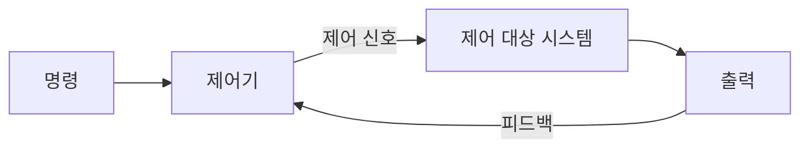

*그림 5. 폐루프 제어시스템*

폐루프 제어시스템은 제어 대상 시스템의 동작 특성에 대한 정보가 부정확하거나 시스템에 불확실한 요소가 있더라도, 그 때문에 생기는 오차를 줄여서 원하는 대로 동작한다. 오차가 생기면 그 오차 자체가 피드백을 통해 측정되고, 제어기가 그 오차를 줄이는 방향으로 제어 신호를 바꾸기 때문이다. 다음 세 가지는 폐루프 제어시스템의 예이다.

**수조 온도 조절 장치.** 수조의 온도를 설정 온도로 유지하는 장치이다. 온도 센서가 측정한 수조의 온도가 온도 조절기에 전달되고, 온도 조절기는 설정 온도와 수조 온도의 차이가 작아지도록 히터를 조절한다.

*그림 6. 수조 온도 조절 장치*

**자동차 운전에서의 피드백.** 운전자는 원하는 진행 방향과 자동차의 실제 진행 방향의 차이를 눈으로 감지하고, 그 오차를 고치기 위해 스티어링 휠을 움직여 자동차를 원하는 방향으로 나아가게 한다. 이때 **운전자가 피드백 제어기의 역할**을 한다.

*그림 7. 자동차 운전의 피드백 구조*

**자동 운전 장치.** 운전자 대신 자동 운전 장치가 피드백 제어기의 역할을 한다. 방향 감지 장치가 실제 진행 방향을 측정하고, 자동 운전 장치가 원하는 진행 방향과의 오차를 계산하여 전동 스티어링 장치를 움직인다.

*그림 8. 자동 운전 장치의 피드백 구조*

| 역할 | 수조 온도 조절 | 사람의 운전 | 자동 운전 |
|:-----|:-----|:-----|:-----|
| 명령(목표값) | 설정 온도 | 원하는 진행 방향 | 원하는 진행 방향 |
| 제어기 | 온도 조절기 | 운전자 | 자동 운전 장치 |
| 구동 장치 | 히터 | 스티어링 휠 | 전동 스티어링 장치 |
| 플랜트 | 수조 | 자동차 | 자동차 |
| 센서 | 온도 센서 | 운전자의 눈 | 방향 감지 장치 |

*표 1. 세 가지 폐루프 제어시스템의 구성 요소*

표 1에서 보듯 폐루프의 구조는 같고, 각 역할을 맡는 구체적인 장치만 다르다. 사람이 하던 제어기와 센서의 역할을 기계가 대신하면 자동 제어가 된다.

### 1.5 폐루프 제어시스템의 구성

폐루프 제어시스템을 실제로 만들려면 출력 신호를 전기 신호로 바꾸어 주는 **센서(sensor)** 가 필요하다. 센서의 전기 신호는 제어기에 입력되고, 제어기는 원하는 명령값과 이 값을 비교하여 제어에 필요한 연산을 수행한 뒤 제어 신호를 발생시켜 출력한다.

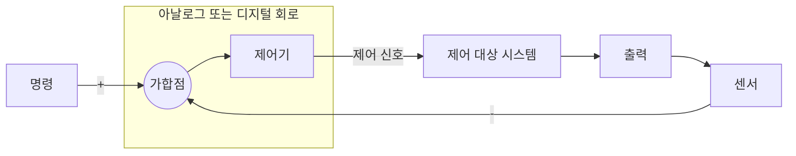

*그림 9. 센서와 제어기를 포함한 폐루프 제어시스템*

그림 9에서 명령과 센서 신호를 비교하는 가합점과 제어기는 하나의 회로로 구현된다. 제어기는 저항, 커패시터, 연산 증폭기 같은 **아날로그(analog) 전자 회로**로 구성할 수도 있고, 마이크로프로세서나 마이크로컨트롤러를 이용한 **디지털(digital) 회로**로 구현할 수도 있다. 최근의 제어기는 대부분 디지털 제어기로 구현한다. 디지털 제어기는 제어 법칙을 프로그램으로 작성하므로 회로를 바꾸지 않고도 제어 방식을 바꿀 수 있다.

### 1.6 시스템 모델링

> **용어 정의:** 제어 대상 시스템을 수학적으로 나타내는 것을 **모델링(modeling)** 이라고 한다.

모델링의 기법에는 시간 영역의 방법과 주파수 영역의 방법이 있다.

| 기법 | 변수 | 대표적인 표현 |
|:-----|:-----|:-----|
| 시간 영역(time domain)의 모델링 | 시간 $t$ | 미분방정식 |
| 주파수 영역(frequency domain)의 모델링 | 주파수 $s$ | 라플라스 변환으로 얻은 식 (5주차의 전달함수) |

*표 2. 시간 영역과 주파수 영역의 모델링*

시간 영역에서 시스템을 나타내는 가장 일반적인 방법은 **미분방정식**을 이용하는 것이다. 미분방정식을 이해하기 위해 방정식의 뜻부터 정리한다. **방정식(equation)** 은 미지수를 포함하는 식이고, 방정식을 푼다는 것은 방정식을 만족하는 미지수의 값을 구하는 것이다. 예를 들어 대수 방정식 $x + x = 1$, 곧 $2x = 1$의 해는 $x = 1/2$이다. 대수 방정식의 미지수는 수이지만, 미분방정식의 미지수는 **함수**이다.

### 1.7 미분방정식

> **용어 정의:** **미분방정식(differential equation)** 은 한 개 이상의 종속변수를 한 개 이상의 독립변수에 대해 미분한 도함수를 포함하는 방정식이다. 미분방정식을 만족하는 함수를 그 미분방정식의 **해(solution)** 라고 한다.

미분방정식은 여러 변수 사이의 관계를 식으로 써서 실제 현상을 수학적으로 모델링한 것이다. 독립변수가 하나뿐이어서 보통의 도함수만 나타나는 미분방정식을 **상미분방정식(ordinary differential equation)**, 독립변수가 둘 이상이어서 편도함수가 나타나는 것을 **편미분방정식(partial differential equation)** 이라고 한다. 제어시스템에서는 주로 시간 $t$를 독립변수로 하는 상미분방정식을 쓴다.

미분방정식은 계와 차수로 분류한다.

- **계(order):** 미분방정식에 나타난 가장 높은 미분 횟수이다. 가장 높은 도함수가 2계 도함수이면 2계 미분방정식이다.
- **차수(degree):** 계가 가장 높은 도함수의 거듭제곱 수이다.

| 미분방정식 | 가장 높은 도함수 | 그 도함수의 거듭제곱 | 분류 |
|:-----|:-----|:-----|:-----|
| $y'' - \sin x = 0$ | $y''$ | 1 | 2계 1차 상미분방정식 |
| $(y'')^3 + 8y = 0$ | $y''$ | 3 | 2계 3차 상미분방정식 |
| $\dfrac{\partial^2 z}{\partial x^2} + \dfrac{\partial^2 z}{\partial y^2} = 8x^2 + 10xy$ | $\dfrac{\partial^2 z}{\partial x^2}$, $\dfrac{\partial^2 z}{\partial y^2}$ | 1 | 2계 1차 편미분방정식 |

*표 3. 미분방정식의 계와 차수*

> **참고:** 제어 공학에서는 계(order)를 흔히 "차"라고도 부른다. 7주차의 1차 시스템과 2차 시스템은 각각 1계, 2계 미분방정식으로 나타나는 시스템을 뜻한다. 이 문서에서는 계와 차수를 구분하기 위해 미분방정식의 order를 계로 쓴다.

**갈릴레이의 낙하 운동.** 갈릴레이는 물체의 낙하 운동을 연구하면서, 자유 낙하하는 물체가 시간 $t$ 동안 거리 $x$만큼 떨어질 때 가속도 $x''(t)$가 중력 가속도 $g$로 일정하다는 사실을 발견했다. 이를 미분방정식으로 쓰면 다음과 같다.

$$
x''(t) = g
$$

양변을 $t$에 대해 한 번 적분하면 속도가, 한 번 더 적분하면 위치가 나온다.

$$
x'(t) = g t + C_1, \qquad x(t) = \frac{1}{2} g t^2 + C_1 t + C_2
$$

물체를 정지 상태에서 놓았다면 $x(0) = 0$, $x'(0) = 0$이므로 $C_2 = 0$, $C_1 = 0$이고, 다음 해를 얻는다.

$$
x(t) = \frac{1}{2} g t^2
$$

*그림 10. 피사의 사탑에서 물체를 떨어뜨리는 갈릴레이의 실험*

갈릴레이의 낙하 법칙은 미분방정식을 세우고 풀어서 얻는 운동 법칙의 첫 예로 흔히 소개된다. 이 풀이에서 미분방정식의 해는 하나로 정해지지 않고 적분 상수 $C_1$, $C_2$를 포함하며, 두 초기 조건이 있어야 해가 하나로 정해진다는 점에 주목할 필요가 있다. 이 사실은 3절에서 2계 미분방정식을 풀 때 다시 나타난다.

### 1.8 시스템 모델링의 예

**RC 회로.** 저항 $R$과 커패시터 $C$를 직렬로 연결하고 전압원 $u(t)$를 가한 회로에서, 입력은 전압원의 전압 $u(t)$이고 출력은 커패시터 양단의 전압 $y(t)$이다. 입력으로는 $t = 0$에서 0 V에서 1 V로 바뀌는 계단 함수(step function)를 자주 쓴다.

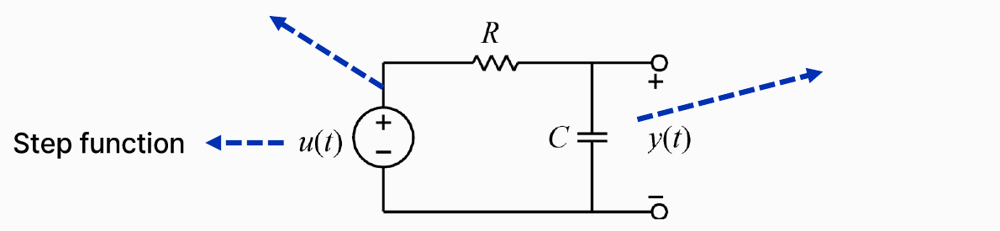

*그림 11. 계단 함수 전압원이 연결된 RC 회로*

미분방정식은 두 법칙으로 유도한다. 회로를 한 바퀴 돌 때 전압의 합이 0이라는 키르히호프의 전압 법칙에 따라 전원 전압은 저항의 전압과 커패시터의 전압의 합이다. 회로에 흐르는 전류를 $i(t)$라 하면 저항의 전압은 $R i(t)$이고, 커패시터의 전류는 전압의 변화율에 비례하여 $i(t) = C \, dy/dt$이다.

$$
u(t) = R\, i(t) + y(t), \qquad i(t) = C \frac{dy(t)}{dt}
$$

두 번째 식을 첫 번째 식에 대입하면 RC 회로의 미분방정식을 얻는다.

$$
RC \frac{dy(t)}{dt} + y(t) = u(t)
$$

이는 1계 미분방정식이다. 3.2절의 방법으로 단위 계단 입력 $u(t) = 1$ ($t \geq 0$)과 초기 조건 $y(0) = 0$에 대해 풀면 $y(t) = 1 - e^{-t/RC}$이다. 커패시터 전압은 0에서 출발하여 1 V를 향해 지수적으로 올라가며, $t = RC$에서 $1 - e^{-1} \approx 0.632$, 곧 최종값의 약 63.2%에 이른다. 이 $RC$를 회로의 **시정수(time constant)** 라고 한다.

**질량-스프링 시스템.** 벽에 연결된 스프링 끝에 질량 $m$인 물체가 달려 있고, 물체가 평형 위치에서 $y$만큼 움직인 상황을 생각한다.

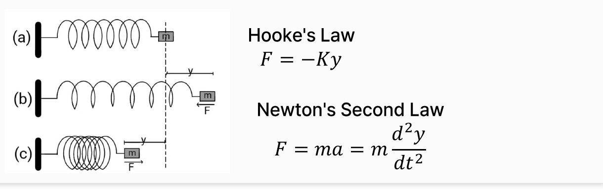

*그림 12. 질량-스프링 시스템과 훅의 법칙, 뉴턴의 제2법칙*

그림 12의 (a)는 스프링이 늘어나지도 줄어들지도 않은 평형 상태, (b)는 물체가 오른쪽으로 $y$만큼 당겨져 스프링이 늘어난 상태, (c)는 물체가 왼쪽으로 밀려 스프링이 압축된 상태이다. (b)에서 스프링의 힘 $F$는 왼쪽(평형 위치 쪽)을, (c)에서는 오른쪽(평형 위치 쪽)을 향한다. 두 물리 법칙을 쓴다.

- **훅의 법칙(Hooke's law):** 스프링의 힘은 변위에 비례하고 변위와 반대 방향을 향한다. $F = -K y$이며, $K$는 스프링 상수이다.
- **뉴턴의 제2법칙(Newton's second law):** 물체에 작용하는 힘은 질량과 가속도의 곱이다. $F = m a = m \, d^2 y/dt^2$이다.

물체에 작용하는 힘이 스프링의 힘뿐이면 두 식의 $F$가 같으므로 다음 미분방정식을 얻는다.

$$
m \frac{d^2 y}{dt^2} = -K y \quad \Rightarrow \quad m \frac{d^2 y}{dt^2} + K y = 0
$$

이는 2계 미분방정식이다. 물체에 외부 힘 $f(t)$를 가하면 그 힘이 입력이 되어 $m \ddot{y} + K y = f(t)$가 된다. 이 식의 특성방정식 $m\lambda^2 + K = 0$의 근은 $\lambda = \pm j\sqrt{K/m}$으로 순허수이므로, 3.5절의 방법으로 풀면 해는 각진동수 $\sqrt{K/m}$으로 영원히 진동하는 코사인과 사인의 조합이 된다. 마찰이나 감쇠기를 포함한 기계 시스템의 모델링은 4주차에서 다룬다.

### 1.9 시간 영역과 주파수 영역

미분방정식을 푸는 것은 미분방정식을 만족하는 함수를 찾는 것이다. 시스템의 동적 특성을 나타내는 미분방정식의 해는 시간 $t$에 대한 함수이므로, 미분방정식을 이용하는 방법은 **시간 영역의 방법**이다.

한편 변수가 시간인 함수에 **라플라스 변환(Laplace transform)** 을 취하면 변수가 복소 주파수 $s$인 함수로 바뀐다. 변수가 주파수이므로 이를 **주파수 영역의 방법**이라고 한다.

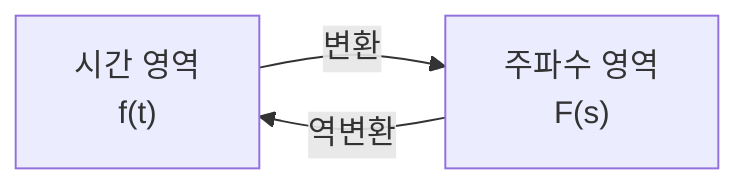

*그림 13. 시간 영역과 주파수 영역의 관계*

제어공학에서 다루는 함수($t \ge 0$에서 연속인 함수 등)에서는 원래의 함수와 변환된 함수 사이에 1대1 대응 관계가 성립하므로(3주차), 변환한 뒤 다시 역변환하면 원래의 함수로 돌아온다. 이 덕분에 다음과 같은 장점이 있다.

- 원래의 함수로는 풀기 어려운 문제가 변환된 함수를 이용하면 쉬워진다. 예를 들어 라플라스 변환은 미분을 $s$의 곱셈으로 바꾸어 미분방정식을 대수 방정식으로 만든다.
- 원래의 함수로는 알아내기 어려웠던 정보를 변환된 함수로는 알 수 있다. 시스템의 안정성과 응답 속도가 그 예이다.

라플라스 변환의 정의와 성질은 3주차에서 다룬다. 주파수 $s$가 복소수이므로, 그 전에 2절에서 복소수를 정리한다.

---

 

## 2. 복소수

### 2.1 허수와 복소수

> **용어 정의:** **복소수(complex number)** 는 실수와 허수로 이루어진 수이다. 제곱하면 0보다 작은 수가 되는 수를 **허수(imaginary number)** 라고 하며, 제곱하여 $-1$이 되는 수를 **허수 단위(imaginary unit)** $i$라고 한다.

$$
i^2 = -1 \quad \Rightarrow \quad i = \sqrt{-1}
$$

전자와 전기를 다루는 분야에서는 전류의 기호 $i$와 헷갈리지 않도록 허수 단위를 $j$로 쓴다. 이 과목에서도 $j$를 쓰며, 복소수는 주로 $s$로 나타낸다.

$$
s = a + jb = a + b\sqrt{-1}
$$

여기서 $a$를 **실수부(real part)** 라고 하며 $a = \mathrm{Re}\lbrace s\rbrace$로, $b$를 **허수부(imaginary part)** 라고 하며 $b = \mathrm{Im}\lbrace s\rbrace$로 쓴다. 허수부 $b$ 자체는 실수라는 점에 주의할 필요가 있다.

| 집합 | 조건 | 예 |
|:-----|:-----|:-----|
| 실수 | $b = 0$ | $-3$, $\sqrt{12}$, $\pi$ |
| 순허수 | $a = 0$, $b \neq 0$ | $j$, $-3j$ |
| 그 밖의 복소수 | $a \neq 0$, $b \neq 0$ | $4 + 2j$, $3 + \sqrt{-2} = 3 + j\sqrt{2}$ |

*표 4. 복소수의 분류*

> **참고:** 제곱하여 음수가 되는 수, 곧 $(bj)^2 = -b^2 < 0$인 $bj$ ($b \neq 0$)를 엄밀하게는 **순허수(purely imaginary number)** 라고 한다. 수학에서 허수는 실수가 아닌 복소수($b \neq 0$) 전체를 가리키는 경우가 많다. 또한 $e^{\pi j}$는 허수처럼 보이지만, 2.6절의 오일러 공식에 따르면 $e^{j\pi} = -1$로 실수이다. 순허수의 예는 $e^{j\pi/2} = j$이다.

예를 들어 $1 + j2 = 1 + 2\sqrt{-1}$의 실수부는 $\mathrm{Re}\lbrace1 + j2\rbrace= 1$, 허수부는 $\mathrm{Im}\lbrace1 + j2\rbrace= 2$이다. 순허수 $j2$를 제곱하면 음수가 된다.

$$
(j2)^2 = \left(2\sqrt{-1}\right)^2 = 4 \times (-1) = -4
$$

복소수는 실수부와 허수부라는 두 실수의 쌍이므로, 좌표계를 통해 평면 위의 점으로 나타낼 수 있다(2.3절, 2.4절).

### 2.2 허수 단위의 거듭제곱

$j^2 = -1$을 반복해서 쓰면 $j$의 거듭제곱은 네 개의 값을 차례로 돈다.

$$
j^1 = j, \quad j^2 = -1, \quad j^3 = j^2 \cdot j = -j, \quad j^4 = (j^2)^2 = 1, \quad j^5 = j^4 \cdot j = j, \quad \ldots
$$

따라서 자연수 $n$에 대해 다음 주기성이 성립한다.

$$
j^{4n-3} = j, \qquad j^{4n-2} = -1, \qquad j^{4n-1} = -j, \qquad j^{4n} = 1
$$

예를 들어 $j^{10}$은 $10 = 4 \times 3 - 2$이므로 $-1$이고, $j^{23}$은 $23 = 4 \times 6 - 1$이므로 $-j$이다. 2.8절에서 보듯 $j$를 곱하는 것은 복소평면에서 90° 회전하는 것과 같으므로, 네 번 곱하면 360° 돌아 제자리로 오는 것이 이 주기성의 기하학적 의미이다.

### 2.3 직교 좌표계

> **용어 정의:** **직교 좌표계(orthogonal coordinate system)** 는 각각의 축 또는 좌표 곡선이 만나는 곳에서 서로 직교하는 좌표계이다. 대표적인 예로 직각 좌표계와 극 좌표계가 있다.

- **직각 좌표계(Cartesian coordinate system):** 서로 수직인 축을 기준으로 위치를 $(x, y)$ 또는 $(x, y, z)$로 나타낸다.
- **극 좌표계(polar coordinate system):** **극점(pole)** 이라고 부르는 기준점으로부터의 거리 $r$과, 극점을 지나는 기준선에 대한 각도 $\theta$로 위치를 $(r, \theta)$로 나타낸다. 반지름이 일정한 원과 각도가 일정한 반직선은 만나는 모든 점에서 서로 수직이므로, 극 좌표계도 직교 좌표계이다.

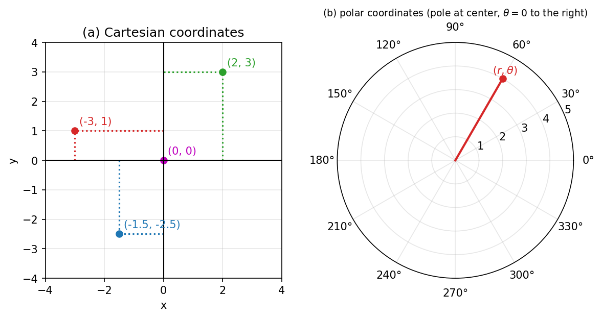

*그림 14. 직각 좌표계와 극 좌표계*

그림 14의 (a)에서 점 $(2, 3)$은 원점에서 $x$축 방향으로 2, $y$축 방향으로 3만큼 간 위치이고, $(-3, 1)$, $(-1.5, -2.5)$, $(0, 0)$도 같은 방식으로 읽는다. (b)는 극점을 중심으로 한 동심원(거리)과 30° 간격의 방사선(각도)으로 이루어진 극 좌표계이며, 점 $(r, \theta)$는 극점에서 거리 $r$, 기준선($\theta = 0$)에서 반시계 방향으로 각도 $\theta$인 위치이다.

### 2.4 직각 좌표 형식과 극좌표 형식

가로축을 **실수축(real axis)**, 세로축을 **허수축(imaginary axis)** 으로 하는 평면을 **복소평면(complex plane)** 이라고 한다. 복소수 $A = a + jb$는 복소평면에서 점 $(a, b)$, 또는 원점에서 그 점으로 가는 화살표로 나타난다.

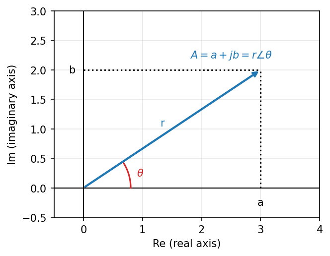

*그림 15. 복소평면에서의 직각 좌표 형식과 극좌표 형식*

- **직각 좌표 형식(Cartesian form):** $A = a + jb$처럼 실수부와 허수부로 나타낸다.
- **극좌표 형식(polar form):** $A = r\angle\theta$처럼 원점에서의 거리 $r$과 실수축에서 잰 각도 $\theta$로 나타낸다. $r = \lvert A \rvert$를 복소수의 **크기(magnitude)**, $\theta$를 **편각(argument)** 이라고 한다.

그림 15의 직각삼각형에서 빗변이 $r$, 밑변이 $a$, 높이가 $b$이므로 삼각함수의 정의에 따라 극좌표 형식을 직각 좌표 형식으로 바꿀 수 있다.

$$
a = r\cos\theta, \qquad b = r\sin\theta, \qquad r\angle\theta = (r\cos\theta) + j(r\sin\theta) = a + jb
$$

반대로 피타고라스 정리와 탄젠트의 정의로 직각 좌표 형식을 극좌표 형식으로 바꿀 수 있다.

$$
r = \sqrt{a^2 + b^2}, \qquad \theta = \tan^{-1}\left(\frac{b}{a}\right)
$$

> **주의:** $\tan^{-1}$은 $-90^\circ$와 $90^\circ$ 사이의 값만 돌려주므로, $\theta = \tan^{-1}(b/a)$는 복소수가 제1사분면이나 제4사분면($a > 0$)에 있을 때만 맞다. $a < 0$이면 $(a, b)$와 $(-a, -b)$가 같은 $b/a$ 값을 가지므로 사분면을 보고 180°를 더하거나 빼야 한다. $a = 0$이면 $b > 0$일 때 $90^\circ$, $b < 0$일 때 $-90^\circ$이다.

| 복소수의 위치 | 편각 $\theta$ |
|:-----|:-----|
| $a > 0$ (제1, 제4사분면) | $\tan^{-1}(b/a)$ |
| $a < 0$, $b \geq 0$ (제2사분면, 음의 실수축) | $\tan^{-1}(b/a) + 180^\circ$ |
| $a < 0$, $b < 0$ (제3사분면) | $\tan^{-1}(b/a) - 180^\circ$ |
| $a = 0$, $b > 0$ (양의 허수축) | $90^\circ$ |
| $a = 0$, $b < 0$ (음의 허수축) | $-90^\circ$ |

*표 5. 사분면에 따른 편각의 계산*

### 2.5 형식 변환 예제

**예제 1: 직각 좌표 형식에서 극좌표 형식으로.** $A = \sqrt{3} + j$를 극좌표 형식으로 나타낸다. $a = \sqrt{3} > 0$, $b = 1$이므로 제1사분면이다.

$$
r = \sqrt{(\sqrt{3})^2 + 1^2} = \sqrt{3 + 1} = 2, \qquad \theta = \tan^{-1}\left(\frac{1}{\sqrt{3}}\right) = 30^\circ
$$

따라서 $A = 2\angle 30^\circ$이다.

**예제 2: 극좌표 형식(도)에서 직각 좌표 형식으로.** $2\angle 45^\circ$와 $2\angle 135^\circ$를 직각 좌표 형식으로 나타낸다. $\cos 45^\circ = \sin 45^\circ = \sqrt{2}/2$, $\cos 135^\circ = -\sqrt{2}/2$, $\sin 135^\circ = \sqrt{2}/2$이므로 다음과 같다.

$$
2\angle 45^\circ = 2\cos 45^\circ + j\,2\sin 45^\circ = 2 \cdot \frac{\sqrt{2}}{2} + j\,2 \cdot \frac{\sqrt{2}}{2} = \sqrt{2} + j\sqrt{2}
$$

$$
2\angle 135^\circ = 2\cos 135^\circ + j\,2\sin 135^\circ = -\sqrt{2} + j\sqrt{2}
$$

두 복소수는 크기가 같고 허수축에 대해 대칭이다.

**예제 3: 극좌표 형식(라디안)에서 직각 좌표 형식으로.** 각도는 라디안으로도 쓴다. $\pi$ rad $= 180^\circ$이므로 $\pi/4 = 45^\circ$, $-\pi/2 = -90^\circ$이다.

$$
1\angle(\pi/4) = \cos\frac{\pi}{4} + j\sin\frac{\pi}{4} = \frac{\sqrt{2}}{2} + j\frac{\sqrt{2}}{2} \approx 0.707 + j0.707
$$

$$
1\angle(-\pi/2) = \cos\left(-\frac{\pi}{2}\right) + j\sin\left(-\frac{\pi}{2}\right) = 0 + j(-1) = -j
$$

**예제 4: 사분면에 주의해야 하는 경우.** $-\sqrt{3} + j$를 극좌표 형식으로 나타낸다. 크기는 $r = \sqrt{3 + 1} = 2$이다. 계산기로 $\tan^{-1}(1/(-\sqrt{3}))$을 구하면 $-30^\circ$가 나오지만, $a < 0$, $b > 0$이므로 이 복소수는 제2사분면에 있다. 표 5에 따라 180°를 더한다.

$$
\theta = -30^\circ + 180^\circ = 150^\circ \quad \Rightarrow \quad -\sqrt{3} + j = 2\angle 150^\circ
$$

검산하면 $2\cos 150^\circ = 2 \times (-\sqrt{3}/2) = -\sqrt{3}$, $2\sin 150^\circ = 2 \times 1/2 = 1$로 원래의 복소수가 나온다.

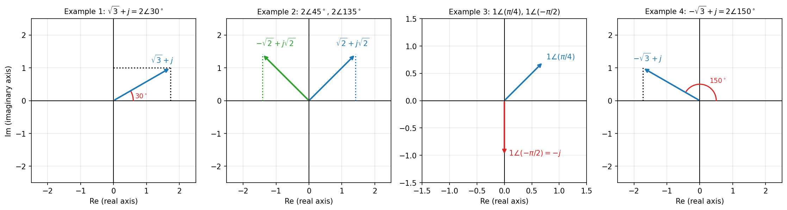

*그림 16. 네 가지 형식 변환 예제*

### 2.6 오일러 공식

**오일러 공식(Euler's formula)** 은 지수 함수와 삼각 함수를 복소수로 연결한다.

$$
e^{j\theta} = \cos\theta + j\sin\theta
$$

이 공식은 **테일러 급수(Taylor series)** 로 유도할 수 있다. 무한 번 미분할 수 있는 함수 $f(x)$를 점 $a$ 근처에서 다항식의 무한합으로 나타낸 것이 테일러 급수이다.

$$
T_f(x) = \sum_{n=0}^{\infty} \frac{f^{(n)}(a)}{n!}(x - a)^n = f(a) + f'(a)(x - a) + \frac{1}{2} f''(a)(x - a)^2 + \frac{1}{6} f'''(a)(x - a)^3 + \cdots
$$

> **[미적분학]** 테일러 급수는 한 점에서 함수의 값과 모든 계 도함수의 값을 알면 그 근처의 함수를 다항식으로 근사할 수 있다는 생각에 바탕을 둔다. $a = 0$에서 전개한 것을 매클로린 급수라고 하며, 항을 많이 더할수록 근사가 넓은 범위에서 정확해진다. 사인, 코사인, 지수 함수의 테일러 급수는 모든 실수 $x$에서 원래 함수로 수렴한다.

$a = 0$에서 세 함수를 전개한다. $\cos x$의 도함수는 $\cos, -\sin, -\cos, \sin$을 반복하므로 $x = 0$에서의 값은 $1, 0, -1, 0$을 반복하고, $\sin x$는 $0, 1, 0, -1$을 반복하며, $e^x$는 모든 계의 도함수가 $e^x$이므로 $x = 0$에서 항상 1이다.

$$
\cos x = 1 - \frac{x^2}{2!} + \frac{x^4}{4!} - \frac{x^6}{6!} + \cdots
$$

$$
\sin x = x - \frac{x^3}{3!} + \frac{x^5}{5!} - \frac{x^7}{7!} + \cdots
$$

$$
e^x = 1 + x + \frac{x^2}{2!} + \frac{x^3}{3!} + \frac{x^4}{4!} + \frac{x^5}{5!} + \frac{x^6}{6!} + \frac{x^7}{7!} + \cdots
$$

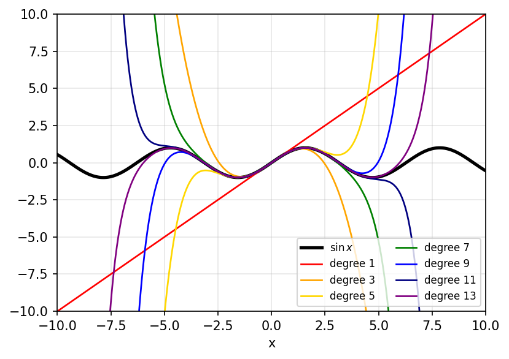

*그림 17. 사인 함수와 차수별 테일러 다항식*

그림 17은 $\sin x$의 테일러 급수를 1차, 3차, 5차, 7차, 9차, 11차, 13차 항까지 더한 다항식이다. 차수가 높을수록 원래의 사인 곡선과 겹치는 구간이 넓어진다.

이제 $e^x$의 급수에 $x$ 대신 $ix$를 대입한다. $i^2 = -1$, $i^3 = -i$, $i^4 = 1$이므로 $(ix)^2 = -x^2$, $(ix)^3 = -ix^3$, $(ix)^4 = x^4$, ...이다.

$$
e^{ix} = 1 + ix - \frac{x^2}{2!} - i\frac{x^3}{3!} + \frac{x^4}{4!} + i\frac{x^5}{5!} - \frac{x^6}{6!} - i\frac{x^7}{7!} + \cdots
$$

$i$가 없는 항과 $i$가 있는 항을 나누어 모으면, 앞의 것은 $\cos x$의 급수이고 뒤의 것은 $i$와 $\sin x$의 급수의 곱이다.

$$
e^{ix} = \left(1 - \frac{x^2}{2!} + \frac{x^4}{4!} - \cdots\right) + i\left(x - \frac{x^3}{3!} + \frac{x^5}{5!} - \cdots\right) = \cos x + i\sin x
$$

$x$를 $\theta$로, $i$를 $j$로 쓰면 오일러 공식 $e^{j\theta} = \cos\theta + j\sin\theta$가 된다. $\lvert e^{j\theta} \rvert = \sqrt{\cos^2\theta + \sin^2\theta} = 1$이므로 $e^{j\theta}$는 복소평면의 단위원 위에서 편각이 $\theta$인 점이다.

**오일러 항등식.** 오일러 공식에 $\theta = \pi$를 대입하면 다음을 얻는다.

$$
e^{j\pi} = \cos\pi + j\sin\pi = -1 + j \cdot 0 = -1 \quad \Rightarrow \quad e^{j\pi} + 1 = 0
$$

이 식을 **오일러 항등식(Euler's identity)** 이라고 한다. 수학의 기본 상수 다섯 개 $0$, $1$, $\pi$, $e$, $j$가 하나의 간단한 식에 모여 있어 흔히 세상에서 가장 아름다운 수학 공식으로 불린다. 1988년 수학 잡지 The Mathematical Intelligencer가 널리 알려진 정리 24개를 제시하고 각 정리의 아름다움을 0점에서 10점까지 매기게 하는 설문을 실었는데, 1990년에 발표된 결과에서 오일러 항등식이 평균 7.7점으로 1위를 차지했다 [1].

**지수 형식.** 오일러 공식을 쓰면 극좌표 형식을 지수 함수 형태로 나타낼 수 있다.

$$
r\angle\theta = r(\cos\theta + j\sin\theta) = r e^{j\theta}
$$

이를 **지수 형식(exponential form)** 이라고 하며, 2.8절과 2.9절에서 곱셈과 나눗셈을 지수 법칙으로 간단히 계산하는 데 쓰인다.

### 2.7 복소수의 덧셈과 뺄셈

두 복소수 $S_1 = a_1 + jb_1$, $S_2 = a_2 + jb_2$의 덧셈과 뺄셈은 직각 좌표 형식에서 실수부끼리, 허수부끼리 계산한다.

$$
S_1 + S_2 = a_1 + jb_1 + a_2 + jb_2 = (a_1 + a_2) + j(b_1 + b_2)
$$

$$
S_1 - S_2 = a_1 + jb_1 - a_2 - jb_2 = (a_1 - a_2) + j(b_1 - b_2)
$$

복소평면에서 덧셈은 두 화살표로 평행사변형을 만들었을 때의 대각선이다. 뺄셈은 $S_1 - S_2 = S_1 + (-S_2)$이므로 $S_2$를 원점에 대해 뒤집은 $-S_2$를 $S_1$에 더한 것이며, $S_2 + (S_1 - S_2) = S_1$이므로 $S_1 - S_2$는 $S_2$의 끝에서 $S_1$의 끝으로 가는 화살표와 크기와 방향이 같다.

**예제.** $S_1 = 2 + j$, $S_2 = 1 + j2$일 때 다음과 같다.

$$
S_1 + S_2 = (2 + 1) + j(1 + 2) = 3 + j3, \qquad S_1 - S_2 = (2 - 1) + j(1 - 2) = 1 - j
$$

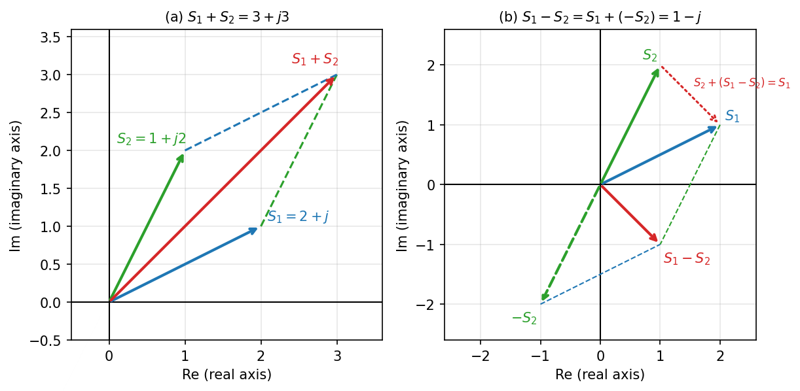

*그림 18. 복소수의 덧셈과 뺄셈*

### 2.8 복소수의 곱셈

**직각 좌표 형식을 이용한 계산.** 분배 법칙으로 전개하고 $j^2 = -1$을 쓴다.

$$
S_1 S_2 = (a_1 + jb_1)(a_2 + jb_2) = a_1a_2 + ja_1b_2 + ja_2b_1 + j^2 b_1b_2 = (a_1a_2 - b_1b_2) + j(a_1b_2 + a_2b_1)
$$

**극좌표 형식을 이용한 계산.** 두 복소수를 지수 형식으로 쓴다.

$$
S_1 = r_1\angle\theta_1 = (r_1\cos\theta_1) + j(r_1\sin\theta_1) = r_1 e^{j\theta_1}, \qquad S_2 = r_2\angle\theta_2 = r_2 e^{j\theta_2}
$$

지수 법칙 $e^{x}e^{y} = e^{x + y}$를 쓰면 다음과 같다.

$$
S_1 S_2 = (r_1 e^{j\theta_1})(r_2 e^{j\theta_2}) = r_1 r_2 e^{j\theta_1} e^{j\theta_2} = r_1 r_2 e^{j(\theta_1 + \theta_2)} = r_1 r_2 \angle(\theta_1 + \theta_2)
$$

> **핵심:** 극좌표 형식에서 곱셈은 **크기는 곱하고 각도는 더한다.** 직각 좌표 형식의 곱셈은 네 개의 항을 전개해야 하지만 극좌표 형식에서는 곱셈 하나와 덧셈 하나로 끝나므로, 곱셈은 극좌표 형식으로 계산하는 것이 편리하다. 특히 $j = 1\angle 90^\circ$를 곱하면 크기는 그대로이고 각도만 90° 커지므로, $j$를 곱하는 것은 복소평면에서 90° 회전하는 것과 같다.

**예제.** $S_1 = 1\angle 60^\circ = \frac{1}{2} + j\frac{\sqrt{3}}{2}$, $S_2 = 2\angle 30^\circ = \sqrt{3} + j$의 곱을 두 방법으로 구한다.

직각 좌표 형식으로 계산하면 $a_1 = 1/2$, $b_1 = \sqrt{3}/2$, $a_2 = \sqrt{3}$, $b_2 = 1$이다.

$$
a_1a_2 - b_1b_2 = \frac{1}{2}\cdot\sqrt{3} - \frac{\sqrt{3}}{2}\cdot 1 = 0, \qquad a_1b_2 + a_2b_1 = \frac{1}{2}\cdot 1 + \sqrt{3}\cdot\frac{\sqrt{3}}{2} = \frac{1}{2} + \frac{3}{2} = 2
$$

따라서 $S_1 S_2 = 0 + j2 = j2$이다. 극좌표 형식으로 계산하면 다음과 같다.

$$
S_1 S_2 = (1 \times 2)\angle(60^\circ + 30^\circ) = 2\angle 90^\circ = 2\cos 90^\circ + j\,2\sin 90^\circ = j2
$$

두 결과가 같다.

### 2.9 복소수의 나눗셈

> **용어 정의:** 복소수 $S = a + jb$의 허수부의 부호를 바꾼 $\bar{S} = a - jb$를 $S$의 **켤레 복소수(complex conjugate)** 라고 한다. 복소수와 그 켤레 복소수의 곱은 $(a + jb)(a - jb) = a^2 - j^2 b^2 = a^2 + b^2$로 항상 0 이상의 실수이다.

**직각 좌표 형식을 이용한 계산.** 분모를 실수로 만들기 위해 분자와 분모에 분모의 켤레 복소수를 곱한다.

$$
\frac{S_1}{S_2} = \frac{a_1 + jb_1}{a_2 + jb_2} = \frac{(a_1 + jb_1)(a_2 - jb_2)}{(a_2 + jb_2)(a_2 - jb_2)}
$$

분자를 전개하면 $j^2 = -1$이므로 다음과 같고, 분모는 $a_2^2 + b_2^2$이다.

$$
(a_1 + jb_1)(a_2 - jb_2) = a_1a_2 - ja_1b_2 + ja_2b_1 - j^2 b_1b_2 = (a_1a_2 + b_1b_2) + j(a_2b_1 - a_1b_2)
$$

$$
\frac{S_1}{S_2} = \frac{(a_1a_2 + b_1b_2) + j(a_2b_1 - a_1b_2)}{a_2^2 + b_2^2}
$$

> **주의:** 분자를 전개할 때 $jb_1 \cdot a_2 = +ja_2b_1$, $a_1 \cdot (-jb_2) = -ja_1b_2$이므로 허수부는 $a_2b_1 - a_1b_2$이다. 부호를 잘못 써서 허수부를 $-(a_1b_2 + a_2b_1)$로 계산하면 아래 예제에서 $j\frac{1}{4}$ 대신 $-j\frac{1}{2}$이라는 틀린 값이 나온다. 극좌표 형식의 결과로 검산하면 이런 실수를 잡을 수 있다.

**극좌표 형식을 이용한 계산.** 지수 법칙 $e^{x}/e^{y} = e^{x - y}$를 쓴다.

$$
\frac{S_1}{S_2} = \frac{r_1 e^{j\theta_1}}{r_2 e^{j\theta_2}} = \frac{r_1}{r_2}\cdot\frac{e^{j\theta_1}}{e^{j\theta_2}} = \frac{r_1}{r_2} e^{j(\theta_1 - \theta_2)} = \frac{r_1}{r_2}\angle(\theta_1 - \theta_2)
$$

> **핵심:** 극좌표 형식에서 나눗셈은 **크기는 나누고 각도는 뺀다.**

**예제.** 2.8절의 $S_1 = 1\angle 60^\circ = \frac{1}{2} + j\frac{\sqrt{3}}{2}$, $S_2 = 2\angle 30^\circ = \sqrt{3} + j$에 대해 $S_1 / S_2$를 구한다.

직각 좌표 형식으로 계산한다.

$$
a_1a_2 + b_1b_2 = \frac{\sqrt{3}}{2} + \frac{\sqrt{3}}{2} = \sqrt{3}, \qquad a_2b_1 - a_1b_2 = \sqrt{3}\cdot\frac{\sqrt{3}}{2} - \frac{1}{2}\cdot 1 = \frac{3}{2} - \frac{1}{2} = 1, \qquad a_2^2 + b_2^2 = 3 + 1 = 4
$$

$$
\frac{S_1}{S_2} = \frac{\sqrt{3} + j1}{4} = \frac{\sqrt{3}}{4} + j\frac{1}{4} \approx 0.433 + j0.25
$$

극좌표 형식으로 계산하면 다음과 같다.

$$
\frac{S_1}{S_2} = \frac{1}{2}\angle(60^\circ - 30^\circ) = 0.5\angle 30^\circ = 0.5\cos 30^\circ + j\,0.5\sin 30^\circ = \frac{\sqrt{3}}{4} + j\frac{1}{4}
$$

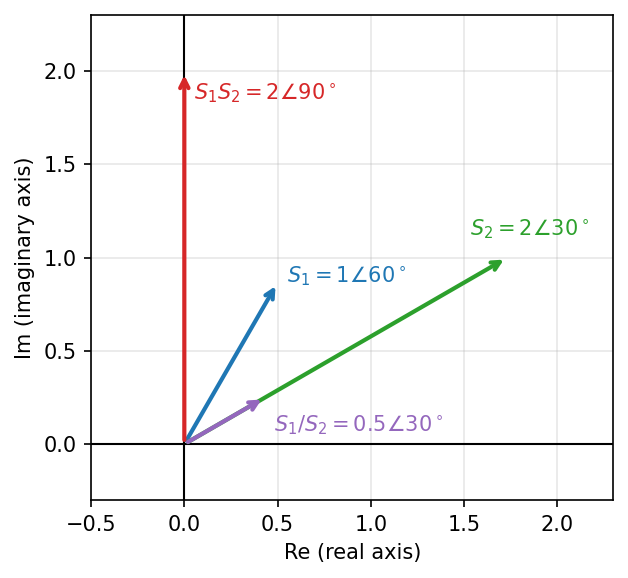

*그림 19. 복소수의 곱셈과 나눗셈*

그림 19에서 곱 $S_1S_2$는 크기가 $1 \times 2 = 2$, 각도가 $60^\circ + 30^\circ = 90^\circ$인 화살표이고, 몫 $S_1/S_2$는 크기가 $1/2$, 각도가 $60^\circ - 30^\circ = 30^\circ$인 화살표이다.

### 2.10 복소 함수

> **용어 정의:** 변수가 복소수 값을 가지는 함수를 **복소 함수(complex function)** 라고 한다. 복소 함수 $G(s)$는 복소평면($s$ 평면)의 점을 다른 복소평면($G(s)$ 평면)의 점으로 옮기는 사상(mapping)으로 볼 수 있다.

**예 1: $G(s) = s^2$.** $s_1 = j$, $s_2 = 1 + j$에서 함수값을 구한다.

$$
G(s_1) = j^2 = -1, \qquad G(s_2) = (1 + j)^2 = 1 + 2j + j^2 = 1 + 2j - 1 = j2
$$

극좌표 형식으로 보면 $s_2 = \sqrt{2}\angle 45^\circ$이므로 $s_2^2 = (\sqrt{2})^2\angle 90^\circ = 2\angle 90^\circ = j2$로, 크기는 제곱하고 각도는 두 배로 한 것과 같다.

**예 2: $G(s) = \dfrac{1}{s + 1}$.** 허수축 위의 점 $s = j\omega$ ($\omega$는 실수)에서의 값을 구한다. 분자와 분모에 분모의 켤레 복소수 $1 - j\omega$를 곱한다.

$$
G(s)\Big\vert_{s = j\omega} = G(j\omega) = \frac{1}{1 + j\omega} = \frac{1 - j\omega}{(1 + j\omega)(1 - j\omega)} = \frac{1 - j\omega}{1 + \omega^2}
$$

따라서 실수부와 허수부는 다음과 같다.

$$
\mathrm{Re}\lbrace G(j\omega)\rbrace= \frac{1}{1 + \omega^2}, \qquad \mathrm{Im}\lbrace G(j\omega)\rbrace= \frac{-\omega}{1 + \omega^2}
$$

몇 개의 $\omega$에서 값을 구하면 $\omega = 0$에서 $1$, $\omega = 1$에서 $0.5 - j0.5$, $\omega = 2$에서 $0.2 - j0.4$이고, $\omega \to \infty$이면 $0$으로 다가간다. 실수부를 $X$, 허수부를 $Y$라 하면 $X^2 + Y^2 = \frac{1 + \omega^2}{(1 + \omega^2)^2} = \frac{1}{1 + \omega^2} = X$이므로 다음 원의 방정식을 만족한다.

$$
X^2 - X + Y^2 = 0 \quad \Rightarrow \quad \left(X - \frac{1}{2}\right)^2 + Y^2 = \left(\frac{1}{2}\right)^2
$$

곧 허수축 위의 점들은 $G(s)$ 평면에서 중심이 $(1/2, 0)$, 반지름이 $1/2$인 원으로 옮겨진다. $\omega \geq 0$이면 허수부 $-\omega/(1 + \omega^2)$가 0 이하이므로 원의 아래쪽 반원이 되고, $\omega$가 0에서 커짐에 따라 점은 $1$에서 출발하여 아래쪽 반원을 따라 $0$으로 다가간다. $\omega < 0$인 부분은 실수축에 대해 대칭인 위쪽 반원이다.

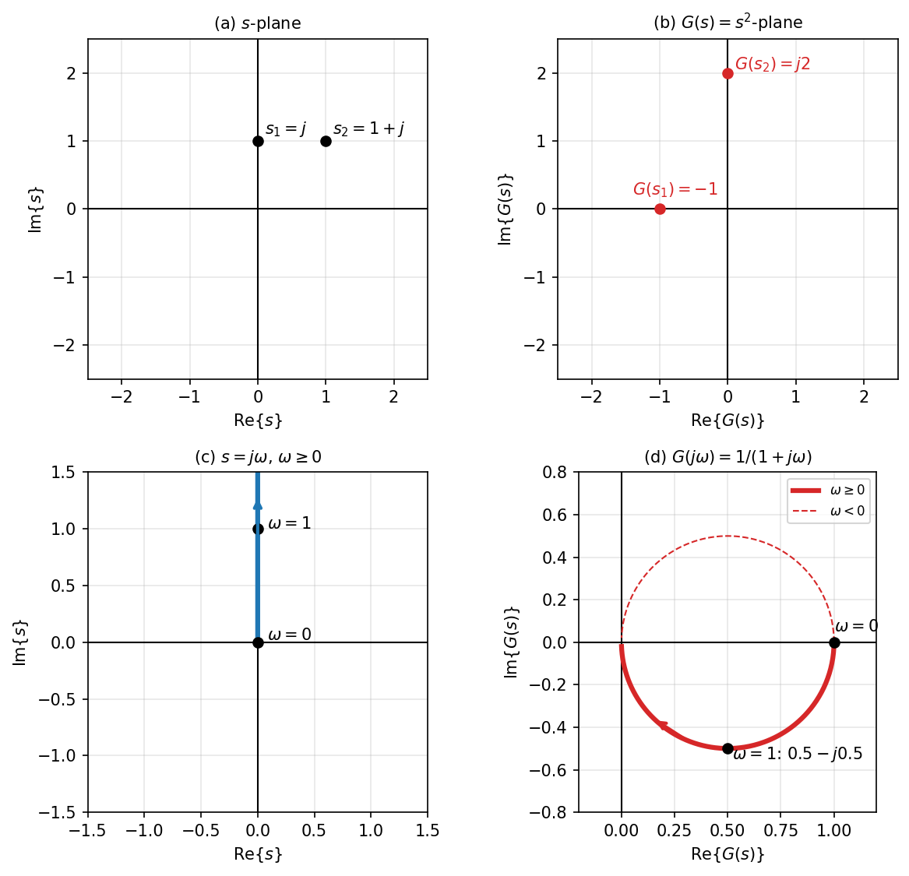

*그림 20. 복소 함수에 의한 s 평면에서 G(s) 평면으로의 사상*

> **참고:** $G(j\omega)$의 크기 $\lvert G(j\omega) \rvert = 1/\sqrt{1 + \omega^2}$와 편각 $\angle G(j\omega) = -\tan^{-1}\omega$는 시스템에 각진동수 $\omega$인 정현파를 넣었을 때 출력의 크기가 몇 배가 되고 위상이 얼마나 늦어지는지를 나타내며, 이를 **주파수 응답(frequency response)** 이라고 한다 [2]. 복소 함수의 값을 구하는 계산은 5주차 이후 전달함수를 다룰 때 계속 쓰인다.

---

 

## 3. 미분방정식

이 절에서는 시간 $t$에 대한 도함수를 점으로 나타낸다. $\dot{x} = dx/dt$는 1계 도함수, $\ddot{x} = d^2x/dt^2$는 2계 도함수이다.

### 3.1 1계 미분방정식의 해

다음 1계 미분방정식과 초기 조건을 생각한다.

$$
\dot{x} + x = 0 \quad \Leftrightarrow \quad \dot{x} = -x, \qquad x(0) = 1
$$

$\dot{x} = -x$이므로 해는 **함수 자신과 그 도함수가 같은 모양**이어야 한다. 몇 가지 함수를 시험해 본다.

- $x(t) = t^2$이면 $\dot{x} = 2t$이고 $-x = -t^2$이므로 $\dot{x} \neq -x$이다.
- $x(t) = \cos t$이면 $\dot{x} = -\sin t$이고 $-x = -\cos t$이므로 $\dot{x} \neq -x$이다.

**지수 함수**는 미분해도 원래 함수의 모양이 그대로 남는다. 해를 $x = Ke^{\lambda t}$로 놓으면 $\dot{x} = K\lambda e^{\lambda t}$이고, 미분방정식에 대입하면 다음과 같다.

$$
\dot{x} = K\lambda e^{\lambda t} = -x = -Ke^{\lambda t} \quad \Rightarrow \quad K(\lambda + 1)e^{\lambda t} = 0
$$

$e^{\lambda t}$는 결코 0이 아니고, $K = 0$이면 $x = 0$이 되어 초기 조건 $x(0) = 1$을 만족할 수 없으므로 $\lambda + 1 = 0$, 곧 $\lambda = -1$이다.

$$
x(t) = Ke^{-t}
$$

초기 조건 값을 이용하여 $K$를 정한다. $t = 0$을 대입하면 $x(0) = Ke^{0} = K = 1$이므로 해는 다음과 같다.

$$
x(t) = e^{-t}
$$

검산하면 $\dot{x} = -e^{-t}$이고 $x = e^{-t}$이므로 $\dot{x} + x = -e^{-t} + e^{-t} = 0$이 성립한다.

### 3.2 우변이 0이 아닌 1계 미분방정식

우변이 상수 1인 경우를 생각한다.

$$
\dot{x} + x = 1, \qquad x(0) = 0
$$

우변이 상수이므로 해도 상수항을 가질 것이라고 가정하고 $x(t) = K_1 e^{\lambda t} + K_2$로 놓는다. $\dot{x} = K_1\lambda e^{\lambda t}$이므로 대입하면 다음과 같다.

$$
\dot{x} + x = K_1\lambda e^{\lambda t} + K_1 e^{\lambda t} + K_2 = K_1 e^{\lambda t}(\lambda + 1) + K_2 = 1
$$

이 식이 모든 $t$에서 성립하려면 시간에 따라 변하는 부분 $K_1 e^{\lambda t}(\lambda + 1)$은 0이 되어야 하고, 상수 부분 $K_2$는 우변의 1과 같아야 한다. 따라서 $\lambda = -1$, $K_2 = 1$이다.

$$
x(t) = K_1 e^{-t} + 1
$$

초기 조건 $x(0) = K_1 + 1 = 0$에서 $K_1 = -1$이므로 해는 다음과 같다.

$$
x(t) = -e^{-t} + 1 = 1 - e^{-t}
$$

해는 0에서 출발하여 1을 향해 지수적으로 다가간다. 해의 두 부분에는 이름이 있다.

- **동차해(homogeneous solution):** $K_1 e^{-t}$처럼 우변을 0으로 둔 방정식 $\dot{x} + x = 0$을 만족하는 부분이다. 이 예처럼 특성방정식의 근이 모두 음의 실수부를 가지면 시간이 지나면서 사라지는 과도 성분이 된다.
- **특수해(particular solution):** 상수 1처럼 원래 방정식 $\dot{x} + x = 1$을 만족하는 해 하나이다. 이 예처럼 입력이 상수이고 동차해가 사라지면 시간이 충분히 지난 뒤 남는 정상 상태 성분이 된다.

> **핵심:** 상수 계수 선형 미분방정식의 일반해는 동차해와 특수해의 합이다. 미정 계수는 동차해에만 있으며, 특수해를 더한 **뒤에** 초기 조건으로 정해야 한다.

같은 방법으로 일반적인 1계 방정식 $\tau\dot{x} + x = u$ ($\tau > 0$, $u$는 상수)를 풀면 $\lambda = -1/\tau$, 특수해 $u$이므로 다음 해를 얻는다. 이 식은 1.8절의 RC 회로($\tau = RC$)와 3.7절의 실내 온도에 그대로 쓰인다.

$$
x(t) = u + \left(x(0) - u\right) e^{-t/\tau}
$$

### 3.3 2계 미분방정식과 특성방정식

다음 2계 미분방정식을 생각한다.

$$
\ddot{x} + 3\dot{x} + 2x = 0, \qquad x(0) = 1, \quad \dot{x}(0) = 0
$$

1계와 같이 $x = Ke^{\lambda t}$로 놓으면 $\dot{x} = K\lambda e^{\lambda t}$, $\ddot{x} = K\lambda^2 e^{\lambda t}$이다. 대입하면 다음과 같다.

$$
\ddot{x} + 3\dot{x} + 2x = K\lambda^2 e^{\lambda t} + 3K\lambda e^{\lambda t} + 2Ke^{\lambda t} = K(\lambda^2 + 3\lambda + 2)e^{\lambda t} = 0
$$

$K \neq 0$이고 $e^{\lambda t} \neq 0$이므로 괄호 안이 0이어야 한다.

$$
\lambda^2 + 3\lambda + 2 = (\lambda + 1)(\lambda + 2) = 0 \quad \Rightarrow \quad \lambda = -1, -2
$$

미분방정식의 $\dot{x}$를 $\lambda$로, $\ddot{x}$를 $\lambda^2$으로 바꾸어 얻은 이 대수 방정식 $\lambda^2 + 3\lambda + 2 = 0$을 **특성방정식(characteristic equation)** 이라고 한다. 두 근에 대응하는 $e^{-t}$와 $e^{-2t}$가 모두 해이고, 방정식이 선형이므로 이들의 선형 결합도 해이다(1주차 2.6절의 중첩의 원리).

$$
x(t) = K_1 e^{-t} + K_2 e^{-2t}
$$

2계 미분방정식의 해에는 정해야 할 상수가 2개이므로 **초기 조건도 2개가 필요하다.** $\dot{x}(t) = -K_1 e^{-t} - 2K_2 e^{-2t}$이므로 두 초기 조건은 다음 연립방정식이 된다.

$$
x(0) = K_1 + K_2 = 1, \qquad \dot{x}(0) = -K_1 - 2K_2 = 0
$$

두 식을 더하면 $-K_2 = 1$, 곧 $K_2 = -1$이고, 첫 식에서 $K_1 = 1 - K_2 = 2$이다. 따라서 해는 다음과 같다.

$$
x(t) = 2e^{-t} - e^{-2t}
$$

검산하면 $x(0) = 2 - 1 = 1$, $\dot{x}(0) = -2 + 2 = 0$이다.

### 3.4 우변이 0이 아닌 2계 미분방정식

우변이 상수 1이고 초기 조건이 모두 0인 경우를 생각한다.

$$
\ddot{x} + 3\dot{x} + 2x = 1, \qquad x(0) = 0, \quad \dot{x}(0) = 0
$$

해가 상수항을 가질 것이라고 가정하고 $x = K_1 e^{\lambda t} + K_3$으로 놓으면 $\dot{x} = K_1\lambda e^{\lambda t}$, $\ddot{x} = K_1\lambda^2 e^{\lambda t}$이다.

$$
\ddot{x} + 3\dot{x} + 2x = K_1\lambda^2 e^{\lambda t} + 3K_1\lambda e^{\lambda t} + 2K_1 e^{\lambda t} + 2K_3 = K_1 e^{\lambda t}(\lambda^2 + 3\lambda + 2) + 2K_3 = 1
$$

시간에 따라 변하는 부분이 0이려면 $\lambda^2 + 3\lambda + 2 = 0$이므로 $\lambda = -1, -2$이고, 상수 부분에서 $2K_3 = 1$, 곧 $K_3 = 1/2$이다. 두 근을 모두 쓰면 일반해는 다음과 같다.

$$
x(t) = K_1 e^{-t} + K_2 e^{-2t} + \frac{1}{2}
$$

초기 조건 2개를 이용하여 상수 2개를 정한다.

$$
x(0) = K_1 + K_2 + 0.5 = 0, \qquad \dot{x}(0) = -K_1 - 2K_2 = 0
$$

두 번째 식에서 $K_1 = -2K_2$이고, 첫 식에 대입하면 $-2K_2 + K_2 = -0.5$, 곧 $K_2 = 0.5$, $K_1 = -1$이다.

$$
x(t) = -e^{-t} + 0.5e^{-2t} + 0.5
$$

시간이 충분히 지나면 두 지수항이 사라지고 $x \to 0.5$가 된다. 이 값은 정상 상태에서 $\ddot{x} = \dot{x} = 0$이므로 $2x = 1$에서 바로 구할 수도 있다.

### 3.5 특성방정식의 근이 복소수인 경우

다음 미분방정식을 생각한다.

$$
\ddot{x} + 2\dot{x} + 5x = 0, \qquad x(0) = 0.5, \quad \dot{x}(0) = -0.5
$$

특성방정식은 $\lambda^2 + 2\lambda + 5 = 0$이다. 근의 공식을 쓰면 판별식이 음수이므로 근은 복소수이다.

$$
\lambda = \frac{-2 \pm \sqrt{2^2 - 4 \cdot 5}}{2} = \frac{-2 \pm \sqrt{-16}}{2} = \frac{-2 \pm j4}{2} = -1 \pm j2
$$

근이 복소수여도 3.3절의 논리는 그대로 성립하므로 일반해는 다음과 같다.

$$
x(t) = K_1 e^{(-1 + j2)t} + K_2 e^{(-1 - j2)t}
$$

초기 조건 2개를 이용하여 두 상수를 정한다. $\dot{x}(t) = (-1 + j2)K_1 e^{(-1 + j2)t} + (-1 - j2)K_2 e^{(-1 - j2)t}$이다.

$$
x(0) = K_1 + K_2 = 0.5
$$

$$
\dot{x}(0) = (-1 + j2)K_1 + (-1 - j2)K_2 = -(K_1 + K_2) + j2(K_1 - K_2) = -0.5 + j2(K_1 - K_2) = -0.5
$$

두 번째 식에서 $K_1 - K_2 = 0$이므로 $K_1 = K_2 = 0.25$이다. 2.6절의 오일러 공식으로 해를 실수 함수로 정리한다.

$$
x(t) = 0.25e^{-t}\left(e^{j2t} + e^{-j2t}\right) = 0.25e^{-t}\left[(\cos 2t + j\sin 2t) + (\cos 2t - j\sin 2t)\right] = 0.5e^{-t}\cos 2t
$$

검산하면 $x(0) = 0.5$이고, $\dot{x}(t) = 0.5\left(-e^{-t}\cos 2t - 2e^{-t}\sin 2t\right)$이므로 $\dot{x}(0) = -0.5$이다.

> **핵심:** 특성방정식의 근이 $\sigma \pm j\omega$이면 해는 $e^{\sigma t}(A\cos\omega t + B\sin\omega t)$ 꼴이다. 실수부 $\sigma$는 진폭이 줄거나 느는 속도(여기서는 $e^{-t}$로 감소)를, 허수부 $\omega$는 진동의 각진동수(여기서는 2 rad/s)를 정한다. 복소수 근의 위치가 응답의 모양을 결정한다는 이 사실은 9주차의 극점 위치에 따른 응답에서 다시 다룬다.

### 3.6 n계 상수 계수 선형 미분방정식

지금까지의 예는 모두 다음 **상수 계수 선형 미분방정식(constant coefficient linear differential equation)** 의 특별한 경우이다.

$$
a_n x^{(n)} + a_{n-1} x^{(n-1)} + \cdots + a_1 x^{(1)} + a_0 x = u
$$

여기서 $x^{(k)}$는 $x$의 $k$계 도함수이고, 계수 $a_0, \ldots, a_n$은 상수이며, $u$는 입력이다. 많은 **선형 시불변 시스템(linear time-invariant system, LTI 시스템)** 의 동적 특성은 이와 같은 형태의 미분방정식으로 나타낼 수 있다(우변에 입력의 도함수가 들어가는 더 일반적인 형태는 5주차에서 다룬다). 식이 $x$와 그 도함수에 대해 1차이므로 중첩의 원리가 성립하여 선형이고, 계수가 시간에 따라 변하지 않으므로 같은 입력을 나중에 넣으면 같은 응답이 그만큼 늦게 나타나는 시불변 시스템이다.

풀이 방법도 같다. 특성방정식 $a_n\lambda^n + a_{n-1}\lambda^{n-1} + \cdots + a_1\lambda + a_0 = 0$의 $n$개의 근을 구하고, 근의 종류에 따라 다음 항을 더해 동차해를 만든 뒤, 특수해를 더하고 $n$개의 초기 조건으로 $n$개의 상수를 정한다 [3].

| 특성방정식의 근 | 동차해에 들어가는 항 |
|:-----|:-----|
| 서로 다른 실근 $\lambda$ | $Ke^{\lambda t}$ |
| 중근 $\lambda$ (두 번 겹침) | $(K_1 + K_2 t)e^{\lambda t}$ |
| 복소수 근 $\sigma \pm j\omega$ | $e^{\sigma t}(A\cos\omega t + B\sin\omega t)$ |

*표 6. 특성방정식의 근과 동차해의 항*

예를 들어 $\ddot{x} + 2\dot{x} + x = 0$의 특성방정식 $\lambda^2 + 2\lambda + 1 = (\lambda + 1)^2 = 0$은 중근 $\lambda = -1$을 가지므로 동차해는 $x = (K_1 + K_2 t)e^{-t}$이다. $e^{-t}$ 하나만으로는 두 초기 조건을 맞출 수 없으므로 $te^{-t}$가 두 번째 해로 더해진다.

### 3.7 미분방정식과 제어시스템의 관계

**실내 온도 변화의 예.** 10°C였던 방에서 목표값 20°C로 난방을 시작하면 실내 온도는 처음에 빠르게 오르다가 점점 느리게 오르며 20°C에 다가간다. 이 동적 특성은 1계 미분방정식으로 나타낼 수 있다.

$$
\tau\dot{x} + x = u, \qquad u = 20, \quad x(0) = 10
$$

3.2절의 결과에 대입하면 해는 다음과 같다.

$$
x(t) = 20 + (10 - 20)e^{-t/\tau} = 20 - 10e^{-t/\tau}, \qquad t \geq 0
$$

$\tau$가 클수록(방의 열용량이 클수록) 온도가 느리게 오른다. $t = \tau$에서 $x = 20 - 10e^{-1} \approx 16.3$°C로, 전체 변화량 10°C의 약 63.2%가 이루어진다.

**2차 시스템의 예.** 입력 $u$와 출력 $x$의 관계가 2계 미분방정식으로 주어지는 시스템을 생각한다.

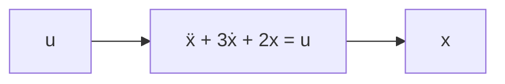

*그림 21. 2계 미분방정식으로 나타낸 시스템*

미분방정식을 이용하면 특정 입력에 대한 출력을 예측할 수 있다. 예를 들어 처음에 정지해 있던($x(0) = \dot{x}(0) = 0$) 이 시스템에 일정한 입력 $u = 1$을 넣으면, 3.4절에서 구한 대로 출력은 $x = -e^{-t} + 0.5e^{-2t} + 0.5$로 0에서 출발하여 0.5로 다가간다.

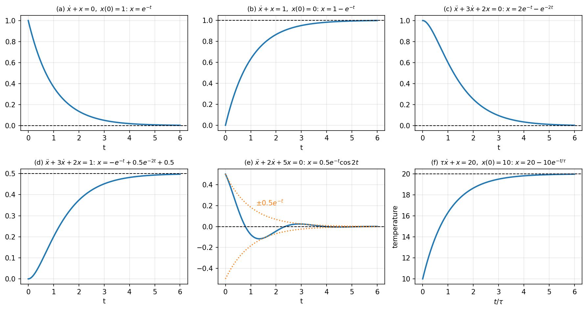

*그림 22. 이 절에서 다룬 미분방정식의 해*

그림 22의 (a)\~(f)는 각각 3.1절, 3.2절, 3.3절, 3.4절, 3.5절의 해와 실내 온도의 해이다. (e)는 복소수 근 때문에 진동하면서 포락선 $\pm 0.5e^{-t}$ 안에서 줄어들고, (f)의 가로축은 시정수 $\tau$를 단위로 잰 시간이다.

미분방정식과 제어시스템의 관계를 정리하면 다음과 같다.

- 어떤 동적 시스템의 특성을 나타내는 미분방정식을 알고 있다면, 그 미분방정식을 이용하여 임의의 입력 신호에 대한 출력을 미리 예상할 수 있다.
- 미분방정식을 이용하면 응답의 빠르기, 진동 여부, 최종값 같은 시스템의 여러 가지 특징을 파악할 수 있다.
- 따라서 어떤 제어시스템을 분석하고 설계하려면 먼저 주어진 시스템의 동적 특성을 나타내는 미분방정식을 구해야 한다.

*그림 23. 제어시스템의 분석과 설계 과정*

---

 

## 개념 적용

다음은 이 단원에서 다룬 물리 시스템을 입력, 출력, 미분방정식으로 정리한 것이다.

| 시스템 | 입력 | 출력 | 미분방정식 | 계 |
|:-----|:-----|:-----|:-----|:-----|
| 자유 낙하 | 없음 (중력) | 낙하 거리 $x$ | $\ddot{x} = g$ | 2계 |
| RC 회로 | 전원 전압 $u$ | 커패시터 전압 $y$ | $RC\dot{y} + y = u$ | 1계 |
| 질량-스프링 | 외부 힘 $f$ | 변위 $y$ | $m\ddot{y} + Ky = f$ | 2계 |
| 실내 온도 | 목표 온도에 해당하는 난방 입력 $u$ | 실내 온도 $x$ | $\tau\dot{x} + x = u$ | 1계 |

*표 7. 물리 시스템의 미분방정식 모델*

**T/F 점검:**

| 문장 | 판단과 근거 |
|:-----|:-----|
| $-1 - j$의 편각은 $\tan^{-1}(-1/-1) = \tan^{-1}(1) = 45^\circ$이다. | **F.** $a < 0$, $b < 0$으로 제3사분면에 있으므로 $45^\circ - 180^\circ = -135^\circ$이다. |
| 극좌표 형식에서 두 복소수를 곱하면 크기는 곱하고 각도는 더한다. | **T.** $r_1e^{j\theta_1} \cdot r_2e^{j\theta_2} = r_1r_2e^{j(\theta_1 + \theta_2)}$이다. |
| $e^{j\pi}$는 순허수이다. | **F.** 오일러 공식에 따라 $e^{j\pi} = \cos\pi + j\sin\pi = -1$로 실수이다. |
| $(y'')^3 + 8y = 0$은 3계 미분방정식이다. | **F.** 가장 높은 도함수는 2계 도함수 $y''$이므로 2계이고, 그 거듭제곱이 3이므로 3차이다. |
| 2계 미분방정식의 해를 하나로 정하려면 초기 조건이 2개 필요하다. | **T.** 일반해에 정해야 할 상수가 2개 있기 때문이다. |
| 특성방정식의 근이 $-1 \pm j2$이면 해는 진동하지 않고 지수적으로 감소한다. | **F.** 허수부 2 때문에 $\cos 2t$, $\sin 2t$로 진동하며, 실수부 $-1$ 때문에 진폭이 $e^{-t}$로 감소한다. |

---

 

## 요약

| 개념 | 핵심 요약 |
|:-----|:-----|
| 시스템과 플랜트 | 시스템은 입력 신호의 영향을 받고 그 영향이 출력 신호로 나타나는 대상이고, 제어의 대상이 되는 시스템을 플랜트라고 한다. |
| 개루프와 폐루프 | 개루프는 불확실성 때문에 오차가 생길 수 있고, 폐루프는 출력을 피드백하여 그 오차를 줄인다. |
| 폐루프의 구성 | 센서가 출력을 전기 신호로 바꾸고, 아날로그 또는 디지털 회로의 제어기가 명령값과 비교하여 제어 신호를 낸다. |
| 모델링 | 플랜트를 수학적으로 나타내는 일이며, 시간 영역에서는 미분방정식을, 주파수 영역에서는 라플라스 변환을 쓴다. |
| 계와 차수 | 계는 가장 높은 미분 횟수이고, 차수는 그 도함수의 거듭제곱 수이다. |
| RC 회로와 질량-스프링 | 각각 $RC\dot{y} + y = u$와 $m\ddot{y} + Ky = f$로 모델링된다. |
| 복소수 | $s = a + jb$로 쓰며, $j^2 = -1$이고 $j$의 거듭제곱은 주기 4로 반복된다. |
| 직각 좌표 형식과 극좌표 형식 | $a = r\cos\theta$, $b = r\sin\theta$, $r = \sqrt{a^2 + b^2}$이며 편각은 사분면을 고려하여 구한다. |
| 오일러 공식 | 테일러 급수로 $e^{j\theta} = \cos\theta + j\sin\theta$를 얻고, 극좌표 형식을 $re^{j\theta}$로 쓸 수 있다. |
| 사칙연산 | 덧셈과 뺄셈은 직각 좌표 형식이, 곱셈과 나눗셈은 크기를 곱하거나 나누고 각도를 더하거나 빼는 극좌표 형식이 편리하다. |
| 복소 함수 | 복소수를 변수로 하는 함수로, $s$ 평면의 점을 $G(s)$ 평면의 점으로 옮긴다. |
| 특성방정식 | $x = Ke^{\lambda t}$를 대입하여 얻는 $\lambda$의 대수 방정식이며, 그 근이 해의 지수와 진동을 정한다. |
| 동차해와 특수해 | 일반해는 동차해와 특수해의 합이고, 초기 조건은 둘을 더한 뒤에 적용한다. |
| 미분방정식과 제어 | 미분방정식을 알면 임의의 입력에 대한 출력을 예측할 수 있으므로 모델링, 미분방정식 도출, 해 도출이 분석과 설계의 출발점이다. |

---

 

## 점검 문제

1. **폐루프의 구성:** 에어컨으로 실내 온도를 제어하는 폐루프 시스템에서 명령, 제어기, 플랜트, 센서에 해당하는 것을 각각 쓰라.

   

   
정답

   명령은 사용자가 정한 설정 온도, 제어기는 에어컨의 온도 조절 회로(마이크로컨트롤러), 플랜트는 방(실내 공기), 센서는 실내 온도를 측정하는 온도 센서이다. 구동 장치는 압축기와 송풍기이다.

   

2. **계와 차수:** $\left(\dfrac{dy}{dx}\right)^4 + y\dfrac{d^3y}{dx^3} = x$의 계와 차수를 구하라.

   

   
정답

   가장 높은 도함수는 3계 도함수 $d^3y/dx^3$이므로 3계이고, 그 도함수의 거듭제곱이 1이므로 1차이다. 1계 도함수의 4제곱은 차수와 관계가 없다.

   

3. **허수 단위의 거듭제곱:** $j^{7} + j^{12} + j^{30}$을 계산하라.

   

   
정답

   $7 = 4 \times 2 - 1$이므로 $j^7 = -j$, $12 = 4 \times 3$이므로 $j^{12} = 1$, $30 = 4 \times 8 - 2$이므로 $j^{30} = -1$이다. 합은 $-j + 1 - 1 = -j$이다.

   

4. **형식 변환:** $-1 - j\sqrt{3}$을 극좌표 형식으로, $4\angle(-60^\circ)$를 직각 좌표 형식으로 나타내라.

   

   
정답

   $r = \sqrt{1 + 3} = 2$이고, $\tan^{-1}(\sqrt{3}) = 60^\circ$이지만 제3사분면에 있으므로 $\theta = 60^\circ - 180^\circ = -120^\circ$이다. 따라서 $2\angle(-120^\circ)$이다. $4\angle(-60^\circ) = 4\cos(-60^\circ) + j4\sin(-60^\circ) = 4 \cdot \frac{1}{2} - j4 \cdot \frac{\sqrt{3}}{2} = 2 - j2\sqrt{3}$이다.

   

5. **곱셈과 나눗셈:** $S_1 = 2\angle 120^\circ$, $S_2 = 4\angle 30^\circ$일 때 $S_1S_2$와 $S_1/S_2$를 극좌표 형식과 직각 좌표 형식으로 구하라.

   

   
정답

   $S_1S_2 = 8\angle 150^\circ = 8\cos 150^\circ + j8\sin 150^\circ = -4\sqrt{3} + j4$이다. $S_1/S_2 = 0.5\angle 90^\circ = j0.5$이다.

   

6. **켤레 복소수를 이용한 나눗셈:** $\dfrac{3 + j4}{1 - j2}$를 직각 좌표 형식으로 계산하라.

   

   
정답

   분자와 분모에 $1 + j2$를 곱한다. 분자는 $(3 + j4)(1 + j2) = 3 + j6 + j4 + j^2 8 = -5 + j10$이고, 분모는 $1^2 + 2^2 = 5$이므로 결과는 $-1 + j2$이다.

   

7. **복소 함수:** $G(s) = \dfrac{1}{s + 1}$에서 $G(j\sqrt{3})$의 크기와 편각을 구하라.

   

   
정답

   $G(j\sqrt{3}) = \frac{1 - j\sqrt{3}}{1 + 3} = \frac{1}{4} - j\frac{\sqrt{3}}{4}$이다. 크기는 $\sqrt{1/16 + 3/16} = 1/2$이고, 제4사분면이므로 편각은 $\tan^{-1}(-\sqrt{3}) = -60^\circ$이다. $\lvert G \rvert = 1/\sqrt{1 + \omega^2} = 1/2$, $\angle G = -\tan^{-1}\sqrt{3} = -60^\circ$와도 일치한다.

   

8. **2계 미분방정식:** $\ddot{x} + 3\dot{x} + 2x = 1$을 초기 조건 $x(0) = 1$, $\dot{x}(0) = 0$으로 풀라.

   

   
정답

   일반해는 3.4절과 같이 $x = K_1e^{-t} + K_2e^{-2t} + 0.5$이다. $x(0) = K_1 + K_2 + 0.5 = 1$, $\dot{x}(0) = -K_1 - 2K_2 = 0$에서 $K_1 = -2K_2$이므로 $-K_2 = 0.5$, $K_2 = -0.5$, $K_1 = 1$이다. 따라서 $x(t) = e^{-t} - 0.5e^{-2t} + 0.5$이다.

   

9. **1계 미분방정식과 피드백:** 1주차 3.2절의 위치 제어 방정식 $\dot{x} = 0.1(50 - x)$, $x(0) = 0$을 3.2절의 방법으로 풀라.

   

   
정답

   식을 정리하면 $\dot{x} + 0.1x = 5$, 곧 $10\dot{x} + x = 50$이므로 $\tau = 10$, $u = 50$이다. $x(t) = u + (x(0) - u)e^{-t/\tau} = 50 - 50e^{-0.1t} = 50(1 - e^{-0.1t})$이다.

   

10. **복소수 근:** $\ddot{x} + 4x = 0$, $x(0) = 1$, $\dot{x}(0) = 0$을 풀고, 1.8절의 질량-스프링 시스템과 비교하라.

    

    
정답

    특성방정식 $\lambda^2 + 4 = 0$의 근은 $\lambda = \pm j2$로 실수부가 0이다. 해는 $x = A\cos 2t + B\sin 2t$이고, $x(0) = A = 1$, $\dot{x}(0) = 2B = 0$이므로 $x(t) = \cos 2t$이다. 이는 $m = 1$, $K = 4$인 질량-스프링 시스템 $m\ddot{y} + Ky = 0$과 같은 식으로, 감쇠가 없어 진폭이 줄지 않고 각진동수 $\sqrt{K/m} = 2$로 영원히 진동한다.

    

---

 

## 참고 문헌

1. D. Wells, "Are these the most beautiful?," *The Mathematical Intelligencer*, vol. 12, no. 3, pp. 37-41, 1990.
2. K. J. Åström and R. M. Murray, *Feedback Systems: An Introduction for Scientists and Engineers*, 2nd ed. Princeton, NJ, USA: Princeton University Press, 2021.
3. E. Kreyszig, *Advanced Engineering Mathematics*, 10th ed. Hoboken, NJ, USA: Wiley, 2011.
