# Week 2 Lecture — Basics of Control Systems

[Repository Guide](../../README.md) | [English](Concepts_Lecture.md) | [한국어](Concepts_Lecture.ko.md)

> **Last Updated:** 2026-11-04

> **Learning Objectives:**
> 1. Explain systems, plants, and the structure of open-loop and closed-loop control systems, and represent examples of feedback control as block diagrams
> 2. Distinguish modeling in the time domain from modeling in the frequency domain, and determine the order and degree of a differential equation
> 3. Derive the differential equations of an RC circuit and of a mass-spring system from physical laws
> 4. Represent complex numbers in Cartesian form and polar form, convert between them, and explain Euler's formula with Taylor series
> 5. Compute the addition, subtraction, multiplication, and division of complex numbers in both forms, and evaluate complex functions
> 6. Solve constant coefficient linear differential equations with the characteristic equation and determine the unknown constants from initial conditions

---

## Table of Contents

- [1. Open-Loop and Closed-Loop Control Systems](#1-open-loop-and-closed-loop-control-systems)
  - [1.1 Definition of a System](#11-definition-of-a-system)
  - [1.2 Control Systems and Plants](#12-control-systems-and-plants)
  - [1.3 Open-Loop Control Systems](#13-open-loop-control-systems)
  - [1.4 Closed-Loop Control Systems](#14-closed-loop-control-systems)
  - [1.5 Structure of a Closed-Loop Control System](#15-structure-of-a-closed-loop-control-system)
  - [1.6 System Modeling](#16-system-modeling)
  - [1.7 Differential Equations](#17-differential-equations)
  - [1.8 Examples of System Modeling](#18-examples-of-system-modeling)
  - [1.9 Time Domain and Frequency Domain](#19-time-domain-and-frequency-domain)
- [2. Complex Numbers](#2-complex-numbers)
  - [2.1 Imaginary and Complex Numbers](#21-imaginary-and-complex-numbers)
  - [2.2 Powers of the Imaginary Unit](#22-powers-of-the-imaginary-unit)
  - [2.3 Orthogonal Coordinate Systems](#23-orthogonal-coordinate-systems)
  - [2.4 Cartesian Form and Polar Form](#24-cartesian-form-and-polar-form)
  - [2.5 Conversion Examples](#25-conversion-examples)
  - [2.6 Euler's Formula](#26-eulers-formula)
  - [2.7 Addition and Subtraction of Complex Numbers](#27-addition-and-subtraction-of-complex-numbers)
  - [2.8 Multiplication of Complex Numbers](#28-multiplication-of-complex-numbers)
  - [2.9 Division of Complex Numbers](#29-division-of-complex-numbers)
  - [2.10 Complex Functions](#210-complex-functions)
- [3. Differential Equations](#3-differential-equations)
  - [3.1 Solution of a First-Order Differential Equation](#31-solution-of-a-first-order-differential-equation)
  - [3.2 First-Order Differential Equations with a Nonzero Right-Hand Side](#32-first-order-differential-equations-with-a-nonzero-right-hand-side)
  - [3.3 Second-Order Differential Equations and the Characteristic Equation](#33-second-order-differential-equations-and-the-characteristic-equation)
  - [3.4 Second-Order Differential Equations with a Nonzero Right-Hand Side](#34-second-order-differential-equations-with-a-nonzero-right-hand-side)
  - [3.5 Complex Roots of the Characteristic Equation](#35-complex-roots-of-the-characteristic-equation)
  - [3.6 nth-Order Constant Coefficient Linear Differential Equations](#36-nth-order-constant-coefficient-linear-differential-equations)
  - [3.7 Differential Equations and Control Systems](#37-differential-equations-and-control-systems)
- [Concept Applications](#concept-applications)
- [Summary](#summary)
- [Self-Check Questions](#self-check-questions)
- [References](#references)

---

 

## 1. Open-Loop and Closed-Loop Control Systems

### 1.1 Definition of a System

Section 1.1 of Week 1 defined a system as an interconnection of components that work together to perform a specific goal. From the point of view of control, it is convenient to look at a system in terms of signals.

> **Definition:** From the point of view of control, a **system** is an object for which an input signal and an output signal are defined, which is affected by the input signal, and whose response appears in the output signal.

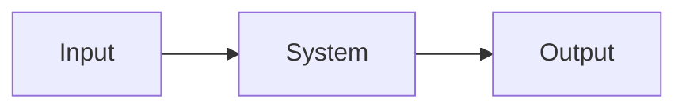

*Figure 1. A system seen in terms of input and output signals*

In a **room temperature system**, for example, the heat produced by a heater is the input and the temperature of the room is the output. The room temperature changes with the amount of heat the heater produces, so it is a system whose output is affected by its input.

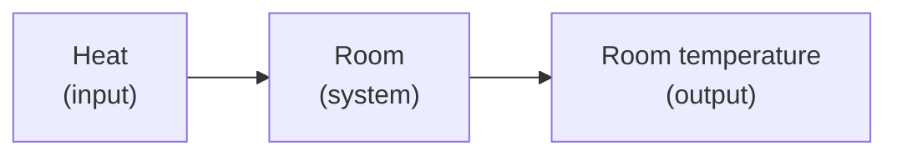

*Figure 2. A room temperature system*

### 1.2 Control Systems and Plants

> **Definition:** A **control system** is a system built so that people can adjust the output or the operating characteristics of some system as they wish. The system to be controlled is called the **controlled system** or the **plant**.

To build a control system, one must first decide which system to control and then what to control in that system. In the room temperature system, the plant is the room and the quantity to be controlled is the room temperature. Even for the same car, one may control its speed or its direction of travel, so deciding what to take as the output is the starting point of control system design.

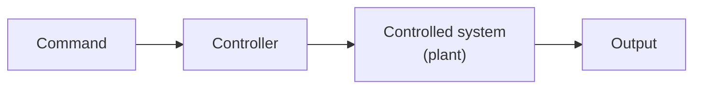

*Figure 3. A controller and a controlled system*

### 1.3 Open-Loop Control Systems

> **Definition:** In an **open-loop control system**, the controller accepts a command input from outside, performs an appropriate computation, and generates a **control signal** that makes the controlled system perform the desired action, which is then fed into the controlled system.

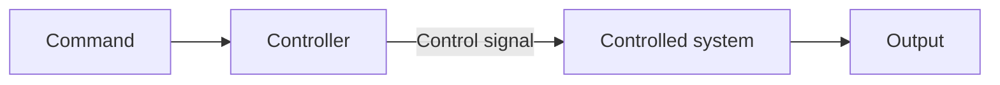

*Figure 4. An open-loop control system*

An open-loop control system does not check its output, so there is always a possibility of error caused by uncertain factors such as plant characteristics that differ from expectations or incoming disturbances.

### 1.4 Closed-Loop Control Systems

> **Definition:** A **closed-loop control system** is a control system that feeds the output value back to the controller and generates a control signal that reduces the error between the command value and the output value, which is fed into the controlled system.

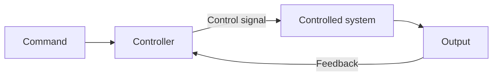

*Figure 5. A closed-loop control system*

A closed-loop control system behaves as desired even when information about the operating characteristics of the controlled system is inaccurate or the system contains uncertain factors, because it reduces the errors those factors cause. When an error occurs, the error itself is measured through feedback, and the controller changes the control signal in the direction that reduces it. The following three are examples of closed-loop control systems.

**Water tank temperature controller.** This device keeps the temperature of a water tank at a set temperature. The tank temperature measured by a temperature sensor is passed to the thermostat, and the thermostat adjusts the heater so that the difference between the set temperature and the tank temperature becomes smaller.

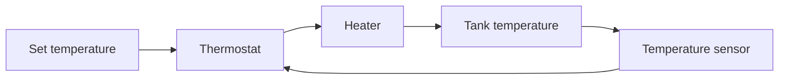

*Figure 6. A water tank temperature controller*

**Feedback in driving a car.** The driver visually senses the difference between the desired direction of travel and the actual direction of the car, and moves the steering wheel to correct that error so that the car moves in the desired direction. Here **the driver plays the role of the feedback controller**.

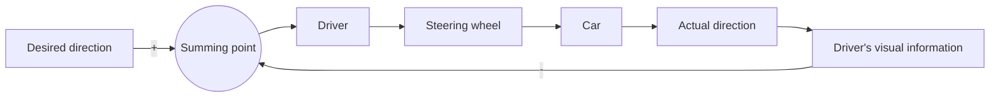

*Figure 7. Feedback structure of driving a car*

**Autopilot.** Instead of the driver, an autopilot plays the role of the feedback controller. A direction sensing device measures the actual direction of travel, and the autopilot computes the error from the desired direction and moves an electric steering device.

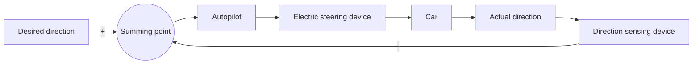

*Figure 8. Feedback structure of an autopilot*

| Role | Water tank temperature control | Human driving | Autopilot |
|:-----|:-----|:-----|:-----|
| Command (reference) | Set temperature | Desired direction | Desired direction |
| Controller | Thermostat | Driver | Autopilot |
| Actuator | Heater | Steering wheel | Electric steering device |
| Plant | Water tank | Car | Car |
| Sensor | Temperature sensor | The driver's eyes | Direction sensing device |

*Table 1. Components of three closed-loop control systems*

As Table 1 shows, the closed-loop structure is the same; only the specific devices that play each role differ. When machines take over the roles of controller and sensor that a person used to play, the result is automatic control.

### 1.5 Structure of a Closed-Loop Control System

To actually build a closed-loop control system, a **sensor** is needed to convert the output signal into an electrical signal. The electrical signal of the sensor is fed into the controller, which compares it with the desired command value, performs the computation needed for control, and generates and outputs a control signal.

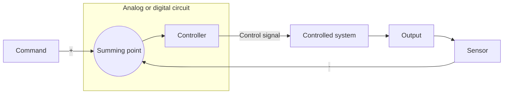

*Figure 9. A closed-loop control system with a sensor and a controller*

In Figure 9, the summing point that compares the command with the sensor signal and the controller are implemented as a single circuit. The controller can be built as an **analog electronic circuit** with resistors, capacitors, and operational amplifiers, or implemented as a **digital circuit** using a microprocessor or microcontroller. Most controllers today are implemented as digital controllers. A digital controller writes the control law as a program, so the control method can be changed without changing the circuit.

### 1.6 System Modeling

> **Definition:** Representing a controlled system mathematically is called **modeling**.

Modeling techniques include methods in the time domain and methods in the frequency domain.

| Technique | Variable | Typical representation |
|:-----|:-----|:-----|
| Modeling in the time domain | Time $t$ | Differential equations |
| Modeling in the frequency domain | Frequency $s$ | Expressions obtained by the Laplace transform (the transfer functions of Week 5) |

*Table 2. Modeling in the time domain and in the frequency domain*

The most common way to represent a system in the time domain is to use **differential equations**. To understand differential equations, let us first clarify what an equation is. An **equation** is an expression that contains unknowns, and solving an equation means finding the values of the unknowns that satisfy it. For example, the solution of the algebraic equation $x + x = 1$, that is, $2x = 1$, is $x = 1/2$. The unknown of an algebraic equation is a number, whereas the unknown of a differential equation is a **function**.

### 1.7 Differential Equations

> **Definition:** A **differential equation** is an equation that contains derivatives of one or more dependent variables with respect to one or more independent variables. A function that satisfies a differential equation is called a **solution** of that differential equation.

A differential equation is a mathematical model of a real phenomenon written as relations among several variables. A differential equation with only one independent variable, in which only ordinary derivatives appear, is called an **ordinary differential equation**, and one with two or more independent variables, in which partial derivatives appear, is called a **partial differential equation**. Control systems mainly use ordinary differential equations with time $t$ as the independent variable.

Differential equations are classified by order and degree.

- **Order:** The highest number of differentiations that appears in the differential equation. If the highest derivative is a second derivative, it is a second-order differential equation.
- **Degree:** The power to which the highest-order derivative is raised.

| Differential equation | Highest derivative | Power of that derivative | Classification |
|:-----|:-----|:-----|:-----|
| $y'' - \sin x = 0$ | $y''$ | 1 | Second-order, first-degree ordinary differential equation |
| $(y'')^3 + 8y = 0$ | $y''$ | 3 | Second-order, third-degree ordinary differential equation |
| $\dfrac{\partial^2 z}{\partial x^2} + \dfrac{\partial^2 z}{\partial y^2} = 8x^2 + 10xy$ | $\dfrac{\partial^2 z}{\partial x^2}$, $\dfrac{\partial^2 z}{\partial y^2}$ | 1 | Second-order, first-degree partial differential equation |

*Table 3. Order and degree of differential equations*

> **Note:** Korean control engineering texts often use the Korean word for degree also for order. The first-order and second-order systems of Week 7 are systems described by first-order and second-order differential equations, respectively. This document uses order for the order of a differential equation to keep order and degree distinct.

**Galileo's falling bodies.** While studying the motion of falling bodies, Galileo found that when a freely falling body falls a distance $x$ in time $t$, its acceleration $x''(t)$ is constant and equal to the gravitational acceleration $g$. Written as a differential equation, this is as follows.

$$
x''(t) = g
$$

Integrating both sides once with respect to $t$ gives the velocity, and integrating once more gives the position.

$$
x'(t) = g t + C_1, \qquad x(t) = \frac{1}{2} g t^2 + C_1 t + C_2
$$

If the body is released from rest, then $x(0) = 0$ and $x'(0) = 0$, so $C_2 = 0$ and $C_1 = 0$, and the following solution is obtained.

$$
x(t) = \frac{1}{2} g t^2
$$

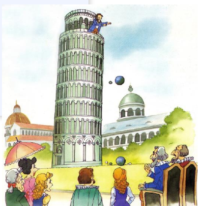

*Figure 10. Galileo's experiment of dropping objects from the Leaning Tower of Pisa*

Galileo's law of falling bodies is often introduced as the first example of a law of motion obtained by setting up and solving a differential equation. Note that in this solution the solution of the differential equation is not unique but contains the integration constants $C_1$ and $C_2$, and two initial conditions are needed to fix a single solution. This fact appears again when second-order differential equations are solved in Section 3.

### 1.8 Examples of System Modeling

**RC circuit.** In a circuit with a resistor $R$ and a capacitor $C$ connected in series to a voltage source $u(t)$, the input is the source voltage $u(t)$ and the output is the voltage $y(t)$ across the capacitor. A step function that changes from 0 V to 1 V at $t = 0$ is often used as the input.

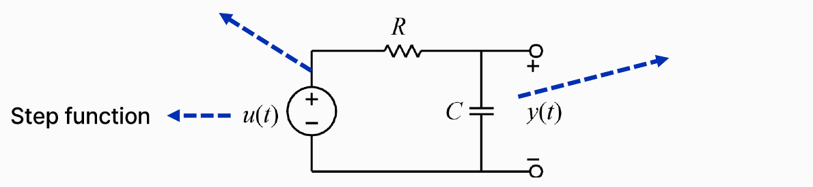

*Figure 11. An RC circuit connected to a step-function voltage source*

The differential equation is derived from two laws. By Kirchhoff's voltage law, which says that the sum of voltages around a loop is zero, the source voltage is the sum of the voltage across the resistor and the voltage across the capacitor. If $i(t)$ is the current in the circuit, the voltage across the resistor is $R i(t)$, and the current of the capacitor is proportional to the rate of change of its voltage, $i(t) = C \, dy/dt$.

$$
u(t) = R\, i(t) + y(t), \qquad i(t) = C \frac{dy(t)}{dt}
$$

Substituting the second equation into the first gives the differential equation of the RC circuit.

$$
RC \frac{dy(t)}{dt} + y(t) = u(t)
$$

This is a first-order differential equation. Solving it with the method of Section 3.2 for the unit step input $u(t) = 1$ ($t \geq 0$) and the initial condition $y(0) = 0$ gives $y(t) = 1 - e^{-t/RC}$. The capacitor voltage starts at 0 and rises exponentially toward 1 V, reaching $1 - e^{-1} \approx 0.632$, about 63.2% of its final value, at $t = RC$. This $RC$ is called the **time constant** of the circuit.

**Mass-spring system.** Consider a body of mass $m$ attached to the end of a spring fixed to a wall, displaced by $y$ from its equilibrium position.

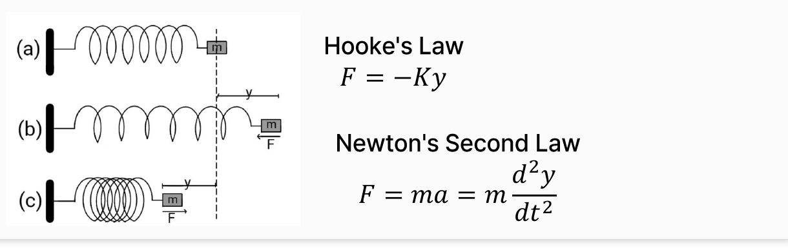

*Figure 12. A mass-spring system with Hooke's law and Newton's second law*

In Figure 12, (a) is the equilibrium state in which the spring is neither stretched nor compressed, (b) is the state in which the body is pulled to the right by $y$ and the spring is stretched, and (c) is the state in which the body is pushed to the left and the spring is compressed. The spring force $F$ points to the left (toward equilibrium) in (b) and to the right (toward equilibrium) in (c). Two physical laws are used.

- **Hooke's law:** The spring force is proportional to the displacement and points opposite to it. $F = -K y$, where $K$ is the spring constant.
- **Newton's second law:** The force acting on a body equals its mass times its acceleration. $F = m a = m \, d^2 y/dt^2$.

If the spring force is the only force acting on the body, the $F$ in the two equations is the same, giving the following differential equation.

$$
m \frac{d^2 y}{dt^2} = -K y \quad \Rightarrow \quad m \frac{d^2 y}{dt^2} + K y = 0
$$

This is a second-order differential equation. If an external force $f(t)$ is applied to the body, that force becomes the input and the equation becomes $m \ddot{y} + K y = f(t)$. The roots of the characteristic equation $m\lambda^2 + K = 0$ of this equation are $\lambda = \pm j\sqrt{K/m}$, which are purely imaginary, so solving it with the method of Section 3.5 gives a combination of cosine and sine that oscillates forever with angular frequency $\sqrt{K/m}$. Modeling of mechanical systems with friction or dampers is covered in Week 4.

### 1.9 Time Domain and Frequency Domain

Solving a differential equation means finding a function that satisfies it. The solution of a differential equation describing the dynamic characteristics of a system is a function of time $t$, so methods that use differential equations are **time-domain methods**.

On the other hand, taking the **Laplace transform** of a function of time turns it into a function of the complex frequency $s$. Because the variable is a frequency, these are called **frequency-domain methods**.

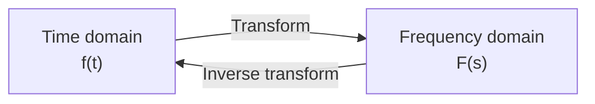

*Figure 13. Relation between the time domain and the frequency domain*

For the functions treated in control engineering (such as functions continuous for $t \ge 0$), there is a one-to-one correspondence between the original function and the transformed function (Week 3), so transforming and then inverse transforming returns the original function. This gives the following advantages.

- Problems that are hard to solve with the original function become easy with the transformed function. For example, the Laplace transform turns differentiation into multiplication by $s$ and turns differential equations into algebraic equations.
- Information that is hard to obtain from the original function can be read from the transformed function. The stability and response speed of a system are examples.

The definition and properties of the Laplace transform are covered in Week 3. Because the frequency $s$ is a complex number, Section 2 first reviews complex numbers.

---

 

## 2. Complex Numbers

### 2.1 Imaginary and Complex Numbers

> **Definition:** A **complex number** is a number made of a real number and an imaginary number. A number whose square is less than 0 is called an **imaginary number**, and the number whose square is $-1$ is called the **imaginary unit** $i$.

$$
i^2 = -1 \quad \Rightarrow \quad i = \sqrt{-1}
$$

In fields that deal with electronics and electricity, the imaginary unit is written $j$ to avoid confusion with the symbol $i$ for current. This course also uses $j$ and mostly denotes a complex number by $s$.

$$
s = a + jb = a + b\sqrt{-1}
$$

Here $a$ is called the **real part** and written $a = \mathrm{Re}\lbrace s\rbrace$, and $b$ is called the **imaginary part** and written $b = \mathrm{Im}\lbrace s\rbrace$. Note that the imaginary part $b$ is itself a real number.

| Set | Condition | Examples |
|:-----|:-----|:-----|
| Real numbers | $b = 0$ | $-3$, $\sqrt{12}$, $\pi$ |
| Purely imaginary numbers | $a = 0$, $b \neq 0$ | $j$, $-3j$ |
| Other complex numbers | $a \neq 0$, $b \neq 0$ | $4 + 2j$, $3 + \sqrt{-2} = 3 + j\sqrt{2}$ |

*Table 4. Classification of complex numbers*

> **Note:** A number whose square is negative, that is, $bj$ ($b \neq 0$) with $(bj)^2 = -b^2 < 0$, is strictly called a **purely imaginary number**. In mathematics, the term imaginary number often refers to every complex number that is not real ($b \neq 0$). Also, $e^{\pi j}$ looks imaginary, but by Euler's formula in Section 2.6, $e^{j\pi} = -1$, a real number. An example of a purely imaginary number is $e^{j\pi/2} = j$.

For example, $1 + j2 = 1 + 2\sqrt{-1}$ has real part $\mathrm{Re}\lbrace1 + j2\rbrace= 1$ and imaginary part $\mathrm{Im}\lbrace1 + j2\rbrace= 2$. Squaring the purely imaginary number $j2$ gives a negative number.

$$
(j2)^2 = \left(2\sqrt{-1}\right)^2 = 4 \times (-1) = -4
$$

A complex number is a pair of two real numbers, the real part and the imaginary part, so it can be represented as a point in a plane through a coordinate system (Sections 2.3 and 2.4).

### 2.2 Powers of the Imaginary Unit

Applying $j^2 = -1$ repeatedly, the powers of $j$ cycle through four values in turn.

$$
j^1 = j, \quad j^2 = -1, \quad j^3 = j^2 \cdot j = -j, \quad j^4 = (j^2)^2 = 1, \quad j^5 = j^4 \cdot j = j, \quad \ldots
$$

Therefore the following periodicity holds for every natural number $n$.

$$
j^{4n-3} = j, \qquad j^{4n-2} = -1, \qquad j^{4n-1} = -j, \qquad j^{4n} = 1
$$

For example, $j^{10}$ is $-1$ because $10 = 4 \times 3 - 2$, and $j^{23}$ is $-j$ because $23 = 4 \times 6 - 1$. As Section 2.8 shows, multiplying by $j$ is the same as rotating by 90° in the complex plane, so the geometric meaning of this periodicity is that multiplying four times turns 360° and returns to the starting point.

### 2.3 Orthogonal Coordinate Systems

> **Definition:** An **orthogonal coordinate system** is a coordinate system whose axes or coordinate curves are mutually perpendicular where they meet. Typical examples are the Cartesian coordinate system and the polar coordinate system.

- **Cartesian coordinate system:** Represents a position as $(x, y)$ or $(x, y, z)$ with respect to mutually perpendicular axes.
- **Polar coordinate system:** Represents a position as $(r, \theta)$ by the distance $r$ from a reference point called the **pole** and the angle $\theta$ measured from a reference line through the pole. Circles of constant radius and rays of constant angle are perpendicular at every point where they meet, so the polar coordinate system is also an orthogonal coordinate system.

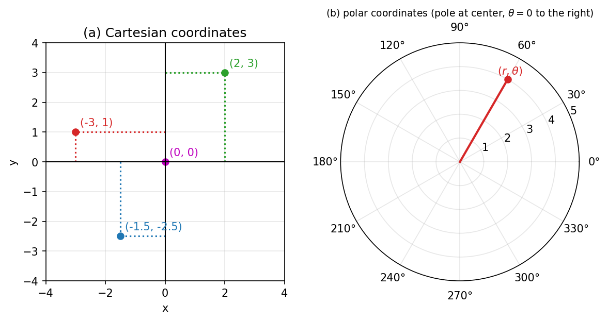

*Figure 14. The Cartesian and polar coordinate systems*

In panel (a) of Figure 14, the point $(2, 3)$ is the position reached by going 2 along the $x$-axis and 3 along the $y$-axis from the origin, and $(-3, 1)$, $(-1.5, -2.5)$, and $(0, 0)$ are read the same way. Panel (b) is a polar coordinate system made of concentric circles (distances) centered at the pole and radial lines (angles) at 30° intervals; the point $(r, \theta)$ is at distance $r$ from the pole and at angle $\theta$ counterclockwise from the reference line ($\theta = 0$).

### 2.4 Cartesian Form and Polar Form

The plane whose horizontal axis is the **real axis** and whose vertical axis is the **imaginary axis** is called the **complex plane**. A complex number $A = a + jb$ appears in the complex plane as the point $(a, b)$, or as an arrow from the origin to that point.

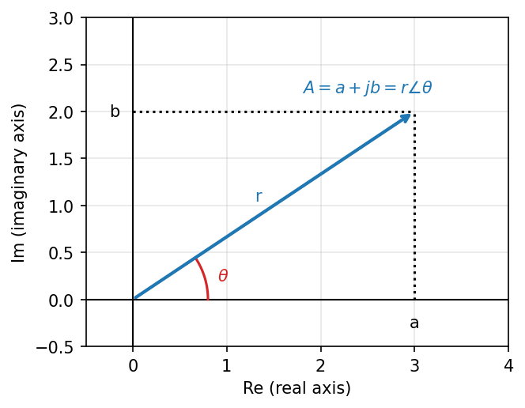

*Figure 15. Cartesian form and polar form in the complex plane*

- **Cartesian form:** Represents the number by its real and imaginary parts, as in $A = a + jb$.
- **Polar form:** Represents the number by its distance $r$ from the origin and the angle $\theta$ measured from the real axis, as in $A = r\angle\theta$. $r = \lvert A \rvert$ is called the **magnitude** of the complex number, and $\theta$ its **argument**.

In the right triangle of Figure 15, the hypotenuse is $r$, the base is $a$, and the height is $b$, so by the definitions of the trigonometric functions the polar form can be converted to the Cartesian form.

$$
a = r\cos\theta, \qquad b = r\sin\theta, \qquad r\angle\theta = (r\cos\theta) + j(r\sin\theta) = a + jb
$$

Conversely, the Pythagorean theorem and the definition of the tangent convert the Cartesian form to the polar form.

$$
r = \sqrt{a^2 + b^2}, \qquad \theta = \tan^{-1}\left(\frac{b}{a}\right)
$$

> **Caution:** $\tan^{-1}$ returns values only between $-90^\circ$ and $90^\circ$, so $\theta = \tan^{-1}(b/a)$ is correct only when the complex number lies in the first or fourth quadrant ($a > 0$). If $a < 0$, the points $(a, b)$ and $(-a, -b)$ give the same value of $b/a$, so 180° must be added or subtracted according to the quadrant. If $a = 0$, the angle is $90^\circ$ when $b > 0$ and $-90^\circ$ when $b < 0$.

| Location of the complex number | Argument $\theta$ |
|:-----|:-----|
| $a > 0$ (first and fourth quadrants) | $\tan^{-1}(b/a)$ |
| $a < 0$, $b \geq 0$ (second quadrant, negative real axis) | $\tan^{-1}(b/a) + 180^\circ$ |
| $a < 0$, $b < 0$ (third quadrant) | $\tan^{-1}(b/a) - 180^\circ$ |
| $a = 0$, $b > 0$ (positive imaginary axis) | $90^\circ$ |
| $a = 0$, $b < 0$ (negative imaginary axis) | $-90^\circ$ |

*Table 5. Computing the argument by quadrant*

### 2.5 Conversion Examples

**Example 1: from Cartesian form to polar form.** Express $A = \sqrt{3} + j$ in polar form. Since $a = \sqrt{3} > 0$ and $b = 1$, it lies in the first quadrant.

$$
r = \sqrt{(\sqrt{3})^2 + 1^2} = \sqrt{3 + 1} = 2, \qquad \theta = \tan^{-1}\left(\frac{1}{\sqrt{3}}\right) = 30^\circ
$$

Therefore $A = 2\angle 30^\circ$.

**Example 2: from polar form (degrees) to Cartesian form.** Express $2\angle 45^\circ$ and $2\angle 135^\circ$ in Cartesian form. Since $\cos 45^\circ = \sin 45^\circ = \sqrt{2}/2$, $\cos 135^\circ = -\sqrt{2}/2$, and $\sin 135^\circ = \sqrt{2}/2$, the results are as follows.

$$
2\angle 45^\circ = 2\cos 45^\circ + j\,2\sin 45^\circ = 2 \cdot \frac{\sqrt{2}}{2} + j\,2 \cdot \frac{\sqrt{2}}{2} = \sqrt{2} + j\sqrt{2}
$$

$$
2\angle 135^\circ = 2\cos 135^\circ + j\,2\sin 135^\circ = -\sqrt{2} + j\sqrt{2}
$$

The two complex numbers have the same magnitude and are symmetric about the imaginary axis.

**Example 3: from polar form (radians) to Cartesian form.** Angles are also written in radians. Since $\pi$ rad $= 180^\circ$, we have $\pi/4 = 45^\circ$ and $-\pi/2 = -90^\circ$.

$$
1\angle(\pi/4) = \cos\frac{\pi}{4} + j\sin\frac{\pi}{4} = \frac{\sqrt{2}}{2} + j\frac{\sqrt{2}}{2} \approx 0.707 + j0.707
$$

$$
1\angle(-\pi/2) = \cos\left(-\frac{\pi}{2}\right) + j\sin\left(-\frac{\pi}{2}\right) = 0 + j(-1) = -j
$$

**Example 4: a case that requires attention to the quadrant.** Express $-\sqrt{3} + j$ in polar form. The magnitude is $r = \sqrt{3 + 1} = 2$. A calculator gives $\tan^{-1}(1/(-\sqrt{3})) = -30^\circ$, but since $a < 0$ and $b > 0$, this complex number lies in the second quadrant. By Table 5, 180° is added.

$$
\theta = -30^\circ + 180^\circ = 150^\circ \quad \Rightarrow \quad -\sqrt{3} + j = 2\angle 150^\circ
$$

Checking, $2\cos 150^\circ = 2 \times (-\sqrt{3}/2) = -\sqrt{3}$ and $2\sin 150^\circ = 2 \times 1/2 = 1$, which gives back the original complex number.

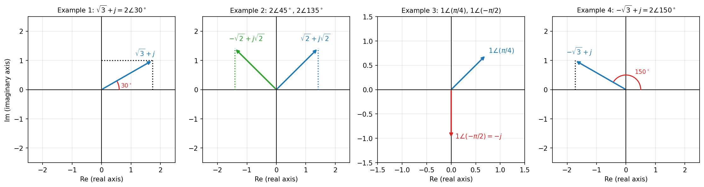

*Figure 16. Four conversion examples*

### 2.6 Euler's Formula

**Euler's formula** connects the exponential function and the trigonometric functions through complex numbers.

$$
e^{j\theta} = \cos\theta + j\sin\theta
$$

This formula can be derived with **Taylor series**. A Taylor series represents a function $f(x)$ that can be differentiated infinitely many times as an infinite sum of polynomial terms near a point $a$.

$$
T_f(x) = \sum_{n=0}^{\infty} \frac{f^{(n)}(a)}{n!}(x - a)^n = f(a) + f'(a)(x - a) + \frac{1}{2} f''(a)(x - a)^2 + \frac{1}{6} f'''(a)(x - a)^3 + \cdots
$$

> **[Calculus]** Taylor series rest on the idea that if the value of a function and the values of all its derivatives at one point are known, the function near that point can be approximated by a polynomial. The expansion at $a = 0$ is called the Maclaurin series, and the more terms are added, the wider the range over which the approximation is accurate. The Taylor series of sine, cosine, and the exponential function converge to the original functions for every real $x$.

Expand the three functions at $a = 0$. The derivatives of $\cos x$ repeat $\cos, -\sin, -\cos, \sin$, so their values at $x = 0$ repeat $1, 0, -1, 0$; those of $\sin x$ repeat $0, 1, 0, -1$; and every derivative of $e^x$ is $e^x$, so it is always 1 at $x = 0$.

$$
\cos x = 1 - \frac{x^2}{2!} + \frac{x^4}{4!} - \frac{x^6}{6!} + \cdots
$$

$$
\sin x = x - \frac{x^3}{3!} + \frac{x^5}{5!} - \frac{x^7}{7!} + \cdots
$$

$$
e^x = 1 + x + \frac{x^2}{2!} + \frac{x^3}{3!} + \frac{x^4}{4!} + \frac{x^5}{5!} + \frac{x^6}{6!} + \frac{x^7}{7!} + \cdots
$$

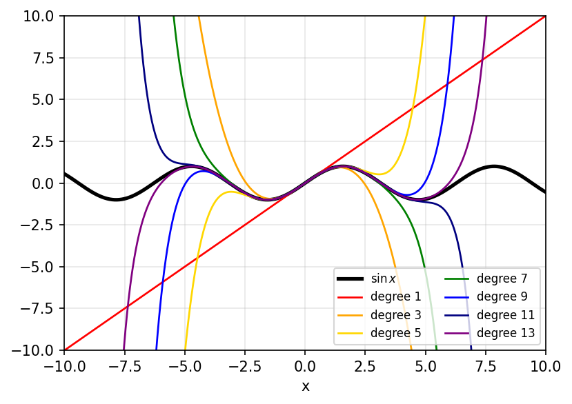

*Figure 17. The sine function and its Taylor polynomials of various degrees*

Figure 17 shows the polynomials obtained by summing the Taylor series of $\sin x$ up to the terms of degree 1, 3, 5, 7, 9, 11, and 13. The higher the degree, the wider the interval over which the polynomial overlaps the original sine curve.

Now substitute $ix$ for $x$ in the series of $e^x$. Since $i^2 = -1$, $i^3 = -i$, and $i^4 = 1$, we have $(ix)^2 = -x^2$, $(ix)^3 = -ix^3$, $(ix)^4 = x^4$, and so on.

$$
e^{ix} = 1 + ix - \frac{x^2}{2!} - i\frac{x^3}{3!} + \frac{x^4}{4!} + i\frac{x^5}{5!} - \frac{x^6}{6!} - i\frac{x^7}{7!} + \cdots
$$

Grouping the terms without $i$ and the terms with $i$ separately, the former is the series of $\cos x$ and the latter is $i$ times the series of $\sin x$.

$$
e^{ix} = \left(1 - \frac{x^2}{2!} + \frac{x^4}{4!} - \cdots\right) + i\left(x - \frac{x^3}{3!} + \frac{x^5}{5!} - \cdots\right) = \cos x + i\sin x
$$

Writing $\theta$ for $x$ and $j$ for $i$ gives Euler's formula $e^{j\theta} = \cos\theta + j\sin\theta$. Since $\lvert e^{j\theta} \rvert = \sqrt{\cos^2\theta + \sin^2\theta} = 1$, $e^{j\theta}$ is the point on the unit circle of the complex plane with argument $\theta$.

**Euler's identity.** Substituting $\theta = \pi$ into Euler's formula gives the following.

$$
e^{j\pi} = \cos\pi + j\sin\pi = -1 + j \cdot 0 = -1 \quad \Rightarrow \quad e^{j\pi} + 1 = 0
$$

This equation is called **Euler's identity**. It brings the five fundamental constants of mathematics, $0$, $1$, $\pi$, $e$, and $j$, together in one simple equation and is often called the most beautiful formula in mathematics. In 1988 the mathematics magazine The Mathematical Intelligencer published a survey that presented 24 well-known theorems and asked readers to score the beauty of each from 0 to 10, and in the results published in 1990 Euler's identity took first place with an average of 7.7 [1].

**Exponential form.** With Euler's formula, the polar form can be written in exponential form.

$$
r\angle\theta = r(\cos\theta + j\sin\theta) = r e^{j\theta}
$$

This is called the **exponential form**, and Sections 2.8 and 2.9 use it to compute multiplication and division simply with the laws of exponents.

### 2.7 Addition and Subtraction of Complex Numbers

The addition and subtraction of two complex numbers $S_1 = a_1 + jb_1$ and $S_2 = a_2 + jb_2$ are computed in Cartesian form, real part with real part and imaginary part with imaginary part.

$$
S_1 + S_2 = a_1 + jb_1 + a_2 + jb_2 = (a_1 + a_2) + j(b_1 + b_2)
$$

$$
S_1 - S_2 = a_1 + jb_1 - a_2 - jb_2 = (a_1 - a_2) + j(b_1 - b_2)
$$

In the complex plane, addition gives the diagonal of the parallelogram formed by the two arrows. Since $S_1 - S_2 = S_1 + (-S_2)$, subtraction adds to $S_1$ the number $-S_2$ obtained by flipping $S_2$ through the origin; and since $S_2 + (S_1 - S_2) = S_1$, the arrow $S_1 - S_2$ has the same length and direction as the arrow from the tip of $S_2$ to the tip of $S_1$.

**Example.** For $S_1 = 2 + j$ and $S_2 = 1 + j2$, the results are as follows.

$$
S_1 + S_2 = (2 + 1) + j(1 + 2) = 3 + j3, \qquad S_1 - S_2 = (2 - 1) + j(1 - 2) = 1 - j
$$

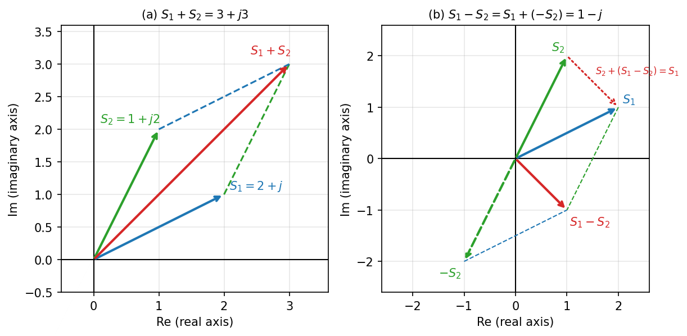

*Figure 18. Addition and subtraction of complex numbers*

### 2.8 Multiplication of Complex Numbers

**Computation in Cartesian form.** Expand with the distributive law and use $j^2 = -1$.

$$
S_1 S_2 = (a_1 + jb_1)(a_2 + jb_2) = a_1a_2 + ja_1b_2 + ja_2b_1 + j^2 b_1b_2 = (a_1a_2 - b_1b_2) + j(a_1b_2 + a_2b_1)
$$

**Computation in polar form.** Write the two complex numbers in exponential form.

$$
S_1 = r_1\angle\theta_1 = (r_1\cos\theta_1) + j(r_1\sin\theta_1) = r_1 e^{j\theta_1}, \qquad S_2 = r_2\angle\theta_2 = r_2 e^{j\theta_2}
$$

Using the law of exponents $e^{x}e^{y} = e^{x + y}$ gives the following.

$$
S_1 S_2 = (r_1 e^{j\theta_1})(r_2 e^{j\theta_2}) = r_1 r_2 e^{j\theta_1} e^{j\theta_2} = r_1 r_2 e^{j(\theta_1 + \theta_2)} = r_1 r_2 \angle(\theta_1 + \theta_2)
$$

> **Key Point:** In polar form, multiplication **multiplies the magnitudes and adds the angles.** Multiplication in Cartesian form requires expanding four terms, but in polar form it takes one multiplication and one addition, so multiplication is convenient in polar form. In particular, multiplying by $j = 1\angle 90^\circ$ keeps the magnitude and increases only the angle by 90°, so multiplying by $j$ is the same as rotating by 90° in the complex plane.

**Example.** Find the product of $S_1 = 1\angle 60^\circ = \frac{1}{2} + j\frac{\sqrt{3}}{2}$ and $S_2 = 2\angle 30^\circ = \sqrt{3} + j$ in two ways.

In Cartesian form, $a_1 = 1/2$, $b_1 = \sqrt{3}/2$, $a_2 = \sqrt{3}$, and $b_2 = 1$.

$$
a_1a_2 - b_1b_2 = \frac{1}{2}\cdot\sqrt{3} - \frac{\sqrt{3}}{2}\cdot 1 = 0, \qquad a_1b_2 + a_2b_1 = \frac{1}{2}\cdot 1 + \sqrt{3}\cdot\frac{\sqrt{3}}{2} = \frac{1}{2} + \frac{3}{2} = 2
$$

Therefore $S_1 S_2 = 0 + j2 = j2$. In polar form the computation is as follows.

$$
S_1 S_2 = (1 \times 2)\angle(60^\circ + 30^\circ) = 2\angle 90^\circ = 2\cos 90^\circ + j\,2\sin 90^\circ = j2
$$

The two results agree.

### 2.9 Division of Complex Numbers

> **Definition:** The number $\bar{S} = a - jb$ obtained by changing the sign of the imaginary part of a complex number $S = a + jb$ is called the **complex conjugate** of $S$. The product of a complex number and its conjugate, $(a + jb)(a - jb) = a^2 - j^2 b^2 = a^2 + b^2$, is always a real number greater than or equal to 0.

**Computation in Cartesian form.** To make the denominator real, multiply the numerator and denominator by the conjugate of the denominator.

$$
\frac{S_1}{S_2} = \frac{a_1 + jb_1}{a_2 + jb_2} = \frac{(a_1 + jb_1)(a_2 - jb_2)}{(a_2 + jb_2)(a_2 - jb_2)}
$$

Expanding the numerator with $j^2 = -1$ gives the following, and the denominator is $a_2^2 + b_2^2$.

$$
(a_1 + jb_1)(a_2 - jb_2) = a_1a_2 - ja_1b_2 + ja_2b_1 - j^2 b_1b_2 = (a_1a_2 + b_1b_2) + j(a_2b_1 - a_1b_2)
$$

$$
\frac{S_1}{S_2} = \frac{(a_1a_2 + b_1b_2) + j(a_2b_1 - a_1b_2)}{a_2^2 + b_2^2}
$$

> **Caution:** When expanding the numerator, $jb_1 \cdot a_2 = +ja_2b_1$ and $a_1 \cdot (-jb_2) = -ja_1b_2$, so the imaginary part is $a_2b_1 - a_1b_2$. Getting a sign wrong and computing the imaginary part as $-(a_1b_2 + a_2b_1)$ gives the wrong value $-j\frac{1}{2}$ instead of $j\frac{1}{4}$ in the example below. Checking against the result in polar form catches such mistakes.

**Computation in polar form.** Use the law of exponents $e^{x}/e^{y} = e^{x - y}$.

$$
\frac{S_1}{S_2} = \frac{r_1 e^{j\theta_1}}{r_2 e^{j\theta_2}} = \frac{r_1}{r_2}\cdot\frac{e^{j\theta_1}}{e^{j\theta_2}} = \frac{r_1}{r_2} e^{j(\theta_1 - \theta_2)} = \frac{r_1}{r_2}\angle(\theta_1 - \theta_2)
$$

> **Key Point:** In polar form, division **divides the magnitudes and subtracts the angles.**

**Example.** For $S_1 = 1\angle 60^\circ = \frac{1}{2} + j\frac{\sqrt{3}}{2}$ and $S_2 = 2\angle 30^\circ = \sqrt{3} + j$ of Section 2.8, find $S_1 / S_2$.

Compute in Cartesian form.

$$
a_1a_2 + b_1b_2 = \frac{\sqrt{3}}{2} + \frac{\sqrt{3}}{2} = \sqrt{3}, \qquad a_2b_1 - a_1b_2 = \sqrt{3}\cdot\frac{\sqrt{3}}{2} - \frac{1}{2}\cdot 1 = \frac{3}{2} - \frac{1}{2} = 1, \qquad a_2^2 + b_2^2 = 3 + 1 = 4
$$

$$
\frac{S_1}{S_2} = \frac{\sqrt{3} + j1}{4} = \frac{\sqrt{3}}{4} + j\frac{1}{4} \approx 0.433 + j0.25
$$

In polar form the computation is as follows.

$$
\frac{S_1}{S_2} = \frac{1}{2}\angle(60^\circ - 30^\circ) = 0.5\angle 30^\circ = 0.5\cos 30^\circ + j\,0.5\sin 30^\circ = \frac{\sqrt{3}}{4} + j\frac{1}{4}
$$

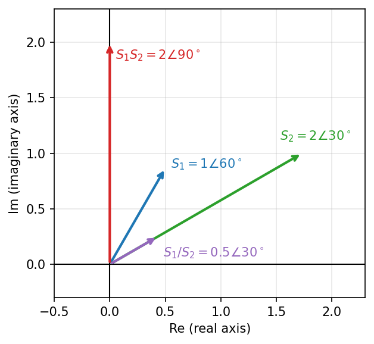

*Figure 19. Multiplication and division of complex numbers*

In Figure 19, the product $S_1S_2$ is an arrow with magnitude $1 \times 2 = 2$ and angle $60^\circ + 30^\circ = 90^\circ$, and the quotient $S_1/S_2$ is an arrow with magnitude $1/2$ and angle $60^\circ - 30^\circ = 30^\circ$.

### 2.10 Complex Functions

> **Definition:** A function whose variable takes complex values is called a **complex function**. A complex function $G(s)$ can be seen as a mapping that carries points of one complex plane (the $s$-plane) to points of another complex plane (the $G(s)$-plane).

**Example 1: $G(s) = s^2$.** Find the function values at $s_1 = j$ and $s_2 = 1 + j$.

$$
G(s_1) = j^2 = -1, \qquad G(s_2) = (1 + j)^2 = 1 + 2j + j^2 = 1 + 2j - 1 = j2
$$

In polar form, $s_2 = \sqrt{2}\angle 45^\circ$, so $s_2^2 = (\sqrt{2})^2\angle 90^\circ = 2\angle 90^\circ = j2$, which is the same as squaring the magnitude and doubling the angle.

**Example 2: $G(s) = \dfrac{1}{s + 1}$.** Find the value at points $s = j\omega$ on the imaginary axis ($\omega$ real). Multiply the numerator and denominator by the conjugate $1 - j\omega$ of the denominator.

$$
G(s)\Big\vert_{s = j\omega} = G(j\omega) = \frac{1}{1 + j\omega} = \frac{1 - j\omega}{(1 + j\omega)(1 - j\omega)} = \frac{1 - j\omega}{1 + \omega^2}
$$

The real and imaginary parts are therefore as follows.

$$
\mathrm{Re}\lbrace G(j\omega)\rbrace= \frac{1}{1 + \omega^2}, \qquad \mathrm{Im}\lbrace G(j\omega)\rbrace= \frac{-\omega}{1 + \omega^2}
$$

Evaluating at a few values of $\omega$ gives $1$ at $\omega = 0$, $0.5 - j0.5$ at $\omega = 1$, and $0.2 - j0.4$ at $\omega = 2$, and the value approaches $0$ as $\omega \to \infty$. Writing $X$ for the real part and $Y$ for the imaginary part, $X^2 + Y^2 = \frac{1 + \omega^2}{(1 + \omega^2)^2} = \frac{1}{1 + \omega^2} = X$, so the points satisfy the following equation of a circle.

$$
X^2 - X + Y^2 = 0 \quad \Rightarrow \quad \left(X - \frac{1}{2}\right)^2 + Y^2 = \left(\frac{1}{2}\right)^2
$$

That is, the points on the imaginary axis are mapped to the circle in the $G(s)$-plane with center $(1/2, 0)$ and radius $1/2$. For $\omega \geq 0$ the imaginary part $-\omega/(1 + \omega^2)$ is at most 0, so the image is the lower half of the circle; as $\omega$ grows from 0, the point starts at $1$ and moves along the lower semicircle toward $0$. The part with $\omega < 0$ is the upper semicircle, symmetric about the real axis.

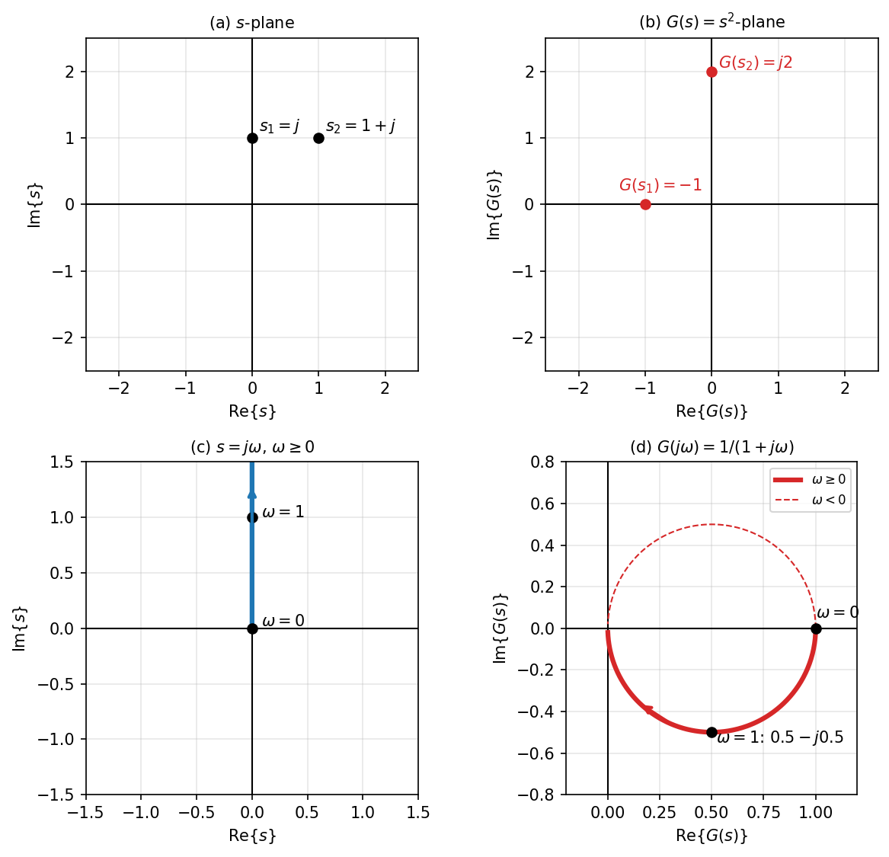

*Figure 20. Mapping from the s-plane to the G(s)-plane by complex functions*

> **Note:** The magnitude $\lvert G(j\omega) \rvert = 1/\sqrt{1 + \omega^2}$ and the argument $\angle G(j\omega) = -\tan^{-1}\omega$ of $G(j\omega)$ describe by what factor the amplitude of the output changes and by how much its phase lags when a sinusoid of angular frequency $\omega$ is fed into the system; this is called the **frequency response** [2]. Computing values of complex functions is used throughout the treatment of transfer functions from Week 5 on.

---

 

## 3. Differential Equations

In this section, derivatives with respect to time $t$ are written with dots: $\dot{x} = dx/dt$ is the first derivative and $\ddot{x} = d^2x/dt^2$ is the second derivative.

### 3.1 Solution of a First-Order Differential Equation

Consider the following first-order differential equation and initial condition.

$$
\dot{x} + x = 0 \quad \Leftrightarrow \quad \dot{x} = -x, \qquad x(0) = 1
$$

Since $\dot{x} = -x$, the solution must be **a function whose derivative has the same form as the function itself**. Let us test a few functions.

- If $x(t) = t^2$, then $\dot{x} = 2t$ and $-x = -t^2$, so $\dot{x} \neq -x$.
- If $x(t) = \cos t$, then $\dot{x} = -\sin t$ and $-x = -\cos t$, so $\dot{x} \neq -x$.

The **exponential function** keeps the form of the original function after differentiation. Setting the solution as $x = Ke^{\lambda t}$ gives $\dot{x} = K\lambda e^{\lambda t}$, and substituting into the differential equation gives the following.

$$
\dot{x} = K\lambda e^{\lambda t} = -x = -Ke^{\lambda t} \quad \Rightarrow \quad K(\lambda + 1)e^{\lambda t} = 0
$$

$e^{\lambda t}$ is never 0, and if $K = 0$ then $x = 0$, which cannot satisfy the initial condition $x(0) = 1$; hence $\lambda + 1 = 0$, that is, $\lambda = -1$.

$$
x(t) = Ke^{-t}
$$

Use the initial condition to determine $K$. Substituting $t = 0$ gives $x(0) = Ke^{0} = K = 1$, so the solution is as follows.

$$
x(t) = e^{-t}
$$

Checking, $\dot{x} = -e^{-t}$ and $x = e^{-t}$, so $\dot{x} + x = -e^{-t} + e^{-t} = 0$ holds.

### 3.2 First-Order Differential Equations with a Nonzero Right-Hand Side

Consider the case in which the right-hand side is the constant 1.

$$
\dot{x} + x = 1, \qquad x(0) = 0
$$

Since the right-hand side is a constant, assume that the solution also has a constant term and set $x(t) = K_1 e^{\lambda t} + K_2$. Since $\dot{x} = K_1\lambda e^{\lambda t}$, substituting gives the following.

$$
\dot{x} + x = K_1\lambda e^{\lambda t} + K_1 e^{\lambda t} + K_2 = K_1 e^{\lambda t}(\lambda + 1) + K_2 = 1
$$

For this to hold for every $t$, the time-varying part $K_1 e^{\lambda t}(\lambda + 1)$ must be 0 and the constant part $K_2$ must equal the 1 on the right-hand side. Hence $\lambda = -1$ and $K_2 = 1$.

$$
x(t) = K_1 e^{-t} + 1
$$

From the initial condition $x(0) = K_1 + 1 = 0$, $K_1 = -1$, so the solution is as follows.

$$
x(t) = -e^{-t} + 1 = 1 - e^{-t}
$$

The solution starts at 0 and approaches 1 exponentially. The two parts of the solution have names.

- **Homogeneous solution:** The part, such as $K_1 e^{-t}$, that satisfies the equation with the right-hand side set to 0, $\dot{x} + x = 0$. When all roots of the characteristic equation have negative real parts, as in this example, it is a transient component that dies out over time.
- **Particular solution:** One solution, such as the constant 1, that satisfies the original equation $\dot{x} + x = 1$. When the input is constant and the homogeneous solution dies out, as in this example, it is the steady-state component that remains after a sufficiently long time.

> **Key Point:** The general solution of a constant coefficient linear differential equation is the sum of the homogeneous solution and the particular solution. The unknown constants appear only in the homogeneous solution, and they must be determined from the initial conditions **after** the particular solution has been added.

Solving the general first-order equation $\tau\dot{x} + x = u$ ($\tau > 0$, $u$ constant) in the same way gives $\lambda = -1/\tau$ and the particular solution $u$, hence the following solution. This formula is used directly for the RC circuit of Section 1.8 ($\tau = RC$) and for the room temperature of Section 3.7.

$$
x(t) = u + \left(x(0) - u\right) e^{-t/\tau}
$$

### 3.3 Second-Order Differential Equations and the Characteristic Equation

Consider the following second-order differential equation.

$$
\ddot{x} + 3\dot{x} + 2x = 0, \qquad x(0) = 1, \quad \dot{x}(0) = 0
$$

As in the first-order case, set $x = Ke^{\lambda t}$, so that $\dot{x} = K\lambda e^{\lambda t}$ and $\ddot{x} = K\lambda^2 e^{\lambda t}$. Substituting gives the following.

$$
\ddot{x} + 3\dot{x} + 2x = K\lambda^2 e^{\lambda t} + 3K\lambda e^{\lambda t} + 2Ke^{\lambda t} = K(\lambda^2 + 3\lambda + 2)e^{\lambda t} = 0
$$

Since $K \neq 0$ and $e^{\lambda t} \neq 0$, the expression in parentheses must be 0.

$$
\lambda^2 + 3\lambda + 2 = (\lambda + 1)(\lambda + 2) = 0 \quad \Rightarrow \quad \lambda = -1, -2
$$

This algebraic equation $\lambda^2 + 3\lambda + 2 = 0$, obtained by replacing $\dot{x}$ with $\lambda$ and $\ddot{x}$ with $\lambda^2$ in the differential equation, is called the **characteristic equation**. Both $e^{-t}$ and $e^{-2t}$, corresponding to the two roots, are solutions, and since the equation is linear, any linear combination of them is also a solution (the superposition principle of Section 2.6 of Week 1).

$$
x(t) = K_1 e^{-t} + K_2 e^{-2t}
$$

The solution of a second-order differential equation has two constants to be determined, so **two initial conditions are also needed.** Since $\dot{x}(t) = -K_1 e^{-t} - 2K_2 e^{-2t}$, the two initial conditions become the following system of equations.

$$
x(0) = K_1 + K_2 = 1, \qquad \dot{x}(0) = -K_1 - 2K_2 = 0
$$

Adding the two equations gives $-K_2 = 1$, that is, $K_2 = -1$, and the first equation gives $K_1 = 1 - K_2 = 2$. The solution is therefore as follows.

$$
x(t) = 2e^{-t} - e^{-2t}
$$

Checking, $x(0) = 2 - 1 = 1$ and $\dot{x}(0) = -2 + 2 = 0$.

### 3.4 Second-Order Differential Equations with a Nonzero Right-Hand Side

Consider the case in which the right-hand side is the constant 1 and both initial conditions are 0.

$$
\ddot{x} + 3\dot{x} + 2x = 1, \qquad x(0) = 0, \quad \dot{x}(0) = 0
$$

Assume that the solution has a constant term and set $x = K_1 e^{\lambda t} + K_3$; then $\dot{x} = K_1\lambda e^{\lambda t}$ and $\ddot{x} = K_1\lambda^2 e^{\lambda t}$.

$$
\ddot{x} + 3\dot{x} + 2x = K_1\lambda^2 e^{\lambda t} + 3K_1\lambda e^{\lambda t} + 2K_1 e^{\lambda t} + 2K_3 = K_1 e^{\lambda t}(\lambda^2 + 3\lambda + 2) + 2K_3 = 1
$$

For the time-varying part to be 0, $\lambda^2 + 3\lambda + 2 = 0$, so $\lambda = -1, -2$; from the constant part, $2K_3 = 1$, that is, $K_3 = 1/2$. Using both roots, the general solution is as follows.

$$
x(t) = K_1 e^{-t} + K_2 e^{-2t} + \frac{1}{2}
$$

Use the two initial conditions to determine the two constants.

$$
x(0) = K_1 + K_2 + 0.5 = 0, \qquad \dot{x}(0) = -K_1 - 2K_2 = 0
$$

The second equation gives $K_1 = -2K_2$, and substituting into the first gives $-2K_2 + K_2 = -0.5$, that is, $K_2 = 0.5$ and $K_1 = -1$.

$$
x(t) = -e^{-t} + 0.5e^{-2t} + 0.5
$$

After a sufficiently long time the two exponential terms vanish and $x \to 0.5$. This value can also be found directly from $2x = 1$, since $\ddot{x} = \dot{x} = 0$ in steady state.

### 3.5 Complex Roots of the Characteristic Equation

Consider the following differential equation.

$$
\ddot{x} + 2\dot{x} + 5x = 0, \qquad x(0) = 0.5, \quad \dot{x}(0) = -0.5
$$

The characteristic equation is $\lambda^2 + 2\lambda + 5 = 0$. By the quadratic formula the discriminant is negative, so the roots are complex.

$$
\lambda = \frac{-2 \pm \sqrt{2^2 - 4 \cdot 5}}{2} = \frac{-2 \pm \sqrt{-16}}{2} = \frac{-2 \pm j4}{2} = -1 \pm j2
$$

The reasoning of Section 3.3 still holds when the roots are complex, so the general solution is as follows.

$$
x(t) = K_1 e^{(-1 + j2)t} + K_2 e^{(-1 - j2)t}
$$

Use the two initial conditions to determine the two constants. $\dot{x}(t) = (-1 + j2)K_1 e^{(-1 + j2)t} + (-1 - j2)K_2 e^{(-1 - j2)t}$.

$$
x(0) = K_1 + K_2 = 0.5
$$

$$
\dot{x}(0) = (-1 + j2)K_1 + (-1 - j2)K_2 = -(K_1 + K_2) + j2(K_1 - K_2) = -0.5 + j2(K_1 - K_2) = -0.5
$$

The second equation gives $K_1 - K_2 = 0$, so $K_1 = K_2 = 0.25$. Euler's formula of Section 2.6 turns the solution into a real function.

$$
x(t) = 0.25e^{-t}\left(e^{j2t} + e^{-j2t}\right) = 0.25e^{-t}\left[(\cos 2t + j\sin 2t) + (\cos 2t - j\sin 2t)\right] = 0.5e^{-t}\cos 2t
$$

Checking, $x(0) = 0.5$, and since $\dot{x}(t) = 0.5\left(-e^{-t}\cos 2t - 2e^{-t}\sin 2t\right)$, $\dot{x}(0) = -0.5$.

> **Key Point:** If the roots of the characteristic equation are $\sigma \pm j\omega$, the solution has the form $e^{\sigma t}(A\cos\omega t + B\sin\omega t)$. The real part $\sigma$ sets how fast the amplitude shrinks or grows (here it decays as $e^{-t}$), and the imaginary part $\omega$ sets the angular frequency of oscillation (here 2 rad/s). The fact that the location of complex roots determines the shape of the response is taken up again in Week 9 with the response by pole location.

### 3.6 nth-Order Constant Coefficient Linear Differential Equations

All the examples so far are special cases of the following **constant coefficient linear differential equation**.

$$
a_n x^{(n)} + a_{n-1} x^{(n-1)} + \cdots + a_1 x^{(1)} + a_0 x = u
$$

Here $x^{(k)}$ is the $k$th derivative of $x$, the coefficients $a_0, \ldots, a_n$ are constants, and $u$ is the input. The dynamic characteristics of many **linear time-invariant systems (LTI systems)** can be represented by a differential equation of this form (the more general form with derivatives of the input on the right-hand side appears in Week 5). The equation is of first degree in $x$ and its derivatives, so the superposition principle holds and the system is linear; the coefficients do not change with time, so the same input applied later produces the same response delayed by the same amount, and the system is time-invariant.

The solution method is also the same. Find the $n$ roots of the characteristic equation $a_n\lambda^n + a_{n-1}\lambda^{n-1} + \cdots + a_1\lambda + a_0 = 0$, build the homogeneous solution by adding the terms below according to the type of root, add the particular solution, and determine the $n$ constants from $n$ initial conditions [3].

| Root of the characteristic equation | Term in the homogeneous solution |
|:-----|:-----|
| Distinct real root $\lambda$ | $Ke^{\lambda t}$ |
| Repeated root $\lambda$ (multiplicity 2) | $(K_1 + K_2 t)e^{\lambda t}$ |
| Complex roots $\sigma \pm j\omega$ | $e^{\sigma t}(A\cos\omega t + B\sin\omega t)$ |

*Table 6. Roots of the characteristic equation and terms of the homogeneous solution*

For example, the characteristic equation $\lambda^2 + 2\lambda + 1 = (\lambda + 1)^2 = 0$ of $\ddot{x} + 2\dot{x} + x = 0$ has the repeated root $\lambda = -1$, so the homogeneous solution is $x = (K_1 + K_2 t)e^{-t}$. Since $e^{-t}$ alone cannot match two initial conditions, $te^{-t}$ is added as a second solution.

### 3.7 Differential Equations and Control Systems

**Example of a changing room temperature.** When heating starts in a room at 10°C with a target of 20°C, the room temperature rises quickly at first and then more and more slowly as it approaches 20°C. This dynamic behavior can be described by a first-order differential equation.

$$
\tau\dot{x} + x = u, \qquad u = 20, \quad x(0) = 10
$$

Substituting into the result of Section 3.2 gives the following solution.

$$
x(t) = 20 + (10 - 20)e^{-t/\tau} = 20 - 10e^{-t/\tau}, \qquad t \geq 0
$$

The larger $\tau$ is (the larger the heat capacity of the room), the more slowly the temperature rises. At $t = \tau$, $x = 20 - 10e^{-1} \approx 16.3$°C, so about 63.2% of the total change of 10°C has taken place.

**Example of a second-order system.** Consider a system whose input $u$ and output $x$ are related by a second-order differential equation.

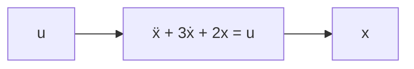

*Figure 21. A system described by a second-order differential equation*

With the differential equation, the output for a given input can be predicted. For example, if a constant input $u = 1$ is applied to this system starting at rest ($x(0) = \dot{x}(0) = 0$), the output is $x = -e^{-t} + 0.5e^{-2t} + 0.5$ as found in Section 3.4, starting at 0 and approaching 0.5.

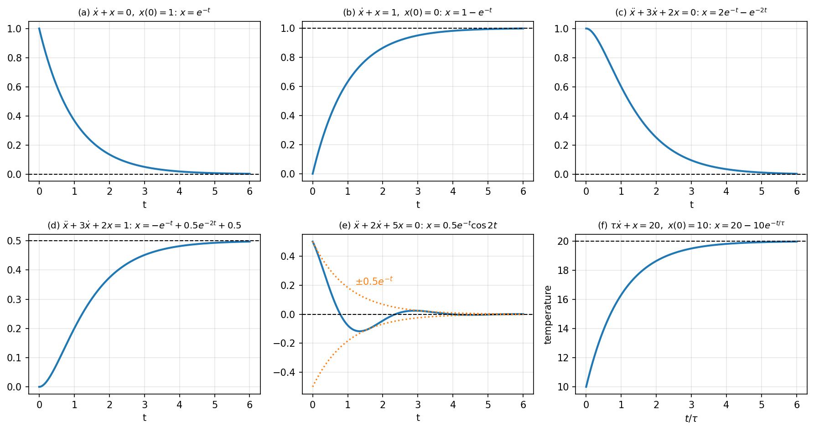

*Figure 22. Solutions of the differential equations in this section*

Panels (a)-(f) of Figure 22 are the solutions of Sections 3.1, 3.2, 3.3, 3.4, and 3.5 and the solution for the room temperature, respectively. Panel (e) oscillates because of the complex roots while shrinking inside the envelope $\pm 0.5e^{-t}$, and the horizontal axis of panel (f) is time measured in units of the time constant $\tau$.

The relation between differential equations and control systems can be summarized as follows.

- If the differential equation describing the characteristics of a dynamic system is known, it can be used to predict in advance the output for any input signal.
- With the differential equation, various characteristics of the system, such as the speed of the response, whether it oscillates, and its final value, can be identified.
- Therefore, to analyze and design a control system, the differential equation describing the dynamic characteristics of the given system must be obtained first.

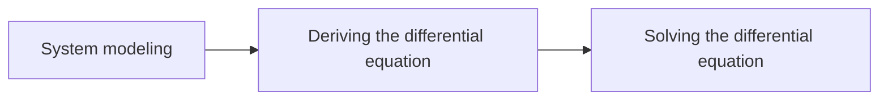

*Figure 23. The process of analyzing and designing a control system*

---

 

## Concept Applications

The following summarizes the physical systems of this unit by input, output, and differential equation.

| System | Input | Output | Differential equation | Order |
|:-----|:-----|:-----|:-----|:-----|
| Free fall | None (gravity) | Distance fallen $x$ | $\ddot{x} = g$ | Second |
| RC circuit | Source voltage $u$ | Capacitor voltage $y$ | $RC\dot{y} + y = u$ | First |
| Mass-spring | External force $f$ | Displacement $y$ | $m\ddot{y} + Ky = f$ | Second |
| Room temperature | Heating input $u$ corresponding to the target temperature | Room temperature $x$ | $\tau\dot{x} + x = u$ | First |

*Table 7. Differential equation models of physical systems*

**True/False Check:**

| Statement | Judgment and Reason |
|:-----|:-----|
| The argument of $-1 - j$ is $\tan^{-1}(-1/-1) = \tan^{-1}(1) = 45^\circ$. | **F.** It lies in the third quadrant with $a < 0$ and $b < 0$, so the argument is $45^\circ - 180^\circ = -135^\circ$. |
| In polar form, multiplying two complex numbers multiplies the magnitudes and adds the angles. | **T.** $r_1e^{j\theta_1} \cdot r_2e^{j\theta_2} = r_1r_2e^{j(\theta_1 + \theta_2)}$. |
| $e^{j\pi}$ is purely imaginary. | **F.** By Euler's formula, $e^{j\pi} = \cos\pi + j\sin\pi = -1$, a real number. |
| $(y'')^3 + 8y = 0$ is a third-order differential equation. | **F.** The highest derivative is the second derivative $y''$, so it is second order; that derivative is raised to the power 3, so it is third degree. |
| Two initial conditions are needed to determine a unique solution of a second-order differential equation. | **T.** The general solution has two constants to be determined. |
| If the roots of the characteristic equation are $-1 \pm j2$, the solution decays exponentially without oscillating. | **F.** Because of the imaginary part 2 it oscillates as $\cos 2t$ and $\sin 2t$, and because of the real part $-1$ its amplitude decays as $e^{-t}$. |

---

 

## Summary

| Concept | Key Summary |
|:-----|:-----|
| Systems and plants | A system is an object that is affected by its input signal and whose response appears in its output signal, and the system to be controlled is called the plant. |
| Open loop and closed loop | An open loop can have errors due to uncertainty, and a closed loop feeds back the output to reduce those errors. |
| Structure of a closed loop | A sensor converts the output into an electrical signal, and a controller built as an analog or digital circuit compares it with the command and produces the control signal. |
| Modeling | Representing the plant mathematically, using differential equations in the time domain and the Laplace transform in the frequency domain. |
| Order and degree | The order is the highest number of differentiations, and the degree is the power of that derivative. |
| RC circuit and mass-spring | They are modeled by $RC\dot{y} + y = u$ and $m\ddot{y} + Ky = f$, respectively. |
| Complex numbers | Written $s = a + jb$, with $j^2 = -1$, and the powers of $j$ repeat with period 4. |
| Cartesian form and polar form | $a = r\cos\theta$, $b = r\sin\theta$, $r = \sqrt{a^2 + b^2}$, and the argument is found by taking the quadrant into account. |
| Euler's formula | Taylor series give $e^{j\theta} = \cos\theta + j\sin\theta$, and the polar form can be written as $re^{j\theta}$. |
| Arithmetic | Addition and subtraction are convenient in Cartesian form, and multiplication and division in polar form, which multiplies or divides the magnitudes and adds or subtracts the angles. |
| Complex functions | Functions of a complex variable that carry points of the $s$-plane to points of the $G(s)$-plane. |
| Characteristic equation | The algebraic equation in $\lambda$ obtained by substituting $x = Ke^{\lambda t}$, whose roots determine the exponents and oscillations of the solution. |
| Homogeneous and particular solutions | The general solution is the sum of the homogeneous and particular solutions, and the initial conditions are applied after adding them. |
| Differential equations and control | Knowing the differential equation lets one predict the output for any input, so modeling, deriving the differential equation, and solving it are the starting point of analysis and design. |

---

 

## Self-Check Questions

1. **Structure of a closed loop:** In a closed-loop system that controls room temperature with an air conditioner, state what corresponds to the command, the controller, the plant, and the sensor.

   

   
Answer

   The command is the set temperature chosen by the user, the controller is the temperature control circuit (microcontroller) of the air conditioner, the plant is the room (the indoor air), and the sensor is the temperature sensor that measures the room temperature. The actuators are the compressor and the fan.

   

2. **Order and degree:** Find the order and degree of $\left(\dfrac{dy}{dx}\right)^4 + y\dfrac{d^3y}{dx^3} = x$.

   

   
Answer

   The highest derivative is the third derivative $d^3y/dx^3$, so it is third order, and that derivative is raised to the power 1, so it is first degree. The fourth power of the first derivative has nothing to do with the degree.

   

3. **Powers of the imaginary unit:** Compute $j^{7} + j^{12} + j^{30}$.

   

   
Answer

   Since $7 = 4 \times 2 - 1$, $j^7 = -j$; since $12 = 4 \times 3$, $j^{12} = 1$; and since $30 = 4 \times 8 - 2$, $j^{30} = -1$. The sum is $-j + 1 - 1 = -j$.

   

4. **Converting forms:** Express $-1 - j\sqrt{3}$ in polar form and $4\angle(-60^\circ)$ in Cartesian form.

   

   
Answer

   $r = \sqrt{1 + 3} = 2$, and $\tan^{-1}(\sqrt{3}) = 60^\circ$, but the number lies in the third quadrant, so $\theta = 60^\circ - 180^\circ = -120^\circ$. Hence it is $2\angle(-120^\circ)$. $4\angle(-60^\circ) = 4\cos(-60^\circ) + j4\sin(-60^\circ) = 4 \cdot \frac{1}{2} - j4 \cdot \frac{\sqrt{3}}{2} = 2 - j2\sqrt{3}$.

   

5. **Multiplication and division:** For $S_1 = 2\angle 120^\circ$ and $S_2 = 4\angle 30^\circ$, find $S_1S_2$ and $S_1/S_2$ in polar and Cartesian forms.

   

   
Answer

   $S_1S_2 = 8\angle 150^\circ = 8\cos 150^\circ + j8\sin 150^\circ = -4\sqrt{3} + j4$. $S_1/S_2 = 0.5\angle 90^\circ = j0.5$.

   

6. **Division with the complex conjugate:** Compute $\dfrac{3 + j4}{1 - j2}$ in Cartesian form.

   

   
Answer

   Multiply the numerator and denominator by $1 + j2$. The numerator is $(3 + j4)(1 + j2) = 3 + j6 + j4 + j^2 8 = -5 + j10$ and the denominator is $1^2 + 2^2 = 5$, so the result is $-1 + j2$.

   

7. **Complex functions:** For $G(s) = \dfrac{1}{s + 1}$, find the magnitude and argument of $G(j\sqrt{3})$.

   

   
Answer

   $G(j\sqrt{3}) = \frac{1 - j\sqrt{3}}{1 + 3} = \frac{1}{4} - j\frac{\sqrt{3}}{4}$. The magnitude is $\sqrt{1/16 + 3/16} = 1/2$, and since it lies in the fourth quadrant, the argument is $\tan^{-1}(-\sqrt{3}) = -60^\circ$. This agrees with $\lvert G \rvert = 1/\sqrt{1 + \omega^2} = 1/2$ and $\angle G = -\tan^{-1}\sqrt{3} = -60^\circ$.

   

8. **Second-order differential equation:** Solve $\ddot{x} + 3\dot{x} + 2x = 1$ with the initial conditions $x(0) = 1$ and $\dot{x}(0) = 0$.

   

   
Answer

   As in Section 3.4, the general solution is $x = K_1e^{-t} + K_2e^{-2t} + 0.5$. From $x(0) = K_1 + K_2 + 0.5 = 1$ and $\dot{x}(0) = -K_1 - 2K_2 = 0$, $K_1 = -2K_2$, so $-K_2 = 0.5$, $K_2 = -0.5$, and $K_1 = 1$. Therefore $x(t) = e^{-t} - 0.5e^{-2t} + 0.5$.

   

9. **First-order equation and feedback:** Solve the position control equation $\dot{x} = 0.1(50 - x)$, $x(0) = 0$ of Section 3.2 of Week 1 with the method of Section 3.2.

   

   
Answer

   Rearranging gives $\dot{x} + 0.1x = 5$, that is, $10\dot{x} + x = 50$, so $\tau = 10$ and $u = 50$. Then $x(t) = u + (x(0) - u)e^{-t/\tau} = 50 - 50e^{-0.1t} = 50(1 - e^{-0.1t})$.

   

10. **Complex roots:** Solve $\ddot{x} + 4x = 0$, $x(0) = 1$, $\dot{x}(0) = 0$, and compare it with the mass-spring system of Section 1.8.

    

    
Answer

    The roots of the characteristic equation $\lambda^2 + 4 = 0$ are $\lambda = \pm j2$, with zero real part. The solution is $x = A\cos 2t + B\sin 2t$, and $x(0) = A = 1$ and $\dot{x}(0) = 2B = 0$, so $x(t) = \cos 2t$. This is the same equation as the mass-spring system $m\ddot{y} + Ky = 0$ with $m = 1$ and $K = 4$; with no damping, the amplitude never decreases and the system oscillates forever with angular frequency $\sqrt{K/m} = 2$.

    

---

 

## References

1. D. Wells, "Are these the most beautiful?," *The Mathematical Intelligencer*, vol. 12, no. 3, pp. 37-41, 1990.
2. K. J. Åström and R. M. Murray, *Feedback Systems: An Introduction for Scientists and Engineers*, 2nd ed. Princeton, NJ, USA: Princeton University Press, 2021.
3. E. Kreyszig, *Advanced Engineering Mathematics*, 10th ed. Hoboken, NJ, USA: Wiley, 2011.
