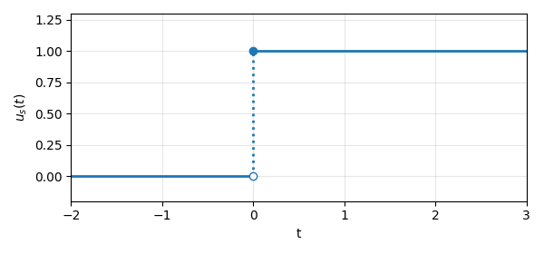
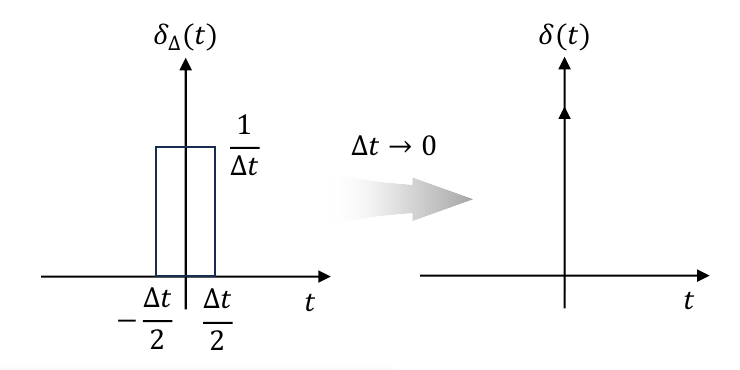
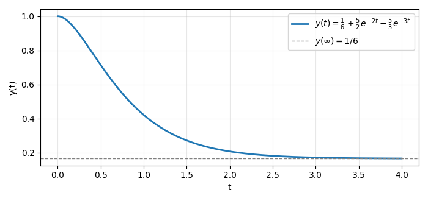

# 3주차 이론 — 기초 공학수학

[레포지토리 안내](../../README.ko.md) | [English](Concepts_Lecture.md) | [한국어](Concepts_Lecture.ko.md)

> **최종 수정일:** 2026-11-04

> **학습 목표:**
> 1. 라플라스 변환으로 미분방정식을 대수방정식으로 바꾸어 푸는 제어시스템 해석의 흐름을 설명할 수 있다
> 2. 정의식으로 단위 계단, 임펄스, 지수, 다항, 코사인, 사인 함수의 라플라스 변환을 유도할 수 있다
> 3. 선형성, 주파수 영역과 시간 영역의 이동, 미분, 적분 성질과 초기값, 최종값 정리를 유도하고 적용 조건과 함께 쓸 수 있다
> 4. 분모가 단근, 복소근, 중근을 갖는 유리함수를 부분분수로 전개하여 역라플라스 변환을 구하고, 초기 조건이 있는 미분방정식을 풀 수 있다
> 5. 행렬의 덧셈, 곱셈, 전치를 계산하고 $2 \times 2$, $3 \times 3$ 행렬의 행렬식과 역행렬을 구할 수 있다
> 6. 역행렬을 이용하여 연립일차방정식을 풀 수 있다

---

## 목차

- [1. 라플라스 변환 I](#1-라플라스-변환-i)
  - [1.1 미분방정식과 제어시스템 해석](#11-미분방정식과-제어시스템-해석)
  - [1.2 라플라스 변환의 정의](#12-라플라스-변환의-정의)
  - [1.3 단방향 라플라스 변환](#13-단방향-라플라스-변환)
  - [1.4 미분과 적분 복습](#14-미분과-적분-복습)
  - [1.5 단위 계단 함수](#15-단위-계단-함수)
  - [1.6 임펄스 함수](#16-임펄스-함수)
  - [1.7 지수 함수](#17-지수-함수)
  - [1.8 일차 함수](#18-일차-함수)
  - [1.9 이차 함수와 n차 함수](#19-이차-함수와-n차-함수)
  - [1.10 코사인 함수](#110-코사인-함수)
  - [1.11 사인 함수](#111-사인-함수)
  - [1.12 기본 변환 쌍](#112-기본-변환-쌍)
- [2. 라플라스 변환 II](#2-라플라스-변환-ii)
  - [2.1 선형성](#21-선형성)
  - [2.2 주파수 영역에서의 이동](#22-주파수-영역에서의-이동)
  - [2.3 시간 영역에서의 이동](#23-시간-영역에서의-이동)
  - [2.4 미분](#24-미분)
  - [2.5 적분](#25-적분)
  - [2.6 초기값 정리](#26-초기값-정리)
  - [2.7 최종값 정리](#27-최종값-정리)
  - [2.8 역라플라스 변환](#28-역라플라스-변환)
  - [2.9 부분분수 전개: 분모가 단근만 갖는 경우](#29-부분분수-전개-분모가-단근만-갖는-경우)
  - [2.10 부분분수 전개: 분모가 중근을 갖는 경우](#210-부분분수-전개-분모가-중근을-갖는-경우)
  - [2.11 라플라스 변환을 이용한 미분방정식의 풀이](#211-라플라스-변환을-이용한-미분방정식의-풀이)
- [3. 행렬](#3-행렬)
  - [3.1 행렬의 정의](#31-행렬의-정의)
  - [3.2 정방 행렬과 대각 행렬](#32-정방-행렬과-대각-행렬)
  - [3.3 단위 행렬](#33-단위-행렬)
  - [3.4 전치 행렬](#34-전치-행렬)
  - [3.5 행벡터와 열벡터](#35-행벡터와-열벡터)
  - [3.6 행렬의 덧셈과 뺄셈](#36-행렬의-덧셈과-뺄셈)
  - [3.7 행렬의 곱셈](#37-행렬의-곱셈)
  - [3.8 단위 행렬과의 곱셈, 전치 행렬의 성질](#38-단위-행렬과의-곱셈-전치-행렬의-성질)
  - [3.9 행렬식](#39-행렬식)
  - [3.10 역행렬](#310-역행렬)
  - [3.11 행렬식에 관한 관계식](#311-행렬식에-관한-관계식)
  - [3.12 행렬을 이용한 연립방정식 풀이](#312-행렬을-이용한-연립방정식-풀이)
- [개념 적용](#개념-적용)
- [요약](#요약)
- [점검 문제](#점검-문제)
- [참고 문헌](#참고-문헌)

---

<br>

## 1. 라플라스 변환 I

2주차에서는 1계와 2계 미분방정식을 시간 영역에서 직접 풀었다. 계가 높아지거나 여러 요소가 연결되면 이 방법은 금방 복잡해진다. 이 절은 미분방정식을 대수방정식으로 바꾸어 주는 라플라스 변환의 정의와, 제어 공학에서 자주 쓰이는 기본 함수들의 변환을 정의식에서 직접 유도한다.

### 1.1 미분방정식과 제어시스템 해석

제어시스템을 분석하고 설계하는 과정은 세 단계로 이루어진다. 먼저 제어할 대상을 수학적으로 표현하는 **시스템 모델링(system modeling)** 을 하고, 그 결과로 시스템의 동작을 기술하는 **미분방정식(differential equation)** 을 도출하며, 마지막으로 그 미분방정식의 해를 구하여 시스템이 시간에 따라 어떻게 움직이는지 알아낸다. 모델링은 4주차에서 자세히 다룬다.


*그림 1. 제어시스템의 분석과 설계 과정*

마지막 단계에서 미분방정식을 시간 영역에서 직접 푸는 일은 어렵다. 라플라스 변환을 쓰면 미분방정식이 **대수방정식(algebraic equation)**, 즉 덧셈, 뺄셈, 곱셈, 나눗셈만으로 이루어진 방정식으로 바뀐다. 대수방정식의 해를 구한 뒤 라플라스 역변환으로 되돌리면 원래 미분방정식의 해를 얻는다.


*그림 2. 라플라스 변환을 이용한 미분방정식의 풀이 경로*

> **핵심:** 라플라스 변환은 어려운 길(미분방정식을 직접 푸는 길)을 쉬운 길 세 개(변환, 대수 연산, 역변환)로 바꾸는 도구이다.

### 1.2 라플라스 변환의 정의

간단한 제어시스템은 미분방정식만으로도 해석하고 설계할 수 있다. 그러나 대부분의 제어시스템은 제어기, 구동기, 제어 대상, 센서처럼 여러 형태의 블록이 서로 연결되어 구성되므로, 전체를 하나의 미분방정식으로 다루면 매우 복잡해진다. 해석을 쉽게 하기 위해 수학적 도구를 도입하며, 제어시스템에서 가장 많이 쓰이는 도구가 라플라스 변환이다.

> **용어 정의:** **라플라스 변환(Laplace transform)** 은 실수 변수 $t$(시간)의 함수 $f(t)$를 복소수 변수 $s = \sigma + j\omega$의 함수 $F(s)$로 바꾸는 적분 변환(integral transform)이다. $t$의 함수를 다루는 세계를 **시간 영역(time domain)**, $s$의 함수를 다루는 세계를 **주파수 영역(frequency domain)** 또는 $s$ 영역($s$-domain)이라 한다.

라플라스 변환의 정의식은 다음과 같다.

```math
F(s) = \mathcal{L}\lbrace f(t) \rbrace= \int_{-\infty}^{\infty} f(t)\,e^{-st}\,dt, \qquad s = \sigma + j\omega
```

$\sigma$는 $s$의 실수부, $\omega$는 허수부이고, $j$는 $j^2 = -1$인 허수 단위이다(2주차). 시간 함수는 소문자 $f(t)$, 그 변환은 대문자 $F(s)$로 쓰며, $\mathcal{L}\lbrace\cdot\rbrace$는 괄호 안의 함수에 라플라스 변환을 적용한다는 기호이다. 변수 $t$는 적분되어 사라지고 결과는 $s$만의 함수가 된다.

적분 구간이 무한하므로 적분이 유한한 값으로 수렴해야 변환이 존재한다. 오일러 공식에서 $\lvert e^{-j\omega t} \rvert = 1$이므로 $\lvert f(t)e^{-st} \rvert = \lvert f(t) \rvert e^{-\sigma t}$이고, 따라서 다음 조건이 성립하면 적분이 수렴한다.

```math
\int_{-\infty}^{\infty} \left\lvert f(t)\,e^{-\sigma t} \right\rvert dt < \infty
```

이 조건은 $\sigma$의 값에 따라 성립하기도 하고 성립하지 않기도 한다. 그래서 라플라스 변환은 일반적으로 $s$의 실수부가 어떤 범위에 있을 때만 정의되며, 이 범위를 **수렴 영역(region of convergence)** 이라 한다 [1]. 예를 들어 1.7절에서 구하는 $e^{at}$의 변환은 $\operatorname{Re}(s) > a$에서만 존재한다. 제어 공학에서 다루는 신호는 지수 함수보다 빠르게 커지지 않으므로, $\operatorname{Re}(s)$를 충분히 크게 잡으면 언제나 변환이 존재한다.

주파수 영역의 가장 큰 장점은 시간 영역의 미분과 적분이 $s$의 곱셈과 나눗셈으로 바뀐다는 것이다(2.4절, 2.5절). 그래서 주파수 영역에서는 곱셈과 나눗셈만으로 시스템을 다룰 수 있다.

### 1.3 단방향 라플라스 변환

```math
F(s) = \mathcal{L}\lbrace f(t) \rbrace= \int_{0}^{\infty} f(t)\,e^{-st}\,dt
```

제어 공학에서는 입력을 가하기 시작하는 순간을 $t = 0$으로 잡고, 그 이전($`t < 0`$)에는 모든 신호의 값이 0이라고 가정할 수 있다. 그러면 1.2절의 정의식에서 $-\infty$부터 0까지의 적분은 0이 되므로, 적분 구간을 0부터 $\infty$까지로 줄인 위 식을 쓴다. 이를 **단방향 라플라스 변환(one-sided Laplace transform)** 이라 하며, 제어 공학에서는 주로 이 변환을 쓴다. 이 문서의 이후 내용은 모두 단방향 변환이다.

> **참고:** 1.6절의 임펄스 함수처럼 $t = 0$의 한 순간에 집중된 신호를 빠뜨리지 않으려고, 적분 하한을 0 직전의 순간인 $0^-$로 정의하는 교재가 많다 [2]. 이 경우 미분 성질(2.4절)의 초기값도 $f(0^-)$가 된다. $t = 0$에서 연속인 보통의 함수에서는 두 정의의 결과가 같다.

### 1.4 미분과 적분 복습

라플라스 변환을 계산하려면 미분과 적분의 기본 공식이 필요하다. 표 1과 표 2는 이 문서에서 쓰는 공식을 모은 것이다.

| 함수 | 도함수 | 이름 |
|:-----|:-----|:-----|
| $c$ (상수) | $0$ | 상수의 미분 |
| $cf(x)$ | $cf'(x)$ | 상수배 |
| $f(x) \pm g(x)$ | $f'(x) \pm g'(x)$ | 합과 차 |
| $f(x)g(x)$ | $f(x)g'(x) + g(x)f'(x)$ | 곱셈 공식 |
| $\dfrac{f(x)}{g(x)}$ | $\dfrac{g(x)f'(x) - f(x)g'(x)}{[g(x)]^2}$ | 나눗셈 공식 |
| $f(g(x))$ | $`f'(g(x))\,g'(x)`$ | 연쇄 법칙 |
| $x^n$ | $nx^{n-1}$ | 거듭제곱 |
| $e^x$, $a^x$ | $e^x$, $a^x \ln a$ | 지수 함수 |
| $\ln \lvert x \rvert$, $\log_a x$ | $\dfrac{1}{x}$, $\dfrac{1}{x \ln a}$ | 로그 함수 |
| $\sin x$, $\cos x$, $\tan x$ | $\cos x$, $-\sin x$, $\sec^2 x$ | 삼각 함수 |

*표 1. 기본 미분 공식*

| 피적분 함수 | 부정적분 ($C$는 적분 상수) |
|:-----|:-----|
| $k$ | $kx + C$ |
| $x^n$ ($`n \ne -1`$) | $\dfrac{x^{n+1}}{n+1} + C$ |
| $(ax+b)^n$ ($`n \ne -1`$) | $\dfrac{(ax+b)^{n+1}}{a(n+1)} + C$ |
| $\dfrac{1}{x}$ | $\ln \lvert x \rvert + C$ |
| $\dfrac{c}{ax+b}$ | $\dfrac{c}{a} \ln \lvert ax+b \rvert + C$ |
| $e^x$ | $e^x + C$ |
| $a^x$ | $\dfrac{a^x}{\ln a} + C$ |
| $\ln x$ | $x \ln x - x + C$ |
| $\log_a x$ | $x \log_a x - \dfrac{x}{\ln a} + C$ |
| $\sin x$ | $-\cos x + C$ |
| $\cos x$ | $\sin x + C$ |
| $\tan x$ | $-\ln \lvert \cos x \rvert + C = \ln \lvert \sec x \rvert + C$ |

*표 2. 기본 적분 공식*

라플라스 변환에서 가장 자주 쓰는 도구는 **부분 적분(integration by parts)** 이다. 곱의 미분 공식 $(uv)' = u'v + uv'$의 양변을 적분하면 $`uv = \int u'v\,dx + \int uv'\,dx`$이고, 이를 정리하면 다음을 얻는다.

```math
\int u\,v'\,dx = uv - \int u'\,v\,dx
```

정적분으로 쓰면 다음과 같다. 1.8절 이후의 유도는 모두 이 식을 쓴다.

```math
\int_a^b f'(t)\,g(t)\,dt = \Big[ f(t)\,g(t) \Big]_{t=a}^{t=b} - \int_a^b f(t)\,g'(t)\,dt
```

> **[미적분학]** 적분 구간에 $\infty$가 있는 이상적분(improper integral)은 극한 $`\int_0^\infty g(t)\,dt = \lim_{T\to\infty}\int_0^T g(t)\,dt`$로 정의한다. 라플라스 변환의 계산에서는 $\operatorname{Re}(s) > 0$일 때 $t \to \infty$에서 $e^{-st} \to 0$이라는 사실과, 지수 함수가 다항식보다 빠르게 줄어들어 모든 자연수 $n$에 대해 $t^n e^{-st} \to 0$이라는 사실을 반복해서 쓴다.

### 1.5 단위 계단 함수

**단위 계단 함수(unit step function)** 는 $t = 0$에서 0이던 값이 1로 바뀌어 그대로 유지되는 함수이다. 스위치를 켜는 순간부터 일정한 입력을 가하는 상황을 나타내며, 제어시스템의 성능을 시험하는 가장 기본적인 입력이다(7주차).

```math
u_s(t) = \begin{cases} 1, & t \ge 0 \\ 0, & t < 0 \end{cases}
```



*그림 3. 단위 계단 함수의 그래프*

정의식에 넣으면 $t \ge 0$에서 $u_s(t) = 1$이므로 다음과 같다.

```math
\mathcal{L}\lbrace u_s(t) \rbrace= \int_0^\infty 1 \cdot e^{-st}\,dt = \left[ -\frac{1}{s}e^{-st} \right]_0^\infty = (0) - \left( -\frac{1}{s} \right) = \frac{1}{s}, \qquad \operatorname{Re}(s) > 0
```

$e^{-st}$의 부정적분은 $-\frac{1}{s}e^{-st}$이다. 위끝 $t \to \infty$에서는 $\operatorname{Re}(s) > 0$이면 $e^{-st} \to 0$이므로 0이고, 아래끝 $t = 0$에서는 $e^{0} = 1$이므로 $-\frac{1}{s}$이다. 위끝 값에서 아래끝 값을 빼면 $\frac{1}{s}$이다. 크기가 $A$인 계단 함수 $Au_s(t)$의 변환은 같은 계산으로 $\frac{A}{s}$이다.

### 1.6 임펄스 함수

**임펄스 함수(impulse function)** $\delta(t)$는 디랙 델타 함수(Dirac delta function)라고도 하며, $t = 0$의 한 순간에만 값이 있고 그 넓이가 1인 함수이다. 망치로 한 번 내리치는 것처럼 매우 짧은 순간에 강하게 가해지는 입력을 나타낸다.

```math
\delta(t) = \begin{cases} 0, & t \ne 0 \\ \infty, & t = 0 \end{cases}, \qquad \int_{0^-}^{0^+} \delta(t)\,dt = 1
```

$\delta(t)$는 보통의 함수로는 정의할 수 없으므로, 그림 4처럼 폭이 $\Delta t$, 높이가 $\frac{1}{\Delta t}$인 직사각형 펄스 $\delta_\Delta(t)$의 극한으로 이해한다. 펄스의 넓이는 $\Delta t \times \frac{1}{\Delta t} = 1$로 언제나 1이다. $\Delta t \to 0$이면 폭은 0으로, 높이는 무한대로 가지만 넓이는 1로 유지되며, 그 극한이 $\delta(t)$이다. 그래프에서는 높이 대신 넓이 1을 뜻하는 화살표로 그린다.



*그림 4. 넓이가 1인 직사각형 펄스와 그 극한인 임펄스 함수*

$\delta(t)$는 $t = 0$이 아닌 곳에서 0이므로, 적분 안의 $e^{-st}$를 $t = 0$에서의 값 $e^{0} = 1$로 바꾸어도 적분값이 같다.

```math
\mathcal{L}\lbrace\delta(t) \rbrace= \int_{0^-}^{\infty} \delta(t)\,e^{-st}\,dt = e^{-s \cdot 0}\int_{0^-}^{0^+} \delta(t)\,dt = 1 \times 1 = 1
```

> **참고:** 같은 논리로 연속 함수 $g(t)$에 대해 $`\int_{-\infty}^{\infty} g(t)\,\delta(t-a)\,dt = g(a)`$가 성립한다. 임펄스 함수가 곱해진 함수에서 한 점의 값만 골라낸다는 뜻에서 이를 **선별 성질(sifting property)** 이라 한다 [1]. 임펄스 함수의 변환이 1이라는 사실은 5주차의 임펄스 응답에서 다시 쓰인다.

### 1.7 지수 함수

지수 함수 $e^{at}$의 변환은 두 지수를 하나로 합친 뒤 적분한다.

```math
\mathcal{L}\lbrace e^{at} \rbrace= \int_0^\infty e^{at}e^{-st}\,dt = \int_0^\infty e^{-(s-a)t}\,dt = \left[ -\frac{1}{s-a}e^{-(s-a)t} \right]_0^\infty = \frac{1}{s-a}, \qquad \operatorname{Re}(s) > a
```

첫 번째 등호는 정의식이고, 두 번째 등호는 지수 법칙 $e^{at}e^{-st} = e^{-(s-a)t}$이다. 세 번째 등호는 1.5절과 같은 적분에서 $s$ 자리에 $s - a$가 들어간 것이다. 위끝에서 $e^{-(s-a)t} \to 0$이려면 $\operatorname{Re}(s - a) > 0$, 즉 $\operatorname{Re}(s) > a$여야 하고, 이때 결과는 $0 - \left( -\frac{1}{s-a} \right) = \frac{1}{s-a}$이다. $a = 0$이면 $e^{0t} = 1$이므로 1.5절의 $\frac{1}{s}$과 일치한다.

**예제.** 공식 $\mathcal{L}\lbrace e^{at} \rbrace= \frac{1}{s-a}$에 $a$의 값을 넣는다.

```math
\mathcal{L}\lbrace e^{-2t} \rbrace= \frac{1}{s-(-2)} = \frac{1}{s+2}, \qquad \mathcal{L}\lbrace e^{3t} \rbrace= \frac{1}{s-3}, \qquad \mathcal{L}\lbrace e^{\omega t} \rbrace= \frac{1}{s-\omega}
```

> **핵심:** 시간 영역에서 줄어드는 지수 함수 $e^{-2t}$는 $s$ 영역에서 분모가 0이 되는 점 $s = -2$를 갖는 분수가 된다. 시간 응답의 모양과 $s$ 영역의 분모의 근 사이의 이 대응은 이후 모든 주차의 해석의 바탕이다.

### 1.8 일차 함수

$f(t) = t$의 변환은 부분 적분으로 구한다. 1.4절의 공식에서 $f'(t) = e^{-st}$, $g(t) = t$로 두면 $f(t) = -\frac{1}{s}e^{-st}$, $g'(t) = 1$이다.

```math
\mathcal{L}\lbrace t \rbrace= \int_0^\infty t\,e^{-st}\,dt = \left[ t \cdot \left( -\frac{1}{s}e^{-st} \right) \right]_0^\infty - \int_0^\infty 1 \cdot \left( -\frac{1}{s}e^{-st} \right) dt
```

```math
= (0 - 0) + \frac{1}{s}\int_0^\infty e^{-st}\,dt = \frac{1}{s} \cdot \frac{1}{s} = \frac{1}{s^2}
```

경계항은 위끝에서 $te^{-st} \to 0$(1.4절의 [미적분학] 상자)이고 아래끝에서 $t = 0$이므로 0이다. 남은 적분은 1.5절의 $\mathcal{L}\lbrace1 \rbrace= \frac{1}{s}$이다. 일정한 비율로 커지는 입력 $t$를 **경사 함수(ramp function)** 라 한다.

### 1.9 이차 함수와 n차 함수

$t^2$의 변환도 같은 방법으로 구한다. 이번에는 $g(t) = t^2$, $g'(t) = 2t$이다.

```math
\mathcal{L}\lbrace t^2 \rbrace= \left[ t^2 \cdot \left( -\frac{1}{s}e^{-st} \right) \right]_0^\infty + \frac{2}{s}\int_0^\infty t\,e^{-st}\,dt = 0 + \frac{2}{s} \cdot \frac{1}{s^2} = \frac{2}{s^3}
```

마지막 적분은 1.8절의 $\mathcal{L}\lbrace t \rbrace= \frac{1}{s^2}$이다. 일반적으로 $t^n$에 부분 적분을 한 번 하면 $\mathcal{L}\lbrace t^n \rbrace= \frac{n}{s}\mathcal{L}\lbrace t^{n-1} \rbrace$가 되므로, 이를 $n$번 되풀이하면 다음을 얻는다.

```math
\mathcal{L}\lbrace t^n \rbrace= \frac{n}{s}\mathcal{L}\lbrace t^{n-1} \rbrace= \frac{n}{s} \cdot \frac{n-1}{s}\mathcal{L}\lbrace t^{n-2} \rbrace= \cdots = \frac{n!}{s^n}\mathcal{L}\lbrace1 \rbrace= \frac{n!}{s^{n+1}}
```

**예제.** $n = 3$이면 $\mathcal{L}\lbrace t^3 \rbrace= \frac{3!}{s^4} = \frac{6}{s^4}$이다. 점화식으로 확인하면 $\frac{3}{s} \cdot \mathcal{L}\lbrace t^2 \rbrace= \frac{3}{s} \cdot \frac{2}{s^3} = \frac{6}{s^4}$으로 같다.

### 1.10 코사인 함수

삼각 함수의 변환은 2주차의 오일러 공식 $e^{j\theta} = \cos\theta + j\sin\theta$를 이용한다. $e^{j\omega t}$와 $e^{-j\omega t}$를 더하면 사인 항이 지워지므로 $\cos\omega t = \frac{e^{j\omega t} + e^{-j\omega t}}{2}$이다. 1.7절의 결과에 $a = j\omega$와 $a = -j\omega$를 넣으면 다음과 같다.

```math
\mathcal{L}\lbrace\cos\omega t \rbrace= \frac{1}{2}\left( \frac{1}{s-j\omega} + \frac{1}{s+j\omega} \right) = \frac{1}{2} \cdot \frac{(s+j\omega) + (s-j\omega)}{(s-j\omega)(s+j\omega)} = \frac{1}{2} \cdot \frac{2s}{s^2+\omega^2} = \frac{s}{s^2+\omega^2}
```

첫 번째 등호는 선형성(2.1절)이다. 두 번째 등호는 통분이며, 분모는 $(s-j\omega)(s+j\omega) = s^2 - (j\omega)^2 = s^2 + \omega^2$이다.

> **참고:** 1.7절의 유도는 $a$가 복소수여도 그대로 성립하며, 이때 수렴 조건은 $\operatorname{Re}(s) > \operatorname{Re}(a)$이다. $a = \pm j\omega$이면 $\operatorname{Re}(a) = 0$이므로 사인과 코사인의 변환은 $\operatorname{Re}(s) > 0$에서 존재한다.

**예제.** $\omega$에 값을 넣는다. $200\pi t$는 진동수 $f = 100$ Hz인 코사인이다($`\omega = 2\pi f`$).

```math
\mathcal{L}\lbrace\cos 10t \rbrace= \frac{s}{s^2+10^2} = \frac{s}{s^2+100}, \qquad \mathcal{L}\lbrace\cos 200\pi t \rbrace= \frac{s}{s^2+(200\pi)^2} = \frac{s}{s^2+40000\pi^2}
```

### 1.11 사인 함수

$e^{j\omega t}$에서 $e^{-j\omega t}$를 빼면 코사인 항이 지워지므로 $\sin\omega t = \frac{e^{j\omega t} - e^{-j\omega t}}{2j}$이다.

```math
\mathcal{L}\lbrace\sin\omega t \rbrace= \frac{1}{2j}\left( \frac{1}{s-j\omega} - \frac{1}{s+j\omega} \right) = \frac{1}{2j} \cdot \frac{(s+j\omega) - (s-j\omega)}{s^2+\omega^2} = \frac{1}{2j} \cdot \frac{2j\omega}{s^2+\omega^2} = \frac{\omega}{s^2+\omega^2}
```

코사인과 달리 분자에 $s$가 아니라 $\omega$가 남는다는 점에 주의한다.

**예제.**

```math
\mathcal{L}\lbrace\sin 10t \rbrace= \frac{10}{s^2+100}, \qquad \mathcal{L}\lbrace\sin 200\pi t \rbrace= \frac{200\pi}{s^2+40000\pi^2}
```

### 1.12 기본 변환 쌍

지금까지 유도한 결과를 표 3에 모은다. 변환을 계산할 때마다 정의식을 적분하지 않고 이 표를 쓰며, 2절의 성질을 함께 쓰면 훨씬 많은 함수의 변환을 구할 수 있다.

| $f(t)$, $t \ge 0$ | $F(s) = \mathcal{L}\lbrace f(t) \rbrace$ | 존재 조건 |
|:-----|:-----|:-----|
| $\delta(t)$ | $1$ | 모든 $s$ |
| $u_s(t)$ 또는 $1$ | $\dfrac{1}{s}$ | $\operatorname{Re}(s) > 0$ |
| $e^{at}$ | $\dfrac{1}{s-a}$ | $\operatorname{Re}(s) > \operatorname{Re}(a)$ |
| $t$ | $\dfrac{1}{s^2}$ | $\operatorname{Re}(s) > 0$ |
| $t^2$ | $\dfrac{2}{s^3}$ | $\operatorname{Re}(s) > 0$ |
| $t^n$ | $\dfrac{n!}{s^{n+1}}$ | $\operatorname{Re}(s) > 0$ |
| $\cos\omega t$ | $\dfrac{s}{s^2+\omega^2}$ | $\operatorname{Re}(s) > 0$ |
| $\sin\omega t$ | $\dfrac{\omega}{s^2+\omega^2}$ | $\operatorname{Re}(s) > 0$ |

*표 3. 정의식에서 유도한 기본 라플라스 변환 쌍*

> **핵심:** 표의 모든 쌍은 정의식의 적분 하나에서 나온다. 다항식은 부분 적분으로, 삼각 함수는 오일러 공식으로 지수 함수의 변환에 돌려 구한다.

---

<br>

## 2. 라플라스 변환 II

1절의 변환 쌍을 조합하고 미분방정식에 적용하려면 라플라스 변환의 성질이 필요하다. 이 절은 일곱 가지 성질을 유도하고, 주파수 영역에서 시간 영역으로 되돌아가는 역라플라스 변환과 그 계산 방법인 부분분수 전개, 그리고 이를 이용한 미분방정식의 풀이를 다룬다.

### 2.1 선형성

```math
\mathcal{L}\lbrace kf(t) \rbrace= k\,\mathcal{L}\lbrace f(t) \rbrace= kF(s)
```

```math
\mathcal{L}\lbrace f_1(t) + f_2(t) \rbrace= \mathcal{L}\lbrace f_1(t) \rbrace+ \mathcal{L}\lbrace f_2(t) \rbrace= F_1(s) + F_2(s)
```

적분은 상수를 밖으로 꺼낼 수 있고 합의 적분은 적분의 합이므로, 적분으로 정의된 라플라스 변환도 같은 성질을 갖는다. 이를 **선형성(linearity)** 이라 한다.

**예제.**

```math
\mathcal{L}\lbrace2e^{-2t} \rbrace= 2 \cdot \frac{1}{s+2} = \frac{2}{s+2}
```

```math
\mathcal{L}\lbrace3t^2 - \cos 4t \rbrace= 3 \cdot \frac{2}{s^3} - \frac{s}{s^2+16} = \frac{6}{s^3} - \frac{s}{s^2+16} = \frac{-s^4 + 6s^2 + 96}{s^3(s^2+16)}
```

두 번째 예제는 표 3의 $t^2$와 $\cos\omega t$($`\omega = 4`$)를 쓴 뒤 통분한 것이며, 분자는 $6(s^2+16) - s \cdot s^3 = -s^4 + 6s^2 + 96$이다.

### 2.2 주파수 영역에서의 이동

```math
\mathcal{L}\lbrace e^{-at}f(t) \rbrace= \int_0^\infty e^{-st}e^{-at}f(t)\,dt = \int_0^\infty e^{-(s+a)t}f(t)\,dt = F(s+a)
```

마지막 적분은 정의식에서 $s$ 자리에 $s + a$가 들어간 것과 같으므로 $F(s+a)$이다. 시간 영역에서 $e^{-at}$를 곱하면 $s$ 영역에서는 함수 전체가 $s$축 방향으로 $-a$만큼($a > 0$이면 왼쪽으로) 이동한다. 이를 **주파수 영역에서의 이동(shift in the frequency domain)** 이라 한다.

**예제.** 1.10절의 결과에 $e^{-2t}$를 곱한 함수의 변환은 $s$를 $s + 2$로 바꾸어 얻는다.

```math
\mathcal{L}\lbrace\cos 200\pi t \rbrace= \frac{s}{s^2+(200\pi)^2} \quad \Rightarrow \quad \mathcal{L}\lbrace e^{-2t}\cos 200\pi t \rbrace= \frac{s+2}{(s+2)^2+(200\pi)^2}
```

같은 방법으로 $\mathcal{L}\lbrace e^{-at}\sin\omega t \rbrace= \frac{\omega}{(s+a)^2+\omega^2}$, $\mathcal{L}\lbrace e^{-at}\cos\omega t \rbrace= \frac{s+a}{(s+a)^2+\omega^2}$, $\mathcal{L}\lbrace t^n e^{-at} \rbrace= \frac{n!}{(s+a)^{n+1}}$을 얻는다. 이 세 쌍은 2.9절과 2.10절의 역변환에서 쓰인다.

### 2.3 시간 영역에서의 이동

```math
\mathcal{L}\lbrace f(t-T) \rbrace= e^{-sT}F(s), \qquad T \ge 0
```

$f(t-T)$는 $f(t)$를 오른쪽으로 $T$만큼 옮긴, 즉 $T$만큼 늦게 시작하는 함수이다. 이 식은 $t < 0$에서 $f(t) = 0$이라는 단방향 변환의 가정 아래 성립하며, 그래서 $t < T$에서 $f(t-T) = 0$이다. 이 점을 드러내어 $f(t-T)u_s(t-T)$로 쓰기도 한다.

유도는 다음과 같다. $t < T$에서 피적분 함수가 0이므로 적분 하한을 $T$로 올릴 수 있다.

```math
\mathcal{L}\lbrace f(t-T) \rbrace= \int_0^\infty f(t-T)\,e^{-st}\,dt = \int_T^\infty f(t-T)\,e^{-st}\,dt
```

$x = t - T$로 치환하면 $dt = dx$이고, $t = T$일 때 $x = 0$, $t \to \infty$일 때 $x \to \infty$이다.

```math
= \int_0^\infty f(x)\,e^{-s(T+x)}\,dx = e^{-sT}\int_0^\infty f(x)\,e^{-sx}\,dx = e^{-sT}F(s)
```

$e^{-s(T+x)} = e^{-sT}e^{-sx}$에서 $e^{-sT}$는 $x$와 무관하므로 적분 밖으로 나오고, 남은 적분은 변수 이름만 $x$로 바뀐 $F(s)$이다.

**예제.** $\mathcal{L}\lbrace f(t-10) \rbrace= e^{-10s}F(s)$이다. 예를 들어 $t = 10$에 켜지는 단위 계단 함수 $u_s(t-10)$의 변환은 $\frac{e^{-10s}}{s}$이다. 시간 지연 $T$는 $s$ 영역에서 $e^{-sT}$의 곱으로 나타나며, 신호가 관을 따라 흘러가는 데 시간이 걸리는 공정의 **지연 시간(dead time)** 을 모델링할 때 쓰인다.

### 2.4 미분

미분 성질은 미분방정식을 대수방정식으로 바꾸는 핵심이다. 부분 적분에서 $f'(t)$를 미분된 쪽으로, $e^{-st}$를 미분할 쪽으로 둔다.

```math
\mathcal{L}\left\lbrace\frac{df(t)}{dt} \right\rbrace= \int_0^\infty f'(t)\,e^{-st}\,dt = \Big[ f(t)\,e^{-st} \Big]_{t=0}^{t=\infty} - \int_0^\infty f(t)\left( -s\,e^{-st} \right) dt
```

```math
= \big( 0 - f(0) \big) + s\int_0^\infty f(t)\,e^{-st}\,dt = sF(s) - f(0)
```

경계항은 위끝에서 $f(t)e^{-st} \to 0$(변환이 존재하는 $s$에서 성립)이고 아래끝에서 $f(0)e^{0} = f(0)$이다. $e^{-st}$의 도함수가 $-se^{-st}$이므로 남은 적분에서 $s$가 밖으로 나와 $sF(s)$가 된다. 같은 과정을 되풀이하면 $n$계 도함수의 변환을 얻는다. $f^{(k)}(0)$은 $k$계 도함수의 $t = 0$에서의 값이다.

```math
\mathcal{L}\left\lbrace\frac{d^n f(t)}{dt^n} \right\rbrace= s^nF(s) - s^{n-1}f(0) - s^{n-2}f^{(1)}(0) - \cdots - f^{(n-1)}(0)
```

**예제.** 2계 도함수는 $f'$에 1계 미분 성질을 적용한 뒤 다시 1계 미분 성질을 쓴다.

```math
\mathcal{L}\left\lbrace\frac{d^2f(t)}{dt^2} \right\rbrace= s\,\mathcal{L}\left\lbrace\frac{df(t)}{dt} \right\rbrace- f^{(1)}(0) = s\big( sF(s) - f(0) \big) - f^{(1)}(0) = s^2F(s) - sf(0) - f^{(1)}(0)
```

초기 조건이 모두 0이면 $\frac{d}{dt}$는 $s$의 곱셈이 된다. 검산으로 $f(t) = \sin\omega t$이면 $f'(t) = \omega\cos\omega t$이고, 미분 성질은 $s \cdot \frac{\omega}{s^2+\omega^2} - \sin 0 = \frac{\omega s}{s^2+\omega^2}$를 주는데, 이는 표 3의 $`\omega\,\mathcal{L}\lbrace\cos\omega t \rbrace`$와 같다.

> **핵심:** 미분 성질은 미분을 $s$의 곱셈으로 바꾸고 초기 조건을 자동으로 식에 넣어 준다. 2주차처럼 일반해를 구한 뒤 초기 조건으로 상수를 정하는 과정이 필요 없다.

### 2.5 적분

```math
\mathcal{L}\left\lbrace\int_0^t f(\tau)\,d\tau \right\rbrace= \frac{F(s)}{s}
```

부분 적분에서 $`g(t) = \int_0^t f(\tau)\,d\tau`$(미적분의 기본 정리에 의해 $`g'(t) = f(t)`$)를 미분할 쪽으로, $e^{-st}$를 적분할 쪽(원시 함수 $`-\frac{1}{s}e^{-st}`$)으로 둔다.

```math
\int_0^\infty \left( \int_0^t f(\tau)\,d\tau \right) e^{-st}\,dt = \left[ -\frac{e^{-st}}{s}\int_0^t f(\tau)\,d\tau \right]_{t=0}^{t=\infty} + \frac{1}{s}\int_0^\infty f(t)\,e^{-st}\,dt = 0 + \frac{F(s)}{s}
```

경계항은 위끝에서 $e^{-st}$가 0으로 가고 아래끝에서 $`\int_0^0 f(\tau)\,d\tau = 0`$이므로 0이다. 적분은 $s$의 나눗셈이 된다. 검산으로 $`\int_0^t 1\,d\tau = t`$이고 적분 성질은 $\frac{1/s}{s} = \frac{1}{s^2}$을 주어 1.8절과 같다.

### 2.6 초기값 정리

```math
\lim_{t\to 0^+} f(t) = \lim_{s\to\infty} sF(s)
```

시간 영역의 초기값은 $s$ 영역에서 $sF(s)$의 $s \to \infty$ 극한과 같다. 이를 **초기값 정리(initial value theorem)** 라 하며, $f(t)$와 $f'(t)$의 변환이 존재하고 $f(t)$가 $t = 0$에 임펄스를 포함하지 않을 때 성립한다 [1]. 미분 성질 $\int_0^\infty f'(t)e^{-st}dt = sF(s) - f(0)$에서 $s \to \infty$로 보내면 좌변의 $e^{-st}$가 $t > 0$에서 0으로 가므로 $sF(s) \to f(0^+)$이 된다는 것이 그 이유이다.

**예제.** $f(t) = \frac{1}{2} - \frac{1}{2}e^{-2t}$의 초기값을 구한다. 먼저 선형성으로 변환한다.

```math
F(s) = \frac{1}{2} \cdot \frac{1}{s} - \frac{1}{2} \cdot \frac{1}{s+2} = \frac{1}{2} \cdot \frac{(s+2) - s}{s(s+2)} = \frac{1}{s(s+2)}
```

```math
\lim_{s\to\infty} sF(s) = \lim_{s\to\infty} \frac{s}{s(s+2)} = \lim_{s\to\infty} \frac{1}{s+2} = 0
```

시간 영역에서 직접 계산해도 $f(0) = \frac{1}{2} - \frac{1}{2} = 0$으로 같다.

### 2.7 최종값 정리

```math
\lim_{t\to\infty} f(t) = \lim_{s\to 0} sF(s)
```

시간 영역의 최종값, 즉 충분히 오랜 시간이 지난 뒤의 값은 $s$ 영역에서 $sF(s)$의 $s \to 0$ 극한과 같다. 이를 **최종값 정리(final value theorem)** 라 한다. 해를 시간 영역으로 되돌리지 않고도 시스템이 결국 어디에 머무는지 알 수 있어, 10주차의 정상 상태 오차 계산에 쓰인다.

**예제.** 2.6절의 같은 함수에 적용한다.

```math
\lim_{s\to 0} sF(s) = \lim_{s\to 0} \frac{1}{s+2} = \frac{1}{2}
```

시간 영역에서도 $t \to \infty$일 때 $e^{-2t} \to 0$이므로 $f(t) \to \frac{1}{2}$로 같다.

> **주의:** 최종값 정리는 $f(t)$가 유한한 값으로 수렴할 때만 쓸 수 있다. $F(s)$가 유리함수이면 이 조건은 $sF(s)$의 분모를 0으로 만드는 $s$의 값, 즉 **극점(pole)** 이 모두 실수부가 음수인 좌반평면에 있는 것과 같다 [2]. 예를 들어 $f(t) = \sin t$이면 $sF(s) = \frac{s}{s^2+1} \to 0$이지만 $\sin t$는 수렴하지 않고 계속 진동한다. 극점 $\pm j$가 허수축 위에 있기 때문이다. $f(t) = e^{t}$이면 $sF(s) = \frac{s}{s-1} \to 0$이지만 실제로는 무한히 커지며, 극점 $s = 1$이 우반평면에 있다. 극점은 5주차에서 자세히 다룬다.

| 성질 | 시간 영역 | $s$ 영역 |
|:-----|:-----|:-----|
| 선형성 | $k_1f_1(t) + k_2f_2(t)$ | $k_1F_1(s) + k_2F_2(s)$ |
| 주파수 영역에서의 이동 | $e^{-at}f(t)$ | $F(s+a)$ |
| 시간 영역에서의 이동 | $f(t-T)$, $T \ge 0$ | $e^{-sT}F(s)$ |
| 미분 | $\dfrac{df(t)}{dt}$ | $sF(s) - f(0)$ |
| 2계 미분 | $\dfrac{d^2f(t)}{dt^2}$ | $s^2F(s) - sf(0) - f^{(1)}(0)$ |
| 적분 | $`\displaystyle\int_0^t f(\tau)\,d\tau`$ | $\dfrac{F(s)}{s}$ |
| 초기값 정리 | $\lim_{t\to 0^+} f(t)$ | $\lim_{s\to\infty} sF(s)$ |
| 최종값 정리 | $\lim_{t\to\infty} f(t)$ | $\lim_{s\to 0} sF(s)$ (극점 조건 필요) |

*표 4. 라플라스 변환의 성질*

### 2.8 역라플라스 변환

**역라플라스 변환(inverse Laplace transform)** 은 라플라스 변환으로 주어진 함수 $F(s)$에서 원래의 시간 함수 $f(t)$를 찾는 연산이며, 정의식은 다음과 같다.

```math
f(t) = \mathcal{L}^{-1}\lbrace F(s) \rbrace= \frac{1}{2\pi j}\int_{\sigma-j\infty}^{\sigma+j\infty} F(s)\,e^{st}\,ds
```

이 적분은 수렴 영역 안의 세로선 $\operatorname{Re}(s) = \sigma$를 따라가는 복소 적분이어서 직접 계산하는 일은 드물다. $t \ge 0$에서 연속인 함수와 그 변환은 일대일로 대응하므로 [3], 실제로는 $F(s)$를 표 3에 있는 간단한 분수들의 합으로 나눈 뒤 각 분수에 맞는 시간 함수를 표에서 거꾸로 읽는다. 대부분의 경우 이 나누는 작업이 2.9절과 2.10절의 부분분수 전개이다.

**예제.** 2.1절의 결과를 거꾸로 읽는다.

```math
\mathcal{L}^{-1}\left\lbrace\frac{2}{s+2} \right\rbrace= 2e^{-2t}, \qquad \mathcal{L}^{-1}\left\lbrace\frac{6}{s^3} - \frac{s}{s^2+16} \right\rbrace= 3t^2 - \cos 4t
```

두 번째 식에서 $\frac{6}{s^3} = 3 \cdot \frac{2}{s^3}$은 $3t^2$의 변환이고, $\frac{s}{s^2+4^2}$은 $\cos 4t$의 변환이다.

$G(s) = \frac{2}{s^2+5s+6}$처럼 표에 바로 나오지 않는 함수는 분모를 $(s+2)(s+3)$으로 인수분해하여 부분분수로 나누어야 한다. 이 예는 2.9절의 예제 1에서 푼다.

### 2.9 부분분수 전개: 분모가 단근만 갖는 경우

분자 $N(s)$의 차수가 분모의 차수보다 낮은 유리함수를 생각한다. 분모의 근 $-p_1, -p_2, \ldots, -p_n$이 모두 서로 다르면, 즉 분모가 **단근(simple root)** 만 가지면 다음과 같이 나눌 수 있다. 이를 **부분분수 전개(partial fraction expansion)** 라 한다.

```math
G(s) = \frac{N(s)}{(s+p_1)(s+p_2)\cdots(s+p_n)} = \frac{K_1}{s+p_1} + \frac{K_2}{s+p_2} + \cdots + \frac{K_n}{s+p_n}
```

계수 $K_i$를 구하려면 양변에 $(s+p_i)$를 곱한다.

```math
G(s)(s+p_i) = \frac{K_1(s+p_i)}{s+p_1} + \frac{K_2(s+p_i)}{s+p_2} + \cdots + K_i + \cdots + \frac{K_n(s+p_i)}{s+p_n}
```

여기에 $s = -p_i$를 넣으면 $K_i$를 뺀 모든 항이 분자에 $(s+p_i) = 0$을 가지므로 사라진다.

```math
K_i = G(s)(s+p_i)\Big|_{s=-p_i}
```

즉 $K_i$는 $G(s)$에서 인수 $(s+p_i)$를 지우고 남은 식에 $s = -p_i$를 넣은 값이다. 각 항은 표 3의 $e^{at}$ 쌍으로 역변환된다.

```math
\mathcal{L}^{-1}\lbrace G(s) \rbrace= \mathcal{L}^{-1}\left\lbrace\frac{K_1}{s+p_1} \right\rbrace+ \cdots + \mathcal{L}^{-1}\left\lbrace\frac{K_n}{s+p_n} \right\rbrace= K_1e^{-p_1t} + K_2e^{-p_2t} + \cdots + K_ne^{-p_nt}
```

> **주의:** 이 방법은 분자의 차수가 분모의 차수보다 낮을 때만 쓸 수 있다. 분자의 차수가 같거나 높으면 먼저 다항식 나눗셈으로 몫(다항식)과 나머지 분수로 나눈 뒤 나머지 분수를 전개한다.

**예제 1.** $G(s) = \dfrac{2}{(s+2)(s+3)} = \dfrac{K_1}{s+2} + \dfrac{K_2}{s+3}$

```math
K_1 = \frac{2}{(s+2)(s+3)}(s+2)\Bigg|_{s=-2} = \frac{2}{s+3}\Bigg|_{s=-2} = \frac{2}{1} = 2, \qquad K_2 = \frac{2}{(s+2)(s+3)}(s+3)\Bigg|_{s=-3} = \frac{2}{s+2}\Bigg|_{s=-3} = \frac{2}{-1} = -2
```

```math
G(s) = \frac{2}{s+2} - \frac{2}{s+3} \quad \Rightarrow \quad g(t) = 2e^{-2t} - 2e^{-3t}
```

검산으로 다시 통분하면 분자는 $2(s+3) - 2(s+2) = 2$로 원래 식과 같다.

**예제 2 (복소근).** $G(s) = \dfrac{2}{s^2+2s+5}$의 분모는 근의 공식으로 $s = \frac{-2 \pm \sqrt{4-20}}{2} = -1 \pm j2$를 근으로 가지므로 다음과 같이 나뉜다.

```math
G(s) = \frac{2}{(s+1+j2)(s+1-j2)} = \frac{K_1}{s+1+j2} + \frac{K_2}{s+1-j2}
```

근이 복소수여도 서로 다르므로 같은 공식을 쓴다. $\frac{1}{j} = -j$를 이용한다.

```math
K_1 = \frac{2}{s+1-j2}\Bigg|_{s=-1-j2} = \frac{2}{-j4} = -\frac{1}{2j} = \frac{j}{2}, \qquad K_2 = \frac{2}{s+1+j2}\Bigg|_{s=-1+j2} = \frac{2}{j4} = \frac{1}{2j} = -\frac{j}{2}
```

$K_1$과 $K_2$는 서로 켤레 복소수이다. 실수 계수 유리함수의 켤레 복소근에 대응하는 계수는 언제나 켤레 쌍이 된다. 역변환하고 오일러 공식을 쓰면 다음과 같다.

```math
g(t) = \frac{j}{2}e^{-(1+j2)t} - \frac{j}{2}e^{-(1-j2)t} = \frac{j}{2}e^{-t}\left( e^{-j2t} - e^{j2t} \right)
```

```math
e^{-j2t} - e^{j2t} = (\cos 2t - j\sin 2t) - (\cos 2t + j\sin 2t) = -2j\sin 2t
```

```math
g(t) = \frac{j}{2}e^{-t}(-2j\sin 2t) = -j^2e^{-t}\sin 2t = e^{-t}\sin 2t
```

**예제 2의 다른 풀이.** 분모를 완전제곱식으로 바꾸면 $s^2+2s+5 = (s+1)^2+2^2$이다. $G_1(s) = \frac{2}{s^2+2^2}$로 두면 표 3에서 $g_1(t) = \sin 2t$이고, $G(s) = G_1(s+1)$이므로 주파수 영역에서의 이동(2.2절)에 의해 $g(t) = e^{-t}g_1(t) = e^{-t}\sin 2t$이다. 복소수 계산 없이 같은 답을 얻는다.

> **핵심:** 켤레 복소근 $-\sigma \pm j\omega$는 시간 영역에서 $e^{-\sigma t}$로 줄어드는 각진동수 $\omega$의 진동, 즉 감쇠 진동을 만든다. 근의 실수부는 줄어드는 속도를, 허수부는 진동의 빠르기를 정한다. 이 관계는 7주차와 9주차의 2차 시스템 응답 해석의 바탕이다.

### 2.10 부분분수 전개: 분모가 중근을 갖는 경우

분모의 근 $-p$가 $r$번 겹친 **중근(multiple root)** 이면, 그 근에 대해 $(s+p)$의 1제곱부터 $r$제곱까지의 항을 모두 두어야 한다. 다음 예에서 $-2$는 세 번 겹친 근이다.

```math
G(s) = \frac{s^2}{(s+2)^3} = \frac{K_1}{(s+2)^3} + \frac{K_2}{(s+2)^2} + \frac{K_3}{s+2}
```

양변에 $(s+2)^3$을 곱한다.

```math
G(s)(s+2)^3 = s^2 = K_1 + K_2(s+2) + K_3(s+2)^2 \qquad (\ast)
```

**$K_1$:** $(\ast)$에 $s = -2$를 넣으면 $K_2$와 $K_3$의 항이 사라지므로 $K_1 = (-2)^2 = 4$이다.

**$K_2$:** $(\ast)$의 양변을 $s$로 미분하면 $K_1$이 상수라 사라진다.

```math
\frac{d}{ds}\left[ G(s)(s+2)^3 \right] = 2s = K_2 + 2K_3(s+2)
```

$s = -2$를 넣으면 $K_3$의 항이 사라지므로 $K_2 = 2 \cdot (-2) = -4$이다.

**$K_3$:** 한 번 더 미분하면 $\frac{d^2}{ds^2}\left[ G(s)(s+2)^3 \right] = 2 = 2K_3$이므로 $K_3 = 1$이다.

일반적으로 $k$번 미분한 뒤 $k!$로 나누어 $`K_{k+1} = \frac{1}{k!}\frac{d^k}{ds^k}\left[ G(s)(s+p)^r \right]_{s=-p}`$로 구한다. 따라서 다음과 같다.

```math
G(s) = \frac{4}{(s+2)^3} - \frac{4}{(s+2)^2} + \frac{1}{s+2}
```

역변환에는 $\mathcal{L}\lbrace t^n \rbrace= \frac{n!}{s^{n+1}}$과 주파수 영역에서의 이동을 함께 쓴다.

| 시간 함수 | $\mathcal{L}\lbrace t^n \rbrace$에서 | $e^{-2t}$를 곱하면 |
|:-----|:-----|:-----|
| $2t^2$ | $\mathcal{L}\lbrace2t^2 \rbrace= 2 \cdot \dfrac{2}{s^3} = \dfrac{4}{s^3}$ | $\mathcal{L}\lbrace2t^2e^{-2t} \rbrace= \dfrac{4}{(s+2)^3}$ |
| $4t$ | $\mathcal{L}\lbrace4t \rbrace= \dfrac{4}{s^2}$ | $\mathcal{L}\lbrace4te^{-2t} \rbrace= \dfrac{4}{(s+2)^2}$ |
| $1$ | $\mathcal{L}\lbrace1 \rbrace= \dfrac{1}{s}$ | $\mathcal{L}\lbrace e^{-2t} \rbrace= \dfrac{1}{s+2}$ |

*표 5. 중근 예제의 각 항을 역변환하는 과정*

```math
g(t) = 2t^2e^{-2t} - 4te^{-2t} + e^{-2t} = e^{-2t}\left( 2t^2 - 4t + 1 \right)
```

검산으로 $g(0) = 1$이고, 초기값 정리로도 $\lim_{s\to\infty} sG(s) = \lim_{s\to\infty} \frac{s^3}{(s+2)^3} = 1$이다.

> **참고:** 이 예처럼 분자가 간단하면 미분 없이 $s = (s+2) - 2$로 바꾸어 전개할 수도 있다. $s^2 = \big( (s+2) - 2 \big)^2 = (s+2)^2 - 4(s+2) + 4$이므로 양변을 $(s+2)^3$으로 나누면 $K_1 = 4$, $K_2 = -4$, $K_3 = 1$이 바로 나온다.

### 2.11 라플라스 변환을 이용한 미분방정식의 풀이

라플라스 변환으로 미분방정식을 푸는 순서는 다음과 같다.

1. 미분방정식의 양변을 라플라스 변환한다. 미분 성질에 초기 조건을 넣는다.
2. 얻은 대수방정식을 출력의 변환 $Y(s)$에 대해 푼다.
3. $Y(s)$를 부분분수로 전개한다.
4. 각 항을 역변환하여 $y(t)$를 얻는다.

**예제.** 다음 미분방정식을 푼다. $y^{(1)}(0)$은 $y$의 1계 도함수의 초기값이다.

```math
\frac{d^2y}{dt^2} + 5\frac{dy}{dt} + 6y = u_s(t), \qquad y(0) = 1, \quad y^{(1)}(0) = 0
```

**1단계.** 각 항을 변환한다.

```math
\mathcal{L}\left\lbrace\frac{d^2y}{dt^2} \right\rbrace= s^2Y(s) - sy(0) - y^{(1)}(0) = s^2Y(s) - s, \qquad \mathcal{L}\left\lbrace\frac{dy}{dt} \right\rbrace= sY(s) - y(0) = sY(s) - 1, \qquad \mathcal{L}\lbrace u_s(t) \rbrace= \frac{1}{s}
```

```math
s^2Y(s) - s + 5\big( sY(s) - 1 \big) + 6Y(s) = \frac{1}{s}
```

**2단계.** $Y(s)$가 있는 항을 왼쪽에, 나머지를 오른쪽에 모은다.

```math
(s^2 + 5s + 6)\,Y(s) = \frac{1}{s} + s + 5 = \frac{s^2 + 5s + 1}{s} \quad \Rightarrow \quad Y(s) = \frac{s^2 + 5s + 1}{s(s+2)(s+3)}
```

**3단계.** 분모가 단근 $0, -2, -3$만 가지므로 2.9절의 공식을 쓴다.

```math
Y(s) = \frac{K_1}{s} + \frac{K_2}{s+2} + \frac{K_3}{s+3}
```

```math
K_1 = \frac{s^2+5s+1}{(s+2)(s+3)}\Bigg|_{s=0} = \frac{1}{6}, \qquad K_2 = \frac{s^2+5s+1}{s(s+3)}\Bigg|_{s=-2} = \frac{4-10+1}{(-2)(1)} = \frac{5}{2}, \qquad K_3 = \frac{s^2+5s+1}{s(s+2)}\Bigg|_{s=-3} = \frac{9-15+1}{(-3)(-1)} = -\frac{5}{3}
```

**4단계.** 표 3으로 역변환한다.

```math
y(t) = \frac{1}{6} + \frac{5}{2}e^{-2t} - \frac{5}{3}e^{-3t}, \qquad t \ge 0
```

검산으로 $y(0) = \frac{1}{6} + \frac{15}{6} - \frac{10}{6} = 1$이고, $y'(t) = -5e^{-2t} + 5e^{-3t}$이므로 $y'(0) = 0$이어서 초기 조건을 만족한다. 최종값 $\frac{1}{6}$은 최종값 정리 $\lim_{s\to 0} sY(s) = \frac{1}{6}$과 같으며($sY(s)$의 극점 $-2, -3$이 좌반평면에 있다), 미분 항이 모두 0이 된 정상 상태의 식 $6y = 1$과도 맞는다.



*그림 5. 예제 미분방정식의 해 y(t)와 그 최종값*

> **핵심:** 해의 지수 $-2$와 $-3$은 이 미분방정식의 특성방정식 $\lambda^2 + 5\lambda + 6 = 0$(2주차 3.3절)의 근이며, $Y(s)$의 분모 인수 $s^2 + 5s + 6$의 근과 같다. 이 근들은 시간이 지나면 사라지는 과도 응답을 만들고, 상수항 $\frac{1}{6}$은 입력이 만드는 정상 상태 응답이다.

---

<br>

## 3. 행렬

행렬은 여러 개의 수를 직사각형 모양으로 배열하여 한꺼번에 다루는 도구이다. 제어 공학에서는 여러 질량이 연결된 시스템의 연립방정식(4주차)과 상태 변수 방정식(6주차)을 행렬로 쓴다. 이 절은 행렬의 기본 요소와 연산, 행렬식, 역행렬, 그리고 역행렬을 이용한 연립방정식 풀이를 다룬다.

### 3.1 행렬의 정의

$m$개의 행(row, 가로줄)과 $n$개의 열(column, 세로줄)로 이루어진 행렬을 $m \times n$ **행렬(matrix)** 이라 한다. $i$행 $j$열에 있는 원소를 $a_{ij}$로 쓰며, 행렬 전체를 $A = [a_{ij}]$로 줄여 쓴다.

```math
A = \begin{bmatrix} a_{11} & a_{12} & \cdots & a_{1n} \\ a_{21} & a_{22} & \cdots & a_{2n} \\ \vdots & \vdots & \ddots & \vdots \\ a_{m1} & a_{m2} & \cdots & a_{mn} \end{bmatrix}
```

다음은 차례로 $2 \times 3$, $3 \times 2$, $3 \times 3$, $2 \times 2$ 행렬이다. 행렬의 크기는 항상 행의 수를 먼저, 열의 수를 나중에 쓴다.

```math
\begin{bmatrix} 2 & 3 & 5 \\ -1 & 6 & 2 \end{bmatrix}, \qquad \begin{bmatrix} 1 & 2 \\ 4 & 4 \\ -3 & 1 \end{bmatrix}, \qquad \begin{bmatrix} 2 & 3 & 2 \\ -2 & 11 & 1 \\ 3 & 0 & 7 \end{bmatrix}, \qquad \begin{bmatrix} -1 & 3 \\ 2 & 1 \end{bmatrix}
```

### 3.2 정방 행렬과 대각 행렬

행의 수와 열의 수가 같은($`m = n`$) 행렬을 **정방 행렬(square matrix)** 이라 한다. 다음은 $2 \times 2$ 정방 행렬 하나와 $3 \times 3$ 정방 행렬 두 개이다.

```math
\begin{bmatrix} 1 & 2 \\ 2 & 4 \end{bmatrix}, \qquad \begin{bmatrix} 2 & 5 & -4 \\ 1 & 6 & 7 \\ 3 & -2 & 7 \end{bmatrix}, \qquad \begin{bmatrix} 1 & 3 & 1 \\ 3 & 2 & 2 \\ 6 & 2 & 4 \end{bmatrix}
```

정방 행렬에서 왼쪽 위부터 오른쪽 아래로 이어지는 원소 $a_{11}, a_{22}, \ldots, a_{nn}$을 **주 대각선(main diagonal)** 이라 한다. 주 대각선 위에 있지 않은 원소가 모두 0인 정방 행렬을 **대각 행렬(diagonal matrix)** 이라 한다.

```math
\begin{bmatrix} 2 & 0 & 0 \\ 0 & 6 & 0 \\ 0 & 0 & 7 \end{bmatrix}
```

### 3.3 단위 행렬

주 대각선의 원소가 모두 1인 대각 행렬을 **단위 행렬(identity matrix)** 이라 하고 $I$로 쓴다. 크기를 밝힐 때는 $I_3$처럼 쓴다.

```math
I = \begin{bmatrix} 1 & 0 & 0 \\ 0 & 1 & 0 \\ 0 & 0 & 1 \end{bmatrix}, \qquad A \cdot I = I \cdot A = A
```

단위 행렬은 수의 곱셈에서 1과 같은 역할을 하여, 어떤 행렬에 곱해도 그 행렬을 바꾸지 않는다. 이때 $I$의 크기는 곱셈이 정의되도록 맞춘다(3.8절).

### 3.4 전치 행렬

행렬의 행과 열을 맞바꾼 행렬을 **전치 행렬(transpose matrix)** 이라 하고 $A^T$로 쓴다. $A$의 $i$행 $j$열 원소가 $A^T$의 $j$행 $i$열 원소가 되므로 $`(A^T)_{ij} = a_{ji}`$이고, $m \times n$ 행렬의 전치 행렬은 $n \times m$ 행렬이다.

```math
A^T = \begin{bmatrix} a_{11} & a_{21} & \cdots & a_{m1} \\ a_{12} & a_{22} & \cdots & a_{m2} \\ \vdots & \vdots & \ddots & \vdots \\ a_{1n} & a_{2n} & \cdots & a_{mn} \end{bmatrix}
```

**예제.** 첫 번째 행렬의 1행 $`[2\ \ 5\ \ {-4}]`$가 전치 행렬의 1열이 되고, 두 번째 행렬은 $2 \times 3$에서 $3 \times 2$로 바뀐다.

```math
\begin{bmatrix} 2 & 5 & -4 \\ 1 & 6 & 7 \\ 3 & -2 & 7 \end{bmatrix}^T = \begin{bmatrix} 2 & 1 & 3 \\ 5 & 6 & -2 \\ -4 & 7 & 7 \end{bmatrix}, \qquad \begin{bmatrix} 2 & 3 & 5 \\ -1 & 6 & 2 \end{bmatrix}^T = \begin{bmatrix} 2 & -1 \\ 3 & 6 \\ 5 & 2 \end{bmatrix}
```

### 3.5 행벡터와 열벡터

행이 하나뿐인 $1 \times n$ 행렬을 **행벡터(row vector)**, 열이 하나뿐인 $n \times 1$ 행렬을 **열벡터(column vector)** 라 한다. 행벡터를 전치하면 열벡터가, 열벡터를 전치하면 행벡터가 된다. 연립방정식의 미지수와 상수항(3.12절)은 열벡터로 쓴다.

```math
\text{행벡터: } \begin{bmatrix} 2 & 3 & 5 \end{bmatrix}, \qquad \text{열벡터: } \begin{bmatrix} 3 \\ -1 \\ 7 \end{bmatrix}
```

### 3.6 행렬의 덧셈과 뺄셈

크기가 같은 두 행렬은 같은 위치의 원소끼리 더하거나 빼서 더하고 뺀다. 크기가 다른 행렬은 더하거나 뺄 수 없다.

```math
A \pm B = \begin{bmatrix} a_{11} \pm b_{11} & a_{12} \pm b_{12} & \cdots & a_{1n} \pm b_{1n} \\ a_{21} \pm b_{21} & a_{22} \pm b_{22} & \cdots & a_{2n} \pm b_{2n} \\ \vdots & \vdots & \ddots & \vdots \\ a_{m1} \pm b_{m1} & a_{m2} \pm b_{m2} & \cdots & a_{mn} \pm b_{mn} \end{bmatrix}
```

**예제.**

```math
\begin{bmatrix} 2 & 3 & -1 \\ 0 & 2 & 3 \\ 1 & 3 & 1 \end{bmatrix} + \begin{bmatrix} 1 & 2 & 4 \\ 3 & 1 & 2 \\ 2 & 4 & 5 \end{bmatrix} = \begin{bmatrix} 2+1 & 3+2 & -1+4 \\ 0+3 & 2+1 & 3+2 \\ 1+2 & 3+4 & 1+5 \end{bmatrix} = \begin{bmatrix} 3 & 5 & 3 \\ 3 & 3 & 5 \\ 3 & 7 & 6 \end{bmatrix}
```

같은 두 행렬의 뺄셈은 원소끼리 빼서 $`\begin{bmatrix} 1 & 1 & -5 \\ -3 & 1 & 1 \\ -1 & -1 & -4 \end{bmatrix}`$이다.

### 3.7 행렬의 곱셈

$m \times n$ 행렬 $A$와 $n \times l$ 행렬 $B$의 곱 $AB = C$는 $m \times l$ 행렬이며, 그 원소는 다음과 같다.

```math
AB = C = [c_{ij}], \qquad c_{ij} = \sum_{k=1}^{n} a_{ik}\,b_{kj} = a_{i1}b_{1j} + a_{i2}b_{2j} + \cdots + a_{in}b_{nj}
```

즉 $c_{ij}$는 $A$의 $i$행과 $B$의 $j$열에서 같은 순서의 원소끼리 곱해 모두 더한 값이다. 그래서 $A$의 열의 수와 $B$의 행의 수가 같아야($n$으로 같아야) 곱이 정의된다. 결과의 크기는 바깥쪽 두 수로 정해진다: $(m \times n)(n \times l) \to m \times l$.

**예제.** $2 \times 2$ 행렬과 $2 \times 3$ 행렬의 곱은 $2 \times 3$ 행렬이다.

```math
\begin{bmatrix} 3 & 4 \\ -5 & 6 \end{bmatrix} \begin{bmatrix} 2 & 3 & 5 \\ -1 & 6 & 2 \end{bmatrix}
```

| 원소 | 쓰는 행과 열 | 계산 | 값 |
|:-----|:-----|:-----|:-----|
| $c_{11}$ | 1행 $`[3\ \ 4]`$, 1열 $`[2\ \ {-1}]^T`$ | $3 \cdot 2 + 4 \cdot (-1) = 6 - 4$ | $2$ |
| $c_{12}$ | 1행, 2열 $`[3\ \ 6]^T`$ | $3 \cdot 3 + 4 \cdot 6 = 9 + 24$ | $33$ |
| $c_{13}$ | 1행, 3열 $`[5\ \ 2]^T`$ | $3 \cdot 5 + 4 \cdot 2 = 15 + 8$ | $23$ |
| $c_{21}$ | 2행 $`[-5\ \ 6]`$, 1열 | $(-5) \cdot 2 + 6 \cdot (-1) = -10 - 6$ | $-16$ |
| $c_{22}$ | 2행, 2열 | $(-5) \cdot 3 + 6 \cdot 6 = -15 + 36$ | $21$ |
| $c_{23}$ | 2행, 3열 | $(-5) \cdot 5 + 6 \cdot 2 = -25 + 12$ | $-13$ |

*표 6. 행렬 곱의 원소별 계산*

```math
\begin{bmatrix} 3 & 4 \\ -5 & 6 \end{bmatrix} \begin{bmatrix} 2 & 3 & 5 \\ -1 & 6 & 2 \end{bmatrix} = \begin{bmatrix} 2 & 33 & 23 \\ -16 & 21 & -13 \end{bmatrix}
```

> **주의:** 행렬의 곱셈은 순서를 바꿀 수 없다. 위 예에서 순서를 바꾼 $(2 \times 3)(2 \times 2)$는 안쪽 두 수 3과 2가 달라 정의조차 되지 않는다. 두 곱이 모두 정의되어도 일반적으로 $AB \ne BA$이다. 예를 들어 3.8절의 $A$, $B$에서 $`AB = \begin{bmatrix} -5 & 2 \\ 3 & 10 \end{bmatrix}`$이지만 $`BA = \begin{bmatrix} 6 & 10 \\ 5 & -1 \end{bmatrix}`$이다.

### 3.8 단위 행렬과의 곱셈, 전치 행렬의 성질

단위 행렬을 곱하면 행렬이 그대로 남는다. 왼쪽에 곱하는 단위 행렬은 $A$의 행의 수에, 오른쪽에 곱하는 단위 행렬은 $A$의 열의 수에 크기를 맞춘다.

```math
\begin{bmatrix} 1 & 0 \\ 0 & 1 \end{bmatrix} \begin{bmatrix} 2 & 3 & 5 \\ -1 & 6 & 2 \end{bmatrix} = \begin{bmatrix} 1 \cdot 2 + 0 \cdot (-1) & 1 \cdot 3 + 0 \cdot 6 & 1 \cdot 5 + 0 \cdot 2 \\ 0 \cdot 2 + 1 \cdot (-1) & 0 \cdot 3 + 1 \cdot 6 & 0 \cdot 5 + 1 \cdot 2 \end{bmatrix} = \begin{bmatrix} 2 & 3 & 5 \\ -1 & 6 & 2 \end{bmatrix}
```

덧셈과 곱셈의 전치 행렬에는 다음 성질이 있다. 곱의 전치는 **순서가 뒤바뀐다**는 점에 주의한다.

```math
(A + B)^T = A^T + B^T, \qquad (AB)^T = B^TA^T
```

곱의 성질은 원소로 확인할 수 있다. $`\big( (AB)^T \big)_{ij} = (AB)_{ji} = \sum_k a_{jk}b_{ki} = \sum_k (B^T)_{ik}(A^T)_{kj} = (B^TA^T)_{ij}`$이다.

**예제.** $`A = \begin{bmatrix} -1 & 3 \\ 2 & 1 \end{bmatrix}`$, $`B = \begin{bmatrix} 2 & 4 \\ -1 & 2 \end{bmatrix}`$로 두 성질을 확인한다.

```math
A + B = \begin{bmatrix} 1 & 7 \\ 1 & 3 \end{bmatrix} \Rightarrow (A+B)^T = \begin{bmatrix} 1 & 1 \\ 7 & 3 \end{bmatrix}, \qquad A^T + B^T = \begin{bmatrix} -1 & 2 \\ 3 & 1 \end{bmatrix} + \begin{bmatrix} 2 & -1 \\ 4 & 2 \end{bmatrix} = \begin{bmatrix} 1 & 1 \\ 7 & 3 \end{bmatrix}
```

```math
AB = \begin{bmatrix} (-1)(2) + 3(-1) & (-1)(4) + 3(2) \\ 2(2) + 1(-1) & 2(4) + 1(2) \end{bmatrix} = \begin{bmatrix} -5 & 2 \\ 3 & 10 \end{bmatrix} \Rightarrow (AB)^T = \begin{bmatrix} -5 & 3 \\ 2 & 10 \end{bmatrix}
```

```math
B^TA^T = \begin{bmatrix} 2 & -1 \\ 4 & 2 \end{bmatrix} \begin{bmatrix} -1 & 2 \\ 3 & 1 \end{bmatrix} = \begin{bmatrix} -2-3 & 4-1 \\ -4+6 & 8+2 \end{bmatrix} = \begin{bmatrix} -5 & 3 \\ 2 & 10 \end{bmatrix}
```

$B^TA^T$는 $(AB)^T$와 같다. 반면 순서를 바꾸지 않은 $`A^TB^T = \begin{bmatrix} 6 & 5 \\ 10 & -1 \end{bmatrix}`$은 $(AB)^T$와 다르다.

### 3.9 행렬식

> **용어 정의:** **행렬식(determinant)** 은 정방 행렬에 정해진 규칙으로 하나의 수를 대응시키는 함수이며, $\det A$ 또는 $\lvert A \rvert$로 쓴다. 행렬식은 역행렬이 존재하는지를 판단하는 근거가 된다(3.10절).

**$2 \times 2$ 행렬의 행렬식**은 주 대각선 원소의 곱에서 다른 대각선 원소의 곱을 뺀 값이다.

```math
\det A = \lvert A \rvert = \begin{vmatrix} a_{11} & a_{12} \\ a_{21} & a_{22} \end{vmatrix} = a_{11}a_{22} - a_{12}a_{21}
```

**예제.** 3.8절의 $A$와 $B$의 행렬식은 다음과 같다.

```math
\lvert A \rvert = \begin{vmatrix} -1 & 3 \\ 2 & 1 \end{vmatrix} = (-1)(1) - (3)(2) = -1 - 6 = -7, \qquad \lvert B \rvert = \begin{vmatrix} 2 & 4 \\ -1 & 2 \end{vmatrix} = (2)(2) - (4)(-1) = 4 + 4 = 8
```

**$3 \times 3$ 행렬의 행렬식**은 $2 \times 2$ 행렬식으로 나누어 계산한다. $i$행과 $j$열을 지우고 남은 $2 \times 2$ 행렬의 행렬식 $\lvert M_{ij} \rvert$를 **소행렬식(minor)** 이라 한다. 첫째 열을 따라 전개하면 다음과 같다.

```math
\begin{vmatrix} a_{11} & a_{12} & a_{13} \\ a_{21} & a_{22} & a_{23} \\ a_{31} & a_{32} & a_{33} \end{vmatrix} = a_{11}\begin{vmatrix} a_{22} & a_{23} \\ a_{32} & a_{33} \end{vmatrix} - a_{21}\begin{vmatrix} a_{12} & a_{13} \\ a_{32} & a_{33} \end{vmatrix} + a_{31}\begin{vmatrix} a_{12} & a_{13} \\ a_{22} & a_{23} \end{vmatrix} = a_{11}\lvert M_{11} \rvert - a_{21}\lvert M_{21} \rvert + a_{31}\lvert M_{31} \rvert
```

```math
\lvert M_{11} \rvert = \begin{vmatrix} a_{22} & a_{23} \\ a_{32} & a_{33} \end{vmatrix}, \qquad \lvert M_{21} \rvert = \begin{vmatrix} a_{12} & a_{13} \\ a_{32} & a_{33} \end{vmatrix}, \qquad \lvert M_{31} \rvert = \begin{vmatrix} a_{12} & a_{13} \\ a_{22} & a_{23} \end{vmatrix}
```

각 항의 부호는 원소의 위치 $(i, j)$에 따라 $(-1)^{i+j}$로 정해지며, 부호까지 붙인 $C_{ij} = (-1)^{i+j}\lvert M_{ij} \rvert$를 **여인수(cofactor)** 라 한다. 부호는 다음과 같이 바둑판 모양으로 바뀐다.

```math
\begin{bmatrix} + & - & + \\ - & + & - \\ + & - & + \end{bmatrix}
```

어느 행이나 어느 열을 따라 전개해도 결과는 같다. 둘째 열, 셋째 열, 첫째 행을 따라 전개하면 다음과 같다.

```math
\lvert A \rvert = -a_{12}\lvert M_{12} \rvert + a_{22}\lvert M_{22} \rvert - a_{32}\lvert M_{32} \rvert = a_{13}\lvert M_{13} \rvert - a_{23}\lvert M_{23} \rvert + a_{33}\lvert M_{33} \rvert = a_{11}\lvert M_{11} \rvert - a_{12}\lvert M_{12} \rvert + a_{13}\lvert M_{13} \rvert
```

> **주의:** 둘째 열($`j = 2`$)을 따라 전개할 때는 첫 항의 부호가 $(-1)^{1+2} = -1$이므로 $-, +, -$ 순서가 된다. 첫째 열이나 셋째 열처럼 $+, -, +$로 쓰면 행렬식의 부호가 반대로 나온다. 0이 많은 행이나 열을 골라 전개하면 계산이 줄어든다.

**예제.** 첫째 행을 따라 전개한다.

```math
\begin{vmatrix} 5 & 3 & 2 \\ 4 & 6 & 7 \\ 8 & 2 & 3 \end{vmatrix} = 5\begin{vmatrix} 6 & 7 \\ 2 & 3 \end{vmatrix} - 3\begin{vmatrix} 4 & 7 \\ 8 & 3 \end{vmatrix} + 2\begin{vmatrix} 4 & 6 \\ 8 & 2 \end{vmatrix} = 5(18 - 14) - 3(12 - 56) + 2(8 - 48)
```

```math
= 5 \cdot 4 - 3 \cdot (-44) + 2 \cdot (-40) = 20 + 132 - 80 = 72
```

첫째 열을 따라 전개해도 $5(18-14) - 4(9-4) + 8(21-12) = 20 - 20 + 72 = 72$로 같다.

### 3.10 역행렬

> **용어 정의:** 정방 행렬 $A$에 곱해서 단위 행렬이 되는 행렬, 즉 $AA^{-1} = A^{-1}A = I$를 만족하는 행렬 $A^{-1}$을 $A$의 **역행렬(inverse matrix)** 이라 한다. 수에서 $3 \times \frac{1}{3} = 1$인 것과 같은 역할이다.

역행렬은 $\lvert A \rvert \ne 0$일 때만 존재한다(3.11절). 행렬식이 0이어서 역행렬이 없는 행렬을 **특이 행렬(singular matrix)** 이라 한다. 예를 들어 3.2절의 $`\begin{bmatrix} 1 & 2 \\ 2 & 4 \end{bmatrix}`$은 $\lvert A \rvert = 4 - 4 = 0$이어서 역행렬이 없으며, 둘째 행이 첫째 행의 2배라는 점에서 그 이유를 볼 수 있다.

**$2 \times 2$ 행렬의 역행렬**은 주 대각선의 두 원소를 맞바꾸고, 나머지 두 원소의 부호를 바꾼 뒤 행렬식으로 나눈 것이다.

```math
A = \begin{bmatrix} a_{11} & a_{12} \\ a_{21} & a_{22} \end{bmatrix}, \qquad A^{-1} = \frac{1}{\lvert A \rvert}\begin{bmatrix} a_{22} & -a_{12} \\ -a_{21} & a_{11} \end{bmatrix} = \frac{1}{a_{11}a_{22} - a_{12}a_{21}}\begin{bmatrix} a_{22} & -a_{12} \\ -a_{21} & a_{11} \end{bmatrix}
```

이 공식이 맞는 이유는 직접 곱해 보면 알 수 있다. $`\begin{bmatrix} a_{11} & a_{12} \\ a_{21} & a_{22} \end{bmatrix}\begin{bmatrix} a_{22} & -a_{12} \\ -a_{21} & a_{11} \end{bmatrix} = \begin{bmatrix} a_{11}a_{22} - a_{12}a_{21} & 0 \\ 0 & a_{11}a_{22} - a_{12}a_{21} \end{bmatrix} = \lvert A \rvert I`$이므로, $\lvert A \rvert$로 나누면 $I$가 된다.

**예제 1.** 3.8절의 $`A = \begin{bmatrix} -1 & 3 \\ 2 & 1 \end{bmatrix}`$은 $\lvert A \rvert = -7$이다.

```math
A^{-1} = \frac{1}{-7}\begin{bmatrix} 1 & -3 \\ -2 & -1 \end{bmatrix} = \begin{bmatrix} -\frac{1}{7} & \frac{3}{7} \\ \frac{2}{7} & \frac{1}{7} \end{bmatrix}
```

검산으로 $AA^{-1}$의 1행 1열은 $(-1)(-\frac{1}{7}) + 3 \cdot \frac{2}{7} = \frac{1}{7} + \frac{6}{7} = 1$, 1행 2열은 $(-1)\frac{3}{7} + 3 \cdot \frac{1}{7} = 0$, 2행 1열은 $2(-\frac{1}{7}) + 1 \cdot \frac{2}{7} = 0$, 2행 2열은 $2 \cdot \frac{3}{7} + 1 \cdot \frac{1}{7} = 1$이므로 $AA^{-1} = I$이다.

**예제 2.**

```math
\begin{bmatrix} 1 & 2 \\ 3 & 5 \end{bmatrix}^{-1} = \frac{1}{1 \cdot 5 - 2 \cdot 3}\begin{bmatrix} 5 & -2 \\ -3 & 1 \end{bmatrix} = \frac{1}{-1}\begin{bmatrix} 5 & -2 \\ -3 & 1 \end{bmatrix} = \begin{bmatrix} -5 & 2 \\ 3 & -1 \end{bmatrix}
```

**$3 \times 3$ 이상의 행렬의 역행렬**은 여인수로 구할 수 있다. 여인수 $C_{ij}$를 원소로 하는 행렬을 전치한 것을 **수반 행렬(adjugate matrix)** $\operatorname{adj}(A)$라 하며, $A^{-1} = \frac{1}{\lvert A \rvert}\operatorname{adj}(A)$이다 [4]. $2 \times 2$의 공식은 이 식의 특별한 경우이다. 예를 들어 다음 행렬은 첫째 행을 따라 전개하면 $\lvert P \rvert = 1(0-24) - 2(0-20) + 3(0-5) = 1$이다.

```math
P = \begin{bmatrix} 1 & 2 & 3 \\ 0 & 1 & 4 \\ 5 & 6 & 0 \end{bmatrix}
```

아홉 개의 여인수는 $C_{11} = -24$, $C_{12} = 20$, $C_{13} = -5$, $C_{21} = 18$, $C_{22} = -15$, $C_{23} = 4$, $C_{31} = 5$, $C_{32} = -4$, $C_{33} = 1$이다. 예를 들어 $`C_{12} = (-1)^{1+2}\begin{vmatrix} 0 & 4 \\ 5 & 0 \end{vmatrix} = -(0 - 20) = 20`$이다. 여인수 행렬을 전치하고 $\lvert P \rvert = 1$로 나누면 역행렬을 얻는다.

```math
P^{-1} = \frac{1}{1}\begin{bmatrix} C_{11} & C_{21} & C_{31} \\ C_{12} & C_{22} & C_{32} \\ C_{13} & C_{23} & C_{33} \end{bmatrix} = \begin{bmatrix} -24 & 18 & 5 \\ 20 & -15 & -4 \\ -5 & 4 & 1 \end{bmatrix}
```

### 3.11 행렬식에 관한 관계식

정방 행렬의 행렬식에는 다음 관계가 성립한다.

```math
\lvert A \rvert = \lvert A^T \rvert, \qquad \lvert AB \rvert = \lvert A \rvert\,\lvert B \rvert, \qquad \lvert A \rvert\,\lvert A^{-1} \rvert = 1 \;\Rightarrow\; \lvert A^{-1} \rvert = \frac{1}{\lvert A \rvert}
```

세 번째 식은 두 번째 식에 $B = A^{-1}$을 넣은 것이다. $`\lvert A \rvert\,\lvert A^{-1} \rvert = \lvert AA^{-1} \rvert = \lvert I \rvert = 1`$이기 때문이다. 이 식에서 $\lvert A \rvert = 0$이면 $\lvert A^{-1} \rvert$를 정할 수 없으므로 역행렬이 존재하지 않는다는 것을 알 수 있다.

**예제.** 3.8절과 3.10절의 $A$, $B$로 확인한다. $`\lvert A^T \rvert = \begin{vmatrix} -1 & 2 \\ 3 & 1 \end{vmatrix} = -1 - 6 = -7 = \lvert A \rvert`$이고, $`\lvert AB \rvert = \begin{vmatrix} -5 & 2 \\ 3 & 10 \end{vmatrix} = -50 - 6 = -56 = (-7)(8) = \lvert A \rvert\,\lvert B \rvert`$이며, $\lvert A^{-1} \rvert = (-\frac{1}{7})(\frac{1}{7}) - (\frac{3}{7})(\frac{2}{7}) = -\frac{7}{49} = -\frac{1}{7} = \frac{1}{\lvert A \rvert}$이다.

### 3.12 행렬을 이용한 연립방정식 풀이

연립일차방정식은 계수 행렬 $A$, 미지수 열벡터 $X$, 상수항 열벡터 $B$로 $AX = B$와 같이 쓸 수 있다. $\lvert A \rvert \ne 0$이면 양변의 **왼쪽**에 $A^{-1}$을 곱해 해를 얻는다.

```math
AX = B \quad \Rightarrow \quad A^{-1}AX = A^{-1}B \quad \Rightarrow \quad X = A^{-1}B
```

$A^{-1}A = I$이고 $IX = X$이기 때문이다. 행렬의 곱셈은 순서를 바꿀 수 없으므로 $X = BA^{-1}$로 쓰면 안 된다.

**예제.** 다음 연립방정식을 푼다.

```math
\begin{cases} x_1 + 2x_2 = 1 \\ 3x_1 + 5x_2 = 2 \end{cases} \quad \Rightarrow \quad \begin{bmatrix} 1 & 2 \\ 3 & 5 \end{bmatrix}\begin{bmatrix} x_1 \\ x_2 \end{bmatrix} = \begin{bmatrix} 1 \\ 2 \end{bmatrix}
```

3.10절의 예제 2에서 구한 역행렬을 쓴다.

```math
\begin{bmatrix} x_1 \\ x_2 \end{bmatrix} = \begin{bmatrix} 1 & 2 \\ 3 & 5 \end{bmatrix}^{-1}\begin{bmatrix} 1 \\ 2 \end{bmatrix} = \begin{bmatrix} -5 & 2 \\ 3 & -1 \end{bmatrix}\begin{bmatrix} 1 \\ 2 \end{bmatrix} = \begin{bmatrix} -5 + 4 \\ 3 - 2 \end{bmatrix} = \begin{bmatrix} -1 \\ 1 \end{bmatrix}
```

검산으로 원래 식에 넣으면 $-1 + 2 = 1$, $-3 + 5 = 2$로 두 식을 모두 만족한다.

> **[선형대수학]** $\lvert A \rvert = 0$이면 연립방정식은 해가 없거나 무수히 많다. 또한 미지수가 많은 연립방정식은 역행렬을 직접 구하는 것보다 가우스 소거법(Gaussian elimination)으로 푸는 편이 계산량이 적고 수치적으로도 안정하다 [4]. 역행렬 공식은 $2 \times 2$나 $3 \times 3$처럼 작은 행렬이나, 4주차의 두 질량 시스템처럼 원소가 $s$의 식인 행렬을 손으로 다룰 때 유용하다.

---

<br>

## 개념 적용

다음 문제마다 어떤 도구를 쓰는지와 결과를 정리한다.

| 문제 | 사용할 도구 | 결과 |
|:-----|:-----|:-----|
| $5e^{-3t}\cos 4t$의 변환 | 선형성, 주파수 영역에서의 이동 | $\dfrac{5(s+3)}{(s+3)^2+16}$ |
| $t = 2$에 켜지는 단위 계단 함수 $u_s(t-2)$의 변환 | 시간 영역에서의 이동 | $\dfrac{e^{-2s}}{s}$ |
| $\dfrac{3}{s(s+3)}$의 역변환 | 단근의 부분분수 전개 ($K_1 = 1$, $`K_2 = -1`$) | $1 - e^{-3t}$ |
| $\dfrac{1}{(s+1)^2}$의 역변환 | $t^n$의 변환과 주파수 영역에서의 이동 | $te^{-t}$ |
| $\dfrac{s+1}{s^2+2s+10}$의 역변환 | 완전제곱 $(s+1)^2 + 3^2$와 주파수 영역에서의 이동 | $e^{-t}\cos 3t$ |
| $y' + 2y = 0$, $y(0) = 3$ | 미분 성질로 $(s+2)Y(s) = 3$ | $3e^{-2t}$ |
| $x_1 - x_2 = 1$, $2x_1 + x_2 = 5$ | 역행렬 ($`\lvert A \rvert = 3`$) | $x_1 = 2$, $x_2 = 1$ |

*표 7. 라플라스 변환과 행렬의 적용 예*

**T/F 점검:**

| 문장 | 판단과 근거 |
|:-----|:------------|
| 단방향 라플라스 변환은 $t < 0$에서의 함수 값을 쓰지 않는다. | **T.** 적분 구간이 0부터 $\infty$까지이며, $t < 0$에서 신호가 0이라고 가정한다. |
| 두 함수의 곱의 변환은 각 변환의 곱이다. | **F.** 선형성은 합과 상수배에만 성립한다. 예를 들어 $t \cdot t = t^2$의 변환은 $\frac{2}{s^3}$이지만 $\frac{1}{s^2} \cdot \frac{1}{s^2} = \frac{1}{s^4}$이다. |
| 최종값 정리는 어떤 $F(s)$에나 쓸 수 있다. | **F.** $sF(s)$의 극점이 모두 좌반평면에 있을 때만 쓸 수 있으며, $\sin t$나 $e^{t}$에는 틀린 값을 준다. |
| 실수 계수 유리함수에서 켤레 복소근에 대응하는 부분분수 계수는 서로 켤레이다. | **T.** 2.9절의 예제 2에서 $K_1 = \frac{j}{2}$, $K_2 = -\frac{j}{2}$였다. |
| 두 행렬의 곱이 모두 정의되면 $AB = BA$이다. | **F.** 3.7절의 예에서 $AB$와 $BA$가 달랐다. |
| $(AB)^T = A^TB^T$이다. | **F.** 순서가 바뀌어 $(AB)^T = B^TA^T$이다. |
| 행렬식이 0인 정방 행렬은 역행렬이 없다. | **T.** $\lvert A^{-1} \rvert = \frac{1}{\lvert A \rvert}$를 정할 수 없기 때문이다. |

---

<br>

## 요약

| 개념 | 핵심 요약 |
|:--------|:------------|
| 라플라스 변환 | 시간 함수 $f(t)$를 $F(s) = \int_0^\infty f(t)e^{-st}dt$로 복소 변수 $s$의 함수로 바꾸며, 미분방정식을 대수방정식으로 만든다. |
| 수렴 영역 | 변환 적분은 $\operatorname{Re}(s)$가 어떤 값보다 클 때만 수렴하며, 예를 들어 $e^{at}$는 $\operatorname{Re}(s) > a$이다. |
| 기본 변환 쌍 | $\delta \to 1$, $u_s \to \frac{1}{s}$, $e^{at} \to \frac{1}{s-a}$, $t^n \to \frac{n!}{s^{n+1}}$, $\cos\omega t \to \frac{s}{s^2+\omega^2}$, $\sin\omega t \to \frac{\omega}{s^2+\omega^2}$이다. |
| 선형성 | 상수배와 합의 변환은 변환의 상수배와 합이다. |
| 이동 성질 | $e^{-at}$를 곱하면 $F(s+a)$가 되고, $T$만큼 늦추면 $e^{-sT}$가 곱해진다. |
| 미분과 적분 | 미분은 $s$를 곱하고 초기값을 빼는 연산이 되고, 적분은 $s$로 나누는 연산이 된다. |
| 초기값, 최종값 정리 | $f(0^+) = \lim_{s\to\infty} sF(s)$이고, $sF(s)$의 극점이 모두 좌반평면에 있으면 $f(\infty) = \lim_{s\to 0} sF(s)$이다. |
| 부분분수 전개 | 단근의 계수는 $K_i = G(s)(s+p_i)\vert_{s=-p_i}$, 중근의 계수는 미분하여 구하고, 켤레 복소근은 감쇠 진동을 만든다. |
| 미분방정식의 풀이 | 변환, $Y(s)$에 대한 대수 풀이, 부분분수 전개, 역변환의 네 단계로 초기 조건까지 한 번에 반영한다. |
| 행렬의 연산 | 덧셈은 같은 크기에서 원소끼리, 곱셈은 $c_{ij} = \sum_k a_{ik}b_{kj}$이며 $AB \ne BA$이고 $(AB)^T = B^TA^T$이다. |
| 행렬식 | $2 \times 2$는 $a_{11}a_{22} - a_{12}a_{21}$이고, $3 \times 3$은 바둑판 부호의 여인수 전개로 구한다. |
| 역행렬 | $AA^{-1} = I$인 행렬로 $\lvert A \rvert \ne 0$일 때만 존재하며, $A^{-1} = \operatorname{adj}(A)/\lvert A \rvert$이다. |
| 연립방정식 | $AX = B$이면 $X = A^{-1}B$이다. |

---

<br>

## 점검 문제

1. **정의식으로 유도:** 정의식으로 $\mathcal{L}\lbrace e^{-4t} \rbrace$를 구하고, 변환이 존재하는 $s$의 범위를 쓰라.

   <details>
   <summary>정답</summary>

   $`\int_0^\infty e^{-4t}e^{-st}dt = \int_0^\infty e^{-(s+4)t}dt = \left[ -\frac{1}{s+4}e^{-(s+4)t} \right]_0^\infty = \frac{1}{s+4}`$이다. 위끝에서 지수 항이 0으로 가려면 $\operatorname{Re}(s+4) > 0$, 즉 $\operatorname{Re}(s) > -4$이어야 한다.

   </details>

2. **부분 적분의 경계항:** $\mathcal{L}\lbrace t \rbrace= \frac{1}{s^2}$을 유도할 때 경계항 $`\left[ -\frac{t}{s}e^{-st} \right]_0^\infty`$이 0이 되는 이유를 설명하라.

   <details>
   <summary>정답</summary>

   아래끝 $t = 0$에서는 곱해진 $t$가 0이므로 0이다. 위끝 $t \to \infty$에서는 $\operatorname{Re}(s) > 0$일 때 $e^{-st}$가 지수적으로 줄어들어 $t$가 커지는 속도보다 빠르므로 $te^{-st} \to 0$이다.

   </details>

3. **오일러 공식:** 오일러 공식을 이용하여 $\mathcal{L}\lbrace\sin 3t \rbrace$를 구하라.

   <details>
   <summary>정답</summary>

   $\sin 3t = \frac{e^{j3t} - e^{-j3t}}{2j}$이므로 $\frac{1}{2j}\left( \frac{1}{s-j3} - \frac{1}{s+j3} \right) = \frac{1}{2j} \cdot \frac{j6}{s^2+9} = \frac{3}{s^2+9}$이다.

   </details>

4. **성질의 조합:** $\mathcal{L}\lbrace e^{-t}(2 + t) \rbrace$를 구하라.

   <details>
   <summary>정답</summary>

   $\mathcal{L}\lbrace2 + t \rbrace= \frac{2}{s} + \frac{1}{s^2}$이고, 주파수 영역에서의 이동으로 $s$를 $s+1$로 바꾸면 $\frac{2}{s+1} + \frac{1}{(s+1)^2} = \frac{2s+3}{(s+1)^2}$이다.

   </details>

5. **시간 지연:** $t = 3$에 켜지는 단위 계단 함수 $u_s(t-3)$의 라플라스 변환을 구하라.

   <details>
   <summary>정답</summary>

   시간 영역에서의 이동으로 $\mathcal{L}\lbrace u_s(t-3) \rbrace= e^{-3s}\mathcal{L}\lbrace u_s(t) \rbrace= \frac{e^{-3s}}{s}$이다.

   </details>

6. **초기값과 최종값:** $F(s) = \frac{2s+1}{s(s+1)}$의 초기값과 최종값을 정리로 구하고, 역변환하여 확인하라.

   <details>
   <summary>정답</summary>

   $sF(s) = \frac{2s+1}{s+1}$이므로 초기값은 $s \to \infty$에서 2, 최종값은 $s \to 0$에서 1이다($sF(s)$의 극점 $-1$이 좌반평면에 있다). 부분분수로 $F(s) = \frac{1}{s} + \frac{1}{s+1}$이므로 $f(t) = 1 + e^{-t}$이고, $f(0) = 2$, $f(\infty) = 1$로 같다.

   </details>

7. **단근의 부분분수 전개:** $\mathcal{L}^{-1}\left\lbrace\frac{4}{s^2+4s+3} \right\rbrace$를 구하라.

   <details>
   <summary>정답</summary>

   분모는 $(s+1)(s+3)$이다. $K_1 = \frac{4}{s+3}\big\vert_{s=-1} = 2$, $K_2 = \frac{4}{s+1}\big\vert_{s=-3} = -2$이므로 $2e^{-t} - 2e^{-3t}$이다.

   </details>

8. **중근의 부분분수 전개:** $\mathcal{L}^{-1}\left\lbrace\frac{s+3}{(s+1)^2} \right\rbrace$를 구하라.

   <details>
   <summary>정답</summary>

   $s + 3 = (s+1) + 2$이므로 $\frac{s+3}{(s+1)^2} = \frac{1}{s+1} + \frac{2}{(s+1)^2}$이다. 각 항을 역변환하면 $e^{-t} + 2te^{-t}$이다.

   </details>

9. **미분방정식의 풀이:** $\frac{dy}{dt} + 3y = 6$, $y(0) = 0$을 라플라스 변환으로 풀라.

   <details>
   <summary>정답</summary>

   변환하면 $sY(s) + 3Y(s) = \frac{6}{s}$이므로 $Y(s) = \frac{6}{s(s+3)} = \frac{2}{s} - \frac{2}{s+3}$이다. 따라서 $y(t) = 2 - 2e^{-3t}$이며, $y(0) = 0$이고 최종값은 2이다.

   </details>

10. **행렬식과 역행렬:** $`\begin{vmatrix} 2 & 0 & 1 \\ 1 & 3 & 2 \\ 1 & 1 & 1 \end{vmatrix}`$을 첫째 행을 따라 전개하여 구하고, 이 행렬의 역행렬이 존재하는지 판단하라.

    <details>
    <summary>정답</summary>

    $2(3 \cdot 1 - 2 \cdot 1) - 0 + 1(1 \cdot 1 - 3 \cdot 1) = 2 - 2 = 0$이다. 행렬식이 0이므로 특이 행렬이고 역행렬이 존재하지 않는다.

    </details>

11. **연립방정식:** $2x_1 + x_2 = 5$, $x_1 + 3x_2 = 5$를 역행렬로 풀라.

    <details>
    <summary>정답</summary>

    $\lvert A \rvert = 6 - 1 = 5$이고 $`A^{-1} = \frac{1}{5}\begin{bmatrix} 3 & -1 \\ -1 & 2 \end{bmatrix}`$이다. $`X = A^{-1}\begin{bmatrix} 5 \\ 5 \end{bmatrix} = \frac{1}{5}\begin{bmatrix} 10 \\ 5 \end{bmatrix} = \begin{bmatrix} 2 \\ 1 \end{bmatrix}`$이므로 $x_1 = 2$, $x_2 = 1$이다.

    </details>

12. **최종값 정리의 한계:** $F(s) = \frac{1}{s^2+4}$에 최종값 정리를 그대로 적용하면 어떤 값이 나오며, 그 값이 왜 틀렸는가?

    <details>
    <summary>정답</summary>

    $\lim_{s\to 0} sF(s) = 0$이 나온다. 그러나 $f(t) = \frac{1}{2}\sin 2t$는 계속 진동하여 수렴하지 않는다. $sF(s)$의 극점 $\pm j2$가 허수축 위에 있어 정리의 조건을 만족하지 않기 때문이다.

    </details>

---

<br>

## 참고 문헌

1. A. V. Oppenheim, A. S. Willsky, and S. H. Nawab, *Signals and Systems*, 2nd ed. Upper Saddle River, NJ, USA: Prentice Hall, 1997.
2. N. S. Nise, *Control Systems Engineering*, 7th ed. Hoboken, NJ, USA: Wiley, 2015.
3. E. Kreyszig, *Advanced Engineering Mathematics*, 10th ed. Hoboken, NJ, USA: Wiley, 2011.
4. G. Strang, *Introduction to Linear Algebra*, 5th ed. Wellesley, MA, USA: Wellesley-Cambridge Press, 2016.
