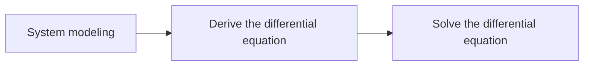
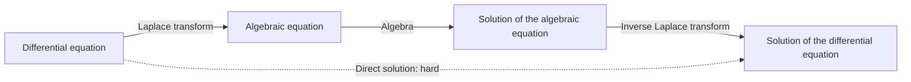
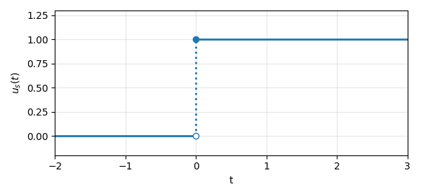
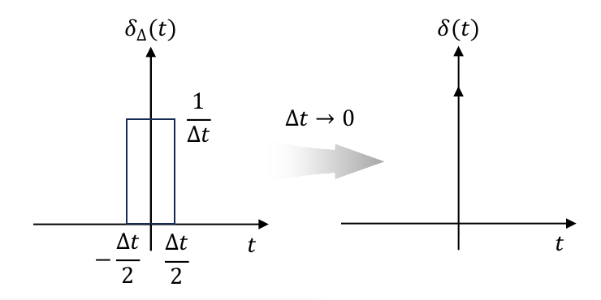
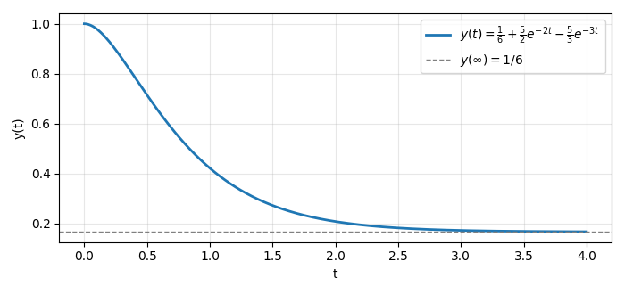

# Week 3 Lecture — Fundamental Engineering Mathematics

[Repository Guide](../../README.md) | [English](Concepts_Lecture.md) | [한국어](Concepts_Lecture.ko.md)

> **Last Updated:** 2026-11-04

> **Learning Objectives:**
> 1. Explain the workflow of control system analysis that turns a differential equation into an algebraic equation with the Laplace transform
> 2. Derive from the definition the Laplace transforms of the unit step, impulse, exponential, polynomial, cosine, and sine functions
> 3. Derive linearity, the shifts in the frequency and time domains, the differentiation and integration properties, and the initial and final value theorems, and use them together with their conditions
> 4. Find inverse Laplace transforms of rational functions whose denominators have simple, complex, or multiple roots by partial fraction expansion, and solve differential equations with initial conditions
> 5. Compute sums, products, and transposes of matrices, and find determinants and inverses of $2 \times 2$ and $3 \times 3$ matrices
> 6. Solve systems of linear equations with the inverse matrix

---

## Table of Contents

- [1. Laplace Transform I](#1-laplace-transform-i)
  - [1.1 Differential Equations and Control System Analysis](#11-differential-equations-and-control-system-analysis)
  - [1.2 Definition of the Laplace Transform](#12-definition-of-the-laplace-transform)
  - [1.3 The One-Sided Laplace Transform](#13-the-one-sided-laplace-transform)
  - [1.4 Review of Differentiation and Integration](#14-review-of-differentiation-and-integration)
  - [1.5 The Unit Step Function](#15-the-unit-step-function)
  - [1.6 The Impulse Function](#16-the-impulse-function)
  - [1.7 The Exponential Function](#17-the-exponential-function)
  - [1.8 The Linear Function](#18-the-linear-function)
  - [1.9 The Quadratic Function and the nth Power](#19-the-quadratic-function-and-the-nth-power)
  - [1.10 The Cosine Function](#110-the-cosine-function)
  - [1.11 The Sine Function](#111-the-sine-function)
  - [1.12 Basic Transform Pairs](#112-basic-transform-pairs)
- [2. Laplace Transform II](#2-laplace-transform-ii)
  - [2.1 Linearity](#21-linearity)
  - [2.2 Shift in the Frequency Domain](#22-shift-in-the-frequency-domain)
  - [2.3 Shift in the Time Domain](#23-shift-in-the-time-domain)
  - [2.4 Differentiation](#24-differentiation)
  - [2.5 Integration](#25-integration)
  - [2.6 Initial Value Theorem](#26-initial-value-theorem)
  - [2.7 Final Value Theorem](#27-final-value-theorem)
  - [2.8 Inverse Laplace Transform](#28-inverse-laplace-transform)
  - [2.9 Partial Fraction Expansion: Simple Roots Only](#29-partial-fraction-expansion-simple-roots-only)
  - [2.10 Partial Fraction Expansion: Multiple Roots](#210-partial-fraction-expansion-multiple-roots)
  - [2.11 Solving Differential Equations with the Laplace Transform](#211-solving-differential-equations-with-the-laplace-transform)
- [3. Matrices](#3-matrices)
  - [3.1 Definition of a Matrix](#31-definition-of-a-matrix)
  - [3.2 Square and Diagonal Matrices](#32-square-and-diagonal-matrices)
  - [3.3 The Identity Matrix](#33-the-identity-matrix)
  - [3.4 The Transpose Matrix](#34-the-transpose-matrix)
  - [3.5 Row Vectors and Column Vectors](#35-row-vectors-and-column-vectors)
  - [3.6 Matrix Addition and Subtraction](#36-matrix-addition-and-subtraction)
  - [3.7 Matrix Multiplication](#37-matrix-multiplication)
  - [3.8 Multiplication by the Identity Matrix and Properties of the Transpose](#38-multiplication-by-the-identity-matrix-and-properties-of-the-transpose)
  - [3.9 Determinants](#39-determinants)
  - [3.10 The Inverse Matrix](#310-the-inverse-matrix)
  - [3.11 Relations for Determinants](#311-relations-for-determinants)
  - [3.12 Solving Systems of Equations with Matrices](#312-solving-systems-of-equations-with-matrices)
- [Concept Applications](#concept-applications)
- [Summary](#summary)
- [Self-Check Questions](#self-check-questions)
- [References](#references)

---

 

## 1. Laplace Transform I

Week 2 solved first-order and second-order differential equations directly in the time domain. When the order grows or several elements are connected, that method quickly becomes complicated. This section derives, directly from the definition, the Laplace transform that turns differential equations into algebraic equations, together with the transforms of the basic functions that appear most often in control engineering.

### 1.1 Differential Equations and Control System Analysis

Analyzing and designing a control system takes three steps. First, **system modeling** expresses the object to be controlled mathematically; this produces a **differential equation** that describes the behavior of the system; finally, solving that differential equation reveals how the system moves over time. Week 4 covers modeling in detail.

*Figure 1. The process of analyzing and designing a control system*

Solving the differential equation directly in the time domain in the last step is difficult. With the Laplace transform, a differential equation becomes an **algebraic equation**, that is, an equation built only from addition, subtraction, multiplication, and division. After the algebraic equation is solved, the inverse Laplace transform brings the result back and gives the solution of the original differential equation.

*Figure 2. The path for solving a differential equation with the Laplace transform*

> **Key Point:** The Laplace transform replaces one hard path (solving the differential equation directly) with three easy ones (transform, algebra, and inverse transform).

### 1.2 Definition of the Laplace Transform

A simple control system can be analyzed and designed with differential equations alone. Most control systems, however, consist of several kinds of blocks connected together, such as a controller, an actuator, the controlled object, and a sensor, so treating the whole system as one differential equation becomes very complicated. Mathematical tools are introduced to make the analysis easier, and the tool used most in control systems is the Laplace transform.

> **Definition:** The **Laplace transform** is an integral transform that turns a function $f(t)$ of the real variable $t$ (time) into a function $F(s)$ of the complex variable $s = \sigma + j\omega$. The world of functions of $t$ is the **time domain**, and the world of functions of $s$ is the **frequency domain** or the $s$-domain.

The defining equation of the Laplace transform is as follows.

$$
F(s) = \mathcal{L}\lbrace f(t) \rbrace= \int_{-\infty}^{\infty} f(t)\,e^{-st}\,dt, \qquad s = \sigma + j\omega
$$

$\sigma$ is the real part of $s$, $\omega$ is its imaginary part, and $j$ is the imaginary unit with $j^2 = -1$ (Week 2). A time function is written in lowercase as $f(t)$ and its transform in uppercase as $F(s)$, and $\mathcal{L}\lbrace\cdot\rbrace$ denotes applying the Laplace transform to the function in the braces. The variable $t$ is integrated out, and the result is a function of $s$ alone.

Because the interval of integration is infinite, the transform exists only if the integral converges to a finite value. Euler's formula gives $\lvert e^{-j\omega t} \rvert = 1$, so $\lvert f(t)e^{-st} \rvert = \lvert f(t) \rvert e^{-\sigma t}$, and the integral therefore converges when the following condition holds.

$$
\int_{-\infty}^{\infty} \left\lvert f(t)\,e^{-\sigma t} \right\rvert dt < \infty
$$

Whether this condition holds depends on the value of $\sigma$. The Laplace transform is therefore generally defined only when the real part of $s$ lies in a certain range, which is called the **region of convergence** [1]. For example, the transform of $e^{at}$ found in Section 1.7 exists only for $\operatorname{Re}(s) > a$. Signals in control engineering do not grow faster than an exponential function, so their transforms always exist once $\operatorname{Re}(s)$ is taken large enough.

The greatest advantage of the frequency domain is that differentiation and integration in the time domain become multiplication and division by $s$ (Sections 2.4 and 2.5). In the frequency domain, a system can therefore be handled with multiplication and division alone.

### 1.3 The One-Sided Laplace Transform

$$
F(s) = \mathcal{L}\lbrace f(t) \rbrace= \int_{0}^{\infty} f(t)\,e^{-st}\,dt
$$

In control engineering, the instant at which the input starts is taken as $t = 0$, and every signal can be assumed to be 0 before that ($t < 0$). The integral from $-\infty$ to 0 in the definition of Section 1.2 then vanishes, and the equation above, whose interval runs from 0 to $\infty$, is used instead. This is the **one-sided Laplace transform**, and it is the transform mainly used in control engineering. Everything after this point in this document uses the one-sided transform.

> **Note:** To avoid missing a signal concentrated at the single instant $t = 0$, such as the impulse function of Section 1.6, many textbooks define the lower limit of integration as $0^-$, the instant just before 0 [2]. The initial value in the differentiation property (Section 2.4) then becomes $f(0^-)$. For ordinary functions that are continuous at $t = 0$, the two definitions give the same result.

### 1.4 Review of Differentiation and Integration

Computing Laplace transforms requires the basic formulas of differentiation and integration. Tables 1 and 2 collect the formulas used in this document.

| Function | Derivative | Name |
|:-----|:-----|:-----|
| $c$ (constant) | $0$ | Derivative of a constant |
| $cf(x)$ | $cf'(x)$ | Constant multiple |
| $f(x) \pm g(x)$ | $f'(x) \pm g'(x)$ | Sum and difference |
| $f(x)g(x)$ | $f(x)g'(x) + g(x)f'(x)$ | Product rule |
| $\dfrac{f(x)}{g(x)}$ | $\dfrac{g(x)f'(x) - f(x)g'(x)}{[g(x)]^2}$ | Quotient rule |
| $f(g(x))$ | $f'(g(x))\,g'(x)$ | Chain rule |
| $x^n$ | $nx^{n-1}$ | Power |
| $e^x$, $a^x$ | $e^x$, $a^x \ln a$ | Exponential functions |
| $\ln \lvert x \rvert$, $\log_a x$ | $\dfrac{1}{x}$, $\dfrac{1}{x \ln a}$ | Logarithmic functions |
| $\sin x$, $\cos x$, $\tan x$ | $\cos x$, $-\sin x$, $\sec^2 x$ | Trigonometric functions |

*Table 1. Basic differentiation formulas*

| Integrand | Indefinite integral ($C$ is the constant of integration) |
|:-----|:-----|
| $k$ | $kx + C$ |
| $x^n$ ($n \ne -1$) | $\dfrac{x^{n+1}}{n+1} + C$ |
| $(ax+b)^n$ ($n \ne -1$) | $\dfrac{(ax+b)^{n+1}}{a(n+1)} + C$ |
| $\dfrac{1}{x}$ | $\ln \lvert x \rvert + C$ |
| $\dfrac{c}{ax+b}$ | $\dfrac{c}{a} \ln \lvert ax+b \rvert + C$ |
| $e^x$ | $e^x + C$ |
| $a^x$ | $\dfrac{a^x}{\ln a} + C$ |
| $\ln x$ | $x \ln x - x + C$ |
| $\log_a x$ | $x \log_a x - \dfrac{x}{\ln a} + C$ |
| $\sin x$ | $-\cos x + C$ |
| $\cos x$ | $\sin x + C$ |
| $\tan x$ | $-\ln \lvert \cos x \rvert + C = \ln \lvert \sec x \rvert + C$ |

*Table 2. Basic integration formulas*

The tool used most often for Laplace transforms is **integration by parts**. Integrating both sides of the product rule $(uv)' = u'v + uv'$ gives $uv = \int u'v\,dx + \int uv'\,dx$, which rearranges to the following.

$$
\int u\,v'\,dx = uv - \int u'\,v\,dx
$$

As a definite integral it reads as follows. Every derivation from Section 1.8 on uses this formula.

$$
\int_a^b f'(t)\,g(t)\,dt = \Big[ f(t)\,g(t) \Big]_{t=a}^{t=b} - \int_a^b f(t)\,g'(t)\,dt
$$

> **[Calculus]** An improper integral with $\infty$ as a limit is defined by the limit $\int_0^\infty g(t)\,dt = \lim_{T\to\infty}\int_0^T g(t)\,dt$. Laplace transform computations repeatedly use two facts: when $\operatorname{Re}(s) > 0$, $e^{-st} \to 0$ as $t \to \infty$; and because an exponential decays faster than any polynomial grows, $t^n e^{-st} \to 0$ for every natural number $n$.

### 1.5 The Unit Step Function

The **unit step function** is 0 before $t = 0$, switches to 1 at $t = 0$, and stays there. It represents a constant input applied from the moment a switch is turned on, and it is the most basic input for testing the performance of a control system (Week 7).

$$
u_s(t) = \begin{cases} 1, & t \ge 0 \\ 0, & t < 0 \end{cases}
$$

*Figure 3. Graph of the unit step function*

Since $u_s(t) = 1$ for $t \ge 0$, substituting into the definition gives the following.

$$
\mathcal{L}\lbrace u_s(t) \rbrace= \int_0^\infty 1 \cdot e^{-st}\,dt = \left[ -\frac{1}{s}e^{-st} \right]_0^\infty = (0) - \left( -\frac{1}{s} \right) = \frac{1}{s}, \qquad \operatorname{Re}(s) > 0
$$

An antiderivative of $e^{-st}$ is $-\frac{1}{s}e^{-st}$. At the upper limit $t \to \infty$ it is 0 because $e^{-st} \to 0$ when $\operatorname{Re}(s) > 0$, and at the lower limit $t = 0$ it is $-\frac{1}{s}$ because $e^{0} = 1$. Subtracting the lower value from the upper value gives $\frac{1}{s}$. The same computation shows that the step $Au_s(t)$ of height $A$ has the transform $\frac{A}{s}$.

### 1.6 The Impulse Function

The **impulse function** $\delta(t)$, also called the Dirac delta function, has a value only at the single instant $t = 0$ and has area 1. It represents an input applied strongly over a very short instant, like a single blow of a hammer.

$$
\delta(t) = \begin{cases} 0, & t \ne 0 \\ \infty, & t = 0 \end{cases}, \qquad \int_{0^-}^{0^+} \delta(t)\,dt = 1
$$

$\delta(t)$ cannot be defined as an ordinary function, so it is understood as the limit of the rectangular pulse $\delta_\Delta(t)$ of width $\Delta t$ and height $\frac{1}{\Delta t}$ shown in Figure 4. The area of the pulse is always $\Delta t \times \frac{1}{\Delta t} = 1$. As $\Delta t \to 0$, the width goes to 0 and the height to infinity while the area stays 1, and the limit is $\delta(t)$. In graphs it is drawn as an arrow that stands for area 1 rather than for a height.

*Figure 4. A rectangular pulse of area 1 and its limit, the impulse function*

Since $\delta(t)$ is 0 everywhere except at $t = 0$, replacing $e^{-st}$ inside the integral by its value at $t = 0$, which is $e^{0} = 1$, does not change the integral.

$$
\mathcal{L}\lbrace\delta(t) \rbrace= \int_{0^-}^{\infty} \delta(t)\,e^{-st}\,dt = e^{-s \cdot 0}\int_{0^-}^{0^+} \delta(t)\,dt = 1 \times 1 = 1
$$

> **Note:** By the same reasoning, $\int_{-\infty}^{\infty} g(t)\,\delta(t-a)\,dt = g(a)$ holds for a continuous function $g(t)$. Because the impulse picks out the value of the function it multiplies at a single point, this is called the **sifting property** [1]. The fact that the impulse function transforms to 1 is used again for the impulse response in Week 5.

### 1.7 The Exponential Function

The transform of the exponential function $e^{at}$ is computed by combining the two exponentials into one and integrating.

$$
\mathcal{L}\lbrace e^{at} \rbrace= \int_0^\infty e^{at}e^{-st}\,dt = \int_0^\infty e^{-(s-a)t}\,dt = \left[ -\frac{1}{s-a}e^{-(s-a)t} \right]_0^\infty = \frac{1}{s-a}, \qquad \operatorname{Re}(s) > a
$$

The first equality is the definition, and the second is the exponent rule $e^{at}e^{-st} = e^{-(s-a)t}$. The third is the integral of Section 1.5 with $s - a$ in place of $s$. For $e^{-(s-a)t} \to 0$ at the upper limit we need $\operatorname{Re}(s - a) > 0$, that is, $\operatorname{Re}(s) > a$, and then the result is $0 - \left( -\frac{1}{s-a} \right) = \frac{1}{s-a}$. With $a = 0$ we have $e^{0t} = 1$, which agrees with $\frac{1}{s}$ from Section 1.5.

**Example.** Substitute values of $a$ into the formula $\mathcal{L}\lbrace e^{at} \rbrace= \frac{1}{s-a}$.

$$
\mathcal{L}\lbrace e^{-2t} \rbrace= \frac{1}{s-(-2)} = \frac{1}{s+2}, \qquad \mathcal{L}\lbrace e^{3t} \rbrace= \frac{1}{s-3}, \qquad \mathcal{L}\lbrace e^{\omega t} \rbrace= \frac{1}{s-\omega}
$$

> **Key Point:** The decaying exponential $e^{-2t}$ in the time domain becomes, in the $s$-domain, a fraction whose denominator vanishes at $s = -2$. This correspondence between the shape of a time response and the roots of the denominator in the $s$-domain underlies the analysis in every later week.

### 1.8 The Linear Function

The transform of $f(t) = t$ is found by integration by parts. In the formula of Section 1.4, set $f'(t) = e^{-st}$ and $g(t) = t$, so that $f(t) = -\frac{1}{s}e^{-st}$ and $g'(t) = 1$.

$$
\mathcal{L}\lbrace t \rbrace= \int_0^\infty t\,e^{-st}\,dt = \left[ t \cdot \left( -\frac{1}{s}e^{-st} \right) \right]_0^\infty - \int_0^\infty 1 \cdot \left( -\frac{1}{s}e^{-st} \right) dt
$$

$$
= (0 - 0) + \frac{1}{s}\int_0^\infty e^{-st}\,dt = \frac{1}{s} \cdot \frac{1}{s} = \frac{1}{s^2}
$$

The boundary term is 0 because $te^{-st} \to 0$ at the upper limit (the [Calculus] box of Section 1.4) and $t = 0$ at the lower limit. The remaining integral is $\mathcal{L}\lbrace1 \rbrace= \frac{1}{s}$ from Section 1.5. The input $t$, which grows at a constant rate, is called the **ramp function**.

### 1.9 The Quadratic Function and the nth Power

The transform of $t^2$ is found the same way, this time with $g(t) = t^2$ and $g'(t) = 2t$.

$$
\mathcal{L}\lbrace t^2 \rbrace= \left[ t^2 \cdot \left( -\frac{1}{s}e^{-st} \right) \right]_0^\infty + \frac{2}{s}\int_0^\infty t\,e^{-st}\,dt = 0 + \frac{2}{s} \cdot \frac{1}{s^2} = \frac{2}{s^3}
$$

The last integral is $\mathcal{L}\lbrace t \rbrace= \frac{1}{s^2}$ from Section 1.8. In general, one integration by parts on $t^n$ gives $\mathcal{L}\lbrace t^n \rbrace= \frac{n}{s}\mathcal{L}\lbrace t^{n-1} \rbrace$, and repeating it $n$ times gives the following.

$$
\mathcal{L}\lbrace t^n \rbrace= \frac{n}{s}\mathcal{L}\lbrace t^{n-1} \rbrace= \frac{n}{s} \cdot \frac{n-1}{s}\mathcal{L}\lbrace t^{n-2} \rbrace= \cdots = \frac{n!}{s^n}\mathcal{L}\lbrace1 \rbrace= \frac{n!}{s^{n+1}}
$$

**Example.** For $n = 3$, $\mathcal{L}\lbrace t^3 \rbrace= \frac{3!}{s^4} = \frac{6}{s^4}$. Checking with the recurrence, $\frac{3}{s} \cdot \mathcal{L}\lbrace t^2 \rbrace= \frac{3}{s} \cdot \frac{2}{s^3} = \frac{6}{s^4}$ agrees.

### 1.10 The Cosine Function

The transforms of trigonometric functions use Euler's formula $e^{j\theta} = \cos\theta + j\sin\theta$ from Week 2. Adding $e^{j\omega t}$ and $e^{-j\omega t}$ cancels the sine terms, so $\cos\omega t = \frac{e^{j\omega t} + e^{-j\omega t}}{2}$. Substituting $a = j\omega$ and $a = -j\omega$ into the result of Section 1.7 gives the following.

$$
\mathcal{L}\lbrace\cos\omega t \rbrace= \frac{1}{2}\left( \frac{1}{s-j\omega} + \frac{1}{s+j\omega} \right) = \frac{1}{2} \cdot \frac{(s+j\omega) + (s-j\omega)}{(s-j\omega)(s+j\omega)} = \frac{1}{2} \cdot \frac{2s}{s^2+\omega^2} = \frac{s}{s^2+\omega^2}
$$

The first equality is linearity (Section 2.1). The second puts the fractions over a common denominator, which is $(s-j\omega)(s+j\omega) = s^2 - (j\omega)^2 = s^2 + \omega^2$.

> **Note:** The derivation of Section 1.7 holds unchanged when $a$ is complex, and the convergence condition becomes $\operatorname{Re}(s) > \operatorname{Re}(a)$. For $a = \pm j\omega$ we have $\operatorname{Re}(a) = 0$, so the transforms of sine and cosine exist for $\operatorname{Re}(s) > 0$.

**Example.** Substitute values of $\omega$. $200\pi t$ is a cosine of frequency $f = 100$ Hz ($\omega = 2\pi f$).

$$
\mathcal{L}\lbrace\cos 10t \rbrace= \frac{s}{s^2+10^2} = \frac{s}{s^2+100}, \qquad \mathcal{L}\lbrace\cos 200\pi t \rbrace= \frac{s}{s^2+(200\pi)^2} = \frac{s}{s^2+40000\pi^2}
$$

### 1.11 The Sine Function

Subtracting $e^{-j\omega t}$ from $e^{j\omega t}$ cancels the cosine terms, so $\sin\omega t = \frac{e^{j\omega t} - e^{-j\omega t}}{2j}$.

$$
\mathcal{L}\lbrace\sin\omega t \rbrace= \frac{1}{2j}\left( \frac{1}{s-j\omega} - \frac{1}{s+j\omega} \right) = \frac{1}{2j} \cdot \frac{(s+j\omega) - (s-j\omega)}{s^2+\omega^2} = \frac{1}{2j} \cdot \frac{2j\omega}{s^2+\omega^2} = \frac{\omega}{s^2+\omega^2}
$$

Note that, unlike the cosine, the numerator keeps $\omega$ rather than $s$.

**Example.**

$$
\mathcal{L}\lbrace\sin 10t \rbrace= \frac{10}{s^2+100}, \qquad \mathcal{L}\lbrace\sin 200\pi t \rbrace= \frac{200\pi}{s^2+40000\pi^2}
$$

### 1.12 Basic Transform Pairs

Table 3 collects the results derived so far. Instead of integrating the definition for every transform, this table is used, and together with the properties of Section 2 it yields the transforms of many more functions.

| $f(t)$, $t \ge 0$ | $F(s) = \mathcal{L}\lbrace f(t) \rbrace$ | Condition of existence |
|:-----|:-----|:-----|
| $\delta(t)$ | $1$ | All $s$ |
| $u_s(t)$ or $1$ | $\dfrac{1}{s}$ | $\operatorname{Re}(s) > 0$ |
| $e^{at}$ | $\dfrac{1}{s-a}$ | $\operatorname{Re}(s) > \operatorname{Re}(a)$ |
| $t$ | $\dfrac{1}{s^2}$ | $\operatorname{Re}(s) > 0$ |
| $t^2$ | $\dfrac{2}{s^3}$ | $\operatorname{Re}(s) > 0$ |
| $t^n$ | $\dfrac{n!}{s^{n+1}}$ | $\operatorname{Re}(s) > 0$ |
| $\cos\omega t$ | $\dfrac{s}{s^2+\omega^2}$ | $\operatorname{Re}(s) > 0$ |
| $\sin\omega t$ | $\dfrac{\omega}{s^2+\omega^2}$ | $\operatorname{Re}(s) > 0$ |

*Table 3. Basic Laplace transform pairs derived from the definition*

> **Key Point:** Every pair in the table comes from the single integral of the definition. Polynomials are handled by integration by parts, and trigonometric functions are reduced to the transform of the exponential function by Euler's formula.

---

 

## 2. Laplace Transform II

Combining the transform pairs of Section 1 and applying them to differential equations requires the properties of the Laplace transform. This section derives seven properties and then covers the inverse Laplace transform, which returns from the frequency domain to the time domain, the partial fraction expansion used to compute it, and the solution of differential equations with these tools.

### 2.1 Linearity

$$
\mathcal{L}\lbrace kf(t) \rbrace= k\,\mathcal{L}\lbrace f(t) \rbrace= kF(s)
$$

$$
\mathcal{L}\lbrace f_1(t) + f_2(t) \rbrace= \mathcal{L}\lbrace f_1(t) \rbrace+ \mathcal{L}\lbrace f_2(t) \rbrace= F_1(s) + F_2(s)
$$

An integral lets a constant factor out, and the integral of a sum is the sum of the integrals, so the Laplace transform, being defined by an integral, has the same properties. This is called **linearity**.

**Example.**

$$
\mathcal{L}\lbrace2e^{-2t} \rbrace= 2 \cdot \frac{1}{s+2} = \frac{2}{s+2}
$$

$$
\mathcal{L}\lbrace3t^2 - \cos 4t \rbrace= 3 \cdot \frac{2}{s^3} - \frac{s}{s^2+16} = \frac{6}{s^3} - \frac{s}{s^2+16} = \frac{-s^4 + 6s^2 + 96}{s^3(s^2+16)}
$$

The second example uses $t^2$ and $\cos\omega t$ ($\omega = 4$) from Table 3 and then combines the fractions; the numerator is $6(s^2+16) - s \cdot s^3 = -s^4 + 6s^2 + 96$.

### 2.2 Shift in the Frequency Domain

$$
\mathcal{L}\lbrace e^{-at}f(t) \rbrace= \int_0^\infty e^{-st}e^{-at}f(t)\,dt = \int_0^\infty e^{-(s+a)t}f(t)\,dt = F(s+a)
$$

The last integral is the definition with $s + a$ in place of $s$, so it equals $F(s+a)$. Multiplying by $e^{-at}$ in the time domain shifts the whole function by $-a$ along the $s$ axis in the $s$-domain (to the left for $a > 0$). This is called the **shift in the frequency domain**.

**Example.** The transform of the function of Section 1.10 multiplied by $e^{-2t}$ is obtained by replacing $s$ with $s + 2$.

$$
\mathcal{L}\lbrace\cos 200\pi t \rbrace= \frac{s}{s^2+(200\pi)^2} \quad \Rightarrow \quad \mathcal{L}\lbrace e^{-2t}\cos 200\pi t \rbrace= \frac{s+2}{(s+2)^2+(200\pi)^2}
$$

In the same way we obtain $\mathcal{L}\lbrace e^{-at}\sin\omega t \rbrace= \frac{\omega}{(s+a)^2+\omega^2}$, $\mathcal{L}\lbrace e^{-at}\cos\omega t \rbrace= \frac{s+a}{(s+a)^2+\omega^2}$, and $\mathcal{L}\lbrace t^n e^{-at} \rbrace= \frac{n!}{(s+a)^{n+1}}$. These three pairs are used for the inverse transforms in Sections 2.9 and 2.10.

### 2.3 Shift in the Time Domain

$$
\mathcal{L}\lbrace f(t-T) \rbrace= e^{-sT}F(s), \qquad T \ge 0
$$

$f(t-T)$ is $f(t)$ moved to the right by $T$, that is, the function that starts $T$ later. The formula holds under the one-sided assumption that $f(t) = 0$ for $t < 0$, which makes $f(t-T) = 0$ for $t < T$. To make this explicit, the function is sometimes written $f(t-T)u_s(t-T)$.

The derivation is as follows. Since the integrand is 0 for $t < T$, the lower limit can be raised to $T$.

$$
\mathcal{L}\lbrace f(t-T) \rbrace= \int_0^\infty f(t-T)\,e^{-st}\,dt = \int_T^\infty f(t-T)\,e^{-st}\,dt
$$

Substituting $x = t - T$ gives $dt = dx$, with $x = 0$ when $t = T$ and $x \to \infty$ when $t \to \infty$.

$$
= \int_0^\infty f(x)\,e^{-s(T+x)}\,dx = e^{-sT}\int_0^\infty f(x)\,e^{-sx}\,dx = e^{-sT}F(s)
$$

In $e^{-s(T+x)} = e^{-sT}e^{-sx}$, the factor $e^{-sT}$ does not depend on $x$ and comes out of the integral, and the remaining integral is $F(s)$ with the variable merely renamed to $x$.

**Example.** $\mathcal{L}\lbrace f(t-10) \rbrace= e^{-10s}F(s)$. For instance, the unit step $u_s(t-10)$ that switches on at $t = 10$ has the transform $\frac{e^{-10s}}{s}$. A time delay $T$ appears in the $s$-domain as multiplication by $e^{-sT}$, which is used to model the **dead time** of a process in which a signal takes time to travel, for example along a pipe.

### 2.4 Differentiation

The differentiation property is the key to turning differential equations into algebraic equations. In integration by parts, $f'(t)$ is taken as the differentiated factor and $e^{-st}$ as the factor to differentiate.

$$
\mathcal{L}\left\lbrace\frac{df(t)}{dt} \right\rbrace= \int_0^\infty f'(t)\,e^{-st}\,dt = \Big[ f(t)\,e^{-st} \Big]_{t=0}^{t=\infty} - \int_0^\infty f(t)\left( -s\,e^{-st} \right) dt
$$

$$
= \big( 0 - f(0) \big) + s\int_0^\infty f(t)\,e^{-st}\,dt = sF(s) - f(0)
$$

In the boundary term, $f(t)e^{-st} \to 0$ at the upper limit (true for the values of $s$ at which the transform exists), and the lower limit gives $f(0)e^{0} = f(0)$. The derivative of $e^{-st}$ is $-se^{-st}$, so $s$ comes out of the remaining integral and leaves $sF(s)$. Repeating the same process gives the transform of the $n$th derivative, where $f^{(k)}(0)$ is the value of the $k$th derivative at $t = 0$.

$$
\mathcal{L}\left\lbrace\frac{d^n f(t)}{dt^n} \right\rbrace= s^nF(s) - s^{n-1}f(0) - s^{n-2}f^{(1)}(0) - \cdots - f^{(n-1)}(0)
$$

**Example.** For the second derivative, apply the first-derivative property to $f'$ and then apply it once more.

$$
\mathcal{L}\left\lbrace\frac{d^2f(t)}{dt^2} \right\rbrace= s\,\mathcal{L}\left\lbrace\frac{df(t)}{dt} \right\rbrace- f^{(1)}(0) = s\big( sF(s) - f(0) \big) - f^{(1)}(0) = s^2F(s) - sf(0) - f^{(1)}(0)
$$

When all initial conditions are 0, $\frac{d}{dt}$ becomes multiplication by $s$. As a check, if $f(t) = \sin\omega t$ then $f'(t) = \omega\cos\omega t$, and the differentiation property gives $s \cdot \frac{\omega}{s^2+\omega^2} - \sin 0 = \frac{\omega s}{s^2+\omega^2}$, which equals $\omega\,\mathcal{L}\lbrace\cos\omega t \rbrace$ from Table 3.

> **Key Point:** The differentiation property turns differentiation into multiplication by $s$ and inserts the initial conditions into the equation automatically. There is no need, as in Week 2, to find the general solution first and then fix the constants with the initial conditions.

### 2.5 Integration

$$
\mathcal{L}\left\lbrace\int_0^t f(\tau)\,d\tau \right\rbrace= \frac{F(s)}{s}
$$

In integration by parts, take $g(t) = \int_0^t f(\tau)\,d\tau$ (with $g'(t) = f(t)$ by the fundamental theorem of calculus) as the factor to differentiate and $e^{-st}$ as the factor to integrate (antiderivative $-\frac{1}{s}e^{-st}$).

$$
\int_0^\infty \left( \int_0^t f(\tau)\,d\tau \right) e^{-st}\,dt = \left[ -\frac{e^{-st}}{s}\int_0^t f(\tau)\,d\tau \right]_{t=0}^{t=\infty} + \frac{1}{s}\int_0^\infty f(t)\,e^{-st}\,dt = 0 + \frac{F(s)}{s}
$$

The boundary term is 0 because $e^{-st}$ goes to 0 at the upper limit and $\int_0^0 f(\tau)\,d\tau = 0$ at the lower limit. Integration becomes division by $s$. As a check, $\int_0^t 1\,d\tau = t$, and the integration property gives $\frac{1/s}{s} = \frac{1}{s^2}$, the same as Section 1.8.

### 2.6 Initial Value Theorem

$$
\lim_{t\to 0^+} f(t) = \lim_{s\to\infty} sF(s)
$$

The initial value in the time domain equals the limit of $sF(s)$ as $s \to \infty$ in the $s$-domain. This is the **initial value theorem**, and it holds when the transforms of $f(t)$ and $f'(t)$ exist and $f(t)$ contains no impulse at $t = 0$ [1]. The reason is the differentiation property $\int_0^\infty f'(t)e^{-st}dt = sF(s) - f(0)$: letting $s \to \infty$, the factor $e^{-st}$ on the left goes to 0 for $t > 0$, so $sF(s) \to f(0^+)$.

**Example.** Find the initial value of $f(t) = \frac{1}{2} - \frac{1}{2}e^{-2t}$. First transform it with linearity.

$$
F(s) = \frac{1}{2} \cdot \frac{1}{s} - \frac{1}{2} \cdot \frac{1}{s+2} = \frac{1}{2} \cdot \frac{(s+2) - s}{s(s+2)} = \frac{1}{s(s+2)}
$$

$$
\lim_{s\to\infty} sF(s) = \lim_{s\to\infty} \frac{s}{s(s+2)} = \lim_{s\to\infty} \frac{1}{s+2} = 0
$$

Computing directly in the time domain gives the same value, $f(0) = \frac{1}{2} - \frac{1}{2} = 0$.

### 2.7 Final Value Theorem

$$
\lim_{t\to\infty} f(t) = \lim_{s\to 0} sF(s)
$$

The final value in the time domain, that is, the value after a sufficiently long time, equals the limit of $sF(s)$ as $s \to 0$ in the $s$-domain. This is the **final value theorem**. It tells where a system eventually settles without converting the solution back to the time domain, and it is used to compute the steady-state error in Week 10.

**Example.** Apply it to the same function as in Section 2.6.

$$
\lim_{s\to 0} sF(s) = \lim_{s\to 0} \frac{1}{s+2} = \frac{1}{2}
$$

In the time domain, $e^{-2t} \to 0$ as $t \to \infty$, so $f(t) \to \frac{1}{2}$ as well.

> **Caution:** The final value theorem can be used only when $f(t)$ converges to a finite value. When $F(s)$ is a rational function, this condition is equivalent to every value of $s$ that makes the denominator of $sF(s)$ zero, that is, every **pole**, lying in the left half-plane where the real part is negative [2]. For example, if $f(t) = \sin t$ then $sF(s) = \frac{s}{s^2+1} \to 0$, but $\sin t$ does not converge and keeps oscillating, because the poles $\pm j$ lie on the imaginary axis. If $f(t) = e^{t}$ then $sF(s) = \frac{s}{s-1} \to 0$, but $f$ actually grows without bound, and the pole $s = 1$ lies in the right half-plane. Poles are covered in detail in Week 5.

| Property | Time domain | $s$-domain |
|:-----|:-----|:-----|
| Linearity | $k_1f_1(t) + k_2f_2(t)$ | $k_1F_1(s) + k_2F_2(s)$ |
| Shift in the frequency domain | $e^{-at}f(t)$ | $F(s+a)$ |
| Shift in the time domain | $f(t-T)$, $T \ge 0$ | $e^{-sT}F(s)$ |
| Differentiation | $\dfrac{df(t)}{dt}$ | $sF(s) - f(0)$ |
| Second derivative | $\dfrac{d^2f(t)}{dt^2}$ | $s^2F(s) - sf(0) - f^{(1)}(0)$ |
| Integration | $\displaystyle\int_0^t f(\tau)\,d\tau$ | $\dfrac{F(s)}{s}$ |
| Initial value theorem | $\lim_{t\to 0^+} f(t)$ | $\lim_{s\to\infty} sF(s)$ |
| Final value theorem | $\lim_{t\to\infty} f(t)$ | $\lim_{s\to 0} sF(s)$ (pole condition required) |

*Table 4. Properties of the Laplace transform*

### 2.8 Inverse Laplace Transform

The **inverse Laplace transform** is the operation that finds the original time function $f(t)$ from a function $F(s)$ given as a Laplace transform, and its defining equation is as follows.

$$
f(t) = \mathcal{L}^{-1}\lbrace F(s) \rbrace= \frac{1}{2\pi j}\int_{\sigma-j\infty}^{\sigma+j\infty} F(s)\,e^{st}\,ds
$$

This is a complex integral along the vertical line $\operatorname{Re}(s) = \sigma$ inside the region of convergence, and it is rarely computed directly. Functions continuous for $t \ge 0$ and their transforms correspond one to one [3], so in practice $F(s)$ is split into a sum of simple fractions found in Table 3, and the time function matching each fraction is read from the table in reverse. In most cases this splitting is the partial fraction expansion of Sections 2.9 and 2.10.

**Example.** Read the results of Section 2.1 in reverse.

$$
\mathcal{L}^{-1}\left\lbrace\frac{2}{s+2} \right\rbrace= 2e^{-2t}, \qquad \mathcal{L}^{-1}\left\lbrace\frac{6}{s^3} - \frac{s}{s^2+16} \right\rbrace= 3t^2 - \cos 4t
$$

In the second equation, $\frac{6}{s^3} = 3 \cdot \frac{2}{s^3}$ is the transform of $3t^2$, and $\frac{s}{s^2+4^2}$ is the transform of $\cos 4t$.

A function such as $G(s) = \frac{2}{s^2+5s+6}$, which does not appear in the table directly, must be split into partial fractions after factoring the denominator as $(s+2)(s+3)$. This example is solved as Example 1 of Section 2.9.

### 2.9 Partial Fraction Expansion: Simple Roots Only

Consider a rational function whose numerator $N(s)$ has lower degree than its denominator. If the roots $-p_1, -p_2, \ldots, -p_n$ of the denominator are all distinct, that is, if the denominator has only **simple roots**, the function splits as follows. This is called **partial fraction expansion**.

$$
G(s) = \frac{N(s)}{(s+p_1)(s+p_2)\cdots(s+p_n)} = \frac{K_1}{s+p_1} + \frac{K_2}{s+p_2} + \cdots + \frac{K_n}{s+p_n}
$$

To find the coefficient $K_i$, multiply both sides by $(s+p_i)$.

$$
G(s)(s+p_i) = \frac{K_1(s+p_i)}{s+p_1} + \frac{K_2(s+p_i)}{s+p_2} + \cdots + K_i + \cdots + \frac{K_n(s+p_i)}{s+p_n}
$$

Substituting $s = -p_i$ makes every term except $K_i$ vanish, because each has $(s+p_i) = 0$ in its numerator.

$$
K_i = G(s)(s+p_i)\Big|_{s=-p_i}
$$

In other words, $K_i$ is the value at $s = -p_i$ of what remains of $G(s)$ after the factor $(s+p_i)$ is removed. Each term is inverted with the $e^{at}$ pair of Table 3.

$$
\mathcal{L}^{-1}\lbrace G(s) \rbrace= \mathcal{L}^{-1}\left\lbrace\frac{K_1}{s+p_1} \right\rbrace+ \cdots + \mathcal{L}^{-1}\left\lbrace\frac{K_n}{s+p_n} \right\rbrace= K_1e^{-p_1t} + K_2e^{-p_2t} + \cdots + K_ne^{-p_nt}
$$

> **Caution:** This method applies only when the numerator has lower degree than the denominator. If the degree of the numerator is equal or higher, first split the function by polynomial division into a quotient (a polynomial) and a remainder fraction, and then expand the remainder fraction.

**Example 1.** $G(s) = \dfrac{2}{(s+2)(s+3)} = \dfrac{K_1}{s+2} + \dfrac{K_2}{s+3}$

$$
K_1 = \frac{2}{(s+2)(s+3)}(s+2)\Bigg|_{s=-2} = \frac{2}{s+3}\Bigg|_{s=-2} = \frac{2}{1} = 2, \qquad K_2 = \frac{2}{(s+2)(s+3)}(s+3)\Bigg|_{s=-3} = \frac{2}{s+2}\Bigg|_{s=-3} = \frac{2}{-1} = -2
$$

$$
G(s) = \frac{2}{s+2} - \frac{2}{s+3} \quad \Rightarrow \quad g(t) = 2e^{-2t} - 2e^{-3t}
$$

As a check, recombining the fractions gives the numerator $2(s+3) - 2(s+2) = 2$, the same as the original.

**Example 2 (complex roots).** By the quadratic formula, the denominator of $G(s) = \dfrac{2}{s^2+2s+5}$ has the roots $s = \frac{-2 \pm \sqrt{4-20}}{2} = -1 \pm j2$, so the function splits as follows.

$$
G(s) = \frac{2}{(s+1+j2)(s+1-j2)} = \frac{K_1}{s+1+j2} + \frac{K_2}{s+1-j2}
$$

The roots are complex but still distinct, so the same formula applies. We use $\frac{1}{j} = -j$.

$$
K_1 = \frac{2}{s+1-j2}\Bigg|_{s=-1-j2} = \frac{2}{-j4} = -\frac{1}{2j} = \frac{j}{2}, \qquad K_2 = \frac{2}{s+1+j2}\Bigg|_{s=-1+j2} = \frac{2}{j4} = \frac{1}{2j} = -\frac{j}{2}
$$

$K_1$ and $K_2$ are complex conjugates of each other. For a rational function with real coefficients, the coefficients that belong to a pair of conjugate complex roots always form a conjugate pair. Inverting and using Euler's formula gives the following.

$$
g(t) = \frac{j}{2}e^{-(1+j2)t} - \frac{j}{2}e^{-(1-j2)t} = \frac{j}{2}e^{-t}\left( e^{-j2t} - e^{j2t} \right)
$$

$$
e^{-j2t} - e^{j2t} = (\cos 2t - j\sin 2t) - (\cos 2t + j\sin 2t) = -2j\sin 2t
$$

$$
g(t) = \frac{j}{2}e^{-t}(-2j\sin 2t) = -j^2e^{-t}\sin 2t = e^{-t}\sin 2t
$$

**Another solution of Example 2.** Completing the square in the denominator gives $s^2+2s+5 = (s+1)^2+2^2$. With $G_1(s) = \frac{2}{s^2+2^2}$, Table 3 gives $g_1(t) = \sin 2t$, and since $G(s) = G_1(s+1)$, the shift in the frequency domain (Section 2.2) gives $g(t) = e^{-t}g_1(t) = e^{-t}\sin 2t$. The same answer follows without complex arithmetic.

> **Key Point:** A pair of conjugate complex roots $-\sigma \pm j\omega$ produces in the time domain an oscillation of angular frequency $\omega$ that decays as $e^{-\sigma t}$, that is, a damped oscillation. The real part of the roots sets the rate of decay, and the imaginary part sets how fast the oscillation is. This relation underlies the analysis of second-order system responses in Weeks 7 and 9.

### 2.10 Partial Fraction Expansion: Multiple Roots

If a root $-p$ of the denominator is a **multiple root** repeated $r$ times, the expansion needs a term for every power of $(s+p)$ from the first to the $r$th. In the following example, $-2$ is a root repeated three times.

$$
G(s) = \frac{s^2}{(s+2)^3} = \frac{K_1}{(s+2)^3} + \frac{K_2}{(s+2)^2} + \frac{K_3}{s+2}
$$

Multiply both sides by $(s+2)^3$.

$$
G(s)(s+2)^3 = s^2 = K_1 + K_2(s+2) + K_3(s+2)^2 \qquad (\ast)
$$

**$K_1$:** Substituting $s = -2$ into $(\ast)$ removes the terms of $K_2$ and $K_3$, so $K_1 = (-2)^2 = 4$.

**$K_2$:** Differentiating both sides of $(\ast)$ with respect to $s$ removes $K_1$, which is a constant.

$$
\frac{d}{ds}\left[ G(s)(s+2)^3 \right] = 2s = K_2 + 2K_3(s+2)
$$

Substituting $s = -2$ removes the term of $K_3$, so $K_2 = 2 \cdot (-2) = -4$.

**$K_3$:** Differentiating once more gives $\frac{d^2}{ds^2}\left[ G(s)(s+2)^3 \right] = 2 = 2K_3$, so $K_3 = 1$.

In general, differentiating $k$ times and dividing by $k!$ gives $K_{k+1} = \frac{1}{k!}\frac{d^k}{ds^k}\left[ G(s)(s+p)^r \right]_{s=-p}$. The result is the following.

$$
G(s) = \frac{4}{(s+2)^3} - \frac{4}{(s+2)^2} + \frac{1}{s+2}
$$

The inverse transform combines $\mathcal{L}\lbrace t^n \rbrace= \frac{n!}{s^{n+1}}$ with the shift in the frequency domain.

| Time function | From $\mathcal{L}\lbrace t^n \rbrace$ | After multiplying by $e^{-2t}$ |
|:-----|:-----|:-----|
| $2t^2$ | $\mathcal{L}\lbrace2t^2 \rbrace= 2 \cdot \dfrac{2}{s^3} = \dfrac{4}{s^3}$ | $\mathcal{L}\lbrace2t^2e^{-2t} \rbrace= \dfrac{4}{(s+2)^3}$ |
| $4t$ | $\mathcal{L}\lbrace4t \rbrace= \dfrac{4}{s^2}$ | $\mathcal{L}\lbrace4te^{-2t} \rbrace= \dfrac{4}{(s+2)^2}$ |
| $1$ | $\mathcal{L}\lbrace1 \rbrace= \dfrac{1}{s}$ | $\mathcal{L}\lbrace e^{-2t} \rbrace= \dfrac{1}{s+2}$ |

*Table 5. Inverting each term of the multiple-root example*

$$
g(t) = 2t^2e^{-2t} - 4te^{-2t} + e^{-2t} = e^{-2t}\left( 2t^2 - 4t + 1 \right)
$$

As a check, $g(0) = 1$, and the initial value theorem also gives $\lim_{s\to\infty} sG(s) = \lim_{s\to\infty} \frac{s^3}{(s+2)^3} = 1$.

> **Note:** When the numerator is simple, as in this example, the expansion can also be done without differentiation by writing $s = (s+2) - 2$. Since $s^2 = \big( (s+2) - 2 \big)^2 = (s+2)^2 - 4(s+2) + 4$, dividing both sides by $(s+2)^3$ gives $K_1 = 4$, $K_2 = -4$, and $K_3 = 1$ at once.

### 2.11 Solving Differential Equations with the Laplace Transform

A differential equation is solved with the Laplace transform in the following order.

1. Take the Laplace transform of both sides of the differential equation, inserting the initial conditions through the differentiation property.
2. Solve the resulting algebraic equation for the transform of the output, $Y(s)$.
3. Expand $Y(s)$ in partial fractions.
4. Invert each term to obtain $y(t)$.

**Example.** Solve the following differential equation. $y^{(1)}(0)$ is the initial value of the first derivative of $y$.

$$
\frac{d^2y}{dt^2} + 5\frac{dy}{dt} + 6y = u_s(t), \qquad y(0) = 1, \quad y^{(1)}(0) = 0
$$

**Step 1.** Transform each term.

$$
\mathcal{L}\left\lbrace\frac{d^2y}{dt^2} \right\rbrace= s^2Y(s) - sy(0) - y^{(1)}(0) = s^2Y(s) - s, \qquad \mathcal{L}\left\lbrace\frac{dy}{dt} \right\rbrace= sY(s) - y(0) = sY(s) - 1, \qquad \mathcal{L}\lbrace u_s(t) \rbrace= \frac{1}{s}
$$

$$
s^2Y(s) - s + 5\big( sY(s) - 1 \big) + 6Y(s) = \frac{1}{s}
$$

**Step 2.** Collect the terms with $Y(s)$ on the left and the rest on the right.

$$
(s^2 + 5s + 6)\,Y(s) = \frac{1}{s} + s + 5 = \frac{s^2 + 5s + 1}{s} \quad \Rightarrow \quad Y(s) = \frac{s^2 + 5s + 1}{s(s+2)(s+3)}
$$

**Step 3.** The denominator has only the simple roots $0, -2, -3$, so the formula of Section 2.9 applies.

$$
Y(s) = \frac{K_1}{s} + \frac{K_2}{s+2} + \frac{K_3}{s+3}
$$

$$
K_1 = \frac{s^2+5s+1}{(s+2)(s+3)}\Bigg|_{s=0} = \frac{1}{6}, \qquad K_2 = \frac{s^2+5s+1}{s(s+3)}\Bigg|_{s=-2} = \frac{4-10+1}{(-2)(1)} = \frac{5}{2}, \qquad K_3 = \frac{s^2+5s+1}{s(s+2)}\Bigg|_{s=-3} = \frac{9-15+1}{(-3)(-1)} = -\frac{5}{3}
$$

**Step 4.** Invert with Table 3.

$$
y(t) = \frac{1}{6} + \frac{5}{2}e^{-2t} - \frac{5}{3}e^{-3t}, \qquad t \ge 0
$$

As a check, $y(0) = \frac{1}{6} + \frac{15}{6} - \frac{10}{6} = 1$, and $y'(t) = -5e^{-2t} + 5e^{-3t}$ gives $y'(0) = 0$, so the initial conditions hold. The final value $\frac{1}{6}$ agrees with the final value theorem $\lim_{s\to 0} sY(s) = \frac{1}{6}$ (the poles $-2, -3$ of $sY(s)$ lie in the left half-plane) and with the steady-state equation $6y = 1$ obtained when all derivative terms vanish.

*Figure 5. The solution y(t) of the example differential equation and its final value*

> **Key Point:** The exponents $-2$ and $-3$ in the solution are the roots of the characteristic equation $\lambda^2 + 5\lambda + 6 = 0$ of this differential equation (Section 3.3 of Week 2), which are the same as the roots of the denominator factor $s^2 + 5s + 6$ of $Y(s)$. These roots produce the transient response that dies out over time, and the constant term $\frac{1}{6}$ is the steady-state response produced by the input.

---

 

## 3. Matrices

A matrix is a tool that arranges several numbers in a rectangle and handles them all at once. In control engineering, the simultaneous equations of systems with several connected masses (Week 4) and the state variable equations (Week 6) are written with matrices. This section covers the basic elements and operations of matrices, determinants, inverse matrices, and the solution of systems of equations with the inverse matrix.

### 3.1 Definition of a Matrix

A matrix with $m$ rows (horizontal lines) and $n$ columns (vertical lines) is an $m \times n$ **matrix**. The element in row $i$ and column $j$ is written $a_{ij}$, and the whole matrix is abbreviated $A = [a_{ij}]$.

$$
A = \begin{bmatrix} a_{11} & a_{12} & \cdots & a_{1n} \\ a_{21} & a_{22} & \cdots & a_{2n} \\ \vdots & \vdots & \ddots & \vdots \\ a_{m1} & a_{m2} & \cdots & a_{mn} \end{bmatrix}
$$

The following are, in order, $2 \times 3$, $3 \times 2$, $3 \times 3$, and $2 \times 2$ matrices. The size of a matrix always gives the number of rows first and the number of columns second.

$$
\begin{bmatrix} 2 & 3 & 5 \\ -1 & 6 & 2 \end{bmatrix}, \qquad \begin{bmatrix} 1 & 2 \\ 4 & 4 \\ -3 & 1 \end{bmatrix}, \qquad \begin{bmatrix} 2 & 3 & 2 \\ -2 & 11 & 1 \\ 3 & 0 & 7 \end{bmatrix}, \qquad \begin{bmatrix} -1 & 3 \\ 2 & 1 \end{bmatrix}
$$

### 3.2 Square and Diagonal Matrices

A matrix with as many rows as columns ($m = n$) is a **square matrix**. The following are one $2 \times 2$ square matrix and two $3 \times 3$ square matrices.

$$
\begin{bmatrix} 1 & 2 \\ 2 & 4 \end{bmatrix}, \qquad \begin{bmatrix} 2 & 5 & -4 \\ 1 & 6 & 7 \\ 3 & -2 & 7 \end{bmatrix}, \qquad \begin{bmatrix} 1 & 3 & 1 \\ 3 & 2 & 2 \\ 6 & 2 & 4 \end{bmatrix}
$$

In a square matrix, the elements $a_{11}, a_{22}, \ldots, a_{nn}$ running from the upper left to the lower right form the **main diagonal**. A square matrix whose elements off the main diagonal are all 0 is a **diagonal matrix**.

$$
\begin{bmatrix} 2 & 0 & 0 \\ 0 & 6 & 0 \\ 0 & 0 & 7 \end{bmatrix}
$$

### 3.3 The Identity Matrix

A diagonal matrix whose main diagonal elements are all 1 is the **identity matrix**, written $I$. When the size matters it is written as, for example, $I_3$.

$$
I = \begin{bmatrix} 1 & 0 & 0 \\ 0 & 1 & 0 \\ 0 & 0 & 1 \end{bmatrix}, \qquad A \cdot I = I \cdot A = A
$$

The identity matrix plays the role of 1 in the multiplication of numbers: multiplying any matrix by it leaves that matrix unchanged. The size of $I$ is chosen so that the product is defined (Section 3.8).

### 3.4 The Transpose Matrix

The matrix obtained by exchanging the rows and columns of a matrix is the **transpose matrix**, written $A^T$. The element in row $i$ and column $j$ of $A$ becomes the element in row $j$ and column $i$ of $A^T$, so $(A^T)_{ij} = a_{ji}$, and the transpose of an $m \times n$ matrix is an $n \times m$ matrix.

$$
A^T = \begin{bmatrix} a_{11} & a_{21} & \cdots & a_{m1} \\ a_{12} & a_{22} & \cdots & a_{m2} \\ \vdots & \vdots & \ddots & \vdots \\ a_{1n} & a_{2n} & \cdots & a_{mn} \end{bmatrix}
$$

**Example.** Row 1 $[2\ \ 5\ \ {-4}]$ of the first matrix becomes column 1 of its transpose, and the second matrix changes from $2 \times 3$ to $3 \times 2$.

$$
\begin{bmatrix} 2 & 5 & -4 \\ 1 & 6 & 7 \\ 3 & -2 & 7 \end{bmatrix}^T = \begin{bmatrix} 2 & 1 & 3 \\ 5 & 6 & -2 \\ -4 & 7 & 7 \end{bmatrix}, \qquad \begin{bmatrix} 2 & 3 & 5 \\ -1 & 6 & 2 \end{bmatrix}^T = \begin{bmatrix} 2 & -1 \\ 3 & 6 \\ 5 & 2 \end{bmatrix}
$$

### 3.5 Row Vectors and Column Vectors

A $1 \times n$ matrix with a single row is a **row vector**, and an $n \times 1$ matrix with a single column is a **column vector**. Transposing a row vector gives a column vector, and transposing a column vector gives a row vector. The unknowns and the constant terms of a system of equations (Section 3.12) are written as column vectors.

$$
\text{Row vector: } \begin{bmatrix} 2 & 3 & 5 \end{bmatrix}, \qquad \text{Column vector: } \begin{bmatrix} 3 \\ -1 \\ 7 \end{bmatrix}
$$

### 3.6 Matrix Addition and Subtraction

Two matrices of the same size are added or subtracted by adding or subtracting the elements in the same positions. Matrices of different sizes cannot be added or subtracted.

$$
A \pm B = \begin{bmatrix} a_{11} \pm b_{11} & a_{12} \pm b_{12} & \cdots & a_{1n} \pm b_{1n} \\ a_{21} \pm b_{21} & a_{22} \pm b_{22} & \cdots & a_{2n} \pm b_{2n} \\ \vdots & \vdots & \ddots & \vdots \\ a_{m1} \pm b_{m1} & a_{m2} \pm b_{m2} & \cdots & a_{mn} \pm b_{mn} \end{bmatrix}
$$

**Example.**

$$
\begin{bmatrix} 2 & 3 & -1 \\ 0 & 2 & 3 \\ 1 & 3 & 1 \end{bmatrix} + \begin{bmatrix} 1 & 2 & 4 \\ 3 & 1 & 2 \\ 2 & 4 & 5 \end{bmatrix} = \begin{bmatrix} 2+1 & 3+2 & -1+4 \\ 0+3 & 2+1 & 3+2 \\ 1+2 & 3+4 & 1+5 \end{bmatrix} = \begin{bmatrix} 3 & 5 & 3 \\ 3 & 3 & 5 \\ 3 & 7 & 6 \end{bmatrix}
$$

Subtracting the same two matrices element by element gives $\begin{bmatrix} 1 & 1 & -5 \\ -3 & 1 & 1 \\ -1 & -1 & -4 \end{bmatrix}$.

### 3.7 Matrix Multiplication

The product $AB = C$ of an $m \times n$ matrix $A$ and an $n \times l$ matrix $B$ is an $m \times l$ matrix whose elements are as follows.

$$
AB = C = [c_{ij}], \qquad c_{ij} = \sum_{k=1}^{n} a_{ik}\,b_{kj} = a_{i1}b_{1j} + a_{i2}b_{2j} + \cdots + a_{in}b_{nj}
$$

That is, $c_{ij}$ is obtained by multiplying the elements of row $i$ of $A$ and column $j$ of $B$ in matching order and adding all the products. The product is therefore defined only when the number of columns of $A$ equals the number of rows of $B$ (both $n$). The size of the result is set by the two outer numbers: $(m \times n)(n \times l) \to m \times l$.

**Example.** The product of a $2 \times 2$ matrix and a $2 \times 3$ matrix is a $2 \times 3$ matrix.

$$
\begin{bmatrix} 3 & 4 \\ -5 & 6 \end{bmatrix} \begin{bmatrix} 2 & 3 & 5 \\ -1 & 6 & 2 \end{bmatrix}
$$

| Element | Row and column used | Computation | Value |
|:-----|:-----|:-----|:-----|
| $c_{11}$ | Row 1 $[3\ \ 4]$, column 1 $[2\ \ {-1}]^T$ | $3 \cdot 2 + 4 \cdot (-1) = 6 - 4$ | $2$ |
| $c_{12}$ | Row 1, column 2 $[3\ \ 6]^T$ | $3 \cdot 3 + 4 \cdot 6 = 9 + 24$ | $33$ |
| $c_{13}$ | Row 1, column 3 $[5\ \ 2]^T$ | $3 \cdot 5 + 4 \cdot 2 = 15 + 8$ | $23$ |
| $c_{21}$ | Row 2 $[-5\ \ 6]$, column 1 | $(-5) \cdot 2 + 6 \cdot (-1) = -10 - 6$ | $-16$ |
| $c_{22}$ | Row 2, column 2 | $(-5) \cdot 3 + 6 \cdot 6 = -15 + 36$ | $21$ |
| $c_{23}$ | Row 2, column 3 | $(-5) \cdot 5 + 6 \cdot 2 = -25 + 12$ | $-13$ |

*Table 6. Element-by-element computation of a matrix product*

$$
\begin{bmatrix} 3 & 4 \\ -5 & 6 \end{bmatrix} \begin{bmatrix} 2 & 3 & 5 \\ -1 & 6 & 2 \end{bmatrix} = \begin{bmatrix} 2 & 33 & 23 \\ -16 & 21 & -13 \end{bmatrix}
$$

> **Caution:** The order of matrix multiplication cannot be swapped. In the example above, the reversed product $(2 \times 3)(2 \times 2)$ is not even defined, because the inner numbers 3 and 2 differ. Even when both products are defined, in general $AB \ne BA$. For example, with $A$ and $B$ of Section 3.8, $AB = \begin{bmatrix} -5 & 2 \\ 3 & 10 \end{bmatrix}$ but $BA = \begin{bmatrix} 6 & 10 \\ 5 & -1 \end{bmatrix}$.

### 3.8 Multiplication by the Identity Matrix and Properties of the Transpose

Multiplying by the identity matrix leaves a matrix unchanged. An identity matrix multiplied on the left matches the number of rows of $A$, and one multiplied on the right matches the number of columns of $A$.

$$
\begin{bmatrix} 1 & 0 \\ 0 & 1 \end{bmatrix} \begin{bmatrix} 2 & 3 & 5 \\ -1 & 6 & 2 \end{bmatrix} = \begin{bmatrix} 1 \cdot 2 + 0 \cdot (-1) & 1 \cdot 3 + 0 \cdot 6 & 1 \cdot 5 + 0 \cdot 2 \\ 0 \cdot 2 + 1 \cdot (-1) & 0 \cdot 3 + 1 \cdot 6 & 0 \cdot 5 + 1 \cdot 2 \end{bmatrix} = \begin{bmatrix} 2 & 3 & 5 \\ -1 & 6 & 2 \end{bmatrix}
$$

The transposes of sums and products have the following properties. Note that the transpose of a product **reverses the order**.

$$
(A + B)^T = A^T + B^T, \qquad (AB)^T = B^TA^T
$$

The product property can be checked element by element: $\big( (AB)^T \big)_{ij} = (AB)_{ji} = \sum_k a_{jk}b_{ki} = \sum_k (B^T)_{ik}(A^T)_{kj} = (B^TA^T)_{ij}$.

**Example.** Check both properties with $A = \begin{bmatrix} -1 & 3 \\ 2 & 1 \end{bmatrix}$ and $B = \begin{bmatrix} 2 & 4 \\ -1 & 2 \end{bmatrix}$.

$$
A + B = \begin{bmatrix} 1 & 7 \\ 1 & 3 \end{bmatrix} \Rightarrow (A+B)^T = \begin{bmatrix} 1 & 1 \\ 7 & 3 \end{bmatrix}, \qquad A^T + B^T = \begin{bmatrix} -1 & 2 \\ 3 & 1 \end{bmatrix} + \begin{bmatrix} 2 & -1 \\ 4 & 2 \end{bmatrix} = \begin{bmatrix} 1 & 1 \\ 7 & 3 \end{bmatrix}
$$

$$
AB = \begin{bmatrix} (-1)(2) + 3(-1) & (-1)(4) + 3(2) \\ 2(2) + 1(-1) & 2(4) + 1(2) \end{bmatrix} = \begin{bmatrix} -5 & 2 \\ 3 & 10 \end{bmatrix} \Rightarrow (AB)^T = \begin{bmatrix} -5 & 3 \\ 2 & 10 \end{bmatrix}
$$

$$
B^TA^T = \begin{bmatrix} 2 & -1 \\ 4 & 2 \end{bmatrix} \begin{bmatrix} -1 & 2 \\ 3 & 1 \end{bmatrix} = \begin{bmatrix} -2-3 & 4-1 \\ -4+6 & 8+2 \end{bmatrix} = \begin{bmatrix} -5 & 3 \\ 2 & 10 \end{bmatrix}
$$

$B^TA^T$ equals $(AB)^T$. By contrast, $A^TB^T = \begin{bmatrix} 6 & 5 \\ 10 & -1 \end{bmatrix}$, taken without reversing the order, differs from $(AB)^T$.

### 3.9 Determinants

> **Definition:** The **determinant** is a function that assigns a single number to a square matrix by a fixed rule, written $\det A$ or $\lvert A \rvert$. The determinant decides whether an inverse matrix exists (Section 3.10).

The **determinant of a $2 \times 2$ matrix** is the product of the main diagonal elements minus the product of the other diagonal elements.

$$
\det A = \lvert A \rvert = \begin{vmatrix} a_{11} & a_{12} \\ a_{21} & a_{22} \end{vmatrix} = a_{11}a_{22} - a_{12}a_{21}
$$

**Example.** The determinants of $A$ and $B$ from Section 3.8 are as follows.

$$
\lvert A \rvert = \begin{vmatrix} -1 & 3 \\ 2 & 1 \end{vmatrix} = (-1)(1) - (3)(2) = -1 - 6 = -7, \qquad \lvert B \rvert = \begin{vmatrix} 2 & 4 \\ -1 & 2 \end{vmatrix} = (2)(2) - (4)(-1) = 4 + 4 = 8
$$

The **determinant of a $3 \times 3$ matrix** is computed by splitting it into $2 \times 2$ determinants. The determinant $\lvert M_{ij} \rvert$ of the $2 \times 2$ matrix left after deleting row $i$ and column $j$ is called a **minor**. Expanding along the first column gives the following.

$$
\begin{vmatrix} a_{11} & a_{12} & a_{13} \\ a_{21} & a_{22} & a_{23} \\ a_{31} & a_{32} & a_{33} \end{vmatrix} = a_{11}\begin{vmatrix} a_{22} & a_{23} \\ a_{32} & a_{33} \end{vmatrix} - a_{21}\begin{vmatrix} a_{12} & a_{13} \\ a_{32} & a_{33} \end{vmatrix} + a_{31}\begin{vmatrix} a_{12} & a_{13} \\ a_{22} & a_{23} \end{vmatrix} = a_{11}\lvert M_{11} \rvert - a_{21}\lvert M_{21} \rvert + a_{31}\lvert M_{31} \rvert
$$

$$
\lvert M_{11} \rvert = \begin{vmatrix} a_{22} & a_{23} \\ a_{32} & a_{33} \end{vmatrix}, \qquad \lvert M_{21} \rvert = \begin{vmatrix} a_{12} & a_{13} \\ a_{32} & a_{33} \end{vmatrix}, \qquad \lvert M_{31} \rvert = \begin{vmatrix} a_{12} & a_{13} \\ a_{22} & a_{23} \end{vmatrix}
$$

The sign of each term is set by the position $(i, j)$ of the element as $(-1)^{i+j}$, and the signed quantity $C_{ij} = (-1)^{i+j}\lvert M_{ij} \rvert$ is called a **cofactor**. The signs alternate in a checkerboard pattern as follows.

$$
\begin{bmatrix} + & - & + \\ - & + & - \\ + & - & + \end{bmatrix}
$$

Expanding along any row or any column gives the same result. Expanding along the second column, the third column, and the first row gives the following.

$$
\lvert A \rvert = -a_{12}\lvert M_{12} \rvert + a_{22}\lvert M_{22} \rvert - a_{32}\lvert M_{32} \rvert = a_{13}\lvert M_{13} \rvert - a_{23}\lvert M_{23} \rvert + a_{33}\lvert M_{33} \rvert = a_{11}\lvert M_{11} \rvert - a_{12}\lvert M_{12} \rvert + a_{13}\lvert M_{13} \rvert
$$

> **Caution:** When expanding along the second column ($j = 2$), the sign of the first term is $(-1)^{1+2} = -1$, so the signs run $-, +, -$. Writing them as $+, -, +$, as for the first or third column, flips the sign of the determinant. Choosing a row or column with many zeros reduces the work.

**Example.** Expand along the first row.

$$
\begin{vmatrix} 5 & 3 & 2 \\ 4 & 6 & 7 \\ 8 & 2 & 3 \end{vmatrix} = 5\begin{vmatrix} 6 & 7 \\ 2 & 3 \end{vmatrix} - 3\begin{vmatrix} 4 & 7 \\ 8 & 3 \end{vmatrix} + 2\begin{vmatrix} 4 & 6 \\ 8 & 2 \end{vmatrix} = 5(18 - 14) - 3(12 - 56) + 2(8 - 48)
$$

$$
= 5 \cdot 4 - 3 \cdot (-44) + 2 \cdot (-40) = 20 + 132 - 80 = 72
$$

Expanding along the first column gives the same value: $5(18-14) - 4(9-4) + 8(21-12) = 20 - 20 + 72 = 72$.

### 3.10 The Inverse Matrix

> **Definition:** The matrix $A^{-1}$ that gives the identity matrix when multiplied by the square matrix $A$, that is, the matrix satisfying $AA^{-1} = A^{-1}A = I$, is the **inverse matrix** of $A$. It plays the same role as $\frac{1}{3}$ in $3 \times \frac{1}{3} = 1$ for numbers.

An inverse matrix exists only when $\lvert A \rvert \ne 0$ (Section 3.11). A matrix that has no inverse because its determinant is 0 is called a **singular matrix**. For example, $\begin{bmatrix} 1 & 2 \\ 2 & 4 \end{bmatrix}$ from Section 3.2 has $\lvert A \rvert = 4 - 4 = 0$ and no inverse, and the reason is visible in the fact that its second row is twice its first row.

The **inverse of a $2 \times 2$ matrix** is obtained by swapping the two elements on the main diagonal, changing the signs of the other two elements, and dividing by the determinant.

$$
A = \begin{bmatrix} a_{11} & a_{12} \\ a_{21} & a_{22} \end{bmatrix}, \qquad A^{-1} = \frac{1}{\lvert A \rvert}\begin{bmatrix} a_{22} & -a_{12} \\ -a_{21} & a_{11} \end{bmatrix} = \frac{1}{a_{11}a_{22} - a_{12}a_{21}}\begin{bmatrix} a_{22} & -a_{12} \\ -a_{21} & a_{11} \end{bmatrix}
$$

Direct multiplication shows why the formula works: $\begin{bmatrix} a_{11} & a_{12} \\ a_{21} & a_{22} \end{bmatrix}\begin{bmatrix} a_{22} & -a_{12} \\ -a_{21} & a_{11} \end{bmatrix} = \begin{bmatrix} a_{11}a_{22} - a_{12}a_{21} & 0 \\ 0 & a_{11}a_{22} - a_{12}a_{21} \end{bmatrix} = \lvert A \rvert I$, so dividing by $\lvert A \rvert$ gives $I$.

**Example 1.** $A = \begin{bmatrix} -1 & 3 \\ 2 & 1 \end{bmatrix}$ from Section 3.8 has $\lvert A \rvert = -7$.

$$
A^{-1} = \frac{1}{-7}\begin{bmatrix} 1 & -3 \\ -2 & -1 \end{bmatrix} = \begin{bmatrix} -\frac{1}{7} & \frac{3}{7} \\ \frac{2}{7} & \frac{1}{7} \end{bmatrix}
$$

As a check, in $AA^{-1}$ the entry in row 1, column 1 is $(-1)(-\frac{1}{7}) + 3 \cdot \frac{2}{7} = \frac{1}{7} + \frac{6}{7} = 1$, row 1, column 2 is $(-1)\frac{3}{7} + 3 \cdot \frac{1}{7} = 0$, row 2, column 1 is $2(-\frac{1}{7}) + 1 \cdot \frac{2}{7} = 0$, and row 2, column 2 is $2 \cdot \frac{3}{7} + 1 \cdot \frac{1}{7} = 1$, so $AA^{-1} = I$.

**Example 2.**

$$
\begin{bmatrix} 1 & 2 \\ 3 & 5 \end{bmatrix}^{-1} = \frac{1}{1 \cdot 5 - 2 \cdot 3}\begin{bmatrix} 5 & -2 \\ -3 & 1 \end{bmatrix} = \frac{1}{-1}\begin{bmatrix} 5 & -2 \\ -3 & 1 \end{bmatrix} = \begin{bmatrix} -5 & 2 \\ 3 & -1 \end{bmatrix}
$$

**The inverse of a $3 \times 3$ or larger matrix** can be found with cofactors. The transpose of the matrix whose elements are the cofactors $C_{ij}$ is called the **adjugate matrix** $\operatorname{adj}(A)$, and $A^{-1} = \frac{1}{\lvert A \rvert}\operatorname{adj}(A)$ [4]. The $2 \times 2$ formula is a special case of this equation. For example, expanding the following matrix along the first row gives $\lvert P \rvert = 1(0-24) - 2(0-20) + 3(0-5) = 1$.

$$
P = \begin{bmatrix} 1 & 2 & 3 \\ 0 & 1 & 4 \\ 5 & 6 & 0 \end{bmatrix}
$$

The nine cofactors are $C_{11} = -24$, $C_{12} = 20$, $C_{13} = -5$, $C_{21} = 18$, $C_{22} = -15$, $C_{23} = 4$, $C_{31} = 5$, $C_{32} = -4$, and $C_{33} = 1$. For example, $C_{12} = (-1)^{1+2}\begin{vmatrix} 0 & 4 \\ 5 & 0 \end{vmatrix} = -(0 - 20) = 20$. Transposing the cofactor matrix and dividing by $\lvert P \rvert = 1$ gives the inverse.

$$
P^{-1} = \frac{1}{1}\begin{bmatrix} C_{11} & C_{21} & C_{31} \\ C_{12} & C_{22} & C_{32} \\ C_{13} & C_{23} & C_{33} \end{bmatrix} = \begin{bmatrix} -24 & 18 & 5 \\ 20 & -15 & -4 \\ -5 & 4 & 1 \end{bmatrix}
$$

### 3.11 Relations for Determinants

The determinants of square matrices satisfy the following relations.

$$
\lvert A \rvert = \lvert A^T \rvert, \qquad \lvert AB \rvert = \lvert A \rvert\,\lvert B \rvert, \qquad \lvert A \rvert\,\lvert A^{-1} \rvert = 1 \;\Rightarrow\; \lvert A^{-1} \rvert = \frac{1}{\lvert A \rvert}
$$

The third relation is the second with $B = A^{-1}$, because $\lvert A \rvert\,\lvert A^{-1} \rvert = \lvert AA^{-1} \rvert = \lvert I \rvert = 1$. It also shows that when $\lvert A \rvert = 0$, $\lvert A^{-1} \rvert$ cannot be defined, so no inverse matrix exists.

**Example.** Check with $A$ and $B$ from Sections 3.8 and 3.10. $\lvert A^T \rvert = \begin{vmatrix} -1 & 2 \\ 3 & 1 \end{vmatrix} = -1 - 6 = -7 = \lvert A \rvert$, $\lvert AB \rvert = \begin{vmatrix} -5 & 2 \\ 3 & 10 \end{vmatrix} = -50 - 6 = -56 = (-7)(8) = \lvert A \rvert\,\lvert B \rvert$, and $\lvert A^{-1} \rvert = (-\frac{1}{7})(\frac{1}{7}) - (\frac{3}{7})(\frac{2}{7}) = -\frac{7}{49} = -\frac{1}{7} = \frac{1}{\lvert A \rvert}$.

### 3.12 Solving Systems of Equations with Matrices

A system of linear equations can be written as $AX = B$ with the coefficient matrix $A$, the column vector of unknowns $X$, and the column vector of constants $B$. If $\lvert A \rvert \ne 0$, multiplying both sides by $A^{-1}$ **on the left** gives the solution.

$$
AX = B \quad \Rightarrow \quad A^{-1}AX = A^{-1}B \quad \Rightarrow \quad X = A^{-1}B
$$

This works because $A^{-1}A = I$ and $IX = X$. Matrix multiplication cannot be reordered, so writing $X = BA^{-1}$ is wrong.

**Example.** Solve the following system of equations.

$$
\begin{cases} x_1 + 2x_2 = 1 \\ 3x_1 + 5x_2 = 2 \end{cases} \quad \Rightarrow \quad \begin{bmatrix} 1 & 2 \\ 3 & 5 \end{bmatrix}\begin{bmatrix} x_1 \\ x_2 \end{bmatrix} = \begin{bmatrix} 1 \\ 2 \end{bmatrix}
$$

Use the inverse found in Example 2 of Section 3.10.

$$
\begin{bmatrix} x_1 \\ x_2 \end{bmatrix} = \begin{bmatrix} 1 & 2 \\ 3 & 5 \end{bmatrix}^{-1}\begin{bmatrix} 1 \\ 2 \end{bmatrix} = \begin{bmatrix} -5 & 2 \\ 3 & -1 \end{bmatrix}\begin{bmatrix} 1 \\ 2 \end{bmatrix} = \begin{bmatrix} -5 + 4 \\ 3 - 2 \end{bmatrix} = \begin{bmatrix} -1 \\ 1 \end{bmatrix}
$$

As a check, substituting into the original equations gives $-1 + 2 = 1$ and $-3 + 5 = 2$, so both equations hold.

> **[Linear Algebra]** When $\lvert A \rvert = 0$, the system has either no solution or infinitely many. For systems with many unknowns, Gaussian elimination requires less computation and is numerically more stable than computing the inverse directly [4]. The inverse formula is useful for small matrices such as $2 \times 2$ or $3 \times 3$, or when handling by hand matrices whose elements are expressions in $s$, as for the two-mass system of Week 4.

---

 

## Concept Applications

For each problem below, the tool to use and the result are listed.

| Problem | Tool to use | Result |
|:-----|:-----|:-----|
| Transform of $5e^{-3t}\cos 4t$ | Linearity, shift in the frequency domain | $\dfrac{5(s+3)}{(s+3)^2+16}$ |
| Transform of the unit step $u_s(t-2)$ that switches on at $t = 2$ | Shift in the time domain | $\dfrac{e^{-2s}}{s}$ |
| Inverse transform of $\dfrac{3}{s(s+3)}$ | Partial fractions with simple roots ($K_1 = 1$, $K_2 = -1$) | $1 - e^{-3t}$ |
| Inverse transform of $\dfrac{1}{(s+1)^2}$ | Transform of $t^n$ and shift in the frequency domain | $te^{-t}$ |
| Inverse transform of $\dfrac{s+1}{s^2+2s+10}$ | Completing the square $(s+1)^2 + 3^2$ and shift in the frequency domain | $e^{-t}\cos 3t$ |
| $y' + 2y = 0$, $y(0) = 3$ | Differentiation property gives $(s+2)Y(s) = 3$ | $3e^{-2t}$ |
| $x_1 - x_2 = 1$, $2x_1 + x_2 = 5$ | Inverse matrix ($\lvert A \rvert = 3$) | $x_1 = 2$, $x_2 = 1$ |

*Table 7. Examples of applying the Laplace transform and matrices*

**True/False Check:**

| Statement | Judgment and Reason |
|:-----|:------------|
| The one-sided Laplace transform does not use the values of a function for $t < 0$. | **T.** The interval of integration runs from 0 to $\infty$, and the signal is assumed to be 0 for $t < 0$. |
| The transform of a product of two functions is the product of their transforms. | **F.** Linearity holds only for sums and constant multiples. For example, $t \cdot t = t^2$ transforms to $\frac{2}{s^3}$, but $\frac{1}{s^2} \cdot \frac{1}{s^2} = \frac{1}{s^4}$. |
| The final value theorem can be used for any $F(s)$. | **F.** It can be used only when all poles of $sF(s)$ lie in the left half-plane, and it gives wrong values for $\sin t$ or $e^{t}$. |
| For a rational function with real coefficients, the partial fraction coefficients that belong to conjugate complex roots are conjugates of each other. | **T.** In Example 2 of Section 2.9, $K_1 = \frac{j}{2}$ and $K_2 = -\frac{j}{2}$. |
| If both products of two matrices are defined, then $AB = BA$. | **F.** In the example of Section 3.7, $AB$ and $BA$ differed. |
| $(AB)^T = A^TB^T$. | **F.** The order reverses: $(AB)^T = B^TA^T$. |
| A square matrix whose determinant is 0 has no inverse. | **T.** $\lvert A^{-1} \rvert = \frac{1}{\lvert A \rvert}$ cannot be defined. |

---

 

## Summary

| Concept | Key Summary |
|:--------|:------------|
| Laplace transform | Turns a time function $f(t)$ into a function of the complex variable $s$ by $F(s) = \int_0^\infty f(t)e^{-st}dt$, making differential equations algebraic. |
| Region of convergence | The transform integral converges only when $\operatorname{Re}(s)$ exceeds some value; for example, $\operatorname{Re}(s) > a$ for $e^{at}$. |
| Basic transform pairs | $\delta \to 1$, $u_s \to \frac{1}{s}$, $e^{at} \to \frac{1}{s-a}$, $t^n \to \frac{n!}{s^{n+1}}$, $\cos\omega t \to \frac{s}{s^2+\omega^2}$, and $\sin\omega t \to \frac{\omega}{s^2+\omega^2}$. |
| Linearity | The transform of a constant multiple or a sum is the constant multiple or sum of the transforms. |
| Shift properties | Multiplying by $e^{-at}$ gives $F(s+a)$, and delaying by $T$ multiplies by $e^{-sT}$. |
| Differentiation and integration | Differentiation becomes multiplying by $s$ and subtracting the initial value, and integration becomes dividing by $s$. |
| Initial and final value theorems | $f(0^+) = \lim_{s\to\infty} sF(s)$, and if all poles of $sF(s)$ lie in the left half-plane, $f(\infty) = \lim_{s\to 0} sF(s)$. |
| Partial fraction expansion | Coefficients of simple roots are $K_i = G(s)(s+p_i)\vert_{s=-p_i}$, those of multiple roots are found by differentiation, and conjugate complex roots produce damped oscillations. |
| Solving differential equations | Transform, solve algebraically for $Y(s)$, expand in partial fractions, and invert; the initial conditions are included in one pass. |
| Matrix operations | Addition is element by element for equal sizes, multiplication is $c_{ij} = \sum_k a_{ik}b_{kj}$, $AB \ne BA$, and $(AB)^T = B^TA^T$. |
| Determinant | For $2 \times 2$ it is $a_{11}a_{22} - a_{12}a_{21}$, and for $3 \times 3$ it is found by cofactor expansion with checkerboard signs. |
| Inverse matrix | The matrix with $AA^{-1} = I$, which exists only when $\lvert A \rvert \ne 0$, and $A^{-1} = \operatorname{adj}(A)/\lvert A \rvert$. |
| Systems of equations | If $AX = B$, then $X = A^{-1}B$. |

---

 

## Self-Check Questions

1. **Derivation from the definition:** Find $\mathcal{L}\lbrace e^{-4t} \rbrace$ from the definition and state the range of $s$ for which the transform exists.

   

   
Answer

   $\int_0^\infty e^{-4t}e^{-st}dt = \int_0^\infty e^{-(s+4)t}dt = \left[ -\frac{1}{s+4}e^{-(s+4)t} \right]_0^\infty = \frac{1}{s+4}$. For the exponential term to vanish at the upper limit we need $\operatorname{Re}(s+4) > 0$, that is, $\operatorname{Re}(s) > -4$.

   

2. **Boundary term of integration by parts:** In deriving $\mathcal{L}\lbrace t \rbrace= \frac{1}{s^2}$, explain why the boundary term $\left[ -\frac{t}{s}e^{-st} \right]_0^\infty$ is 0.

   

   
Answer

   At the lower limit $t = 0$, the factor $t$ is 0. At the upper limit $t \to \infty$, when $\operatorname{Re}(s) > 0$ the factor $e^{-st}$ decays exponentially, faster than $t$ grows, so $te^{-st} \to 0$.

   

3. **Euler's formula:** Use Euler's formula to find $\mathcal{L}\lbrace\sin 3t \rbrace$.

   

   
Answer

   Since $\sin 3t = \frac{e^{j3t} - e^{-j3t}}{2j}$, the transform is $\frac{1}{2j}\left( \frac{1}{s-j3} - \frac{1}{s+j3} \right) = \frac{1}{2j} \cdot \frac{j6}{s^2+9} = \frac{3}{s^2+9}$.

   

4. **Combining properties:** Find $\mathcal{L}\lbrace e^{-t}(2 + t) \rbrace$.

   

   
Answer

   $\mathcal{L}\lbrace2 + t \rbrace= \frac{2}{s} + \frac{1}{s^2}$, and the shift in the frequency domain replaces $s$ with $s+1$, giving $\frac{2}{s+1} + \frac{1}{(s+1)^2} = \frac{2s+3}{(s+1)^2}$.

   

5. **Time delay:** Find the Laplace transform of the unit step $u_s(t-3)$ that switches on at $t = 3$.

   

   
Answer

   By the shift in the time domain, $\mathcal{L}\lbrace u_s(t-3) \rbrace= e^{-3s}\mathcal{L}\lbrace u_s(t) \rbrace= \frac{e^{-3s}}{s}$.

   

6. **Initial and final values:** Use the theorems to find the initial and final values of $F(s) = \frac{2s+1}{s(s+1)}$, and confirm them by inverting.

   

   
Answer

   $sF(s) = \frac{2s+1}{s+1}$, so the initial value is 2 as $s \to \infty$ and the final value is 1 as $s \to 0$ (the pole $-1$ of $sF(s)$ lies in the left half-plane). Partial fractions give $F(s) = \frac{1}{s} + \frac{1}{s+1}$, so $f(t) = 1 + e^{-t}$, with $f(0) = 2$ and $f(\infty) = 1$, as expected.

   

7. **Partial fractions with simple roots:** Find $\mathcal{L}^{-1}\left\lbrace\frac{4}{s^2+4s+3} \right\rbrace$.

   

   
Answer

   The denominator is $(s+1)(s+3)$. $K_1 = \frac{4}{s+3}\big\vert_{s=-1} = 2$ and $K_2 = \frac{4}{s+1}\big\vert_{s=-3} = -2$, so the result is $2e^{-t} - 2e^{-3t}$.

   

8. **Partial fractions with a multiple root:** Find $\mathcal{L}^{-1}\left\lbrace\frac{s+3}{(s+1)^2} \right\rbrace$.

   

   
Answer

   Since $s + 3 = (s+1) + 2$, we have $\frac{s+3}{(s+1)^2} = \frac{1}{s+1} + \frac{2}{(s+1)^2}$. Inverting each term gives $e^{-t} + 2te^{-t}$.

   

9. **Solving a differential equation:** Solve $\frac{dy}{dt} + 3y = 6$, $y(0) = 0$ with the Laplace transform.

   

   
Answer

   Transforming gives $sY(s) + 3Y(s) = \frac{6}{s}$, so $Y(s) = \frac{6}{s(s+3)} = \frac{2}{s} - \frac{2}{s+3}$. Therefore $y(t) = 2 - 2e^{-3t}$, with $y(0) = 0$ and final value 2.

   

10. **Determinant and inverse:** Find $\begin{vmatrix} 2 & 0 & 1 \\ 1 & 3 & 2 \\ 1 & 1 & 1 \end{vmatrix}$ by expanding along the first row, and decide whether this matrix has an inverse.

    

    
Answer

    $2(3 \cdot 1 - 2 \cdot 1) - 0 + 1(1 \cdot 1 - 3 \cdot 1) = 2 - 2 = 0$. The determinant is 0, so the matrix is singular and has no inverse.

    

11. **System of equations:** Solve $2x_1 + x_2 = 5$, $x_1 + 3x_2 = 5$ with the inverse matrix.

    

    
Answer

    $\lvert A \rvert = 6 - 1 = 5$ and $A^{-1} = \frac{1}{5}\begin{bmatrix} 3 & -1 \\ -1 & 2 \end{bmatrix}$. Then $X = A^{-1}\begin{bmatrix} 5 \\ 5 \end{bmatrix} = \frac{1}{5}\begin{bmatrix} 10 \\ 5 \end{bmatrix} = \begin{bmatrix} 2 \\ 1 \end{bmatrix}$, so $x_1 = 2$ and $x_2 = 1$.

    

12. **Limits of the final value theorem:** What value results from applying the final value theorem directly to $F(s) = \frac{1}{s^2+4}$, and why is that value wrong?

    

    
Answer

    It gives $\lim_{s\to 0} sF(s) = 0$. However, $f(t) = \frac{1}{2}\sin 2t$ keeps oscillating and does not converge. The poles $\pm j2$ of $sF(s)$ lie on the imaginary axis, so the condition of the theorem is not met.

    

---

 

## References

1. A. V. Oppenheim, A. S. Willsky, and S. H. Nawab, *Signals and Systems*, 2nd ed. Upper Saddle River, NJ, USA: Prentice Hall, 1997.
2. N. S. Nise, *Control Systems Engineering*, 7th ed. Hoboken, NJ, USA: Wiley, 2015.
3. E. Kreyszig, *Advanced Engineering Mathematics*, 10th ed. Hoboken, NJ, USA: Wiley, 2011.
4. G. Strang, *Introduction to Linear Algebra*, 5th ed. Wellesley, MA, USA: Wellesley-Cambridge Press, 2016.
