# 4주차 이론 — 제어시스템 모델링 I

[레포지토리 안내](../../README.ko.md) | [English](Concepts_Lecture.md) | [한국어](Concepts_Lecture.ko.md)

> **최종 수정일:** 2026-11-04

> **학습 목표:**
> 1. 동적 시스템, 모델링, 모델의 뜻과 뉴턴의 운동 법칙이 기계 시스템 모델링의 출발점인 이유를 설명할 수 있다
> 2. 질량, 스프링, 마찰의 힘 관계를 쓰고, 직선 운동 시스템의 운동방정식과 전달함수를 유도할 수 있다
> 3. 관성 모멘트, 회전 스프링, 회전 마찰의 토크 관계를 쓰고, 원판의 관성 모멘트를 적분으로 유도할 수 있다
> 4. 이상적인 기어의 각도와 토크 관계를 유도하고, 기어 너머의 관성이 잇수비의 제곱으로 반사되는 원리를 설명할 수 있다
> 5. 키르히호프의 전압 법칙으로 RC, RL, RLC 회로의 미분방정식과 전달함수를 유도할 수 있다
> 6. 직류 서보 모터와 감속 기어가 달린 로봇 관절의 전기, 기계 방정식을 세우고 전달함수를 유도할 수 있다

---

## 목차

- [1. 직선 운동](#1-직선-운동)
  - [1.1 제어시스템 모델링](#11-제어시스템-모델링)
  - [1.2 뉴턴의 운동 법칙](#12-뉴턴의-운동-법칙)
  - [1.3 직선 운동과 회전 운동](#13-직선-운동과-회전-운동)
  - [1.4 직선 운동 시스템의 운동 법칙](#14-직선-운동-시스템의-운동-법칙)
  - [1.5 질량](#15-질량)
  - [1.6 스프링](#16-스프링)
  - [1.7 마찰](#17-마찰)
  - [1.8 선형 마찰과 비선형 마찰](#18-선형-마찰과-비선형-마찰)
  - [1.9 직선 운동방정식: 질량, 스프링, 댐퍼 시스템](#19-직선-운동방정식-질량-스프링-댐퍼-시스템)
  - [1.10 직선 운동방정식: 두 질량 시스템](#110-직선-운동방정식-두-질량-시스템)
- [2. 회전 운동](#2-회전-운동)
  - [2.1 회전 운동 시스템의 운동 법칙](#21-회전-운동-시스템의-운동-법칙)
  - [2.2 관성 모멘트](#22-관성-모멘트)
  - [2.3 회전 스프링](#23-회전-스프링)
  - [2.4 회전 마찰](#24-회전-마찰)
  - [2.5 회전 운동방정식](#25-회전-운동방정식)
  - [2.6 기어](#26-기어)
  - [2.7 두 관성으로 이루어진 시스템](#27-두-관성으로-이루어진-시스템)
  - [2.8 기어로 연결된 시스템](#28-기어로-연결된-시스템)
- [3. 전기 회로](#3-전기-회로)
  - [3.1 저항-커패시터 회로](#31-저항-커패시터-회로)
  - [3.2 저항-인덕터 회로](#32-저항-인덕터-회로)
  - [3.3 저항-인덕터-커패시터 회로](#33-저항-인덕터-커패시터-회로)
  - [3.4 전자기력과 기전력](#34-전자기력과-기전력)
  - [3.5 직류 서보 모터의 구조](#35-직류-서보-모터의-구조)
  - [3.6 직류 서보 모터의 모델](#36-직류-서보-모터의-모델)
  - [3.7 로봇 모델링](#37-로봇-모델링)
- [개념 적용](#개념-적용)
- [요약](#요약)
- [점검 문제](#점검-문제)
- [참고 문헌](#참고-문헌)

---

 

## 1. 직선 운동

3주차에서 미분방정식을 라플라스 변환으로 푸는 방법을 익혔다. 이 단원은 그 미분방정식을 실제 시스템에서 얻어 내는 과정, 즉 모델링을 다룬다. 이 절은 모델링의 개념과 직선으로 움직이는 기계 시스템의 모델링을 다룬다.

### 1.1 제어시스템 모델링

어떤 시스템을 제어하려면 먼저 그 시스템이 입력에 어떻게 반응하는지를 수학적으로 표현해야 한다. 제어 대상의 특성은 미분방정식으로 나타낼 수 있으며, 다음 세 용어가 이 과정을 가리킨다.

> **용어 정의:** **동적 시스템(dynamic system)** 은 특성을 미분방정식으로 나타낼 수 있는 시스템이다. 현재의 출력이 현재의 입력뿐 아니라 과거의 상태(예: 속도, 충전된 전하)에도 의존하는 시스템이 여기에 해당한다. **모델링(modeling)** 은 제어시스템의 특성을 나타내는 수학 식을 구하는 과정이고, **모델(model)** 은 그렇게 얻은, 제어 대상의 특성을 나타낸 수학 식이다.

모델링은 물리 법칙에서 출발한다. 기계 시스템에서는 뉴턴의 운동 법칙(1.2절)이, 전기 회로에서는 키르히호프의 전압 법칙(3절)이 그 출발점이다. 이렇게 얻은 미분방정식을 3주차의 라플라스 변환으로 $s$ 영역의 식으로 바꾸면, 5주차의 전달함수와 블록선도로 시스템을 다룰 수 있다.

### 1.2 뉴턴의 운동 법칙

기계적인 운동을 하는 시스템을 모델링하는 가장 기본적인 법칙은 **뉴턴의 운동 법칙(Newton's laws of motion)** 이다.

| 법칙 | 내용 | 이름 |
|:-----|:-----|:-----|
| 제1법칙 | 움직이는 물체는 계속 움직이고, 정지한 물체는 계속 정지해 있다. 힘이 가해지지 않는 한 운동 상태는 바뀌지 않는다. | 관성(inertia) |
| 제2법칙 | 힘은 질량과 가속도의 곱과 같다: $f = ma$. | 가속도(acceleration) |
| 제3법칙 | 모든 작용에는 크기가 같고 방향이 반대인 반작용이 있다. | 작용과 반작용(action-reaction) |

*표 1. 뉴턴의 운동 법칙*

제2법칙은 운동방정식을 세우는 데 직접 쓰이고, 제3법칙은 서로 연결된 두 물체가 주고받는 힘(1.10절)과 토크(2.7절)를 다루는 데 쓰인다.

### 1.3 직선 운동과 회전 운동

기계적인 운동은 **직선 운동(translational motion)** 과 **회전 운동(rotational motion)** 의 두 종류로 나뉜다. 직선 운동은 물체 전체가 한 방향으로 평행하게 이동하는 운동이고, 회전 운동은 물체가 한 축을 중심으로 도는 운동이다. 실제 물체의 운동은 두 운동이 합쳐진 경우가 많다.

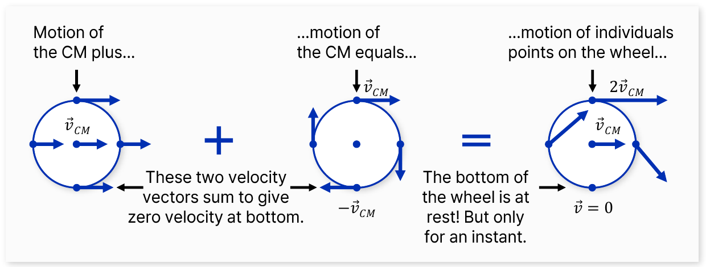

*그림 1. 굴러가는 바퀴의 운동을 질량 중심의 직선 운동과 질량 중심에 대한 회전 운동의 합으로 나타낸 그림*

그림 1에서 왼쪽은 바퀴의 모든 점이 질량 중심(CM)과 같은 속도 $\vec{v}_{CM}$으로 움직이는 직선 운동이고, 가운데는 질량 중심을 축으로 도는 회전 운동으로 위쪽 점은 $+\vec{v}_{CM}$, 아래쪽 점은 $-\vec{v}_{CM}$의 속도를 갖는다. 두 운동을 더한 오른쪽에서 바퀴의 맨 위 점은 $2\vec{v}_{CM}$으로 움직이고, 땅에 닿은 맨 아래 점은 두 속도가 상쇄되어 그 순간에만 정지해 있다. 이처럼 복잡한 운동도 직선 운동과 회전 운동으로 나누어 모델링할 수 있다. 이 절은 직선 운동을, 2절은 회전 운동을 다룬다.

### 1.4 직선 운동 시스템의 운동 법칙

직선 운동에서는 힘이 가속도에 비례한다. 비례 상수가 질량이다.

$$
f = ma
$$

| 물리량 | 기호 | 단위 |
|:-----|:-----|:-----|
| 힘 | $f$ | N (뉴턴), $1\,\text{N} = 1\,\text{kg}\cdot\text{m/s}^2$ |
| 질량 | $M$ 또는 $m$ | kg |
| 변위 | $y$ | m |
| 속도 | $\dfrac{dy}{dt}$ | m/s |
| 가속도 | $a = \dfrac{d^2y}{dt^2}$ | $\text{m/s}^2$ |

*표 2. 직선 운동의 물리량과 단위*

1 N은 질량 1 kg인 물체를 $1\,\text{m/s}^2$으로 가속시키는 힘이다. 직선 운동을 하는 기계 시스템은 **질량, 스프링, 마찰**의 세 요소로 구성된다. 1.5절부터 1.7절까지 각 요소가 만드는 힘을 차례로 다룬다.

### 1.5 질량

지구의 중력장에서 물체가 받는 힘을 **무게(weight)** 라 한다. 물체의 **질량(mass)** 은 무게를 중력 가속도 $g = 9.8\,\text{m/s}^2$로 나눈 값이다. 따라서 중력장에서 받는 힘이 9.8 N인 물체의 질량은 1 kg이다. 무게는 질량이 아니라 힘이므로 단위가 N이라는 점에 주의해야 한다. 일상에서 쓰는 "1 kg의 무게"는 정확히는 1 kgf(킬로그램힘)이며, 다음과 같다.

$$
1\,\text{kgf} = 1\,\text{kg} \times 9.8\,\text{m/s}^2 \approx 9.8\,\text{N}
$$

질량이 $M$인 물체에 힘 $f$가 가해질 때의 운동방정식은 뉴턴의 제2법칙에서 가속도를 변위 $y$의 2계 도함수로 쓴 것이다.

$$
f = M\frac{d^2y}{dt^2} = Ma
$$

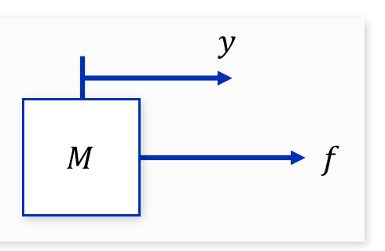

*그림 2. 힘 f를 받아 변위 y만큼 움직이는 질량 M*

그림 2처럼 변위 $y$와 힘 $f$의 양의 방향을 화살표로 표시한다. 방향을 먼저 정해 두면 운동방정식의 부호를 일관되게 정할 수 있다.

**예제 1.** 질량 8 kg인 물체가 위쪽으로 $3.5\,\text{m/s}^2$의 가속도로 움직인다. $g = 9.8\,\text{m/s}^2$일 때 물체에 가해지는 힘을 구한다.

위쪽을 양의 방향으로 잡는다. 물체에는 위로 당기는 힘 $F$와 아래로 작용하는 중력 $Mg$가 있으므로 알짜힘(합력)은 $F - Mg$이고, 뉴턴의 제2법칙에서 이것이 $Ma$와 같다.

$$
F - Mg = Ma \quad \Rightarrow \quad F = M(g + a) = 8 \times (9.8 + 3.5) = 8 \times 13.3 = 106.4\,\text{N}
$$

물체를 가속시키는 데 드는 알짜힘은 $Ma = 8 \times 3.5 = 28\,\text{N}$이고, 여기에 중력 $Mg = 8 \times 9.8 = 78.4\,\text{N}$을 이기는 힘이 더해져 위로 가해야 하는 힘은 106.4 N이다.

### 1.6 스프링

힘을 가하면 변형이 생기고, 힘을 없애면 원래 상태로 돌아오는 성질을 **탄성(elasticity)** 이라 하며, 탄성을 가진 기계 요소를 **스프링(spring)** 이라 한다. 스프링에 가해진 힘과 스프링이 늘어난 길이는 비례하며(훅의 법칙, Hooke's law), 그 비례 상수 $K$를 **스프링 상수(spring constant)** 라 한다. 단위는 N/m이고, 스프링 상수가 클수록 같은 힘에 덜 늘어나는 단단한(hard) 스프링이다.

$$
f = Ky
$$

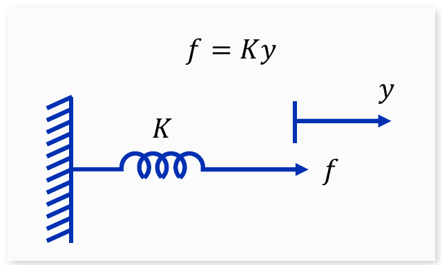

*그림 3. 한쪽 끝이 벽에 고정된 스프링 상수 K의 스프링*

그림 3에서 스프링을 힘 $f$로 당겨 $y$만큼 늘리려면 $f = Ky$의 힘이 필요하다. 거꾸로 말하면 $y$만큼 늘어난 스프링은 늘어난 방향과 반대로 $Ky$의 복원력을 낸다. 운동방정식을 세울 때는 이 복원력을 쓴다.

**예제 2.** 질량 400 g인 물체가 스프링 상수 14 N/m인 스프링에 매달려 정지해 있을 때, 스프링이 늘어난 길이(변위)를 구한다. $g = 9.8\,\text{m/s}^2$이다.

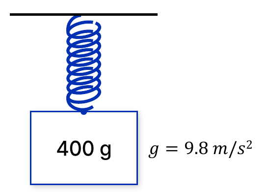

*그림 4. 스프링에 매달린 질량 400 g의 물체*

질량을 kg으로 바꾸면 0.4 kg이다. 정지해 있으므로 가속도가 0이고, 스프링의 복원력 $Ky$가 무게 $Mg$와 같다.

$$
Ky = Mg \quad \Rightarrow \quad y = \frac{Mg}{K} = \frac{0.4 \times 9.8}{14} = \frac{3.92}{14} = 0.28\,\text{m}
$$

스프링은 28 cm 늘어난다.

### 1.7 마찰

**마찰(friction)** 은 움직이는 물체의 운동을 방해하는 힘을 만드는 요소이며, 이 방해하는 힘을 **마찰력**이라 한다. 마찰력은 물체의 운동 방향과 반대 방향으로 작용하고, 그 크기는 일반적으로 물체의 운동 속도와 관련이 있다.

물체의 운동 속도와 마찰력의 크기가 비례하는 요소를 **선형 마찰(linear friction)** 또는 점성 마찰(viscous friction)이라 하며, 그 비례 상수 $B$를 선형 마찰 계수 또는 **감쇠 계수(damping coefficient)** 라 한다. 단위는 $\text{N}\cdot\text{s/m}$이다. 기계 도면에서는 선형 마찰을 기름이 든 실린더 속의 피스톤 모양인 **댐퍼(damper)** 로 그린다.

$$
f = B\frac{dy}{dt}
$$

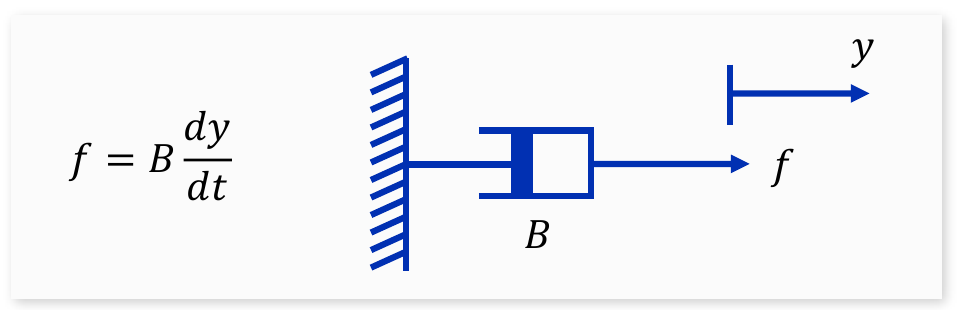

*그림 5. 감쇠 계수 B의 댐퍼와 그 힘의 관계*

스프링의 힘은 변위에, 댐퍼의 힘은 속도에 비례한다는 점이 두 요소의 차이이다. 자동차의 현가장치(서스펜션)는 스프링과 댐퍼를 함께 써서 충격을 흡수하고 흔들림을 빨리 가라앉힌다.

### 1.8 선형 마찰과 비선형 마찰

기계 운동에서 생기는 마찰에는 선형 마찰 외에도, 속도와 힘의 관계가 비선형인 **비선형 마찰(nonlinear friction)** 이 있다. 대표적인 예가 **쿨롱 마찰(Coulomb friction)** 이다. 쿨롱 마찰력은 운동 속도와 관계없이 항상 일정한 크기 $F_c$를 가지며, 속도의 방향에 따라 힘의 방향만 바뀐다. 마른 표면끼리 미끄러질 때의 마찰이 이에 가깝다.

$$
f = \begin{cases} F_c, & \dot{y} > 0 \\ -F_c, & \dot{y} < 0 \end{cases}
$$

$\dot{y}$는 $\frac{dy}{dt}$를 줄여 쓴 것이다.

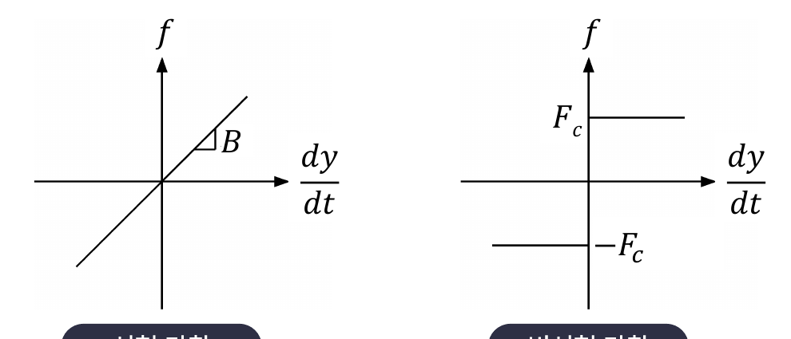

*그림 6. 속도에 따른 마찰력: 선형 마찰(왼쪽)과 쿨롱 마찰(오른쪽)*

그림 6의 왼쪽 그래프는 원점을 지나고 기울기가 $B$인 직선이고, 오른쪽 그래프는 속도가 양이면 $F_c$, 음이면 $-F_c$인 계단 모양이다. 기계적 운동을 하는 시스템에서는 선형 마찰보다 쿨롱 마찰 같은 비선형 마찰이 더 큰 경우가 많다. 그러나 비선형 마찰을 포함하는 시스템은 선형 시스템의 제어 이론으로는 해석할 수 없고, 이론적으로 해석하기도 어렵다. 그래서 이후의 모델은 모두 선형 마찰만 고려한다.

> **참고:** 선형 시스템은 입력을 두 배로 하면 출력도 두 배가 되고, 두 입력의 합에 대한 출력은 각 출력의 합이 되는 시스템이다(중첩의 원리). 라플라스 변환과 전달함수는 이 성질에 기대므로 선형 시스템에만 쓸 수 있다. 쿨롱 마찰은 속도의 크기와 무관한 힘을 내므로 이 성질을 깨뜨린다.

### 1.9 직선 운동방정식: 질량, 스프링, 댐퍼 시스템

**예제 3.** 그림 7의 시스템은 질량 $M$이 스프링 $K$와 댐퍼 $B$로 벽에 연결되어 있고 외력 $f$를 받는다. $y$는 평형 위치(스프링이 늘어나지도 줄어들지도 않은 위치)에서 잰 질량의 변위이다.

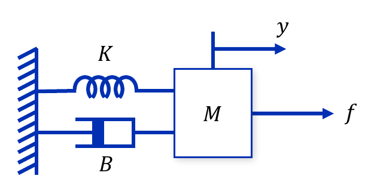

*그림 7. 스프링과 댐퍼로 벽에 연결된 질량 M과 외력 f*

모델링은 다음 순서로 한다. 첫째, 물체에 작용하는 힘을 모두 찾는다(이를 그림으로 그린 것을 **자유 물체도(free-body diagram)** 라 한다). 둘째, 정한 양의 방향에 맞추어 부호를 붙여 힘의 합을 구한다. 셋째, 힘의 합이 질량과 가속도의 곱과 같다고 놓는다. 질량 $M$에 작용하는 힘은 다음과 같다.

| 힘 | 크기 | 방향 |
|:-----|:-----|:-----|
| 외력 | $f$ | 오른쪽(양) |
| 스프링의 복원력 | $Ky$ | 늘어난 반대 방향, 왼쪽(음) |
| 댐퍼의 마찰력 | $B\dfrac{dy}{dt}$ | 운동의 반대 방향, 왼쪽(음) |

*표 3. 질량, 스프링, 댐퍼 시스템에서 질량에 작용하는 힘*

물체에 가해지는 힘의 합은 가속도에 비례하므로 다음과 같다.

$$
M\frac{d^2y}{dt^2} = f - Ky - B\frac{dy}{dt} \quad \Rightarrow \quad M\frac{d^2y}{dt^2} + B\frac{dy}{dt} + Ky = f
$$

이 시스템의 운동방정식은 2계 미분방정식이다. 시스템을 입력과 출력의 관계로 간단히 나타내기 위해 전달함수를 쓴다.

> **용어 정의:** **전달함수(transfer function)** 는 모든 초기 조건을 0으로 두었을 때 출력의 라플라스 변환과 입력의 라플라스 변환의 비이다. 5주차에서 자세히 다루며, 이 문서에서는 모델을 $s$ 영역에서 간단히 나타내는 데 쓴다.

초기 조건을 0으로 두고 양변을 라플라스 변환하면, 3주차의 미분 성질에 의해 $\frac{d}{dt}$가 $s$의 곱셈이 된다.

$$
(Ms^2 + Bs + K)\,Y(s) = F(s) \quad \Rightarrow \quad \frac{Y(s)}{F(s)} = \frac{1}{Ms^2 + Bs + K}
$$

> **핵심:** 질량은 가속도, 댐퍼는 속도, 스프링은 변위에 비례하는 힘을 내므로, 질량, 스프링, 댐퍼 시스템의 운동방정식에는 $y$의 2계, 1계, 0계 도함수가 하나씩 나타난다.

### 1.10 직선 운동방정식: 두 질량 시스템

**예제 4.** 그림 8의 시스템은 벽에 댐퍼 $B$로 연결된 질량 $M_2$와, $M_2$에 스프링 $K$로 연결되어 외력 $f$를 받는 질량 $M_1$로 이루어진다. $y_1$, $y_2$는 각 질량의 변위이며, 둘 다 오른쪽을 양의 방향으로 하고 스프링이 늘어나지 않은 상태에서 잰다.

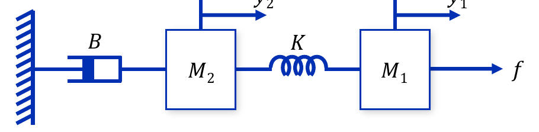

*그림 8. 스프링으로 연결된 두 질량과 벽에 연결된 댐퍼*

질량이 둘이므로 각 질량에 대해 운동방정식을 하나씩 세운다. 각 물체에 가해지는 힘의 합은 그 물체의 가속도에 비례한다. 스프링의 늘어난 길이는 두 끝의 변위 차이 $y_1 - y_2$이다.

**질량 $M_1$:** 외력 $f$가 오른쪽으로, 스프링의 복원력 $K(y_1 - y_2)$가 왼쪽으로 작용한다.

$$
M_1\frac{d^2y_1}{dt^2} = f - K(y_1 - y_2)
$$

**질량 $M_2$:** 같은 스프링이 뉴턴의 제3법칙에 따라 $M_2$를 오른쪽으로 $K(y_1 - y_2)$의 힘으로 당기고, 댐퍼가 운동의 반대 방향으로 $B\frac{dy_2}{dt}$의 힘을 낸다.

$$
M_2\frac{d^2y_2}{dt^2} = K(y_1 - y_2) - B\frac{dy_2}{dt}
$$

정리하면 두 개의 2계 미분방정식, 즉 연립 2계 미분방정식을 얻는다.

$$
M_1\frac{d^2y_1}{dt^2} + K(y_1 - y_2) = f, \qquad M_2\frac{d^2y_2}{dt^2} + B\frac{dy_2}{dt} + K(y_2 - y_1) = 0
$$

초기 조건을 0으로 두고 라플라스 변환하면 연립방정식이 되며, 3주차의 행렬로 쓸 수 있다.

$$
\begin{bmatrix} M_1s^2 + K & -K \\ -K & M_2s^2 + Bs + K \end{bmatrix} \begin{bmatrix} Y_1(s) \\ Y_2(s) \end{bmatrix} = \begin{bmatrix} F(s) \\ 0 \end{bmatrix}
$$

계수 행렬의 행렬식을 $\Delta(s)$라 하면 다음과 같다.

$$
\Delta(s) = (M_1s^2 + K)(M_2s^2 + Bs + K) - K^2 = M_1M_2s^4 + M_1Bs^3 + (M_1 + M_2)Ks^2 + BKs
$$

$2 \times 2$ 역행렬 공식(3주차)으로 풀면 두 전달함수를 얻는다.

$$
\begin{bmatrix} Y_1(s) \\ Y_2(s) \end{bmatrix} = \frac{1}{\Delta(s)}\begin{bmatrix} M_2s^2 + Bs + K & K \\ K & M_1s^2 + K \end{bmatrix} \begin{bmatrix} F(s) \\ 0 \end{bmatrix} \quad \Rightarrow \quad \frac{Y_1(s)}{F(s)} = \frac{M_2s^2 + Bs + K}{\Delta(s)}, \qquad \frac{Y_2(s)}{F(s)} = \frac{K}{\Delta(s)}
$$

$\Delta(s)$는 $s$를 인수로 가지므로 $s = 0$에 극점이 있다. 이 시스템은 벽에 스프링으로 붙어 있지 않아서, 일정한 힘을 계속 가하면 댐퍼가 끝없이 늘어나며 전체가 일정한 속도 $f/B$로 계속 움직이기 때문이다. $s$가 작을 때 $\Delta(s) \approx BKs$이므로 $\frac{Y_2(s)}{F(s)} \approx \frac{1}{Bs}$가 되어, 변위가 아니라 속도가 일정한 값 $f/B$에 머문다는 것을 확인할 수 있다.

---

 

## 2. 회전 운동

이 절은 축을 중심으로 도는 기계 시스템의 모델링을 다룬다. 회전 운동의 법칙은 직선 운동의 법칙과 같은 꼴이며, 힘, 질량, 변위 자리에 토크, 관성 모멘트, 각도가 들어간다. 마지막으로 두 회전축을 잇는 기어를 다룬다.

### 2.1 회전 운동 시스템의 운동 법칙

회전 운동에도 직선 운동과 마찬가지로 뉴턴의 운동 법칙이 적용된다. 다른 점은 힘 대신 **토크(torque)**, 질량 대신 **관성 모멘트(moment of inertia)**, 가속도 대신 **각가속도(angular acceleration)** 를 쓴다는 것이다. 토크는 물체를 회전시키려는 힘의 효과로, 힘과 회전축으로부터의 거리의 곱이다. 토크와 각가속도는 비례한다.

$$
\tau = J\alpha = J\frac{d^2\theta}{dt^2}
$$

| 직선 운동 | 단위 | 회전 운동 | 단위 |
|:-----|:-----|:-----|:-----|
| 힘 $f$ | N | 토크 $\tau$ | $\text{N}\cdot\text{m}$ |
| 질량 $M$ | kg | 관성 모멘트 $J$ | $\text{kg}\cdot\text{m}^2$ |
| 변위 $y$ | m | 각도 $\theta$ | rad |
| 속도 $\dfrac{dy}{dt}$ | m/s | 각속도 $\omega = \dfrac{d\theta}{dt}$ | rad/s |
| 가속도 $a$ | $\text{m/s}^2$ | 각가속도 $\alpha = \dfrac{d^2\theta}{dt^2}$ | $\text{rad/s}^2$ |
| $f = Ma$ | | $\tau = J\alpha$ | |

*표 4. 직선 운동과 회전 운동의 물리량 대응*

회전 운동 시스템을 구성하는 세 요소는 **관성 모멘트, 회전 스프링, 회전 마찰**이며, 각각 직선 운동의 질량, 스프링, 마찰에 대응한다.

### 2.2 관성 모멘트

**관성 모멘트(moment of inertia)** 는 물체가 회전 운동의 변화에 저항하는 정도이다. 관성 질량(inertia)이라고도 부른다. 직선 운동의 질량과 달리 관성 모멘트는 질량뿐 아니라 질량이 회전축에서 얼마나 멀리 분포하는지에 따라 달라진다.

가장 간단한 경우로, 질량이 없는 막대의 한쪽 끝에 질량 $M$인 물체가 고정되어 회전축에서 거리 $R$만큼 떨어져 도는 경우를 생각한다. 관성 모멘트는 질량에 거리의 제곱을 곱한 값이다.

$$
J = MR^2
$$

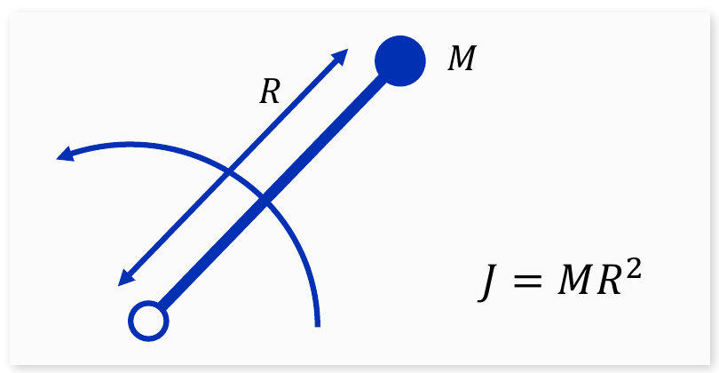

*그림 9. 회전축에서 거리 R만큼 떨어진 질량 M과 그 관성 모멘트*

질량이 여러 곳에 퍼져 있는 물체는 물체를 작은 조각으로 나누어 각 조각의 $r^2\,dm$을 모두 더한다, 즉 적분한다. 두께가 균일한 반지름 $R$의 원반이 중심을 축으로 회전할 때의 관성 모멘트를 구한다.

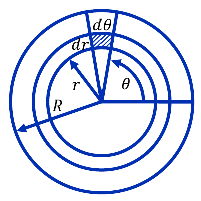

*그림 10. 원반을 반지름 방향 dr, 각도 방향 dθ의 작은 조각으로 나눈 그림*

원반의 단위 면적당 질량을 $\rho$라 한다. 회전 중심에서 거리가 $r$, 각도가 $\theta$인 위치의 작은 조각은 반지름 방향 길이가 $dr$, 원호 방향 길이가 $r\,d\theta$인 거의 사각형이므로, 그 넓이는 $r\,dr\,d\theta$이고 질량은 다음과 같다.

$$
dm = \rho\,r\,dr\,d\theta
$$

이 작은 사각형은 축에서 거리 $r$에 있으므로 그 관성 모멘트는 $dJ = r^2\,dm = \rho\,r^3\,dr\,d\theta$이다. 원반 전체에 대해 $r$을 0부터 $R$까지, $\theta$를 0부터 $2\pi$까지 적분한다.

$$
J = \int_0^{2\pi}\int_0^R \rho\,r^3\,dr\,d\theta = \rho \cdot \frac{R^4}{4} \cdot 2\pi = \frac{\pi\rho R^4}{2}
$$

원반의 전체 질량은 $M = \rho \times (\text{넓이}) = \rho\pi R^2$이므로, $\pi\rho R^4 = (\rho\pi R^2)R^2 = MR^2$로 바꾸어 쓸 수 있다.

$$
J = \frac{1}{2}MR^2
$$

> **핵심:** 같은 질량과 반지름이라도 질량이 모두 바깥 둘레에 있으면 $J = MR^2$이고, 원반처럼 고르게 퍼져 있으면 그 절반인 $\frac{1}{2}MR^2$이다. 축에 가까운 질량일수록 관성 모멘트에 덜 기여하기 때문이다.

### 2.3 회전 스프링

토크를 가하면 비틀림 변형이 생기고, 토크를 없애면 원래 상태로 돌아오는 기계 요소를 **회전 스프링(torsional spring)** 이라 한다. 토크와 비틀린 각도는 비례하며, 비례 상수 $K$를 (회전) 스프링 상수라 한다. 단위는 $\text{N}\cdot\text{m/rad}$이다. 긴 축이 비틀리는 현상도 회전 스프링으로 모델링한다.

$$
\tau = K\theta
$$

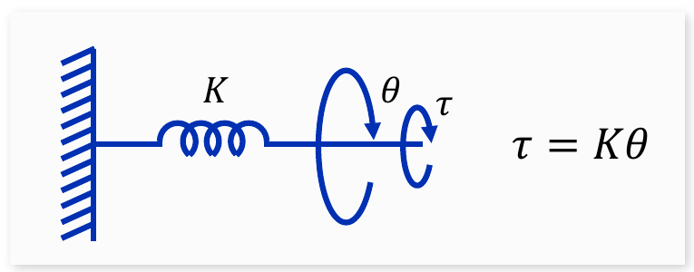

*그림 11. 벽에 고정된 회전 스프링과 토크, 각도의 관계*

### 2.4 회전 마찰

**회전 마찰(rotational friction)** 은 회전하는 물체의 운동을 방해하는 토크를 만드는 요소이며, 이 토크를 회전 마찰력(마찰 토크)이라 한다. 마찰 토크는 물체의 회전 방향과 반대 방향으로 작용하고, 그 크기는 일반적으로 회전 속도와 관련이 있다. 회전 속도와 마찰 토크의 크기가 비례하는 요소를 **선형 회전 마찰(linear rotational friction)** 이라 하며, 비례 상수 $B$를 선형 회전 마찰 계수 또는 감쇠 계수라 한다. 단위는 $\text{N}\cdot\text{m}\cdot\text{s/rad}$이다. 베어링의 윤활유가 만드는 마찰이 대표적이다.

$$
\tau = B\frac{d\theta}{dt}
$$

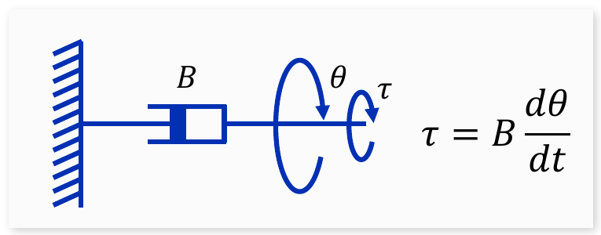

*그림 12. 회전 댐퍼와 토크, 각속도의 관계*

직선 운동과 마찬가지로 회전 운동에도 비선형 마찰이 있다. 회전 쿨롱 마찰 토크는 회전 속도와 관계없이 일정한 크기 $F_c$를 갖고, 회전 방향에 따라 부호만 바뀐다. 토크와 각속도의 그래프는 그림 6에서 $f$를 $\tau$로, $\frac{dy}{dt}$를 $\frac{d\theta}{dt}$로 바꾼 것과 같다.

$$
\tau = \begin{cases} F_c, & \dot{\theta} > 0 \\ -F_c, & \dot{\theta} < 0 \end{cases}
$$

### 2.5 회전 운동방정식

**예제 1.** 그림 13의 시스템은 관성 모멘트 $J$인 회전체가 회전 스프링 $K$와 회전 댐퍼 $B$로 벽에 연결되어 있고 외부 토크 $\tau$를 받는다. $\theta$는 스프링이 비틀리지 않은 위치에서 잰 회전 각도이다.

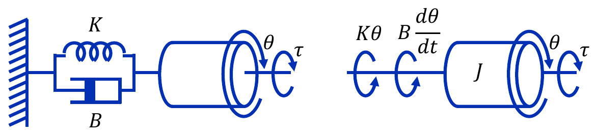

*그림 13. 회전 스프링과 회전 댐퍼로 벽에 연결된 회전체(왼쪽)와 회전체에 작용하는 토크(오른쪽)*

그림 13의 오른쪽처럼 회전체에 작용하는 토크를 모두 찾는다. 외부 토크 $\tau$는 회전 방향으로, 스프링 토크 $K\theta$와 마찰 토크 $B\frac{d\theta}{dt}$는 그 반대 방향으로 작용한다. 회전체에 가해지는 토크의 합은 각가속도에 비례하므로 다음과 같다.

$$
J\frac{d^2\theta}{dt^2} = \tau - K\theta - B\frac{d\theta}{dt} \quad \Rightarrow \quad J\frac{d^2\theta}{dt^2} + B\frac{d\theta}{dt} + K\theta = \tau
$$

초기 조건을 0으로 두고 라플라스 변환하면 전달함수를 얻는다. $T(s)$는 $\tau(t)$의 변환이다.

$$
\frac{\Theta(s)}{T(s)} = \frac{1}{Js^2 + Bs + K}
$$

1.9절의 $\frac{Y(s)}{F(s)} = \frac{1}{Ms^2 + Bs + K}$에서 $M$을 $J$로 바꾼 것과 같은 꼴이다.

### 2.6 기어

회전 운동을 하는 기계 장치에서는 토크를 증폭하기 위해 **기어(gear)** 를 쓰는 경우가 많다. 톱니(tooth)의 수, 즉 잇수가 각각 $N_1$과 $N_2$인 두 기어가 맞물린 **이상적인 기어**를 생각한다. 이상적인 기어는 자체의 관성 모멘트나 마찰이 전혀 없어 입력축이 한 일을 손실 없이 출력축에 전달하는 장치이다.

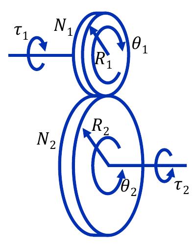

*그림 14. 잇수 N1, 반지름 R1인 기어와 잇수 N2, 반지름 R2인 기어가 맞물린 모습*

**잇수와 반지름.** 톱니의 크기가 같으므로 기어의 잇수는 반지름에 비례한다고 가정한다.

$$
\frac{R_2}{R_1} = \frac{N_2}{N_1}
$$

**각도의 관계.** 이상적인 기어에서 맞물려 돌아가는 두 바퀴는 접점에서 미끄러지지 않으므로, 두 바퀴가 돈 원호의 길이(반지름과 회전 각도의 곱)가 항상 같다.

$$
R_1\theta_1 = R_2\theta_2 \quad \Rightarrow \quad \theta_2 = \frac{R_1}{R_2}\theta_1 = \frac{N_1}{N_2}\theta_1
$$

이 식을 시간에 대해 미분하면 각속도의 관계를 얻는다.

$$
\dot{\theta}_2 = \frac{N_1}{N_2}\dot{\theta}_1
$$

$N_1/N_2$를 **기어비(gear ratio)** 라 한다. $N_1/N_2$가 1보다 작으면, 즉 작은 기어로 큰 기어를 돌리면 출력축이 입력축보다 느리게 돌며, 이를 **감속 기어(reduction gear)** 라 한다.

**토크의 관계.** 이상적인 기어이므로 한쪽 바퀴의 기계 에너지는 손실 없이 100% 다른 쪽으로 전달된다. 회전 운동의 에너지, 즉 일(work)은 토크와 회전 각도의 곱이므로, 입력 에너지와 출력 에너지가 같다는 조건에서 토크의 관계를 얻는다.

$$
\tau_1\theta_1 = \tau_2\theta_2 \quad \Rightarrow \quad \tau_2 = \frac{\theta_1}{\theta_2}\tau_1 = \frac{N_2}{N_1}\tau_1
$$

두 번째 등호에는 각도 관계 $\frac{\theta_1}{\theta_2} = \frac{N_2}{N_1}$를 썼다. 감속 기어($N_2 > N_1$)는 회전 각도와 속도를 $\frac{N_1}{N_2}$배로 줄이는 대신 토크를 $\frac{N_2}{N_1}$배로 키운다. 자전거의 낮은 기어로 언덕을 오를 때 페달은 많이 돌리지만 힘은 적게 드는 것과 같은 원리이다.

> **주의:** 각도는 잇수비 $\frac{N_1}{N_2}$로, 토크는 그 역수 $\frac{N_2}{N_1}$로 바뀐다. 두 비를 혼동하지 않으려면 "에너지 $\tau\theta$는 보존된다"는 원리에서 다시 유도하면 된다.

### 2.7 두 관성으로 이루어진 시스템

기어 시스템을 해석하려면 먼저 서로 연결된 두 관성 사이에 주고받는 토크를 이해해야 한다. 그림 15처럼 관성 모멘트가 $J_1$과 $J_2$인 두 물체가 한 축으로 단단히 연결되어 함께 회전하고, $J_1$에 외부 토크 $\tau$가 가해지는 경우를 생각한다. 두 물체가 함께 돌므로 $\theta_1 = \theta_2 = \theta$이다.

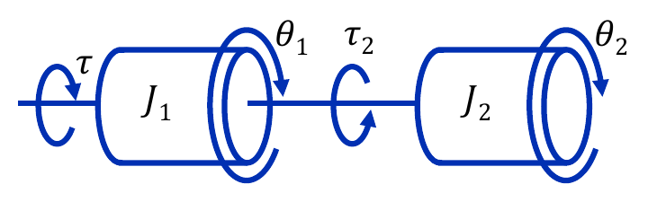

*그림 15. 한 축으로 연결되어 함께 회전하는 두 관성 J1, J2*

$\tau_2$는 관성 모멘트가 $J_2$인 물체의 회전으로 인해 $J_1$인 물체에 가해지는 **반력 토크(reaction torque)** 이며, 반작용 토크라고도 한다. $J_1$이 $J_2$를 돌리기 위해 축을 통해 토크 $\tau_2$를 가하면, 뉴턴의 제3법칙에 따라 $J_2$는 $J_1$에 크기가 같고 방향이 반대인 토크를 돌려준다. 각 물체에 운동 법칙을 적용하면 다음과 같다.

$$
J_1\ddot{\theta} = \tau - \tau_2, \qquad J_2\ddot{\theta} = \tau_2
$$

두 식을 더하면 반력 토크가 지워진다.

$$
(J_1 + J_2)\ddot{\theta} = \tau
$$

함께 회전하는 두 관성은 관성 모멘트가 $J_1 + J_2$인 하나의 물체처럼 움직인다.

### 2.8 기어로 연결된 시스템

이제 두 회전체가 이상적인 기어로 연결되어 있고, 한쪽 회전체에 토크가 가해져 회전한다고 가정한다(그림 16). 입력축에는 관성 $J_1$과 잇수 $N_1$인 기어가, 출력축에는 잇수 $N_2$인 기어와 관성 $J_2$가 있다.

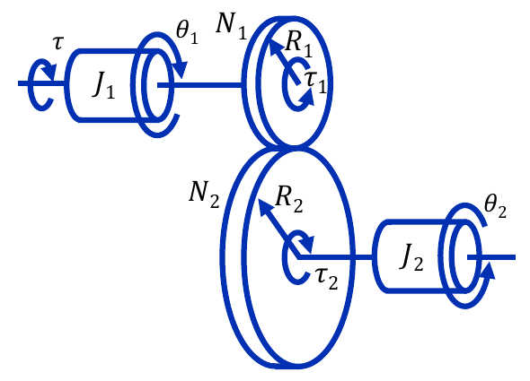

*그림 16. 이상적인 기어로 연결된 두 관성 J1, J2*

출력축의 기어는 $J_2$를 돌리기 위해 토크 $\tau_2$를 가하며, 그 반작용인 반력 토크 $\tau_2$가 기어를 통해 입력축에 전해진 값이 $\tau_1$이다. 따라서 관성 모멘트 $J_1$인 물체에 가해지는 토크는 외부 토크 $\tau$에서 반력 토크 $\tau_1$을 뺀 값이다.

$$
J_1\ddot{\theta}_1 = \tau - \tau_1, \qquad J_2\ddot{\theta}_2 = \tau_2
$$

2.6절의 기어 관계 $\tau_1 = \frac{N_1}{N_2}\tau_2$와 $\theta_2 = \frac{N_1}{N_2}\theta_1$을 써서 $\tau_1$을 $\theta_1$로 나타낸다.

$$
\tau_1 = \frac{N_1}{N_2}\tau_2 = \frac{N_1}{N_2}J_2\ddot{\theta}_2 = \frac{N_1}{N_2}J_2\left( \frac{N_1}{N_2}\ddot{\theta}_1 \right) = \left( \frac{N_1}{N_2} \right)^2 J_2\ddot{\theta}_1
$$

이를 첫 식에 넣으면 입력축에서 본 운동방정식과 전달함수를 얻는다.

$$
\left[ J_1 + \left( \frac{N_1}{N_2} \right)^2 J_2 \right]\ddot{\theta}_1 = \tau \quad \Rightarrow \quad \frac{\Theta_1(s)}{T(s)} = \frac{1}{\left[ J_1 + (N_1/N_2)^2 J_2 \right]s^2}
$$

> **핵심:** 기어 너머의 관성 $J_2$는 입력축에서 볼 때 $\left( \frac{N_1}{N_2} \right)^2$배로 보인다. 이를 **반사 관성(reflected inertia)** 이라 한다. 기어비는 각도에 한 번, 토크에 한 번 곱해지므로 제곱으로 나타난다. 회전 마찰과 회전 스프링도 같은 방식으로 잇수비의 제곱만큼 반사된다 [1].

거꾸로 출력축에서 보면 $J_1$이 $\left( \frac{N_2}{N_1} \right)^2$배로 반사되어 $\left[ \left( \frac{N_2}{N_1} \right)^2 J_1 + J_2 \right]\ddot{\theta}_2 = \frac{N_2}{N_1}\tau$가 된다. 이 식에 $\theta_2 = \frac{N_1}{N_2}\theta_1$을 넣으면 위의 식과 같아진다. 검산으로 $N_1 = N_2$이면 2.7절의 $(J_1 + J_2)\ddot{\theta} = \tau$가 된다.

---

 

## 3. 전기 회로

이 절은 저항, 커패시터, 인덕터로 이루어진 전기 회로의 모델링과, 전기 에너지를 회전 운동으로 바꾸는 직류 서보 모터의 모델링을 다룬다. 마지막으로 모터와 기어, 링크를 모두 합친 산업용 로봇 관절의 모델을 유도한다.

### 3.1 저항-커패시터 회로

전기 회로의 모델링은 **키르히호프의 전압 법칙(Kirchhoff's voltage law, KVL)** 에서 출발한다. KVL은 닫힌 회로를 한 바퀴 돌 때 전압의 합이 0이라는 법칙으로, 직렬 회로에서는 입력 전압이 각 소자에 걸리는 전압의 합과 같다는 뜻이다.

**커패시터(capacitor)** 는 전하를 저장하는 소자이다. 커패시터에 저장된 전하 $q$는 양단 전압 $y$에 비례하며, 비례 상수 $C$를 커패시턴스(단위 F, 패럿)라 한다. 전류는 전하의 시간 변화율이므로, 양변을 미분하면 커패시터의 전류와 전압의 관계를 얻는다.

$$
q = Cy, \qquad i = \frac{dq}{dt} = C\frac{dy}{dt}
$$

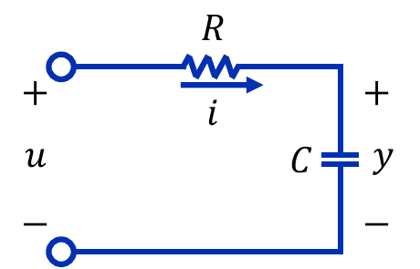

*그림 17. 입력 전압 u와 커패시터 전압 y를 갖는 RC 회로*

그림 17의 회로에 KVL을 적용하면, 입력 전압 $u$는 저항 양단의 전압 $Ri$(옴의 법칙)와 커패시터 양단의 전압 $y$의 합과 같다. 여기에 $i = C\frac{dy}{dt}$를 넣는다.

$$
Ri + y = RC\frac{dy}{dt} + y = u
$$

RC 회로는 1계 미분방정식으로 표현된다. 초기 조건을 0으로 두고 라플라스 변환하면 전달함수는 다음과 같다.

$$
(RCs + 1)\,Y(s) = U(s) \quad \Rightarrow \quad \frac{Y(s)}{U(s)} = \frac{1}{RCs + 1}
$$

곱 $RC$는 시간의 단위를 가지며, 응답이 얼마나 빨리 변하는지를 정하는 **시정수(time constant)** 이다. 1차 시스템의 응답과 시정수는 7주차에서 자세히 다룬다.

### 3.2 저항-인덕터 회로

**인덕터(inductor)** 는 전류의 변화에 저항하는 소자로, 양단 전압 $v_L$이 전류의 변화율에 비례한다. 비례 상수 $L$을 인덕턴스(단위 H, 헨리)라 한다.

$$
v_L = L\frac{di}{dt}
$$

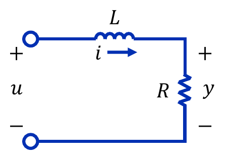

*그림 18. 입력 전압 u와 저항 전압 y를 갖는 RL 회로*

그림 18의 회로에서 출력은 저항 양단의 전압 $y = Ri$이다. KVL을 적용하면 입력 전압은 인덕터 전압과 저항 양단의 전압의 합과 같다.

$$
v_L + Ri = L\frac{di}{dt} + Ri = u, \qquad y = Ri
$$

$i = \frac{y}{R}$를 넣어 출력 $y$에 대한 식으로 바꾸면 다음과 같다.

$$
\frac{L}{R}\frac{dy}{dt} + y = u \quad \Rightarrow \quad \frac{Y(s)}{U(s)} = \frac{1}{(L/R)s + 1}
$$

RL 회로도 1차 시스템이며, 시정수는 $\frac{L}{R}$이다.

### 3.3 저항-인덕터-커패시터 회로

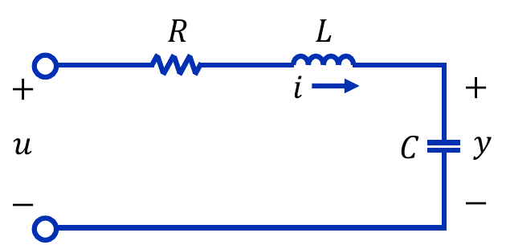

*그림 19. 저항, 인덕터, 커패시터가 직렬로 연결된 RLC 회로*

그림 19의 회로에 KVL을 적용하면 입력 전압은 저항 전압, 인덕터 전압, 커패시터 양단의 전압의 합과 같다. 출력은 커패시터 전압 $y$이다.

$$
L\frac{di}{dt} + Ri + y = u, \qquad i = C\frac{dy}{dt}
$$

두 번째 식을 첫 식에 넣으면 $\frac{di}{dt} = C\frac{d^2y}{dt^2}$이므로 2계 미분방정식을 얻는다.

$$
LC\frac{d^2y}{dt^2} + RC\frac{dy}{dt} + y = u \quad \Rightarrow \quad \frac{Y(s)}{U(s)} = \frac{1}{LCs^2 + RCs + 1}
$$

> **핵심:** RLC 회로의 식 $LC\ddot{y} + RC\dot{y} + y = u$는 1.9절의 질량, 스프링, 댐퍼 시스템의 식 $M\ddot{y} + B\dot{y} + Ky = f$와 같은 꼴이다. 물리적으로 전혀 다른 시스템도 같은 꼴의 미분방정식으로 표현되므로, 한 가지 해석 방법(7주차의 2차 시스템 응답 등)을 모든 분야에 쓸 수 있다. 이 대응 관계는 개념 적용 절의 표 6에 정리한다.

### 3.4 전자기력과 기전력

전기 에너지를 기계 에너지로 바꾸는 모터를 모델링하려면 전기와 자기의 두 가지 현상이 필요하다.

**전자기력.** 자기장(magnetic field) 안에서 전류가 흐르는 도체에는 힘이 작용하며, 이 힘을 **전자기력(electromagnetic force)** 이라 한다. 힘의 크기는 자기장의 세기와 도체에 흐르는 전류의 크기에 비례한다.

$$
F = BIl\ [\text{N}]
$$

$B$는 자속 밀도(magnetic flux density, 단위 T, 테슬라), $I$는 전류, $l$은 자기장 안에 있는 도선의 길이이다. 힘의 방향은 **플레밍의 왼손 법칙(Fleming's left-hand rule)** 으로 정한다. 왼손의 엄지, 검지, 중지를 서로 직각으로 펴서 검지를 자기장(N극에서 S극) 방향, 중지를 전류 방향에 맞추면 엄지가 힘의 방향을 가리킨다.

**기전력.** 자기장 안에서 도체를 움직이면 도체에 **기전력(electromotive force, emf)** 이 생기며, 그 크기는 도체가 움직이는 속도에 비례한다. 이는 **패러데이 법칙(Faraday's law)** 의 한 경우이다. 패러데이 법칙은 회로를 지나는 자기 선속 $\Phi$가 변하면 그 변화율에 해당하는 기전력이 생긴다는 법칙이다.

$$
\varepsilon = -\frac{d\Phi}{dt}, \qquad \Phi = BS
$$

$S$는 자기장이 지나는 회로의 면적이고, 음의 부호는 유도된 전류가 선속의 변화를 방해하는 방향으로 흐른다는 뜻이다(렌츠의 법칙). 길이 $l$인 도선이 자기장에 수직으로 속도 $v$로 움직이면 회로의 면적이 매초 $lv$씩 변하므로 기전력의 크기는 $Blv$로, 속도에 비례한다 [2].

> **참고:** 모터는 이 두 현상을 함께 이용한다. 코일에 전류를 흘리면 전자기력으로 토크가 생겨 회전하고(3.6절의 토크 상수), 코일이 회전하면 자기장 안에서 움직이므로 전류와 반대 방향의 기전력이 생긴다(3.6절의 역기전력).

### 3.5 직류 서보 모터의 구조

> **용어 정의:** **서보 모터(servo motor)** 는 시스템이 요구하는 특정 위치로 기기를 이동시키거나, 특정 속도와 토크로 가동시킬 때 정확하게 제어할 수 있는 구조를 갖춘 모터이다. 직류 전원으로 구동하는 것을 **직류 서보 모터(DC servo motor)** 라 한다.

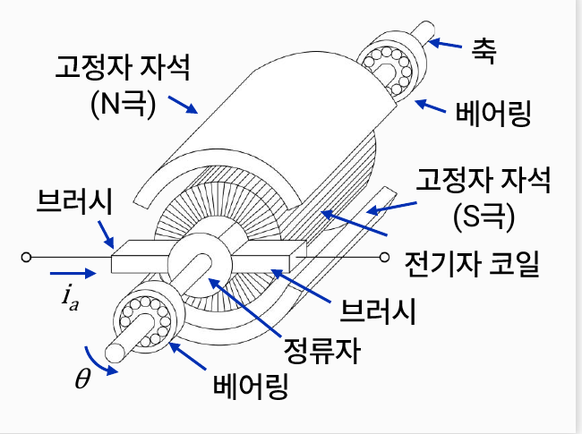

*그림 20. 직류 서보 모터의 구조*

그림 20은 직류 서보 모터의 단면을 보여 주며, 표시된 부품은 축, 베어링(양 끝), 고정자 자석(N극과 S극), 전기자 코일, 브러시, 정류자이다. 각 부품의 역할은 다음과 같다.

| 부품 | 역할 |
|:-----|:-----|
| 고정자 자석(stator magnet) | 움직이지 않는 바깥쪽 자석으로 자기장을 만든다. 전자석(electromagnet)과 영구 자석(permanent magnet)을 쓸 수 있으나, 제어용 서보 모터에는 대체로 영구 자석을 쓴다. |
| 전기자(armature)와 전기자 코일 | 회전하는 부분으로, 전류를 흘리기 위한 코일이 감겨 있다. 코일의 전류 $i_a$가 자기장과 작용하여 토크를 만든다. |
| 브러시(brush)와 정류자(commutator) | 회전하는 전기자에 전류를 공급한다. 정류자는 전기자가 회전할 때 코일의 전류 방향을 바꾸어 토크가 한 방향으로 유지되게 한다. |
| 축과 베어링 | 축은 회전을 바깥으로 전달하고, 베어링은 축을 지지하며 회전 마찰의 주요 원인이 된다. |

*표 5. 직류 서보 모터의 주요 부품과 역할*

직류 서보 모터를 구성하는 가장 주된 부품은 자기장을 만드는 자석과 회전하는 전기자이다.

### 3.6 직류 서보 모터의 모델

**토크 상수.** 모터가 내는 토크는 전기자에 흐르는 전류에 비례하며(전자기력), 비례 상수 $K_t$를 **토크 상수(torque constant)** 라 한다.

$$
\tau = K_t i_a
$$

**역기전력 상수.** 모터의 회전으로 생기는 기전력을 **역기전력(back emf, back electromotive force)** 이라 한다. 전기자 코일이 자기장 안에서 돌기 때문에 생기며, 그 크기는 모터의 회전 속도에 비례한다. 비례 상수 $K_b$를 **역기전력 상수(back-emf constant)** 라 한다.

$$
e_b = K_b\frac{d\theta}{dt} = K_b\omega
$$

> **참고:** SI 단위에서는 $K_t$와 $K_b$의 값이 같다. 역기전력이 흡수하는 전기적 일률 $e_bi_a = K_b\omega i_a$는 모터가 내는 기계적 일률 $\tau\omega = K_ti_a\omega$와 같아야 하므로(에너지 보존), $K_t\,[\text{N}\cdot\text{m/A}] = K_b\,[\text{V}\cdot\text{s/rad}]$이다 [3].

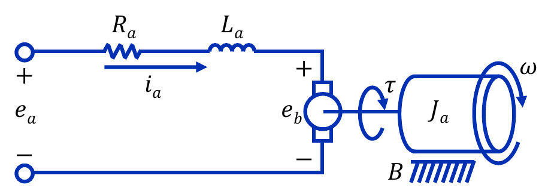

*그림 21. 직류 서보 모터의 전기자 회로와 회전부의 모델*

그림 21의 모델에서 $e_a$는 전기자에 가한 전압, $R_a$와 $L_a$는 전기자 코일의 저항과 인덕턴스, $i_a$는 전기자 전류, $J_a$는 전기자(회전부)의 관성 모멘트, $B$는 회전 마찰 계수, $\theta$와 $\omega$는 회전 각도와 각속도이다.

**전기 방정식.** 전기자 회로에 KVL을 적용하면, 전기자에 인가된 전압은 저항 전압, 인덕턴스 전압, 역기전력을 합한 전압과 같다.

$$
e_a = R_ai_a + L_a\frac{di_a}{dt} + e_b = R_ai_a + L_a\frac{di_a}{dt} + K_b\frac{d\theta}{dt}
$$

**기계 방정식.** 서보 모터가 낸 토크는 전기자를 회전시키므로, 2.5절과 같이 운동방정식을 세우면 다음과 같다. 부하가 없으면 토크는 전기자의 관성과 회전 마찰에만 쓰인다.

$$
\tau = K_ti_a = J_a\frac{d^2\theta}{dt^2} + B\frac{d\theta}{dt}
$$

두 식은 전류 $i_a$와 각도 $\theta$로 서로 연결되어 있다. 전류가 토크를 만들어 회전을 일으키고, 회전이 역기전력을 만들어 전류를 줄인다.

**전달함수.** 초기 조건을 0으로 두고 두 식을 라플라스 변환한다.

$$
E_a(s) = (L_as + R_a)\,I_a(s) + K_bs\,\Theta(s), \qquad K_tI_a(s) = (J_as^2 + Bs)\,\Theta(s)
$$

두 번째 식에서 $I_a(s) = \frac{(J_as^2 + Bs)\,\Theta(s)}{K_t} = \frac{s(J_as + B)\,\Theta(s)}{K_t}$를 구해 첫 식에 넣으면 다음과 같다.

$$
E_a(s) = \left[ \frac{(L_as + R_a)(J_as + B)s}{K_t} + K_bs \right]\Theta(s) = \frac{s\left[ (L_as + R_a)(J_as + B) + K_tK_b \right]}{K_t}\,\Theta(s)
$$

따라서 입력 전압에서 회전 각도와 각속도($\Omega(s) = s\Theta(s)$)까지의 전달함수는 다음과 같다.

$$
\frac{\Theta(s)}{E_a(s)} = \frac{K_t}{s\left[ (L_as + R_a)(J_as + B) + K_tK_b \right]}, \qquad \frac{\Omega(s)}{E_a(s)} = \frac{K_t}{(L_as + R_a)(J_as + B) + K_tK_b}
$$

이 관계를 블록선도로 그리면 그림 22와 같다. 블록선도는 5주차에서 자세히 다루며, 여기서는 신호가 어떤 순서로 변환되는지를 보이는 데 쓴다.

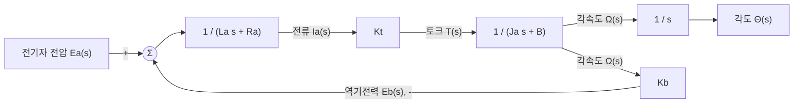

*그림 22. 직류 서보 모터의 블록선도*

그림 22에서 역기전력은 각속도에 비례하는 전압을 입력 전압에서 빼는 피드백 경로를 이룬다. 모터는 외부 제어기가 없어도 내부에 이런 피드백을 가지고 있어서, 일정한 전압을 걸면 역기전력과 저항의 전압 강하 $R_ai_a$의 합이 입력 전압과 같아지는 일정한 속도에 도달한다. 이때의 전류 $i_a$는 점성 마찰 토크 $B\omega$를 공급하며, 마찰이 없을 때($B = 0$)에만 역기전력이 입력 전압과 같아진다.

**전기자 인덕턴스를 무시한 근사.** 전기자 인덕턴스 $L_a$는 보통 매우 작아서 전기 회로의 응답이 기계부의 응답보다 훨씬 빠르다. $L_a \approx 0$으로 두면 각속도의 전달함수는 1차 시스템이 된다 [3].

$$
\frac{\Omega(s)}{E_a(s)} \approx \frac{K_t}{R_a(J_as + B) + K_tK_b} = \frac{K_m}{T_ms + 1}, \qquad K_m = \frac{K_t}{R_aB + K_tK_b}, \quad T_m = \frac{R_aJ_a}{R_aB + K_tK_b}
$$

$K_m$은 1 V당 정상 상태 각속도인 모터 이득이고, $T_m$은 기계적 시정수이다.

**수치 예.** $R_a = 2\,\Omega$, $L_a = 0.01\,\text{H}$, $J_a = 0.02\,\text{kg}\cdot\text{m}^2$, $B = 0.05\,\text{N}\cdot\text{m}\cdot\text{s/rad}$, $K_t = K_b = 0.5$인 모터를 생각한다. 분모를 전개하면 다음과 같다.

$$
(0.01s + 2)(0.02s + 0.05) + 0.5 \times 0.5 = 0.0002s^2 + 0.0405s + 0.35 \quad \Rightarrow \quad \frac{\Omega(s)}{E_a(s)} = \frac{0.5}{0.0002s^2 + 0.0405s + 0.35}
$$

분모의 근, 즉 극점은 $s \approx -9.05$와 $s \approx -193.45$이다. 크기가 작은 $-9.05$는 기계부의 느린 응답을, 큰 $-193.45$는 전기 회로의 빠른 응답을 나타낸다. 근사식에서는 $K_m = \frac{0.5}{2 \times 0.05 + 0.25} = \frac{0.5}{0.35} \approx 1.43\,\text{rad/s}$(1 V당), $T_m = \frac{2 \times 0.02}{0.35} \approx 0.114\,\text{s}$이고, 극점은 $-\frac{1}{T_m} = -8.75$로 정확한 모델의 느린 극점 $-9.05$와 가깝다. 단위 계단 전압(1 V)을 가했을 때의 각속도 응답은 그림 23과 같다.

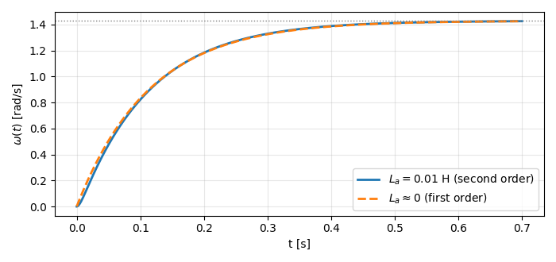

*그림 23. 단위 계단 전압에 대한 직류 서보 모터의 각속도 응답: 전기자 인덕턴스를 포함한 모델과 무시한 근사*

두 곡선은 처음의 매우 짧은 구간을 빼면 거의 겹치며, 둘 다 최종값 정리(3주차)로 구한 정상 상태 각속도 $\lim_{s\to 0} s \cdot \frac{1}{s} \cdot \frac{0.5}{0.35} \approx 1.43\,\text{rad/s}$에 수렴한다.

### 3.7 로봇 모델링

산업용 로봇의 각 축(관절)에는 회전 운동을 위한 서보 모터가 붙어 있으며, 로봇 제어기는 이 서보 모터들을 제어하여 로봇이 원하는 작업을 하도록 한다. 그림 24의 로봇 팔은 세 관절이 각각 각도 $\theta_1$(밑받침의 수평 회전), $\theta_2$(어깨), $\theta_3$(팔꿈치)로 움직인다.

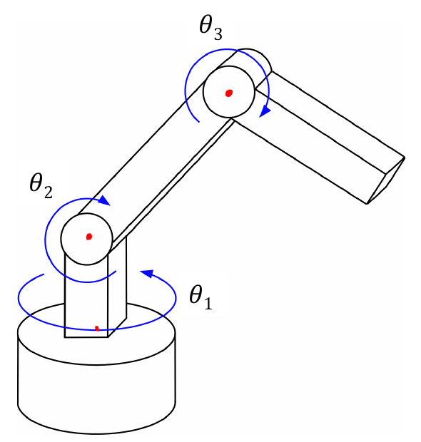

*그림 24. 세 개의 회전 관절을 가진 로봇 팔*

일반적으로 산업용 로봇은 감속 기어가 부착된 서보 모터로 움직인다. 그림 25는 로봇의 한 축에 대한 모델이다. 모터의 전기자 회로, 관성 $J_1$과 회전 마찰 $B_1$을 가진 모터축, 잇수 $N_1$과 $N_2$인 감속 기어, 관성 $J_2$와 회전 마찰 $B_2$를 가진 로봇 링크(팔)로 이루어진다.

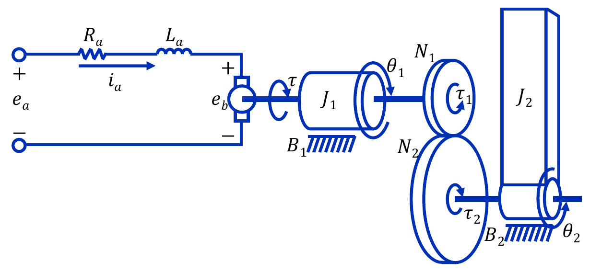

*그림 25. 감속 기어가 달린 서보 모터로 구동되는 로봇 한 축의 모델*

**모터 회로.** 모터의 회로에 KVL을 적용한다. 3.6절과 같으며, 역기전력은 모터축의 각속도 $\frac{d\theta_1}{dt}$에 비례한다.

$$
e_a = R_ai_a + L_a\frac{di_a}{dt} + e_b = R_ai_a + L_a\frac{di_a}{dt} + K_b\frac{d\theta_1}{dt}
$$

**모터축.** 서보 모터의 축에는 기어를 통해 전달되는 반력 토크 $\tau_1$이 작용하며, 이 토크는 모터가 내는 토크 $\tau$와 방향이 반대이다. 따라서 서보 모터 전기자에 대한 운동방정식은 다음과 같다.

$$
\tau - \tau_1 = K_ti_a - \tau_1 = J_1\frac{d^2\theta_1}{dt^2} + B_1\frac{d\theta_1}{dt}
$$

**로봇 링크.** 출력축의 기어가 링크에 가하는 토크 $\tau_2$는 링크의 관성과 회전 마찰을 이기는 데 쓰인다. $\tau_2$는 동시에 링크가 기어에 돌려주는 반력 토크의 크기이기도 하다.

$$
\tau_2 = J_2\frac{d^2\theta_2}{dt^2} + B_2\frac{d\theta_2}{dt}
$$

**기어 관계.** 2.6절에서 기어의 토크와 각도는 기어비로 연결된다.

$$
\tau_1 = \frac{N_1}{N_2}\tau_2, \qquad \theta_2 = \frac{N_1}{N_2}\theta_1
$$

**결합.** 모터축의 식에서 $\tau_1$을 오른쪽으로 옮기고, 기어 관계와 링크의 식을 차례로 넣는다.

$$
\tau = K_ti_a = J_1\frac{d^2\theta_1}{dt^2} + B_1\frac{d\theta_1}{dt} + \tau_1 = J_1\frac{d^2\theta_1}{dt^2} + B_1\frac{d\theta_1}{dt} + \frac{N_1}{N_2}\tau_2
$$

$$
= J_1\frac{d^2\theta_1}{dt^2} + B_1\frac{d\theta_1}{dt} + \frac{N_1}{N_2}\left[ J_2\frac{d^2\theta_2}{dt^2} + B_2\frac{d\theta_2}{dt} \right] = \left[ J_1 + \left( \frac{N_1}{N_2} \right)^2 J_2 \right]\frac{d^2\theta_1}{dt^2} + \left[ B_1 + \left( \frac{N_1}{N_2} \right)^2 B_2 \right]\frac{d\theta_1}{dt}
$$

마지막 등호에서는 $\theta_2 = \frac{N_1}{N_2}\theta_1$의 도함수 $\frac{d\theta_2}{dt} = \frac{N_1}{N_2}\frac{d\theta_1}{dt}$, $\frac{d^2\theta_2}{dt^2} = \frac{N_1}{N_2}\frac{d^2\theta_1}{dt^2}$을 넣고 같은 도함수끼리 묶었다. 모터축에서 본 등가 관성과 등가 마찰을 다음과 같이 둔다.

$$
J_{eq} = J_1 + \left( \frac{N_1}{N_2} \right)^2 J_2, \qquad B_{eq} = B_1 + \left( \frac{N_1}{N_2} \right)^2 B_2
$$

그러면 로봇 한 축의 모델은 3.6절의 직류 서보 모터 모델에서 $J_a$를 $J_{eq}$로, $B$를 $B_{eq}$로 바꾼 것과 같다. 전달함수는 다음과 같으며, 링크의 각도는 $\Theta_2(s) = \frac{N_1}{N_2}\Theta_1(s)$이다.

$$
\frac{\Theta_1(s)}{E_a(s)} = \frac{K_t}{s\left[ (L_as + R_a)(J_{eq}s + B_{eq}) + K_tK_b \right]}, \qquad \frac{\Theta_2(s)}{E_a(s)} = \frac{N_1}{N_2} \cdot \frac{\Theta_1(s)}{E_a(s)}
$$

> **핵심:** 모터에 비해 로봇 링크의 관성 모멘트가 크지만, 링크의 관성 모멘트에는 기어비의 제곱이 곱해지므로 기어비 $\frac{N_1}{N_2}$가 1보다 작으면 링크의 관성이 모터에 미치는 영향은 그리 크지 않다. 예를 들어 모터축 관성 $J_1 = 0.001\,\text{kg}\cdot\text{m}^2$, 링크 관성 $J_2 = 5\,\text{kg}\cdot\text{m}^2$, 기어비 $\frac{1}{100}$이면 반사 관성은 $\left( \frac{1}{100} \right)^2 \times 5 = 0.0005\,\text{kg}\cdot\text{m}^2$이고 $J_{eq} = 0.0015\,\text{kg}\cdot\text{m}^2$이다. 기어 없이 모터를 링크에 바로 연결하면 모터는 그 3000배가 넘는 $5.001\,\text{kg}\cdot\text{m}^2$을 돌려야 한다. 대신 링크는 모터보다 100배 느리게 돌고, 100배 큰 토크를 받는다.

---

 

## 개념 적용

직선 운동, 회전 운동, 전기 회로의 요소는 서로 일대일로 대응한다. 힘과 전압을 대응시키는 이 관계를 **힘-전압 상사(force-voltage analogy)** 라 한다 [1]. RLC 회로의 식을 커패시터 전하 $q = Cy$로 쓰면 $L\ddot{q} + R\dot{q} + \frac{1}{C}q = u$가 되어 대응이 분명해진다.

| 직선 운동 | 회전 운동 | 전기 회로 |
|:-----|:-----|:-----|
| 힘 $f$ | 토크 $\tau$ | 전압 $u$ |
| 변위 $y$ | 각도 $\theta$ | 전하 $q$ |
| 속도 $\dot{y}$ | 각속도 $\dot{\theta}$ | 전류 $i = \dot{q}$ |
| 질량 $M$ | 관성 모멘트 $J$ | 인덕턴스 $L$ |
| 감쇠 계수 $B$ | 회전 감쇠 계수 $B$ | 저항 $R$ |
| 스프링 상수 $K$ | 회전 스프링 상수 $K$ | 커패시턴스의 역수 $\dfrac{1}{C}$ |
| $M\ddot{y} + B\dot{y} + Ky = f$ | $J\ddot{\theta} + B\dot{\theta} + K\theta = \tau$ | $L\ddot{q} + R\dot{q} + \dfrac{1}{C}q = u$ |

*표 6. 직선 운동, 회전 운동, 전기 회로의 대응 관계*

**T/F 점검:**

| 문장 | 판단과 근거 |
|:-----|:------------|
| 무게의 단위는 kg이다. | **F.** 무게는 힘이므로 단위가 N이며, 질량 1 kg인 물체의 무게는 1 kgf, 즉 약 9.8 N이다. |
| 쿨롱 마찰력은 속도에 비례한다. | **F.** 쿨롱 마찰력은 속도의 크기와 관계없이 일정하고, 속도의 방향에 따라 부호만 바뀐다. |
| 이상적인 감속 기어($N_1 < N_2$)에서 출력축의 토크는 입력축의 토크보다 크다. | **T.** $\tau_2 = \frac{N_2}{N_1}\tau_1$이고 $\frac{N_2}{N_1} > 1$이다. |
| 기어 너머의 관성은 잇수비에 비례하여 입력축으로 반사된다. | **F.** 기어비가 각도와 토크에 한 번씩 곱해지므로 잇수비의 제곱 $\left( \frac{N_1}{N_2} \right)^2$에 비례한다. |
| 역기전력은 전기자 전류에 비례한다. | **F.** 역기전력은 회전 속도에 비례하며($e_b = K_b\omega$), 전류에 비례하는 것은 토크이다. |
| RLC 회로와 질량, 스프링, 댐퍼 시스템은 같은 꼴의 2계 미분방정식으로 표현된다. | **T.** 표 6처럼 $L$, $R$, $\frac{1}{C}$이 $M$, $B$, $K$에 대응한다. |
| 1.10절의 두 질량 시스템의 전달함수는 $s = 0$에 극점을 가진다. | **T.** 시스템이 벽에 스프링으로 고정되어 있지 않아 일정한 힘에 대해 일정한 속도로 계속 움직이므로 $\Delta(s)$가 $s$를 인수로 가진다. |

---

 

## 요약

| 개념 | 핵심 요약 |
|:--------|:------------|
| 동적 시스템, 모델링, 모델 | 미분방정식으로 특성을 나타낼 수 있는 시스템이 동적 시스템이며, 그 수학 식을 구하는 과정이 모델링, 얻은 식이 모델이다. |
| 뉴턴의 운동 법칙 | 관성, 가속도($f = ma$), 작용과 반작용의 세 법칙이 기계 시스템 모델링의 바탕이다. |
| 직선 운동의 세 요소 | 질량은 $f = M\ddot{y}$, 스프링은 $f = Ky$, 선형 마찰(댐퍼)은 $f = B\dot{y}$의 힘을 낸다. |
| 비선형 마찰 | 쿨롱 마찰은 속도와 무관한 크기 $F_c$의 힘을 내며, 선형 시스템 이론으로 해석할 수 없다. |
| 질량, 스프링, 댐퍼 시스템 | $M\ddot{y} + B\dot{y} + Ky = f$이고, 전달함수는 $\frac{1}{Ms^2 + Bs + K}$이다. |
| 두 질량 시스템 | 질량마다 운동방정식을 세운 연립 2계 미분방정식이며, $s$ 영역에서 행렬로 풀어 전달함수를 얻는다. |
| 회전 운동의 법칙 | $\tau = J\alpha$이며, 관성 모멘트, 회전 스프링($\tau = K\theta$), 회전 마찰($\tau = B\dot{\theta}$)이 세 요소이다. |
| 관성 모멘트 | 점 질량은 $MR^2$, 균일한 원반은 적분으로 $\frac{1}{2}MR^2$이다. |
| 기어 | $\theta_2 = \frac{N_1}{N_2}\theta_1$, $\tau_2 = \frac{N_2}{N_1}\tau_1$이며, 감속 기어는 속도를 줄이고 토크를 키운다. |
| 반사 관성 | 기어 너머의 관성과 마찰은 입력축에서 $\left( \frac{N_1}{N_2} \right)^2$배로 보인다. |
| RC, RL, RLC 회로 | KVL로 RC와 RL은 1계, RLC는 2계 미분방정식을 얻으며, RLC는 $\frac{1}{LCs^2 + RCs + 1}$이다. |
| 전자기력과 기전력 | 전류가 흐르는 도체는 $F = BIl$의 힘을 받고, 움직이는 도체에는 속도에 비례하는 기전력이 생긴다. |
| 직류 서보 모터 | $\tau = K_ti_a$, $e_b = K_b\omega$, $e_a = R_ai_a + L_a\dot{i}_a + e_b$, $K_ti_a = J_a\ddot{\theta} + B\dot{\theta}$이며, $L_a \approx 0$이면 각속도는 1차 시스템이 된다. |
| 로봇 한 축의 모델 | 감속 기어 때문에 $J_{eq} = J_1 + (N_1/N_2)^2J_2$, $B_{eq} = B_1 + (N_1/N_2)^2B_2$인 모터 모델과 같아진다. |

---

 

## 점검 문제

1. **무게와 질량:** 무게가 49 N인 물체의 질량은 얼마인가? 이 무게를 kgf로 나타내라. ($g = 9.8\,\text{m/s}^2$)

   

   
정답

   질량은 무게를 중력 가속도로 나눈 값이므로 $\frac{49}{9.8} = 5\,\text{kg}$이다. 질량 5 kg인 물체의 무게이므로 5 kgf이다.

   

2. **뉴턴의 제2법칙:** 질량 2 kg인 물체를 위쪽으로 $1.2\,\text{m/s}^2$으로 가속시키려면 위로 얼마의 힘을 가해야 하는가? ($g = 9.8\,\text{m/s}^2$)

   

   
정답

   위쪽을 양으로 하면 $F - Mg = Ma$이므로 $F = M(g + a) = 2 \times (9.8 + 1.2) = 22\,\text{N}$이다.

   

3. **스프링:** 스프링 상수가 200 N/m인 스프링에 질량 1 kg인 물체를 매달면 스프링은 얼마나 늘어나는가?

   

   
정답

   정지 상태에서 $Ky = Mg$이므로 $y = \frac{1 \times 9.8}{200} = 0.049\,\text{m}$, 즉 4.9 cm이다.

   

4. **질량, 스프링, 댐퍼 시스템:** $M = 1$, $B = 3$, $K = 2$인 예제 3의 시스템의 운동방정식과 전달함수를 쓰고, 극점과 단위 계단 힘에 대한 최종 변위를 구하라.

   

   
정답

   운동방정식은 $\ddot{y} + 3\dot{y} + 2y = f$이고 전달함수는 $\frac{1}{s^2 + 3s + 2} = \frac{1}{(s+1)(s+2)}$이므로 극점은 $-1$, $-2$이다. 극점이 모두 좌반평면에 있으므로 최종값 정리로 $\lim_{s\to 0} s \cdot \frac{1}{s} \cdot \frac{1}{s^2+3s+2} = \frac{1}{2}$이다. 정상 상태에서는 스프링 힘이 외력과 같아 $Ky = 1$, $y = \frac{1}{2}$인 것과 일치한다.

   

5. **관성 모멘트:** 질량 2 kg, 반지름 0.1 m인 균일한 원반의 관성 모멘트를 구하고, 같은 질량이 모두 반지름 0.1 m의 둘레에 있을 때와 비교하라.

   

   
정답

   원반은 $J = \frac{1}{2}MR^2 = \frac{1}{2} \times 2 \times 0.01 = 0.01\,\text{kg}\cdot\text{m}^2$이다. 질량이 모두 둘레에 있으면 $J = MR^2 = 0.02\,\text{kg}\cdot\text{m}^2$로 두 배이다.

   

6. **기어:** 잇수가 $N_1 = 20$, $N_2 = 60$인 이상적인 기어에서 입력축이 $90^\circ$ 돌고 입력 토크가 $3\,\text{N}\cdot\text{m}$일 때, 출력축의 회전 각도와 토크를 구하라.

   

   
정답

   $\theta_2 = \frac{N_1}{N_2}\theta_1 = \frac{20}{60} \times 90^\circ = 30^\circ$이고, $\tau_2 = \frac{N_2}{N_1}\tau_1 = 3 \times 3 = 9\,\text{N}\cdot\text{m}$이다. 일은 $\tau_1\theta_1 = \tau_2\theta_2$로 보존된다.

   

7. **반사 관성:** 모터축 관성 $J_1 = 0.002\,\text{kg}\cdot\text{m}^2$, 부하 관성 $J_2 = 0.9\,\text{kg}\cdot\text{m}^2$, 기어비 $\frac{N_1}{N_2} = \frac{1}{30}$일 때 모터축에서 본 등가 관성을 구하라.

   

   
정답

   반사 관성은 $\left( \frac{1}{30} \right)^2 \times 0.9 = \frac{0.9}{900} = 0.001\,\text{kg}\cdot\text{m}^2$이므로 $J_{eq} = 0.002 + 0.001 = 0.003\,\text{kg}\cdot\text{m}^2$이다.

   

8. **RC 회로:** $R = 10\,\text{k}\Omega$, $C = 100\,\mu\text{F}$인 RC 회로의 전달함수와 시정수를 구하라.

   

   
정답

   $RC = 10^4 \times 10^{-4} = 1\,\text{s}$이므로 전달함수는 $\frac{1}{s + 1}$이고 시정수는 1 s이다.

   

9. **토크 상수와 역기전력 상수:** SI 단위에서 $K_t = K_b$인 이유를 에너지 보존으로 설명하라.

   

   
정답

   역기전력에 맞서 전류를 흘리는 데 드는 전기적 일률은 $e_bi_a = K_b\omega i_a$이고, 모터가 내는 기계적 일률은 $\tau\omega = K_ti_a\omega$이다. 손실이 없는 에너지 변환에서 두 일률이 같아야 하므로 $K_t = K_b$이다.

   

10. **직류 서보 모터의 근사 모델:** 3.6절의 수치 예의 모터에 10 V의 계단 전압을 가하면 정상 상태 각속도는 얼마인가? $L_a \approx 0$인 근사 모델로 구하라.

    

    
정답

    $\frac{\Omega(s)}{E_a(s)} \approx \frac{K_m}{T_ms + 1}$에서 $K_m = \frac{0.5}{0.35} \approx 1.43$이다. 최종값 정리로 $\lim_{s\to 0} s \cdot \frac{10}{s} \cdot \frac{K_m}{T_ms + 1} = 10K_m \approx 14.3\,\text{rad/s}$이다. 근사하지 않은 모델의 직류 이득도 $\frac{0.5}{0.35}$로 같으므로 결과가 같다.

    

11. **두 질량 시스템의 극점:** 1.10절의 두 질량 시스템에서 $\Delta(s)$가 $s$를 인수로 갖는 물리적인 이유를 설명하고, 일정한 힘 $f$를 계속 가할 때 $M_2$의 최종 속도를 구하라.

    

    
정답

    시스템 전체가 벽에 스프링 없이 댐퍼로만 연결되어 있어, 일정한 힘에 맞서 위치를 되돌리는 복원력이 없기 때문이다. $s$가 작을 때 $\Delta(s) \approx BKs$이므로 $\frac{Y_2(s)}{F(s)} \approx \frac{1}{Bs}$이고, 속도 $sY_2(s)$에 최종값 정리를 쓰면 $\lim_{s\to 0} s \cdot s \cdot \frac{f}{s} \cdot \frac{K}{\Delta(s)} = \frac{f}{B}$이다. 정상 상태에서 댐퍼의 힘 $B\dot{y}_2$가 외력 $f$와 같아지는 속도이다.

    

12. **로봇 모델:** 로봇 한 축의 모델이 직류 서보 모터 모델과 같은 꼴이 되려면 $J_a$와 $B$를 각각 무엇으로 바꾸어야 하며, 그 이유는 무엇인가?

    

    
정답

    $J_a$를 $J_{eq} = J_1 + \left( \frac{N_1}{N_2} \right)^2 J_2$로, $B$를 $B_{eq} = B_1 + \left( \frac{N_1}{N_2} \right)^2 B_2$로 바꾼다. 링크의 토크가 기어를 거쳐 $\frac{N_1}{N_2}$배로 줄어 모터축에 전해지고, 링크의 각도가 모터축 각도의 $\frac{N_1}{N_2}$배이므로 링크의 관성과 마찰이 모두 기어비의 제곱만큼 반사되기 때문이다.

    

---

 

## 참고 문헌

1. N. S. Nise, *Control Systems Engineering*, 7th ed. Hoboken, NJ, USA: Wiley, 2015.
2. D. Halliday, R. Resnick, and J. Walker, *Fundamentals of Physics*, 10th ed. Hoboken, NJ, USA: Wiley, 2014.
3. K. Ogata, *Modern Control Engineering*, 5th ed. Upper Saddle River, NJ, USA: Prentice Hall, 2010.
