# Week 4 Lecture — Control System Modeling I

[Repository Guide](../../README.md) | [English](Concepts_Lecture.md) | [한국어](Concepts_Lecture.ko.md)

> **Last Updated:** 2026-11-04

> **Learning Objectives:**
> 1. Explain what a dynamic system, modeling, and a model are, and why Newton's laws of motion are the starting point for modeling mechanical systems
> 2. Write the force relations of mass, spring, and friction, and derive the equations of motion and transfer functions of translational systems
> 3. Write the torque relations of the moment of inertia, the torsional spring, and rotational friction, and derive the moment of inertia of a disk by integration
> 4. Derive the angle and torque relations of an ideal gear, and explain why an inertia beyond a gear is reflected by the square of the teeth ratio
> 5. Derive the differential equations and transfer functions of RC, RL, and RLC circuits with Kirchhoff's voltage law
> 6. Set up the electrical and mechanical equations of a DC servo motor and of a robot joint with a reduction gear, and derive their transfer functions

---

## Table of Contents

- [1. Translational Motion](#1-translational-motion)
  - [1.1 Control System Modeling](#11-control-system-modeling)
  - [1.2 Newton's Laws of Motion](#12-newtons-laws-of-motion)
  - [1.3 Translational and Rotational Motion](#13-translational-and-rotational-motion)
  - [1.4 Laws of Motion for Translational Systems](#14-laws-of-motion-for-translational-systems)
  - [1.5 Mass](#15-mass)
  - [1.6 Spring](#16-spring)
  - [1.7 Friction](#17-friction)
  - [1.8 Linear and Nonlinear Friction](#18-linear-and-nonlinear-friction)
  - [1.9 Translational Equation of Motion: The Mass-Spring-Damper System](#19-translational-equation-of-motion-the-mass-spring-damper-system)
  - [1.10 Translational Equations of Motion: A Two-Mass System](#110-translational-equations-of-motion-a-two-mass-system)
- [2. Rotational Motion](#2-rotational-motion)
  - [2.1 Laws of Motion for Rotational Systems](#21-laws-of-motion-for-rotational-systems)
  - [2.2 Moment of Inertia](#22-moment-of-inertia)
  - [2.3 Torsional Spring](#23-torsional-spring)
  - [2.4 Rotational Friction](#24-rotational-friction)
  - [2.5 Rotational Equation of Motion](#25-rotational-equation-of-motion)
  - [2.6 Gears](#26-gears)
  - [2.7 A System of Two Inertias](#27-a-system-of-two-inertias)
  - [2.8 A System Connected by Gears](#28-a-system-connected-by-gears)
- [3. Electric Circuits](#3-electric-circuits)
  - [3.1 Resistor-Capacitor Circuit](#31-resistor-capacitor-circuit)
  - [3.2 Resistor-Inductor Circuit](#32-resistor-inductor-circuit)
  - [3.3 Resistor-Inductor-Capacitor Circuit](#33-resistor-inductor-capacitor-circuit)
  - [3.4 Electromagnetic Force and Electromotive Force](#34-electromagnetic-force-and-electromotive-force)
  - [3.5 Structure of a DC Servo Motor](#35-structure-of-a-dc-servo-motor)
  - [3.6 Model of a DC Servo Motor](#36-model-of-a-dc-servo-motor)
  - [3.7 Robot Modeling](#37-robot-modeling)
- [Concept Applications](#concept-applications)
- [Summary](#summary)
- [Self-Check Questions](#self-check-questions)
- [References](#references)

---

<br>

## 1. Translational Motion

Solving differential equations with the Laplace transform is the subject of Week 3. This unit covers how those differential equations are obtained from real systems, that is, modeling. This section covers the concept of modeling and the modeling of mechanical systems that move in a straight line.

### 1.1 Control System Modeling

To control a system, one must first express mathematically how the system responds to its input. The characteristics of the controlled object can be described by differential equations, and the following three terms name this process.

> **Definition:** A **dynamic system** is a system whose characteristics can be described by differential equations. Systems whose present output depends not only on the present input but also on the past state (for example, a velocity or a stored charge) belong here. **Modeling** is the process of finding the mathematical equations that describe the characteristics of a control system, and a **model** is the resulting set of equations that describes the characteristics of the controlled object.

Modeling starts from physical laws. For mechanical systems the starting point is Newton's laws of motion (Section 1.2), and for electric circuits it is Kirchhoff's voltage law (Section 3). Converting the resulting differential equations into $s$-domain equations with the Laplace transform of Week 3 lets the system be handled with the transfer functions and block diagrams of Week 5.

### 1.2 Newton's Laws of Motion

The most basic laws for modeling systems with mechanical motion are **Newton's laws of motion**.

| Law | Statement | Name |
|:-----|:-----|:-----|
| First law | A body in motion remains in motion, and a body at rest remains at rest. Its state of motion does not change unless a force acts on it. | Inertia |
| Second law | Force equals mass times acceleration: $f = ma$. | Acceleration |
| Third law | For every action there is an equal and opposite reaction. | Action-reaction |

*Table 1. Newton's laws of motion*

The second law is used directly to set up equations of motion, and the third law is used to handle the forces (Section 1.10) and torques (Section 2.7) that two connected bodies exert on each other.

### 1.3 Translational and Rotational Motion

Mechanical motion is divided into two kinds: **translational motion** and **rotational motion**. In translational motion the whole body moves in parallel in one direction, and in rotational motion the body turns about an axis. The motion of real bodies is often a combination of the two.

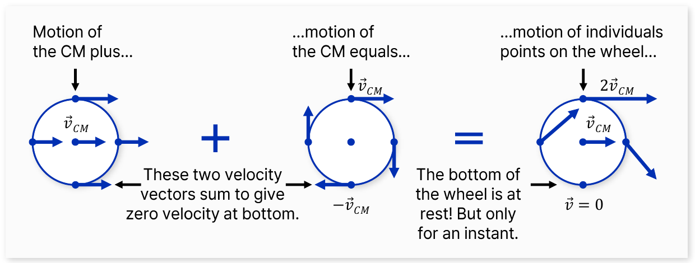

*Figure 1. The motion of a rolling wheel shown as the sum of the translation of the center of mass and the rotation about the center of mass*

On the left of Figure 1, every point of the wheel moves with the same velocity $`\vec{v}_{CM}`$ as the center of mass (CM), which is translation; in the middle, the wheel rotates about the center of mass, so the top point has velocity $`+\vec{v}_{CM}`$ and the bottom point $`-\vec{v}_{CM}`$. On the right, where the two motions are added, the top point moves at $`2\vec{v}_{CM}`$, while the bottom point touching the ground is at rest, but only for an instant, because the two velocities cancel. In this way even a complex motion can be modeled by splitting it into translation and rotation. This section covers translation, and Section 2 covers rotation.

### 1.4 Laws of Motion for Translational Systems

In translational motion, force is proportional to acceleration. The constant of proportionality is the mass.

```math
f = ma
```

| Quantity | Symbol | Unit |
|:-----|:-----|:-----|
| Force | $f$ | N (newton), $`1\,\text{N} = 1\,\text{kg}\cdot\text{m/s}^2`$ |
| Mass | $M$ or $m$ | kg |
| Displacement | $y$ | m |
| Velocity | $\dfrac{dy}{dt}$ | m/s |
| Acceleration | $a = \dfrac{d^2y}{dt^2}$ | $\text{m/s}^2$ |

*Table 2. Quantities and units of translational motion*

1 N is the force that accelerates a body of mass 1 kg at $`1\,\text{m/s}^2`$. A mechanical system in translational motion consists of three elements: **mass, spring, and friction**. Sections 1.5 through 1.7 cover the force each element produces in turn.

### 1.5 Mass

The force a body experiences in the Earth's gravitational field is its **weight**. The **mass** of a body is its weight divided by the gravitational acceleration $`g = 9.8\,\text{m/s}^2`$. A body that experiences a force of 9.8 N in the gravitational field therefore has a mass of 1 kg. Note that weight is a force, not a mass, so its unit is N. The everyday phrase "a weight of 1 kg" means, strictly, 1 kgf (kilogram-force), which is the following.

```math
1\,\text{kgf} = 1\,\text{kg} \times 9.8\,\text{m/s}^2 \approx 9.8\,\text{N}
```

The equation of motion of a body of mass $M$ acted on by a force $f$ is Newton's second law with the acceleration written as the second derivative of the displacement $y$.

```math
f = M\frac{d^2y}{dt^2} = Ma
```

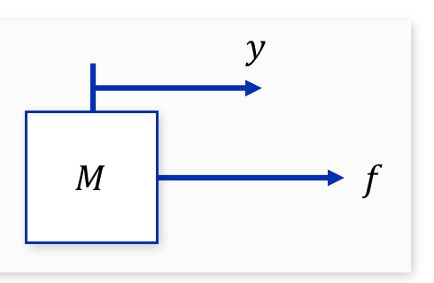

*Figure 2. A mass M that moves by the displacement y under a force f*

As in Figure 2, arrows mark the positive directions of the displacement $y$ and the force $f$. Fixing the directions first makes the signs in the equation of motion consistent.

**Example 1.** A body of mass 8 kg moves upward with an acceleration of $`3.5\,\text{m/s}^2`$. With $`g = 9.8\,\text{m/s}^2`$, find the force applied to the body.

Take upward as positive. The body is acted on by an upward pulling force $F$ and the downward gravitational force $Mg$, so the net force is $F - Mg$, and by Newton's second law it equals $Ma$.

```math
F - Mg = Ma \quad \Rightarrow \quad F = M(g + a) = 8 \times (9.8 + 3.5) = 8 \times 13.3 = 106.4\,\text{N}
```

The net force needed to accelerate the body is $`Ma = 8 \times 3.5 = 28\,\text{N}`$; adding the force that overcomes gravity, $`Mg = 8 \times 9.8 = 78.4\,\text{N}`$, gives the required upward force of 106.4 N.

### 1.6 Spring

The property of deforming under a force and returning to the original state when the force is removed is called **elasticity**, and a mechanical element with elasticity is a **spring**. The force applied to a spring is proportional to how far the spring stretches (Hooke's law), and the constant of proportionality $K$ is the **spring constant**. Its unit is N/m, and a larger spring constant means a hard spring that stretches less under the same force.

```math
f = Ky
```

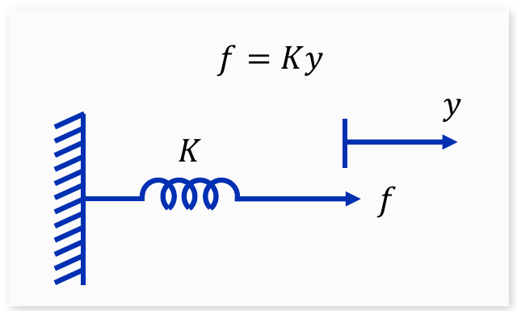

*Figure 3. A spring with spring constant K whose one end is fixed to a wall*

In Figure 3, stretching the spring by $y$ with the force $f$ takes a force $f = Ky$. Conversely, a spring stretched by $y$ produces a restoring force $Ky$ opposite to the stretch. Equations of motion use this restoring force.

**Example 2.** A body of mass 400 g hangs at rest from a spring with spring constant 14 N/m. Find how far the spring stretches (the displacement). $`g = 9.8\,\text{m/s}^2`$.

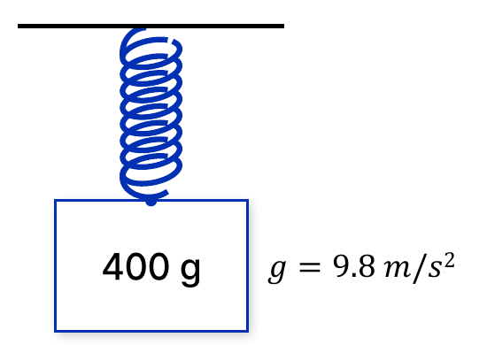

*Figure 4. A body of mass 400 g hanging from a spring*

In kilograms the mass is 0.4 kg. The body is at rest, so its acceleration is 0, and the restoring force $Ky$ of the spring equals the weight $Mg$.

```math
Ky = Mg \quad \Rightarrow \quad y = \frac{Mg}{K} = \frac{0.4 \times 9.8}{14} = \frac{3.92}{14} = 0.28\,\text{m}
```

The spring stretches 28 cm.

### 1.7 Friction

**Friction** is an element that produces a force opposing the motion of a moving body, and this opposing force is the **friction force**. The friction force acts opposite to the direction of motion, and its magnitude is generally related to the speed of the body.

An element whose friction force is proportional to the speed of the body is called **linear friction** or viscous friction, and its constant of proportionality $B$ is the linear friction coefficient or **damping coefficient**. Its unit is $\text{N}\cdot\text{s/m}$. In mechanical drawings, linear friction is drawn as a **damper**, shaped like a piston inside an oil-filled cylinder.

```math
f = B\frac{dy}{dt}
```

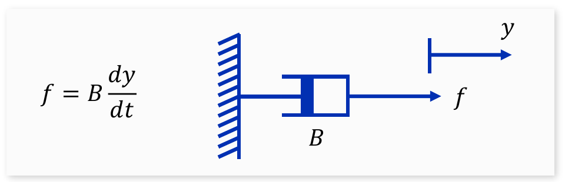

*Figure 5. A damper with damping coefficient B and its force relation*

The difference between the two elements is that the spring force is proportional to displacement and the damper force to velocity. The suspension of a car uses springs and dampers together to absorb shocks and quickly settle oscillations.

### 1.8 Linear and Nonlinear Friction

Besides linear friction, mechanical motion also involves **nonlinear friction**, in which the relation between velocity and force is nonlinear. A typical example is **Coulomb friction**. The Coulomb friction force always has the same magnitude $F_c$ regardless of the speed, and only its direction changes with the direction of the velocity. Friction between dry sliding surfaces is close to this.

```math
f = \begin{cases} F_c, & \dot{y} > 0 \\ -F_c, & \dot{y} < 0 \end{cases}
```

$\dot{y}$ is shorthand for $\frac{dy}{dt}$.

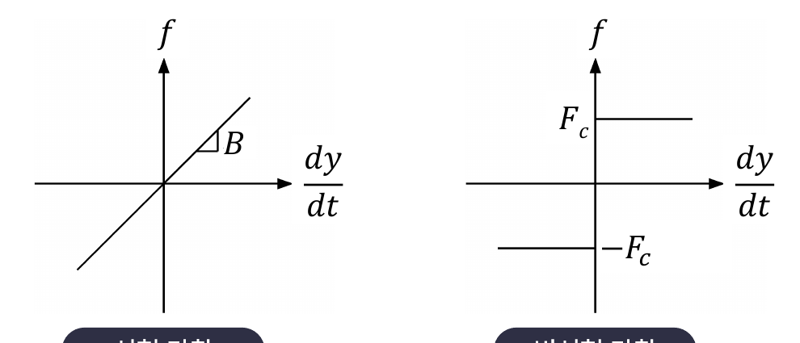

*Figure 6. Friction force versus velocity: linear friction (left) and Coulomb friction (right)*

The left graph of Figure 6 is a straight line through the origin with slope $B$, and the right graph is a step shape that is $F_c$ for positive velocity and $-F_c$ for negative velocity. In systems with mechanical motion, nonlinear friction such as Coulomb friction is often larger than linear friction. However, systems that contain nonlinear friction cannot be analyzed with the control theory of linear systems, and they are hard to analyze theoretically. All later models therefore consider linear friction only.

> **Note:** A linear system is one in which doubling the input doubles the output, and the output for the sum of two inputs is the sum of the individual outputs (the superposition principle). Solving differential equations with the Laplace transform and using transfer functions rely on this property, so they apply only to linear systems, and a transfer function is defined for linear time-invariant systems, whose coefficients do not change with time. Coulomb friction breaks this property because it produces a force independent of the magnitude of the velocity.

### 1.9 Translational Equation of Motion: The Mass-Spring-Damper System

**Example 3.** In the system of Figure 7, a mass $M$ is connected to a wall by a spring $K$ and a damper $B$ and is acted on by an external force $f$. $y$ is the displacement of the mass measured from the equilibrium position (where the spring is neither stretched nor compressed).

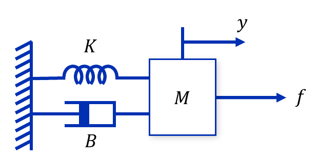

*Figure 7. A mass M connected to a wall by a spring and a damper, with an external force f*

Modeling proceeds in this order. First, find every force acting on the body (a drawing of these forces is called a **free-body diagram**). Second, add the forces with signs that match the chosen positive direction. Third, set the sum of the forces equal to mass times acceleration. The forces acting on the mass $M$ are as follows.

| Force | Magnitude | Direction |
|:-----|:-----|:-----|
| External force | $f$ | Right (positive) |
| Restoring force of the spring | $Ky$ | Opposite to the stretch, left (negative) |
| Friction force of the damper | $B\dfrac{dy}{dt}$ | Opposite to the motion, left (negative) |

*Table 3. Forces acting on the mass in the mass-spring-damper system*

The sum of the forces on the body is proportional to its acceleration, which gives the following.

```math
M\frac{d^2y}{dt^2} = f - Ky - B\frac{dy}{dt} \quad \Rightarrow \quad M\frac{d^2y}{dt^2} + B\frac{dy}{dt} + Ky = f
```

The equation of motion of this system is a second-order differential equation. To express the system simply as a relation between input and output, we use the transfer function.

> **Definition:** A **transfer function** is the ratio of the Laplace transform of the output to the Laplace transform of the input when all initial conditions are set to 0. Week 5 covers it in detail; in this unit it is used to express models compactly in the $s$-domain.

Setting the initial conditions to 0 and taking the Laplace transform of both sides turns $\frac{d}{dt}$ into multiplication by $s$, by the differentiation property of Week 3.

```math
(Ms^2 + Bs + K)\,Y(s) = F(s) \quad \Rightarrow \quad \frac{Y(s)}{F(s)} = \frac{1}{Ms^2 + Bs + K}
```

> **Key Point:** The mass produces a force proportional to acceleration, the damper one proportional to velocity, and the spring one proportional to displacement, so the equation of motion of the mass-spring-damper system contains one each of the second, first, and zeroth derivatives of $y$.

### 1.10 Translational Equations of Motion: A Two-Mass System

**Example 4.** The system of Figure 8 consists of a mass $M_2$ connected to a wall by a damper $B$, and a mass $M_1$ connected to $M_2$ by a spring $K$ and acted on by an external force $f$. $y_1$ and $y_2$ are the displacements of the masses, both positive to the right and measured from the state in which the spring is not stretched.

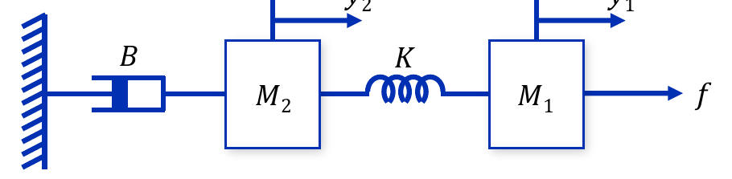

*Figure 8. Two masses connected by a spring, with a damper connected to the wall*

There are two masses, so one equation of motion is set up for each. The sum of the forces on each body is proportional to that body's acceleration. The stretch of the spring is the difference of the displacements of its two ends, $y_1 - y_2$.

**Mass $M_1$:** The external force $f$ acts to the right, and the restoring force of the spring $K(y_1 - y_2)$ acts to the left.

```math
M_1\frac{d^2y_1}{dt^2} = f - K(y_1 - y_2)
```

**Mass $M_2$:** By Newton's third law, the same spring pulls $M_2$ to the right with the force $K(y_1 - y_2)$, and the damper produces the force $B\frac{dy_2}{dt}$ opposite to the motion.

```math
M_2\frac{d^2y_2}{dt^2} = K(y_1 - y_2) - B\frac{dy_2}{dt}
```

Rearranging gives two second-order differential equations, that is, a system of simultaneous second-order differential equations.

```math
M_1\frac{d^2y_1}{dt^2} + K(y_1 - y_2) = f, \qquad M_2\frac{d^2y_2}{dt^2} + B\frac{dy_2}{dt} + K(y_2 - y_1) = 0
```

Setting the initial conditions to 0 and taking the Laplace transform gives a system of algebraic equations, which can be written with the matrices of Week 3.

```math
\begin{bmatrix} M_1s^2 + K & -K \\ -K & M_2s^2 + Bs + K \end{bmatrix} \begin{bmatrix} Y_1(s) \\ Y_2(s) \end{bmatrix} = \begin{bmatrix} F(s) \\ 0 \end{bmatrix}
```

Let $\Delta(s)$ be the determinant of the coefficient matrix.

```math
\Delta(s) = (M_1s^2 + K)(M_2s^2 + Bs + K) - K^2 = M_1M_2s^4 + M_1Bs^3 + (M_1 + M_2)Ks^2 + BKs
```

Solving with the $2 \times 2$ inverse formula (Week 3) gives the two transfer functions.

```math
\begin{bmatrix} Y_1(s) \\ Y_2(s) \end{bmatrix} = \frac{1}{\Delta(s)}\begin{bmatrix} M_2s^2 + Bs + K & K \\ K & M_1s^2 + K \end{bmatrix} \begin{bmatrix} F(s) \\ 0 \end{bmatrix} \quad \Rightarrow \quad \frac{Y_1(s)}{F(s)} = \frac{M_2s^2 + Bs + K}{\Delta(s)}, \qquad \frac{Y_2(s)}{F(s)} = \frac{K}{\Delta(s)}
```

$\Delta(s)$ has $s$ as a factor, so there is a pole at $s = 0$. The reason is that the system is not attached to the wall by a spring: under a constant force the damper keeps extending, and the whole system keeps moving at the constant velocity $f/B$. For small $s$, $\Delta(s) \approx BKs$, so $\frac{Y_2(s)}{F(s)} \approx \frac{1}{Bs}$, which confirms that the velocity, not the displacement, settles at the constant value $f/B$.

---

<br>

## 2. Rotational Motion

This section covers the modeling of mechanical systems that turn about an axis. The laws of rotational motion have the same form as those of translational motion, with torque, moment of inertia, and angle in place of force, mass, and displacement. The section ends with gears, which connect two rotating shafts.

### 2.1 Laws of Motion for Rotational Systems

Newton's laws of motion apply to rotation just as they do to translation. The difference is that **torque** replaces force, the **moment of inertia** replaces mass, and **angular acceleration** replaces acceleration. Torque is the turning effect of a force; its magnitude is the magnitude of the force times the perpendicular distance from the axis of rotation to the line of action of the force. Torque is proportional to angular acceleration.

```math
\tau = J\alpha = J\frac{d^2\theta}{dt^2}
```

| Translational motion | Unit | Rotational motion | Unit |
|:-----|:-----|:-----|:-----|
| Force $f$ | N | Torque $\tau$ | $\text{N}\cdot\text{m}$ |
| Mass $M$ | kg | Moment of inertia $J$ | $\text{kg}\cdot\text{m}^2$ |
| Displacement $y$ | m | Angle $\theta$ | rad |
| Velocity $\dfrac{dy}{dt}$ | m/s | Angular velocity $\omega = \dfrac{d\theta}{dt}$ | rad/s |
| Acceleration $a$ | $\text{m/s}^2$ | Angular acceleration $\alpha = \dfrac{d^2\theta}{dt^2}$ | $\text{rad/s}^2$ |
| $f = Ma$ | | $\tau = J\alpha$ | |

*Table 4. Correspondence between the quantities of translational and rotational motion*

The three elements of a rotational system are the **moment of inertia, the torsional spring, and rotational friction**, which correspond to the mass, spring, and friction of translational motion.

### 2.2 Moment of Inertia

The **moment of inertia** measures how strongly a body resists changes in its rotation. It is also simply called inertia. Unlike mass in translation, the moment of inertia depends not only on the mass but also on how far the mass is distributed from the axis of rotation.

As the simplest case, consider a body of mass $M$ fixed to one end of a massless rod so that it turns at distance $R$ from the axis. The moment of inertia is the mass times the square of the distance.

```math
J = MR^2
```

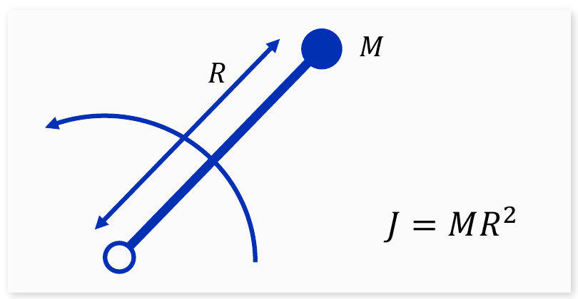

*Figure 9. A mass M at distance R from the axis of rotation and its moment of inertia*

For a body whose mass is spread out, the body is divided into small pieces and the quantities $`r^2\,dm`$ of all pieces are added, that is, integrated. Let us find the moment of inertia of a disk of uniform thickness and radius $R$ rotating about its center.

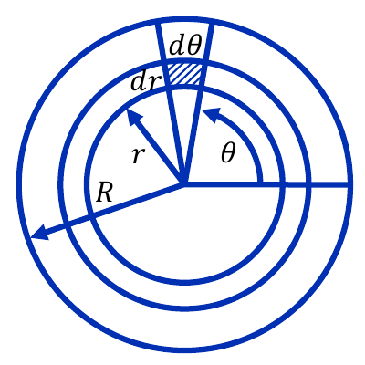

*Figure 10. A disk divided into small pieces of size dr in the radial direction and dθ in the angular direction*

Let $\rho$ be the mass per unit area of the disk. The small piece at distance $r$ from the center and angle $\theta$ is nearly a rectangle with radial length $dr$ and arc length $`r\,d\theta`$, so its area is $`r\,dr\,d\theta`$ and its mass is the following.

```math
dm = \rho\,r\,dr\,d\theta
```

This small rectangle lies at distance $r$ from the axis, so its moment of inertia is $`dJ = r^2\,dm = \rho\,r^3\,dr\,d\theta`$. Integrate over the whole disk, $r$ from 0 to $R$ and $\theta$ from 0 to $2\pi$.

```math
J = \int_0^{2\pi}\int_0^R \rho\,r^3\,dr\,d\theta = \rho \cdot \frac{R^4}{4} \cdot 2\pi = \frac{\pi\rho R^4}{2}
```

The total mass of the disk is $M = \rho \times (\text{area}) = \rho\pi R^2$, so $\pi\rho R^4 = (\rho\pi R^2)R^2 = MR^2$.

```math
J = \frac{1}{2}MR^2
```

> **Key Point:** For the same mass and radius, $J = MR^2$ if all the mass is on the rim, and half of that, $\frac{1}{2}MR^2$, if it is spread evenly as in a disk. Mass closer to the axis contributes less to the moment of inertia.

### 2.3 Torsional Spring

A mechanical element that twists under a torque and returns to its original state when the torque is removed is a **torsional spring**. Torque is proportional to the twist angle, and the constant of proportionality $K$ is the (torsional) spring constant, with unit $\text{N}\cdot\text{m/rad}$. The twisting of a long shaft is also modeled as a torsional spring.

```math
\tau = K\theta
```

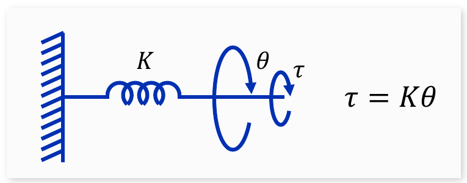

*Figure 11. A torsional spring fixed to a wall and the relation between torque and angle*

### 2.4 Rotational Friction

**Rotational friction** is an element that produces a torque opposing the motion of a rotating body, and this torque is the rotational friction torque. The friction torque acts opposite to the direction of rotation, and its magnitude is generally related to the rotational speed. An element whose friction torque is proportional to the rotational speed is called **linear rotational friction**, and its constant of proportionality $B$ is the linear rotational friction coefficient or damping coefficient, with unit $\text{N}\cdot\text{m}\cdot\text{s/rad}$. Friction from the lubricant in a bearing is a typical example.

```math
\tau = B\frac{d\theta}{dt}
```

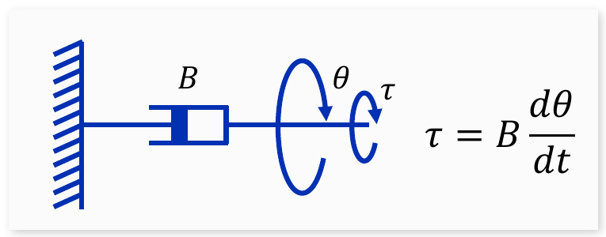

*Figure 12. A rotational damper and the relation between torque and angular velocity*

As in translation, rotation also has nonlinear friction. The rotational Coulomb friction torque has a constant magnitude $F_c$ regardless of the rotational speed, and only its sign changes with the direction of rotation. Its graph of torque versus angular velocity is Figure 6 with $f$ replaced by $\tau$ and $\frac{dy}{dt}$ by $\frac{d\theta}{dt}$.

```math
\tau = \begin{cases} F_c, & \dot{\theta} > 0 \\ -F_c, & \dot{\theta} < 0 \end{cases}
```

### 2.5 Rotational Equation of Motion

**Example 1.** In the system of Figure 13, a rotating body with moment of inertia $J$ is connected to a wall by a torsional spring $K$ and a rotational damper $B$ and is acted on by an external torque $\tau$. $\theta$ is the rotation angle measured from the position in which the spring is not twisted.

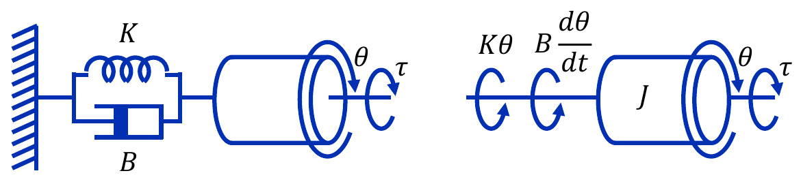

*Figure 13. A rotating body connected to a wall by a torsional spring and a rotational damper (left) and the torques acting on the body (right)*

As on the right of Figure 13, find every torque acting on the body. The external torque $\tau$ acts in the direction of rotation, and the spring torque $K\theta$ and the friction torque $B\frac{d\theta}{dt}$ act in the opposite direction. The sum of the torques on the body is proportional to its angular acceleration, which gives the following.

```math
J\frac{d^2\theta}{dt^2} = \tau - K\theta - B\frac{d\theta}{dt} \quad \Rightarrow \quad J\frac{d^2\theta}{dt^2} + B\frac{d\theta}{dt} + K\theta = \tau
```

Setting the initial conditions to 0 and taking the Laplace transform gives the transfer function, where $T(s)$ is the transform of $\tau(t)$.

```math
\frac{\Theta(s)}{T(s)} = \frac{1}{Js^2 + Bs + K}
```

This has the same form as $\frac{Y(s)}{F(s)} = \frac{1}{Ms^2 + Bs + K}$ of Section 1.9 with $M$ replaced by $J$.

### 2.6 Gears

Mechanical devices with rotational motion often use **gears** to amplify torque. Consider an **ideal gear** pair in which two gears with $N_1$ and $N_2$ teeth mesh. An ideal gear has no moment of inertia or friction of its own, so it transmits the work done on the input shaft to the output shaft without loss.

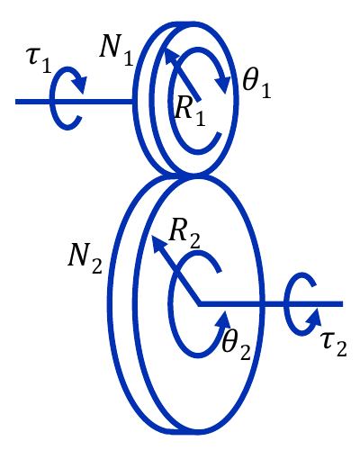

*Figure 14. A gear with N1 teeth and radius R1 meshing with a gear with N2 teeth and radius R2*

**Teeth and radius.** Since the teeth have the same size, the number of teeth of a gear is assumed to be proportional to its radius.

```math
\frac{R_2}{R_1} = \frac{N_2}{N_1}
```

**Angle relation.** In an ideal gear, the two meshing wheels do not slip at the contact point, so the arc lengths traveled by the two wheels (radius times rotation angle) are always equal.

```math
R_1\theta_1 = R_2\theta_2 \quad \Rightarrow \quad \theta_2 = \frac{R_1}{R_2}\theta_1 = \frac{N_1}{N_2}\theta_1
```

Differentiating with respect to time gives the angular velocity relation.

```math
\dot{\theta}_2 = \frac{N_1}{N_2}\dot{\theta}_1
```

$N_1/N_2$ is called the **gear ratio**. Some texts call the reciprocal $N_2/N_1$ the gear ratio instead, so it is necessary to check which one is meant. If $N_1/N_2$ is less than 1, that is, if a small gear drives a large gear, the output shaft turns more slowly than the input shaft, and the gear is called a **reduction gear**.

**Torque relation.** Because the gear is ideal, the mechanical energy of one wheel is transferred to the other without any loss. The energy, or work, of rotation is torque times rotation angle, so the condition that input and output energy are equal gives the torque relation.

```math
\tau_1\theta_1 = \tau_2\theta_2 \quad \Rightarrow \quad \tau_2 = \frac{\theta_1}{\theta_2}\tau_1 = \frac{N_2}{N_1}\tau_1
```

The second equality uses the angle relation $\frac{\theta_1}{\theta_2} = \frac{N_2}{N_1}$. A reduction gear ($`N_2 > N_1`$) scales the rotation angle and speed down by $\frac{N_1}{N_2}$ and scales the torque up by $\frac{N_2}{N_1}$. It is the same principle as riding a bicycle uphill in a low gear: the pedals turn many times, but each push takes little force.

> **Caution:** Angles change by the teeth ratio $\frac{N_1}{N_2}$, and torques by its reciprocal $\frac{N_2}{N_1}$. To avoid confusing the two ratios, derive them again from the principle that the energy $\tau\theta$ is conserved.

### 2.7 A System of Two Inertias

Analyzing gear systems first requires understanding the torque that two connected inertias exchange. As in Figure 15, two bodies with moments of inertia $J_1$ and $J_2$ are rigidly connected by one shaft and rotate together, and we consider the case in which an external torque $\tau$ is applied to $J_1$. Since the two bodies turn together, $\theta_1 = \theta_2 = \theta$.

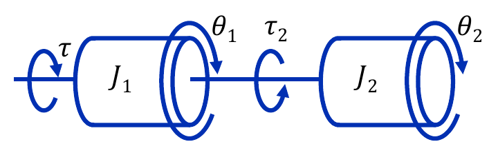

*Figure 15. Two inertias J1 and J2 connected by one shaft and rotating together*

$\tau_2$ is the **reaction torque** exerted on the body with inertia $J_1$ because of the rotation of the body with inertia $J_2$. When $J_1$ applies the torque $\tau_2$ through the shaft to turn $J_2$, by Newton's third law $J_2$ returns a torque of equal magnitude and opposite direction to $J_1$. Applying the law of motion to each body gives the following.

```math
J_1\ddot{\theta} = \tau - \tau_2, \qquad J_2\ddot{\theta} = \tau_2
```

Adding the two equations cancels the reaction torque.

```math
(J_1 + J_2)\ddot{\theta} = \tau
```

Two inertias that rotate together move like a single body with moment of inertia $J_1 + J_2$.

### 2.8 A System Connected by Gears

Now assume that two rotating bodies are connected by an ideal gear and that a torque applied to one of them makes it rotate (Figure 16). The input shaft carries the inertia $J_1$ and a gear with $N_1$ teeth, and the output shaft carries a gear with $N_2$ teeth and the inertia $J_2$.

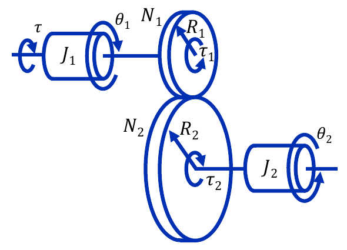

*Figure 16. Two inertias J1 and J2 connected by an ideal gear*

The gear on the output shaft applies the torque $\tau_2$ to turn $J_2$, and the reaction torque $\tau_2$ transmitted back through the gear to the input shaft has the value $\tau_1$. The torque acting on the body with inertia $J_1$ is therefore the external torque $\tau$ minus the reaction torque $\tau_1$.

```math
J_1\ddot{\theta}_1 = \tau - \tau_1, \qquad J_2\ddot{\theta}_2 = \tau_2
```

Use the gear relations $\tau_1 = \frac{N_1}{N_2}\tau_2$ and $\theta_2 = \frac{N_1}{N_2}\theta_1$ of Section 2.6 to express $\tau_1$ in terms of $\theta_1$.

```math
\tau_1 = \frac{N_1}{N_2}\tau_2 = \frac{N_1}{N_2}J_2\ddot{\theta}_2 = \frac{N_1}{N_2}J_2\left( \frac{N_1}{N_2}\ddot{\theta}_1 \right) = \left( \frac{N_1}{N_2} \right)^2 J_2\ddot{\theta}_1
```

Substituting into the first equation gives the equation of motion and the transfer function seen from the input shaft.

```math
\left[ J_1 + \left( \frac{N_1}{N_2} \right)^2 J_2 \right]\ddot{\theta}_1 = \tau \quad \Rightarrow \quad \frac{\Theta_1(s)}{T(s)} = \frac{1}{\left[ J_1 + (N_1/N_2)^2 J_2 \right]s^2}
```

> **Key Point:** Seen from the input shaft, the inertia $J_2$ beyond the gear appears multiplied by $\left( \frac{N_1}{N_2} \right)^2$. This is called the **reflected inertia**. The gear ratio multiplies once for the angle and once for the torque, so it appears squared. Rotational friction and torsional springs are reflected by the square of the teeth ratio in the same way [1].

Conversely, seen from the output shaft, $J_1$ is reflected by $\left( \frac{N_2}{N_1} \right)^2$, giving $`\left[ \left( \frac{N_2}{N_1} \right)^2 J_1 + J_2 \right]\ddot{\theta}_2 = \frac{N_2}{N_1}\tau`$. Substituting $\theta_2 = \frac{N_1}{N_2}\theta_1$ into this equation recovers the equation above. As a check, $N_1 = N_2$ gives $(J_1 + J_2)\ddot{\theta} = \tau$ of Section 2.7.

---

<br>

## 3. Electric Circuits

This section covers the modeling of electric circuits made of resistors, capacitors, and inductors, and of the DC servo motor, which converts electrical energy into rotation. Finally, it derives the model of an industrial robot joint that combines the motor, the gear, and the link.

### 3.1 Resistor-Capacitor Circuit

Modeling electric circuits starts from **Kirchhoff's voltage law (KVL)**. KVL states that the voltages around a closed loop sum to 0; in a series circuit, this means that the input voltage equals the sum of the voltages across the elements.

A **capacitor** is an element that stores charge. The charge $q$ stored in a capacitor is proportional to the voltage $y$ across it, and the constant of proportionality $C$ is the capacitance (unit F, farad). Current is the rate of change of charge, so differentiating both sides gives the relation between the current and voltage of the capacitor.

```math
q = Cy, \qquad i = \frac{dq}{dt} = C\frac{dy}{dt}
```

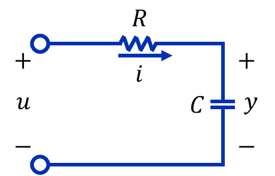

*Figure 17. An RC circuit with input voltage u and capacitor voltage y*

Applying KVL to the circuit of Figure 17, the input voltage $u$ equals the voltage across the resistor, $Ri$ (Ohm's law), plus the voltage across the capacitor, $y$. Substitute $i = C\frac{dy}{dt}$.

```math
Ri + y = RC\frac{dy}{dt} + y = u
```

The RC circuit is described by a first-order differential equation. Setting the initial conditions to 0 and taking the Laplace transform gives the following transfer function.

```math
(RCs + 1)\,Y(s) = U(s) \quad \Rightarrow \quad \frac{Y(s)}{U(s)} = \frac{1}{RCs + 1}
```

The product $RC$ has the unit of time and is the **time constant** that sets how fast the response changes. The response of first-order systems and the time constant are covered in detail in Week 7.

### 3.2 Resistor-Inductor Circuit

An **inductor** is an element that opposes changes in current; the voltage $v_L$ across it is proportional to the rate of change of the current. The constant of proportionality $L$ is the inductance (unit H, henry).

```math
v_L = L\frac{di}{dt}
```

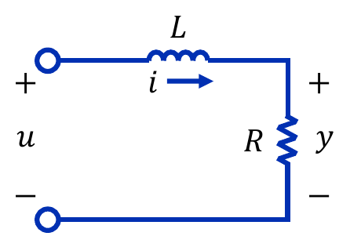

*Figure 18. An RL circuit with input voltage u and resistor voltage y*

In the circuit of Figure 18, the output is the voltage across the resistor, $y = Ri$. Applying KVL, the input voltage equals the inductor voltage plus the voltage across the resistor.

```math
v_L + Ri = L\frac{di}{dt} + Ri = u, \qquad y = Ri
```

Substituting $i = \frac{y}{R}$ gives an equation in the output $y$.

```math
\frac{L}{R}\frac{dy}{dt} + y = u \quad \Rightarrow \quad \frac{Y(s)}{U(s)} = \frac{1}{(L/R)s + 1}
```

The RL circuit is also a first-order system, with time constant $\frac{L}{R}$.

### 3.3 Resistor-Inductor-Capacitor Circuit

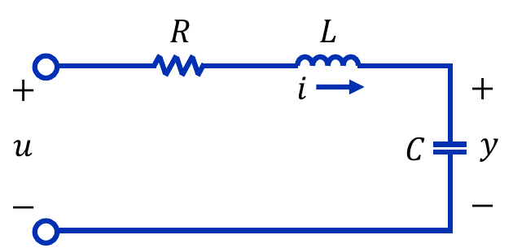

*Figure 19. An RLC circuit with a resistor, an inductor, and a capacitor in series*

Applying KVL to the circuit of Figure 19, the input voltage equals the sum of the resistor voltage, the inductor voltage, and the voltage across the capacitor. The output is the capacitor voltage $y$.

```math
L\frac{di}{dt} + Ri + y = u, \qquad i = C\frac{dy}{dt}
```

Substituting the second equation into the first gives $\frac{di}{dt} = C\frac{d^2y}{dt^2}$, and hence a second-order differential equation.

```math
LC\frac{d^2y}{dt^2} + RC\frac{dy}{dt} + y = u \quad \Rightarrow \quad \frac{Y(s)}{U(s)} = \frac{1}{LCs^2 + RCs + 1}
```

> **Key Point:** The RLC equation $LC\ddot{y} + RC\dot{y} + y = u$ has the same form as the mass-spring-damper equation $M\ddot{y} + B\dot{y} + Ky = f$ of Section 1.9. Physically quite different systems are described by differential equations of the same form, so one method of analysis (such as the second-order system response of Week 7) serves every field. Table 6 in the Concept Applications section summarizes this correspondence.

### 3.4 Electromagnetic Force and Electromotive Force

Modeling a motor, which converts electrical energy into mechanical energy, requires two electromagnetic phenomena.

**Electromagnetic force.** A conductor carrying a current in a magnetic field experiences a force, called the **electromagnetic force**. Its magnitude is proportional to the strength of the magnetic field and to the current in the conductor, and for a wire perpendicular to the field it is the following.

```math
F = BIl\ [\text{N}]
```

$B$ is the magnetic flux density (unit T, tesla), $I$ is the current, and $l$ is the length of the wire inside the magnetic field. The direction of the force is given by **Fleming's left-hand rule**: with the thumb, index finger, and middle finger of the left hand held at right angles, point the index finger along the magnetic field (from the N pole to the S pole) and the middle finger along the current; the thumb then points along the force.

**Electromotive force.** Moving a conductor in a magnetic field produces an **electromotive force (emf)** in the conductor, and its magnitude is proportional to the speed at which the conductor moves. This is a case of **Faraday's law**, which states that when the magnetic flux $\Phi$ through a circuit changes, an emf equal to its rate of change is produced.

```math
\varepsilon = -\frac{d\Phi}{dt}, \qquad \Phi = BS
```

$S$ is the area of the circuit through which the field passes, and $\Phi = BS$ holds when the field is uniform and perpendicular to the surface. The minus sign means that the induced current flows in the direction that opposes the change of flux (Lenz's law). When a wire of length $l$ moves perpendicular to the field at speed $v$, the area of the circuit changes by $lv$ per second, so the emf has magnitude $Blv$, proportional to the speed [2].

> **Note:** A motor uses both phenomena together. A current in the coil produces a torque through the electromagnetic force and makes the motor turn (the torque constant of Section 3.6), and the turning coil moves in the magnetic field and produces an emf opposing the current (the back emf of Section 3.6).

### 3.5 Structure of a DC Servo Motor

> **Definition:** A **servo motor** is a motor built so that it can precisely control a device when moving it to a specific position required by the system or running it at a specific speed and torque. One driven by a DC supply is a **DC servo motor**.

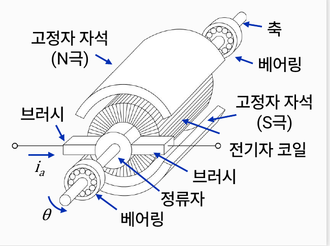

*Figure 20. Structure of a DC servo motor*

Figure 20 shows a cutaway of a DC servo motor; the labeled parts (in Korean) are the shaft (축), the bearings at both ends (베어링), the stator magnets with N and S poles (고정자 자석), the armature coil (전기자 코일), the brushes (브러시), and the commutator (정류자). The role of each part is as follows.

| Part | Role |
|:-----|:-----|
| Stator magnet | The stationary outer magnet that creates the magnetic field. Electromagnets or permanent magnets can be used, but control servo motors mostly use permanent magnets. |
| Armature and armature coil | The rotating part, wound with coils that carry current. The coil current $i_a$ interacts with the magnetic field to produce torque. |
| Brush and commutator | Supply current to the rotating armature. The commutator reverses the current direction in the coils as the armature turns, so that the torque stays in one direction. |
| Shaft and bearings | The shaft transmits the rotation outward, and the bearings support the shaft and are one source of rotational friction. |

*Table 5. Main parts of a DC servo motor and their roles*

The most important parts of a DC servo motor are the magnets that create the magnetic field and the rotating armature.

### 3.6 Model of a DC Servo Motor

**Torque constant.** In a cross-section of the motor, the armature wound with coils sits between the N and S poles of the stator, and the electromagnetic force on the coil current in the field turns the armature at the angular velocity $\omega$. The torque produced by the motor is proportional to the current in the armature (the electromagnetic force), and the constant of proportionality $K_t$ is the **torque constant**.

```math
\tau = K_t i_a
```

**Back-emf constant.** The emf produced by the rotation of the motor is called the **back emf (back electromotive force)**. It arises because the armature coil turns in the magnetic field, and its magnitude is proportional to the rotational speed of the motor. The constant of proportionality $K_b$ is the **back-emf constant**.

```math
e_b = K_b\frac{d\theta}{dt} = K_b\omega
```

> **Note:** In SI units, $K_t$ and $K_b$ have the same value. The electrical power absorbed by the back emf, $e_bi_a = K_b\omega i_a$, must equal the mechanical power produced by the motor, $\tau\omega = K_ti_a\omega$ (conservation of energy), so $`K_t\,[\text{N}\cdot\text{m/A}] = K_b\,[\text{V}\cdot\text{s/rad}]`$ [3].

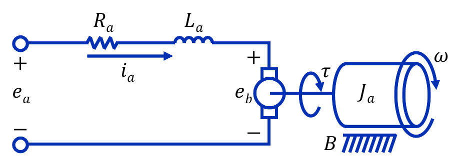

*Figure 21. Model of the armature circuit and the rotating part of a DC servo motor*

In the model of Figure 21, $e_a$ is the voltage applied to the armature, $R_a$ and $L_a$ are the resistance and inductance of the armature coil, $i_a$ is the armature current, $J_a$ is the moment of inertia of the armature (the rotating part), $B$ is the rotational friction coefficient, and $\theta$ and $\omega$ are the rotation angle and angular velocity.

**Electrical equation.** Applying KVL to the armature circuit, the voltage applied to the armature equals the sum of the resistor voltage, the inductance voltage, and the back emf.

```math
e_a = R_ai_a + L_a\frac{di_a}{dt} + e_b = R_ai_a + L_a\frac{di_a}{dt} + K_b\frac{d\theta}{dt}
```

**Mechanical equation.** The torque produced by the servo motor turns the armature, so setting up the equation of motion as in Section 2.5 gives the following. Without a load, the torque goes only into the inertia of the armature and the rotational friction.

```math
\tau = K_ti_a = J_a\frac{d^2\theta}{dt^2} + B\frac{d\theta}{dt}
```

The two equations are coupled through the current $i_a$ and the angle $\theta$. The current produces torque and causes rotation, and the rotation produces a back emf that reduces the current.

**Transfer function.** Set the initial conditions to 0 and take the Laplace transform of both equations.

```math
E_a(s) = (L_as + R_a)\,I_a(s) + K_bs\,\Theta(s), \qquad K_tI_a(s) = (J_as^2 + Bs)\,\Theta(s)
```

From the second equation, $`I_a(s) = \frac{(J_as^2 + Bs)\,\Theta(s)}{K_t} = \frac{s(J_as + B)\,\Theta(s)}{K_t}`$; substituting into the first gives the following.

```math
E_a(s) = \left[ \frac{(L_as + R_a)(J_as + B)s}{K_t} + K_bs \right]\Theta(s) = \frac{s\left[ (L_as + R_a)(J_as + B) + K_tK_b \right]}{K_t}\,\Theta(s)
```

The transfer functions from the input voltage to the rotation angle and to the angular velocity ($`\Omega(s) = s\Theta(s)`$) are therefore as follows.

```math
\frac{\Theta(s)}{E_a(s)} = \frac{K_t}{s\left[ (L_as + R_a)(J_as + B) + K_tK_b \right]}, \qquad \frac{\Omega(s)}{E_a(s)} = \frac{K_t}{(L_as + R_a)(J_as + B) + K_tK_b}
```

Drawn as a block diagram, these relations look like Figure 22. Block diagrams are covered in detail in Week 5; here the diagram shows in what order the signals are transformed.

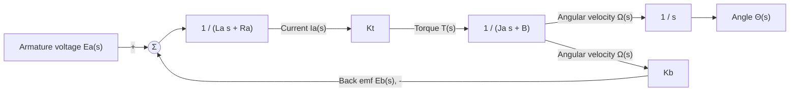

*Figure 22. Block diagram of a DC servo motor*

In Figure 22, the back emf forms a feedback path that subtracts a voltage proportional to the angular velocity from the input voltage. Even without an external controller, the motor has this internal feedback, so under a constant voltage it reaches a constant speed at which the back emf plus the resistive drop $R_ai_a$ equals the input voltage. The current $i_a$ at that speed supplies the viscous friction torque $B\omega$, and the back emf equals the input voltage only when there is no friction ($`B = 0`$).

**Approximation neglecting the armature inductance.** The armature inductance $L_a$ is usually very small, so the electrical circuit responds much faster than the mechanical part. Setting $L_a \approx 0$ makes the angular velocity transfer function first-order [1].

```math
\frac{\Omega(s)}{E_a(s)} \approx \frac{K_t}{R_a(J_as + B) + K_tK_b} = \frac{K_m}{T_ms + 1}, \qquad K_m = \frac{K_t}{R_aB + K_tK_b}, \quad T_m = \frac{R_aJ_a}{R_aB + K_tK_b}
```

$K_m$ is the motor gain, the steady-state angular velocity per volt, and $T_m$ is the mechanical time constant.

**Numerical example.** Consider a motor with $`R_a = 2\,\Omega`$, $`L_a = 0.01\,\text{H}`$, $`J_a = 0.02\,\text{kg}\cdot\text{m}^2`$, $`B = 0.05\,\text{N}\cdot\text{m}\cdot\text{s/rad}`$, and $K_t = K_b = 0.5$. Expanding the denominator gives the following.

```math
(0.01s + 2)(0.02s + 0.05) + 0.5 \times 0.5 = 0.0002s^2 + 0.0405s + 0.35 \quad \Rightarrow \quad \frac{\Omega(s)}{E_a(s)} = \frac{0.5}{0.0002s^2 + 0.0405s + 0.35}
```

The roots of the denominator, that is, the poles, are $s \approx -9.05$ and $s \approx -193.45$. The smaller one, $-9.05$, represents the slow response of the mechanical part, and the larger one, $-193.45$, the fast response of the electrical circuit. In the approximation, $`K_m = \frac{0.5}{2 \times 0.05 + 0.25} = \frac{0.5}{0.35} \approx 1.43\,\text{rad/s}`$ (per volt) and $`T_m = \frac{2 \times 0.02}{0.35} \approx 0.114\,\text{s}`$, and the pole $-\frac{1}{T_m} = -8.75$ is close to the slow pole $-9.05$ of the exact model. Figure 23 shows the angular velocity response to a unit step voltage (1 V).

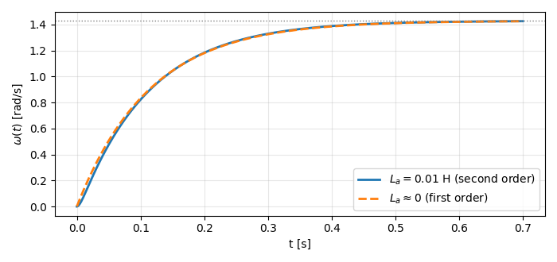

*Figure 23. Angular velocity response of a DC servo motor to a unit step voltage: the model with armature inductance and the approximation without it*

Apart from a very short initial interval, the two curves nearly coincide, and both converge to the steady-state angular velocity given by the final value theorem (Week 3), $`\lim_{s\to 0} s \cdot \frac{1}{s} \cdot \frac{0.5}{0.35} \approx 1.43\,\text{rad/s}`$.

### 3.7 Robot Modeling

Each axis (joint) of an industrial robot has a servo motor for rotation, and the robot controller controls these servo motors so that the robot performs the desired task. The robot arm in Figure 24 has three joints that move through the angles $\theta_1$ (horizontal rotation of the base), $\theta_2$ (shoulder), and $\theta_3$ (elbow).

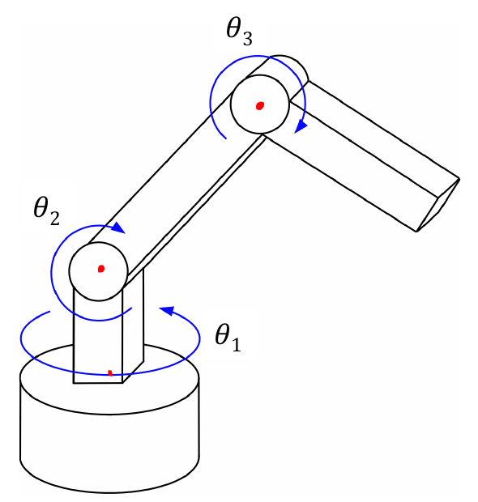

*Figure 24. A robot arm with three revolute joints*

Industrial robots are generally driven by servo motors fitted with reduction gears. Figure 25 is a model of one axis of a robot. It consists of the armature circuit of the motor, the motor shaft with inertia $J_1$ and rotational friction $B_1$, a reduction gear with $N_1$ and $N_2$ teeth, and the robot link (arm) with inertia $J_2$ and rotational friction $B_2$.

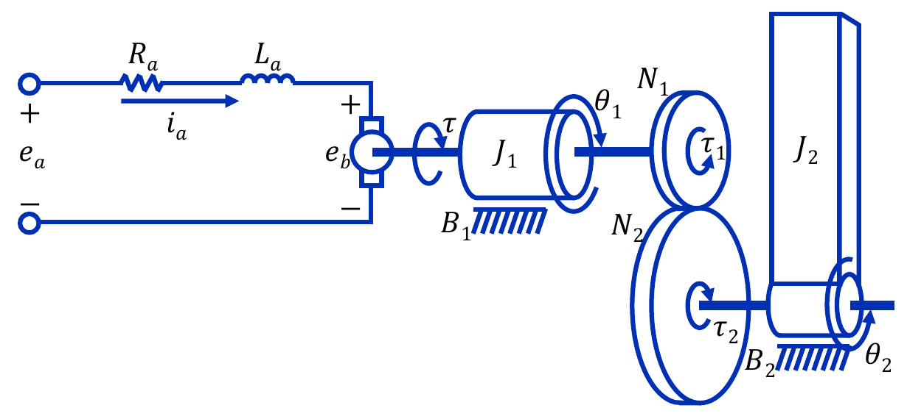

*Figure 25. Model of one robot axis driven by a servo motor with a reduction gear*

**Motor circuit.** Apply KVL to the motor circuit. It is the same as in Section 3.6, and the back emf is proportional to the angular velocity of the motor shaft, $\frac{d\theta_1}{dt}$.

```math
e_a = R_ai_a + L_a\frac{di_a}{dt} + e_b = R_ai_a + L_a\frac{di_a}{dt} + K_b\frac{d\theta_1}{dt}
```

**Motor shaft.** The shaft of the servo motor is acted on by the reaction torque $\tau_1$ transmitted through the gear, and this torque is opposite in direction to the torque $\tau$ produced by the motor. The equation of motion for the servo motor armature is therefore the following.

```math
\tau - \tau_1 = K_ti_a - \tau_1 = J_1\frac{d^2\theta_1}{dt^2} + B_1\frac{d\theta_1}{dt}
```

**Robot link.** The torque $\tau_2$ that the gear on the output shaft applies to the link goes into overcoming the inertia and rotational friction of the link. $\tau_2$ is at the same time the magnitude of the reaction torque that the link returns to the gear.

```math
\tau_2 = J_2\frac{d^2\theta_2}{dt^2} + B_2\frac{d\theta_2}{dt}
```

**Gear relations.** From Section 2.6, the torques and angles of the gear are linked by the gear ratio.

```math
\tau_1 = \frac{N_1}{N_2}\tau_2, \qquad \theta_2 = \frac{N_1}{N_2}\theta_1
```

**Combining.** Move $\tau_1$ in the motor shaft equation to the right-hand side, and substitute the gear relations and the link equation in turn.

```math
\tau = K_ti_a = J_1\frac{d^2\theta_1}{dt^2} + B_1\frac{d\theta_1}{dt} + \tau_1 = J_1\frac{d^2\theta_1}{dt^2} + B_1\frac{d\theta_1}{dt} + \frac{N_1}{N_2}\tau_2
```

```math
= J_1\frac{d^2\theta_1}{dt^2} + B_1\frac{d\theta_1}{dt} + \frac{N_1}{N_2}\left[ J_2\frac{d^2\theta_2}{dt^2} + B_2\frac{d\theta_2}{dt} \right] = \left[ J_1 + \left( \frac{N_1}{N_2} \right)^2 J_2 \right]\frac{d^2\theta_1}{dt^2} + \left[ B_1 + \left( \frac{N_1}{N_2} \right)^2 B_2 \right]\frac{d\theta_1}{dt}
```

The last equality substitutes the derivatives of $\theta_2 = \frac{N_1}{N_2}\theta_1$, namely $\frac{d\theta_2}{dt} = \frac{N_1}{N_2}\frac{d\theta_1}{dt}$ and $\frac{d^2\theta_2}{dt^2} = \frac{N_1}{N_2}\frac{d^2\theta_1}{dt^2}$, and groups equal derivatives. Define the equivalent inertia and equivalent friction seen from the motor shaft as follows.

```math
J_{eq} = J_1 + \left( \frac{N_1}{N_2} \right)^2 J_2, \qquad B_{eq} = B_1 + \left( \frac{N_1}{N_2} \right)^2 B_2
```

The model of one robot axis is then the DC servo motor model of Section 3.6 with $J_a$ replaced by $J_{eq}$ and $B$ by $B_{eq}$. The transfer functions are as follows, and the link angle is $\Theta_2(s) = \frac{N_1}{N_2}\Theta_1(s)$.

```math
\frac{\Theta_1(s)}{E_a(s)} = \frac{K_t}{s\left[ (L_as + R_a)(J_{eq}s + B_{eq}) + K_tK_b \right]}, \qquad \frac{\Theta_2(s)}{E_a(s)} = \frac{N_1}{N_2} \cdot \frac{\Theta_1(s)}{E_a(s)}
```

> **Key Point:** The robot link has a larger moment of inertia than the motor, but the link inertia is multiplied by the square of the gear ratio, so if the gear ratio $\frac{N_1}{N_2}$ is less than 1, the influence of the link inertia on the motor is not large. For example, with motor shaft inertia $`J_1 = 0.001\,\text{kg}\cdot\text{m}^2`$, link inertia $`J_2 = 5\,\text{kg}\cdot\text{m}^2`$, and gear ratio $\frac{1}{100}$, the reflected inertia is $`\left( \frac{1}{100} \right)^2 \times 5 = 0.0005\,\text{kg}\cdot\text{m}^2`$ and $`J_{eq} = 0.0015\,\text{kg}\cdot\text{m}^2`$. Connecting the motor directly to the link without a gear would make the motor turn $`5.001\,\text{kg}\cdot\text{m}^2`$, more than 3000 times as much. In exchange, the link turns 100 times more slowly than the motor and receives 100 times the torque.

---

<br>

## Concept Applications

The elements of translational motion, rotational motion, and electric circuits correspond one to one. This relation, which pairs force with voltage, is called the **force-voltage analogy** or series analog [1]. Writing the RLC equation in terms of the capacitor charge $q = Cy$ gives $L\ddot{q} + R\dot{q} + \frac{1}{C}q = u$, which makes the correspondence clear.

| Translational motion | Rotational motion | Electric circuit |
|:-----|:-----|:-----|
| Force $f$ | Torque $\tau$ | Voltage $u$ |
| Displacement $y$ | Angle $\theta$ | Charge $q$ |
| Velocity $\dot{y}$ | Angular velocity $\dot{\theta}$ | Current $i = \dot{q}$ |
| Mass $M$ | Moment of inertia $J$ | Inductance $L$ |
| Damping coefficient $B$ | Rotational damping coefficient $B$ | Resistance $R$ |
| Spring constant $K$ | Torsional spring constant $K$ | Reciprocal of capacitance $\dfrac{1}{C}$ |
| $M\ddot{y} + B\dot{y} + Ky = f$ | $J\ddot{\theta} + B\dot{\theta} + K\theta = \tau$ | $L\ddot{q} + R\dot{q} + \dfrac{1}{C}q = u$ |

*Table 6. Correspondence among translational motion, rotational motion, and electric circuits*

**True/False Check:**

| Statement | Judgment and Reason |
|:-----|:------------|
| The unit of weight is kg. | **F.** Weight is a force, so its unit is N; a body of mass 1 kg weighs 1 kgf, about 9.8 N. |
| The Coulomb friction force is proportional to velocity. | **F.** The Coulomb friction force is constant regardless of the magnitude of the velocity, and only its sign changes with the direction of the velocity. |
| In an ideal reduction gear ($`N_1 < N_2`$), the output shaft torque is larger than the input shaft torque. | **T.** $\tau_2 = \frac{N_2}{N_1}\tau_1$ with $\frac{N_2}{N_1} > 1$. |
| An inertia beyond a gear is reflected to the input shaft in proportion to the teeth ratio. | **F.** The gear ratio multiplies once for the angle and once for the torque, so the reflection is proportional to the square $\left( \frac{N_1}{N_2} \right)^2$. |
| The back emf is proportional to the armature current. | **F.** The back emf is proportional to the rotational speed ($`e_b = K_b\omega`$); the torque is what is proportional to the current. |
| The RLC circuit and the mass-spring-damper system are described by second-order differential equations of the same form. | **T.** As in Table 6, $L$, $R$, and $\frac{1}{C}$ correspond to $M$, $B$, and $K$. |
| The transfer functions of the two-mass system of Section 1.10 have a pole at $s = 0$. | **T.** The system is not fixed to the wall by a spring and keeps moving at a constant velocity under a constant force, so $\Delta(s)$ has $s$ as a factor. |

---

<br>

## Summary

| Concept | Key Summary |
|:--------|:------------|
| Dynamic system, modeling, model | A dynamic system is one whose characteristics can be described by differential equations; finding those equations is modeling, and the resulting equations are the model. |
| Newton's laws of motion | The three laws of inertia, acceleration ($`f = ma`$), and action-reaction are the basis of modeling mechanical systems. |
| Three elements of translation | A mass produces the force $f = M\ddot{y}$, a spring $f = Ky$, and linear friction (a damper) $f = B\dot{y}$. |
| Nonlinear friction | Coulomb friction produces a force of constant magnitude $F_c$ independent of speed and cannot be analyzed with linear system theory. |
| Mass-spring-damper system | $M\ddot{y} + B\dot{y} + Ky = f$, with transfer function $\frac{1}{Ms^2 + Bs + K}$. |
| Two-mass system | Simultaneous second-order differential equations with one equation of motion per mass, solved with matrices in the $s$-domain to obtain the transfer functions. |
| Law of rotational motion | $\tau = J\alpha$, with the moment of inertia, the torsional spring ($`\tau = K\theta`$), and rotational friction ($`\tau = B\dot{\theta}`$) as the three elements. |
| Moment of inertia | $MR^2$ for a point mass and, by integration, $\frac{1}{2}MR^2$ for a uniform disk. |
| Gears | $\theta_2 = \frac{N_1}{N_2}\theta_1$ and $\tau_2 = \frac{N_2}{N_1}\tau_1$; a reduction gear lowers speed and raises torque. |
| Reflected inertia | Inertia and friction beyond a gear appear multiplied by $\left( \frac{N_1}{N_2} \right)^2$ at the input shaft. |
| RC, RL, and RLC circuits | KVL gives first-order equations for RC and RL and a second-order equation for RLC, whose transfer function is $\frac{1}{LCs^2 + RCs + 1}$. |
| Electromagnetic force and emf | A conductor carrying current experiences the force $F = BIl$, and a moving conductor develops an emf proportional to its speed. |
| DC servo motor | $\tau = K_ti_a$, $e_b = K_b\omega$, $`e_a = R_ai_a + L_a\dot{i}_a + e_b`$, and $K_ti_a = J_a\ddot{\theta} + B\dot{\theta}$; with $L_a \approx 0$ the angular velocity becomes a first-order system. |
| Model of one robot axis | Because of the reduction gear, it equals the motor model with $J_{eq} = J_1 + (N_1/N_2)^2J_2$ and $B_{eq} = B_1 + (N_1/N_2)^2B_2$. |

---

<br>

## Self-Check Questions

1. **Weight and mass:** What is the mass of a body that weighs 49 N? Express this weight in kgf. ($`g = 9.8\,\text{m/s}^2`$)

   <details>
   <summary>Answer</summary>

   Mass is weight divided by the gravitational acceleration, so it is $`\frac{49}{9.8} = 5\,\text{kg}`$. It is the weight of a body of mass 5 kg, so it is 5 kgf.

   </details>

2. **Newton's second law:** What upward force must be applied to accelerate a body of mass 2 kg upward at $`1.2\,\text{m/s}^2`$? ($`g = 9.8\,\text{m/s}^2`$)

   <details>
   <summary>Answer</summary>

   With upward positive, $F - Mg = Ma$, so $`F = M(g + a) = 2 \times (9.8 + 1.2) = 22\,\text{N}`$.

   </details>

3. **Spring:** How far does a spring with spring constant 200 N/m stretch when a body of mass 1 kg hangs from it?

   <details>
   <summary>Answer</summary>

   At rest, $Ky = Mg$, so $`y = \frac{1 \times 9.8}{200} = 0.049\,\text{m}`$, that is, 4.9 cm.

   </details>

4. **Mass-spring-damper system:** For the system of Example 3 with $M = 1$, $B = 3$, and $K = 2$, write the equation of motion and the transfer function, and find the poles and the final displacement under a unit step force.

   <details>
   <summary>Answer</summary>

   The equation of motion is $\ddot{y} + 3\dot{y} + 2y = f$ and the transfer function is $\frac{1}{s^2 + 3s + 2} = \frac{1}{(s+1)(s+2)}$, so the poles are $-1$ and $-2$. Both poles lie in the left half-plane, so the final value theorem gives $\lim_{s\to 0} s \cdot \frac{1}{s} \cdot \frac{1}{s^2+3s+2} = \frac{1}{2}$. This agrees with the steady state, in which the spring force equals the external force: $Ky = 1$, $y = \frac{1}{2}$.

   </details>

5. **Moment of inertia:** Find the moment of inertia of a uniform disk of mass 2 kg and radius 0.1 m, and compare it with the case in which the same mass is all on a rim of radius 0.1 m.

   <details>
   <summary>Answer</summary>

   For the disk, $`J = \frac{1}{2}MR^2 = \frac{1}{2} \times 2 \times 0.01 = 0.01\,\text{kg}\cdot\text{m}^2`$. With all the mass on the rim, $`J = MR^2 = 0.02\,\text{kg}\cdot\text{m}^2`$, twice as much.

   </details>

6. **Gears:** In an ideal gear with $N_1 = 20$ and $N_2 = 60$ teeth, the input shaft turns $90^\circ$ with an input torque of $`3\,\text{N}\cdot\text{m}`$. Find the rotation angle and the torque of the output shaft.

   <details>
   <summary>Answer</summary>

   $\theta_2 = \frac{N_1}{N_2}\theta_1 = \frac{20}{60} \times 90^\circ = 30^\circ$ and $`\tau_2 = \frac{N_2}{N_1}\tau_1 = 3 \times 3 = 9\,\text{N}\cdot\text{m}`$. The work is conserved: $\tau_1\theta_1 = \tau_2\theta_2$.

   </details>

7. **Reflected inertia:** With motor shaft inertia $`J_1 = 0.002\,\text{kg}\cdot\text{m}^2`$, load inertia $`J_2 = 0.9\,\text{kg}\cdot\text{m}^2`$, and gear ratio $\frac{N_1}{N_2} = \frac{1}{30}$, find the equivalent inertia seen from the motor shaft.

   <details>
   <summary>Answer</summary>

   The reflected inertia is $`\left( \frac{1}{30} \right)^2 \times 0.9 = \frac{0.9}{900} = 0.001\,\text{kg}\cdot\text{m}^2`$, so $`J_{eq} = 0.002 + 0.001 = 0.003\,\text{kg}\cdot\text{m}^2`$.

   </details>

8. **RC circuit:** Find the transfer function and the time constant of an RC circuit with $`R = 10\,\text{k}\Omega`$ and $`C = 100\,\mu\text{F}`$.

   <details>
   <summary>Answer</summary>

   $`RC = 10^4 \times 10^{-4} = 1\,\text{s}`$, so the transfer function is $\frac{1}{s + 1}$ and the time constant is 1 s.

   </details>

9. **Torque constant and back-emf constant:** Explain with conservation of energy why $K_t = K_b$ in SI units.

   <details>
   <summary>Answer</summary>

   The electrical power needed to drive current against the back emf is $e_bi_a = K_b\omega i_a$, and the mechanical power produced by the motor is $\tau\omega = K_ti_a\omega$. In a lossless energy conversion the two powers must be equal, so $K_t = K_b$.

   </details>

10. **Approximate model of a DC servo motor:** If a 10 V step voltage is applied to the motor of the numerical example in Section 3.6, what is the steady-state angular velocity? Use the approximate model with $L_a \approx 0$.

    <details>
    <summary>Answer</summary>

    In $\frac{\Omega(s)}{E_a(s)} \approx \frac{K_m}{T_ms + 1}$, $K_m = \frac{0.5}{0.35} \approx 1.43$. The final value theorem gives $`\lim_{s\to 0} s \cdot \frac{10}{s} \cdot \frac{K_m}{T_ms + 1} = 10K_m \approx 14.3\,\text{rad/s}`$. The DC gain of the exact model is also $\frac{0.5}{0.35}$, so the result is the same.

    </details>

11. **Pole of the two-mass system:** Explain the physical reason that $\Delta(s)$ of the two-mass system in Section 1.10 has $s$ as a factor, and find the final velocity of $M_2$ under a constant force $f$.

    <details>
    <summary>Answer</summary>

    The whole system is connected to the wall only by a damper, without a spring, so there is no restoring force that pulls the position back against a constant force. For small $s$, $\Delta(s) \approx BKs$, so $\frac{Y_2(s)}{F(s)} \approx \frac{1}{Bs}$, and applying the final value theorem to the velocity $sY_2(s)$ gives $\lim_{s\to 0} s \cdot s \cdot \frac{f}{s} \cdot \frac{K}{\Delta(s)} = \frac{f}{B}$. It is the speed at which, in the steady state, the damper force $`B\dot{y}_2`$ equals the external force $f$.

    </details>

12. **Robot model:** For the model of one robot axis to take the same form as the DC servo motor model, what must $J_a$ and $B$ be replaced with, and why?

    <details>
    <summary>Answer</summary>

    Replace $J_a$ with $J_{eq} = J_1 + \left( \frac{N_1}{N_2} \right)^2 J_2$ and $B$ with $B_{eq} = B_1 + \left( \frac{N_1}{N_2} \right)^2 B_2$. The link torque reaches the motor shaft reduced by $\frac{N_1}{N_2}$ through the gear, and the link angle is $\frac{N_1}{N_2}$ times the motor shaft angle, so both the inertia and the friction of the link are reflected by the square of the gear ratio.

    </details>

---

<br>

## References

1. N. S. Nise, *Control Systems Engineering*, 7th ed. Hoboken, NJ, USA: Wiley, 2015.
2. D. Halliday, R. Resnick, and J. Walker, *Fundamentals of Physics*, 10th ed. Hoboken, NJ, USA: Wiley, 2014.
3. University of Michigan, Carnegie Mellon University, and University of Detroit Mercy, "DC Motor Speed: System Modeling," *Control Tutorials for MATLAB and Simulink*. https://ctms.engin.umich.edu/CTMS/index.php?example=MotorSpeed&section=SystemModeling
