# 5주차 이론 — 제어시스템 모델링 II

[레포지토리 안내](../../README.ko.md) | [English](Concepts_Lecture.md) | [한국어](Concepts_Lecture.ko.md)

> **최종 수정일:** 2026-11-04

> **학습 목표:**
> 1. 전달함수를 정의하고, 선형 미분방정식에서 초기 조건을 0으로 두어 전달함수를 유도할 수 있다
> 2. 임펄스 함수와 임펄스 응답을 정의하고, 전달함수와 합성곱을 이용하여 임의의 입력에 대한 응답을 구할 수 있다
> 3. 특성방정식, 극점, 영점을 정의하고, 무한대에 있는 극점과 영점까지 포함하여 구할 수 있다
> 4. 직렬, 병렬, 피드백 연결의 등가 전달함수를 유도할 수 있다
> 5. 가합점과 인출점의 이동 규칙을 적용하여 복잡한 블록선도를 하나의 전달함수로 간소화할 수 있다

---

## 목차

- [1. 전달함수](#1-전달함수)
  - [1.1 전달함수의 정의](#11-전달함수의-정의)
  - [1.2 미분방정식에서 전달함수 구하기](#12-미분방정식에서-전달함수-구하기)
  - [1.3 전달함수로 출력 구하기](#13-전달함수로-출력-구하기)
  - [1.4 예제 1: RC 회로](#14-예제-1-rc-회로)
  - [1.5 예제 2: 질량, 스프링, 댐퍼 시스템](#15-예제-2-질량-스프링-댐퍼-시스템)
  - [1.6 예제 3: 두 질량 시스템](#16-예제-3-두-질량-시스템)
- [2. 임펄스 응답과 특성방정식](#2-임펄스-응답과-특성방정식)
  - [2.1 펄스 함수와 임펄스 함수](#21-펄스-함수와-임펄스-함수)
  - [2.2 임펄스 응답](#22-임펄스-응답)
  - [2.3 임의의 입력에 대한 응답과 합성곱](#23-임의의-입력에-대한-응답과-합성곱)
  - [2.4 예제 1: RC 회로의 임펄스 응답](#24-예제-1-rc-회로의-임펄스-응답)
  - [2.5 예제 2: RL 회로의 임펄스 응답](#25-예제-2-rl-회로의-임펄스-응답)
  - [2.6 예제 3: 계단 응답](#26-예제-3-계단-응답)
  - [2.7 전달함수의 일반형](#27-전달함수의-일반형)
  - [2.8 특성방정식](#28-특성방정식)
  - [2.9 극점과 영점](#29-극점과-영점)
  - [2.10 예제 4, 5: 극점과 영점 구하기](#210-예제-4-5-극점과-영점-구하기)
- [3. 블록선도](#3-블록선도)
  - [3.1 블록선도와 대수 방정식](#31-블록선도와-대수-방정식)
  - [3.2 직렬 연결](#32-직렬-연결)
  - [3.3 병렬 연결](#33-병렬-연결)
  - [3.4 피드백 연결](#34-피드백-연결)
  - [3.5 가합점과 인출점의 이동](#35-가합점과-인출점의-이동)
  - [3.6 예제 1: 루프가 겹친 블록선도](#36-예제-1-루프가-겹친-블록선도)
  - [3.7 예제 2: 인출점을 옮겨야 하는 블록선도](#37-예제-2-인출점을-옮겨야-하는-블록선도)
- [개념 적용](#개념-적용)
- [요약](#요약)
- [점검 문제](#점검-문제)
- [참고 문헌](#참고-문헌)

---

 

## 1. 전달함수

4주차는 직선 운동, 회전 운동, 전기 회로를 미분방정식으로 모델링하는 방법을 다루었다. 미분방정식은 시스템의 동작을 정확히 기술하지만, 입력이 바뀔 때마다 미분방정식을 다시 풀어야 하고, 여러 부분 시스템을 연결하면 식이 빠르게 복잡해진다. 이 절에서는 3주차의 라플라스 변환으로 미분방정식을 대수식으로 바꾸고, 시스템의 입출력 관계를 하나의 함수로 요약하는 전달함수를 다룬다.

### 1.1 전달함수의 정의

> **용어 정의:** **전달함수(transfer function)** 는 선형 시불변 시스템에서 모든 초기 조건을 0으로 두었을 때, 출력 신호의 라플라스 변환과 입력 신호의 라플라스 변환의 비이다.

$$
G(s) = \frac{Y(s)}{U(s)} = \frac{\mathcal{L}\lbrace y(t) \rbrace}{\mathcal{L}\lbrace u(t) \rbrace} \qquad (\text{모든 초기 조건이 } 0)
$$

여기서 $u(t)$는 입력 신호, $y(t)$는 출력 신호, $U(s)$와 $Y(s)$는 각각의 라플라스 변환, $s$는 복소수인 라플라스 변수이다. 정의를 거꾸로 쓰면 출력은 입력에 전달함수를 곱한 것이다.

$$
Y(s) = G(s)U(s)
$$

이 관계를 그림으로 나타내면 그림 1과 같다. 상자(블록) 안에 전달함수를 적고, 화살표로 입력 신호와 출력 신호를 표시한다. 이런 그림을 블록선도라 하며, 3절에서 자세히 다룬다.

*그림 1. 전달함수 G(s)를 나타내는 블록*

전달함수가 유용한 이유는 다음과 같다.

- 시간 영역의 미분과 적분이 $s$ 영역에서는 $s$를 곱하고 나누는 대수 연산이 되므로, 입출력 관계를 곱셈 하나로 나타낼 수 있다.
- 입력이 무엇이든 $Y(s) = G(s)U(s)$에 입력의 라플라스 변환을 넣고 역변환하면 출력을 얻는다(1.3절).
- 분모와 분자의 근(극점과 영점, 2.9절)을 보면 시스템의 안정성, 응답 시간, 진동 같은 특성을 미분방정식을 풀지 않고도 평가할 수 있으며, 이를 바탕으로 시스템을 설계하고 제어한다. 이 특성은 7주차와 9주차에서 자세히 다룬다.

> **용어 정의:** **선형 시불변 시스템(linear time-invariant system, LTI 시스템)** 은 중첩의 원리가 성립하고(선형), 같은 입력을 언제 넣어도 시간만 밀린 같은 모양의 출력이 나오는(시불변) 시스템이다. 계수가 상수인 선형 미분방정식으로 기술되는 시스템이 여기에 속한다. 전달함수는 LTI 시스템에 대해서만 정의된다.

> **주의:** 전달함수는 초기 조건을 0으로 둔 상태의 입출력 관계이다. 초기 조건이 0이 아니면 출력에 초기 조건에 의한 항이 더해지며, 이 항은 $G(s)U(s)$에 들어 있지 않다(2.4절).

### 1.2 미분방정식에서 전달함수 구하기

전달함수는 다음 세 단계로 구한다.

1. 시스템의 입출력 관계를 미분방정식으로 쓴다.
2. 초기 조건을 모두 0으로 두고 양변을 라플라스 변환한다.
3. 출력 신호의 라플라스 변환 $Y(s)$를 입력 신호의 라플라스 변환 $U(s)$로 나눈 비를 정리한다.

예로 다음 미분방정식을 생각한다. $\dot{y}$와 $\ddot{y}$는 $y$를 시간으로 한 번, 두 번 미분한 것이다.

$$
\ddot{y}(t) + 3\dot{y}(t) + 2y(t) = u(t)
$$

3주차의 미분 성질은 $\mathcal{L}\lbrace\dot{y} \rbrace= sY(s) - y(0)$, $\mathcal{L}\lbrace\ddot{y} \rbrace= s^2Y(s) - sy(0) - \dot{y}(0)$이다. 초기 조건 $y(0) = 0$, $\dot{y}(0) = 0$을 두면 초기값 항이 사라져, 미분 한 번이 $s$를 한 번 곱하는 것으로 바뀐다. 양변을 변환하면 다음과 같다.

$$
s^2Y(s) + 3sY(s) + 2Y(s) = U(s)
$$

좌변을 $Y(s)$로 묶으면 $(s^2 + 3s + 2)Y(s) = U(s)$이고, 양변을 $U(s)$와 $(s^2 + 3s + 2)$로 나누면 전달함수를 얻는다.

$$
G(s) = \frac{Y(s)}{U(s)} = \frac{1}{s^2 + 3s + 2} = \frac{1}{(s+1)(s+2)}
$$

미분방정식 좌변(출력 쪽)의 계수 $1, 3, 2$가 분모 다항식의 계수가 되고, 우변(입력 쪽)의 계수 $1$이 분자가 된다. 그림 2는 같은 시스템을 시간 영역과 $s$ 영역에서 나타낸 것이다. 시간 영역에서는 입력과 출력이 미분방정식으로 얽혀 있지만, $s$ 영역에서는 입력에 $G(s)$를 곱하면 출력이 된다.

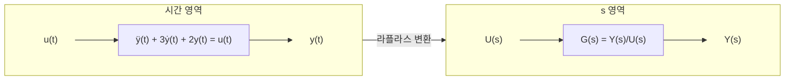

*그림 2. 시간 영역의 미분방정식과 s 영역의 전달함수*

### 1.3 전달함수로 출력 구하기

전달함수를 알면 임의의 입력에 대한 출력을 $Y(s) = G(s)U(s)$로 구할 수 있다. 예로 1.2절의 시스템에 **단위 계단 입력(unit step input)** 을 넣는다. 단위 계단 함수는 $t < 0$에서 0, $t \ge 0$에서 1인 함수이며, 라플라스 변환은 $1/s$이다(3주차).

$$
Y(s) = G(s)U(s) = \frac{1}{(s+1)(s+2)} \cdot \frac{1}{s} = \frac{1}{s(s+1)(s+2)}
$$

역변환에는 3주차의 부분분수 전개를 쓴다. 분모의 근 $0$, $-1$, $-2$가 서로 다른 실수이므로 다음과 같이 놓는다.

$$
\frac{1}{s(s+1)(s+2)} = \frac{K_1}{s} + \frac{K_2}{s+1} + \frac{K_3}{s+2}
$$

각 계수는 양변에 해당 인수를 곱한 뒤 그 인수의 근을 대입하여 구한다. 다른 항은 그 근에서 모두 0이 되기 때문이다.

$$
\begin{aligned}
K_1 &= \left.\frac{1}{(s+1)(s+2)}\right|_{s=0} = \frac{1}{1 \cdot 2} = \frac{1}{2} \\
K_2 &= \left.\frac{1}{s(s+2)}\right|_{s=-1} = \frac{1}{(-1)(1)} = -1 \\
K_3 &= \left.\frac{1}{s(s+1)}\right|_{s=-2} = \frac{1}{(-2)(-1)} = \frac{1}{2}
\end{aligned}
$$

$\mathcal{L}^{-1}\lbrace1/s \rbrace= 1$, $\mathcal{L}^{-1}\lbrace1/(s+a) \rbrace= e^{-at}$을 적용하면 $t \ge 0$에서 출력은 다음과 같다.

$$
y(t) = \frac{1}{2} - e^{-t} + \frac{1}{2}e^{-2t}
$$

결과를 두 가지로 검산할 수 있다. $t = 0$이면 $y(0) = 1/2 - 1 + 1/2 = 0$이므로 초기 조건과 맞는다. $t \to \infty$이면 지수 항이 사라져 $y \to 1/2$인데, 정상 상태에서는 모든 미분이 0이므로 미분방정식이 $2y = 1$이 되어 $y = 1/2$이라는 점과도 일치한다. 이 응답의 모양은 2.6절의 그림 8에 있다.

### 1.4 예제 1: RC 회로

그림 3의 회로에서 전압원 $u(t)$가 입력이고, 커패시터 양단의 전압 $y(t)$가 출력이다. 관심 대상은 $u(t)$로 인해 발생하는 $y(t)$의 시간에 따른 거동이다.

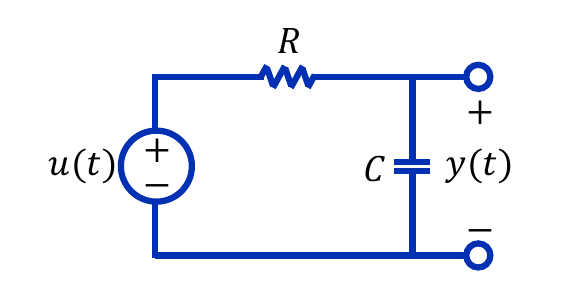

*그림 3. 전압원, 저항, 커패시터로 이루어진 RC 회로*

**미분방정식 세우기.** 출력 단자에 아무것도 연결되어 있지 않으므로, 키르히호프의 전류 법칙(KCL)에 따라 저항에 흐르는 전류와 커패시터에 흐르는 전류는 같다. 저항의 전류는 양단 전압을 저항으로 나눈 $(u - y)/R$이고, 커패시터의 전류는 $C\,dy/dt$이다.

$$
\frac{u(t) - y(t)}{R} = C\frac{dy(t)}{dt}
$$

양변에 $R$을 곱하고 정리하면 다음 1계 미분방정식을 얻는다.

$$
RC\frac{dy(t)}{dt} + y(t) = u(t)
$$

**전달함수 구하기.** 초기 조건 $y(0) = 0$을 두고 라플라스 변환하면 $RCsY(s) + Y(s) = U(s)$, 곧 $(RCs + 1)Y(s) = U(s)$이다. 입력과 출력의 라플라스 변환의 비를 구하면 다음과 같다.

$$
G(s) = \frac{Y(s)}{U(s)} = \frac{1}{RCs + 1}
$$

곱 $RC$는 시간의 차원을 가지며 **시정수(time constant)** 라고 한다. 1차 시스템의 응답 속도는 7주차에서 시정수로 분석한다.

### 1.5 예제 2: 질량, 스프링, 댐퍼 시스템

그림 4는 질량 $M$이 스프링(강성 $K$)과 댐퍼(점성 마찰 계수 $B$)로 벽에 연결되고, 외력 $f$가 작용하는 시스템이다. 관심 대상은 $f$로 인해 발생하는 변위 $y$의 시간에 따른 거동이다.

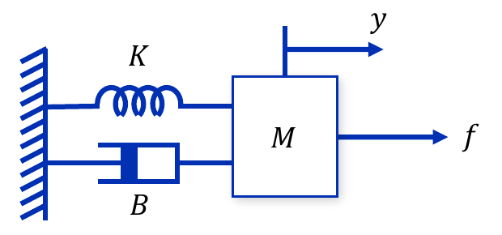

*그림 4. 스프링과 댐퍼로 벽에 연결된 질량*

**미분방정식 세우기.** 4주차와 같이 질량에 작용하는 힘을 모두 더하면 뉴턴의 제2법칙에 따라 질량과 가속도의 곱과 같다. 외력 $f$는 $+y$ 방향으로, 스프링의 복원력 $Ky$와 댐퍼의 마찰력 $B\,dy/dt$는 $-y$ 방향으로 작용한다.

$$
f - Ky - B\frac{dy}{dt} = M\frac{d^2y}{dt^2}
\quad\Longrightarrow\quad
M\frac{d^2y}{dt^2} + B\frac{dy}{dt} + Ky = f
$$

**전달함수 구하기.** 초기 조건을 0으로 두고 양변을 라플라스 변환하면 $Ms^2Y(s) + BsY(s) + KY(s) = F(s)$이다. $Y(s)$로 묶고 $F(s)$로 나눈다.

$$
G(s) = \frac{Y(s)}{F(s)} = \frac{1}{Ms^2 + Bs + K}
$$

분모가 2차 다항식이므로 이 시스템은 2차 시스템이다. 1.2절의 미분방정식은 $M = 1$, $B = 3$, $K = 2$인 경우와 같다.

### 1.6 예제 3: 두 질량 시스템

그림 5는 두 질량 $M_1$, $M_2$가 스프링 $K$로 연결되고, $M_2$는 댐퍼 $B$로 벽에 연결된 시스템이다. 외력 $f$는 $M_1$에 작용한다. 관심 대상은 $f$로 인해 발생하는 두 변위 $y_1$, $y_2$의 시간에 따른 거동이다.

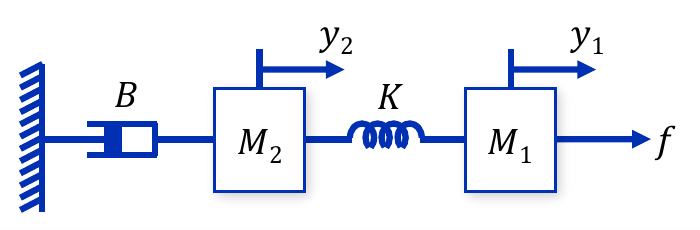

*그림 5. 스프링으로 연결된 두 질량과 벽에 연결된 댐퍼*

**미분방정식 세우기.** 질량마다 뉴턴의 제2법칙을 쓴다. 스프링은 두 끝의 변위 차이 $y_1 - y_2$만큼 늘어나 힘 $K(y_1 - y_2)$를 내며, 이 힘은 $M_1$을 $-$ 방향으로, $M_2$를 $+$ 방향으로 당긴다. 댐퍼는 $M_2$의 속도에 비례하는 마찰력 $B\,dy_2/dt$를 $-$ 방향으로 낸다.

$$
\begin{aligned}
M_1: &\quad f - K(y_1 - y_2) = M_1\frac{d^2y_1}{dt^2} \\
M_2: &\quad K(y_1 - y_2) - B\frac{dy_2}{dt} = M_2\frac{d^2y_2}{dt^2}
\end{aligned}
$$

**라플라스 변환.** 초기 조건을 0으로 두고 각 식을 변환한 뒤, $Y_1$과 $Y_2$의 항을 정리한다. 첫째 식은 $F - KY_1 + KY_2 = M_1s^2Y_1$, 둘째 식은 $KY_1 - KY_2 - BsY_2 = M_2s^2Y_2$가 된다.

$$
\begin{aligned}
(M_1s^2 + K)Y_1(s) &= F(s) + KY_2(s) \\
(M_2s^2 + Bs + K)Y_2(s) &= KY_1(s)
\end{aligned}
$$

두 출력이 서로 얽혀 있으므로 2개의 연립 방정식을 풀어야 한다. 둘째 식에서 $Y_2$를 $Y_1$로 나타낸다.

$$
Y_2(s) = \frac{K}{M_2s^2 + Bs + K}\,Y_1(s)
$$

이를 첫째 식에 대입하고 $Y_1$로 묶는다.

$$
\left[(M_1s^2 + K) - \frac{K^2}{M_2s^2 + Bs + K}\right]Y_1(s) = F(s)
$$

대괄호 안을 통분하면 분자는 $(M_1s^2 + K)(M_2s^2 + Bs + K) - K^2$이다. 이를 전개하면 $K^2$ 항이 상쇄되고 모든 항에 $s$가 남는다.

$$
\begin{aligned}
(M_1s^2 + K)(M_2s^2 + Bs + K) - K^2
&= M_1M_2s^4 + M_1Bs^3 + (M_1 + M_2)Ks^2 + BKs + K^2 - K^2 \\
&= s\left[M_1M_2s^3 + M_1Bs^2 + (M_1 + M_2)Ks + BK\right]
\end{aligned}
$$

대괄호 안의 3차 다항식을 $D(s) = M_1M_2s^3 + M_1Bs^2 + (M_1 + M_2)Ks + BK$로 두면, 두 전달함수는 다음과 같다. 둘째 전달함수는 $Y_2/Y_1$과 $Y_1/F$의 곱이다.

$$
\frac{Y_1(s)}{F(s)} = \frac{M_2s^2 + Bs + K}{s\,D(s)},
\qquad
\frac{Y_2(s)}{F(s)} = \frac{Y_2(s)}{Y_1(s)} \cdot \frac{Y_1(s)}{F(s)} = \frac{K}{s\,D(s)}
$$

두 전달함수는 분모가 같고 분자만 다르다. 분모는 시스템 전체의 성질이고, 분자는 어느 변위를 출력으로 보느냐에 따라 달라진다. 분모의 인수 $s$는 원점의 극점(2.9절)이다. 벽과 연결된 요소가 댐퍼뿐이므로, 일정한 힘을 계속 가하면 두 질량이 한없이 밀려 나간다는 뜻이다.

---

 

## 2. 임펄스 응답과 특성방정식

전달함수와 밀접한 관련이 있는 시간 영역의 함수가 시스템의 임펄스 응답이다. 이 절에서는 임펄스 함수를 정의하고, 임펄스 응답과 전달함수의 관계, 임의의 입력에 대한 응답, 전달함수의 일반형과 특성방정식, 극점과 영점을 다룬다.

### 2.1 펄스 함수와 임펄스 함수

> **용어 정의:** **펄스 함수(pulse function)** 는 짧은 시간 동안 지속되며, 지속 시간 동안 함수 값이 일정한 함수이다. 폭이 $\Delta t$인 펄스 함수 $\delta_\Delta(t)$는 높이를 폭의 역수 $1/\Delta t$로 정하여 면적이 1이 되게 한다.

$$
\delta_\Delta(t) =
\begin{cases}
\dfrac{1}{\Delta t}, & -\dfrac{\Delta t}{2} \le t \le \dfrac{\Delta t}{2} \\
0, & \text{그 밖의 } t
\end{cases}
$$

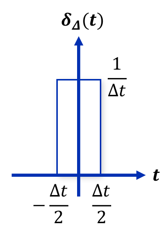

*그림 6. 면적이 1인 펄스 함수*

펄스 함수의 면적은 폭과 높이의 곱이므로 폭에 관계없이 1이다.

$$
\int_{-\infty}^{\infty}\delta_\Delta(t)\,dt = \int_{-\Delta t/2}^{\Delta t/2}\frac{1}{\Delta t}\,dt = \Delta t \cdot \frac{1}{\Delta t} = 1
$$

> **용어 정의:** **임펄스 함수(impulse function)** $\delta(t)$는 펄스 함수의 폭을 무한히 작게 한 극한이다. 폭은 무한히 작아지는 반면 높이는 무한대가 되고, 적분 값은 1로 유지된다. 단위 임펄스(unit impulse) 또는 디랙 델타 함수(Dirac delta function)라고도 한다.

$$
\delta(t) = \lim_{\Delta t \to 0}\delta_\Delta(t), \qquad
\int_{-\infty}^{\infty}\delta(t)\,dt = \int_{0^-}^{0^+}\delta(t)\,dt = 1
$$

$0^-$와 $0^+$는 각각 0의 바로 직전과 바로 직후의 시각이다. 임펄스는 $t = 0$에 몰려 있으므로 $0^-$부터 $0^+$까지만 적분해도 면적 1을 모두 얻는다. 임펄스는 망치로 한 번 치는 것처럼 매우 짧은 순간에 큰 크기로 가해지지만 전체 효과(면적)는 유한한 입력을 이상화한 것이다.

엄밀히 말하면 $\delta(t)$는 보통의 함수가 아니다. 한 점 밖에서 0인 보통의 함수는 적분이 0이기 때문이다. 임펄스는 적분 안에서의 작용으로 정의되는 일반화 함수(generalized function)이며, 그 작용을 나타내는 것이 다음의 **선별 성질(sifting property)** 이다 [1]. 함수 $f$가 $t = a$에서 연속이면 다음이 성립한다.

$$
\int_{-\infty}^{\infty} f(t)\,\delta(t - a)\,dt = f(a)
$$

**임펄스 함수의 라플라스 변환.** 선별 성질에 $f(t) = e^{-st}$, $a = 0$을 넣는다. 라플라스 변환의 적분 하한을 $0^-$로 잡아 $t = 0$의 임펄스를 적분 구간에 포함시키면, $t = 0$ 근처에서 $e^{-st} = e^0 = 1$이므로 다음을 얻는다.

$$
\mathcal{L}\lbrace\delta(t) \rbrace= \int_{0^-}^{\infty}\delta(t)e^{-st}\,dt = \int_{0^-}^{0^+}\delta(t) \cdot 1\,dt = 1
$$

> **주의:** 라플라스 변환의 하한을 $0^+$로 잡으면 $t = 0$의 임펄스가 적분 구간 밖에 놓여 $\mathcal{L}\lbrace\delta(t) \rbrace= 0$이 된다. 임펄스 입력을 다룰 때는 하한을 $0^-$로 잡고, 초기 조건 $y(0)$도 입력이 들어오기 직전의 값 $y(0^-)$로 해석한다 [1].

### 2.2 임펄스 응답

> **용어 정의:** 초기 조건이 모두 0인 시스템의 입력에 임펄스 신호 $\delta(t)$가 입력될 경우의 출력 응답을 **임펄스 응답(impulse response)** 이라 하고, $g(t)$로 쓴다.

입력이 임펄스이면 임펄스의 라플라스 변환이 1이므로, $Y(s) = G(s)U(s)$에서 출력의 라플라스 변환은 전달함수 그 자체가 된다.

$$
u(t) = \delta(t) \;\Rightarrow\; U(s) = 1 \;\Rightarrow\; Y(s) = G(s)
$$

양변을 역변환하면 전달함수의 역라플라스 변환이 임펄스 응답이다.

$$
y(t) = \mathcal{L}^{-1}\lbrace G(s) \rbrace= g(t)
$$

> **핵심:** 임펄스 응답 $g(t)$와 전달함수 $G(s)$는 라플라스 변환 쌍이다. 전달함수의 역라플라스 변환이 임펄스 응답이고, 임펄스 응답의 라플라스 변환이 전달함수이므로, 둘 중 하나를 알면 다른 하나도 안다.

예로 1.2절의 $G(s) = 1/[(s+1)(s+2)]$는 부분분수로 $1/(s+1) - 1/(s+2)$이므로, 임펄스 응답은 $g(t) = e^{-t} - e^{-2t}$이다.

### 2.3 임의의 입력에 대한 응답과 합성곱

$Y(s) = G(s)U(s)$를 시간 영역으로 되돌리면, $s$ 영역의 곱은 시간 영역의 **합성곱(convolution)** 이 된다(라플라스 변환의 합성곱 정리).

$$
y(t) = \mathcal{L}^{-1}\lbrace Y(s) \rbrace= \mathcal{L}^{-1}\lbrace G(s)U(s) \rbrace= \mathcal{L}^{-1}\lbrace G(s) \rbrace* \mathcal{L}^{-1}\lbrace U(s) \rbrace= g(t) * u(t) = \int_0^t g(t-\tau)\,u(\tau)\,d\tau
$$

여기서 $*$는 합성곱 연산이며, 입력과 임펄스 응답이 $t < 0$에서 0인 경우의 정의를 썼다. 이 식은 다음과 같이 이해할 수 있다.

1. 입력 $u(\tau)$를 폭이 $d\tau$인 짧은 조각으로 나누면, 시각 $\tau$의 조각은 면적이 $u(\tau)\,d\tau$인 임펄스로 볼 수 있다.
2. 시불변성에 의해, 시각 $\tau$에 들어온 단위 임펄스는 $\tau$만큼 늦게 시작하는 응답 $g(t - \tau)$를 만든다.
3. 선형성에 의해, 면적이 $u(\tau)\,d\tau$인 임펄스의 응답은 $g(t - \tau)\,u(\tau)\,d\tau$이다.
4. 중첩의 원리에 의해, 이 응답들을 모두 더한(적분한) 것이 시각 $t$의 출력이다. 적분 구간이 $0$부터 $t$까지인 것은 $\tau < 0$에는 입력이 없고, $\tau > t$에 들어올 입력은 아직 시각 $t$의 출력에 영향을 주지 못하기 때문이다.

> **핵심:** LTI 시스템은 임펄스 응답 $g(t)$ 하나로 완전히 결정된다. 어떤 입력에 대한 출력도 입력과 $g(t)$의 합성곱으로 구할 수 있다 [2].

> **[미적분학]** 합성곱 적분에서 $\sigma = t - \tau$로 치환하면 $d\sigma = -d\tau$이고 적분 구간의 끝이 서로 바뀌므로 $\int_0^t g(t-\tau)u(\tau)\,d\tau = \int_0^t g(\sigma)u(t-\sigma)\,d\sigma$이다. 따라서 $g * u = u * g$로 합성곱은 교환 법칙을 만족한다. 2.6절의 계산에 이 치환을 쓴다.

### 2.4 예제 1: RC 회로의 임펄스 응답

1.4절의 RC 회로(그림 3)에서 이번에는 초기 조건 $y(0)$이 0이 아닐 수도 있다고 하고 출력을 구한다. 미분방정식 $RC\,\dot{y} + y = u$를 미분 성질 $\mathcal{L}\lbrace\dot{y} \rbrace= sY(s) - y(0)$로 변환한다.

$$
RC\left[sY(s) - y(0)\right] + Y(s) = U(s)
$$

$Y(s)$의 항을 좌변에 모으면 $(RCs + 1)Y(s) = U(s) + y(0)RC$이므로, 출력 신호의 라플라스 변환은 다음과 같다.

$$
Y(s) = \frac{1}{RCs + 1}\left[U(s) + y(0)RC\right]
$$

첫째 항 $U(s)/(RCs + 1) = G(s)U(s)$는 입력에 의한 부분이고, 둘째 항 $y(0)RC/(RCs + 1)$은 초기 조건에 의한 부분이다. 임펄스 입력 $U(s) = 1$을 넣고, 역변환하기 쉽게 분자와 분모를 $RC$로 나눈다.

$$
Y(s) = \frac{1 + y(0)RC}{RCs + 1} = \frac{\dfrac{1}{RC} + y(0)}{s + \dfrac{1}{RC}}
$$

$\mathcal{L}^{-1}\lbrace1/(s+a) \rbrace= e^{-at}$에 $a = 1/RC$를 적용하여 역라플라스 변환한다.

$$
y(t) = \left[\frac{1}{RC} + y(0)\right]e^{-t/RC} = \underbrace{\frac{1}{RC}e^{-t/RC}}_{\text{임펄스 응답 } g(t)} + \underbrace{y(0)\,e^{-t/RC}}_{\text{초기 조건에 의한 응답}}
$$

초기 조건이 0이면 둘째 항이 사라지고, 첫째 항 $g(t) = \frac{1}{RC}e^{-t/RC}$가 RC 회로의 임펄스 응답이다. 이는 $G(s) = 1/(RCs + 1)$의 역라플라스 변환과 같다. 물리적으로는 임펄스 전압이 들어오는 순간 저항을 통해 전하 $\int i\,dt = \int \delta(t)/R\,dt = 1/R$이 커패시터에 들어가 커패시터 전압이 $1/(RC)$로 뛰어오르고, 그 뒤에는 입력이 0이므로 커패시터가 저항을 통해 방전되어 전압이 시정수 $RC$로 지수적으로 줄어든다.

### 2.5 예제 2: RL 회로의 임펄스 응답

그림 7의 회로는 인덕터 $L$과 저항 $R$이 직렬로 연결되어 있으며, 입력은 전압 $u$, 출력은 저항 양단의 전압 $y$이다.

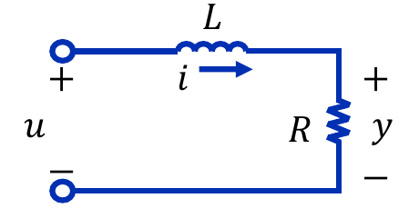

*그림 7. 인덕터와 저항이 직렬로 연결된 RL 회로*

**미분방정식 세우기.** 키르히호프의 전압 법칙(KVL)에 따라 입력 전압은 인덕터 전압 $L\,di/dt$와 저항 전압 $Ri$의 합이다. 출력이 $y = Ri$이므로 $i = y/R$을 대입한다.

$$
u = L\frac{di}{dt} + Ri = \frac{L}{R}\frac{dy}{dt} + y
$$

**출력 신호의 라플라스 변환.** 초기 조건 $y(0)$을 남긴 채 변환하고 임펄스 입력 $U(s) = 1$을 넣는다.

$$
\frac{L}{R}\left[sY(s) - y(0)\right] + Y(s) = U(s) = 1
$$

$Y(s)$로 묶으면 $\left(\frac{L}{R}s + 1\right)Y(s) = 1 + \frac{L}{R}y(0)$이고, 분자와 분모를 $L/R$로 나누면 다음과 같다.

$$
Y(s) = \frac{1 + \dfrac{L}{R}y(0)}{\dfrac{L}{R}s + 1} = \frac{\dfrac{R}{L} + y(0)}{s + \dfrac{R}{L}}
$$

**역라플라스 변환.** $a = R/L$로 두고 역변환한다.

$$
y(t) = \left[\frac{R}{L} + y(0)\right]e^{-Rt/L}
$$

초기 조건이 0이면 임펄스 응답은 $g(t) = \frac{R}{L}e^{-Rt/L}$이고, 전달함수는 $G(s) = 1/\left(\frac{L}{R}s + 1\right)$이다. RC 회로와 RL 회로는 물리적으로 다르지만, 둘 다 $G(s) = 1/(\tau s + 1)$ 꼴의 1차 시스템이며 시정수가 각각 $\tau = RC$와 $\tau = L/R$이다.

### 2.6 예제 3: 계단 응답

다음 시스템에 단위 계단 입력 $U(s) = 1/s$를 넣었을 때의 출력을 두 가지 방법으로 구한다.

$$
G(s) = \frac{Y(s)}{U(s)} = \frac{s}{(s+2)(s+1)}, \qquad U(s) = \frac{1}{s}
$$

**방법 1: 부분분수 전개.** 출력 신호의 라플라스 변환을 구하면 분자의 $s$와 입력의 $1/s$가 약분된다.

$$
Y(s) = G(s)U(s) = \frac{s}{(s+2)(s+1)} \cdot \frac{1}{s} = \frac{1}{(s+1)(s+2)}
$$

부분분수 $K_1/(s+1) + K_2/(s+2)$로 전개하면 $K_1 = \frac{1}{s+2}\big\vert_{s=-1} = 1$, $K_2 = \frac{1}{s+1}\big\vert_{s=-2} = -1$이므로 역라플라스 변환은 다음과 같다.

$$
Y(s) = \frac{1}{s+1} - \frac{1}{s+2} \quad\Longrightarrow\quad y(t) = e^{-t} - e^{-2t} \quad (t \ge 0)
$$

**방법 2: 합성곱.** 먼저 임펄스 응답 $g(t) = \mathcal{L}^{-1}\lbrace G(s) \rbrace$를 부분분수 전개로 구한다.

$$
\frac{s}{(s+1)(s+2)} = \frac{A}{s+1} + \frac{B}{s+2}, \qquad
A = \left.\frac{s}{s+2}\right|_{s=-1} = \frac{-1}{1} = -1, \qquad
B = \left.\frac{s}{s+1}\right|_{s=-2} = \frac{-2}{-1} = 2
$$

따라서 $g(t) = -e^{-t} + 2e^{-2t}$이다. 단위 계단 입력은 $\tau \ge 0$에서 $u(\tau) = 1$이므로 합성곱은 $y(t) = \int_0^t g(t-\tau)\,d\tau$이다. $\sigma = t - \tau$로 치환하면 $d\sigma = -d\tau$이고, $\tau = 0$일 때 $\sigma = t$, $\tau = t$일 때 $\sigma = 0$이므로 다음과 같다.

$$
\begin{aligned}
y(t) &= \int_0^t g(\sigma)\,d\sigma = \int_0^t \left(-e^{-\sigma} + 2e^{-2\sigma}\right)d\sigma \\
&= \Big[\,e^{-\sigma} - e^{-2\sigma}\,\Big]_0^t = \left(e^{-t} - e^{-2t}\right) - (1 - 1) = e^{-t} - e^{-2t}
\end{aligned}
$$

두 방법의 결과가 같다. 계단 응답은 임펄스 응답을 0부터 $t$까지 적분한 것이며, 이는 $s$ 영역에서 $G(s)$에 $1/s$를 곱하는 것에 해당한다.

그림 8은 1.3절의 계단 응답과 이 예제의 계단 응답을 비교한 것이다. 1.3절의 시스템은 출력이 0에서 출발하여 $1/2$로 수렴하지만, 이 예제의 시스템은 분자의 $s$ 때문에 출력이 잠시 커졌다가 다시 0으로 돌아간다. $dy/dt = -e^{-t} + 2e^{-2t} = 0$에서 $e^{-t} = 1/2$이므로 최댓값은 $t = \ln 2 \approx 0.69$에서 $1/2 - 1/4 = 1/4$이다. 분자의 $s$는 입력을 미분하는 효과를 내므로, 일정한 입력이 계속되면 출력이 사라진다. 또 이 예제의 계단 응답은 1.2절 시스템의 임펄스 응답(2.2절)과 같다. $G(s) = s \cdot \frac{1}{(s+1)(s+2)}$에 $1/s$를 곱하면 $\frac{1}{(s+1)(s+2)}$만 남기 때문이다.

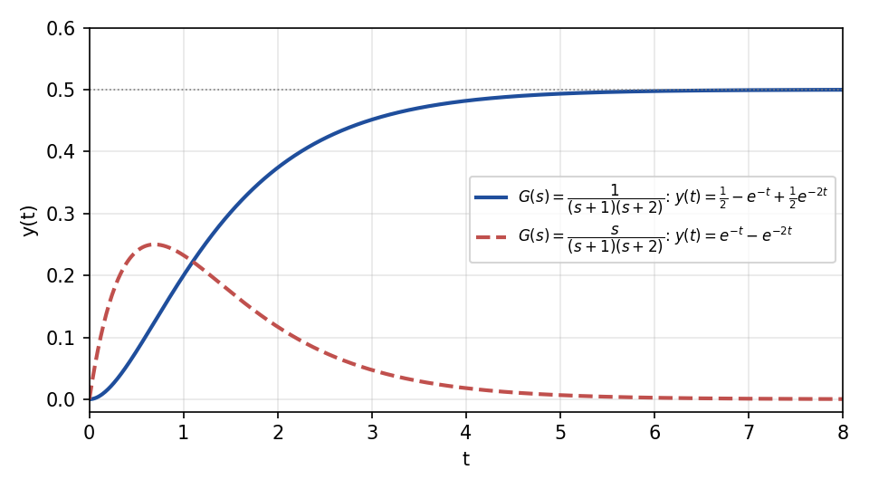

*그림 8. 두 시스템의 단위 계단 응답*

### 2.7 전달함수의 일반형

$n$계 미분방정식으로 기술되는 선형 시불변 시스템을 생각한다. 출력의 최고차 미분의 계수를 1로 맞춘 일반형은 다음과 같으며, $a_i$와 $b_i$는 상수이다.

$$
\frac{d^ny(t)}{dt^n} + a_{n-1}\frac{d^{n-1}y(t)}{dt^{n-1}} + \cdots + a_1\frac{dy(t)}{dt} + a_0y(t)
= b_m\frac{d^mu(t)}{dt^m} + b_{m-1}\frac{d^{m-1}u(t)}{dt^{m-1}} + \cdots + b_1\frac{du(t)}{dt} + b_0u(t)
$$

초기 조건을 0으로 두고 라플라스 변환하면 $k$번 미분이 $s^k$를 곱하는 것으로 바뀐다.

$$
(s^n + a_{n-1}s^{n-1} + \cdots + a_1s + a_0)\,Y(s) = (b_ms^m + b_{m-1}s^{m-1} + \cdots + b_1s + b_0)\,U(s)
$$

따라서 전달함수는 두 다항식의 비, 곧 $s$의 유리함수이다.

$$
G(s) = \frac{Y(s)}{U(s)} = \frac{b_ms^m + b_{m-1}s^{m-1} + \cdots + b_1s + b_0}{s^n + a_{n-1}s^{n-1} + \cdots + a_1s + a_0}
$$

분모 다항식의 계수는 미분방정식 좌변(출력 쪽)의 계수이고, 분자 다항식의 계수는 우변(입력 쪽)의 계수이다. 분모의 차수 $n$을 시스템의 **차수(order)** 라고 한다. 실제 물리 시스템에서는 대부분 $m \le n$이며, $m \le n$인 전달함수를 **프로퍼 전달함수(proper transfer function)**, $m < n$인 전달함수를 **순프로퍼 전달함수(strictly proper transfer function)** 라고 한다.

### 2.8 특성방정식

> **용어 정의:** 전달함수의 분모를 0으로 놓아서 얻어지는 방정식을 시스템의 **특성방정식(characteristic equation)** 이라 한다.

$$
s^n + a_{n-1}s^{n-1} + \cdots + a_1s + a_0 = 0
$$

특성방정식은 시스템의 특성에 관한 중요한 정보를 제공한다. 이 다항식은 2주차에서 동차 미분방정식의 해를 구할 때 쓴 특성방정식과 같다. 동차 미분방정식 $y^{(n)} + a_{n-1}y^{(n-1)} + \cdots + a_0y = 0$($y^{(k)}$는 $y$의 $k$계 도함수)에 $y = e^{\lambda t}$를 넣으면 $\lambda^n + a_{n-1}\lambda^{n-1} + \cdots + a_0 = 0$이 되는데, 변수 이름만 $\lambda$에서 $s$로 바뀌었을 뿐이다. 따라서 특성방정식의 근 $p_i$는 시스템이 스스로 보이는 움직임 $e^{p_it}$의 지수를 정한다. 예로 1.2절 시스템의 특성방정식은 $s^2 + 3s + 2 = 0$이고 근이 $-1$, $-2$이므로, 응답에 $e^{-t}$와 $e^{-2t}$가 나타난다(1.3절, 2.2절).

### 2.9 극점과 영점

> **용어 정의:** **극점(pole)** 은 전달함수의 값을 무한대로 만드는 라플라스 변수 $s$의 값이고, **영점(zero)** 은 전달함수의 분자를 0으로 하는(전달함수의 값을 0으로 만드는) $s$의 값이다.

전달함수의 값이 무한대가 되는 경우는 두 가지이다.

- 분자가 0이 아닌 유한한 값을 가질 때 분모가 0이 되는 경우이다. 따라서 분자와 분모에 공통 인수가 없으면 특성방정식의 근은 모두 극점이다.
- 분자가 무한대가 되어 전달함수의 값이 무한대가 되는 경우이다. 이는 $s$가 무한대로 갈 때 일어날 수 있으므로, 무한대도 극점이 될 수 있다.

**무한대의 극점과 영점.** $\lvert s\rvert \to \infty$이면 $G(s)$는 최고차 항의 비 $b_ms^m/s^n = b_ms^{m-n}$처럼 행동한다.

- 분자의 차수가 분모의 차수보다 크면($m > n$) $G(s) \to \infty$이므로 무한대에 극점이 존재하며, 그 개수는 $m - n$이다.
- 분모의 차수가 분자의 차수보다 크면($n > m$) $G(s) \to 0$이므로 무한대에 영점이 존재하며, 그 개수는 $n - m$이다.

무한대의 것까지 세면 극점의 개수와 영점의 개수는 $\max(m, n)$으로 같다. 극점과 영점은 복소평면, 곧 $s$ 평면(가로축 $\sigma$는 실수부, 세로축 $j\omega$는 허수부) 위에 극점은 ×, 영점은 ○로 표시하며, 이 그림을 **극점-영점 배치도(pole-zero map)** 라 한다.

> **핵심:** 전달함수의 극점의 위치는 시스템의 특성에 관한 중요한 정보를 가지고 있다. 서로 다른 극점 $p$는 각각 응답에 $e^{pt}$ 항을 만들므로, 극점의 실수부가 음수이면 그 항이 줄어들고, 양수이면 커지며, 허수부가 있으면 진동한다. 극점의 위치와 응답의 관계, 그리고 안정도는 9주차에서 다룬다.

> **주의:** 분자와 분모에 같은 인수가 있으면 약분되어 극점과 영점이 함께 사라진다. 이를 **극점-영점 상쇄(pole-zero cancellation)** 라 한다. 약분된 극점은 전달함수에는 보이지 않지만 시스템 내부에는 남아 있을 수 있으며, 이 문제는 6주차의 상태 변수 방정식에서 다룬다.

### 2.10 예제 4, 5: 극점과 영점 구하기

**예제 4.** 다음 전달함수의 특성방정식, 극점, 영점을 구한다. $j = \sqrt{-1}$은 허수 단위이다.

$$
G(s) = \frac{(s+1)^2}{(s+2)(s^2 + 2s + 2)}
$$

- **특성방정식:** $(s+2)(s^2 + 2s + 2) = 0$이다.
- **극점:** $s + 2 = 0$에서 $-2$를 얻는다. $s^2 + 2s + 2 = 0$은 근의 공식으로 $s = \frac{-2 \pm \sqrt{4 - 8}}{2} = -1 \pm j$이며, 완전제곱 $(s+1)^2 + 1 = 0$으로도 확인할 수 있다. 따라서 극점은 $-2$, $-1 + j$, $-1 - j$이다.
- **영점:** 분자 $(s+1)^2 = 0$에서 $-1$을 얻으며, 중근이므로 두 번 센다. 또 분모의 차수 3이 분자의 차수 2보다 크므로 무한대에 영점이 1개 존재한다.

그림 9는 이 전달함수의 극점-영점 배치도이다. 복소 극점 $-1 \pm j$는 실수축에 대해 대칭인 켤레 쌍으로 나타난다. 계수가 실수인 다항식의 복소근은 항상 켤레 쌍으로 나타나기 때문이다.

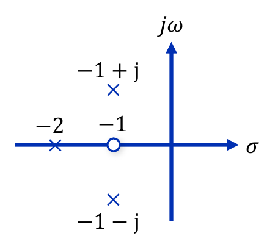

*그림 9. 예제 4의 극점-영점 배치도*

**예제 5.** 다음 전달함수의 특성방정식, 극점, 영점을 구한다.

$$
G(s) = \frac{s(s+1)}{s+2}
$$

- **특성방정식:** $s + 2 = 0$이다.
- **극점:** $-2$를 얻는다. 또 분자의 차수 2가 분모의 차수 1보다 높으므로 무한대에 극점이 1개 존재한다.
- **영점:** 분자 $s(s+1) = 0$에서 $0$과 $-1$을 얻는다. 분모의 차수가 분자보다 크지 않으므로 무한대에는 영점이 없다.

> **참고:** 예제 5의 영점을 $-1$과 무한대로 적은 자료가 있으나, 분자 $s(s+1)$은 $s = 0$에서도 0이 되므로 영점은 $0$과 $-1$이다. 분자의 차수가 분모보다 크므로 무한대에는 영점이 아니라 극점이 있다. 무한대까지 세면 극점 2개($-2$, $\infty$)와 영점 2개($0$, $-1$)로 개수가 맞는다.

| 전달함수 | 유한한 극점 | 유한한 영점 | 무한대 |
|:-----|:-----|:-----|:-----|
| 예제 4: $\dfrac{(s+1)^2}{(s+2)(s^2+2s+2)}$ | $-2$, $-1 \pm j$ | $-1$ (중근) | 영점 1개 ($n - m = 1$) |
| 예제 5: $\dfrac{s(s+1)}{s+2}$ | $-2$ | $0$, $-1$ | 극점 1개 ($m - n = 1$) |

*표 1. 예제 4와 예제 5의 극점과 영점*

예제 5처럼 분자의 차수가 분모보다 큰 전달함수는 입력의 미분을 출력에 포함하므로, 2.7절에서 말한 대로 실제 물리 시스템에서는 드물다.

---

 

## 3. 블록선도

### 3.1 블록선도와 대수 방정식

$s$ 영역에서는 출력을 입력에 전달함수를 곱한 형태 $Y(s) = G(s)U(s)$로 나타낼 수 있다. $s$는 복소 주파수를 나타내므로 $s$ 영역을 주파수 영역이라고도 한다. 시간 영역에서 입력과 출력의 관계는 단순한 곱셈이나 덧셈으로 나타낼 수 있는 관계가 아니라 미분방정식으로 나타내지는 관계이지만, $s$ 영역에서는 입력과 출력의 관계를 곱셈과 덧셈으로 이루어진 **대수 방정식(algebraic equation)** 의 형태로 나타낼 수 있다. 그래서 $s$ 영역에서는 시스템을 블록선도로 나타내고, 그림 위에서 대수 연산만으로 전체 전달함수를 구할 수 있다.

> **용어 정의:** **블록선도(block diagram)** 는 시스템의 각 구성 요소를 전달함수를 적은 블록으로, 신호를 화살표로 나타내어 신호의 흐름과 요소 사이의 연결을 보여 주는 그림이다. 블록선도는 다음 네 요소로 이루어진다.
>
> - **블록(block):** 기본 블록(그림 1)으로, 입력 신호에 블록 안의 전달함수를 곱해 출력 신호를 만든다.
> - **신호(signal):** 화살표로 나타내며, 화살표 방향으로만 흐른다.
> - **가합점(summing point):** 원으로 나타내며, 들어오는 신호들을 각 화살표에 붙은 부호($+$ 또는 $-$)대로 더한다.
> - **인출점(takeoff point):** 한 신호를 여러 곳으로 나누어 보내는 점이다. 인출해도 신호의 값은 줄지 않고 모든 갈래에 같은 값이 전달된다.

이하의 식에서는 간단히 쓰기 위해 $(s)$를 생략하여 $G_1(s)$를 $G_1$, $U_1(s)$를 $U_1$처럼 쓴다.

### 3.2 직렬 연결

두 블록을 직렬로 연결하면(그림 10) 앞 블록의 출력이 뒤 블록의 입력이 된다.

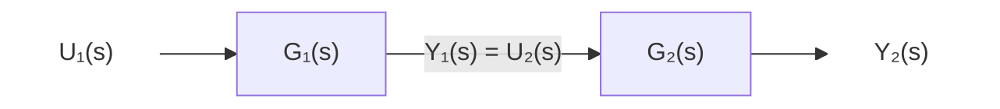

*그림 10. 두 블록의 직렬 연결*

각 블록의 관계 $Y_1 = G_1U_1$, $U_2 = Y_1$, $Y_2 = G_2U_2$를 차례로 대입하면 $Y_2 = G_2Y_1 = G_2G_1U_1$이다. 따라서 직렬로 연결한 전체 시스템의 전달함수는 각각의 전달함수를 곱한 것과 같다.

$$
\frac{Y_2(s)}{U_1(s)} = G_1(s)G_2(s)
$$

> **주의:** 직렬 연결의 곱셈 규칙은 뒤 블록이 앞 블록의 출력에 영향을 주지 않는다고(부하 효과가 없다고) 가정한다. 예를 들어 RC 회로 두 개를 그대로 이어 붙이면 뒤 회로가 앞 회로에서 전류를 끌어가 앞 회로의 동작이 바뀌므로, 전체 전달함수는 두 전달함수의 곱이 되지 않는다. 이런 경우에는 연결된 전체 회로의 방정식을 새로 세워야 한다 [3].

### 3.3 병렬 연결

두 블록이 같은 입력을 받고 두 출력이 가합점에서 더해지면(그림 11) 병렬 연결이다.

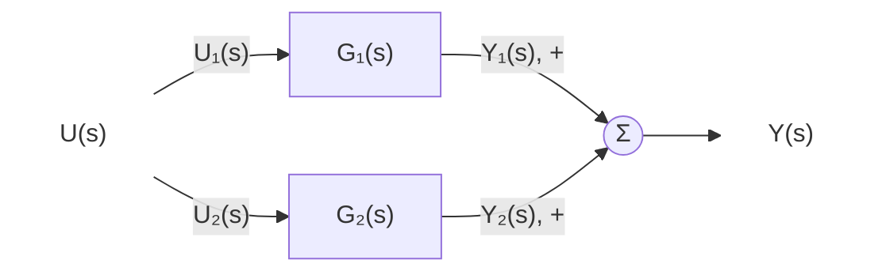

*그림 11. 두 블록의 병렬 연결*

인출점에서 갈라진 두 입력은 $U_1 = U_2 = U$이고, 출력은 $Y = Y_1 + Y_2 = G_1U + G_2U$이다. 따라서 병렬로 연결한 전체 시스템의 전달함수는 각각의 전달함수를 더한 것과 같다.

$$
\frac{Y(s)}{U(s)} = G_1(s) + G_2(s)
$$

가합점에서 한 갈래의 부호가 $-$이면 그 전달함수를 뺀다.

### 3.4 피드백 연결

피드백 연결(그림 12)은 출력의 일부를 되돌려 입력과 비교하는 구조이며, 1주차에서 본 폐루프 제어시스템의 기본 형태이다. $G_1(s)$가 있는 경로를 전방향 경로(forward path), $G_2(s)$가 있는 되돌아가는 경로를 피드백 경로(feedback path)라 한다. 그림 12처럼 가합점에서 피드백 신호를 빼는 연결을 **음의 피드백(negative feedback)** 이라 한다.

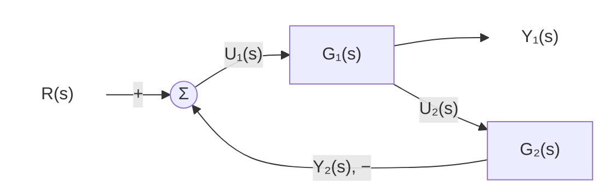

*그림 12. 두 블록의 피드백 연결*

각 신호의 관계는 다음과 같다.

$$
U_1 = R - Y_2, \qquad Y_1 = G_1U_1, \qquad U_2 = Y_1, \qquad Y_2 = G_2U_2
$$

둘째 식에 첫째 식을 넣고 $Y_2 = G_2U_2 = G_2Y_1$을 대입한다.

$$
Y_1 = G_1(R - G_2Y_1) = G_1R - G_1G_2Y_1
$$

$Y_1$의 항을 좌변으로 모으면 $(1 + G_1G_2)Y_1 = G_1R$이므로 다음을 얻는다.

$$
\frac{Y_1(s)}{R(s)} = \frac{G_1(s)}{1 + G_1(s)G_2(s)}
$$

이 비를 **폐루프 전달함수(closed-loop transfer function)** 라 하고, 분모의 $G_1G_2$처럼 루프를 한 바퀴 돌며 만나는 전달함수를 모두 곱한 것을 **루프 이득(loop gain)** 이라 한다. 음의 피드백의 결과를 말로 쓰면 다음과 같다.

$$
\text{폐루프 전달함수} = \frac{\text{전방향 경로의 전달함수}}{1 + \text{루프 이득}}
$$

- 가합점에서 피드백 신호를 더하는 **양의 피드백(positive feedback)** 이면, 첫 식이 $U_1 = R + Y_2$가 되어 분모의 부호가 바뀐 $G_1/(1 - G_1G_2)$를 얻는다.
- 피드백 경로의 전달함수가 1인 경우를 **단위 피드백(unity feedback)** 이라 하며, 이때 폐루프 전달함수는 $G_1/(1 + G_1)$이다.

### 3.5 가합점과 인출점의 이동

루프가 서로 얽힌 블록선도에는 3.2\~3.4절의 규칙을 바로 적용할 수 없는 경우가 있다. 이때 가합점이나 인출점을 블록의 앞이나 뒤로 옮겨 구조를 단순하게 만드는데, 이를 블록선도 연산이라 한다. 이동의 원칙은 하나이다. **옮기기 전과 후에 모든 출력 신호의 값이 같아야 한다.** 이 원칙에서 다음 네 규칙이 나온다.

**규칙 1: 가합점을 블록 뒤로 옮기기.** 이동 전에는 $Y_1 = G_1(U_1 + U_2) = G_1U_1 + G_1U_2$이다. 가합점을 $G_1$ 뒤로 옮기면 $U_1$은 $G_1$을 거치지만 $U_2$는 거치지 않으므로, $U_2$의 갈래에 $G_1$을 넣어야 같은 출력이 된다(그림 13).

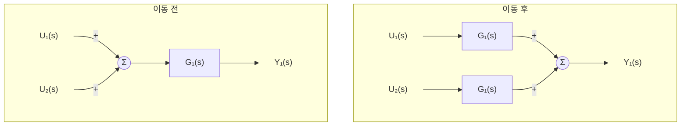

*그림 13. 가합점을 블록 뒤로 옮기는 규칙*

**규칙 2: 가합점을 블록 앞으로 옮기기.** 이동 전에는 $Y_1 = G_1U_1 + U_2$이다. 가합점을 $G_1$ 앞으로 옮기면 $U_2$도 $G_1$을 거치게 되므로, $U_2$의 갈래에 $1/G_1$을 넣어 $G_1(U_1 + U_2/G_1) = G_1U_1 + U_2$가 되게 한다(그림 14).

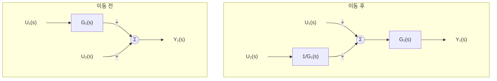

*그림 14. 가합점을 블록 앞으로 옮기는 규칙*

**규칙 3: 인출점을 블록 뒤로 옮기기.** 이동 전에는 인출점이 $G_1$ 앞에 있어 $Y_2 = U_1$이다. 인출점을 $G_1$ 뒤로 옮기면 인출되는 신호가 $Y_1 = G_1U_1$이 되므로, 갈래에 $1/G_1$을 넣어 $Y_2 = Y_1/G_1 = U_1$이 되게 한다(그림 15).

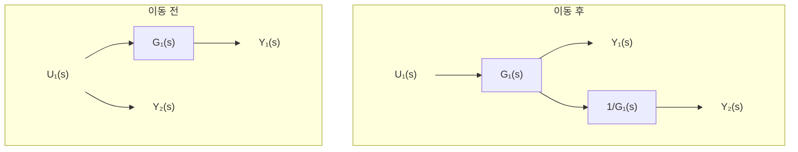

*그림 15. 인출점을 블록 뒤로 옮기는 규칙*

**규칙 4: 인출점을 블록 앞으로 옮기기.** 이동 전에는 인출점이 $G_1$ 뒤에 있어 $Y_2 = Y_1 = G_1U_1$이다. 인출점을 $G_1$ 앞으로 옮기면 인출되는 신호가 $U_1$이 되므로, 갈래에 $G_1$을 넣어 $Y_2 = G_1U_1$이 되게 한다(그림 16).

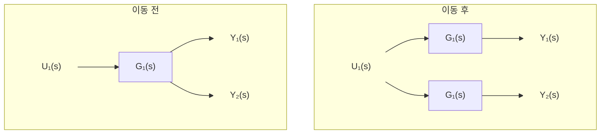

*그림 16. 인출점을 블록 앞으로 옮기는 규칙*

| 이동 | 옮긴 갈래에 넣을 블록 | 확인 |
|:-----|:-----|:-----|
| 가합점을 블록 뒤로 | $G_1$ | $G_1(U_1 + U_2) = G_1U_1 + G_1U_2$ |
| 가합점을 블록 앞으로 | $1/G_1$ | $G_1(U_1 + U_2/G_1) = G_1U_1 + U_2$ |
| 인출점을 블록 뒤로 | $1/G_1$ | $(G_1U_1)/G_1 = U_1$ |
| 인출점을 블록 앞으로 | $G_1$ | $G_1U_1 = Y_1$ |

*표 2. 가합점과 인출점의 이동 규칙*

> **주의:** 가합점과 인출점은 같은 방향으로 옮겨도 넣는 블록이 반대이다. 블록 뒤로 옮길 때 가합점의 갈래에는 $G_1$, 인출점의 갈래에는 $1/G_1$을 넣고, 블록 앞으로 옮길 때는 그 반대이다. 두 경우를 혼동하기 쉬우므로, 규칙을 외우기보다 옮긴 뒤의 신호 식을 써서 이동 전과 같은지 확인하는 것이 안전하다.

> **참고:** 인출점을 블록 앞으로 옮기는 규칙의 그림에서 옮긴 갈래에 $1/G_1$을 넣은 자료가 있으나, 이동 전에 인출되는 신호는 $G_1U_1$이므로 블록 앞의 $U_1$에서 인출하면 $G_1$을 곱해야 같은 신호가 된다(표 2). $1/G_1$을 넣으면 $U_1/G_1$이 인출되어 원래의 신호와 달라진다.

### 3.6 예제 1: 루프가 겹친 블록선도

그림 17의 블록선도에서 전달함수 $Y(s)/R(s)$를 구한다. 이 블록선도에는 가합점이 세 개 있다. 안쪽 루프에서는 $G_1$의 출력이 $G_2$를 거쳐 둘째 가합점으로 되돌아가고, 바깥 루프에서는 $G_4$의 출력이 $G_3$을 거쳐 첫째 가합점으로 되돌아간다. $G_4$의 출력은 또 $G_5$와 $G_6$으로 갈라져 셋째 가합점에서 더해진 뒤 출력 $Y$가 된다.

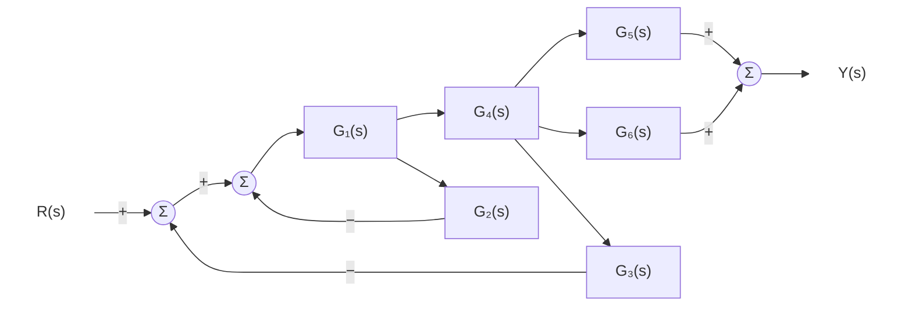

*그림 17. 예제 1의 블록선도*

**단계 1: 안쪽 루프.** 둘째 가합점에서 $G_1$ 뒤의 인출점까지는 다른 신호가 드나들지 않으므로, 안쪽 루프는 독립된 피드백 연결이다. 3.4절의 결과로 이 루프를 블록 하나로 바꾼다.

$$
G_A = \frac{G_1}{1 + G_1G_2}
$$

**단계 2: 직렬 연결.** $G_A$와 $G_4$는 직렬이므로 곱한다. 그 결과가 그림 18의 블록선도이다.

$$
G_AG_4 = \frac{G_1G_4}{1 + G_1G_2}
$$

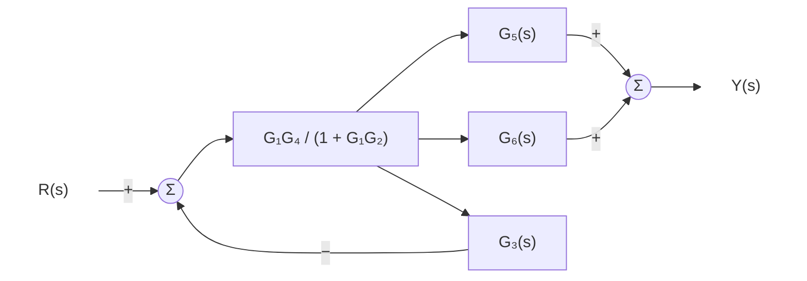

*그림 18. 안쪽 루프와 직렬 블록을 간소화한 예제 1의 블록선도*

**단계 3: 바깥 루프.** 전방향 경로가 $G_AG_4$, 피드백 경로가 $G_3$인 피드백 연결이다. 3.4절의 결과에 대입한 뒤, 분자와 분모에 $1 + G_1G_2$를 곱해 번분수를 정리한다.

$$
\frac{G_AG_4}{1 + G_AG_4G_3}
= \frac{\dfrac{G_1G_4}{1 + G_1G_2}}{1 + \dfrac{G_1G_3G_4}{1 + G_1G_2}}
= \frac{G_1G_4}{1 + G_1G_2 + G_1G_3G_4}
$$

**단계 4: 병렬 연결.** $G_5$와 $G_6$은 같은 신호를 받아 더해지므로 $G_5 + G_6$이다.

**단계 5: 직렬 연결.** 단계 3과 단계 4의 결과는 직렬이므로 곱한다(그림 19).

$$
\frac{Y(s)}{R(s)} = \frac{G_1G_4(G_5 + G_6)}{1 + G_1G_2 + G_1G_3G_4}
$$

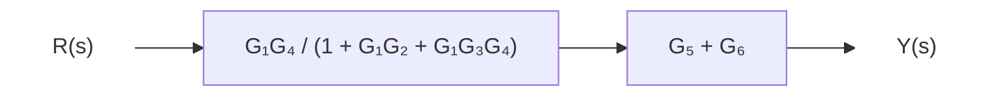

*그림 19. 간소화를 마친 예제 1의 블록선도*

검산으로 신호마다 식을 세워 연립해도 같은 결과가 나온다. 첫째, 둘째 가합점의 출력을 $E_1$, $E_2$, $G_1$과 $G_4$의 출력을 $X_1$, $X_4$라 하면 $E_1 = R - G_3X_4$, $E_2 = E_1 - G_2X_1$, $X_1 = G_1E_2$, $X_4 = G_4X_1$, $Y = (G_5 + G_6)X_4$이며, 이 다섯 식을 풀면 위의 전달함수가 된다. 6주차의 메이슨의 이득 공식으로도 같은 결과를 얻는다.

### 3.7 예제 2: 인출점을 옮겨야 하는 블록선도

그림 20의 블록선도에서 전달함수 $Y(s)/R(s)$를 구한다. $G_1$의 출력은 $G_2$와 $G_5$로 갈라지고, $G_2$의 출력은 $G_4$와 $G_3$으로 갈라진다. $G_3$의 출력은 첫째 가합점으로 되돌아가고, $G_4$와 $G_5$의 출력은 둘째 가합점에서 더해져 출력 $Y$가 된다.

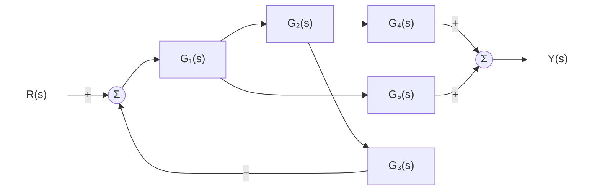

*그림 20. 예제 2의 블록선도*

**문제점.** $G_5$로 가는 인출점은 피드백 루프 안($G_1$과 $G_2$ 사이)에 있지만, $G_5$의 출력은 루프 밖에서 더해진다. 그래서 루프를 블록 하나로 바꾸려 해도 루프 안에서 신호가 빠져나가므로 3.4절을 바로 적용할 수 없다.

**단계 1: 인출점을 블록 뒤로 옮기기.** $G_5$로 가는 인출점을 $G_2$ 뒤로 옮긴다. 규칙 3에 따라 갈래에 $1/G_2$를 넣으면 $G_5$의 갈래는 $G_5/G_2$가 된다. 확인하면 옮긴 뒤 $G_5$ 갈래의 출력은 $(G_2X_1)\cdot G_5/G_2 = G_5X_1$로 이동 전과 같다($X_1$은 $G_1$의 출력). 이제 두 인출점이 모두 $G_2$ 뒤에 있으므로 그림 21과 같이 된다.

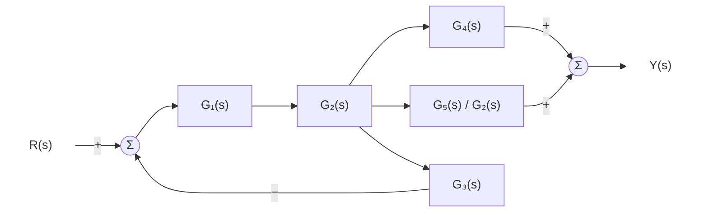

*그림 21. 인출점을 G₂ 뒤로 옮긴 예제 2의 블록선도*

**단계 2: 피드백 루프.** 전방향 경로 $G_1G_2$, 피드백 경로 $G_3$이므로 $\dfrac{G_1G_2}{1 + G_1G_2G_3}$이다.

**단계 3: 병렬 연결.** $G_4$와 $G_5/G_2$는 병렬이므로 $G_4 + \dfrac{G_5}{G_2}$이다.

**단계 4: 직렬 연결.** 두 결과를 곱하고, 분배하여 $G_2$를 약분한다(그림 22).

$$
\frac{Y(s)}{R(s)} = \frac{G_1G_2}{1 + G_1G_2G_3}\left(G_4 + \frac{G_5}{G_2}\right) = \frac{G_1G_2G_4 + G_1G_5}{1 + G_1G_2G_3}
$$

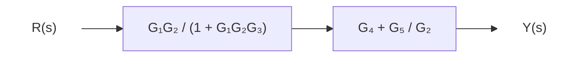

*그림 22. 간소화를 마친 예제 2의 블록선도*

결과의 분모에는 루프 이득 $G_1G_2G_3$만 나타나고, 분자는 입력에서 출력으로 가는 두 경로의 곱 $G_1G_2G_4$와 $G_1G_5$의 합이다. $G_5$ 경로는 루프 밖으로 나가므로 피드백되지 않고 출력에만 더해진다.

---

 

## 개념 적용

**T/F 점검:**

| 문장 | 판단과 근거 |
|:-----|:------------|
| 전달함수는 초기 조건과 관계없이 출력의 라플라스 변환과 입력의 라플라스 변환의 비이다. | **F.** 전달함수는 모든 초기 조건을 0으로 둔 상태에서 정의한다. 초기 조건이 0이 아니면 출력에 초기 조건에 의한 항이 더해진다. |
| 임펄스 응답의 라플라스 변환은 전달함수이다. | **T.** 임펄스의 라플라스 변환이 1이므로 $Y(s) = G(s)$이고, 따라서 $g(t) = \mathcal{L}^{-1}\lbrace G(s) \rbrace$이다. |
| 특성방정식의 근은 모두 극점이다. | **F.** 분자와 분모에 공통 인수가 없을 때만 성립한다. 공통 인수로 약분되는 근에서는 전달함수가 무한대가 되지 않으므로 그 근은 극점이 아니다(2.9절의 주의, 6주차의 극점-영점 상쇄). |
| $G(s) = (s+3)/[s(s+1)]$에는 무한대에 극점이 하나 있다. | **F.** 분모의 차수 2가 분자의 차수 1보다 크므로 무한대에 있는 것은 영점 1개이다. |
| 직렬로 연결된 두 블록의 전체 전달함수는 두 전달함수의 합이다. | **F.** 직렬 연결은 곱, 병렬 연결은 합이다. |
| 인출점을 블록 앞으로 옮기면 옮긴 갈래에 그 블록의 전달함수를 넣는다. | **T.** 이동 전의 인출 신호는 블록의 출력 $G_1U_1$이므로, 블록 앞의 $U_1$에서 인출하면 $G_1$을 곱해야 같은 신호가 된다. |

---

 

## 요약

| 개념 | 핵심 요약 |
|:-----|:-----|
| 전달함수 | LTI 시스템에서 초기 조건을 모두 0으로 둔 출력의 라플라스 변환과 입력의 라플라스 변환의 비 $G(s) = Y(s)/U(s)$이다. |
| 전달함수 구하기 | 미분방정식을 초기 조건 0으로 라플라스 변환하면 $k$번 미분이 $s^k$의 곱이 되며, 좌변의 계수가 분모, 우변의 계수가 분자가 된다. |
| 임펄스 함수 | 면적이 1인 펄스 함수의 폭을 0으로 보낸 극한이며, 라플라스 변환은 1이다. |
| 임펄스 응답 | 초기 조건이 0인 시스템에 임펄스를 넣었을 때의 출력이며, 전달함수의 역라플라스 변환 $g(t) = \mathcal{L}^{-1}\lbrace G(s) \rbrace$이다. |
| 합성곱 | 임의의 입력에 대한 출력은 $y(t) = \int_0^t g(t-\tau)u(\tau)\,d\tau$이며, $s$ 영역의 곱 $G(s)U(s)$에 해당한다. |
| 특성방정식 | 전달함수의 분모를 0으로 놓은 방정식이며, 그 근이 응답에 나타나는 지수 함수 $e^{pt}$의 지수를 정한다. |
| 극점과 영점 | 극점은 전달함수를 무한대로, 영점은 0으로 만드는 $s$의 값이며, 분자와 분모의 차수가 다르면 그 차이만큼 무한대에 극점이나 영점이 있다. |
| 블록선도 | 블록, 신호, 가합점, 인출점으로 $s$ 영역의 대수 관계를 나타낸 그림이다. |
| 기본 연결 | 직렬 연결은 $G_1G_2$, 병렬 연결은 $G_1 + G_2$, 음의 피드백 연결은 $G_1/(1 + G_1G_2)$이다. |
| 블록선도 연산 | 가합점과 인출점을 옮길 때는 출력 신호가 변하지 않도록 옮긴 갈래에 $G$ 또는 $1/G$를 넣는다. |

---

 

## 점검 문제

1. **전달함수 구하기:** 미분방정식 $2\ddot{y} + 5\dot{y} + 3y = 4\dot{u} + u$의 전달함수 $G(s) = Y(s)/U(s)$를 구하고, 극점과 영점을 무한대의 것까지 포함하여 쓰라.

   

   
정답

   초기 조건을 0으로 두고 라플라스 변환하면 $(2s^2 + 5s + 3)Y(s) = (4s + 1)U(s)$이므로 $G(s) = \dfrac{4s + 1}{2s^2 + 5s + 3}$이다. 분모는 $2s^2 + 5s + 3 = (2s + 3)(s + 1)$로 인수분해되므로 극점은 $-1$과 $-3/2$이다. 분자 $4s + 1 = 0$에서 영점은 $-1/4$이고, 분모의 차수 2가 분자의 차수 1보다 크므로 무한대에 영점이 1개 있다.

   

2. **임펄스 응답과 계단 응답:** $G(s) = 3/(s + 4)$인 시스템의 임펄스 응답과 단위 계단 응답을 구하라.

   

   
정답

   임펄스 응답은 $g(t) = \mathcal{L}^{-1}\lbrace3/(s+4) \rbrace= 3e^{-4t}$이다. 단위 계단 응답은 $Y(s) = \dfrac{3}{s(s+4)} = \dfrac{3/4}{s} - \dfrac{3/4}{s+4}$이므로 $y(t) = \frac{3}{4}(1 - e^{-4t})$이다. 이 결과는 $\int_0^t 3e^{-4\sigma}\,d\sigma = \frac{3}{4}(1 - e^{-4t})$로, 임펄스 응답을 적분한 것과 같다.

   

3. **라플라스 변환의 하한:** 임펄스의 라플라스 변환을 1로 얻으려면 적분 하한을 $0^-$로 잡아야 하는 이유를 설명하라.

   

   
정답

   임펄스 $\delta(t)$는 $t = 0$ 한 점에 면적 1이 몰려 있다. 하한을 $0^-$로 잡으면 이 점이 적분 구간에 들어가 $\int_{0^-}^{0^+}\delta(t)e^{-st}dt = 1$이 되지만, $0^+$로 잡으면 임펄스가 구간 밖에 놓여 적분이 0이 된다. 같은 이유로 초기 조건은 입력이 들어오기 직전의 값 $y(0^-)$로 해석한다.

   

4. **합성곱:** 임펄스 응답이 $g(t) = e^{-t}$인 시스템에 단위 계단 입력을 넣었을 때의 출력을 합성곱으로 구하고, 라플라스 변환으로 검산하라.

   

   
정답

   $u(\tau) = 1$이므로 $y(t) = \int_0^t e^{-(t-\tau)}\,d\tau = e^{-t}\int_0^t e^{\tau}\,d\tau = e^{-t}(e^t - 1) = 1 - e^{-t}$이다. 라플라스 변환으로는 $G(s) = 1/(s+1)$, $U(s) = 1/s$이므로 $Y(s) = \dfrac{1}{s(s+1)} = \dfrac{1}{s} - \dfrac{1}{s+1}$이고, 역변환하면 같은 $y(t) = 1 - e^{-t}$를 얻는다.

   

5. **극점과 영점:** $G(s) = \dfrac{s + 3}{s(s^2 + 4)}$의 극점과 영점을 무한대의 것까지 포함하여 쓰라.

   

   
정답

   분모 $s(s^2 + 4) = 0$에서 극점은 $0$, $2j$, $-2j$이다. 분자 $s + 3 = 0$에서 유한한 영점은 $-3$이고, 분모의 차수 3이 분자의 차수 1보다 2만큼 크므로 무한대에 영점이 2개 있다. 무한대까지 세면 극점 3개, 영점 3개로 개수가 같다.

   

6. **RC 회로:** 1.4절의 RC 회로에서 $R = 1\,\mathrm{M\Omega}$, $C = 0.5\,\mathrm{\mu F}$이다. 시정수와 임펄스 응답을 구하라.

   

   
정답

   $RC = 10^6 \times 0.5 \times 10^{-6} = 0.5\,\mathrm{s}$이다. 전달함수는 $G(s) = 1/(0.5s + 1) = 2/(s + 2)$이므로 임펄스 응답은 $g(t) = 2e^{-2t}$이다. 이는 $\frac{1}{RC}e^{-t/RC}$에 $RC = 0.5$를 넣은 것과 같다.

   

7. **단위 피드백:** 전방향 경로의 전달함수가 $G(s) = \dfrac{10}{s(s + 1)}$인 단위 피드백 시스템의 폐루프 전달함수와 특성방정식을 구하라.

   

   
정답

   $\dfrac{G}{1 + G} = \dfrac{10/[s(s+1)]}{1 + 10/[s(s+1)]}$의 분자와 분모에 $s(s+1)$을 곱하면 $\dfrac{10}{s(s+1) + 10} = \dfrac{10}{s^2 + s + 10}$이다. 특성방정식은 $s^2 + s + 10 = 0$이다.

   

8. **블록선도 연산:** 인출점을 블록 $G$ 뒤로 옮길 때는 갈래에 $1/G$를 넣는데, 가합점을 블록 $G$ 뒤로 옮길 때는 $G$를 넣는 이유를 신호 식으로 설명하라.

   

   
정답

   인출점은 신호를 꺼내는 점이다. 블록 앞에서는 $U$를 꺼냈는데 블록 뒤에서는 $GU$를 꺼내게 되므로, $1/G$를 곱해 $U$로 되돌려야 한다. 가합점은 신호를 넣는 점이다. 블록 앞에서 넣은 신호 $U_2$는 블록을 거쳐 $GU_2$로 출력에 나타났는데, 블록 뒤에서 넣으면 블록을 거치지 않으므로 $G$를 미리 곱해 $GU_2$가 되게 해야 한다.

   

9. **가합점을 공유하는 두 루프:** 가합점 하나에 입력 $R$이 $+$로, 출력 $Y$가 블록 $H$를 거쳐 $-$로, 첫 블록 $G_1$의 출력 $X$가 블록 $H_2$를 거쳐 $+$로 들어간다. 가합점의 출력은 $G_1$에, $G_1$의 출력 $X$는 $G_2$에 들어가고 $G_2$의 출력이 $Y$이다. $Y/R$을 구하라.

   

   
정답

   신호 식은 $X = G_1(R - HY + H_2X)$, $Y = G_2X$이다. 둘째 식을 첫째 식에 넣으면 $X = G_1R - G_1G_2HX + G_1H_2X$이고, $X$의 항을 모으면 $(1 - G_1H_2 + G_1G_2H)X = G_1R$이다. 따라서 $\dfrac{Y}{R} = \dfrac{G_2X}{R} = \dfrac{G_1G_2}{1 - G_1H_2 + G_1G_2H}$이다. 양의 피드백 루프 $G_1H_2$는 분모에 $-$ 부호로, 음의 피드백 루프 $G_1G_2H$는 $+$ 부호로 나타난다.

   

10. **두 질량 시스템:** 1.6절의 결과에서 스프링이 매우 단단해지는 극한 $K \to \infty$를 생각하면 $Y_1/F$는 어떻게 되는가? 물리적으로 해석하라.

    

    
정답

    분자와 분모의 $K$에 관한 최고차 항만 남기면 분자는 $K$, 분모는 $s\left[(M_1 + M_2)Ks + BK\right]$이므로 $\dfrac{Y_1}{F} \to \dfrac{K}{sK[(M_1 + M_2)s + B]} = \dfrac{1}{(M_1 + M_2)s^2 + Bs}$이다. 스프링이 늘어나지 않으면 두 질량이 한 덩어리로 움직이므로, 질량 $M_1 + M_2$가 댐퍼 $B$로만 벽에 연결된 1자유도 시스템 $(M_1 + M_2)\ddot{y} + B\dot{y} = f$와 같아진다.

    

---

 

## 참고 문헌

1. K. H. Lundberg, H. R. Miller, and D. L. Trumper, "Initial conditions, generalized functions, and the Laplace transform: Troubles at the origin," *IEEE Control Systems Magazine*, vol. 27, no. 1, pp. 22-35, Feb. 2007.
2. K. Ogata, *Modern Control Engineering*, 5th ed. Upper Saddle River, NJ, USA: Prentice Hall, 2010.
3. N. S. Nise, *Control Systems Engineering*, 7th ed. Hoboken, NJ, USA: Wiley, 2015.
