# Week 5 Lecture — Control System Modeling II

[Repository Guide](../../README.md) | [English](Concepts_Lecture.md) | [한국어](Concepts_Lecture.ko.md)

> **Last Updated:** 2026-11-04

> **Learning Objectives:**
> 1. Define the transfer function and derive it from a linear differential equation with all initial conditions set to zero
> 2. Define the impulse function and the impulse response, and find the response to an arbitrary input using the transfer function and convolution
> 3. Define the characteristic equation, poles, and zeros, and find them including the poles and zeros at infinity
> 4. Derive the equivalent transfer functions of series, parallel, and feedback connections
> 5. Apply the rules for moving summing points and takeoff points to reduce a complex block diagram to a single transfer function

---

## Table of Contents

- [1. Transfer Functions](#1-transfer-functions)
  - [1.1 Definition of the Transfer Function](#11-definition-of-the-transfer-function)
  - [1.2 Obtaining a Transfer Function from a Differential Equation](#12-obtaining-a-transfer-function-from-a-differential-equation)
  - [1.3 Computing the Output with a Transfer Function](#13-computing-the-output-with-a-transfer-function)
  - [1.4 Example 1: RC Circuit](#14-example-1-rc-circuit)
  - [1.5 Example 2: Mass, Spring, and Damper System](#15-example-2-mass-spring-and-damper-system)
  - [1.6 Example 3: Two-Mass System](#16-example-3-two-mass-system)
- [2. Impulse Response and Characteristic Equation](#2-impulse-response-and-characteristic-equation)
  - [2.1 Pulse Function and Impulse Function](#21-pulse-function-and-impulse-function)
  - [2.2 Impulse Response](#22-impulse-response)
  - [2.3 Response to an Arbitrary Input and Convolution](#23-response-to-an-arbitrary-input-and-convolution)
  - [2.4 Example 1: Impulse Response of an RC Circuit](#24-example-1-impulse-response-of-an-rc-circuit)
  - [2.5 Example 2: Impulse Response of an RL Circuit](#25-example-2-impulse-response-of-an-rl-circuit)
  - [2.6 Example 3: Step Response](#26-example-3-step-response)
  - [2.7 General Form of the Transfer Function](#27-general-form-of-the-transfer-function)
  - [2.8 Characteristic Equation](#28-characteristic-equation)
  - [2.9 Poles and Zeros](#29-poles-and-zeros)
  - [2.10 Examples 4 and 5: Finding Poles and Zeros](#210-examples-4-and-5-finding-poles-and-zeros)
- [3. Block Diagrams](#3-block-diagrams)
  - [3.1 Block Diagrams and Algebraic Equations](#31-block-diagrams-and-algebraic-equations)
  - [3.2 Series Connection](#32-series-connection)
  - [3.3 Parallel Connection](#33-parallel-connection)
  - [3.4 Feedback Connection](#34-feedback-connection)
  - [3.5 Moving Summing Points and Takeoff Points](#35-moving-summing-points-and-takeoff-points)
  - [3.6 Example 1: A Block Diagram with Nested Loops](#36-example-1-a-block-diagram-with-nested-loops)
  - [3.7 Example 2: A Block Diagram That Requires Moving a Takeoff Point](#37-example-2-a-block-diagram-that-requires-moving-a-takeoff-point)
- [Concept Applications](#concept-applications)
- [Summary](#summary)
- [Self-Check Questions](#self-check-questions)
- [References](#references)

---

 

## 1. Transfer Functions

Week 4 covers the modeling of translational motion, rotational motion, and electric circuits with differential equations. A differential equation describes the behavior of a system exactly, but it must be solved again every time the input changes, and the equations grow complicated quickly when several subsystems are connected. This section uses the Laplace transform of Week 3 to turn differential equations into algebraic expressions and introduces the transfer function, which summarizes the input-output relation of a system in a single function.

### 1.1 Definition of the Transfer Function

> **Definition:** The **transfer function** of a linear time-invariant system is the ratio of the Laplace transform of the output signal to the Laplace transform of the input signal when all initial conditions are zero.

$$
G(s) = \frac{Y(s)}{U(s)} = \frac{\mathcal{L}\lbrace y(t) \rbrace}{\mathcal{L}\lbrace u(t) \rbrace} \qquad (\text{all initial conditions are } 0)
$$

Here $u(t)$ is the input signal, $y(t)$ is the output signal, $U(s)$ and $Y(s)$ are their Laplace transforms, and $s$ is the complex Laplace variable. Reading the definition backward, the output is the input multiplied by the transfer function.

$$
Y(s) = G(s)U(s)
$$

Figure 1 shows this relation as a picture. The transfer function is written inside a box (a block), and arrows indicate the input and output signals. Such a picture is called a block diagram, and Section 3 treats it in detail.

*Figure 1. Block representing the transfer function G(s)*

The transfer function is useful for the following reasons.

- Differentiation and integration in the time domain become multiplication and division by $s$ in the $s$ domain, so the input-output relation becomes a single multiplication.
- Whatever the input is, substituting its Laplace transform into $Y(s) = G(s)U(s)$ and inverting gives the output (Section 1.3).
- The roots of the denominator and numerator (poles and zeros, Section 2.9) reveal properties such as stability, response time, and oscillation without solving the differential equation, and systems are designed and controlled on this basis. Weeks 7 and 9 treat these properties in detail.

> **Definition:** A **linear time-invariant system (LTI system)** is a system for which the superposition principle holds (linear) and for which the same input applied at any time produces the same output shape shifted only in time (time-invariant). Systems described by linear differential equations with constant coefficients belong to this class. The transfer function is defined only for LTI systems.

> **Caution:** The transfer function is the input-output relation with all initial conditions set to zero. If the initial conditions are not zero, a term caused by the initial conditions is added to the output, and this term is not contained in $G(s)U(s)$ (Section 2.4).

### 1.2 Obtaining a Transfer Function from a Differential Equation

The transfer function is obtained in three steps.

1. Write the input-output relation of the system as a differential equation.
2. Set all initial conditions to zero and take the Laplace transform of both sides.
3. Arrange the ratio of the Laplace transform of the output $Y(s)$ to the Laplace transform of the input $U(s)$.

As an example, consider the following differential equation. $\dot{y}$ and $\ddot{y}$ are the first and second time derivatives of $y$.

$$
\ddot{y}(t) + 3\dot{y}(t) + 2y(t) = u(t)
$$

The differentiation property of Week 3 states $\mathcal{L}\lbrace\dot{y} \rbrace= sY(s) - y(0)$ and $\mathcal{L}\lbrace\ddot{y} \rbrace= s^2Y(s) - sy(0) - \dot{y}(0)$. With the initial conditions $y(0) = 0$ and $\dot{y}(0) = 0$, the initial-value terms vanish and each differentiation becomes one multiplication by $s$. Transforming both sides gives the following.

$$
s^2Y(s) + 3sY(s) + 2Y(s) = U(s)
$$

Factoring $Y(s)$ out of the left side gives $(s^2 + 3s + 2)Y(s) = U(s)$, and dividing both sides by $U(s)$ and by $(s^2 + 3s + 2)$ gives the transfer function.

$$
G(s) = \frac{Y(s)}{U(s)} = \frac{1}{s^2 + 3s + 2} = \frac{1}{(s+1)(s+2)}
$$

The coefficients $1, 3, 2$ on the left (output) side of the differential equation become the coefficients of the denominator polynomial, and the coefficient $1$ on the right (input) side becomes the numerator. Figure 2 shows the same system in the time domain and in the $s$ domain. In the time domain the input and output are entangled through a differential equation, whereas in the $s$ domain the output is the input multiplied by $G(s)$.

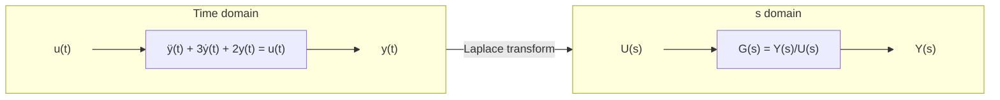

*Figure 2. Differential equation in the time domain and transfer function in the s domain*

### 1.3 Computing the Output with a Transfer Function

Once the transfer function is known, the output for any input follows from $Y(s) = G(s)U(s)$. As an example, apply a **unit step input** to the system of Section 1.2. The unit step function is 0 for $t < 0$ and 1 for $t \ge 0$, and its Laplace transform is $1/s$ (Week 3).

$$
Y(s) = G(s)U(s) = \frac{1}{(s+1)(s+2)} \cdot \frac{1}{s} = \frac{1}{s(s+1)(s+2)}
$$

The inverse transform uses the partial fraction expansion of Week 3. The denominator roots $0$, $-1$, and $-2$ are distinct real numbers, so the expansion has the following form.

$$
\frac{1}{s(s+1)(s+2)} = \frac{K_1}{s} + \frac{K_2}{s+1} + \frac{K_3}{s+2}
$$

Each coefficient is found by multiplying both sides by the corresponding factor and substituting the root of that factor, because all other terms vanish at that root.

$$
\begin{aligned}
K_1 &= \left.\frac{1}{(s+1)(s+2)}\right|_{s=0} = \frac{1}{1 \cdot 2} = \frac{1}{2} \\
K_2 &= \left.\frac{1}{s(s+2)}\right|_{s=-1} = \frac{1}{(-1)(1)} = -1 \\
K_3 &= \left.\frac{1}{s(s+1)}\right|_{s=-2} = \frac{1}{(-2)(-1)} = \frac{1}{2}
\end{aligned}
$$

Applying $\mathcal{L}^{-1}\lbrace1/s \rbrace= 1$ and $\mathcal{L}^{-1}\lbrace1/(s+a) \rbrace= e^{-at}$, the output for $t \ge 0$ is as follows.

$$
y(t) = \frac{1}{2} - e^{-t} + \frac{1}{2}e^{-2t}
$$

The result can be checked in two ways. At $t = 0$, $y(0) = 1/2 - 1 + 1/2 = 0$, which matches the initial condition. As $t \to \infty$ the exponential terms vanish and $y \to 1/2$; this agrees with the steady state, in which all derivatives are zero, the differential equation becomes $2y = 1$, and therefore $y = 1/2$. The shape of this response appears in Figure 8 of Section 2.6.

### 1.4 Example 1: RC Circuit

In the circuit of Figure 3, the voltage source $u(t)$ is the input and the voltage across the capacitor $y(t)$ is the output. The quantity of interest is the time behavior of $y(t)$ caused by $u(t)$.

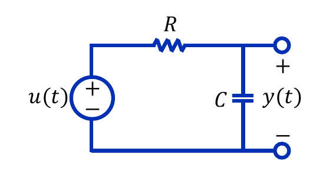

*Figure 3. RC circuit consisting of a voltage source, a resistor, and a capacitor*

**Writing the differential equation.** Nothing is connected to the output terminals, so by Kirchhoff's current law (KCL) the current through the resistor equals the current through the capacitor. The resistor current is the voltage across it divided by the resistance, $(u - y)/R$, and the capacitor current is $C\,dy/dt$.

$$
\frac{u(t) - y(t)}{R} = C\frac{dy(t)}{dt}
$$

Multiplying both sides by $R$ and rearranging gives the following first-order differential equation.

$$
RC\frac{dy(t)}{dt} + y(t) = u(t)
$$

**Finding the transfer function.** With the initial condition $y(0) = 0$, the Laplace transform gives $RCsY(s) + Y(s) = U(s)$, that is, $(RCs + 1)Y(s) = U(s)$. The ratio of the Laplace transforms of output and input is as follows.

$$
G(s) = \frac{Y(s)}{U(s)} = \frac{1}{RCs + 1}
$$

The product $RC$ has the dimension of time and is called the **time constant**. Week 7 analyzes the response speed of first-order systems through the time constant.

### 1.5 Example 2: Mass, Spring, and Damper System

Figure 4 shows a mass $M$ connected to a wall through a spring (stiffness $K$) and a damper (viscous friction coefficient $B$), with an external force $f$ acting on it. The quantity of interest is the time behavior of the displacement $y$ caused by $f$.

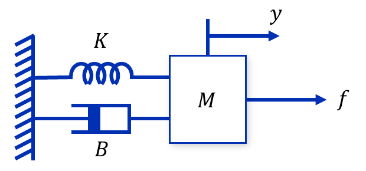

*Figure 4. Mass connected to a wall through a spring and a damper*

**Writing the differential equation.** As in Week 4, the sum of all forces acting on the mass equals the mass times the acceleration by Newton's second law. The external force $f$ acts in the $+y$ direction, while the spring restoring force $Ky$ and the damper friction force $B\,dy/dt$ act in the $-y$ direction.

$$
f - Ky - B\frac{dy}{dt} = M\frac{d^2y}{dt^2}
\quad\Longrightarrow\quad
M\frac{d^2y}{dt^2} + B\frac{dy}{dt} + Ky = f
$$

**Finding the transfer function.** Setting the initial conditions to zero and transforming both sides gives $Ms^2Y(s) + BsY(s) + KY(s) = F(s)$. Factor out $Y(s)$ and divide by $F(s)$.

$$
G(s) = \frac{Y(s)}{F(s)} = \frac{1}{Ms^2 + Bs + K}
$$

The denominator is a second-degree polynomial, so this is a second-order system. The differential equation of Section 1.2 is the case $M = 1$, $B = 3$, $K = 2$.

### 1.6 Example 3: Two-Mass System

Figure 5 shows two masses $M_1$ and $M_2$ connected by a spring $K$, with $M_2$ connected to the wall through a damper $B$. The external force $f$ acts on $M_1$. The quantities of interest are the time behaviors of the two displacements $y_1$ and $y_2$ caused by $f$.

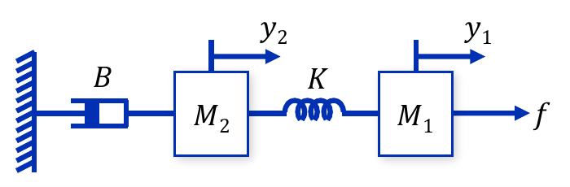

*Figure 5. Two masses connected by a spring and a damper connected to the wall*

**Writing the differential equations.** Write Newton's second law for each mass. The spring is stretched by the difference of the end displacements $y_1 - y_2$ and produces the force $K(y_1 - y_2)$, which pulls $M_1$ in the $-$ direction and $M_2$ in the $+$ direction. The damper produces the friction force $B\,dy_2/dt$, proportional to the velocity of $M_2$, in the $-$ direction.

$$
\begin{aligned}
M_1: &\quad f - K(y_1 - y_2) = M_1\frac{d^2y_1}{dt^2} \\
M_2: &\quad K(y_1 - y_2) - B\frac{dy_2}{dt} = M_2\frac{d^2y_2}{dt^2}
\end{aligned}
$$

**Laplace transform.** Set the initial conditions to zero, transform each equation, and collect the terms in $Y_1$ and $Y_2$. The first equation becomes $F - KY_1 + KY_2 = M_1s^2Y_1$, and the second becomes $KY_1 - KY_2 - BsY_2 = M_2s^2Y_2$.

$$
\begin{aligned}
(M_1s^2 + K)Y_1(s) &= F(s) + KY_2(s) \\
(M_2s^2 + Bs + K)Y_2(s) &= KY_1(s)
\end{aligned}
$$

The two outputs are coupled, so the two simultaneous equations must be solved together. Express $Y_2$ in terms of $Y_1$ from the second equation.

$$
Y_2(s) = \frac{K}{M_2s^2 + Bs + K}\,Y_1(s)
$$

Substitute this into the first equation and factor out $Y_1$.

$$
\left[(M_1s^2 + K) - \frac{K^2}{M_2s^2 + Bs + K}\right]Y_1(s) = F(s)
$$

Bringing the bracket to a common denominator gives the numerator $(M_1s^2 + K)(M_2s^2 + Bs + K) - K^2$. Expanding it cancels the $K^2$ terms and leaves a factor $s$ in every term.

$$
\begin{aligned}
(M_1s^2 + K)(M_2s^2 + Bs + K) - K^2
&= M_1M_2s^4 + M_1Bs^3 + (M_1 + M_2)Ks^2 + BKs + K^2 - K^2 \\
&= s\left[M_1M_2s^3 + M_1Bs^2 + (M_1 + M_2)Ks + BK\right]
\end{aligned}
$$

Denoting the cubic polynomial in the bracket by $D(s) = M_1M_2s^3 + M_1Bs^2 + (M_1 + M_2)Ks + BK$, the two transfer functions are as follows. The second transfer function is the product of $Y_2/Y_1$ and $Y_1/F$.

$$
\frac{Y_1(s)}{F(s)} = \frac{M_2s^2 + Bs + K}{s\,D(s)},
\qquad
\frac{Y_2(s)}{F(s)} = \frac{Y_2(s)}{Y_1(s)} \cdot \frac{Y_1(s)}{F(s)} = \frac{K}{s\,D(s)}
$$

The two transfer functions share the same denominator and differ only in the numerator. The denominator is a property of the whole system, whereas the numerator depends on which displacement is taken as the output. The factor $s$ in the denominator is a pole at the origin (Section 2.9). Since the damper is the only element attached to the wall, a constant force applied indefinitely pushes both masses away without bound.

---

 

## 2. Impulse Response and Characteristic Equation

The time-domain function most closely related to the transfer function is the impulse response of the system. This section defines the impulse function and covers the relation between the impulse response and the transfer function, the response to an arbitrary input, the general form of the transfer function and the characteristic equation, and poles and zeros.

### 2.1 Pulse Function and Impulse Function

> **Definition:** A **pulse function** lasts for a short time and has a constant value during that time. The pulse function $\delta_\Delta(t)$ of width $\Delta t$ has its height set to the reciprocal of the width, $1/\Delta t$, so that its area is 1.

$$
\delta_\Delta(t) =
\begin{cases}
\dfrac{1}{\Delta t}, & -\dfrac{\Delta t}{2} \le t \le \dfrac{\Delta t}{2} \\
0, & \text{otherwise}
\end{cases}
$$

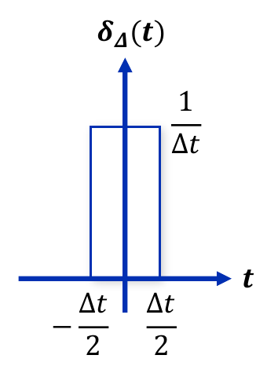

*Figure 6. Pulse function with unit area*

The area of the pulse is the product of its width and height, so it is 1 regardless of the width.

$$
\int_{-\infty}^{\infty}\delta_\Delta(t)\,dt = \int_{-\Delta t/2}^{\Delta t/2}\frac{1}{\Delta t}\,dt = \Delta t \cdot \frac{1}{\Delta t} = 1
$$

> **Definition:** The **impulse function** $\delta(t)$ is the limit of the pulse function as its width becomes infinitely small. The width shrinks to zero while the height grows to infinity, and the integral stays equal to 1. It is also called the unit impulse or the Dirac delta function.

$$
\delta(t) = \lim_{\Delta t \to 0}\delta_\Delta(t), \qquad
\int_{-\infty}^{\infty}\delta(t)\,dt = \int_{0^-}^{0^+}\delta(t)\,dt = 1
$$

$0^-$ and $0^+$ denote the instants just before and just after 0. Since the impulse is concentrated at $t = 0$, integrating from $0^-$ to $0^+$ already captures the whole area 1. The impulse idealizes an input, such as a single hammer blow, that is applied with a large magnitude over a very short moment but has a finite total effect (area).

Strictly speaking, $\delta(t)$ is not an ordinary function, because an ordinary function that is zero everywhere except at one point has integral zero. The impulse is a generalized function defined by its action inside an integral, and that action is expressed by the following **sifting property** [1]. If a function $f$ is continuous at $t = a$, then the following holds.

$$
\int_{-\infty}^{\infty} f(t)\,\delta(t - a)\,dt = f(a)
$$

**Laplace transform of the impulse function.** Put $f(t) = e^{-st}$ and $a = 0$ into the sifting property. Taking the lower limit of the Laplace transform as $0^-$ so that the impulse at $t = 0$ lies inside the integration interval, and using $e^{-st} = e^0 = 1$ near $t = 0$, gives the following.

$$
\mathcal{L}\lbrace\delta(t) \rbrace= \int_{0^-}^{\infty}\delta(t)e^{-st}\,dt = \int_{0^-}^{0^+}\delta(t) \cdot 1\,dt = 1
$$

> **Caution:** If the lower limit of the Laplace transform is taken as $0^+$, the impulse at $t = 0$ falls outside the integration interval and $\mathcal{L}\lbrace\delta(t) \rbrace= 0$ results. When impulse inputs are involved, take the lower limit as $0^-$ and interpret the initial condition $y(0)$ as the value $y(0^-)$ just before the input arrives [1].

### 2.2 Impulse Response

> **Definition:** The output response when the impulse signal $\delta(t)$ is applied to the input of a system with all initial conditions zero is called the **impulse response** and is written $g(t)$.

When the input is an impulse, its Laplace transform is 1, so $Y(s) = G(s)U(s)$ shows that the Laplace transform of the output is the transfer function itself.

$$
u(t) = \delta(t) \;\Rightarrow\; U(s) = 1 \;\Rightarrow\; Y(s) = G(s)
$$

Inverting both sides shows that the inverse Laplace transform of the transfer function is the impulse response.

$$
y(t) = \mathcal{L}^{-1}\lbrace G(s) \rbrace= g(t)
$$

> **Key Point:** The impulse response $g(t)$ and the transfer function $G(s)$ form a Laplace transform pair. The inverse Laplace transform of the transfer function is the impulse response and the Laplace transform of the impulse response is the transfer function, so knowing one means knowing the other.

For example, $G(s) = 1/[(s+1)(s+2)]$ of Section 1.2 expands into partial fractions as $1/(s+1) - 1/(s+2)$, so its impulse response is $g(t) = e^{-t} - e^{-2t}$.

### 2.3 Response to an Arbitrary Input and Convolution

Returning $Y(s) = G(s)U(s)$ to the time domain, the product in the $s$ domain becomes a **convolution** in the time domain (the convolution theorem of the Laplace transform).

$$
y(t) = \mathcal{L}^{-1}\lbrace Y(s) \rbrace= \mathcal{L}^{-1}\lbrace G(s)U(s) \rbrace= \mathcal{L}^{-1}\lbrace G(s) \rbrace* \mathcal{L}^{-1}\lbrace U(s) \rbrace= g(t) * u(t) = \int_0^t g(t-\tau)\,u(\tau)\,d\tau
$$

Here $*$ denotes convolution, and the definition used is the one for an input and an impulse response that are zero for $t < 0$. The formula can be understood as follows.

1. Dividing the input $u(\tau)$ into very short pieces of width $d\tau$, the piece at time $\tau$ can be regarded as an impulse of area $u(\tau)\,d\tau$.
2. By time invariance, a unit impulse arriving at time $\tau$ produces the response $g(t - \tau)$, which starts $\tau$ later.
3. By linearity, the response to an impulse of area $u(\tau)\,d\tau$ is $g(t - \tau)\,u(\tau)\,d\tau$.
4. By superposition, the sum (integral) of all these responses is the output at time $t$. The integration runs from $0$ to $t$ because there is no input for $\tau < 0$ and an input arriving at $\tau > t$ cannot yet affect the output at time $t$.

> **Key Point:** An LTI system is completely determined by its impulse response $g(t)$ alone. The output for any input is the convolution of the input with $g(t)$ [2].

> **[Calculus]** Substituting $\sigma = t - \tau$ in the convolution integral gives $d\sigma = -d\tau$ and swaps the ends of the interval, so $\int_0^t g(t-\tau)u(\tau)\,d\tau = \int_0^t g(\sigma)u(t-\sigma)\,d\sigma$. Hence $g * u = u * g$, and convolution is commutative. The computation in Section 2.6 uses this substitution.

### 2.4 Example 1: Impulse Response of an RC Circuit

For the RC circuit of Section 1.4 (Figure 3), find the output this time allowing a nonzero initial condition $y(0)$. Transform the differential equation $RC\,\dot{y} + y = u$ with the differentiation property $\mathcal{L}\lbrace\dot{y} \rbrace= sY(s) - y(0)$.

$$
RC\left[sY(s) - y(0)\right] + Y(s) = U(s)
$$

Collecting the terms in $Y(s)$ on the left gives $(RCs + 1)Y(s) = U(s) + y(0)RC$, so the Laplace transform of the output signal is as follows.

$$
Y(s) = \frac{1}{RCs + 1}\left[U(s) + y(0)RC\right]
$$

The first term $U(s)/(RCs + 1) = G(s)U(s)$ is the part due to the input, and the second term $y(0)RC/(RCs + 1)$ is the part due to the initial condition. Insert the impulse input $U(s) = 1$ and divide the numerator and denominator by $RC$ to make the inverse transform easy.

$$
Y(s) = \frac{1 + y(0)RC}{RCs + 1} = \frac{\dfrac{1}{RC} + y(0)}{s + \dfrac{1}{RC}}
$$

Apply $\mathcal{L}^{-1}\lbrace1/(s+a) \rbrace= e^{-at}$ with $a = 1/RC$ to take the inverse Laplace transform.

$$
y(t) = \left[\frac{1}{RC} + y(0)\right]e^{-t/RC} = \underbrace{\frac{1}{RC}e^{-t/RC}}_{\text{impulse response } g(t)} + \underbrace{y(0)\,e^{-t/RC}}_{\text{response to the initial condition}}
$$

If the initial condition is zero, the second term vanishes and the first term $g(t) = \frac{1}{RC}e^{-t/RC}$ is the impulse response of the RC circuit. It equals the inverse Laplace transform of $G(s) = 1/(RCs + 1)$. Physically, at the instant the impulse voltage arrives, the charge $\int i\,dt = \int \delta(t)/R\,dt = 1/R$ flows through the resistor into the capacitor and the capacitor voltage jumps to $1/(RC)$; afterward the input is zero, so the capacitor discharges through the resistor and the voltage decays exponentially with time constant $RC$.

### 2.5 Example 2: Impulse Response of an RL Circuit

In the circuit of Figure 7, an inductor $L$ and a resistor $R$ are connected in series; the input is the voltage $u$ and the output is the voltage $y$ across the resistor.

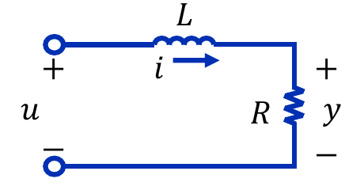

*Figure 7. RL circuit with an inductor and a resistor in series*

**Writing the differential equation.** By Kirchhoff's voltage law (KVL), the input voltage is the sum of the inductor voltage $L\,di/dt$ and the resistor voltage $Ri$. Since the output is $y = Ri$, substitute $i = y/R$.

$$
u = L\frac{di}{dt} + Ri = \frac{L}{R}\frac{dy}{dt} + y
$$

**Laplace transform of the output signal.** Transform while keeping the initial condition $y(0)$, and insert the impulse input $U(s) = 1$.

$$
\frac{L}{R}\left[sY(s) - y(0)\right] + Y(s) = U(s) = 1
$$

Factoring out $Y(s)$ gives $\left(\frac{L}{R}s + 1\right)Y(s) = 1 + \frac{L}{R}y(0)$, and dividing the numerator and denominator by $L/R$ gives the following.

$$
Y(s) = \frac{1 + \dfrac{L}{R}y(0)}{\dfrac{L}{R}s + 1} = \frac{\dfrac{R}{L} + y(0)}{s + \dfrac{R}{L}}
$$

**Inverse Laplace transform.** Invert with $a = R/L$.

$$
y(t) = \left[\frac{R}{L} + y(0)\right]e^{-Rt/L}
$$

If the initial condition is zero, the impulse response is $g(t) = \frac{R}{L}e^{-Rt/L}$ and the transfer function is $G(s) = 1/\left(\frac{L}{R}s + 1\right)$. The RC circuit and the RL circuit are physically different, but both are first-order systems of the form $G(s) = 1/(\tau s + 1)$, with time constants $\tau = RC$ and $\tau = L/R$, respectively.

### 2.6 Example 3: Step Response

Find the output of the following system for the unit step input $U(s) = 1/s$ in two ways.

$$
G(s) = \frac{Y(s)}{U(s)} = \frac{s}{(s+2)(s+1)}, \qquad U(s) = \frac{1}{s}
$$

**Method 1: partial fraction expansion.** In the Laplace transform of the output signal, the $s$ in the numerator cancels the input's $1/s$.

$$
Y(s) = G(s)U(s) = \frac{s}{(s+2)(s+1)} \cdot \frac{1}{s} = \frac{1}{(s+1)(s+2)}
$$

Expanding into partial fractions $K_1/(s+1) + K_2/(s+2)$ gives $K_1 = \frac{1}{s+2}\big\vert_{s=-1} = 1$ and $K_2 = \frac{1}{s+1}\big\vert_{s=-2} = -1$, so the inverse Laplace transform is as follows.

$$
Y(s) = \frac{1}{s+1} - \frac{1}{s+2} \quad\Longrightarrow\quad y(t) = e^{-t} - e^{-2t} \quad (t \ge 0)
$$

**Method 2: convolution.** First find the impulse response $g(t) = \mathcal{L}^{-1}\lbrace G(s) \rbrace$ by partial fraction expansion.

$$
\frac{s}{(s+1)(s+2)} = \frac{A}{s+1} + \frac{B}{s+2}, \qquad
A = \left.\frac{s}{s+2}\right|_{s=-1} = \frac{-1}{1} = -1, \qquad
B = \left.\frac{s}{s+1}\right|_{s=-2} = \frac{-2}{-1} = 2
$$

Hence $g(t) = -e^{-t} + 2e^{-2t}$. The unit step input is $u(\tau) = 1$ for $\tau \ge 0$, so the convolution is $y(t) = \int_0^t g(t-\tau)\,d\tau$. Substituting $\sigma = t - \tau$ gives $d\sigma = -d\tau$, with $\sigma = t$ when $\tau = 0$ and $\sigma = 0$ when $\tau = t$, so the result is as follows.

$$
\begin{aligned}
y(t) &= \int_0^t g(\sigma)\,d\sigma = \int_0^t \left(-e^{-\sigma} + 2e^{-2\sigma}\right)d\sigma \\
&= \Big[\,e^{-\sigma} - e^{-2\sigma}\,\Big]_0^t = \left(e^{-t} - e^{-2t}\right) - (1 - 1) = e^{-t} - e^{-2t}
\end{aligned}
$$

The two methods agree. The step response is the integral of the impulse response from 0 to $t$, which corresponds to multiplying $G(s)$ by $1/s$ in the $s$ domain.

Figure 8 compares the step response of Section 1.3 with the step response of this example. The output of the system in Section 1.3 starts at 0 and converges to $1/2$, whereas the output of this example rises for a while and returns to 0 because of the $s$ in the numerator. From $dy/dt = -e^{-t} + 2e^{-2t} = 0$ we get $e^{-t} = 1/2$, so the maximum is $1/2 - 1/4 = 1/4$ at $t = \ln 2 \approx 0.69$. The $s$ in the numerator acts as a differentiation of the input, so the output vanishes while a constant input persists. Moreover, the step response of this example equals the impulse response of the system in Section 1.2 (Section 2.2), because multiplying $G(s) = s \cdot \frac{1}{(s+1)(s+2)}$ by $1/s$ leaves only $\frac{1}{(s+1)(s+2)}$.

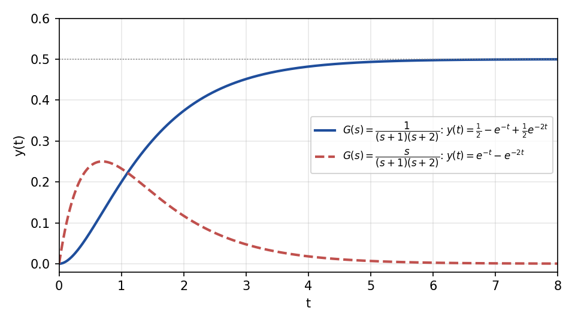

*Figure 8. Unit step responses of the two systems*

### 2.7 General Form of the Transfer Function

Consider a linear time-invariant system described by an $n$th-order differential equation. With the coefficient of the highest output derivative normalized to 1, the general form is as follows, where $a_i$ and $b_i$ are constants.

$$
\frac{d^ny(t)}{dt^n} + a_{n-1}\frac{d^{n-1}y(t)}{dt^{n-1}} + \cdots + a_1\frac{dy(t)}{dt} + a_0y(t)
= b_m\frac{d^mu(t)}{dt^m} + b_{m-1}\frac{d^{m-1}u(t)}{dt^{m-1}} + \cdots + b_1\frac{du(t)}{dt} + b_0u(t)
$$

Taking the Laplace transform with zero initial conditions turns the $k$th derivative into multiplication by $s^k$.

$$
(s^n + a_{n-1}s^{n-1} + \cdots + a_1s + a_0)\,Y(s) = (b_ms^m + b_{m-1}s^{m-1} + \cdots + b_1s + b_0)\,U(s)
$$

Therefore the transfer function is a ratio of two polynomials, that is, a rational function of $s$.

$$
G(s) = \frac{Y(s)}{U(s)} = \frac{b_ms^m + b_{m-1}s^{m-1} + \cdots + b_1s + b_0}{s^n + a_{n-1}s^{n-1} + \cdots + a_1s + a_0}
$$

The coefficients of the denominator polynomial are those of the left (output) side of the differential equation, and the coefficients of the numerator polynomial are those of the right (input) side. The degree $n$ of the denominator is called the **order** of the system. In real physical systems $m \le n$ in most cases; a transfer function with $m \le n$ is called a **proper transfer function**, and one with $m < n$ is called a **strictly proper transfer function**.

### 2.8 Characteristic Equation

> **Definition:** The equation obtained by setting the denominator of the transfer function to zero is called the **characteristic equation** of the system.

$$
s^n + a_{n-1}s^{n-1} + \cdots + a_1s + a_0 = 0
$$

The characteristic equation provides important information about the properties of the system. This polynomial is the same characteristic equation used in Week 2 to solve homogeneous differential equations. Substituting $y = e^{\lambda t}$ into the homogeneous equation $y^{(n)} + a_{n-1}y^{(n-1)} + \cdots + a_0y = 0$ (where $y^{(k)}$ is the $k$th derivative of $y$) gives $\lambda^n + a_{n-1}\lambda^{n-1} + \cdots + a_0 = 0$; only the name of the variable has changed from $\lambda$ to $s$. Hence the roots $p_i$ of the characteristic equation fix the exponents of the motions $e^{p_it}$ that the system exhibits by itself. For example, the characteristic equation of the system in Section 1.2 is $s^2 + 3s + 2 = 0$ with roots $-1$ and $-2$, so $e^{-t}$ and $e^{-2t}$ appear in its responses (Sections 1.3 and 2.2).

### 2.9 Poles and Zeros

> **Definition:** A **pole** is a value of the Laplace variable $s$ that makes the transfer function infinite, and a **zero** is a value of $s$ that makes the numerator of the transfer function zero (that makes the transfer function zero).

The value of the transfer function becomes infinite in two cases.

- The denominator becomes zero while the numerator has a finite nonzero value. Hence, if the numerator and denominator have no common factor, every root of the characteristic equation is a pole.
- The numerator becomes infinite and therefore the transfer function becomes infinite. This can happen as $s$ goes to infinity, so infinity can also be a pole.

**Poles and zeros at infinity.** As $\lvert s\rvert \to \infty$, $G(s)$ behaves like the ratio of the leading terms, $b_ms^m/s^n = b_ms^{m-n}$.

- If the degree of the numerator exceeds that of the denominator ($m > n$), then $G(s) \to \infty$, so there are poles at infinity, $m - n$ of them.
- If the degree of the denominator exceeds that of the numerator ($n > m$), then $G(s) \to 0$, so there are zeros at infinity, $n - m$ of them.

Counting those at infinity, the numbers of poles and zeros are equal to $\max(m, n)$. Poles and zeros are plotted in the complex plane, the $s$ plane (horizontal axis $\sigma$ for the real part, vertical axis $j\omega$ for the imaginary part), with poles marked × and zeros marked ○; this plot is called a **pole-zero map**.

> **Key Point:** The locations of the poles of a transfer function carry important information about the system. Each distinct pole $p$ contributes a term $e^{pt}$ to the response, so the term decays if the real part of the pole is negative, grows if it is positive, and oscillates if the pole has an imaginary part. Week 9 covers the relation between pole location and response, and stability.

> **Caution:** If the numerator and denominator share a factor, it cancels and a pole and a zero disappear together. This is called **pole-zero cancellation**. A canceled pole is invisible in the transfer function but may remain inside the system; Week 6 treats this issue with state variable equations.

### 2.10 Examples 4 and 5: Finding Poles and Zeros

**Example 4.** Find the characteristic equation, poles, and zeros of the following transfer function. $j = \sqrt{-1}$ is the imaginary unit.

$$
G(s) = \frac{(s+1)^2}{(s+2)(s^2 + 2s + 2)}
$$

- **Characteristic equation:** $(s+2)(s^2 + 2s + 2) = 0$.
- **Poles:** $s + 2 = 0$ gives $-2$. The quadratic formula applied to $s^2 + 2s + 2 = 0$ gives $s = \frac{-2 \pm \sqrt{4 - 8}}{2} = -1 \pm j$, which can also be confirmed by completing the square, $(s+1)^2 + 1 = 0$. Hence the poles are $-2$, $-1 + j$, and $-1 - j$.
- **Zeros:** The numerator $(s+1)^2 = 0$ gives $-1$, counted twice because it is a double root. In addition, the degree 3 of the denominator exceeds the degree 2 of the numerator, so there is one zero at infinity.

Figure 9 is the pole-zero map of this transfer function. The complex poles $-1 \pm j$ appear as a conjugate pair symmetric about the real axis, because the complex roots of a polynomial with real coefficients always come in conjugate pairs.

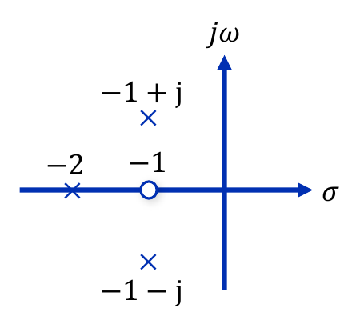

*Figure 9. Pole-zero map of Example 4*

**Example 5.** Find the characteristic equation, poles, and zeros of the following transfer function.

$$
G(s) = \frac{s(s+1)}{s+2}
$$

- **Characteristic equation:** $s + 2 = 0$.
- **Poles:** $-2$. In addition, the degree 2 of the numerator is higher than the degree 1 of the denominator, so there is one pole at infinity.
- **Zeros:** The numerator $s(s+1) = 0$ gives $0$ and $-1$. The degree of the denominator does not exceed that of the numerator, so there is no zero at infinity.

> **Note:** Some materials list the zeros of Example 5 as $-1$ and infinity, but the numerator $s(s+1)$ also vanishes at $s = 0$, so the zeros are $0$ and $-1$. Because the numerator has the higher degree, infinity is a pole, not a zero. Counting infinity, there are two poles ($-2$, $\infty$) and two zeros ($0$, $-1$), so the counts match.

| Transfer function | Finite poles | Finite zeros | At infinity |
|:-----|:-----|:-----|:-----|
| Example 4: $\dfrac{(s+1)^2}{(s+2)(s^2+2s+2)}$ | $-2$, $-1 \pm j$ | $-1$ (double) | 1 zero ($n - m = 1$) |
| Example 5: $\dfrac{s(s+1)}{s+2}$ | $-2$ | $0$, $-1$ | 1 pole ($m - n = 1$) |

*Table 1. Poles and zeros of Examples 4 and 5*

A transfer function whose numerator has a higher degree than its denominator, like Example 5, includes derivatives of the input in its output, so, as noted in Section 2.7, it is rare in real physical systems.

---

 

## 3. Block Diagrams

### 3.1 Block Diagrams and Algebraic Equations

In the $s$ domain the output can be written as the input multiplied by the transfer function, $Y(s) = G(s)U(s)$. Because $s$ represents a complex frequency, the $s$ domain is also called the frequency domain. In the time domain the input-output relation is not one that simple multiplication or addition can express but one expressed by a differential equation, whereas in the $s$ domain the input-output relation can be written as an **algebraic equation** made of multiplications and additions. Therefore in the $s$ domain a system can be represented by a block diagram, and the overall transfer function can be found from the picture with algebra alone.

> **Definition:** A **block diagram** represents each component of a system as a block containing its transfer function and each signal as an arrow, showing the flow of signals and the connections between components. A block diagram consists of the following four elements.
>
> - **Block:** The basic block (Figure 1) multiplies its input signal by the transfer function inside the block to produce its output signal.
> - **Signal:** It is drawn as an arrow and flows only in the direction of the arrow.
> - **Summing point:** It is drawn as a circle and adds the incoming signals with the sign ($+$ or $-$) attached to each arrow.
> - **Takeoff point:** It is a point that sends one signal to several places. Taking off a signal does not reduce its value, and every branch receives the same value.

In the equations below, $(s)$ is omitted for brevity, so that $G_1(s)$ is written $G_1$ and $U_1(s)$ is written $U_1$.

### 3.2 Series Connection

When two blocks are connected in series (Figure 10), the output of the first block becomes the input of the second.

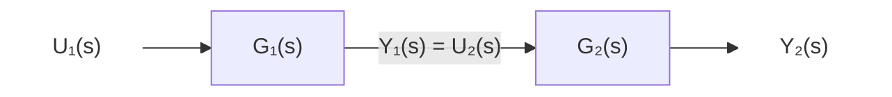

*Figure 10. Series connection of two blocks*

Substituting the block relations $Y_1 = G_1U_1$, $U_2 = Y_1$, and $Y_2 = G_2U_2$ in turn gives $Y_2 = G_2Y_1 = G_2G_1U_1$. Therefore the transfer function of the whole system connected in series equals the product of the individual transfer functions.

$$
\frac{Y_2(s)}{U_1(s)} = G_1(s)G_2(s)
$$

> **Caution:** The product rule for series connections assumes that the second block does not affect the output of the first block (no loading effect). For example, if two RC circuits are simply joined, the second circuit draws current from the first and changes its behavior, so the overall transfer function is not the product of the two transfer functions. In such cases the equations of the whole connected circuit must be written anew [3].

### 3.3 Parallel Connection

When two blocks receive the same input and their outputs are added at a summing point (Figure 11), they are connected in parallel.

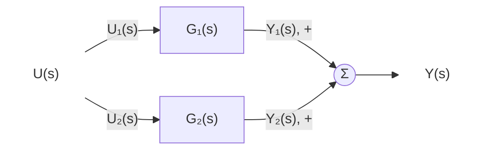

*Figure 11. Parallel connection of two blocks*

The two inputs that split at the takeoff point satisfy $U_1 = U_2 = U$, and the output is $Y = Y_1 + Y_2 = G_1U + G_2U$. Therefore the transfer function of the whole system connected in parallel equals the sum of the individual transfer functions.

$$
\frac{Y(s)}{U(s)} = G_1(s) + G_2(s)
$$

If one branch has the sign $-$ at the summing point, its transfer function is subtracted.

### 3.4 Feedback Connection

A feedback connection (Figure 12) returns part of the output and compares it with the input; it is the basic form of the closed-loop control system seen in Week 1. The path containing $G_1(s)$ is called the forward path, and the returning path containing $G_2(s)$ is called the feedback path. A connection that subtracts the feedback signal at the summing point, as in Figure 12, is called **negative feedback**.

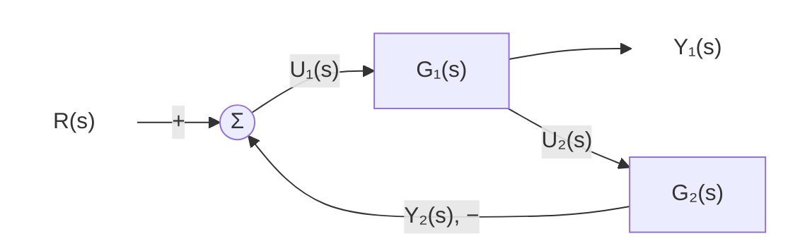

*Figure 12. Feedback connection of two blocks*

The signals are related as follows.

$$
U_1 = R - Y_2, \qquad Y_1 = G_1U_1, \qquad U_2 = Y_1, \qquad Y_2 = G_2U_2
$$

Insert the first relation into the second and substitute $Y_2 = G_2U_2 = G_2Y_1$.

$$
Y_1 = G_1(R - G_2Y_1) = G_1R - G_1G_2Y_1
$$

Collecting the terms in $Y_1$ on the left gives $(1 + G_1G_2)Y_1 = G_1R$, and therefore the following.

$$
\frac{Y_1(s)}{R(s)} = \frac{G_1(s)}{1 + G_1(s)G_2(s)}
$$

This ratio is called the **closed-loop transfer function**, and the product of all transfer functions met while going once around the loop, such as $G_1G_2$ in the denominator, is called the **loop gain**. In words, the result for negative feedback is the following.

$$
\text{closed-loop transfer function} = \frac{\text{transfer function of the forward path}}{1 + \text{loop gain}}
$$

- With **positive feedback**, which adds the feedback signal at the summing point, the first relation becomes $U_1 = R + Y_2$ and the sign in the denominator flips, giving $G_1/(1 - G_1G_2)$.
- The case in which the feedback path has transfer function 1 is called **unity feedback**, and the closed-loop transfer function is then $G_1/(1 + G_1)$.

### 3.5 Moving Summing Points and Takeoff Points

In a block diagram whose loops are intertwined, the rules of Sections 3.2-3.4 sometimes cannot be applied directly. The structure is then simplified by moving summing points or takeoff points ahead of or behind blocks; these manipulations are called block diagram operations. There is one principle for every move. **Every output signal must have the same value before and after the move.** The following four rules follow from this principle.

**Rule 1: moving a summing point behind a block.** Before the move, $Y_1 = G_1(U_1 + U_2) = G_1U_1 + G_1U_2$. After the summing point is moved behind $G_1$, $U_1$ still passes through $G_1$ but $U_2$ does not, so $G_1$ must be inserted in the $U_2$ branch to obtain the same output (Figure 13).

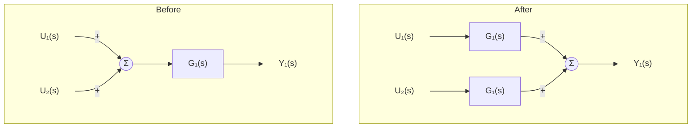

*Figure 13. Rule for moving a summing point behind a block*

**Rule 2: moving a summing point ahead of a block.** Before the move, $Y_1 = G_1U_1 + U_2$. After the summing point is moved ahead of $G_1$, $U_2$ also passes through $G_1$, so $1/G_1$ is inserted in the $U_2$ branch to obtain $G_1(U_1 + U_2/G_1) = G_1U_1 + U_2$ (Figure 14).

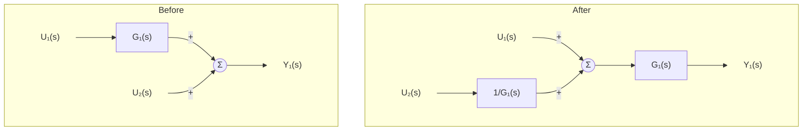

*Figure 14. Rule for moving a summing point ahead of a block*

**Rule 3: moving a takeoff point behind a block.** Before the move, the takeoff point is ahead of $G_1$, so $Y_2 = U_1$. After it is moved behind $G_1$, the signal taken off becomes $Y_1 = G_1U_1$, so $1/G_1$ is inserted in the branch to keep $Y_2 = Y_1/G_1 = U_1$ (Figure 15).

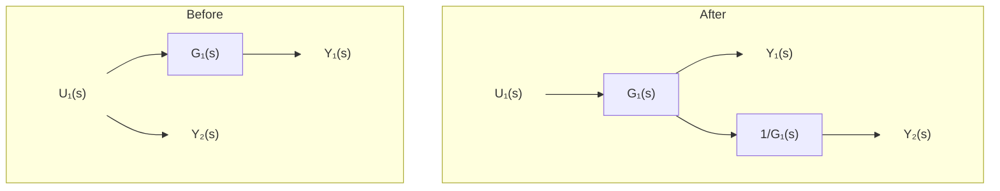

*Figure 15. Rule for moving a takeoff point behind a block*

**Rule 4: moving a takeoff point ahead of a block.** Before the move, the takeoff point is behind $G_1$, so $Y_2 = Y_1 = G_1U_1$. After it is moved ahead of $G_1$, the signal taken off becomes $U_1$, so $G_1$ is inserted in the branch to keep $Y_2 = G_1U_1$ (Figure 16).

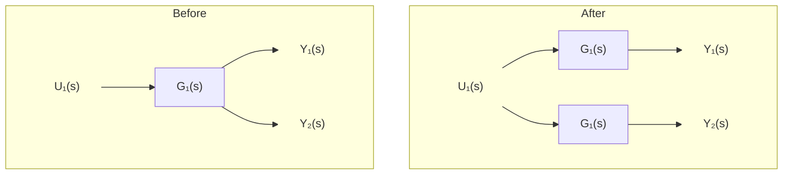

*Figure 16. Rule for moving a takeoff point ahead of a block*

| Move | Block to insert in the moved branch | Check |
|:-----|:-----|:-----|
| Summing point behind a block | $G_1$ | $G_1(U_1 + U_2) = G_1U_1 + G_1U_2$ |
| Summing point ahead of a block | $1/G_1$ | $G_1(U_1 + U_2/G_1) = G_1U_1 + U_2$ |
| Takeoff point behind a block | $1/G_1$ | $(G_1U_1)/G_1 = U_1$ |
| Takeoff point ahead of a block | $G_1$ | $G_1U_1 = Y_1$ |

*Table 2. Rules for moving summing points and takeoff points*

> **Caution:** For a move in the same direction, summing points and takeoff points need opposite blocks. When moving behind a block, insert $G_1$ in a summing-point branch and $1/G_1$ in a takeoff-point branch; when moving ahead of a block, do the opposite. Because the two cases are easily confused, it is safer to write the signal equations after the move and check that they match the original than to memorize the rules.

> **Note:** Some materials draw the rule for moving a takeoff point ahead of a block with $1/G_1$ in the moved branch, but the signal taken off before the move is $G_1U_1$, so taking it off at $U_1$ ahead of the block requires multiplying by $G_1$ to obtain the same signal (Table 2). Inserting $1/G_1$ would take off $U_1/G_1$, which differs from the original signal.

### 3.6 Example 1: A Block Diagram with Nested Loops

Find the transfer function $Y(s)/R(s)$ of the block diagram in Figure 17. The diagram has three summing points. In the inner loop the output of $G_1$ returns through $G_2$ to the second summing point, and in the outer loop the output of $G_4$ returns through $G_3$ to the first summing point. The output of $G_4$ also splits into $G_5$ and $G_6$, whose outputs are added at the third summing point to form the output $Y$.

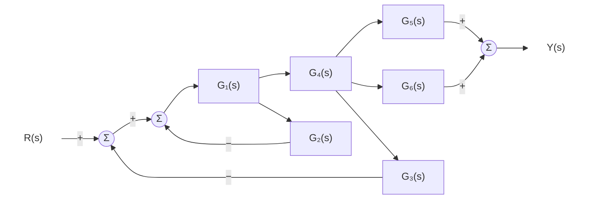

*Figure 17. Block diagram of Example 1*

**Step 1: inner loop.** No other signal enters or leaves between the second summing point and the takeoff point behind $G_1$, so the inner loop is a self-contained feedback connection. Replace it by a single block using the result of Section 3.4.

$$
G_A = \frac{G_1}{1 + G_1G_2}
$$

**Step 2: series connection.** $G_A$ and $G_4$ are in series, so multiply them. The result is the block diagram of Figure 18.

$$
G_AG_4 = \frac{G_1G_4}{1 + G_1G_2}
$$

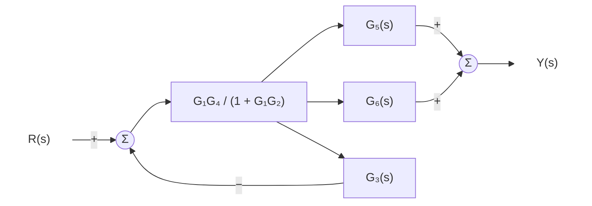

*Figure 18. Block diagram of Example 1 after reducing the inner loop and the series blocks*

**Step 3: outer loop.** This is a feedback connection with forward path $G_AG_4$ and feedback path $G_3$. Substitute into the result of Section 3.4, then multiply the numerator and denominator by $1 + G_1G_2$ to clear the compound fraction.

$$
\frac{G_AG_4}{1 + G_AG_4G_3}
= \frac{\dfrac{G_1G_4}{1 + G_1G_2}}{1 + \dfrac{G_1G_3G_4}{1 + G_1G_2}}
= \frac{G_1G_4}{1 + G_1G_2 + G_1G_3G_4}
$$

**Step 4: parallel connection.** $G_5$ and $G_6$ receive the same signal and are added, giving $G_5 + G_6$.

**Step 5: series connection.** The results of Steps 3 and 4 are in series, so multiply them (Figure 19).

$$
\frac{Y(s)}{R(s)} = \frac{G_1G_4(G_5 + G_6)}{1 + G_1G_2 + G_1G_3G_4}
$$

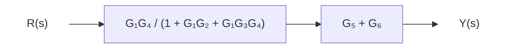

*Figure 19. Fully reduced block diagram of Example 1*

As a check, writing an equation for each signal and solving them simultaneously gives the same result. Let $E_1$ and $E_2$ be the outputs of the first and second summing points and $X_1$ and $X_4$ the outputs of $G_1$ and $G_4$; then $E_1 = R - G_3X_4$, $E_2 = E_1 - G_2X_1$, $X_1 = G_1E_2$, $X_4 = G_4X_1$, and $Y = (G_5 + G_6)X_4$, and solving these five equations yields the transfer function above. Mason's gain formula of Week 6 also gives the same result.

### 3.7 Example 2: A Block Diagram That Requires Moving a Takeoff Point

Find the transfer function $Y(s)/R(s)$ of the block diagram in Figure 20. The output of $G_1$ splits into $G_2$ and $G_5$, and the output of $G_2$ splits into $G_4$ and $G_3$. The output of $G_3$ returns to the first summing point, and the outputs of $G_4$ and $G_5$ are added at the second summing point to form the output $Y$.

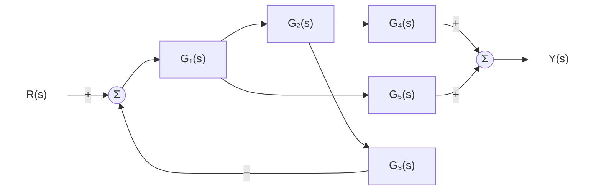

*Figure 20. Block diagram of Example 2*

**The difficulty.** The takeoff point feeding $G_5$ lies inside the feedback loop (between $G_1$ and $G_2$), but the output of $G_5$ is added outside the loop. A signal leaves from inside the loop, so the loop cannot be replaced by a single block with Section 3.4 directly.

**Step 1: moving the takeoff point behind a block.** Move the takeoff point feeding $G_5$ behind $G_2$. By Rule 3, inserting $1/G_2$ in the branch turns the $G_5$ branch into $G_5/G_2$. As a check, after the move the output of the $G_5$ branch is $(G_2X_1)\cdot G_5/G_2 = G_5X_1$, the same as before the move ($X_1$ is the output of $G_1$). Both takeoff points now lie behind $G_2$, as shown in Figure 21.

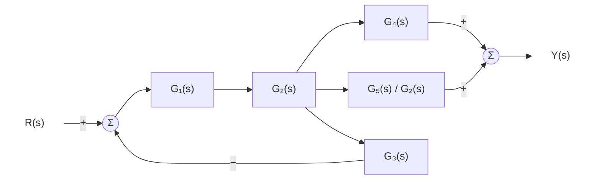

*Figure 21. Block diagram of Example 2 with the takeoff point moved behind G₂*

**Step 2: feedback loop.** The forward path is $G_1G_2$ and the feedback path is $G_3$, giving $\dfrac{G_1G_2}{1 + G_1G_2G_3}$.

**Step 3: parallel connection.** $G_4$ and $G_5/G_2$ are in parallel, giving $G_4 + \dfrac{G_5}{G_2}$.

**Step 4: series connection.** Multiply the two results, distribute, and cancel $G_2$ (Figure 22).

$$
\frac{Y(s)}{R(s)} = \frac{G_1G_2}{1 + G_1G_2G_3}\left(G_4 + \frac{G_5}{G_2}\right) = \frac{G_1G_2G_4 + G_1G_5}{1 + G_1G_2G_3}
$$

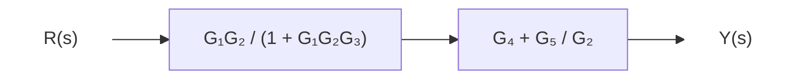

*Figure 22. Fully reduced block diagram of Example 2*

Only the loop gain $G_1G_2G_3$ appears in the denominator of the result, and the numerator is the sum of the products along the two paths from input to output, $G_1G_2G_4$ and $G_1G_5$. The $G_5$ path leaves the loop, so it is not fed back and is only added to the output.

---

 

## Concept Applications

**True/False Check:**

| Statement | Judgment and Reason |
|:-----|:------------|
| The transfer function is the ratio of the Laplace transform of the output to that of the input regardless of the initial conditions. | **F.** The transfer function is defined with all initial conditions set to zero. Nonzero initial conditions add a term due to the initial conditions to the output. |
| The Laplace transform of the impulse response is the transfer function. | **T.** The Laplace transform of the impulse is 1, so $Y(s) = G(s)$ and hence $g(t) = \mathcal{L}^{-1}\lbrace G(s) \rbrace$. |
| Every root of the characteristic equation is a pole. | **F.** This holds only when the numerator and denominator have no common factor. At a root cancelled by a common factor the transfer function does not become infinite, so that root is not a pole (the Caution in Section 2.9 and the pole-zero cancellation of Week 6). |
| $G(s) = (s+3)/[s(s+1)]$ has one pole at infinity. | **F.** The denominator degree 2 exceeds the numerator degree 1, so what lies at infinity is one zero. |
| The overall transfer function of two blocks connected in series is the sum of the two transfer functions. | **F.** A series connection gives the product, and a parallel connection gives the sum. |
| When a takeoff point is moved ahead of a block, the transfer function of that block is inserted in the moved branch. | **T.** Before the move the signal taken off is the block output $G_1U_1$, so taking off $U_1$ ahead of the block requires multiplying by $G_1$ to obtain the same signal. |

---

 

## Summary

| Concept | Key Summary |
|:-----|:-----|
| Transfer function | It is the ratio $G(s) = Y(s)/U(s)$ of the Laplace transforms of the output and the input of an LTI system with all initial conditions zero. |
| Finding a transfer function | Transforming the differential equation with zero initial conditions turns the $k$th derivative into multiplication by $s^k$; the left-side coefficients form the denominator and the right-side coefficients form the numerator. |
| Impulse function | It is the limit of a unit-area pulse as its width goes to zero, and its Laplace transform is 1. |
| Impulse response | It is the output of a system with zero initial conditions to an impulse input and equals the inverse Laplace transform of the transfer function, $g(t) = \mathcal{L}^{-1}\lbrace G(s) \rbrace$. |
| Convolution | The output for an arbitrary input is $y(t) = \int_0^t g(t-\tau)u(\tau)\,d\tau$, which corresponds to the product $G(s)U(s)$ in the $s$ domain. |
| Characteristic equation | It is the equation obtained by setting the denominator of the transfer function to zero, and its roots fix the exponents of the exponentials $e^{pt}$ in the response. |
| Poles and zeros | Poles are the values of $s$ that make the transfer function infinite and zeros those that make it zero; if the numerator and denominator degrees differ, poles or zeros lie at infinity in the number of the difference. |
| Block diagram | It represents the algebraic relations of the $s$ domain with blocks, signals, summing points, and takeoff points. |
| Basic connections | A series connection gives $G_1G_2$, a parallel connection gives $G_1 + G_2$, and a negative feedback connection gives $G_1/(1 + G_1G_2)$. |
| Block diagram operations | When moving summing points and takeoff points, $G$ or $1/G$ is inserted in the moved branch so that the output signals do not change. |

---

 

## Self-Check Questions

1. **Finding a transfer function:** Find the transfer function $G(s) = Y(s)/U(s)$ of the differential equation $2\ddot{y} + 5\dot{y} + 3y = 4\dot{u} + u$, and list its poles and zeros, including those at infinity.

   

   
Answer

   Taking the Laplace transform with zero initial conditions gives $(2s^2 + 5s + 3)Y(s) = (4s + 1)U(s)$, so $G(s) = \dfrac{4s + 1}{2s^2 + 5s + 3}$. The denominator factors as $2s^2 + 5s + 3 = (2s + 3)(s + 1)$, so the poles are $-1$ and $-3/2$. From the numerator $4s + 1 = 0$ the zero is $-1/4$, and since the denominator degree 2 exceeds the numerator degree 1, there is one zero at infinity.

   

2. **Impulse and step responses:** Find the impulse response and the unit step response of the system $G(s) = 3/(s + 4)$.

   

   
Answer

   The impulse response is $g(t) = \mathcal{L}^{-1}\lbrace3/(s+4) \rbrace= 3e^{-4t}$. The unit step response is obtained from $Y(s) = \dfrac{3}{s(s+4)} = \dfrac{3/4}{s} - \dfrac{3/4}{s+4}$, so $y(t) = \frac{3}{4}(1 - e^{-4t})$. This equals $\int_0^t 3e^{-4\sigma}\,d\sigma = \frac{3}{4}(1 - e^{-4t})$, the integral of the impulse response.

   

3. **Lower limit of the Laplace transform:** Explain why the lower limit of integration must be taken as $0^-$ to obtain 1 as the Laplace transform of the impulse.

   

   
Answer

   The impulse $\delta(t)$ concentrates its unit area at the single point $t = 0$. With the lower limit $0^-$ this point lies inside the integration interval and $\int_{0^-}^{0^+}\delta(t)e^{-st}dt = 1$, but with $0^+$ the impulse lies outside the interval and the integral is 0. For the same reason the initial condition is interpreted as the value $y(0^-)$ just before the input arrives.

   

4. **Convolution:** For a system with impulse response $g(t) = e^{-t}$, find the output for a unit step input by convolution, and check it with the Laplace transform.

   

   
Answer

   Since $u(\tau) = 1$, $y(t) = \int_0^t e^{-(t-\tau)}\,d\tau = e^{-t}\int_0^t e^{\tau}\,d\tau = e^{-t}(e^t - 1) = 1 - e^{-t}$. With the Laplace transform, $G(s) = 1/(s+1)$ and $U(s) = 1/s$, so $Y(s) = \dfrac{1}{s(s+1)} = \dfrac{1}{s} - \dfrac{1}{s+1}$, and the inverse transform gives the same $y(t) = 1 - e^{-t}$.

   

5. **Poles and zeros:** List the poles and zeros of $G(s) = \dfrac{s + 3}{s(s^2 + 4)}$, including those at infinity.

   

   
Answer

   From the denominator $s(s^2 + 4) = 0$ the poles are $0$, $2j$, and $-2j$. From the numerator $s + 3 = 0$ the finite zero is $-3$, and since the denominator degree 3 exceeds the numerator degree 1 by 2, there are two zeros at infinity. Counting infinity, there are three poles and three zeros.

   

6. **RC circuit:** In the RC circuit of Section 1.4, $R = 1\,\mathrm{M\Omega}$ and $C = 0.5\,\mathrm{\mu F}$. Find the time constant and the impulse response.

   

   
Answer

   $RC = 10^6 \times 0.5 \times 10^{-6} = 0.5\,\mathrm{s}$. The transfer function is $G(s) = 1/(0.5s + 1) = 2/(s + 2)$, so the impulse response is $g(t) = 2e^{-2t}$. This is $\frac{1}{RC}e^{-t/RC}$ with $RC = 0.5$.

   

7. **Unity feedback:** Find the closed-loop transfer function and the characteristic equation of a unity feedback system whose forward path has transfer function $G(s) = \dfrac{10}{s(s + 1)}$.

   

   
Answer

   Multiplying the numerator and denominator of $\dfrac{G}{1 + G} = \dfrac{10/[s(s+1)]}{1 + 10/[s(s+1)]}$ by $s(s+1)$ gives $\dfrac{10}{s(s+1) + 10} = \dfrac{10}{s^2 + s + 10}$. The characteristic equation is $s^2 + s + 10 = 0$.

   

8. **Block diagram operations:** Explain with signal equations why $1/G$ is inserted in the branch when a takeoff point is moved behind a block $G$, whereas $G$ is inserted when a summing point is moved behind a block $G$.

   

   
Answer

   A takeoff point extracts a signal. Ahead of the block it extracted $U$, but behind the block it extracts $GU$, so multiplying by $1/G$ is needed to return to $U$. A summing point injects a signal. A signal $U_2$ injected ahead of the block passed through the block and appeared at the output as $GU_2$, but injected behind the block it does not pass through the block, so it must be multiplied by $G$ in advance to give $GU_2$.

   

9. **Two loops sharing a summing point:** At one summing point, the input $R$ enters with $+$, the output $Y$ enters through a block $H$ with $-$, and the output $X$ of the first block $G_1$ enters through a block $H_2$ with $+$. The output of the summing point enters $G_1$, the output $X$ of $G_1$ enters $G_2$, and the output of $G_2$ is $Y$. Find $Y/R$.

   

   
Answer

   The signal equations are $X = G_1(R - HY + H_2X)$ and $Y = G_2X$. Substituting the second into the first gives $X = G_1R - G_1G_2HX + G_1H_2X$, and collecting the terms in $X$ gives $(1 - G_1H_2 + G_1G_2H)X = G_1R$. Therefore $\dfrac{Y}{R} = \dfrac{G_2X}{R} = \dfrac{G_1G_2}{1 - G_1H_2 + G_1G_2H}$. The positive feedback loop $G_1H_2$ appears in the denominator with a $-$ sign and the negative feedback loop $G_1G_2H$ with a $+$ sign.

   

10. **Two-mass system:** In the result of Section 1.6, what happens to $Y_1/F$ in the limit $K \to \infty$ of a very stiff spring? Interpret the result physically.

    

    
Answer

    Keeping only the highest-order terms in $K$, the numerator is $K$ and the denominator is $s\left[(M_1 + M_2)Ks + BK\right]$, so $\dfrac{Y_1}{F} \to \dfrac{K}{sK[(M_1 + M_2)s + B]} = \dfrac{1}{(M_1 + M_2)s^2 + Bs}$. If the spring does not stretch, the two masses move as one body, so the system becomes the single-degree-of-freedom system $(M_1 + M_2)\ddot{y} + B\dot{y} = f$, a mass $M_1 + M_2$ connected to the wall only through the damper $B$.

    

---

 

## References

1. K. H. Lundberg, H. R. Miller, and D. L. Trumper, "Initial conditions, generalized functions, and the Laplace transform: Troubles at the origin," *IEEE Control Systems Magazine*, vol. 27, no. 1, pp. 22-35, Feb. 2007.
2. K. Ogata, *Modern Control Engineering*, 5th ed. Upper Saddle River, NJ, USA: Prentice Hall, 2010.
3. N. S. Nise, *Control Systems Engineering*, 7th ed. Hoboken, NJ, USA: Wiley, 2015.
