# 6주차 이론 — 제어시스템 모델링 III

[레포지토리 안내](../../README.ko.md) | [English](Concepts_Lecture.md) | [한국어](Concepts_Lecture.ko.md)

> **최종 수정일:** 2026-11-10

> **학습 목표:**
> 1. 신호 흐름도의 마디, 가지, 이득을 설명하고, 블록선도를 신호 흐름도로 바꿀 수 있다
> 2. 경로, 전방향 경로, 루프, 경로 이득, 루프 이득, 비접촉을 정의하고, 주어진 신호 흐름도에서 찾을 수 있다
> 3. 메이슨의 이득 공식으로 신호 흐름도의 전체 전달함수를 구할 수 있다
> 4. 전달함수가 같아도 내부 구조가 다른 시스템이 있음을 설명하고, 상태 변수와 상태 변수 방정식을 정의할 수 있다
> 5. 선형 시불변 시스템의 상태 변수 방정식을 행렬 $A$, $B$, $C$, $D$로 쓰고, 각 행렬의 크기를 말할 수 있다
> 6. 중간 변수를 이용하여 n계 미분방정식이나 전달함수에서 상태 변수 방정식을 세우고, 상태 변수 방정식에서 전달함수를 다시 구할 수 있다

---

## 목차

- [1. 신호 흐름도](#1-신호-흐름도)
  - [1.1 신호 흐름도의 개념과 구성](#11-신호-흐름도의-개념과-구성)
  - [1.2 기본 연결의 신호 흐름도](#12-기본-연결의-신호-흐름도)
  - [1.3 예제 1, 2: 블록선도를 신호 흐름도로 바꾸기](#13-예제-1-2-블록선도를-신호-흐름도로-바꾸기)
  - [1.4 경로와 루프에 관한 용어](#14-경로와-루프에-관한-용어)
  - [1.5 메이슨의 이득 공식](#15-메이슨의-이득-공식)
  - [1.6 예제 3: 메이슨의 이득 공식의 적용](#16-예제-3-메이슨의-이득-공식의-적용)
  - [1.7 예제 4: 가합점 마디의 신호](#17-예제-4-가합점-마디의-신호)
  - [1.8 예제 5: 비접촉 루프가 있는 신호 흐름도](#18-예제-5-비접촉-루프가-있는-신호-흐름도)
- [2. 1차, 2차 상태 변수 방정식](#2-1차-2차-상태-변수-방정식)
  - [2.1 전달함수의 한계](#21-전달함수의-한계)
  - [2.2 전달함수가 같은 1차 시스템과 2차 시스템](#22-전달함수가-같은-1차-시스템과-2차-시스템)
  - [2.3 상태 변수와 상태 변수 방정식](#23-상태-변수와-상태-변수-방정식)
  - [2.4 예제 1, 2: 블록선도에서 상태 변수 방정식 세우기](#24-예제-1-2-블록선도에서-상태-변수-방정식-세우기)
  - [2.5 상태 변수 벡터와 일반적인 형태](#25-상태-변수-벡터와-일반적인-형태)
  - [2.6 선형 시불변 시스템의 상태 변수 방정식](#26-선형-시불변-시스템의-상태-변수-방정식)
- [3. n차 상태 변수 방정식](#3-n차-상태-변수-방정식)
  - [3.1 입력의 미분 항이 없는 경우](#31-입력의-미분-항이-없는-경우)
  - [3.2 입력의 미분 항이 있는 경우와 중간 변수](#32-입력의-미분-항이-있는-경우와-중간-변수)
  - [3.3 벡터 형태와 블록선도](#33-벡터-형태와-블록선도)
  - [3.4 예제 1: 분자가 상수인 전달함수](#34-예제-1-분자가-상수인-전달함수)
  - [3.5 예제 2: 분자가 다항식인 전달함수](#35-예제-2-분자가-다항식인-전달함수)
  - [3.6 상태 변수 방정식에서 전달함수 구하기](#36-상태-변수-방정식에서-전달함수-구하기)
- [개념 적용](#개념-적용)
- [요약](#요약)
- [점검 문제](#점검-문제)
- [참고 문헌](#참고-문헌)

---

<br>

## 1. 신호 흐름도

5주차는 블록선도의 가합점과 인출점을 옮겨 가며 블록선도를 간소화하는 방법을 다루었다. 블록선도가 복잡해지면 어디를 어떻게 옮길지 정하는 일 자체가 어려워진다. 이 절에서는 블록선도를 마디와 가지로 다시 그린 신호 흐름도와, 그림을 간소화하지 않고 한 번에 전체 전달함수를 구하는 메이슨의 이득 공식을 다룬다.

### 1.1 신호 흐름도의 개념과 구성

**신호 흐름도(signal flow graph)** 는 블록선도의 또 다른 표현 형태이다. 블록선도와 같은 정보를 담지만 그림이 간결하고, 1.5절의 메이슨의 이득 공식을 쓸 수 있어 복잡한 시스템을 다룰 때 블록선도보다 간편하고 편리하다. 신호 흐름도는 다음 세 요소로 구성된다.

> **용어 정의:** **신호 흐름도의 구성 요소(elements of a signal flow graph).** 구성 요소는 다음과 같다.
>
> - **마디(node):** 제어시스템 내의 신호 변수를 나타내는 점이다. 마디는 가합점의 역할도 하여, 마디의 값은 그 마디로 들어오는 모든 가지의 신호를 더한 것이다.
> - **가지(branch):** 마디와 마디를 연결하는 선으로, 전달함수를 나타낸다. 방향을 나타내는 화살표를 표시하며, 시작 마디의 신호에 이득을 곱하여 끝 마디로 보낸다.
> - **이득(gain):** 가지의 전달함수로부터 정해지는 값으로, 가지 옆에 적는다.

마디에서 나가는 가지는 마디의 값을 바꾸지 않는다. 한 마디에서 여러 가지가 나가면 모든 가지가 같은 신호를 받으므로, 블록선도의 인출점은 따로 그릴 필요가 없다. 또 가합점에 $-$ 부호로 들어가는 신호는 가지의 이득에 $-$를 붙여 나타낸다. 나가는 가지만 있는 마디를 **입력 마디(input node)**, 들어오는 가지만 있는 마디를 **출력 마디(output node)** 라 한다. 출력으로 삼을 마디에서 나가는 가지가 있으면 이득 1인 가지로 새 마디를 이어 출력 마디로 삼으며, 이렇게 해도 경로와 루프는 바뀌지 않는다. 표 1은 블록선도와 신호 흐름도의 요소를 대응시킨 것이다.

| 블록선도 | 신호 흐름도 |
|:-----|:-----|
| 신호(화살표) | 마디 |
| 전달함수가 $G$인 블록 | 이득이 $G$인 가지 |
| 가합점 | 들어오는 가지가 여러 개인 마디 (빼는 신호는 이득에 $-$를 붙인다) |
| 인출점 | 나가는 가지가 여러 개인 마디 |

*표 1. 블록선도와 신호 흐름도의 요소 대응*

### 1.2 기본 연결의 신호 흐름도

5주차의 세 가지 기본 연결을 신호 흐름도로 나타내면 다음과 같다. 그림의 원은 마디이고, 화살표 위의 글자는 가지의 이득이다.

**직렬 블록의 신호 흐름도.** $U \to G_1 \to X \to G_2 \to Y$는 마디 $U$, $X$, $Y$와 이득 $G_1$, $G_2$인 가지 두 개로 나타난다(그림 1). $Y = G_2X = G_1G_2U$이다.

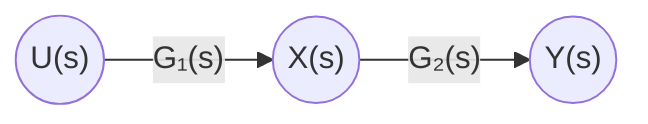

*그림 1. 직렬 블록의 신호 흐름도*

**병렬 블록의 신호 흐름도.** 마디 $U$에서 이득 $G_1$과 $G_2$인 두 가지가 나와 마디 $Y$로 들어간다(그림 2). 마디 $Y$의 값은 들어오는 두 신호의 합 $G_1U + G_2U$이다.

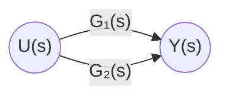

*그림 2. 병렬 블록의 신호 흐름도*

**피드백 블록의 신호 흐름도.** 5주차 그림 12의 피드백 연결은 그림 3과 같다. 마디 $U_1$로 입력 마디 $R$에서 이득 1인 가지와, 출력 $Y_1$에서 이득 $-G_2$인 가지가 들어오므로 $U_1 = R - G_2Y_1$이며, 이는 가합점의 식과 같다. 입력 마디 $R$과 마디 $U_1$을 이득 1인 가지로 따로 둔 것은, 입력 마디에는 들어오는 가지가 없어야 하기 때문이다.

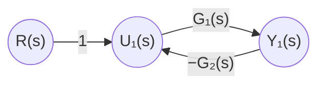

*그림 3. 피드백 블록의 신호 흐름도*

### 1.3 예제 1, 2: 블록선도를 신호 흐름도로 바꾸기

블록선도는 다음 순서로 신호 흐름도로 바꾼다.

1. 입력 신호, 출력 신호, 각 가합점의 출력, 각 블록의 출력마다 마디를 하나씩 둔다.
2. 각 블록을 그 전달함수를 이득으로 하는 가지로 바꾼다.
3. 가합점에 들어가는 신호마다 가지를 그리고, $-$ 부호로 들어가는 신호는 이득에 $-$를 붙인다.
4. 입력 마디에 들어오는 가지가 생기면, 입력 마디와 그 마디 사이에 이득 1인 가지를 넣는다.

**예제 1.** 5주차 3.6절(5주차 그림 17)의 블록선도를 신호 흐름도로 바꾸면 그림 4가 된다. 첫째 가합점의 출력 $E_1 = R - G_3X_4$는 바로 둘째 가합점으로 들어가 $E_2 = E_1 - G_2X_1 = R - G_3X_4 - G_2X_1$이 되므로, 두 가합점을 마디 하나 $N_1$로 합칠 수 있다. 마디 $N_2$는 $G_1$의 출력, $N_3$은 $G_4$의 출력이다.

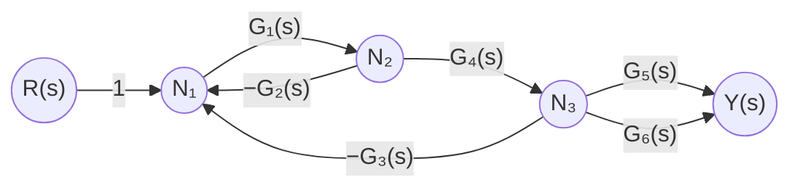

*그림 4. 예제 1의 신호 흐름도*

**예제 2.** 5주차 3.7절(5주차 그림 20)의 블록선도를 신호 흐름도로 바꾸면 그림 5가 된다. 마디 $N_1$은 가합점의 출력, $N_2$는 $G_1$의 출력, $N_3$은 $G_2$의 출력이다. 블록선도에서는 $G_5$로 가는 인출점을 옮겨야 했지만, 신호 흐름도에서는 마디 $N_2$에서 가지 하나를 더 내면 된다.

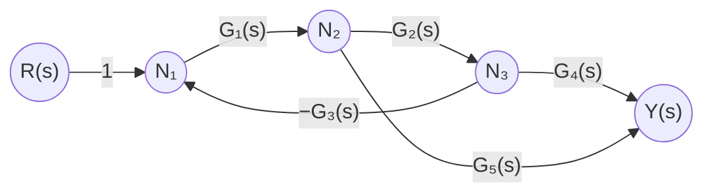

*그림 5. 예제 2의 신호 흐름도*

### 1.4 경로와 루프에 관한 용어

메이슨의 이득 공식을 쓰려면 다음 용어가 필요하다.

> **용어 정의:** **신호 흐름도의 경로와 루프(signal flow graph paths and loops).**
>
> - **경로(path):** 신호 흐름도의 어느 한 마디로부터 다른 마디까지 가지의 화살표 방향을 따라 이동하기 위해 순차적으로 거쳐야 하는 가지들의 집합이다. 단, 출발 마디로부터 끝 마디까지 사이에 하나의 마디를 두 번 이상 거쳐서는 안 된다.
> - **전방향 경로(forward path):** 입력 마디에서 출발하여 출력 마디에서 끝나는 경로이다.
> - **루프(loop):** 하나의 마디에서 출발하여 같은 마디로 돌아오는 경로이다. 곧 루프는 경로들 중에서 출발 마디와 끝 마디가 같은 경로이며, 출발 마디와 끝 마디를 제외하고는 하나의 마디를 두 번 이상 거쳐서는 안 된다.
> - **경로 이득(path gain):** 경로를 구성하는 가지들의 이득을 모두 곱한 것이다.
> - **루프 이득(loop gain):** 루프를 구성하는 가지들의 이득을 모두 곱한 것이다.
> - **비접촉(non-touching):** 두 개의 서로 다른 경로나 루프가 동일한 마디를 공유하지 않는 것이다.

그림 5(예제 2)에 적용하면 다음과 같다.

- **전방향 경로:** $R \to N_1 \to N_2 \to N_3 \to Y$와 $R \to N_1 \to N_2 \to Y$의 두 개이며, 경로 이득은 각각 $1 \cdot G_1 \cdot G_2 \cdot G_4 = G_1G_2G_4$와 $1 \cdot G_1 \cdot G_5 = G_1G_5$이다.
- **루프:** $N_1 \to N_2 \to N_3 \to N_1$ 하나이며, 루프 이득은 $G_1 \cdot G_2 \cdot (-G_3) = -G_1G_2G_3$이다.
- **접촉 여부:** 두 전방향 경로는 모두 마디 $N_1$, $N_2$를 루프와 공유하므로 루프와 접촉한다.

비접촉의 예로 그림 6의 신호 흐름도를 본다. 이 그림에는 루프가 네 개 있다. 루프 1은 $N_1 \to N_2 \to N_1$, 루프 2는 $N_3 \to N_4 \to N_3$, 루프 3은 $N_5 \to N_6 \to N_5$, 루프 4는 $N_1 \to N_2 \to N_3 \to N_4 \to N_1$이다. 루프 1, 2, 3은 서로 마디를 공유하지 않으므로 서로 비접촉이고, 루프 4는 루프 3과 비접촉이지만 루프 1, 2와는 마디를 공유하므로 접촉한다. 이 신호 흐름도의 전달함수는 1.8절에서 구한다.

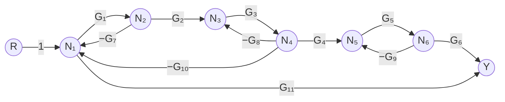

*그림 6. 비접촉 루프가 있는 신호 흐름도*

### 1.5 메이슨의 이득 공식

**메이슨의 이득 공식(Mason's gain formula)** 은 메이슨의 법칙이라고도 하며, 신호 흐름도의 입력 마디에서 출력 마디까지의 전체 전달함수 $M$을 그림에서 바로 읽어 낸 경로와 루프로 계산하는 공식이다. S. J. Mason이 1953년 논문에서 신호 흐름도의 성질을 정리하고 [1], 1956년 논문에서 이 공식을 발표하였다 [2].

```math
M = \frac{\displaystyle\sum_{k=1}^{n} M_k\Delta_k}{\Delta}
```

각 기호의 뜻은 다음과 같다.

- $n$: 전방향 경로의 수
- $M_k$: $k$번째 전방향 경로의 경로 이득
- $\Delta = 1 - L_1 + L_2 - L_3 + \cdots + (-1)^iL_i + \cdots$
- $L_1$: 모든 루프의 루프 이득을 더한 것
- $L_2$: 서로 비접촉인 2개의 루프의 루프 이득을 곱한 것을 모두 더한 것
- $L_3$: 서로 비접촉인 3개의 루프의 루프 이득을 곱한 것을 모두 더한 것
- $L_i$: 서로 비접촉인 $i$개의 루프의 루프 이득을 곱한 것을 모두 더한 것
- $\Delta_k$: $k$번째 전방향 경로와 비접촉인 루프들만으로 $\Delta$를 계산한 것

$\Delta$를 신호 흐름도의 **행렬식(determinant)**, $\Delta_k$를 $k$번째 경로의 **여인수(cofactor)** 라고 부른다. $\Delta$는 마디 신호들이 이루는 연립 일차방정식의 계수 행렬식과 같고, 공식 전체는 그 연립방정식을 크라메르 공식으로 푼 결과와 같다 [2]. 전방향 경로와 접촉하는 루프는 그 경로의 신호에 이미 영향을 주고 있으므로 $\Delta_k$에서 빠지고, 비접촉인 루프만 그 경로에 따로 곱해진다. 전방향 경로가 모든 루프와 접촉하면 $\Delta_k = 1$이다.

공식은 다음 순서로 적용한다.

1. 전방향 경로를 모두 찾고, 각 경로 이득 $M_k$를 구한다.
2. 루프를 모두 찾고, 각 루프 이득을 구한다.
3. 서로 비접촉인 루프의 2개 묶음, 3개 묶음 등을 모두 찾는다.
4. $\Delta$를 계산한다.
5. 각 전방향 경로와 비접촉인 루프만으로 $\Delta_k$를 계산한다.
6. 공식에 대입한다.

**기본 연결로 확인하기.** 그림 2의 병렬 블록은 전방향 경로가 $G_1$, $G_2$ 두 개이고 루프가 없으므로 $\Delta = \Delta_1 = \Delta_2 = 1$이고 $M = G_1 + G_2$이다. 그림 3의 피드백 블록은 전방향 경로가 $M_1 = G_1$ 하나, 루프가 이득 $-G_1G_2$인 것 하나이며, 경로가 루프와 접촉하므로 $\Delta_1 = 1$이다.

```math
M = \frac{M_1\Delta_1}{\Delta} = \frac{G_1}{1 - (-G_1G_2)} = \frac{G_1}{1 + G_1G_2}
```

이는 5주차 3.4절의 피드백 연결 결과와 같다.

> **주의:** 신호 흐름도의 루프 이득에는 가합점의 부호가 이미 들어 있다. 음의 피드백 루프는 루프 이득이 $-G_1G_2$처럼 음수이며, $\Delta = 1 - L_1$에 넣으면 $1 + G_1G_2$가 된다. 5주차 3.4절에서 블록선도의 루프 이득을 부호 없이 $G_1G_2$로 놓고 분모를 $1 + G_1G_2$로 쓴 것과 결과는 같지만, 신호 흐름도에서는 부호를 가지의 이득에 포함시킨다는 점을 혼동하지 않아야 한다.

### 1.6 예제 3: 메이슨의 이득 공식의 적용

그림 4(예제 1의 신호 흐름도)에 메이슨의 이득 공식을 적용한다.

- **2개의 전방향 경로가 있다:** $R \to N_1 \to N_2 \to N_3 \to Y$를 지나는 두 경로이며, 마지막 가지만 $G_5$와 $G_6$으로 다르다.

```math
M_1 = G_1G_4G_5, \qquad M_2 = G_1G_4G_6
```

- **2개의 루프가 있다:** $N_1 \to N_2 \to N_1$과 $N_1 \to N_2 \to N_3 \to N_1$이다.

```math
L_1 = (-G_1G_2) + (-G_1G_4G_3) = -G_1G_2 - G_1G_3G_4
```

- **비접촉인 루프가 없으므로 $L_2$와 그 이후의 항은 없다:** 두 루프는 마디 $N_1$, $N_2$를 공유한다. 따라서 다음과 같다.

```math
\Delta = 1 - L_1 = 1 + G_1G_2 + G_1G_3G_4
```

- **2개의 전방향 경로와 비접촉인 루프가 없으므로** $\Delta_1 = \Delta_2 = 1$이다. 두 경로 모두 $N_1$, $N_2$를 지나기 때문이다.

공식에 대입하면 다음과 같다.

```math
M = \frac{M_1\Delta_1 + M_2\Delta_2}{\Delta} = \frac{G_1G_4G_5 + G_1G_4G_6}{1 + G_1G_2 + G_1G_3G_4} = \frac{G_1G_4(G_5 + G_6)}{1 + G_1G_2 + G_1G_3G_4}
```

이는 5주차 3.6절에서 블록선도를 다섯 단계에 걸쳐 간소화한 결과와 같다. 같은 방법으로 그림 5(예제 2)에 적용하면, 1.4절에서 찾은 대로 $M_1 = G_1G_2G_4$, $M_2 = G_1G_5$, $L_1 = -G_1G_2G_3$이고 두 경로가 모두 루프와 접촉하므로 $\Delta_1 = \Delta_2 = 1$이다. 따라서 $M = (G_1G_2G_4 + G_1G_5)/(1 + G_1G_2G_3)$로, 인출점을 옮기지 않고도 5주차 3.7절의 결과를 얻는다.

### 1.7 예제 4: 가합점 마디의 신호

가합점에 해당하는 마디의 신호는 가합점의 합산 값이라는 점에 주의가 필요하다. 가지가 가합점의 앞에서 나가는지 뒤에서 나가는지에 따라 신호 흐름도와 결과가 달라지는데, 이를 두 블록선도로 비교한다.

**(가) 가합점 뒤에서 가지가 나가는 경우.** 그림 7의 블록선도에서 $G_4$는 가합점의 출력 $E$를 입력으로 받는다.

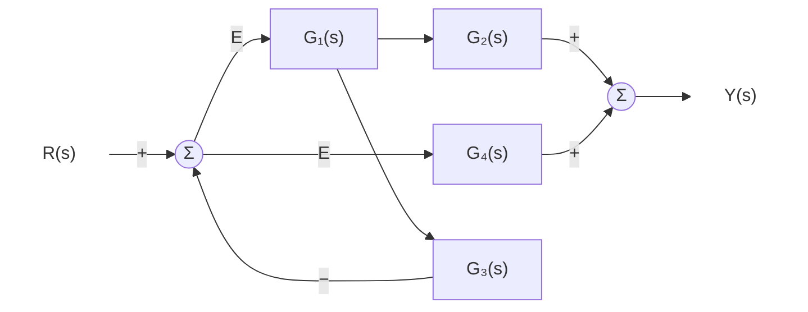

*그림 7. 가합점 뒤에서 가지가 나가는 블록선도*

신호 흐름도에서는 가합점이 마디 $E$가 되고, $G_4$의 가지는 마디 $E$에서 나간다(그림 8). 마디 $X$는 $G_1$의 출력, 마디 $N$은 둘째 가합점의 출력이다.

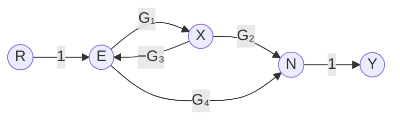

*그림 8. 그림 7의 신호 흐름도*

- 전방향 경로: $M_1 = G_1G_2$ ($`R \to E \to X \to N \to Y`$), $M_2 = G_4$ ($`R \to E \to N \to Y`$)
- 루프: $E \to X \to E$ 하나이며, $L_1 = -G_1G_3$이므로 $\Delta = 1 + G_1G_3$이다.
- 두 전방향 경로 모두 마디 $E$를 지나 루프와 접촉하므로 $\Delta_1 = \Delta_2 = 1$이다.

```math
M = \frac{G_1G_2 + G_4}{1 + G_1G_3}
```

검산으로 대수적으로 풀면, $E = R - G_3G_1E$에서 $E = R/(1 + G_1G_3)$이고 $Y = G_2G_1E + G_4E = (G_1G_2 + G_4)E$이므로 같은 결과가 나온다. $G_4$의 입력 $E$에 피드백 신호가 섞여 있으므로 $G_4$의 항도 분모 $1 + G_1G_3$으로 나누어진다.

**(나) 가합점 앞에서 가지가 나가는 경우.** 그림 9의 블록선도에서는 $G_4$가 가합점에 들어가기 전의 입력 $R$을 받는다. 이 블록선도와 신호 흐름도는 앞의 경우와 다르다.

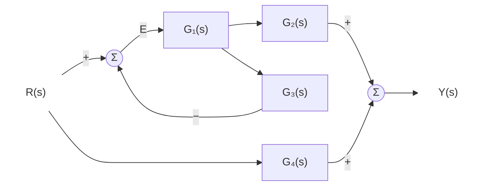

*그림 9. 가합점 앞에서 가지가 나가는 블록선도*

신호 흐름도에서는 가합점 이전에 마디 $A$가 존재하며, $A$에서 이득 1인 가지가 가합점 마디 $E$로, 이득 $G_4$인 가지가 마디 $N$으로 나간다(그림 10). 마디 $A$의 값은 $R$ 그대로이다.

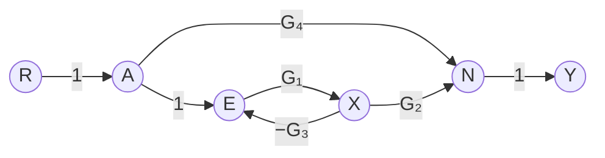

*그림 10. 그림 9의 신호 흐름도*

- 전방향 경로: $M_1 = G_1G_2$ ($`R \to A \to E \to X \to N \to Y`$), $M_2 = G_4$ ($`R \to A \to N \to Y`$)
- 루프: $E \to X \to E$ 하나이며, $\Delta = 1 + G_1G_3$이다.
- $M_1$은 루프와 접촉하므로 $\Delta_1 = 1$이다. $M_2$는 마디 $R$, $A$, $N$, $Y$만 지나 루프의 마디 $E$, $X$와 겹치지 않으므로 비접촉이고, $\Delta_2 = 1 - (-G_1G_3) = 1 + G_1G_3$이다.

```math
M = \frac{G_1G_2 \cdot 1 + G_4(1 + G_1G_3)}{1 + G_1G_3} = \frac{G_1G_2}{1 + G_1G_3} + G_4
```

$G_4$는 피드백 루프를 거치지 않고 입력을 바로 출력에 더하므로, 폐루프 전달함수 $G_1G_2/(1 + G_1G_3)$에 $G_4$가 그대로 더해진다. (가)와 (나)의 차이는 $\Delta_2$뿐이며, 이는 $G_4$의 가지가 루프의 마디 $E$에서 나가는지 아닌지에서 생긴다.

### 1.8 예제 5: 비접촉 루프가 있는 신호 흐름도

1.4절 그림 6의 신호 흐름도에 메이슨의 이득 공식을 적용한다.

**전방향 경로가 2개이다.**

```math
M_1 = G_1G_2G_3G_4G_5G_6, \qquad M_2 = G_{11}
```

**4개의 루프 이득을 모두 더한다.** 루프의 이득은 표 2와 같다.

| 루프 | 지나는 마디 | 루프 이득 |
|:-----|:-----|:-----|
| 1 | $N_1$, $N_2$ | $l_1 = -G_1G_7$ |
| 2 | $N_3$, $N_4$ | $l_2 = -G_3G_8$ |
| 3 | $N_5$, $N_6$ | $l_3 = -G_5G_9$ |
| 4 | $N_1$, $N_2$, $N_3$, $N_4$ | $l_4 = -G_1G_2G_3G_{10}$ |

*표 2. 예제 5의 루프와 루프 이득*

```math
L_1 = l_1 + l_2 + l_3 + l_4 = -\left(G_1G_7 + G_3G_8 + G_5G_9 + G_1G_2G_3G_{10}\right)
```

**4개의 루프 중 서로 비접촉인 루프를 2개씩 골라서 루프 이득을 서로 곱하고, 이들 값을 모두 구한 후 더한다.** 표 2의 마디를 비교하면 비접촉인 쌍은 (1, 2), (1, 3), (2, 3), (3, 4)의 네 쌍이다. (1, 4)는 $N_1$, $N_2$를, (2, 4)는 $N_3$, $N_4$를 공유하므로 접촉한다. 음수 두 개의 곱은 양수이다.

```math
L_2 = l_1l_2 + l_1l_3 + l_2l_3 + l_3l_4 = G_1G_3G_7G_8 + G_1G_5G_7G_9 + G_3G_5G_8G_9 + G_1G_2G_3G_5G_9G_{10}
```

**4개의 루프 중 서로 비접촉인 루프 3개의 이득을 곱한다.** 세 루프가 모두 서로 비접촉이어야 하므로 (1, 2, 3)만 가능하다. 루프 4를 포함하는 묶음은 루프 1이나 2와 접촉한다.

```math
L_3 = l_1l_2l_3 = -G_1G_3G_5G_7G_8G_9
```

서로 비접촉인 루프 4개의 묶음은 없으므로 $L_4 = 0$이다. 따라서 다음과 같다.

```math
\begin{aligned}
\Delta &= 1 - L_1 + L_2 - L_3 \\
&= 1 + G_1G_7 + G_3G_8 + G_5G_9 + G_1G_2G_3G_{10} \\
&\quad + G_1G_3G_7G_8 + G_1G_5G_7G_9 + G_3G_5G_8G_9 + G_1G_2G_3G_5G_9G_{10} + G_1G_3G_5G_7G_8G_9
\end{aligned}
```

**경로 이득이 $M_1$인 전방향 경로와 비접촉인 루프는 없다.** 이 경로는 $N_1$부터 $N_6$까지 모든 마디를 지나므로 $\Delta_1 = 1$이다.

**경로 이득이 $M_2$인 경로와 비접촉인 루프는 루프 2와 3이다.** 이 경로는 $R \to N_1 \to Y$로 마디 $N_1$만 공유하므로, $N_1$을 지나는 루프 1과 4는 빠진다. 루프 2와 3은 서로 비접촉이므로 그 곱도 들어간다.

```math
\Delta_2 = 1 - (l_2 + l_3) + l_2l_3 = 1 + G_3G_8 + G_5G_9 + G_3G_5G_8G_9 = (1 + G_3G_8)(1 + G_5G_9)
```

공식에 대입하면 전달함수는 다음과 같다.

```math
M = \frac{M_1\Delta_1 + M_2\Delta_2}{\Delta} = \frac{G_1G_2G_3G_4G_5G_6 + G_{11}\left(1 + G_3G_8 + G_5G_9 + G_3G_5G_8G_9\right)}{\Delta}
```

> **참고:** 루프 3은 다른 모든 루프와 비접촉이므로 $\Delta$가 $(1 + G_5G_9)$를 인수로 갖는다. 실제로 $\Delta = (1 + G_5G_9)(1 + G_1G_7 + G_3G_8 + G_1G_2G_3G_{10} + G_1G_3G_7G_8)$이며, 전개하면 위의 열 개 항과 같다. 일반적으로 서로 비접촉인 부분 그래프들의 $\Delta$는 각 부분의 $\Delta$의 곱이다. $\Delta_2 = (1 + G_3G_8)(1 + G_5G_9)$도 같은 이유로 인수분해된다.

---

<br>

## 2. 1차, 2차 상태 변수 방정식

### 2.1 전달함수의 한계

전달함수는 주파수 영역($s$ 영역)에서 입력 신호와 출력 신호의 비(ratio)로서 시스템의 특성을 나타낸다. 이 방식에는 다음 한계가 있다.

- 입출력 신호의 비로 시스템의 특성을 나타내면, 서로 다른 시스템의 경우라도 입출력 신호의 비만 같으면 전달함수는 같게 된다.
- 시스템의 실제 내부 구조와 상관없이 시스템의 외부에서 본 입출력 신호의 관계로만 시스템을 나타내게 된다.
- 따라서 시스템의 내부에서 실제로 일어나는 상황을 정확히 나타내기 어렵다.

이 절에서는 이 한계를 예로 확인하고, 시스템 내부의 변수까지 기술하는 상태 변수 방정식을 도입한다.

### 2.2 전달함수가 같은 1차 시스템과 2차 시스템

서로 다른 시스템이라도 전달함수가 같으면 전달함수로는 구분이 어렵다. 그림 11과 그림 12의 두 시스템은 1차 시스템과 2차 시스템으로 서로 다르지만 전달함수는 같다. 두 그림의 $1/s$ 블록은 **적분기(integrator)** 이다. $`\mathcal{L}\left\lbrace\int_0^t x(\tau)\,d\tau \right\rbrace= X(s)/s`$이므로, 초기 조건이 0일 때 $1/s$ 블록에 $\dot{x}$가 들어가면 $x$가 나온다.

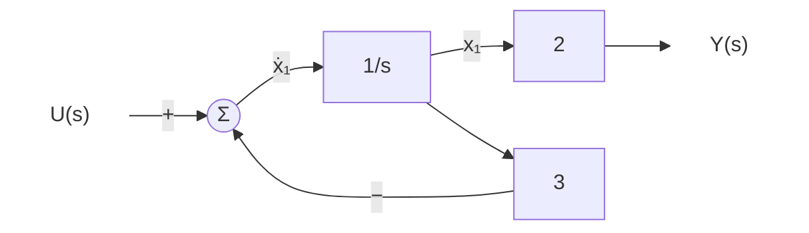

*그림 11. 전달함수가 2/(s+3)인 1차 시스템*

**1차 시스템.** 적분기의 입력은 $`\dot{x}_1 = u - 3x_1`$, 출력 방정식은 $y = 2x_1$이다. 라플라스 변환하면 $sX_1 = U - 3X_1$에서 $X_1 = U/(s + 3)$이고, $Y = 2X_1$이므로 다음과 같다.

```math
G(s) = \frac{Y(s)}{U(s)} = \frac{2}{s + 3}
```

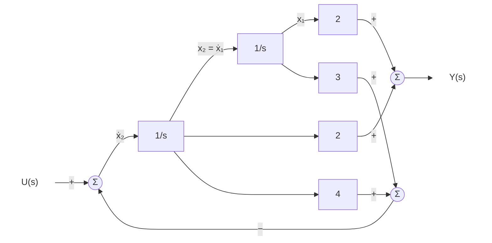

*그림 12. 전달함수가 2/(s+3)인 2차 시스템*

**2차 시스템.** 두 적분기가 직렬로 있어 첫 적분기의 출력 $x_2$가 둘째 적분기의 입력 $`\dot{x}_1`$이 된다. 첫 적분기의 입력은 $u$에서 $4x_2 + 3x_1$을 뺀 값이고, 출력은 $2x_1$과 $2x_2$의 합이다.

```math
\dot{x}_1 = x_2, \qquad \dot{x}_2 = u - 4x_2 - 3x_1, \qquad y = 2x_1 + 2x_2
```

라플라스 변환하면 $X_2 = sX_1$이고, 이를 둘째 식 $sX_2 = U - 4X_2 - 3X_1$에 넣으면 $s^2X_1 = U - 4sX_1 - 3X_1$이므로 $X_1 = U/(s^2 + 4s + 3)$이다. 출력은 $Y = 2X_1 + 2sX_1 = 2(s + 1)X_1$이므로 다음과 같다.

```math
G(s) = \frac{2(s + 1)}{s^2 + 4s + 3} = \frac{2(s + 1)}{(s + 1)(s + 3)} = \frac{2}{s + 3}
```

분모의 인수 $(s + 1)$이 분자의 $(s + 1)$과 약분되어(5주차 2.9절의 극점-영점 상쇄), 두 시스템의 전달함수가 같아진다. 그러나 2차 시스템의 내부에는 약분된 극점 $-1$에 해당하는 움직임 $e^{-t}$가 남아 있다. 예를 들어 입력 없이 초기 상태가 $x_1(0) = 1$, $x_2(0) = -1$이면 $x_1(t) = e^{-t}$, $x_2(t) = -e^{-t}$로 내부 변수는 움직이지만, 출력은 $y = 2e^{-t} - 2e^{-t} = 0$으로 항상 0이다. 이처럼 출력에서 보이지 않는 움직임을 **관측할 수 없는(unobservable)** 모드라 한다 [3]. 전달함수만으로는 이런 내부의 움직임을 알 수 없으므로, 내부 변수를 직접 다루는 표현이 필요하다.

### 2.3 상태 변수와 상태 변수 방정식

> **용어 정의:** 시스템의 **상태(state)** 는 어떤 시각 $t_0$에서의 값과 $t \ge t_0$의 입력을 알면 $t \ge t_0$의 시스템 거동을 모두 결정할 수 있는 최소한의 변수 집합이다. 그 변수들을 **상태 변수(state variable)** 라 하고, 상태 변수의 1계 미분방정식들과 출력을 상태 변수로 나타낸 식을 함께 **상태 변수 방정식(state variable equation)** 이라 한다.

**상태 변수 방정식의 예.** 5주차 1.2절의 미분방정식을 상태 변수 방정식으로 바꾼다.

- 미분방정식:

```math
\ddot{y}(t) + 3\dot{y}(t) + 2y(t) = u(t)
```

- 상태 변수 정의: 2계 미분방정식을 풀려면 초기 조건 $y(0)$, $\dot{y}(0)$ 두 개가 필요하므로, 출력과 그 도함수를 상태 변수로 정한다.

```math
x_1(t) = y(t), \qquad x_2(t) = \dot{y}(t)
```

각 상태 변수를 미분하여 상태 변수와 입력으로 나타낸다. $`\dot{x}_1 = \dot{y} = x_2`$이고, 미분방정식을 $\ddot{y}$에 대해 풀면 $`\dot{x}_2 = \ddot{y} = -2y - 3\dot{y} + u = -2x_1 - 3x_2 + u`$이다. 출력은 $y = x_1$이다.

- 상태 변수 벡터: 상태 변수들을 세로로 모은 벡터이다.

```math
x(t) = \begin{bmatrix} x_1(t) \\ x_2(t) \end{bmatrix}
```

- 벡터 방정식: 위의 세 식을 행렬로 쓰면 다음과 같다.

```math
\begin{bmatrix} \dot{x}_1 \\ \dot{x}_2 \end{bmatrix}
= \begin{bmatrix} 0 & 1 \\ -2 & -3 \end{bmatrix}
\begin{bmatrix} x_1 \\ x_2 \end{bmatrix}
+ \begin{bmatrix} 0 \\ 1 \end{bmatrix} u,
\qquad
y = \begin{bmatrix} 1 & 0 \end{bmatrix}
\begin{bmatrix} x_1 \\ x_2 \end{bmatrix}
```

2계 미분방정식 하나가 1계 미분방정식 두 개로 바뀌었다. 1계 미분방정식의 연립은 행렬 연산으로 다룰 수 있고 컴퓨터로 수치 적분하기도 쉽다.

### 2.4 예제 1, 2: 블록선도에서 상태 변수 방정식 세우기

적분기로 이루어진 블록선도에서는 **각 적분기의 출력을 상태 변수로 정한다.** 그러면 적분기의 입력이 그 상태 변수의 도함수가 되므로, 적분기의 입력을 상태 변수와 입력의 식으로 쓰면 상태 변수 방정식이 된다.

**예제 1: 1차 시스템.** 그림 11의 적분기 출력을 $x_1$으로 두면 다음과 같다.

```math
\dot{x}_1 = -3x_1 + u, \qquad y = 2x_1
```

**예제 2: 2차 시스템.** 그림 12의 두 적분기 출력을 $x_2$, $x_1$로 두면 2.2절의 식을 행렬로 쓸 수 있다.

```math
\begin{bmatrix} \dot{x}_1 \\ \dot{x}_2 \end{bmatrix}
= \begin{bmatrix} 0 & 1 \\ -3 & -4 \end{bmatrix}
\begin{bmatrix} x_1 \\ x_2 \end{bmatrix}
+ \begin{bmatrix} 0 \\ 1 \end{bmatrix} u,
\qquad
y = \begin{bmatrix} 2 & 2 \end{bmatrix}
\begin{bmatrix} x_1 \\ x_2 \end{bmatrix}
```

두 시스템은 전달함수가 같지만 상태 변수의 개수가 1개와 2개로 다르다. 상태 변수 방정식은 이 내부 구조의 차이를 그대로 드러낸다.

### 2.5 상태 변수 벡터와 일반적인 형태

$n$개의 상태 변수를 모은 상태 변수 벡터는 다음과 같다.

```math
x(t) = \begin{bmatrix} x_1(t) \\ x_2(t) \\ \vdots \\ x_n(t) \end{bmatrix}
```

여기서 $n$은 다음과 같은 뜻을 가진다.

- 시스템의 **차수(order)** 이다.
- 시스템을 완전하게 나타낼 수 있는 독립적인 상태 변수의 개수이다.
- 시스템 특성을 나타내는 미분방정식의 차수와 일치한다.

상태 변수 방정식의 일반적인 형태는 다음과 같다.

```math
\dot{x}(t) = f\big(x(t), u(t)\big), \qquad y(t) = g\big(x(t), u(t)\big)
```

첫째 식을 **상태 방정식(state equation)**, 둘째 식을 **출력 방정식(output equation)** 이라 한다. 이 형태는 입력과 출력이 여러 개인 **다중 입력 다중 출력(multi-input multi-output, MIMO)** 시스템과 하나씩인 **단일 입력 단일 출력(single-input single-output, SISO)** 시스템을 모두 포함하며, 함수 $f$, $g$가 선형이 아닌 비선형 시스템도 포함한다. 예를 들어 길이 $l$인 진자의 각도 $\theta$가 $\ddot{\theta} = -(g_0/l)\sin\theta + u$를 따르면($g_0$은 중력 가속도), $x_1 = \theta$, $x_2 = \dot{\theta}$로 두어 $`\dot{x}_1 = x_2`$, $`\dot{x}_2 = -(g_0/l)\sin x_1 + u`$로 쓸 수 있다. $\sin x_1$ 때문에 이 시스템은 전달함수로 나타낼 수 없지만 상태 변수 방정식으로는 나타낼 수 있다.

### 2.6 선형 시불변 시스템의 상태 변수 방정식

선형 시불변 시스템(linear time-invariant system)에서는 $f$와 $g$가 상태와 입력의 선형 결합이고 계수가 시간에 따라 변하지 않으므로, 상태 변수 방정식은 다음과 같이 행렬로 쓴다.

```math
\dot{x}(t) = Ax(t) + Bu(t), \qquad y(t) = Cx(t) + Du(t)
```

단일 입력 단일 출력 시스템에서 각 변수와 행렬의 크기와 이름은 표 3과 같다. $A$를 **시스템 행렬(system matrix)**, $B$를 **입력 행렬(input matrix)**, $C$를 **출력 행렬(output matrix)**, $D$를 **직달 행렬(feedthrough matrix)** 이라 한다.

| 기호 | 크기 | 이름과 역할 |
|:-----|:-----|:-----|
| $x$ | $n \times 1$ | 상태 변수 벡터 |
| $u$ | $1 \times 1$ | 입력 |
| $y$ | $1 \times 1$ | 출력 |
| $A$ | $n \times n$ | 시스템 행렬: 상태 변수들이 서로에게 주는 영향 |
| $B$ | $n \times 1$ | 입력 행렬: 입력이 각 상태 변수의 변화에 주는 영향 |
| $C$ | $1 \times n$ | 출력 행렬: 상태 변수들로 출력을 만드는 방법 |
| $D$ | $1 \times 1$ | 직달 행렬: 입력이 상태를 거치지 않고 출력에 바로 주는 영향 |

*표 3. 단일 입력 단일 출력 선형 시불변 시스템의 상태 변수 방정식의 크기*

2.3절의 예는 $`A = \begin{bmatrix} 0 & 1 \\ -2 & -3 \end{bmatrix}`$, $`B = \begin{bmatrix} 0 \\ 1 \end{bmatrix}`$, $`C = \begin{bmatrix} 1 & 0 \end{bmatrix}`$, $D = 0$인 경우이다. 행렬 곱의 크기를 확인하면 $Ax$는 $(n \times n)(n \times 1) = n \times 1$, $Bu$는 $(n \times 1)(1 \times 1) = n \times 1$로 $\dot{x}$와 크기가 같고, $Cx$는 $(1 \times n)(n \times 1) = 1 \times 1$로 $y$와 크기가 같다. 입력이 $p$개, 출력이 $q$개인 다중 입력 다중 출력 시스템에서는 $B$가 $n \times p$, $C$가 $q \times n$, $D$가 $q \times p$가 된다.

---

<br>

## 3. n차 상태 변수 방정식

### 3.1 입력의 미분 항이 없는 경우

제어 입력 신호의 미분 항이 없는 $n$계 미분방정식은 다음과 같다.

```math
\frac{d^ny(t)}{dt^n} + a_{n-1}\frac{d^{n-1}y(t)}{dt^{n-1}} + \cdots + a_1\frac{dy(t)}{dt} + a_0y(t) = u(t)
```

2.3절과 같이 출력과 그 도함수들을 상태 변수로 정의한다. $y^{(k)}$는 $y$의 $k$계 도함수이다.

```math
x_1(t) = y(t), \qquad x_2(t) = y^{(1)}(t), \qquad \ldots, \qquad x_n(t) = y^{(n-1)}(t)
```

각 상태 변수를 미분하면 다음 상태 변수가 되고, 마지막 상태 변수의 도함수는 미분방정식을 $y^{(n)}$에 대해 풀어 얻는다.

```math
\begin{aligned}
\dot{x}_1 &= y^{(1)} = x_2 \\
\dot{x}_2 &= y^{(2)} = x_3 \\
&\;\;\vdots \\
\dot{x}_n &= y^{(n)} = -a_0x_1 - a_1x_2 - \cdots - a_{n-1}x_n + u
\end{aligned}
```

이처럼 상태 변수 방정식은 $n$계 미분방정식을 $n$개의 1계 미분방정식으로 변환한 것이며, $\dot{x} = Ax + Bu$, $y = Cx + Du$의 꼴이 된다. 출력은 $y = x_1$이므로 $`C = \begin{bmatrix} 1 & 0 & \cdots & 0 \end{bmatrix}`$, $D = 0$이다.

### 3.2 입력의 미분 항이 있는 경우와 중간 변수

제어 입력 신호의 미분 항이 있는 경우를 생각한다. 우변의 최고차 미분이 $n - 1$차 이하라고 가정한다(전달함수가 순프로퍼).

```math
\frac{d^ny}{dt^n} + a_{n-1}\frac{d^{n-1}y}{dt^{n-1}} + \cdots + a_1\frac{dy}{dt} + a_0y
= b_{n-1}\frac{d^{n-1}u}{dt^{n-1}} + b_{n-2}\frac{d^{n-2}u}{dt^{n-2}} + \cdots + b_1\frac{du}{dt} + b_0u
```

이때 3.1절처럼 $x_1 = y, \ldots, x_n = y^{(n-1)}$로 두면, $`\dot{x}_n = y^{(n)}`$에 입력의 도함수 $\dot{u}, \ddot{u}, \ldots$가 섞여 들어가 $\dot{x} = Ax + Bu$의 꼴을 만들 수 없다. 이 문제는 중간 변수를 도입하여 해결한다.

**전달함수.** 초기 조건을 0으로 두고 변환하면 전달함수는 다음과 같다.

```math
G(s) = \frac{Y(s)}{U(s)} = \frac{b_{n-1}s^{n-1} + b_{n-2}s^{n-2} + \cdots + b_1s + b_0}{s^n + a_{n-1}s^{n-1} + \cdots + a_1s + a_0}
```

**중간 변수 $Z(s)$ 도입.** 전달함수를 분모 부분과 분자 부분의 두 단계로 나누고, 그 사이의 신호를 **중간 변수(intermediate variable)** $Z(s)$로 둔다.

```math
\frac{Y(s)}{U(s)} = \frac{Z(s)}{U(s)} \cdot \frac{Y(s)}{Z(s)},
\qquad
\frac{Z(s)}{U(s)} = \frac{1}{s^n + a_{n-1}s^{n-1} + \cdots + a_1s + a_0},
\qquad
\frac{Y(s)}{Z(s)} = b_{n-1}s^{n-1} + \cdots + b_1s + b_0
```

두 식을 곱하면 원래의 전달함수가 되므로, 이렇게 나누어도 입출력 관계는 그대로이다.

**입력 변수 식.** 첫째 단계를 다시 쓰면 다음과 같다.

```math
U(s) = (s^n + a_{n-1}s^{n-1} + \cdots + a_1s + a_0)Z(s)
```

미분방정식으로 변환하면 $z^{(n)} + a_{n-1}z^{(n-1)} + \cdots + a_1\dot{z} + a_0z = u$이다. 이 식에는 입력의 미분 항이 없으므로 3.1절의 방법을 그대로 쓸 수 있다.

**중간 변수 $z(t)$를 이용하여 상태 변수 정의.** 출력 $y$ 대신 중간 변수 $z$와 그 도함수들을 상태 변수로 정한다.

```math
x_1(t) = z(t), \qquad x_2(t) = z^{(1)}(t), \qquad \ldots, \qquad x_n(t) = z^{(n-1)}(t)
```

그러면 상태 방정식은 3.1절과 같은 꼴이 된다.

```math
\begin{aligned}
\dot{x}_1(t) &= z^{(1)}(t) = x_2(t) \\
\dot{x}_2(t) &= z^{(2)}(t) = x_3(t) \\
&\;\;\vdots \\
\dot{x}_n(t) &= z^{(n)}(t) = -a_0x_1(t) - a_1x_2(t) - \cdots - a_{n-1}x_n(t) + u(t)
\end{aligned}
```

**출력 변수 식.** 둘째 단계를 다시 쓰면 다음과 같다.

```math
Y(s) = (b_{n-1}s^{n-1} + b_{n-2}s^{n-2} + \cdots + b_1s + b_0)Z(s)
```

미분방정식으로 변환하고 $z$의 도함수를 상태 변수로 바꾸면 출력 방정식을 얻는다. $z$의 최고차 도함수가 $z^{(n-1)} = x_n$이므로 출력에는 입력의 미분이 필요 없다.

```math
\begin{aligned}
y(t) &= b_{n-1}\frac{d^{n-1}z(t)}{dt^{n-1}} + b_{n-2}\frac{d^{n-2}z(t)}{dt^{n-2}} + \cdots + b_1\frac{dz(t)}{dt} + b_0z(t) \\
&= b_{n-1}x_n(t) + b_{n-2}x_{n-1}(t) + \cdots + b_1x_2(t) + b_0x_1(t)
\end{aligned}
```

### 3.3 벡터 형태와 블록선도

3.2절의 결과를 벡터 형태의 상태 변수 방정식으로 쓰면 다음과 같다.

```math
\begin{bmatrix} \dot{x}_1 \\ \dot{x}_2 \\ \vdots \\ \dot{x}_{n-1} \\ \dot{x}_n \end{bmatrix}
=
\begin{bmatrix}
0 & 1 & 0 & \cdots & 0 \\
0 & 0 & 1 & \cdots & 0 \\
\vdots & \vdots & \vdots & \ddots & \vdots \\
0 & 0 & 0 & \cdots & 1 \\
-a_0 & -a_1 & -a_2 & \cdots & -a_{n-1}
\end{bmatrix}
\begin{bmatrix} x_1 \\ x_2 \\ \vdots \\ x_{n-1} \\ x_n \end{bmatrix}
+
\begin{bmatrix} 0 \\ 0 \\ \vdots \\ 0 \\ 1 \end{bmatrix} u,
\qquad
y = \begin{bmatrix} b_0 & b_1 & \cdots & b_{n-2} & b_{n-1} \end{bmatrix}
\begin{bmatrix} x_1 \\ x_2 \\ \vdots \\ x_n \end{bmatrix}
```

행렬의 모양에서 다음 규칙을 읽을 수 있다.

- $A$의 대각선 바로 위에는 1이 있다. 이는 $`\dot{x}_i = x_{i+1}`$을 나타낸다.
- $A$의 마지막 행은 전달함수 분모의 계수를 낮은 차수부터 부호를 바꾸어 늘어놓은 $-a_0, -a_1, \ldots, -a_{n-1}$이다.
- $B$는 마지막 성분만 1인 벡터이다. 입력은 $`\dot{x}_n`$에만 들어간다.
- $C$는 전달함수 분자의 계수를 낮은 차수부터 늘어놓은 $b_0, b_1, \ldots, b_{n-1}$이고, $D = 0$이다.

그림 13은 이 상태 변수 방정식을 블록선도로 그린 것이다. 적분기 $n$개가 직렬로 이어져 $`\dot{x}_n`$이 $x_n$, $x_{n-1}, \ldots$, $x_1$로 차례로 적분된다. 각 적분기의 출력 $x_{i+1}$은 이득 $a_i$를 거쳐 입력 쪽 가합점으로 되돌아가 $u$에서 빼지고, 동시에 이득 $b_i$를 거쳐 출력 쪽 가합점에서 더해져 $Y$가 된다. 이런 꼴의 상태 변수 방정식을 **가제어 표준형(controllable canonical form)** 이라 하며, 상태 변수가 $z$와 그 도함수들이어서 위상 변수(phase variable) 형태라고도 한다 [3], [4].

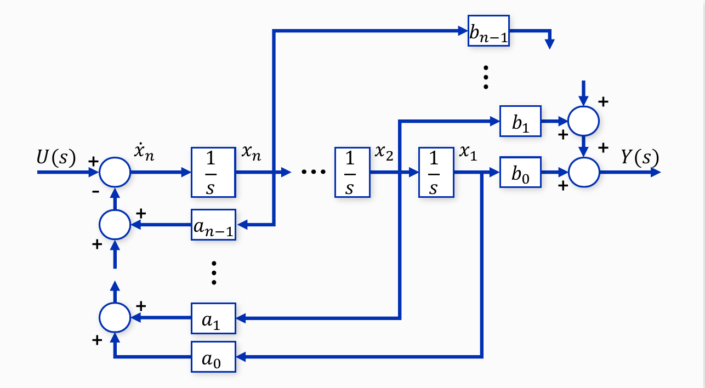

*그림 13. n차 전달함수를 상태 변수 방정식으로 나타낸 블록선도*

> **참고:** 분자와 분모의 차수가 같은 전달함수($`m = n`$)는 먼저 다항식 나눗셈으로 $G(s) = D + (\text{순프로퍼 전달함수})$로 나눈다. 순프로퍼 부분은 위의 방법으로 $A$, $B$, $C$를 구하고, 몫인 상수가 직달 행렬 $D$가 된다. 예를 들어 $G(s) = \dfrac{s + 3}{s + 1} = 1 + \dfrac{2}{s + 1}$은 $A = -1$, $B = 1$, $C = 2$, $D = 1$이다.

### 3.4 예제 1: 분자가 상수인 전달함수

다음 전달함수를 상태 변수 방정식으로 나타낸다.

```math
G(s) = \frac{Y(s)}{U(s)} = \frac{1}{s^3 + 2s^2 + 3s + 1}
```

**미분방정식.** 분모를 곱해 $(s^3 + 2s^2 + 3s + 1)Y(s) = U(s)$로 쓰고 시간 영역으로 되돌리면 입력의 미분 항이 없는 3계 미분방정식이 된다.

```math
\frac{d^3y(t)}{dt^3} + 2\frac{d^2y(t)}{dt^2} + 3\frac{dy(t)}{dt} + y(t) = u(t)
```

**상태 변수 정의.** $x_1 = y$, $x_2 = \dot{y}$, $x_3 = \ddot{y}$로 두면 $`\dot{x}_1 = x_2`$, $`\dot{x}_2 = x_3`$이고, 미분방정식을 $\dddot{y}$에 대해 풀어 $`\dot{x}_3 = -x_1 - 3x_2 - 2x_3 + u`$를 얻는다. 계수는 $a_0 = 1$, $a_1 = 3$, $a_2 = 2$, $b_0 = 1$이다.

```math
\begin{bmatrix} \dot{x}_1 \\ \dot{x}_2 \\ \dot{x}_3 \end{bmatrix}
= \begin{bmatrix} 0 & 1 & 0 \\ 0 & 0 & 1 \\ -1 & -3 & -2 \end{bmatrix}
\begin{bmatrix} x_1 \\ x_2 \\ x_3 \end{bmatrix}
+ \begin{bmatrix} 0 \\ 0 \\ 1 \end{bmatrix} u,
\qquad
y = \begin{bmatrix} 1 & 0 & 0 \end{bmatrix}
\begin{bmatrix} x_1 \\ x_2 \\ x_3 \end{bmatrix}
```

블록선도는 그림 14와 같다. 적분기 세 개가 $`\dot{x}_3 \to x_3 \to x_2 \to x_1`$로 이어지고, $x_3$, $x_2$, $x_1$이 이득 2, 3, 1을 거쳐 입력 쪽 가합점으로 되돌아가며, 출력은 $x_1$에 이득 1을 곱한 것이다.

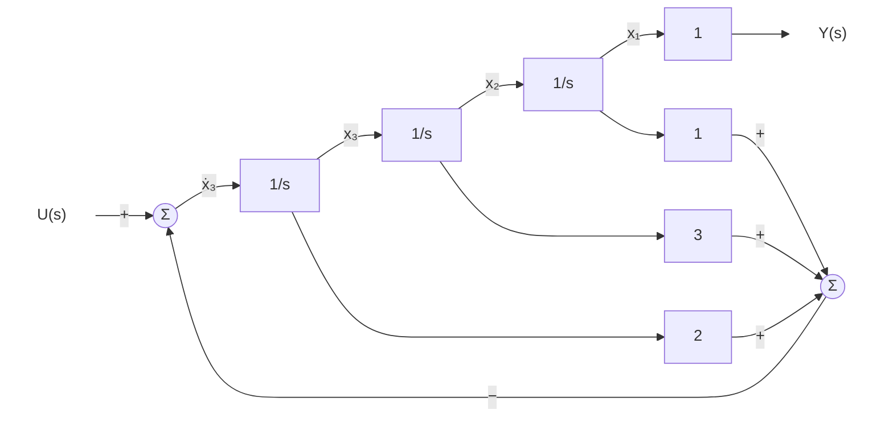

*그림 14. 예제 1의 상태 변수 블록선도*

### 3.5 예제 2: 분자가 다항식인 전달함수

다음 전달함수를 상태 변수 방정식으로 나타낸다.

```math
G(s) = \frac{Y(s)}{U(s)} = \frac{5s + 4}{s^3 + 2s^2 + 3s + 1}
```

분자에 $s$가 있어 입력의 미분 항이 생기므로 중간 변수를 쓴다. $Z(s)/U(s) = 1/(s^3 + 2s^2 + 3s + 1)$, $Y(s) = (5s + 4)Z(s)$로 나누고, 상태 변수를 다음과 같이 정의한다.

```math
x_1 = z, \qquad x_2 = \dot{z}, \qquad x_3 = \ddot{z}
```

분모가 예제 1과 같으므로 상태 방정식($A$, $`B`$)도 예제 1과 같다. 출력은 $y = 5\dot{z} + 4z = 4x_1 + 5x_2$이므로 $b_0 = 4$, $b_1 = 5$, $b_2 = 0$이다.

```math
\begin{bmatrix} \dot{x}_1 \\ \dot{x}_2 \\ \dot{x}_3 \end{bmatrix}
= \begin{bmatrix} 0 & 1 & 0 \\ 0 & 0 & 1 \\ -1 & -3 & -2 \end{bmatrix}
\begin{bmatrix} x_1 \\ x_2 \\ x_3 \end{bmatrix}
+ \begin{bmatrix} 0 \\ 0 \\ 1 \end{bmatrix} u,
\qquad
y = \begin{bmatrix} 4 & 5 & 0 \end{bmatrix}
\begin{bmatrix} x_1 \\ x_2 \\ x_3 \end{bmatrix}
```

블록선도는 그림 15와 같다. 그림 14와 비교하면 피드백 부분은 같고, 출력 쪽에서 $x_1$에 4를, $x_2$에 5를 곱해 더하는 부분만 다르다. 분모는 $A$를, 분자는 $C$만을 결정한다.

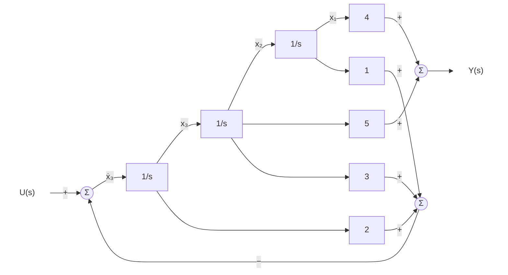

*그림 15. 예제 2의 상태 변수 블록선도*

### 3.6 상태 변수 방정식에서 전달함수 구하기

반대로 상태 변수 방정식이 주어지면 전달함수를 구할 수 있다 [3]. 초기 상태를 $x(0) = 0$으로 두고 $\dot{x} = Ax + Bu$를 라플라스 변환하면 $sX(s) = AX(s) + BU(s)$이다. $X(s)$의 항을 모으면 $(sI - A)X(s) = BU(s)$이고($I$는 $n \times n$ 단위 행렬), 양변에 $(sI - A)^{-1}$을 곱하면 $X(s) = (sI - A)^{-1}BU(s)$이다. 이를 출력 방정식 $Y(s) = CX(s) + DU(s)$에 넣으면 다음을 얻는다.

```math
G(s) = \frac{Y(s)}{U(s)} = C(sI - A)^{-1}B + D
```

> **[선형대수학]** 역행렬은 $(sI - A)^{-1} = \dfrac{\operatorname{adj}(sI - A)}{\det(sI - A)}$로 쓸 수 있다($\operatorname{adj}$는 수반 행렬). 따라서 전달함수의 분모는 $\det(sI - A)$이고, 특성방정식은 $\det(sI - A) = 0$이며, 그 근은 $A$의 고윳값이다. 약분이 없으면 전달함수의 극점은 $A$의 고윳값과 같다. $2 \times 2$ 행렬은 $`\begin{bmatrix} a & b \\ c & d \end{bmatrix}^{-1} = \dfrac{1}{ad - bc}\begin{bmatrix} d & -b \\ -c & a \end{bmatrix}`$이다(3주차).

**예: 2.3절의 상태 변수 방정식.** $`A = \begin{bmatrix} 0 & 1 \\ -2 & -3 \end{bmatrix}`$이므로 다음과 같다.

```math
sI - A = \begin{bmatrix} s & -1 \\ 2 & s + 3 \end{bmatrix},
\qquad
\det(sI - A) = s(s + 3) + 2 = s^2 + 3s + 2,
\qquad
(sI - A)^{-1} = \frac{1}{s^2 + 3s + 2}\begin{bmatrix} s + 3 & 1 \\ -2 & s \end{bmatrix}
```

$`B = \begin{bmatrix} 0 & 1 \end{bmatrix}^T`$을 곱하면 역행렬의 둘째 열만 남고, $`C = \begin{bmatrix} 1 & 0 \end{bmatrix}`$을 곱하면 그 첫째 성분만 남는다.

```math
G(s) = \begin{bmatrix} 1 & 0 \end{bmatrix}\frac{1}{s^2 + 3s + 2}\begin{bmatrix} 1 \\ s \end{bmatrix} = \frac{1}{s^2 + 3s + 2}
```

이는 원래 미분방정식 $\ddot{y} + 3\dot{y} + 2y = u$의 전달함수와 같다.

**예: 2.2절의 2차 시스템.** $`A = \begin{bmatrix} 0 & 1 \\ -3 & -4 \end{bmatrix}`$이면 같은 계산으로 $`(sI - A)^{-1}B = \dfrac{1}{s^2 + 4s + 3}\begin{bmatrix} 1 \\ s \end{bmatrix}`$이고, $`C = \begin{bmatrix} 2 & 2 \end{bmatrix}`$를 곱하면 $\dfrac{2 + 2s}{s^2 + 4s + 3} = \dfrac{2}{s + 3}$이다. $A$의 고윳값은 $\det(sI - A) = (s + 1)(s + 3) = 0$의 근 $-1$, $-3$인데, 전달함수에는 $-3$만 극점으로 남는다. 고윳값 $-1$이 약분으로 사라진 것이 2.2절에서 본 숨은 움직임 $e^{-t}$이다.

**가제어 표준형의 경우.** 3.3절의 $A$, $B$에 대해서는 $`(sI - A)^{-1}B = \dfrac{1}{s^n + a_{n-1}s^{n-1} + \cdots + a_0}\begin{bmatrix} 1 & s & \cdots & s^{n-1} \end{bmatrix}^T`$가 성립한다. 따라서 $`C = \begin{bmatrix} b_0 & b_1 & \cdots & b_{n-1} \end{bmatrix}`$을 곱하면 분자 $b_0 + b_1s + \cdots + b_{n-1}s^{n-1}$이 나온다. 예제 2에서는 $`\begin{bmatrix} 4 & 5 & 0 \end{bmatrix}\begin{bmatrix} 1 & s & s^2 \end{bmatrix}^T = 5s + 4`$이므로 원래의 전달함수가 다시 나온다. $C$의 성분이 분자의 계수가 되는 이유가 여기에 있다.

> **핵심:** 전달함수에서 상태 변수 방정식으로 가는 방법은 하나가 아니다. 상태 변수 벡터를 가역 행렬 $T$로 바꾸어 $x = T\hat{x}$로 두면 $\hat{A} = T^{-1}AT$, $\hat{B} = T^{-1}B$, $\hat{C} = CT$, $\hat{D} = D$인 다른 상태 변수 방정식이 되지만 전달함수는 같다 [3]. 2.2절의 두 시스템처럼 상태 변수의 개수가 다른 표현도 가능하다. 반대로 상태 변수 방정식에서 전달함수로 가는 결과는 하나로 정해진다.

---

<br>

## 개념 적용

**T/F 점검:**

| 문장 | 판단과 근거 |
|:-----|:------------|
| 신호 흐름도에서 마디의 값은 그 마디에서 나가는 가지들의 신호를 더한 것이다. | **F.** 마디의 값은 들어오는 가지들의 신호의 합이며, 나가는 가지는 마디의 값을 바꾸지 않는다. |
| 메이슨의 이득 공식에서 $\Delta_k$는 $k$번째 전방향 경로와 접촉하는 루프들만으로 계산한다. | **F.** $\Delta_k$는 $k$번째 전방향 경로와 비접촉인 루프들만으로 계산한다. |
| 모든 루프가 서로 접촉하면 $\Delta = 1 - L_1$이다. | **T.** 비접촉인 루프의 묶음이 없으므로 $L_2$ 이후의 항이 모두 0이다. |
| 전달함수가 같은 두 시스템은 상태 변수의 개수도 같다. | **F.** 2.2절의 두 시스템은 전달함수가 $2/(s+3)$으로 같지만 상태 변수가 1개와 2개이다. |
| 단일 입력 단일 출력 시스템에서 $C$의 크기는 $1 \times n$이다. | **T.** $Cx$가 스칼라 출력 $y$가 되어야 하므로 $(1 \times n)(n \times 1) = 1 \times 1$이다. |
| 가제어 표준형에서 전달함수의 분자는 $A$의 마지막 행을 결정한다. | **F.** $A$의 마지막 행은 분모의 계수로 정해지고, 분자의 계수는 $C$를 결정한다. |

---

<br>

## 요약

| 개념 | 핵심 요약 |
|:-----|:-----|
| 신호 흐름도 | 신호를 마디로, 전달함수를 이득이 붙은 방향성 가지로 나타낸 블록선도의 또 다른 표현이며, 마디의 값은 들어오는 가지 신호의 합이다. |
| 경로와 루프 | 경로는 한 마디를 두 번 거치지 않고 가지를 따라가는 길이고, 전방향 경로는 입력 마디에서 출력 마디까지, 루프는 출발 마디로 돌아오는 경로이다. |
| 비접촉 | 두 경로나 루프가 같은 마디를 하나도 공유하지 않는 것이다. |
| 메이슨의 이득 공식 | $M = \sum M_k\Delta_k/\Delta$이며, $\Delta = 1 - L_1 + L_2 - \cdots$이고 $\Delta_k$는 $k$번째 전방향 경로와 비접촉인 루프만으로 계산한다. |
| 루프 이득의 부호 | 신호 흐름도에서는 가합점의 $-$ 부호가 가지의 이득에 들어가므로, 음의 피드백 루프의 루프 이득은 음수이다. |
| 전달함수의 한계 | 전달함수는 외부에서 본 입출력의 비이므로, 극점-영점 상쇄로 사라진 내부의 움직임을 나타내지 못한다. |
| 상태 변수 | 어떤 시각의 값과 그 이후의 입력으로 이후의 거동을 모두 결정하는 최소한의 변수이며, 그 개수가 시스템의 차수이다. |
| 상태 변수 방정식 | 일반형은 $\dot{x} = f(x, u)$, $y = g(x, u)$이고, 선형 시불변 시스템에서는 $\dot{x} = Ax + Bu$, $y = Cx + Du$이다. |
| 중간 변수 | 입력의 미분 항이 있으면 $Z/U = 1/(\text{분모})$, $Y = (\text{분자})Z$로 나누고 $z$와 그 도함수를 상태 변수로 정한다. |
| 가제어 표준형 | $A$의 마지막 행은 $-a_0, \ldots, -a_{n-1}$, $`B = [0 \cdots 0\ 1]^T`$, $C = [b_0 \cdots b_{n-1}]$이다. |
| 전달함수로의 변환 | $G(s) = C(sI - A)^{-1}B + D$이며, 분모 $\det(sI - A)$의 근은 $A$의 고윳값이다. |

---

<br>

## 점검 문제

1. **신호 흐름도 그리기:** 전방향 경로의 전달함수가 $G$인 단위 피드백 시스템을 신호 흐름도로 그리고, 메이슨의 이득 공식으로 폐루프 전달함수를 구하라.

   <details>
   <summary>정답</summary>

   마디 $R$, $E$, $Y$를 두고 가지 $R \to E$(이득 1), $E \to Y$(이득 $`G`$), $Y \to E$(이득 $`-1`$)를 그린다. 전방향 경로는 $M_1 = G$ 하나, 루프는 이득 $-G$인 것 하나이며 경로가 루프와 접촉하므로 $\Delta_1 = 1$이다. 따라서 $M = \dfrac{G}{1 - (-G)} = \dfrac{G}{1 + G}$이다.

   </details>

2. **비접촉 루프:** 마디 $R$, $N_1$, $N_2$, $N_3$, $N_4$, $Y$와 가지 $R \to N_1$(1), $N_1 \to N_2$($`G_1`$), $N_2 \to N_1$($`H_1`$), $N_2 \to N_3$($`G_2`$), $N_3 \to N_4$($`G_3`$), $N_4 \to N_3$($`H_2`$), $N_4 \to Y$(1)로 이루어진 신호 흐름도의 전달함수를 구하라.

   <details>
   <summary>정답</summary>

   전방향 경로는 $M_1 = G_1G_2G_3$ 하나이다. 루프는 $l_1 = G_1H_1$($N_1$, $`N_2`$)과 $l_2 = G_3H_2$($N_3$, $`N_4`$)이며 서로 비접촉이다. 따라서 $\Delta = 1 - (G_1H_1 + G_3H_2) + G_1H_1G_3H_2 = (1 - G_1H_1)(1 - G_3H_2)$이고, 전방향 경로는 두 루프와 모두 접촉하므로 $\Delta_1 = 1$이다. $M = \dfrac{G_1G_2G_3}{(1 - G_1H_1)(1 - G_3H_2)}$이며, 이는 두 피드백 루프 $G_1/(1 - G_1H_1)$, $G_3/(1 - G_3H_2)$와 $G_2$의 직렬 연결과 같다.

   </details>

3. **여인수의 의미:** 메이슨의 이득 공식에서 $k$번째 전방향 경로와 접촉하는 루프를 $\Delta_k$에서 빼는 이유를 1.7절의 예제 4로 설명하라.

   <details>
   <summary>정답</summary>

   전방향 경로가 루프의 마디를 지나면, 그 경로의 신호에는 루프의 효과가 이미 $\Delta$로 나누는 과정에 반영되어 있다. (가)에서 $G_4$의 경로는 루프의 마디 $E$를 지나므로 $\Delta_2 = 1$이고 $G_4$의 항도 $1 + G_1G_3$으로 나누어진다. (나)에서 $G_4$의 경로는 루프를 지나지 않으므로 루프의 영향을 받지 않아야 하는데, $\Delta_2 = 1 + G_1G_3$이 분모의 $\Delta$를 상쇄하여 $G_4$가 그대로 더해진다.

   </details>

4. **예제 5의 접촉 관계:** 1.8절의 예제 5에서 루프 1과 루프 4가 비접촉이 아닌 이유와, 3개의 비접촉 루프 묶음이 (1, 2, 3) 하나뿐인 이유를 설명하라.

   <details>
   <summary>정답</summary>

   루프 1은 마디 $N_1$, $N_2$를, 루프 4는 $N_1$, $N_2$, $N_3$, $N_4$를 지나므로 $N_1$, $N_2$를 공유하여 접촉한다. 루프 4는 루프 2와도 $N_3$, $N_4$를 공유한다. 따라서 루프 4를 포함하는 3개 묶음에는 반드시 루프 1이나 2가 들어가 접촉이 생기고, 루프 4를 뺀 루프 1, 2, 3만 서로 비접촉인 3개 묶음이 된다.

   </details>

5. **미분방정식에서 상태 변수 방정식으로:** $\dddot{y} + 6\ddot{y} + 11\dot{y} + 6y = 2u$를 상태 변수 방정식으로 나타내라.

   <details>
   <summary>정답</summary>

   $x_1 = y$, $x_2 = \dot{y}$, $x_3 = \ddot{y}$로 두면 $`\dot{x}_1 = x_2`$, $`\dot{x}_2 = x_3`$, $`\dot{x}_3 = -6x_1 - 11x_2 - 6x_3 + 2u`$이므로 $`A = \begin{bmatrix} 0 & 1 & 0 \\ 0 & 0 & 1 \\ -6 & -11 & -6 \end{bmatrix}`$, $`B = \begin{bmatrix} 0 \\ 0 \\ 2 \end{bmatrix}`$, $`C = \begin{bmatrix} 1 & 0 & 0 \end{bmatrix}`$, $D = 0$이다. 전달함수 $2/(s^3 + 6s^2 + 11s + 6)$에 3.3절의 형태를 적용하여 $`B = \begin{bmatrix} 0 & 0 & 1 \end{bmatrix}^T`$, $`C = \begin{bmatrix} 2 & 0 & 0 \end{bmatrix}`$로 써도 전달함수가 같으므로 맞는 답이다.

   </details>

6. **전달함수에서 상태 변수 방정식으로:** $G(s) = \dfrac{3s + 1}{s^2 + 4s + 5}$를 가제어 표준형으로 나타내라.

   <details>
   <summary>정답</summary>

   분모에서 $a_0 = 5$, $a_1 = 4$, 분자에서 $b_0 = 1$, $b_1 = 3$이다. 따라서 $`A = \begin{bmatrix} 0 & 1 \\ -5 & -4 \end{bmatrix}`$, $`B = \begin{bmatrix} 0 \\ 1 \end{bmatrix}`$, $`C = \begin{bmatrix} 1 & 3 \end{bmatrix}`$, $D = 0$이다. 상태 변수는 $x_1 = z$, $x_2 = \dot{z}$이고 $Z(s)/U(s) = 1/(s^2 + 4s + 5)$, $Y = (3s + 1)Z$이다.

   </details>

7. **상태 변수 방정식에서 전달함수로:** $`A = \begin{bmatrix} 0 & 1 \\ -6 & -5 \end{bmatrix}`$, $`B = \begin{bmatrix} 0 \\ 1 \end{bmatrix}`$, $`C = \begin{bmatrix} 1 & 1 \end{bmatrix}`$, $D = 0$인 시스템의 전달함수와 극점을 구하라.

   <details>
   <summary>정답</summary>

   $`sI - A = \begin{bmatrix} s & -1 \\ 6 & s + 5 \end{bmatrix}`$이고 $\det(sI - A) = s^2 + 5s + 6$이다. $`(sI - A)^{-1}B = \dfrac{1}{s^2 + 5s + 6}\begin{bmatrix} 1 \\ s \end{bmatrix}`$이므로 $G(s) = \dfrac{1 + s}{s^2 + 5s + 6} = \dfrac{s + 1}{(s + 2)(s + 3)}$이다. 극점은 $-2$, $-3$이고, 이는 $A$의 고윳값과 같다.

   </details>

8. **행렬의 크기:** 상태 변수가 4개인 단일 입력 단일 출력 선형 시불변 시스템에서 $A$, $B$, $C$, $D$의 크기를 쓰라. 입력이 2개, 출력이 3개라면 어떻게 바뀌는가?

   <details>
   <summary>정답</summary>

   단일 입력 단일 출력이면 $A$는 $4 \times 4$, $B$는 $4 \times 1$, $C$는 $1 \times 4$, $D$는 $1 \times 1$이다. 입력이 2개, 출력이 3개이면 $A$는 $4 \times 4$로 같고, $B$는 $4 \times 2$, $C$는 $3 \times 4$, $D$는 $3 \times 2$가 된다.

   </details>

9. **숨은 움직임:** 2.2절의 2차 시스템에서 입력이 0이고 초기 상태가 $x_1(0) = 1$, $x_2(0) = -1$일 때 출력이 항상 0인 이유를 상태 변수 방정식으로 설명하라.

   <details>
   <summary>정답</summary>

   $`x(t) = e^{-t}\begin{bmatrix} 1 & -1 \end{bmatrix}^T`$를 넣으면 $`\dot{x}_1 = -e^{-t} = x_2`$, $`\dot{x}_2 = e^{-t} = -3e^{-t} - 4(-e^{-t})`$로 상태 방정식을 만족한다. 곧 $`\begin{bmatrix} 1 & -1 \end{bmatrix}^T`$는 고윳값 $-1$에 대한 $A$의 고유벡터이다. 출력은 $y = 2x_1 + 2x_2 = 2e^{-t} - 2e^{-t} = 0$이므로, 내부에서는 $e^{-t}$로 움직이지만 출력에는 나타나지 않는다. 전달함수 $2/(s + 3)$에 극점 $-1$이 없는 것도 이 때문이다.

   </details>

10. **직달 행렬:** $G(s) = \dfrac{2s + 5}{s + 2}$를 상태 변수 방정식으로 나타내라.

    <details>
    <summary>정답</summary>

    분자와 분모의 차수가 같으므로 먼저 나눈다. $2s + 5 = 2(s + 2) + 1$이므로 $G(s) = 2 + \dfrac{1}{s + 2}$이다. 순프로퍼 부분 $1/(s + 2)$에서 $A = -2$, $B = 1$, $C = 1$이고, 몫 2가 $D$이다. 검산하면 $C(s - A)^{-1}B + D = \dfrac{1}{s + 2} + 2 = \dfrac{2s + 5}{s + 2}$이다.

    </details>

---

<br>

## 참고 문헌

1. S. J. Mason, "Feedback theory: Some properties of signal flow graphs," *Proceedings of the IRE*, vol. 41, no. 9, pp. 1144-1156, 1953.
2. S. J. Mason, "Feedback theory: Further properties of signal flow graphs," *Proceedings of the IRE*, vol. 44, no. 7, pp. 920-926, 1956.
3. K. Ogata, *Modern Control Engineering*, 5th ed. Upper Saddle River, NJ, USA: Prentice Hall, 2010.
4. N. S. Nise, *Control Systems Engineering*, 7th ed. Hoboken, NJ, USA: Wiley, 2015.
