# Week 6 Lecture — Control System Modeling III

[Repository Guide](../../README.md) | [English](Concepts_Lecture.md) | [한국어](Concepts_Lecture.ko.md)

> **Last Updated:** 2026-11-10

> **Learning Objectives:**
> 1. Explain the nodes, branches, and gains of a signal flow graph, and convert a block diagram into a signal flow graph
> 2. Define path, forward path, loop, path gain, loop gain, and non-touching, and identify them in a given signal flow graph
> 3. Find the overall transfer function of a signal flow graph with Mason's gain formula
> 4. Explain that systems with different internal structures can share a transfer function, and define state variables and state variable equations
> 5. Write the state variable equations of a linear time-invariant system with the matrices $A$, $B$, $C$, $D$, and state the size of each matrix
> 6. Set up state variable equations from an nth-order differential equation or a transfer function using an intermediate variable, and recover the transfer function from state variable equations

---

## Table of Contents

- [1. Signal Flow Graphs](#1-signal-flow-graphs)
  - [1.1 Concept and Elements of a Signal Flow Graph](#11-concept-and-elements-of-a-signal-flow-graph)
  - [1.2 Signal Flow Graphs of the Basic Connections](#12-signal-flow-graphs-of-the-basic-connections)
  - [1.3 Examples 1 and 2: Converting Block Diagrams to Signal Flow Graphs](#13-examples-1-and-2-converting-block-diagrams-to-signal-flow-graphs)
  - [1.4 Terms for Paths and Loops](#14-terms-for-paths-and-loops)
  - [1.5 Mason's Gain Formula](#15-masons-gain-formula)
  - [1.6 Example 3: Applying Mason's Gain Formula](#16-example-3-applying-masons-gain-formula)
  - [1.7 Example 4: The Signal at a Summing-Point Node](#17-example-4-the-signal-at-a-summing-point-node)
  - [1.8 Example 5: A Signal Flow Graph with Non-Touching Loops](#18-example-5-a-signal-flow-graph-with-non-touching-loops)
- [2. First-Order and Second-Order State Variable Equations](#2-first-order-and-second-order-state-variable-equations)
  - [2.1 Limitations of the Transfer Function](#21-limitations-of-the-transfer-function)
  - [2.2 A First-Order and a Second-Order System with the Same Transfer Function](#22-a-first-order-and-a-second-order-system-with-the-same-transfer-function)
  - [2.3 State Variables and State Variable Equations](#23-state-variables-and-state-variable-equations)
  - [2.4 Examples 1 and 2: Setting Up State Variable Equations from Block Diagrams](#24-examples-1-and-2-setting-up-state-variable-equations-from-block-diagrams)
  - [2.5 The State Vector and the General Form](#25-the-state-vector-and-the-general-form)
  - [2.6 State Variable Equations of Linear Time-Invariant Systems](#26-state-variable-equations-of-linear-time-invariant-systems)
- [3. nth-Order State Variable Equations](#3-nth-order-state-variable-equations)
  - [3.1 Without Derivatives of the Input](#31-without-derivatives-of-the-input)
  - [3.2 With Derivatives of the Input and an Intermediate Variable](#32-with-derivatives-of-the-input-and-an-intermediate-variable)
  - [3.3 Vector Form and Block Diagram](#33-vector-form-and-block-diagram)
  - [3.4 Example 1: A Transfer Function with a Constant Numerator](#34-example-1-a-transfer-function-with-a-constant-numerator)
  - [3.5 Example 2: A Transfer Function with a Polynomial Numerator](#35-example-2-a-transfer-function-with-a-polynomial-numerator)
  - [3.6 Obtaining the Transfer Function from State Variable Equations](#36-obtaining-the-transfer-function-from-state-variable-equations)
- [Concept Applications](#concept-applications)
- [Summary](#summary)
- [Self-Check Questions](#self-check-questions)
- [References](#references)

---

<br>

## 1. Signal Flow Graphs

Week 5 covers reducing block diagrams by moving their summing points and takeoff points. As block diagrams grow complex, deciding what to move and where becomes difficult in itself. This section covers the signal flow graph, which redraws a block diagram with nodes and branches, and Mason's gain formula, which yields the overall transfer function in one step without reducing the picture.

### 1.1 Concept and Elements of a Signal Flow Graph

A **signal flow graph** is another representation of a block diagram. It carries the same information as a block diagram, but the picture is more compact and Mason's gain formula of Section 1.5 applies to it, so it is simpler and more convenient than a block diagram for complex systems. A signal flow graph consists of the following three elements.

> **Definition:** **Elements of a signal flow graph.** They are as follows.
>
> - **Node:** A point that represents a signal variable in the control system. A node also acts as a summing point: the value of a node is the sum of the signals of all branches entering it.
> - **Branch:** A line connecting two nodes that represents a transfer function. It carries an arrow showing its direction, and it multiplies the signal of its starting node by its gain and sends the result to its ending node.
> - **Gain:** A value determined by the transfer function of the branch, written next to the branch.

A branch leaving a node does not change the value of that node. When several branches leave one node, all of them receive the same signal, so takeoff points of a block diagram need not be drawn separately. A signal that enters a summing point with the sign $-$ is represented by attaching $-$ to the branch gain. A node with only outgoing branches is called an **input node**, and a node with only incoming branches is called an **output node**. If a node to be used as the output has outgoing branches, a new node is attached to it through a branch of gain 1 and used as the output node; this does not change the paths or loops. Table 1 matches the elements of block diagrams and signal flow graphs.

| Block diagram | Signal flow graph |
|:-----|:-----|
| Signal (arrow) | Node |
| Block with transfer function $G$ | Branch with gain $G$ |
| Summing point | Node with several incoming branches (a subtracted signal gets $-$ in its gain) |
| Takeoff point | Node with several outgoing branches |

*Table 1. Correspondence between block diagram and signal flow graph elements*

### 1.2 Signal Flow Graphs of the Basic Connections

The three basic connections of Week 5 appear as signal flow graphs as follows. The circles in the figures are nodes, and the labels on the arrows are branch gains.

**Signal flow graph of series blocks.** $U \to G_1 \to X \to G_2 \to Y$ becomes the nodes $U$, $X$, $Y$ and two branches with gains $G_1$ and $G_2$ (Figure 1), so $Y = G_2X = G_1G_2U$.

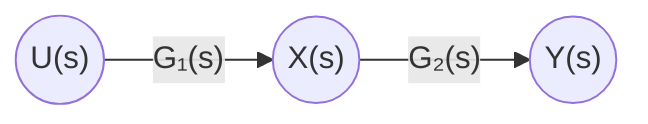

*Figure 1. Signal flow graph of series blocks*

**Signal flow graph of parallel blocks.** Two branches with gains $G_1$ and $G_2$ leave node $U$ and enter node $Y$ (Figure 2). The value of node $Y$ is the sum of the two incoming signals, $G_1U + G_2U$.

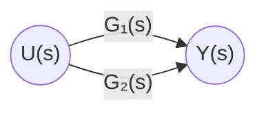

*Figure 2. Signal flow graph of parallel blocks*

**Signal flow graph of feedback blocks.** The feedback connection of Week 5 Figure 12 becomes Figure 3. Node $U_1$ receives a branch of gain 1 from the input node $R$ and a branch of gain $-G_2$ from the output $Y_1$, so $U_1 = R - G_2Y_1$, which is the summing-point equation. The input node $R$ and node $U_1$ are kept separate with a branch of gain 1 because an input node must have no incoming branches.

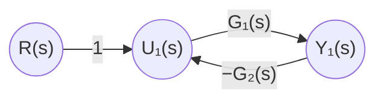

*Figure 3. Signal flow graph of feedback blocks*

### 1.3 Examples 1 and 2: Converting Block Diagrams to Signal Flow Graphs

A block diagram is converted into a signal flow graph in the following order.

1. Place one node for the input signal, the output signal, the output of each summing point, and the output of each block.
2. Replace each block with a branch whose gain is its transfer function.
3. Draw a branch for each signal entering a summing point, attaching $-$ to the gain of a signal that enters with the sign $-$.
4. If a branch would enter the input node, insert a branch of gain 1 between the input node and that node.

**Example 1.** Converting the block diagram of Week 5 Section 3.6 (Week 5 Figure 17) gives Figure 4. The output of the first summing point, $E_1 = R - G_3X_4$, goes straight into the second summing point and gives $E_2 = E_1 - G_2X_1 = R - G_3X_4 - G_2X_1$, so the two summing points can be merged into the single node $N_1$. Node $N_2$ is the output of $G_1$, and $N_3$ is the output of $G_4$.

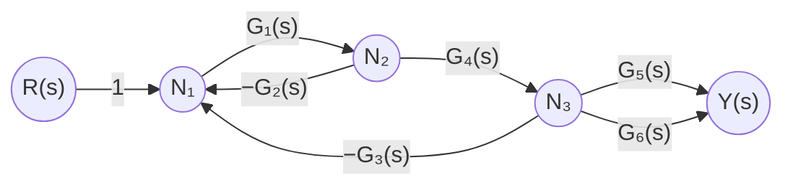

*Figure 4. Signal flow graph of Example 1*

**Example 2.** Converting the block diagram of Week 5 Section 3.7 (Week 5 Figure 20) gives Figure 5. Node $N_1$ is the output of the summing point, $N_2$ is the output of $G_1$, and $N_3$ is the output of $G_2$. In the block diagram the takeoff point feeding $G_5$ had to be moved, but in the signal flow graph one more branch simply leaves node $N_2$.

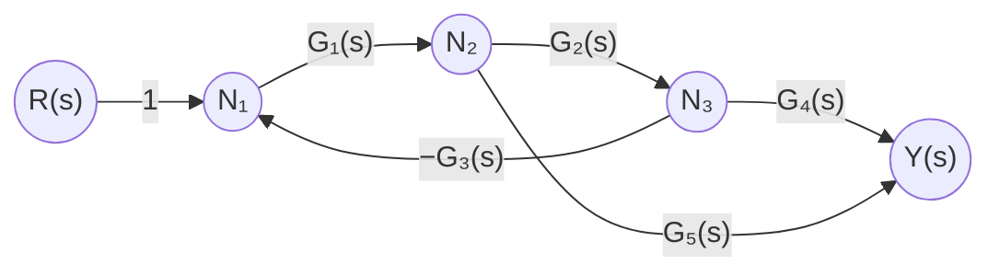

*Figure 5. Signal flow graph of Example 2*

### 1.4 Terms for Paths and Loops

Mason's gain formula requires the following terms.

> **Definition:** **Signal flow graph paths and loops.**
>
> - **Path:** The set of branches that must be traversed in sequence, following the branch arrows, to travel from one node of a signal flow graph to another node. No node may be passed more than once between the starting node and the ending node.
> - **Forward path:** A path that starts at the input node and ends at the output node.
> - **Loop:** A path that starts at a node and returns to the same node. That is, a loop is a path whose starting and ending nodes coincide, and apart from the starting and ending node no node may be passed more than once.
> - **Path gain:** The product of the gains of all branches forming a path.
> - **Loop gain:** The product of the gains of all branches forming a loop.
> - **Non-touching:** Two different paths or loops are non-touching if they share no node.

Applied to Figure 5 (Example 2), these terms give the following.

- **Forward paths:** There are two, $R \to N_1 \to N_2 \to N_3 \to Y$ and $R \to N_1 \to N_2 \to Y$, with path gains $1 \cdot G_1 \cdot G_2 \cdot G_4 = G_1G_2G_4$ and $1 \cdot G_1 \cdot G_5 = G_1G_5$.
- **Loops:** There is one, $N_1 \to N_2 \to N_3 \to N_1$, with loop gain $G_1 \cdot G_2 \cdot (-G_3) = -G_1G_2G_3$.
- **Touching:** Both forward paths share nodes $N_1$ and $N_2$ with the loop, so both touch the loop.

As an example of non-touching loops, consider the signal flow graph of Figure 6. It has four loops: loop 1 is $N_1 \to N_2 \to N_1$, loop 2 is $N_3 \to N_4 \to N_3$, loop 3 is $N_5 \to N_6 \to N_5$, and loop 4 is $N_1 \to N_2 \to N_3 \to N_4 \to N_1$. Loops 1, 2, and 3 share no nodes and are mutually non-touching, and loop 4 does not touch loop 3 but shares nodes with loops 1 and 2 and so touches them. The transfer function of this signal flow graph is found in Section 1.8.

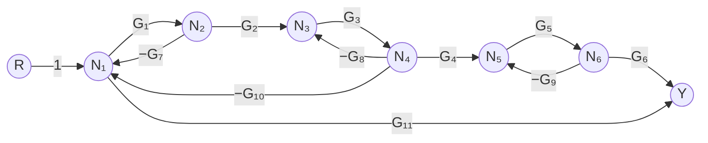

*Figure 6. Signal flow graph with non-touching loops*

### 1.5 Mason's Gain Formula

**Mason's gain formula**, also called Mason's rule, computes the overall transfer function $M$ from the input node to the output node of a signal flow graph using the paths and loops read directly off the picture. S. J. Mason set out the properties of signal flow graphs in a 1953 paper [1] and published this formula in a 1956 paper [2].

```math
M = \frac{\displaystyle\sum_{k=1}^{n} M_k\Delta_k}{\Delta}
```

The symbols mean the following.

- $n$: number of forward paths
- $M_k$: path gain of the $`k`$th forward path
- $\Delta = 1 - L_1 + L_2 - L_3 + \cdots + (-1)^iL_i + \cdots$
- $L_1$: sum of the loop gains of all loops
- $L_2$: sum of the products of the loop gains of every set of 2 mutually non-touching loops
- $L_3$: sum of the products of the loop gains of every set of 3 mutually non-touching loops
- $L_i$: sum of the products of the loop gains of every set of $i$ mutually non-touching loops
- $\Delta_k$: $\Delta$ computed using only the loops that do not touch the $`k`$th forward path

$\Delta$ is called the **determinant** of the signal flow graph, and $\Delta_k$ the **cofactor** of the $`k`$th path. $\Delta$ equals the coefficient determinant of the simultaneous linear equations formed by the node signals, and the whole formula equals the solution of those equations by Cramer's rule [2]. A loop that touches a forward path already affects that path's signal, so it is left out of $\Delta_k$, and only non-touching loops are multiplied onto that path separately. If a forward path touches every loop, $\Delta_k = 1$.

The formula is applied in the following order.

1. Find all forward paths and their path gains $M_k$.
2. Find all loops and their loop gains.
3. Find every set of 2, 3, and more mutually non-touching loops.
4. Compute $\Delta$.
5. Compute $\Delta_k$ from only the loops that do not touch each forward path.
6. Substitute into the formula.

**Checking with the basic connections.** The parallel blocks of Figure 2 have two forward paths $G_1$ and $G_2$ and no loops, so $\Delta = \Delta_1 = \Delta_2 = 1$ and $M = G_1 + G_2$. The feedback blocks of Figure 3 have one forward path $M_1 = G_1$ and one loop of gain $-G_1G_2$, and the path touches the loop, so $\Delta_1 = 1$.

```math
M = \frac{M_1\Delta_1}{\Delta} = \frac{G_1}{1 - (-G_1G_2)} = \frac{G_1}{1 + G_1G_2}
```

This agrees with the feedback connection of Week 5 Section 3.4.

> **Caution:** The loop gain in a signal flow graph already contains the sign of the summing point. A negative feedback loop has a negative loop gain such as $-G_1G_2$, and inserting it into $\Delta = 1 - L_1$ gives $1 + G_1G_2$. The result is the same as in Week 5 Section 3.4, where the loop gain of the block diagram was taken without sign as $G_1G_2$ and the denominator was written $1 + G_1G_2$, but do not confuse the two conventions: in a signal flow graph the sign is part of the branch gain.

### 1.6 Example 3: Applying Mason's Gain Formula

Apply Mason's gain formula to Figure 4 (the signal flow graph of Example 1).

- **There are 2 forward paths:** both pass through $R \to N_1 \to N_2 \to N_3 \to Y$ and differ only in the last branch, $G_5$ or $G_6$.

```math
M_1 = G_1G_4G_5, \qquad M_2 = G_1G_4G_6
```

- **There are 2 loops:** $N_1 \to N_2 \to N_1$ and $N_1 \to N_2 \to N_3 \to N_1$.

```math
L_1 = (-G_1G_2) + (-G_1G_4G_3) = -G_1G_2 - G_1G_3G_4
```

- **There are no non-touching loops, so $L_2$ and the later terms vanish:** the two loops share nodes $N_1$ and $N_2$. Hence the following.

```math
\Delta = 1 - L_1 = 1 + G_1G_2 + G_1G_3G_4
```

- **No loop is non-touching with the 2 forward paths**, so $\Delta_1 = \Delta_2 = 1$, because both paths pass through $N_1$ and $N_2$.

Substituting into the formula gives the following.

```math
M = \frac{M_1\Delta_1 + M_2\Delta_2}{\Delta} = \frac{G_1G_4G_5 + G_1G_4G_6}{1 + G_1G_2 + G_1G_3G_4} = \frac{G_1G_4(G_5 + G_6)}{1 + G_1G_2 + G_1G_3G_4}
```

This equals the result of the five-step block diagram reduction in Week 5 Section 3.6. Applying the same method to Figure 5 (Example 2), Section 1.4 found $M_1 = G_1G_2G_4$, $M_2 = G_1G_5$, and $L_1 = -G_1G_2G_3$, and both paths touch the loop, so $\Delta_1 = \Delta_2 = 1$. Hence $M = (G_1G_2G_4 + G_1G_5)/(1 + G_1G_2G_3)$, the result of Week 5 Section 3.7 obtained without moving any takeoff point.

### 1.7 Example 4: The Signal at a Summing-Point Node

Note that the signal at a node corresponding to a summing point is the summed value of that summing point. The signal flow graph and the result change depending on whether a branch leaves before or after the summing point; two block diagrams compare the cases.

**(a) A branch leaving after the summing point.** In the block diagram of Figure 7, $G_4$ takes the output $E$ of the summing point as its input.

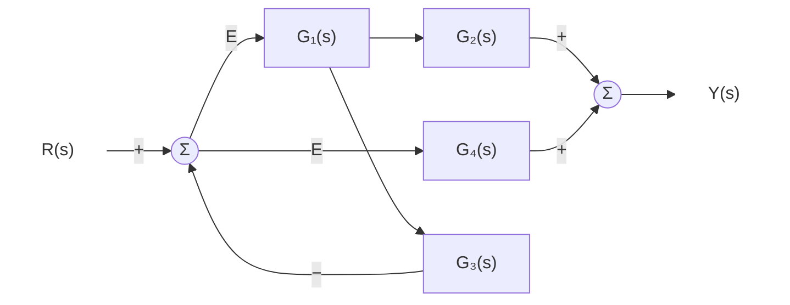

*Figure 7. Block diagram with a branch leaving after the summing point*

In the signal flow graph the summing point becomes node $E$, and the branch of $G_4$ leaves node $E$ (Figure 8). Node $X$ is the output of $G_1$, and node $N$ is the output of the second summing point.

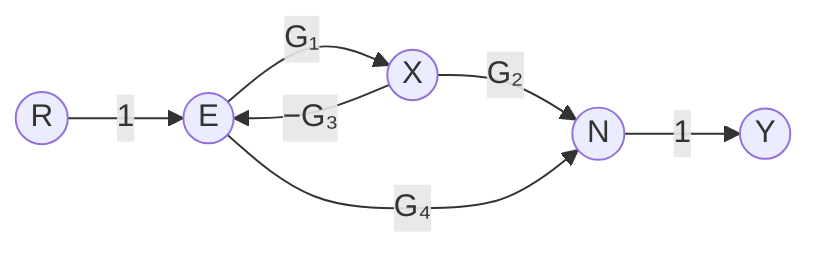

*Figure 8. Signal flow graph of Figure 7*

- Forward paths: $M_1 = G_1G_2$ ($`R \to E \to X \to N \to Y`$) and $M_2 = G_4$ ($`R \to E \to N \to Y`$)
- Loops: there is one, $E \to X \to E$, with $L_1 = -G_1G_3$, so $\Delta = 1 + G_1G_3$.
- Both forward paths pass through node $E$ and touch the loop, so $\Delta_1 = \Delta_2 = 1$.

```math
M = \frac{G_1G_2 + G_4}{1 + G_1G_3}
```

As an algebraic check, $E = R - G_3G_1E$ gives $E = R/(1 + G_1G_3)$ and $Y = G_2G_1E + G_4E = (G_1G_2 + G_4)E$, which yields the same result. The input $E$ of $G_4$ contains the feedback signal, so the $G_4$ term is also divided by $1 + G_1G_3$.

**(b) A branch leaving before the summing point.** In the block diagram of Figure 9, $G_4$ takes the input $R$ before it enters the summing point. This block diagram and its signal flow graph differ from the previous case.

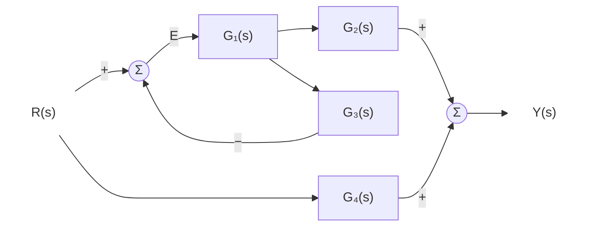

*Figure 9. Block diagram with a branch leaving before the summing point*

In the signal flow graph a node $A$ exists before the summing point; from $A$ a branch of gain 1 goes to the summing-point node $E$ and a branch of gain $G_4$ goes to node $N$ (Figure 10). The value of node $A$ is simply $R$.

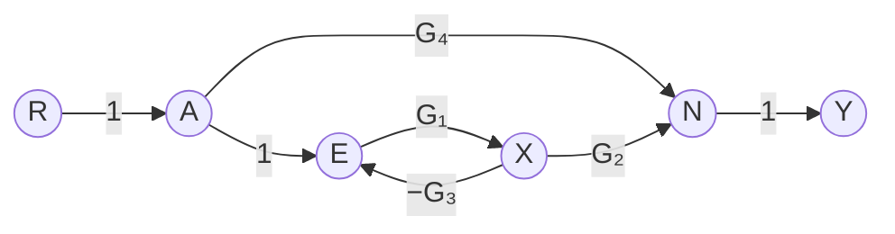

*Figure 10. Signal flow graph of Figure 9*

- Forward paths: $M_1 = G_1G_2$ ($`R \to A \to E \to X \to N \to Y`$) and $M_2 = G_4$ ($`R \to A \to N \to Y`$)
- Loops: there is one, $E \to X \to E$, and $\Delta = 1 + G_1G_3$.
- $M_1$ touches the loop, so $\Delta_1 = 1$. $M_2$ passes only through nodes $R$, $A$, $N$, $Y$ and shares none of the loop nodes $E$, $X$, so it is non-touching and $\Delta_2 = 1 - (-G_1G_3) = 1 + G_1G_3$.

```math
M = \frac{G_1G_2 \cdot 1 + G_4(1 + G_1G_3)}{1 + G_1G_3} = \frac{G_1G_2}{1 + G_1G_3} + G_4
```

$G_4$ adds the input directly to the output without passing through the feedback loop, so $G_4$ is added unchanged to the closed-loop transfer function $G_1G_2/(1 + G_1G_3)$. The only difference between (a) and (b) is $\Delta_2$, which arises from whether the branch of $G_4$ leaves the loop node $E$ or not.

### 1.8 Example 5: A Signal Flow Graph with Non-Touching Loops

Apply Mason's gain formula to the signal flow graph of Figure 6 in Section 1.4.

**There are 2 forward paths.**

```math
M_1 = G_1G_2G_3G_4G_5G_6, \qquad M_2 = G_{11}
```

**Add the gains of all 4 loops.** The loop gains are listed in Table 2.

| Loop | Nodes passed | Loop gain |
|:-----|:-----|:-----|
| 1 | $N_1$, $N_2$ | $l_1 = -G_1G_7$ |
| 2 | $N_3$, $N_4$ | $l_2 = -G_3G_8$ |
| 3 | $N_5$, $N_6$ | $l_3 = -G_5G_9$ |
| 4 | $N_1$, $N_2$, $N_3$, $N_4$ | $l_4 = -G_1G_2G_3G_{10}$ |

*Table 2. Loops and loop gains of Example 5*

```math
L_1 = l_1 + l_2 + l_3 + l_4 = -\left(G_1G_7 + G_3G_8 + G_5G_9 + G_1G_2G_3G_{10}\right)
```

**Pick every pair of mutually non-touching loops among the 4 loops, multiply their loop gains, and add all these values.** Comparing the nodes in Table 2, the non-touching pairs are (1, 2), (1, 3), (2, 3), and (3, 4). The pair (1, 4) shares $N_1$, $N_2$ and the pair (2, 4) shares $N_3$, $N_4$, so they touch. The product of two negative numbers is positive.

```math
L_2 = l_1l_2 + l_1l_3 + l_2l_3 + l_3l_4 = G_1G_3G_7G_8 + G_1G_5G_7G_9 + G_3G_5G_8G_9 + G_1G_2G_3G_5G_9G_{10}
```

**Multiply the gains of 3 mutually non-touching loops among the 4 loops.** All three loops must be pairwise non-touching, so only (1, 2, 3) qualifies. Any set containing loop 4 includes loop 1 or 2, which touches it.

```math
L_3 = l_1l_2l_3 = -G_1G_3G_5G_7G_8G_9
```

There is no set of 4 mutually non-touching loops, so $L_4 = 0$. Hence the following.

```math
\begin{aligned}
\Delta &= 1 - L_1 + L_2 - L_3 \\
&= 1 + G_1G_7 + G_3G_8 + G_5G_9 + G_1G_2G_3G_{10} \\
&\quad + G_1G_3G_7G_8 + G_1G_5G_7G_9 + G_3G_5G_8G_9 + G_1G_2G_3G_5G_9G_{10} + G_1G_3G_5G_7G_8G_9
\end{aligned}
```

**No loop is non-touching with the forward path of gain $M_1$.** This path passes through every node from $N_1$ to $N_6$, so $\Delta_1 = 1$.

**The loops non-touching with the path of gain $M_2$ are loops 2 and 3.** This path is $R \to N_1 \to Y$ and shares only node $N_1$, so loops 1 and 4, which pass through $N_1$, are excluded. Loops 2 and 3 are mutually non-touching, so their product is also included.

```math
\Delta_2 = 1 - (l_2 + l_3) + l_2l_3 = 1 + G_3G_8 + G_5G_9 + G_3G_5G_8G_9 = (1 + G_3G_8)(1 + G_5G_9)
```

Substituting into the formula gives the transfer function.

```math
M = \frac{M_1\Delta_1 + M_2\Delta_2}{\Delta} = \frac{G_1G_2G_3G_4G_5G_6 + G_{11}\left(1 + G_3G_8 + G_5G_9 + G_3G_5G_8G_9\right)}{\Delta}
```

> **Note:** Loop 3 does not touch any other loop, so $\Delta$ has the factor $(1 + G_5G_9)$. Indeed $\Delta = (1 + G_5G_9)(1 + G_1G_7 + G_3G_8 + G_1G_2G_3G_{10} + G_1G_3G_7G_8)$, which expands to the ten terms above. In general, the $\Delta$ of mutually non-touching subgraphs is the product of the $\Delta$ of each part. $\Delta_2 = (1 + G_3G_8)(1 + G_5G_9)$ factors for the same reason.

---

<br>

## 2. First-Order and Second-Order State Variable Equations

### 2.1 Limitations of the Transfer Function

The transfer function represents the properties of a system as the ratio of the output signal to the input signal in the frequency domain (the $s$ domain). This approach has the following limitations.

- When a system is represented by the ratio of its input and output signals, different systems have the same transfer function as long as their input-output ratios are the same.
- The system is represented only by the input-output relation seen from outside, regardless of its actual internal structure.
- Hence it is difficult to represent exactly what actually happens inside the system.

This section confirms these limitations with an example and introduces state variable equations, which also describe the variables inside the system.

### 2.2 A First-Order and a Second-Order System with the Same Transfer Function

Different systems cannot be told apart by their transfer function if the transfer functions are the same. The two systems of Figures 11 and 12 are a first-order and a second-order system and are different, yet their transfer functions are the same. The $1/s$ blocks in both figures are **integrators**. Since $`\mathcal{L}\left\lbrace\int_0^t x(\tau)\,d\tau \right\rbrace= X(s)/s`$, with zero initial conditions, when $\dot{x}$ enters a $1/s$ block, $x$ comes out.

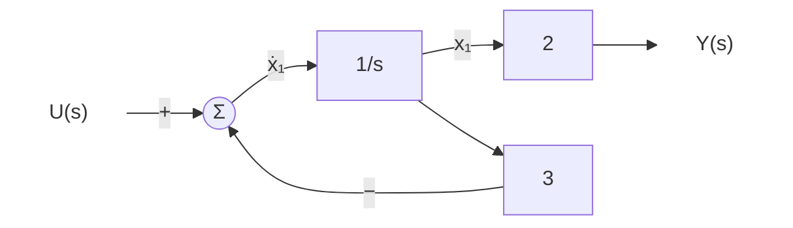

*Figure 11. First-order system with transfer function 2/(s+3)*

**First-order system.** The integrator input is $`\dot{x}_1 = u - 3x_1`$, and the output equation is $y = 2x_1$. The Laplace transform gives $sX_1 = U - 3X_1$, hence $X_1 = U/(s + 3)$, and since $Y = 2X_1$ the result is the following.

```math
G(s) = \frac{Y(s)}{U(s)} = \frac{2}{s + 3}
```

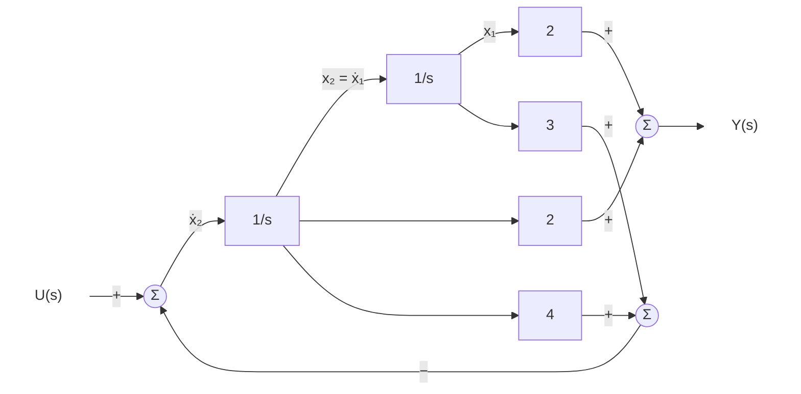

*Figure 12. Second-order system with transfer function 2/(s+3)*

**Second-order system.** Two integrators are in series, so the output $x_2$ of the first integrator is the input $`\dot{x}_1`$ of the second. The input of the first integrator is $u$ minus $4x_2 + 3x_1$, and the output is the sum of $2x_1$ and $2x_2$.

```math
\dot{x}_1 = x_2, \qquad \dot{x}_2 = u - 4x_2 - 3x_1, \qquad y = 2x_1 + 2x_2
```

The Laplace transform gives $X_2 = sX_1$, and inserting this into the second equation $sX_2 = U - 4X_2 - 3X_1$ gives $s^2X_1 = U - 4sX_1 - 3X_1$, so $X_1 = U/(s^2 + 4s + 3)$. The output is $Y = 2X_1 + 2sX_1 = 2(s + 1)X_1$, and therefore the following holds.

```math
G(s) = \frac{2(s + 1)}{s^2 + 4s + 3} = \frac{2(s + 1)}{(s + 1)(s + 3)} = \frac{2}{s + 3}
```

The denominator factor $(s + 1)$ cancels the numerator factor $(s + 1)$ (the pole-zero cancellation of Week 5 Section 2.9), so the two systems have the same transfer function. Inside the second-order system, however, the motion $e^{-t}$ belonging to the canceled pole $-1$ remains. For example, with no input and the initial state $x_1(0) = 1$, $x_2(0) = -1$, the internal variables move as $x_1(t) = e^{-t}$ and $x_2(t) = -e^{-t}$, but the output is $y = 2e^{-t} - 2e^{-t} = 0$ at all times. A motion that is invisible at the output in this way is called an **unobservable** mode [3]. The transfer function alone cannot reveal such internal motion, so a representation that deals with the internal variables directly is needed.

### 2.3 State Variables and State Variable Equations

> **Definition:** The **state** of a system is the smallest set of variables whose values at a time $t_0$, together with the input for $t \ge t_0$, determine the entire behavior of the system for $t \ge t_0$. These variables are called **state variables**, and the first-order differential equations of the state variables together with the expression of the output in terms of the state variables are called the **state variable equations**.

**Example of state variable equations.** Convert the differential equation of Week 5 Section 1.2 into state variable equations.

- Differential equation:

```math
\ddot{y}(t) + 3\dot{y}(t) + 2y(t) = u(t)
```

- Definition of the state variables: solving a second-order differential equation requires two initial conditions, $y(0)$ and $\dot{y}(0)$, so the output and its derivative are chosen as state variables.

```math
x_1(t) = y(t), \qquad x_2(t) = \dot{y}(t)
```

Differentiate each state variable and express it with the state variables and the input. $`\dot{x}_1 = \dot{y} = x_2`$, and solving the differential equation for $\ddot{y}$ gives $`\dot{x}_2 = \ddot{y} = -2y - 3\dot{y} + u = -2x_1 - 3x_2 + u`$. The output is $y = x_1$.

- State vector: the vector that stacks the state variables in a column.

```math
x(t) = \begin{bmatrix} x_1(t) \\ x_2(t) \end{bmatrix}
```

- Vector equation: writing the three equations above with matrices gives the following.

```math
\begin{bmatrix} \dot{x}_1 \\ \dot{x}_2 \end{bmatrix}
= \begin{bmatrix} 0 & 1 \\ -2 & -3 \end{bmatrix}
\begin{bmatrix} x_1 \\ x_2 \end{bmatrix}
+ \begin{bmatrix} 0 \\ 1 \end{bmatrix} u,
\qquad
y = \begin{bmatrix} 1 & 0 \end{bmatrix}
\begin{bmatrix} x_1 \\ x_2 \end{bmatrix}
```

One second-order differential equation has become two first-order differential equations. A system of first-order differential equations can be handled with matrix operations and is easy to integrate numerically on a computer.

### 2.4 Examples 1 and 2: Setting Up State Variable Equations from Block Diagrams

In a block diagram built from integrators, **choose the output of each integrator as a state variable.** The input of each integrator is then the derivative of that state variable, so writing each integrator input in terms of the state variables and the input gives the state variable equations.

**Example 1: first-order system.** Taking the integrator output of Figure 11 as $x_1$ gives the following.

```math
\dot{x}_1 = -3x_1 + u, \qquad y = 2x_1
```

**Example 2: second-order system.** Taking the two integrator outputs of Figure 12 as $x_2$ and $x_1$, the equations of Section 2.2 can be written with matrices.

```math
\begin{bmatrix} \dot{x}_1 \\ \dot{x}_2 \end{bmatrix}
= \begin{bmatrix} 0 & 1 \\ -3 & -4 \end{bmatrix}
\begin{bmatrix} x_1 \\ x_2 \end{bmatrix}
+ \begin{bmatrix} 0 \\ 1 \end{bmatrix} u,
\qquad
y = \begin{bmatrix} 2 & 2 \end{bmatrix}
\begin{bmatrix} x_1 \\ x_2 \end{bmatrix}
```

The two systems share a transfer function but have different numbers of state variables, one and two. State variable equations expose this difference in internal structure directly.

### 2.5 The State Vector and the General Form

The state vector collecting $n$ state variables is as follows.

```math
x(t) = \begin{bmatrix} x_1(t) \\ x_2(t) \\ \vdots \\ x_n(t) \end{bmatrix}
```

Here $n$ has the following meanings.

- It is the **order** of the system.
- It is the number of independent state variables that can represent the system completely.
- It equals the order of the differential equation describing the system.

The general form of the state variable equations is as follows.

```math
\dot{x}(t) = f\big(x(t), u(t)\big), \qquad y(t) = g\big(x(t), u(t)\big)
```

The first equation is called the **state equation** and the second the **output equation**. This form covers both **multi-input multi-output (MIMO)** systems, with several inputs and outputs, and **single-input single-output (SISO)** systems, with one of each, and it also covers nonlinear systems in which the functions $f$ and $g$ are not linear. For example, if the angle $\theta$ of a pendulum of length $l$ obeys $\ddot{\theta} = -(g_0/l)\sin\theta + u$ ($g_0$ is the gravitational acceleration), setting $x_1 = \theta$ and $x_2 = \dot{\theta}$ gives $`\dot{x}_1 = x_2`$ and $`\dot{x}_2 = -(g_0/l)\sin x_1 + u`$. Because of $\sin x_1$, this system cannot be represented by a transfer function, but it can be represented by state variable equations.

### 2.6 State Variable Equations of Linear Time-Invariant Systems

In a linear time-invariant system, $f$ and $g$ are linear combinations of the state and the input with coefficients that do not change in time, so the state variable equations are written with matrices as follows.

```math
\dot{x}(t) = Ax(t) + Bu(t), \qquad y(t) = Cx(t) + Du(t)
```

For a single-input single-output system, the sizes and names of the variables and matrices are given in Table 3. $A$ is called the **system matrix**, $B$ the **input matrix**, $C$ the **output matrix**, and $D$ the **feedthrough matrix**.

| Symbol | Size | Name and role |
|:-----|:-----|:-----|
| $x$ | $n \times 1$ | State vector |
| $u$ | $1 \times 1$ | Input |
| $y$ | $1 \times 1$ | Output |
| $A$ | $n \times n$ | System matrix: how the state variables affect one another |
| $B$ | $n \times 1$ | Input matrix: how the input affects the change of each state variable |
| $C$ | $1 \times n$ | Output matrix: how the output is formed from the state variables |
| $D$ | $1 \times 1$ | Feedthrough matrix: how the input affects the output directly, without passing through the state |

*Table 3. Sizes in the state variable equations of a single-input single-output linear time-invariant system*

The example of Section 2.3 is the case $`A = \begin{bmatrix} 0 & 1 \\ -2 & -3 \end{bmatrix}`$, $`B = \begin{bmatrix} 0 \\ 1 \end{bmatrix}`$, $`C = \begin{bmatrix} 1 & 0 \end{bmatrix}`$, $D = 0$. Checking the sizes of the matrix products, $Ax$ is $(n \times n)(n \times 1) = n \times 1$ and $Bu$ is $(n \times 1)(1 \times 1) = n \times 1$, the same size as $\dot{x}$, and $Cx$ is $(1 \times n)(n \times 1) = 1 \times 1$, the same size as $y$. In a multi-input multi-output system with $p$ inputs and $q$ outputs, $B$ becomes $n \times p$, $C$ becomes $q \times n$, and $D$ becomes $q \times p$.

---

<br>

## 3. nth-Order State Variable Equations

### 3.1 Without Derivatives of the Input

An $`n`$th-order differential equation without derivatives of the control input signal has the following form.

```math
\frac{d^ny(t)}{dt^n} + a_{n-1}\frac{d^{n-1}y(t)}{dt^{n-1}} + \cdots + a_1\frac{dy(t)}{dt} + a_0y(t) = u(t)
```

As in Section 2.3, define the output and its derivatives as state variables, where $y^{(k)}$ is the $`k`$th derivative of $y$.

```math
x_1(t) = y(t), \qquad x_2(t) = y^{(1)}(t), \qquad \ldots, \qquad x_n(t) = y^{(n-1)}(t)
```

Differentiating each state variable gives the next one, and the derivative of the last state variable comes from solving the differential equation for $y^{(n)}$.

```math
\begin{aligned}
\dot{x}_1 &= y^{(1)} = x_2 \\
\dot{x}_2 &= y^{(2)} = x_3 \\
&\;\;\vdots \\
\dot{x}_n &= y^{(n)} = -a_0x_1 - a_1x_2 - \cdots - a_{n-1}x_n + u
\end{aligned}
```

The state variable equations thus convert an $`n`$th-order differential equation into $n$ first-order differential equations of the form $\dot{x} = Ax + Bu$, $y = Cx + Du$. The output is $y = x_1$, so $`C = \begin{bmatrix} 1 & 0 & \cdots & 0 \end{bmatrix}`$ and $D = 0$.

### 3.2 With Derivatives of the Input and an Intermediate Variable

Consider the case in which derivatives of the control input signal appear. Assume that the highest derivative on the right side has order at most $n - 1$ (the transfer function is strictly proper).

```math
\frac{d^ny}{dt^n} + a_{n-1}\frac{d^{n-1}y}{dt^{n-1}} + \cdots + a_1\frac{dy}{dt} + a_0y
= b_{n-1}\frac{d^{n-1}u}{dt^{n-1}} + b_{n-2}\frac{d^{n-2}u}{dt^{n-2}} + \cdots + b_1\frac{du}{dt} + b_0u
```

If $x_1 = y, \ldots, x_n = y^{(n-1)}$ were chosen as in Section 3.1, the input derivatives $\dot{u}, \ddot{u}, \ldots$ would enter $`\dot{x}_n = y^{(n)}`$, and the form $\dot{x} = Ax + Bu$ could not be obtained. An intermediate variable solves this problem.

**Transfer function.** Transforming with zero initial conditions gives the following transfer function.

```math
G(s) = \frac{Y(s)}{U(s)} = \frac{b_{n-1}s^{n-1} + b_{n-2}s^{n-2} + \cdots + b_1s + b_0}{s^n + a_{n-1}s^{n-1} + \cdots + a_1s + a_0}
```

**Introducing the intermediate variable $Z(s)$.** Split the transfer function into a denominator stage and a numerator stage, and call the signal between them the **intermediate variable** $Z(s)$.

```math
\frac{Y(s)}{U(s)} = \frac{Z(s)}{U(s)} \cdot \frac{Y(s)}{Z(s)},
\qquad
\frac{Z(s)}{U(s)} = \frac{1}{s^n + a_{n-1}s^{n-1} + \cdots + a_1s + a_0},
\qquad
\frac{Y(s)}{Z(s)} = b_{n-1}s^{n-1} + \cdots + b_1s + b_0
```

The product of the two stages is the original transfer function, so this split leaves the input-output relation unchanged.

**Input variable equation.** The first stage can be rewritten as follows.

```math
U(s) = (s^n + a_{n-1}s^{n-1} + \cdots + a_1s + a_0)Z(s)
```

Converted to a differential equation, it reads $z^{(n)} + a_{n-1}z^{(n-1)} + \cdots + a_1\dot{z} + a_0z = u$. This equation has no derivatives of the input, so the method of Section 3.1 applies as is.

**Defining the state variables with the intermediate variable $z(t)$.** Choose the intermediate variable $z$ and its derivatives, instead of the output $y$, as the state variables.

```math
x_1(t) = z(t), \qquad x_2(t) = z^{(1)}(t), \qquad \ldots, \qquad x_n(t) = z^{(n-1)}(t)
```

The state equations then take the same form as in Section 3.1.

```math
\begin{aligned}
\dot{x}_1(t) &= z^{(1)}(t) = x_2(t) \\
\dot{x}_2(t) &= z^{(2)}(t) = x_3(t) \\
&\;\;\vdots \\
\dot{x}_n(t) &= z^{(n)}(t) = -a_0x_1(t) - a_1x_2(t) - \cdots - a_{n-1}x_n(t) + u(t)
\end{aligned}
```

**Output variable equation.** The second stage can be rewritten as follows.

```math
Y(s) = (b_{n-1}s^{n-1} + b_{n-2}s^{n-2} + \cdots + b_1s + b_0)Z(s)
```

Converting it to a differential equation and replacing the derivatives of $z$ with state variables gives the output equation. The highest derivative of $z$ is $z^{(n-1)} = x_n$, so the output needs no derivative of the input.

```math
\begin{aligned}
y(t) &= b_{n-1}\frac{d^{n-1}z(t)}{dt^{n-1}} + b_{n-2}\frac{d^{n-2}z(t)}{dt^{n-2}} + \cdots + b_1\frac{dz(t)}{dt} + b_0z(t) \\
&= b_{n-1}x_n(t) + b_{n-2}x_{n-1}(t) + \cdots + b_1x_2(t) + b_0x_1(t)
\end{aligned}
```

### 3.3 Vector Form and Block Diagram

Writing the result of Section 3.2 as state variable equations in vector form gives the following.

```math
\begin{bmatrix} \dot{x}_1 \\ \dot{x}_2 \\ \vdots \\ \dot{x}_{n-1} \\ \dot{x}_n \end{bmatrix}
=
\begin{bmatrix}
0 & 1 & 0 & \cdots & 0 \\
0 & 0 & 1 & \cdots & 0 \\
\vdots & \vdots & \vdots & \ddots & \vdots \\
0 & 0 & 0 & \cdots & 1 \\
-a_0 & -a_1 & -a_2 & \cdots & -a_{n-1}
\end{bmatrix}
\begin{bmatrix} x_1 \\ x_2 \\ \vdots \\ x_{n-1} \\ x_n \end{bmatrix}
+
\begin{bmatrix} 0 \\ 0 \\ \vdots \\ 0 \\ 1 \end{bmatrix} u,
\qquad
y = \begin{bmatrix} b_0 & b_1 & \cdots & b_{n-2} & b_{n-1} \end{bmatrix}
\begin{bmatrix} x_1 \\ x_2 \\ \vdots \\ x_n \end{bmatrix}
```

The following rules can be read from the shape of the matrices.

- The entries just above the diagonal of $A$ are 1, representing $`\dot{x}_i = x_{i+1}`$.
- The last row of $A$ lists the denominator coefficients of the transfer function from the lowest order with their signs changed, $-a_0, -a_1, \ldots, -a_{n-1}$.
- $B$ is the vector whose only nonzero entry is the last one, 1. The input enters only $`\dot{x}_n`$.
- $C$ lists the numerator coefficients of the transfer function from the lowest order, $b_0, b_1, \ldots, b_{n-1}$, and $D = 0$.

Figure 13 draws these state variable equations as a block diagram. A chain of $n$ integrators integrates $`\dot{x}_n`$ successively into $x_n$, $x_{n-1}, \ldots$, $x_1$. Each integrator output $x_{i+1}$ returns through a gain $a_i$ to the summing point on the input side, where it is subtracted from $u$, and at the same time passes through a gain $b_i$ to the summing point on the output side, where the terms add up to $Y$. State variable equations of this form are called the **controllable canonical form**, and since the state variables are $z$ and its derivatives, the form is also called the phase-variable form [3], [4].

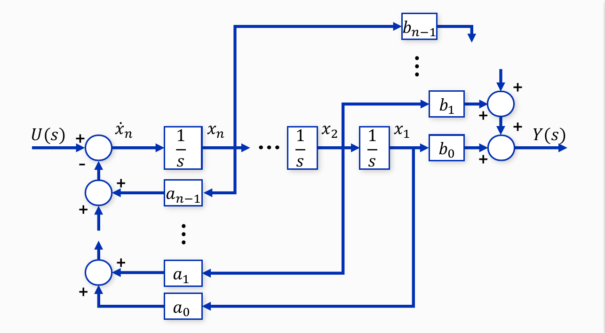

*Figure 13. Block diagram of the state variable equations of an nth-order transfer function*

> **Note:** A transfer function whose numerator and denominator have the same degree ($`m = n`$) is first split by polynomial division into $G(s) = D + (\text{strictly proper transfer function})$. The strictly proper part gives $A$, $B$, $C$ by the method above, and the constant quotient becomes the feedthrough matrix $D$. For example, $G(s) = \dfrac{s + 3}{s + 1} = 1 + \dfrac{2}{s + 1}$ gives $A = -1$, $B = 1$, $C = 2$, $D = 1$.

### 3.4 Example 1: A Transfer Function with a Constant Numerator

Represent the following transfer function with state variable equations.

```math
G(s) = \frac{Y(s)}{U(s)} = \frac{1}{s^3 + 2s^2 + 3s + 1}
```

**Differential equation.** Multiplying by the denominator gives $(s^3 + 2s^2 + 3s + 1)Y(s) = U(s)$, and returning to the time domain gives a third-order differential equation without derivatives of the input.

```math
\frac{d^3y(t)}{dt^3} + 2\frac{d^2y(t)}{dt^2} + 3\frac{dy(t)}{dt} + y(t) = u(t)
```

**Definition of the state variables.** With $x_1 = y$, $x_2 = \dot{y}$, $x_3 = \ddot{y}$, we have $`\dot{x}_1 = x_2`$ and $`\dot{x}_2 = x_3`$, and solving the differential equation for $\dddot{y}$ gives $`\dot{x}_3 = -x_1 - 3x_2 - 2x_3 + u`$. The coefficients are $a_0 = 1$, $a_1 = 3$, $a_2 = 2$, $b_0 = 1$.

```math
\begin{bmatrix} \dot{x}_1 \\ \dot{x}_2 \\ \dot{x}_3 \end{bmatrix}
= \begin{bmatrix} 0 & 1 & 0 \\ 0 & 0 & 1 \\ -1 & -3 & -2 \end{bmatrix}
\begin{bmatrix} x_1 \\ x_2 \\ x_3 \end{bmatrix}
+ \begin{bmatrix} 0 \\ 0 \\ 1 \end{bmatrix} u,
\qquad
y = \begin{bmatrix} 1 & 0 & 0 \end{bmatrix}
\begin{bmatrix} x_1 \\ x_2 \\ x_3 \end{bmatrix}
```

The block diagram is Figure 14. Three integrators are chained as $`\dot{x}_3 \to x_3 \to x_2 \to x_1`$; $x_3$, $x_2$, and $x_1$ return through gains 2, 3, and 1 to the summing point on the input side; and the output is $x_1$ multiplied by the gain 1.

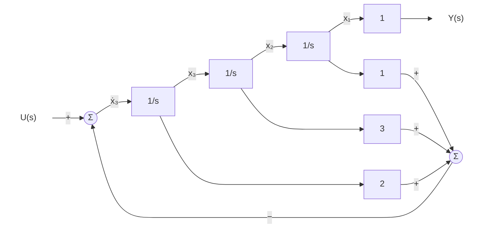

*Figure 14. State variable block diagram of Example 1*

### 3.5 Example 2: A Transfer Function with a Polynomial Numerator

Represent the following transfer function with state variable equations.

```math
G(s) = \frac{Y(s)}{U(s)} = \frac{5s + 4}{s^3 + 2s^2 + 3s + 1}
```

The $s$ in the numerator produces a derivative of the input, so an intermediate variable is used. Split the transfer function into $Z(s)/U(s) = 1/(s^3 + 2s^2 + 3s + 1)$ and $Y(s) = (5s + 4)Z(s)$, and define the state variables as follows.

```math
x_1 = z, \qquad x_2 = \dot{z}, \qquad x_3 = \ddot{z}
```

The denominator is the same as in Example 1, so the state equation ($A$, $`B`$) is also the same as in Example 1. The output is $y = 5\dot{z} + 4z = 4x_1 + 5x_2$, so $b_0 = 4$, $b_1 = 5$, $b_2 = 0$.

```math
\begin{bmatrix} \dot{x}_1 \\ \dot{x}_2 \\ \dot{x}_3 \end{bmatrix}
= \begin{bmatrix} 0 & 1 & 0 \\ 0 & 0 & 1 \\ -1 & -3 & -2 \end{bmatrix}
\begin{bmatrix} x_1 \\ x_2 \\ x_3 \end{bmatrix}
+ \begin{bmatrix} 0 \\ 0 \\ 1 \end{bmatrix} u,
\qquad
y = \begin{bmatrix} 4 & 5 & 0 \end{bmatrix}
\begin{bmatrix} x_1 \\ x_2 \\ x_3 \end{bmatrix}
```

The block diagram is Figure 15. Compared with Figure 14, the feedback part is the same, and only the output side differs, where $x_1$ is multiplied by 4 and $x_2$ by 5 before being added. The denominator determines $A$, and the numerator determines only $C$.

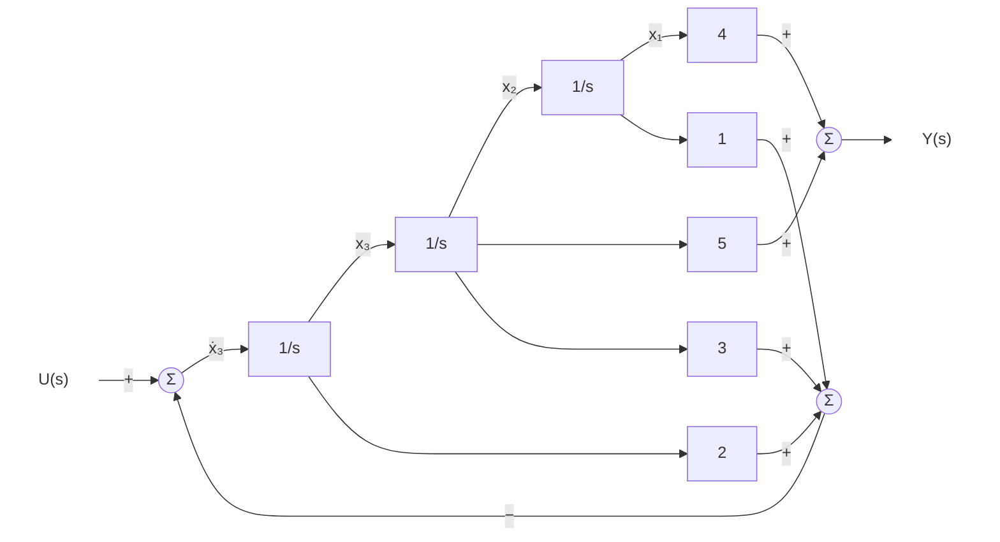

*Figure 15. State variable block diagram of Example 2*

### 3.6 Obtaining the Transfer Function from State Variable Equations

Conversely, given state variable equations, the transfer function can be found [3]. With the initial state $x(0) = 0$, the Laplace transform of $\dot{x} = Ax + Bu$ is $sX(s) = AX(s) + BU(s)$. Collecting the terms in $X(s)$ gives $(sI - A)X(s) = BU(s)$ ($I$ is the $n \times n$ identity matrix), and multiplying both sides by $(sI - A)^{-1}$ gives $X(s) = (sI - A)^{-1}BU(s)$. Inserting this into the output equation $Y(s) = CX(s) + DU(s)$ gives the following.

```math
G(s) = \frac{Y(s)}{U(s)} = C(sI - A)^{-1}B + D
```

> **[Linear Algebra]** The inverse can be written $(sI - A)^{-1} = \dfrac{\operatorname{adj}(sI - A)}{\det(sI - A)}$ ($\operatorname{adj}$ is the adjugate matrix). Hence the denominator of the transfer function is $\det(sI - A)$, the characteristic equation is $\det(sI - A) = 0$, and its roots are the eigenvalues of $A$. Without cancellation, the poles of the transfer function equal the eigenvalues of $A$. For a $2 \times 2$ matrix, $`\begin{bmatrix} a & b \\ c & d \end{bmatrix}^{-1} = \dfrac{1}{ad - bc}\begin{bmatrix} d & -b \\ -c & a \end{bmatrix}`$ (Week 3).

**Example: the state variable equations of Section 2.3.** Since $`A = \begin{bmatrix} 0 & 1 \\ -2 & -3 \end{bmatrix}`$, the following holds.

```math
sI - A = \begin{bmatrix} s & -1 \\ 2 & s + 3 \end{bmatrix},
\qquad
\det(sI - A) = s(s + 3) + 2 = s^2 + 3s + 2,
\qquad
(sI - A)^{-1} = \frac{1}{s^2 + 3s + 2}\begin{bmatrix} s + 3 & 1 \\ -2 & s \end{bmatrix}
```

Multiplying by $`B = \begin{bmatrix} 0 & 1 \end{bmatrix}^T`$ keeps only the second column of the inverse, and multiplying by $`C = \begin{bmatrix} 1 & 0 \end{bmatrix}`$ keeps only its first entry.

```math
G(s) = \begin{bmatrix} 1 & 0 \end{bmatrix}\frac{1}{s^2 + 3s + 2}\begin{bmatrix} 1 \\ s \end{bmatrix} = \frac{1}{s^2 + 3s + 2}
```

This equals the transfer function of the original differential equation $\ddot{y} + 3\dot{y} + 2y = u$.

**Example: the second-order system of Section 2.2.** With $`A = \begin{bmatrix} 0 & 1 \\ -3 & -4 \end{bmatrix}`$, the same computation gives $`(sI - A)^{-1}B = \dfrac{1}{s^2 + 4s + 3}\begin{bmatrix} 1 \\ s \end{bmatrix}`$, and multiplying by $`C = \begin{bmatrix} 2 & 2 \end{bmatrix}`$ gives $\dfrac{2 + 2s}{s^2 + 4s + 3} = \dfrac{2}{s + 3}$. The eigenvalues of $A$ are the roots $-1$ and $-3$ of $\det(sI - A) = (s + 1)(s + 3) = 0$, but only $-3$ remains as a pole of the transfer function. The eigenvalue $-1$ removed by cancellation is the hidden motion $e^{-t}$ seen in Section 2.2.

**The controllable canonical form.** For $A$ and $B$ of Section 3.3, $`(sI - A)^{-1}B = \dfrac{1}{s^n + a_{n-1}s^{n-1} + \cdots + a_0}\begin{bmatrix} 1 & s & \cdots & s^{n-1} \end{bmatrix}^T`$ holds. Multiplying by $`C = \begin{bmatrix} b_0 & b_1 & \cdots & b_{n-1} \end{bmatrix}`$ therefore produces the numerator $b_0 + b_1s + \cdots + b_{n-1}s^{n-1}$. In Example 2, $`\begin{bmatrix} 4 & 5 & 0 \end{bmatrix}\begin{bmatrix} 1 & s & s^2 \end{bmatrix}^T = 5s + 4`$, so the original transfer function is recovered. This is why the entries of $C$ are the numerator coefficients.

> **Key Point:** There is more than one way to go from a transfer function to state variable equations. Changing the state vector with an invertible matrix $T$ as $x = T\hat{x}$ gives other state variable equations with $\hat{A} = T^{-1}AT$, $\hat{B} = T^{-1}B$, $\hat{C} = CT$, $\hat{D} = D$, but the transfer function stays the same [3]. Representations with different numbers of state variables, like the two systems of Section 2.2, are also possible. Conversely, going from state variable equations to the transfer function gives a unique result.

---

<br>

## Concept Applications

**True/False Check:**

| Statement | Judgment and Reason |
|:-----|:------------|
| In a signal flow graph, the value of a node is the sum of the signals of the branches leaving it. | **F.** The value of a node is the sum of the signals of the incoming branches, and outgoing branches do not change the value of the node. |
| In Mason's gain formula, $\Delta_k$ is computed from only the loops that touch the $`k`$th forward path. | **F.** $\Delta_k$ is computed from only the loops that do not touch the $`k`$th forward path. |
| If all loops touch one another, $\Delta = 1 - L_1$. | **T.** There is no set of non-touching loops, so all terms from $L_2$ on are zero. |
| Two systems with the same transfer function also have the same number of state variables. | **F.** The two systems of Section 2.2 share the transfer function $2/(s+3)$ but have one and two state variables. |
| In a single-input single-output system, $C$ has size $1 \times n$. | **T.** $Cx$ must be the scalar output $y$, so $(1 \times n)(n \times 1) = 1 \times 1$. |
| In the controllable canonical form, the numerator of the transfer function determines the last row of $A$. | **F.** The last row of $A$ is set by the denominator coefficients, and the numerator coefficients determine $C$. |

---

<br>

## Summary

| Concept | Key Summary |
|:-----|:-----|
| Signal flow graph | It is another representation of a block diagram in which signals are nodes and transfer functions are directed branches with gains, and the value of a node is the sum of its incoming branch signals. |
| Paths and loops | A path follows branches without passing a node twice; a forward path runs from the input node to the output node, and a loop returns to its starting node. |
| Non-touching | Two paths or loops are non-touching if they share no node at all. |
| Mason's gain formula | $M = \sum M_k\Delta_k/\Delta$ with $\Delta = 1 - L_1 + L_2 - \cdots$, and $\Delta_k$ is computed from only the loops that do not touch the $`k`$th forward path. |
| Sign of the loop gain | In a signal flow graph the $-$ sign of a summing point is part of the branch gain, so the loop gain of a negative feedback loop is negative. |
| Limitation of the transfer function | The transfer function is the input-output ratio seen from outside, so it cannot show internal motion removed by pole-zero cancellation. |
| State variables | They are the smallest set of variables whose values at one time, together with the later input, determine all later behavior, and their number is the order of the system. |
| State variable equations | The general form is $\dot{x} = f(x, u)$, $y = g(x, u)$, and for linear time-invariant systems it is $\dot{x} = Ax + Bu$, $y = Cx + Du$. |
| Intermediate variable | When input derivatives appear, the transfer function is split into $Z/U = 1/(\text{denominator})$ and $Y = (\text{numerator})Z$, and $z$ and its derivatives become the state variables. |
| Controllable canonical form | The last row of $A$ is $-a_0, \ldots, -a_{n-1}$, $`B = [0 \cdots 0\ 1]^T`$, and $C = [b_0 \cdots b_{n-1}]$. |
| Conversion to a transfer function | $G(s) = C(sI - A)^{-1}B + D$, and the roots of the denominator $\det(sI - A)$ are the eigenvalues of $A$. |

---

<br>

## Self-Check Questions

1. **Drawing a signal flow graph:** Draw the signal flow graph of a unity feedback system whose forward path has transfer function $G$, and find the closed-loop transfer function with Mason's gain formula.

   <details>
   <summary>Answer</summary>

   Place nodes $R$, $E$, $Y$ and draw the branches $R \to E$ (gain 1), $E \to Y$ (gain $`G`$), and $Y \to E$ (gain $`-1`$). There is one forward path $M_1 = G$ and one loop of gain $-G$, and the path touches the loop, so $\Delta_1 = 1$. Therefore $M = \dfrac{G}{1 - (-G)} = \dfrac{G}{1 + G}$.

   </details>

2. **Non-touching loops:** Find the transfer function of the signal flow graph with nodes $R$, $N_1$, $N_2$, $N_3$, $N_4$, $Y$ and branches $R \to N_1$ (1), $N_1 \to N_2$ ($`G_1`$), $N_2 \to N_1$ ($`H_1`$), $N_2 \to N_3$ ($`G_2`$), $N_3 \to N_4$ ($`G_3`$), $N_4 \to N_3$ ($`H_2`$), and $N_4 \to Y$ (1).

   <details>
   <summary>Answer</summary>

   There is one forward path, $M_1 = G_1G_2G_3$. The loops are $l_1 = G_1H_1$ ($N_1$, $`N_2`$) and $l_2 = G_3H_2$ ($N_3$, $`N_4`$), which are non-touching. Hence $\Delta = 1 - (G_1H_1 + G_3H_2) + G_1H_1G_3H_2 = (1 - G_1H_1)(1 - G_3H_2)$, and the forward path touches both loops, so $\Delta_1 = 1$. $M = \dfrac{G_1G_2G_3}{(1 - G_1H_1)(1 - G_3H_2)}$, which equals the series connection of the two feedback loops $G_1/(1 - G_1H_1)$ and $G_3/(1 - G_3H_2)$ with $G_2$.

   </details>

3. **Meaning of the cofactor:** Using Example 4 of Section 1.7, explain why the loops that touch the $`k`$th forward path are removed from $\Delta_k$ in Mason's gain formula.

   <details>
   <summary>Answer</summary>

   If a forward path passes through a node of a loop, the effect of the loop on that path's signal is already accounted for by the division by $\Delta$. In (a) the path of $G_4$ passes through the loop node $E$, so $\Delta_2 = 1$ and the $G_4$ term is also divided by $1 + G_1G_3$. In (b) the path of $G_4$ does not pass through the loop and should not be affected by it, and $\Delta_2 = 1 + G_1G_3$ cancels the $\Delta$ in the denominator, so $G_4$ is added unchanged.

   </details>

4. **Touching relations in Example 5:** In Example 5 of Section 1.8, explain why loops 1 and 4 are not non-touching, and why (1, 2, 3) is the only set of 3 non-touching loops.

   <details>
   <summary>Answer</summary>

   Loop 1 passes through nodes $N_1$, $N_2$ and loop 4 through $N_1$, $N_2$, $N_3$, $N_4$, so they share $N_1$, $N_2$ and touch. Loop 4 also shares $N_3$, $N_4$ with loop 2. Hence any set of 3 containing loop 4 must include loop 1 or 2 and has a touching pair, and only loops 1, 2, and 3, without loop 4, form a set of 3 mutually non-touching loops.

   </details>

5. **From a differential equation to state variable equations:** Represent $\dddot{y} + 6\ddot{y} + 11\dot{y} + 6y = 2u$ with state variable equations.

   <details>
   <summary>Answer</summary>

   With $x_1 = y$, $x_2 = \dot{y}$, $x_3 = \ddot{y}$, we have $`\dot{x}_1 = x_2`$, $`\dot{x}_2 = x_3`$, $`\dot{x}_3 = -6x_1 - 11x_2 - 6x_3 + 2u`$, so $`A = \begin{bmatrix} 0 & 1 & 0 \\ 0 & 0 & 1 \\ -6 & -11 & -6 \end{bmatrix}`$, $`B = \begin{bmatrix} 0 \\ 0 \\ 2 \end{bmatrix}`$, $`C = \begin{bmatrix} 1 & 0 & 0 \end{bmatrix}`$, $D = 0$. Applying the form of Section 3.3 to the transfer function $2/(s^3 + 6s^2 + 11s + 6)$ and writing $`B = \begin{bmatrix} 0 & 0 & 1 \end{bmatrix}^T`$, $`C = \begin{bmatrix} 2 & 0 & 0 \end{bmatrix}`$ is also correct, since the transfer function is the same.

   </details>

6. **From a transfer function to state variable equations:** Represent $G(s) = \dfrac{3s + 1}{s^2 + 4s + 5}$ in controllable canonical form.

   <details>
   <summary>Answer</summary>

   The denominator gives $a_0 = 5$, $a_1 = 4$, and the numerator gives $b_0 = 1$, $b_1 = 3$. Hence $`A = \begin{bmatrix} 0 & 1 \\ -5 & -4 \end{bmatrix}`$, $`B = \begin{bmatrix} 0 \\ 1 \end{bmatrix}`$, $`C = \begin{bmatrix} 1 & 3 \end{bmatrix}`$, $D = 0$. The state variables are $x_1 = z$ and $x_2 = \dot{z}$, with $Z(s)/U(s) = 1/(s^2 + 4s + 5)$ and $Y = (3s + 1)Z$.

   </details>

7. **From state variable equations to a transfer function:** Find the transfer function and poles of the system with $`A = \begin{bmatrix} 0 & 1 \\ -6 & -5 \end{bmatrix}`$, $`B = \begin{bmatrix} 0 \\ 1 \end{bmatrix}`$, $`C = \begin{bmatrix} 1 & 1 \end{bmatrix}`$, $D = 0$.

   <details>
   <summary>Answer</summary>

   $`sI - A = \begin{bmatrix} s & -1 \\ 6 & s + 5 \end{bmatrix}`$ and $\det(sI - A) = s^2 + 5s + 6$. Since $`(sI - A)^{-1}B = \dfrac{1}{s^2 + 5s + 6}\begin{bmatrix} 1 \\ s \end{bmatrix}`$, $G(s) = \dfrac{1 + s}{s^2 + 5s + 6} = \dfrac{s + 1}{(s + 2)(s + 3)}$. The poles are $-2$ and $-3$, which equal the eigenvalues of $A$.

   </details>

8. **Matrix sizes:** Give the sizes of $A$, $B$, $C$, $D$ for a single-input single-output linear time-invariant system with 4 state variables. How do they change with 2 inputs and 3 outputs?

   <details>
   <summary>Answer</summary>

   For a single-input single-output system, $A$ is $4 \times 4$, $B$ is $4 \times 1$, $C$ is $1 \times 4$, and $D$ is $1 \times 1$. With 2 inputs and 3 outputs, $A$ stays $4 \times 4$, while $B$ becomes $4 \times 2$, $C$ becomes $3 \times 4$, and $D$ becomes $3 \times 2$.

   </details>

9. **Hidden motion:** For the second-order system of Section 2.2 with zero input and the initial state $x_1(0) = 1$, $x_2(0) = -1$, explain with the state variable equations why the output is always zero.

   <details>
   <summary>Answer</summary>

   Substituting $`x(t) = e^{-t}\begin{bmatrix} 1 & -1 \end{bmatrix}^T`$ gives $`\dot{x}_1 = -e^{-t} = x_2`$ and $`\dot{x}_2 = e^{-t} = -3e^{-t} - 4(-e^{-t})`$, so the state equations are satisfied. That is, $`\begin{bmatrix} 1 & -1 \end{bmatrix}^T`$ is an eigenvector of $A$ for the eigenvalue $-1$. The output is $y = 2x_1 + 2x_2 = 2e^{-t} - 2e^{-t} = 0$, so the system moves internally as $e^{-t}$ but this never appears at the output. This is also why the transfer function $2/(s + 3)$ has no pole at $-1$.

   </details>

10. **Feedthrough matrix:** Represent $G(s) = \dfrac{2s + 5}{s + 2}$ with state variable equations.

    <details>
    <summary>Answer</summary>

    The numerator and denominator have the same degree, so divide first. Since $2s + 5 = 2(s + 2) + 1$, $G(s) = 2 + \dfrac{1}{s + 2}$. The strictly proper part $1/(s + 2)$ gives $A = -2$, $B = 1$, $C = 1$, and the quotient 2 is $D$. As a check, $C(s - A)^{-1}B + D = \dfrac{1}{s + 2} + 2 = \dfrac{2s + 5}{s + 2}$.

    </details>

---

<br>

## References

1. S. J. Mason, "Feedback theory: Some properties of signal flow graphs," *Proceedings of the IRE*, vol. 41, no. 9, pp. 1144-1156, 1953.
2. S. J. Mason, "Feedback theory: Further properties of signal flow graphs," *Proceedings of the IRE*, vol. 44, no. 7, pp. 920-926, 1956.
3. K. Ogata, *Modern Control Engineering*, 5th ed. Upper Saddle River, NJ, USA: Prentice Hall, 2010.
4. N. S. Nise, *Control Systems Engineering*, 7th ed. Hoboken, NJ, USA: Wiley, 2015.
