# 7주차 이론 — 제어시스템 성능 I

[레포지토리 안내](../../README.ko.md) | [English](Concepts_Lecture.md) | [한국어](Concepts_Lecture.ko.md)

> **최종 수정일:** 2026-11-04

> **학습 목표:**
> 1. 피드백 제어시스템의 구성 요소를 설명하고, 피드백 경로에 센서가 있는 시스템을 블록선도 연산으로 단위 피드백 시스템으로 바꿀 수 있다
> 2. 단위 계단, 단위 경사, 단위 포물선 시험 입력을 정의하고 과도 성능과 정상 상태 성능을 구분할 수 있다
> 3. 최대 초과량, 최고점 시간, 정착 시간, 상승 시간을 계단 응답 위에서 정의하고 읽을 수 있다
> 4. 1차 시스템의 단위 계단 응답을 유도하고 시정수로 상승 시간과 정착 시간을 계산할 수 있다
> 5. 2차 표준형의 감쇠비와 고유 진동수를 정의하고, 특성방정식의 근의 종류에 따라 단위 계단 응답을 유도할 수 있다
> 6. 부족 감쇠 시스템의 극점 위치를 감쇠비와 고유 진동수로 해석할 수 있다

---

## 목차

- [1. 제어시스템 성능 개요](#1-제어시스템-성능-개요)
  - [1.1 피드백 제어시스템의 예](#11-피드백-제어시스템의-예)
  - [1.2 피드백 제어시스템의 구조](#12-피드백-제어시스템의-구조)
  - [1.3 간단한 제어시스템의 성능 비교](#13-간단한-제어시스템의-성능-비교)
  - [1.4 시험 입력 신호](#14-시험-입력-신호)
  - [1.5 미분방정식으로 본 과도 성능과 정상 상태 성능](#15-미분방정식으로-본-과도-성능과-정상-상태-성능)
- [2. 1차 시스템의 과도 응답](#2-1차-시스템의-과도-응답)
  - [2.1 과도 성능의 정량적 지표](#21-과도-성능의-정량적-지표)
  - [2.2 1차 시스템의 단위 계단 응답](#22-1차-시스템의-단위-계단-응답)
  - [2.3 1차 시스템의 상승 시간과 정착 시간](#23-1차-시스템의-상승-시간과-정착-시간)
  - [2.4 예제: 직류 모터의 시정수](#24-예제-직류-모터의-시정수)
  - [2.5 예제: 모터 속도 제어시스템](#25-예제-모터-속도-제어시스템)
- [3. 2차 시스템의 과도 응답](#3-2차-시스템의-과도-응답)
  - [3.1 간단한 2차 시스템의 예](#31-간단한-2차-시스템의-예)
  - [3.2 표준형 2차 시스템](#32-표준형-2차-시스템)
  - [3.3 특성방정식의 근의 분류](#33-특성방정식의-근의-분류)
  - [3.4 서로 다른 두 실근: 과감쇠](#34-서로-다른-두-실근-과감쇠)
  - [3.5 중근: 임계 감쇠](#35-중근-임계-감쇠)
  - [3.6 켤레 복소근: 부족 감쇠](#36-켤레-복소근-부족-감쇠)
  - [3.7 부족 감쇠 극점의 기하학적 의미](#37-부족-감쇠-극점의-기하학적-의미)
- [개념 적용](#개념-적용)
- [요약](#요약)
- [점검 문제](#점검-문제)
- [참고 문헌](#참고-문헌)

---

<br>

## 1. 제어시스템 성능 개요

5주차와 6주차에서는 물리 시스템을 전달함수, 블록선도, 상태 변수 방정식으로 나타내는 방법을 다루었다. 모델이 있으면 다음으로 물어야 할 것은 그 시스템이 명령을 얼마나 잘 따르는가이다. 이 절은 제어시스템의 성능을 무엇으로 평가하는지 정하고, 성능을 시험할 때 쓰는 표준 입력을 정의한다.

### 1.1 피드백 제어시스템의 예

**실내 난방 온도 제어시스템.** 온도 제어기는 설정된 온도와 온도 센서가 측정한 현재 실내 온도를 비교한다. 차이가 있으면 실내 온도가 설정 온도에 도달하도록 난방 장치를 가동하고, 실내 온도가 설정 온도에 도달하면 난방 장치를 조절하여 실내 온도가 설정 온도를 유지하도록 제어한다. 출력(실내 온도)을 측정하여 입력 쪽으로 되돌려 비교하므로 피드백 제어시스템이다(1주차).

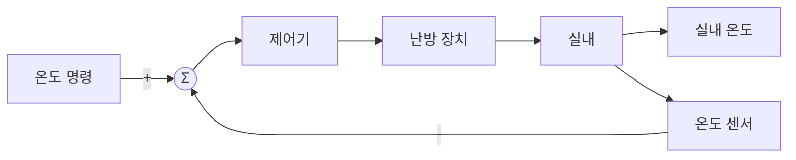

*그림 1. 실내 난방 온도 제어시스템의 블록선도*

이 시스템에 대한 요구 사항은 두 가지로 정리된다.

1. 실내 온도가 가능한 한 빠른 시간에 설정 온도에 도달해야 한다.
2. 설정 온도에 도달한 뒤에는 오차 없이 설정 온도를 유지해야 한다.

첫째 요구는 **과도 성능(transient performance)**, 둘째 요구는 **정상 상태 성능(steady-state performance)** 에 해당한다. 두 성능은 1.3절에서 정의한다.

**쿼드콥터 자세 제어시스템.** 쿼드콥터(quadcopter)는 네 개의 로터로 비행하는 드론이다. 비행 제어기는 네 개의 모터를 각각 제어하여 자세 제어에 필요한 추력을 발생시키며, 기체의 각도를 측정하는 각도 센서를 포함한다. 각도 명령과 측정한 각도를 비교하여 모터를 구동하는 구조는 난방 시스템과 같다.

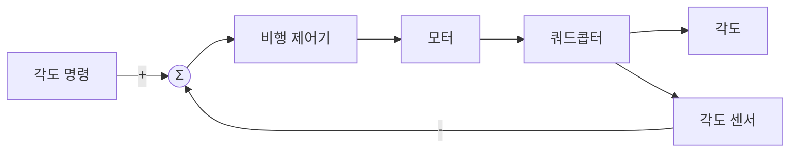

*그림 2. 쿼드콥터 자세 제어시스템의 블록선도*

구조가 같아도 제어시스템의 성능에 따라 응답은 크게 달라진다. 그림 3은 기울어진 기체가 목표 각도 0으로 돌아오는 두 응답이다. 왼쪽 응답은 목표 각도를 여러 번 지나치며 진동하다가 천천히 수렴하고, 오른쪽 응답은 목표를 지나치지 않고 빠르게 수렴한다. 둘 다 결국 목표에 도달하지만 오른쪽이 더 좋은 성능이다. 이 차이를 수치로 나타내는 방법이 이 단원의 주제이다.

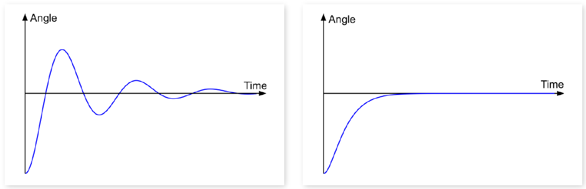

*그림 3. 성능이 다른 두 쿼드콥터 자세 제어시스템의 각도 응답*

### 1.2 피드백 제어시스템의 구조

일반적인 피드백 제어시스템은 그림 4처럼 세 전달함수로 나타낸다. 기준 입력에서 피드백 신호를 뺀 값이 제어기에 들어가고, 제어기의 출력이 제어 대상을 움직여 출력을 만들며, 센서가 출력을 측정하여 가합점으로 되돌린다.

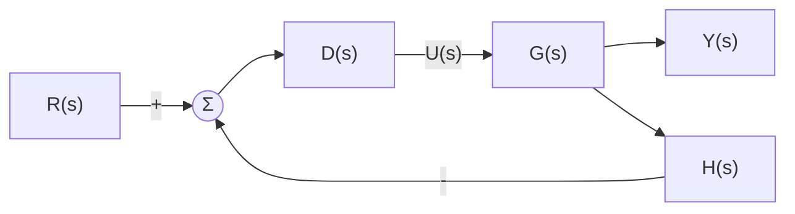

*그림 4. 피드백 제어시스템의 일반 구조*

| 기호 | 이름 | 역할 |
|:-----|:-----|:-----|
| $R(s)$ | 기준 입력(reference input) | 출력이 따라가야 할 명령 |
| $D(s)$ | 제어기(controller)의 전달함수 | 가합점의 출력으로부터 제어 입력 $U(s)$를 만든다 |
| $G(s)$ | 플랜트(plant), 즉 제어 대상 시스템의 전달함수 | 제어 입력을 받아 출력을 만든다 |
| $H(s)$ | 센서(sensor)의 전달함수 | 출력을 측정하여 가합점으로 되돌린다 |
| $Y(s)$ | 출력(output) | 제어하려는 물리량 |

*표 1. 피드백 제어시스템의 구성 요소*

가합점의 출력을 $E_a(s) = R(s) - H(s)Y(s)$라 하면 $U = DE_a$, $Y = GU$이므로 $Y = DG(R - HY)$이다. 이를 $Y$에 대해 정리하면 5주차에서 유도한 **폐루프 전달함수(closed-loop transfer function)** 를 얻는다.

```math
Y(1 + DGH) = DGR \quad\Longrightarrow\quad T(s) = \frac{Y(s)}{R(s)} = \frac{D(s)G(s)}{1 + D(s)G(s)H(s)}
```

$H(s) = 1$이어서 출력을 그대로 되먹이는 시스템을 **단위 피드백(unity feedback)** 시스템이라 한다. 단위 피드백 시스템이 아니어도 블록선도 연산으로 단위 피드백 시스템으로 바꿀 수 있다. 그림 5는 그림 4와 같은 시스템이다.

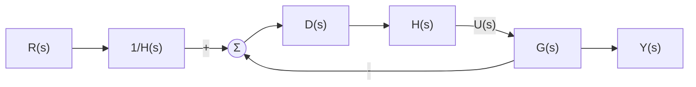

*그림 5. 그림 4와 같은 입출력 관계를 갖는 단위 피드백 시스템*

두 시스템이 같다는 것은 폐루프 전달함수를 비교하여 확인한다. 그림 5의 안쪽 루프는 전방향 경로가 $DHG$인 단위 피드백이므로 전달함수가 $DHG/(1 + DHG)$이고, 그 앞에 $1/H$가 곱해진다.

```math
T(s) = \frac{1}{H}\cdot\frac{DHG}{1 + DHG} = \frac{DG}{1 + DGH}
```

결과가 그림 4의 $T(s)$와 같다. 제어 입력도 $`U = HD\,(R/H - Y) = D(R - HY)`$로 그림 4와 같으므로, 두 블록선도는 입출력뿐 아니라 플랜트에 들어가는 신호까지 같다. 이 변환은 $H(s)$가 0이 아닌 전달함수일 때 성립한다.

> **핵심:** 센서의 전달함수 $H(s)$가 있는 시스템도 입력 쪽에 $1/H(s)$를 두고 $H(s)$를 전방향 경로로 옮기면 단위 피드백 시스템으로 다룰 수 있다. 그래서 제어시스템의 성능 분석은 주로 단위 피드백 시스템을 기준으로 한다.

### 1.3 간단한 제어시스템의 성능 비교

플랜트가 $G(s) = 1/(s+1)$이고 제어기가 상수 이득 $K$인 단위 피드백 시스템을 생각한다. 상수 이득 $K$만 곱하는 제어기를 **비례 제어기(proportional controller)** 라 한다(11주차).

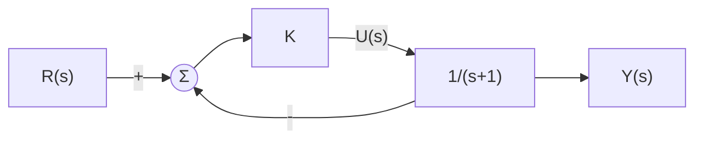

*그림 6. 플랜트 1/(s+1)과 비례 제어기로 이루어진 단위 피드백 시스템*

$D = K$, $G = 1/(s+1)$, $H = 1$을 폐루프 전달함수에 넣고 분자와 분모에 $s + 1$을 곱한다.

```math
T(s) = \frac{K\cdot\frac{1}{s+1}}{1 + K\cdot\frac{1}{s+1}} = \frac{K}{s + 1 + K}
```

그림 7은 $K = 5$와 $K = 10$일 때 단위 계단 명령 $r(t) = 1$에 대한 출력이다. $K = 10$인 경우가 $K = 5$인 경우보다 출력이 더 빠르게 이동하고, 최종 도달 지점도 명령값 1에 더 가깝다. 따라서 $K = 10$인 경우가 더 좋은 특성을 나타낸다고 할 수 있다.

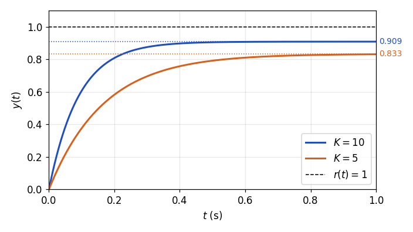

*그림 7. 비례 이득 K = 5와 K = 10에 대한 단위 계단 응답*

이 비교에서 제어시스템의 성능을 평가하는 두 기준이 드러난다.

1. 제어시스템의 출력이 명령값까지 얼마나 빠르게 이동하는가: **과도 성능**
2. 최종 도달 지점이 명령값에 얼마나 근접하는가: **정상 상태 성능**

> **용어 정의:** **과도 응답(transient response)** 은 입력이 가해진 뒤 출력이 최종값 근처에 자리 잡기까지의 응답이고, **정상 상태 응답(steady-state response)** 은 충분한 시간이 지나 과도 성분이 사라진 뒤의 응답이다. 과도 성능은 과도 응답의 빠르기와 모양으로, 정상 상태 성능은 정상 상태에서 출력과 명령값의 차이인 **정상 상태 오차(steady-state error)** 로 평가한다.

### 1.4 시험 입력 신호

> **용어 정의:** **시험 입력 신호(test input signal)** 는 제어시스템의 성능을 시험하기 위해 제어시스템에 입력하는 표준 신호이다.

대표적인 시험 입력은 다음 세 가지이며, 모두 $t < 0$에서 0이다.

```math
u_s(t) = \begin{cases} 1, & t \ge 0 \\ 0, & t < 0 \end{cases} \qquad u_r(t) = \begin{cases} t, & t \ge 0 \\ 0, & t < 0 \end{cases} \qquad u_p(t) = \begin{cases} \dfrac{t^2}{2}, & t \ge 0 \\ 0, & t < 0 \end{cases}
```

| 시험 입력 | 시간 함수 ($`t \ge 0`$) | 라플라스 변환 | 나타내는 명령 |
|:-----|:-----|:-----|:-----|
| 단위 계단 입력(unit step input) | $u_s(t) = 1$ | $U_s(s) = 1/s$ | 목표값이 갑자기 바뀌어 그 값을 유지하는 명령 |
| 단위 경사 입력(unit ramp input) | $u_r(t) = t$ | $U_r(s) = 1/s^2$ | 목표값이 일정한 속도로 바뀌는 명령 |
| 단위 포물선 입력(unit parabolic input) | $u_p(t) = t^2/2$ | $U_p(s) = 1/s^3$ | 목표값이 일정한 가속도로 바뀌는 명령 |

*표 2. 세 가지 시험 입력 신호와 그 라플라스 변환*

경사 입력은 램프 입력이라고도 한다. 세 신호는 차례로 앞 신호를 적분한 것이다. $`u_r(t) = \int_0^t u_s(\lambda)\,d\lambda`$이고 $`u_p(t) = \int_0^t u_r(\lambda)\,d\lambda`$이며, 3주차의 적분 정리에 따라 시간 영역의 적분은 $s$ 영역에서 $1/s$를 곱하는 것이므로 라플라스 변환이 $1/s$, $1/s^2$, $1/s^3$으로 이어진다. 포물선 입력에 $1/2$을 붙이는 것은 변환을 $1/s^3$으로 깔끔하게 만들기 위해서이다.

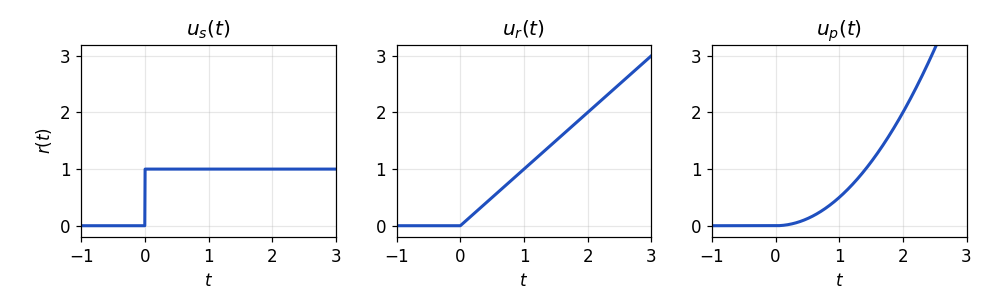

*그림 8. 단위 계단, 단위 경사, 단위 포물선 입력*

시험 입력 신호가 실제 제어시스템의 운용 과정에서 명령 입력으로 쓰이는 경우는 많지 않다. 그럼에도 성능 평가와 시험의 과정에서 많이 쓰이는 이유는 다음과 같다. 첫째, 식이 단순하여 응답을 해석적으로 구할 수 있다. 둘째, 갑작스러운 변화(계단), 일정한 속도의 변화(경사), 일정한 가속도의 변화(포물선)는 실제 명령의 전형적인 성분이므로 이에 대한 응답을 보면 실제 명령에 대한 동작을 짐작할 수 있다. 셋째, 같은 입력으로 시험하면 서로 다른 시스템의 성능을 공정하게 비교할 수 있다. 이 단원과 9주차는 주로 단위 계단 응답으로 과도 성능을 평가하고, 10주차는 세 입력 모두로 정상 상태 오차를 평가한다.

### 1.5 미분방정식으로 본 과도 성능과 정상 상태 성능

1.3절의 시스템을 시간 영역에서 풀면 두 성능이 응답의 어느 부분에 해당하는지 분명해진다. 폐루프 전달함수 $Y(s)/R(s) = K/(s + 1 + K)$의 분모를 넘기면 $(s + 1 + K)Y(s) = KR(s)$이다. 초기 조건이 0일 때 $sY(s)$는 $\dot{y}(t)$의 라플라스 변환이므로(3주차), 이 식은 다음 **미분방정식**에 해당한다.

```math
\dot{y}(t) + (K + 1)\,y(t) = K\,r(t)
```

단위 계단 입력 $r(t) = 1$ ($`t \ge 0`$)과 초기 조건 $y(0) = 0$으로 이 1계 미분방정식을 2주차의 방법으로 푼다.

1. **동차해:** $\dot{y} + (K+1)y = 0$의 해는 $y_h(t) = Ce^{-(K+1)t}$이다.
2. **특수해:** 입력이 상수이므로 상수 $y_p$를 가정하면 $`\dot{y}_p = 0`$이고 $(K + 1)y_p = K$에서 $y_p = K/(K+1)$이다.
3. **초기 조건:** $y(0) = C + K/(K+1) = 0$에서 $C = -K/(K+1)$이다.

```math
y(t) = -\frac{K}{K+1}\,e^{-(K+1)t} + \frac{K}{K+1}, \qquad t \ge 0
```

라플라스 변환으로 풀어도 같다. $Y(s) = \dfrac{K}{s(s + K + 1)} = \dfrac{K}{K+1}\left(\dfrac{1}{s} - \dfrac{1}{s + K + 1}\right)$의 역변환이 위 식이다.

해의 첫째 항은 시간이 지나면 0으로 사라지는 **과도 성분**이고, 둘째 항은 끝까지 남는 **정상 상태 성분**이다. 과도 성분이 사라지는 빠르기는 지수 $K + 1$, 즉 폐루프 극점 $s = -(K+1)$이 정하고, 최종값은 $K/(K+1)$이다.

| 이득 | 폐루프 극점 | 과도 성분이 $e^{-1}$로 줄어드는 시간 $1/(K+1)$ | 최종값 $K/(K+1)$ | 정상 상태 오차 $1/(K+1)$ |
|:-----|:-----|:-----|:-----|:-----|
| $K = 5$ | $-6$ | $0.167$ s | $0.833$ | $0.167$ |
| $K = 10$ | $-11$ | $0.0909$ s | $0.909$ | $0.0909$ |

*표 3. 비례 이득에 따른 과도 성분의 감소 속도와 최종값*

$K = 10$인 경우에 정상 상태에 더 빠르게 도달하며, 정상 상태의 값도 1에 더 가깝다. 이득 $K$는 과도 성능(극점의 위치)과 정상 상태 성능(최종값)을 함께 바꾼다.

> **주의:** 이 예에서는 $K$를 키울수록 두 성능이 모두 좋아지지만, 일반적인 결론은 아니다. 실제 시스템에서는 큰 이득이 구동기의 포화와 센서 잡음의 증폭을 일으키고, 차수가 높은 시스템에서는 이득이 크면 진동이 심해지거나 불안정해질 수 있다(9주차). 또한 이 시스템의 정상 상태 오차 $1/(K+1)$은 $K$가 유한하면 0이 되지 않는다. 이 오차를 없애는 조건은 10주차의 시스템 타입에서 다룬다.

---

<br>

## 2. 1차 시스템의 과도 응답

### 2.1 과도 성능의 정량적 지표

과도 성능은 보통 단위 계단 응답으로 나타낸다. 그림 9는 목표값을 한 번 넘었다가 진동하며 수렴하는 전형적인 계단 응답 위에 네 지표를 표시한 것이다.

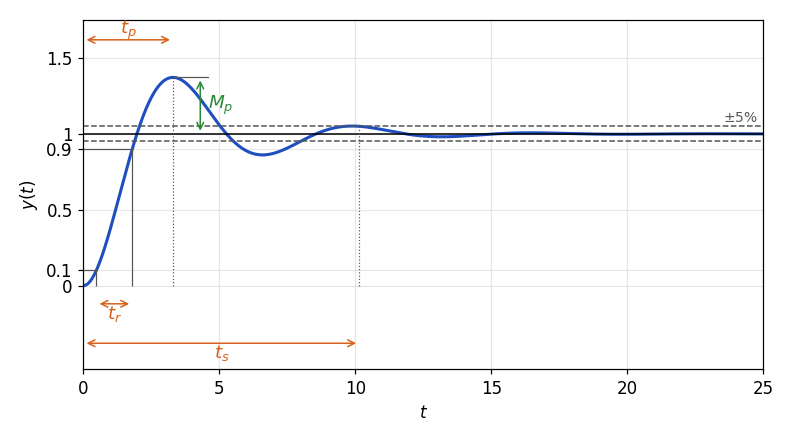

*그림 9. 단위 계단 응답 위에 나타낸 과도 성능 지표*

**최대 초과량(maximum overshoot) $M_p$.** 출력이 목표값에 도달할 때 목표값보다 더 크게 혹은 더 작게 진동하는 현상을 **오버슈트(overshoot)** 라 하고, 그 최대 크기를 최대 초과량이라 한다. 출력의 최댓값 $y(t_p)$에서 정상 상태의 값 $y_{ss}$를 뺀 값을 $y_{ss}$에 대한 비율로 나타내며, 정상 상태의 출력 값을 100%로 한 백분율로 쓰는 경우가 많다 [1].

```math
M_p = \frac{y(t_p) - y_{ss}}{y_{ss}}, \qquad \text{백분율 초과량} = \frac{y(t_p) - y_{ss}}{y_{ss}} \times 100\,\%
```

최대 초과량은 제어시스템의 안정성과 성능을 평가하는 중요한 지표이다. 최대 초과량이 크다는 것은 감쇠가 작아 진동이 쉽게 일어난다는 뜻이므로 안정성의 여유가 작다. 위치 제어에서는 목표 위치를 지나쳐 부딪히는 문제도 생기므로 최대 초과량을 최소화하는 것이 중요하다.

**최고점 시간(peak time) $t_p$.** 출력이 최댓값에 처음 도달하는 시간이다. 일반적으로 최고점 시간이 짧을수록 시스템의 반응이 빠르다고 볼 수 있으므로, 최고점 시간은 반응 속도를 평가하는 데 쓰이며 빠른 반응이 필요한 시스템에서는 최고점 시간을 줄이는 것이 중요하다.

**정착 시간(settling time) $t_s$.** 출력이 최종값 주변의 정해진 허용 오차 범위 안으로 들어와 그 뒤로 계속 그 범위 안에 머무르기 시작하는 시간이다. 허용 오차 범위는 최종값에 대한 백분율로 정하며, 보통 $`\pm 5\%`$나 $`\pm 2\%`$를 쓴다 [1]. 예를 들어 5% 정착 시간은 출력이 최종값의 $`\pm 5\%`$ 범위 안에 계속 머무르기 시작하는 시간이다. 정착 시간은 시스템이 얼마나 빨리 안정된 출력을 유지하게 되는지를 나타낸다.

**상승 시간(rise time) $t_r$.** 출력이 처음으로 최종값 근처에 도달하는 데 걸리는 시간이다. 보통 최종값의 10%에서 90%까지 걸리는 시간으로 계산하며, 진동하는 응답에서는 0%에서 100%까지 걸리는 시간을 쓰기도 한다 [1]. 상승 시간이 짧으면 시스템이 입력 신호에 빠르게 반응한다는 뜻이다.

| 지표 | 기호 | 정의 | 평가하는 성질 |
|:-----|:-----|:-----|:-----|
| 최대 초과량 | $M_p$ | $(y(t_p) - y_{ss})/y_{ss}$ | 감쇠의 정도, 안정성의 여유 |
| 최고점 시간 | $t_p$ | 출력이 최댓값에 처음 도달하는 시간 | 반응 속도 |
| 정착 시간 | $t_s$ | 출력이 $`\pm 5\%`$ (또는 $`\pm 2\%`$) 범위에 계속 머무르기 시작하는 시간 | 안정된 출력에 이르는 속도 |
| 상승 시간 | $t_r$ | 출력이 최종값의 10%에서 90%까지 오르는 시간 | 초기 반응 속도 |

*표 4. 과도 성능의 네 가지 정량적 지표*

그림 9의 응답은 3.6절에서 유도하는 2차 시스템으로, 감쇠비 $\zeta = 0.3$, 고유 진동수 $\omega_n = 1$ rad/s인 경우이다. 이 응답에서 $`M_p \approx 37\%`$, $t_p \approx 3.3$ s, $t_r \approx 1.3$ s, 5% 정착 시간 $t_s \approx 10.1$ s이다.

### 2.2 1차 시스템의 단위 계단 응답

분모가 $s$의 1차식인 전달함수를 갖는 시스템을 **1차 시스템(first-order system)** 이라 한다. 정상 상태 이득이 1인 1차 시스템의 표준형은 다음과 같다.

```math
\frac{Y(s)}{R(s)} = G_T(s) = \frac{1}{\tau s + 1}, \qquad \tau > 0
```

$\tau$를 **시정수(time constant)** 라 한다. 극점은 $\tau s + 1 = 0$의 근인 $s = -1/\tau$ 하나이다. 단위 계단 입력 $U_s(s) = 1/s$를 넣으면 $(\tau s + 1)Y(s) = U_s(s)$이고, 이를 시간 영역으로 옮기면 다음 미분방정식이 된다.

```math
\tau\,\dot{y}(t) + y(t) = u_s(t)
```

라플라스 변환으로 응답을 구한다. 분모를 $\tau$로 나누어 부분분수로 전개한다(3주차).

```math
Y(s) = \frac{1}{s(\tau s + 1)} = \frac{1/\tau}{s\,(s + 1/\tau)} = \frac{A}{s} + \frac{B}{s + 1/\tau}
```

```math
A = \left. sY(s) \right|_{s=0} = \frac{1/\tau}{1/\tau} = 1, \qquad B = \left. \left(s + \tfrac{1}{\tau}\right)Y(s) \right|_{s=-1/\tau} = \frac{1/\tau}{-1/\tau} = -1
```

```math
y(t) = 1 - e^{-t/\tau}, \qquad t \ge 0
```

응답은 0에서 출발하여 1을 넘지 않고 단조롭게 증가한다. 몇 시점의 값은 다음과 같다.

| 시간 | $\tau$ | $2\tau$ | $3\tau$ | $4\tau$ | $5\tau$ |
|:-----|:-----|:-----|:-----|:-----|:-----|
| $y(t) = 1 - e^{-t/\tau}$ | $0.632$ | $0.865$ | $0.950$ | $0.982$ | $0.993$ |

*표 5. 1차 시스템의 단위 계단 응답이 시정수의 배수에서 갖는 값*

$t = 0$에서의 기울기는 $\dot{y}(0) = 1/\tau$이다. 출력이 처음 기울기를 그대로 유지한다면 $t = \tau$에 최종값 1에 도달할 것이다. 실제 출력은 목표에 가까워질수록 느려져 $t = \tau$에 최종값의 63.2%에 이른다.

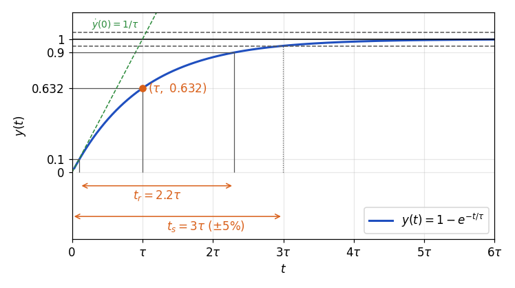

*그림 10. 1차 시스템의 단위 계단 응답과 시정수, 상승 시간, 정착 시간*

> **용어 정의:** **시정수(time constant)** $\tau$는 1차 시스템의 계단 응답이 최종값의 $`1 - e^{-1} \approx 63.2\%`$에 이르는 시간이며, 극점 $s = -1/\tau$와 원점 사이 거리의 역수이다. 극점이 원점에서 멀수록 시정수가 작아 응답이 빠르다.

### 2.3 1차 시스템의 상승 시간과 정착 시간

**상승 시간.** 출력이 10%와 90%에 이르는 시간을 각각 구한다.

```math
1 - e^{-t_{10}/\tau} = 0.1 \;\Rightarrow\; t_{10} = \tau\ln\frac{1}{0.9} \approx 0.105\,\tau, \qquad 1 - e^{-t_{90}/\tau} = 0.9 \;\Rightarrow\; t_{90} = \tau\ln\frac{1}{0.1} \approx 2.303\,\tau
```

```math
t_r = t_{90} - t_{10} = \tau\left(\ln 10 - \ln\frac{10}{9}\right) = \tau\ln 9 \approx 2.2\,\tau
```

**정착 시간.** 응답이 단조 증가하므로 최종값과의 차이는 $1 - y(t) = e^{-t/\tau}$이고, 이 값이 허용 오차와 같아지는 순간부터 계속 범위 안에 머무른다.

```math
e^{-t_s/\tau} = 0.05 \;\Rightarrow\; t_s = \tau\ln 20 \approx 3.0\,\tau \;(\pm 5\%), \qquad e^{-t_s/\tau} = 0.02 \;\Rightarrow\; t_s = \tau\ln 50 \approx 3.9\,\tau \;(\pm 2\%)
```

$`\pm 2\%`$ 정착 시간은 흔히 $4\tau$로 어림한다 [1]. 1차 시스템의 계단 응답은 최종값을 넘지 않으므로 최대 초과량은 0이고, 최댓값에 유한한 시간에 도달하지 않으므로 최고점 시간은 정의되지 않는다.

> **핵심:** 1차 시스템의 과도 성능은 시정수 $\tau$ 하나로 정해진다. $t_r \approx 2.2\tau$, $t_s \approx 3\tau$ ($`\pm 5\%`$)이므로 시정수를 줄이면, 즉 극점 $-1/\tau$를 왼쪽으로 옮기면 상승 시간과 정착 시간이 같은 비율로 줄어든다. 전달함수가 $K_{dc}/(\tau s + 1)$처럼 정상 상태 이득 $K_{dc}$를 가지면 응답 전체가 $K_{dc}$배가 될 뿐 시간 지표는 변하지 않는다.

### 2.4 예제: 직류 모터의 시정수

4주차에서 모델링한 전기자 제어 직류 모터는 그림 11과 같다 [2]. 전기자 회로에 전압 $e_a$를 가하면 저항 $R_a$와 인덕턴스 $L_a$를 지나 전류 $i_a$가 흐르고, 모터가 회전하면 회전 속도에 비례하는 **역기전력(back electromotive force)** $e_b$가 생긴다. 모터 토크는 관성 모멘트 $J_a$인 회전자를 돌리며, 회전에는 점성 마찰 계수 $B$의 마찰이 작용한다. 그림의 $\tau$는 모터 토크이며, 시정수와 구분하기 위해 아래 식에서는 토크를 $T$로 쓴다.

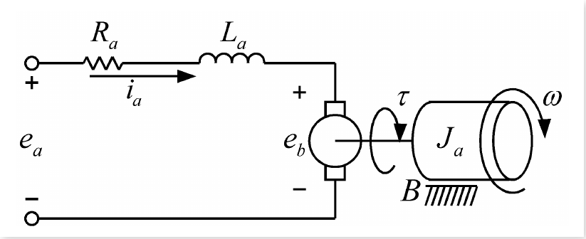

*그림 11. 전기자 제어 직류 모터의 회로와 회전부*

전기자 회로에 키르히호프 전압 법칙을, 회전부에 회전 운동 방정식을 적용한다. $K_b$는 역기전력 상수, $K_t$는 토크 상수이고, $\omega = d\theta/dt$는 각속도이다.

```math
e_a = R_a i_a + L_a\frac{di_a}{dt} + e_b = R_a i_a + L_a\frac{di_a}{dt} + K_b\frac{d\theta}{dt}
```

```math
T = K_t i_a = J_a\frac{d^2\theta}{dt^2} + B\frac{d\theta}{dt}
```

초기 조건을 0으로 두고 라플라스 변환하면 $E_a = (R_a + L_a s)I_a + K_b\Omega$이고 $K_t I_a = (J_a s + B)\Omega$이다. 둘째 식에서 $I_a = (J_a s + B)\Omega/K_t$를 첫째 식에 넣어 $\Omega/E_a$를 구한다.

```math
\frac{\Omega(s)}{E_a(s)} = \frac{K_t}{(R_a + L_a s)(J_a s + B) + K_t K_b}
```

이 식은 분모가 2차이다. 일반적인 직류 모터에서는 전기 회로의 시정수 $L_a/R_a$가 회전부의 기계적 시정수보다 훨씬 작아 전류가 회전 속도보다 훨씬 빨리 변하므로 $L_a \approx 0$으로 둘 수 있고 [3], 점성 마찰도 작다고 보아 $B \approx 0$으로 두면 1차 시스템이 된다.

```math
\frac{\Omega(s)}{E_a(s)} = \frac{K_t}{R_a J_a s + K_t K_b} = \frac{1/K_b}{\dfrac{J_a R_a}{K_t K_b}\,s + 1} = \frac{1}{K_b}\times\frac{1/\tau_m}{s + 1/\tau_m}
```

둘째 등호는 분자와 분모를 $K_t K_b$로 나눈 것이다. 2.2절의 표준형과 비교하면 모터의 시정수는 다음과 같다.

```math
\tau_m = \frac{J_a R_a}{K_t K_b}
```

모터의 시정수는 관성 모멘트 $J_a$에 비례한다. 따라서 관성이 큰 모터는 시정수가 커서 속도가 목표에 이르기까지 오래 걸린다.

> **참고:** 점성 마찰을 무시하지 않고 $L_a \approx 0$만 가정하면 $\Omega/E_a = K_t/(R_a J_a s + R_a B + K_t K_b)$이므로, 시정수는 $J_a R_a/(R_a B + K_t K_b)$, 정상 상태 이득은 $K_t/(R_a B + K_t K_b)$가 된다. 마찰은 시정수를 조금 줄이고 최종 속도도 줄인다.

### 2.5 예제: 모터 속도 제어시스템

2.4절의 모터에 비례 제어기 $K$와 속도 센서를 달아 단위 피드백으로 속도를 제어한다. 출력 $Y(s)$는 모터의 각속도이다.

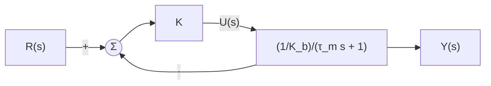

*그림 12. 모터 속도 제어시스템*

전방향 경로는 $\dfrac{K/K_b}{\tau_m s + 1}$이므로 폐루프 전달함수는 다음과 같다. 둘째 줄은 분자와 분모에 $K_b$를 곱한 뒤 $K_b + K$로 나누어 1차 표준형으로 맞춘 것이다.

```math
T(s) = \frac{\dfrac{K/K_b}{\tau_m s + 1}}{1 + \dfrac{K/K_b}{\tau_m s + 1}} = \frac{K/K_b}{\tau_m s + 1 + K/K_b} = \frac{K}{K_b\tau_m s + K_b + K}
```

```math
T(s) = \frac{K/(K_b + K)}{\dfrac{K_b\tau_m}{K_b + K}\,s + 1}, \qquad \tau_c = \frac{K_b\,\tau_m}{K_b + K} = \frac{\tau_m}{1 + K/K_b}
```

폐루프 시스템도 1차 시스템이며, 그 시정수 $\tau_c$는 모터 자체의 시정수 $\tau_m$보다 작다. 제어기의 상수 이득 $K$를 키우면 $\tau_c$가 줄어들어 응답이 빨라지므로, 폐루프 시스템의 시정수는 $K$로 조절할 수 있다. 예를 들어 $\tau_m = 1$ s, $K_b = 1$인 모터에서 다음과 같다.

| 이득 $K$ | 폐루프 시정수 $\tau_c$ | 5% 정착 시간 $3\tau_c$ | 최종값 $K/(K_b + K)$ |
|:-----|:-----|:-----|:-----|
| 피드백 없음 (모터 자체) | $\tau_m = 1$ s | $3$ s | 해당 없음 |
| $4$ | $0.2$ s | $0.6$ s | $0.8$ |
| $9$ | $0.1$ s | $0.3$ s | $0.9$ |

*표 6. 비례 이득에 따른 모터 속도 제어시스템의 시정수와 최종값*

> **핵심:** 피드백은 폐루프 극점을 $-1/\tau_m$에서 $-(K_b + K)/(K_b\tau_m)$으로 왼쪽으로 옮겨, 모터 자체보다 빠른 응답을 만든다. 다만 최종값 $K/(K_b + K)$는 1보다 작아 정상 상태 오차가 남으며, 이는 1.5절의 예와 같은 성질이다.

---

<br>

## 3. 2차 시스템의 과도 응답

### 3.1 간단한 2차 시스템의 예

플랜트가 $G(s) = \dfrac{1}{s(s+1)}$이고 제어기가 상수 이득 $K$인 단위 피드백 시스템을 생각한다. 2.4절의 모터에서 출력을 각속도 $\omega$ 대신 회전 각도 $\theta$로 잡으면 $\Theta(s) = \Omega(s)/s$이므로 $\Theta/E_a = \dfrac{1/K_b}{s(\tau_m s + 1)}$이 된다. 이 플랜트는 그중 $\tau_m = 1$, $K_b = 1$인 경우로, 모터의 위치 제어시스템에 해당한다.

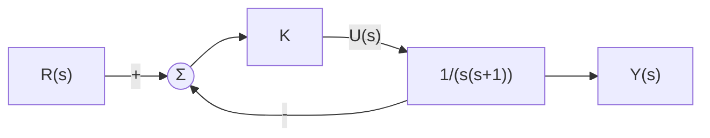

*그림 13. 플랜트 1/(s(s+1))과 비례 제어기로 이루어진 단위 피드백 시스템*

폐루프 전달함수의 분자와 분모에 $s(s+1)$을 곱한다.

```math
T(s) = \frac{\dfrac{K}{s(s+1)}}{1 + \dfrac{K}{s(s+1)}} = \frac{K}{s^2 + s + K}
```

분모가 $s$의 2차식이므로 이 폐루프 시스템은 **2차 시스템(second-order system)** 이다. 2차 시스템의 응답은 분모 계수에 따라 진동하기도 하고 진동하지 않기도 하므로, 분모를 표준형으로 정리하여 분류한다.

### 3.2 표준형 2차 시스템

정상 상태 이득이 1이고 영점이 없는 2차 시스템은 다음 표준형으로 쓴다.

```math
\frac{Y(s)}{R(s)} = G_T(s) = \frac{1}{(s/\omega_n)^2 + 2\zeta s/\omega_n + 1} = \frac{\omega_n^2}{s^2 + 2\zeta\omega_n s + \omega_n^2}
```

둘째 등호는 분자와 분모에 $\omega_n^2$을 곱한 것이다. $\zeta$를 **감쇠비(damping ratio)**, $\omega_n > 0$을 **고유 진동수(natural frequency)** 라 하며 $\omega_n$의 단위는 rad/s이다. $\zeta > 0$이면 두 극점이 좌반평면에 있고 $G_T(0) = 1$이므로 단위 계단 입력에 대한 최종값은 1이다.

두 매개변수의 물리적 의미는 4주차의 질량-스프링-댐퍼 시스템에서 볼 수 있다. 질량 $M$, 점성 마찰 계수 $B$, 스프링 상수 $K$인 시스템에 힘 $f$를 가하면 운동방정식은 $M\ddot{y} + B\dot{y} + Ky = f$이고, 전달함수를 표준형과 비교하면 다음과 같다.

```math
\frac{Y(s)}{F(s)} = \frac{1}{Ms^2 + Bs + K} = \frac{1}{K}\cdot\frac{K/M}{s^2 + (B/M)s + K/M} \quad\Longrightarrow\quad \omega_n = \sqrt{\frac{K}{M}}, \qquad \zeta = \frac{B}{2\sqrt{KM}}
```

고유 진동수는 마찰이 없을 때 질량과 스프링이 진동하는 각진동수이고, 감쇠비는 마찰 $B$가 그 진동을 얼마나 억제하는지를 나타낸다. 3.1절의 시스템은 $s^2 + s + K$를 $s^2 + 2\zeta\omega_n s + \omega_n^2$과 비교하여 $\omega_n = \sqrt{K}$, $\zeta = 1/(2\sqrt{K})$이다.

**단위 계단 응답.** $U_s(s) = 1/s$이므로 출력의 라플라스 변환은 다음과 같다.

```math
Y(s) = G_T(s)U_s(s) = \frac{\omega_n^2}{(s^2 + 2\zeta\omega_n s + \omega_n^2)\,s}
```

역라플라스 변환으로 $y(t)$를 구하려면 부분분수 전개가 필요하고, 부분분수 전개를 하려면 분모를 인수분해해야 한다. 즉 다음 **특성방정식(characteristic equation)** 의 근을 구해야 하며, 근의 종류에 따라 응답의 형태가 달라진다.

```math
s^2 + 2\zeta\omega_n s + \omega_n^2 = 0
```

### 3.3 특성방정식의 근의 분류

특성방정식의 두 근을 $s_1$, $s_2$라 하면 $s^2 + 2\zeta\omega_n s + \omega_n^2 = (s - s_1)(s - s_2)$이다. 근의 공식을 적용한다.

```math
s = \frac{-2\zeta\omega_n \pm \sqrt{4\zeta^2\omega_n^2 - 4\omega_n^2}}{2} \quad\Longrightarrow\quad s_1 = -\zeta\omega_n + \sqrt{(\zeta^2 - 1)\,\omega_n^2}, \qquad s_2 = -\zeta\omega_n - \sqrt{(\zeta^2 - 1)\,\omega_n^2}
```

근호 안의 부호는 $\zeta^2 - 1$의 부호, 즉 $\zeta$와 1의 대소로 정해진다. $\zeta > 0$인 경우는 다음 세 가지로 나뉜다. $\zeta = 0$과 $\zeta < 0$인 경우는 9주차에서 다룬다.

| 감쇠비 | $\zeta^2 - 1$ | 근 | 응답 유형 |
|:-----|:-----|:-----|:-----|
| $\zeta > 1$ | 양수 | 서로 다른 두 음의 실근 | 과감쇠(overdamped) |
| $\zeta = 1$ | 0 | 중근(double root) $s_1 = s_2 = -\omega_n$ | 임계 감쇠(critically damped) |
| $0 < \zeta < 1$ | 음수 | 켤레 복소근 $-\zeta\omega_n \pm j\omega_n\sqrt{1 - \zeta^2}$ | 부족 감쇠(underdamped) |

*표 7. 감쇠비에 따른 특성방정식의 근과 응답 유형*

두 근이 서로 다르면($`\zeta \ne 1`$) $Y(s)$는 다음처럼 전개된다. 각 계수는 3주차의 방법대로 그 극점의 인수를 곱한 뒤 극점에서의 값을 구한 것이다.

```math
Y(s) = \frac{\omega_n^2}{(s - s_1)(s - s_2)\,s} = \frac{K_1}{s - s_1} + \frac{K_2}{s - s_2} + \frac{K_3}{s}
```

```math
K_1 = \frac{\omega_n^2}{(s_1 - s_2)\,s_1}, \qquad K_2 = \frac{\omega_n^2}{(s_2 - s_1)\,s_2}, \qquad K_3 = \frac{\omega_n^2}{s_1 s_2}
```

```math
y(t) = K_1e^{s_1t} + K_2e^{s_2t} + K_3, \qquad t \ge 0
```

근과 계수의 관계에서 $s_1 s_2 = \omega_n^2$이므로 $K_3 = 1$이다. $K_3$은 입력 극점 $s = 0$에서 나온 정상 상태 성분(특수해)이고, $K_1e^{s_1t}$와 $K_2e^{s_2t}$는 시스템 극점에서 나온 과도 성분이다.

### 3.4 서로 다른 두 실근: 과감쇠

$\zeta > 1$이면 두 근은 서로 다른 실수이다. $\omega_n\sqrt{\zeta^2 - 1} < \zeta\omega_n$이므로 두 근은 모두 음수이며, 이 경우를 **과감쇠(overdamped)** 라 한다. 각 근에 1차 시스템처럼 시정수를 대응시킨다.

```math
\tau_1 = -\frac{1}{s_1} = \frac{1}{\zeta\omega_n - \sqrt{(\zeta^2 - 1)\,\omega_n^2}}, \qquad \tau_2 = -\frac{1}{s_2} = \frac{1}{\zeta\omega_n + \sqrt{(\zeta^2 - 1)\,\omega_n^2}}
```

```math
y(t) = 1 + K_1e^{-t/\tau_1} + K_2e^{-t/\tau_2}, \qquad t \ge 0
```

두 시정수가 모두 0보다 크므로 두 지수 항은 0으로 사라지고, 출력은 특수해의 값인 $K_3 = 1$로 수렴한다. 일반해가 지수 함수만으로 구성되므로 출력은 진동하지 않는다. $\tau_1 > \tau_2$이므로 원점에 가까운 극점 $s_1$의 항이 더 천천히 사라지며, 응답의 후반부는 이 항이 주로 결정한다.

**예제 1.** 전달함수가 $G(s) = \dfrac{2}{s^2 + 3s + 2} = \dfrac{2}{(s+1)(s+2)}$인 시스템의 단위 계단 응답을 구한다.

표준형과 비교하면 $\omega_n^2 = 2$에서 $\omega_n = \sqrt{2} \approx 1.414$ rad/s이고, $2\zeta\omega_n = 3$에서 $\zeta = 3/(2\sqrt{2}) \approx 1.061$이다. $\zeta > 1$이므로 과감쇠이며, 근은 $s_1 = -1$, $s_2 = -2$이다. $U_s(s) = 1/s$를 곱해 부분분수로 전개한다.

```math
Y(s) = \frac{2}{s(s+1)(s+2)} = \frac{A}{s} + \frac{B}{s+1} + \frac{C}{s+2}
```

```math
A = \left.\frac{2}{(s+1)(s+2)}\right|_{s=0} = 1, \qquad B = \left.\frac{2}{s(s+2)}\right|_{s=-1} = \frac{2}{(-1)(1)} = -2, \qquad C = \left.\frac{2}{s(s+1)}\right|_{s=-2} = \frac{2}{(-2)(-1)} = 1
```

```math
y(t) = 1 - 2e^{-t} + e^{-2t}, \qquad t \ge 0
```

3.3절의 공식으로도 $K_1 = 2/[(-1+2)(-1)] = -2$, $K_2 = 2/[(-2+1)(-2)] = 1$, $K_3 = 2/[(-1)(-2)] = 1$로 같다. $y(0) = 1 - 2 + 1 = 0$이고 $\dot{y}(0) = 2 - 2 = 0$이어서 응답은 기울기 0에서 출발한다. 그림 14처럼 출력은 두 지수 항 $-2e^{-t}$와 $e^{-2t}$의 합에 1을 더한 것이며, $e^{-2t}$가 먼저 사라진 뒤에는 $-2e^{-t}$가 응답을 결정한다.

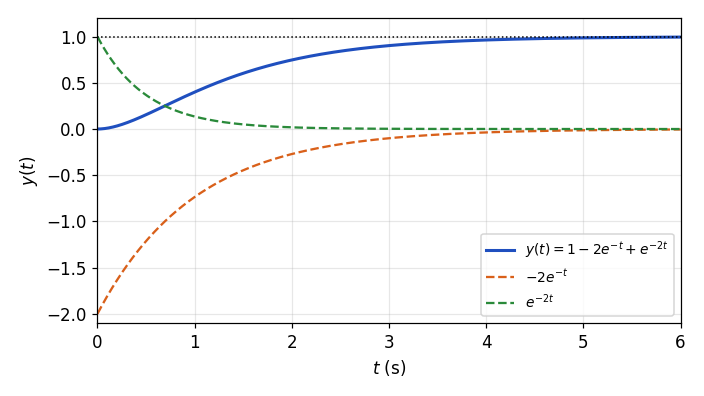

*그림 14. 과감쇠 시스템 2/((s+1)(s+2))의 단위 계단 응답과 두 지수 성분*

### 3.5 중근: 임계 감쇠

$\zeta = 1$이면 근호 안이 0이 되어 두 근이 $s_1 = s_2 = -\omega_n$으로 같아진다. 이 경우를 **임계 감쇠(critically damped)** 라 한다. 중근에서는 3.3절의 공식을 쓸 수 없으므로(분모의 $s_1 - s_2$가 0이 된다) 반복 인수의 부분분수 전개를 한다.

```math
Y(s) = \frac{\omega_n^2}{s\,(s + \omega_n)^2} = \frac{A}{s} + \frac{B}{s + \omega_n} + \frac{C}{(s + \omega_n)^2}
```

```math
A = \left.\frac{\omega_n^2}{(s + \omega_n)^2}\right|_{s=0} = 1, \qquad C = \left.\frac{\omega_n^2}{s}\right|_{s=-\omega_n} = -\omega_n, \qquad B = \left.\frac{d}{ds}\left(\frac{\omega_n^2}{s}\right)\right|_{s=-\omega_n} = \left.-\frac{\omega_n^2}{s^2}\right|_{s=-\omega_n} = -1
```

$\mathcal{L}^{-1}\lbrace1/(s+a)^2 \rbrace= te^{-at}$이므로(3주차) 응답은 다음과 같다.

```math
y(t) = 1 - e^{-\omega_n t} - \omega_n t\,e^{-\omega_n t} = 1 - e^{-\omega_n t}(1 + \omega_n t), \qquad t \ge 0
```

$te^{-\omega_n t}$ 항이 있어도 지수 함수가 더 빨리 줄어들므로 출력은 1로 수렴하며, 진동하지 않는다. 임계 감쇠는 과감쇠와 부족 감쇠의 경계이며, 같은 $\omega_n$에서 진동 없이 수렴하는 응답 중 가장 빠르다(9주차).

### 3.6 켤레 복소근: 부족 감쇠

$0 < \zeta < 1$이면 $\zeta^2 - 1 < 0$이므로 근호 안이 음수가 되고, $\sqrt{(\zeta^2 - 1)\omega_n^2} = j\sqrt{(1 - \zeta^2)\omega_n^2}$이다. 이 경우를 **부족 감쇠(underdamped)** 라 한다.

```math
s_1 = -\zeta\omega_n + j\sqrt{(1 - \zeta^2)\,\omega_n^2}, \qquad s_2 = -\zeta\omega_n - j\sqrt{(1 - \zeta^2)\,\omega_n^2}
```

실수부와 허수부에 이름을 붙인다. $\omega_d$를 **감쇠 고유 진동수(damped natural frequency)** 라 한다.

```math
\sigma = -\zeta\omega_n, \qquad \omega_d = \sqrt{(1 - \zeta^2)\,\omega_n^2} = \omega_n\sqrt{1 - \zeta^2}, \qquad s_1 = \sigma + j\omega_d, \qquad s_2 = \sigma - j\omega_d
```

두 근은 서로 켤레 복소수($`s_2 = s_1^{\ast}`$)이다. 두 근이 서로 다르므로 3.3절의 전개를 그대로 쓸 수 있으며, 실수 계수 유리함수의 켤레 극점에 대한 계수는 서로 켤레이므로 $K_2 = K_1^{\ast}$이다.

```math
y(t) = K_1e^{s_1t} + K_2e^{s_2t} + K_3 = K_1e^{s_1t} + K_1^{\ast}e^{s_1^{\ast}t} + K_3, \qquad K_1 = \frac{\omega_n^2}{(s_1 - s_2)\,s_1} = \frac{\omega_n^2}{2j\omega_d\,(\sigma + j\omega_d)}
```

**실수 형태로 바꾸기.** $K_1$을 극좌표 형식 $K_1 = \vert K_1\vert e^{j\angle K_1}$으로 쓰고(2주차) 지수를 정리한다.

```math
\begin{aligned}
y(t) &= K_1e^{\sigma t + j\omega_d t} + K_1^{\ast}e^{\sigma t - j\omega_d t} + K_3 \\
&= \vert K_1\vert e^{j\angle K_1}e^{\sigma t + j\omega_d t} + \vert K_1\vert e^{-j\angle K_1}e^{\sigma t - j\omega_d t} + K_3 \\
&= \vert K_1\vert e^{\sigma t}\left(e^{j(\omega_d t + \angle K_1)} + e^{-j(\omega_d t + \angle K_1)}\right) + K_3 \\
&= 2\vert K_1\vert e^{\sigma t}\cos(\omega_d t + \angle K_1) + K_3, \qquad t \ge 0
\end{aligned}
```

마지막 줄은 오일러 공식 $e^{jx} = \cos x + j\sin x$에서 얻는 $e^{jx} + e^{-jx} = 2\cos x$를 쓴 것이다. 허수 부분이 서로 지워져 실수 응답이 된다.

**계수 계산.** $\vert s_1\vert^2 = \sigma^2 + \omega_d^2 = \zeta^2\omega_n^2 + (1 - \zeta^2)\omega_n^2 = \omega_n^2$이므로 $\vert s_1\vert = \omega_n$이고 $K_3 = \omega_n^2/(s_1 s_1^{\ast}) = \omega_n^2/\vert s_1\vert^2 = 1$이다. $K_1$의 크기와 편각은 다음과 같다. $\phi$는 아래 식으로 정의하는 각이며, $s_1$은 제2사분면에 있어 편각이 $\angle s_1 = \pi/2 + \phi$이다.

```math
\vert K_1\vert = \frac{\omega_n^2}{2\omega_d\,\vert s_1\vert} = \frac{\omega_n}{2\omega_d} = \frac{1}{2\sqrt{1 - \zeta^2}}, \qquad \angle K_1 = -\frac{\pi}{2} - \angle s_1 = -\pi - \phi \equiv \pi - \phi, \qquad \phi = \tan^{-1}\frac{\zeta}{\sqrt{1 - \zeta^2}}
```

$\cos(x + \pi - \phi) = -\cos(x - \phi)$이므로 부족 감쇠 2차 시스템의 단위 계단 응답은 다음과 같다.

```math
y(t) = 1 - \frac{1}{\sqrt{1 - \zeta^2}}\,e^{-\zeta\omega_n t}\cos\left(\omega_n\sqrt{1 - \zeta^2}\,t - \phi\right), \qquad t \ge 0
```

$\sin\phi = \zeta$, $\cos\phi = \sqrt{1 - \zeta^2}$이므로 코사인을 전개하면 $y(t) = 1 - e^{-\zeta\omega_n t}\left(\cos\omega_d t + \dfrac{\zeta}{\sqrt{1 - \zeta^2}}\sin\omega_d t\right)$로도 쓸 수 있고, $t = 0$을 넣으면 $y(0) = 1 - 1 = 0$이다.

**응답의 해석.** 응답은 진폭이 포락선 $e^{-\zeta\omega_n t}/\sqrt{1 - \zeta^2}$로 줄어드는 각진동수 $\omega_d$의 진동이 1 주위에서 일어나는 모양이다. 진동이 줄어드는 빠르기는 극점의 실수부 크기 $\zeta\omega_n$이, 진동의 빠르기는 허수부 $\omega_d$가 정한다. 또한 $\zeta\omega_n t$와 $`\omega_d t = \sqrt{1 - \zeta^2}\,\omega_n t`$가 모두 $\omega_n t$의 함수이므로, $\zeta$가 같으면 응답의 모양은 같고 시간 축만 $1/\omega_n$배로 늘어나거나 줄어든다. 따라서 일반해의 응답 속도는 $\omega_n$에 비례하며, $\omega_n$이 클수록 빨라진다. 그림 15는 가로축을 $\omega_n t$로 하여 여러 $\zeta$의 응답을 비교한 것이다. $\zeta$가 작을수록 최대 초과량이 커지고 진동이 오래 남는다.

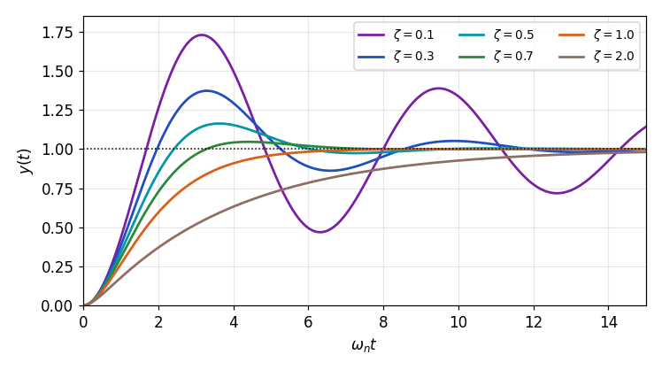

*그림 15. 감쇠비에 따른 표준형 2차 시스템의 단위 계단 응답*

### 3.7 부족 감쇠 극점의 기하학적 의미

부족 감쇠 극점 $s_1 = \sigma + j\omega_d$를 복소평면($s$ 평면)에 찍으면 그림 16과 같다. 원점에서 극점까지의 거리는 3.6절에서 구한 대로 $\vert s_1\vert = \sqrt{\zeta^2\omega_n^2 + (1 - \zeta^2)\omega_n^2} = \omega_n$이며, 이 값은 $\zeta$에 무관하게 항상 $\omega_n$이다. 원점에서 극점으로 그은 선분이 허수축과 이루는 각을 $\theta$라 하면, 그 대변이 $\zeta\omega_n$이고 빗변이 $\omega_n$이므로 다음이 성립한다.

```math
\sin\theta = \frac{\zeta\omega_n}{\omega_n} = \zeta
```

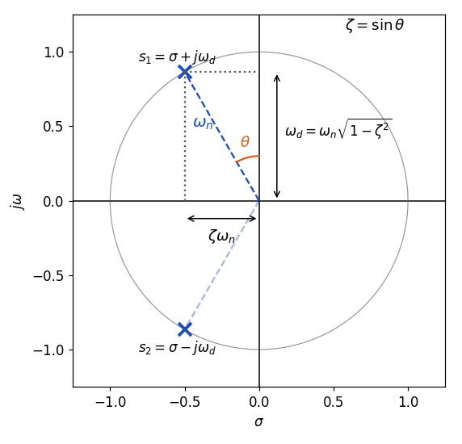

*그림 16. 부족 감쇠 극점의 위치와 감쇠비, 고유 진동수의 관계*

$\theta$는 3.6절의 $\phi$와 같은 각이다($`\sin\phi = \zeta`$). 같은 선분이 음의 실수축과 이루는 각 $\beta = 90^\circ - \theta$를 쓰면 $\cos\beta = \zeta$로 쓸 수도 있으며, 많은 교재가 이 표현을 쓴다.

| 극점의 기하학적 양 | 값 | 응답에서의 의미 |
|:-----|:-----|:-----|
| 원점에서의 거리 | $\omega_n$ | 응답 전체의 시간 척도, 클수록 빠르다 |
| 허수축과 이루는 각 $\theta$ | $\sin\theta = \zeta$ | 감쇠의 정도, 클수록 진동이 작다 |
| 실수부의 크기 | $\zeta\omega_n$ | 포락선이 줄어드는 빠르기 |
| 허수부 | $\omega_d = \omega_n\sqrt{1 - \zeta^2}$ | 진동의 각진동수 |

*표 8. 부족 감쇠 극점의 위치와 응답 특성의 대응*

> **핵심:** 2차 시스템의 과도 응답은 극점의 위치로 정해진다. 극점이 원점에서 멀수록($\omega_n$이 클수록) 빠르고, 원점과 극점을 잇는 선이 허수축과 이루는 각이 클수록($\zeta$가 클수록) 진동이 작다. 9주차는 이 관계로 $\omega_n$과 $\zeta$의 변화가 응답 속도와 최대 초과량, 정착 시간에 주는 영향을 정량적으로 다룬다.

---

<br>

## 개념 적용

다음 시스템의 특성방정식을 표준형과 비교하여 고유 진동수, 감쇠비, 응답 유형을 구한다. 앞의 세 행은 3.1절의 시스템 $K/(s^2 + s + K)$에서 이득 $K$만 바꾼 것이다.

| 시스템 | 특성방정식 | $\omega_n$ (rad/s) | $\zeta$ | 응답 유형 |
|:-----|:-----|:-----|:-----|:-----|
| 3.1절, $K = 0.1$ | $s^2 + s + 0.1 = 0$ | $0.316$ | $1.58$ | 과감쇠 |
| 3.1절, $K = 0.25$ | $s^2 + s + 0.25 = 0$ | $0.5$ | $1$ | 임계 감쇠 |
| 3.1절, $K = 1$ | $s^2 + s + 1 = 0$ | $1$ | $0.5$ | 부족 감쇠 |
| 3.4절 예제 1 | $s^2 + 3s + 2 = 0$ | $1.414$ | $1.06$ | 과감쇠 |
| 질량-스프링-댐퍼, $M = 1$, $B = 2$, $K = 4$ | $s^2 + 2s + 4 = 0$ | $2$ | $0.5$ | 부족 감쇠 |

*표 9. 여러 2차 시스템의 고유 진동수, 감쇠비, 응답 유형*

3.1절의 시스템에서 $\zeta = 1/(2\sqrt{K})$이므로, $K$를 키우면 응답이 빨라지는 대신($\omega_n = \sqrt{K}$ 증가) 감쇠비가 줄어 진동이 커진다. 1차 시스템인 1.3절의 예와 달리, 2차 시스템에서는 이득을 키우는 것이 과도 성능의 모든 면을 좋게 하지는 않는다.

**T/F 점검:**

| 문장 | 판단과 근거 |
|:-----|:------------|
| 센서의 전달함수 $H(s)$가 있는 피드백 시스템은 단위 피드백 시스템으로 바꿀 수 없다. | **F.** 입력 쪽에 $1/H(s)$를 두고 $H(s)$를 전방향 경로로 옮기면 폐루프 전달함수가 같은 단위 피드백 시스템이 된다. |
| 1.3절의 시스템에서 $K$를 아무리 키워도 유한한 $K$에서는 정상 상태 오차가 0이 되지 않는다. | **T.** 정상 상태 오차가 $1/(K+1)$이므로 $K$가 유한하면 0보다 크다. |
| 1차 시스템의 단위 계단 응답은 최종값을 넘었다가 돌아온다. | **F.** $y(t) = 1 - e^{-t/\tau}$는 단조 증가하므로 최대 초과량은 0이다. |
| 시정수가 $\tau$인 1차 시스템의 계단 응답은 $t = \tau$에서 최종값의 63.2%에 이른다. | **T.** $1 - e^{-1} \approx 0.632$이다. |
| 부족 감쇠 2차 시스템의 진동 각진동수는 $\omega_n$이다. | **F.** 진동 각진동수는 $\omega_d = \omega_n\sqrt{1 - \zeta^2}$로 $\omega_n$보다 작다. |
| $\zeta$가 같고 $\omega_n$이 두 배인 2차 시스템의 계단 응답은 모양이 같고 시간 축만 절반으로 줄어든다. | **T.** 응답이 $\omega_n t$만의 함수이기 때문이다. |
| 부족 감쇠 극점과 원점 사이의 거리는 감쇠비가 커질수록 줄어든다. | **F.** 거리는 $\zeta$에 무관하게 항상 $\omega_n$이다. |

---

<br>

## 요약

| 개념 | 핵심 요약 |
|:--------|:------------|
| 피드백 제어시스템 | 제어기 $D(s)$, 플랜트 $G(s)$, 센서 $H(s)$로 이루어지며 폐루프 전달함수는 $DG/(1 + DGH)$이다. |
| 단위 피드백 변환 | 입력 쪽에 $1/H(s)$를 두고 $H(s)$를 전방향 경로로 옮기면 같은 입출력의 단위 피드백 시스템이 된다. |
| 과도 성능과 정상 상태 성능 | 과도 성능은 출력이 명령값까지 얼마나 빨리 가는지, 정상 상태 성능은 최종값이 명령값에 얼마나 가까운지를 평가한다. |
| 시험 입력 | 단위 계단 $1/s$, 단위 경사 $1/s^2$, 단위 포물선 $1/s^3$이며, 성능 평가와 비교에 쓰는 표준 입력이다. |
| 과도 성능 지표 | 최대 초과량 $M_p$, 최고점 시간 $t_p$, 정착 시간 $t_s$($`\pm 5\%`$ 또는 $`\pm 2\%`$), 상승 시간 $t_r$(10%에서 90%)이다. |
| 1차 시스템 | $1/(\tau s + 1)$의 계단 응답은 $1 - e^{-t/\tau}$이며 $t_r \approx 2.2\tau$, $t_s \approx 3\tau$($`\pm 5\%`$), $M_p = 0$이다. |
| 직류 모터의 시정수 | $L_a \approx 0$, $B \approx 0$이면 $\tau_m = J_aR_a/(K_tK_b)$이고, 비례 제어 폐루프의 시정수는 $\tau_m/(1 + K/K_b)$로 줄어든다. |
| 2차 표준형 | $\omega_n^2/(s^2 + 2\zeta\omega_n s + \omega_n^2)$에서 $\zeta$는 감쇠비, $\omega_n$은 고유 진동수이다. |
| 근의 분류 | $\zeta > 1$은 두 음의 실근(과감쇠), $\zeta = 1$은 중근(임계 감쇠), $0 < \zeta < 1$은 켤레 복소근(부족 감쇠)이다. |
| 과감쇠와 임계 감쇠 응답 | 과감쇠는 두 지수 항의 합, 임계 감쇠는 $1 - e^{-\omega_n t}(1 + \omega_n t)$이며 둘 다 진동하지 않는다. |
| 부족 감쇠 응답 | $1 - e^{-\zeta\omega_n t}\cos(\omega_d t - \phi)/\sqrt{1 - \zeta^2}$이며 $\omega_d = \omega_n\sqrt{1 - \zeta^2}$, $\phi = \tan^{-1}(\zeta/\sqrt{1 - \zeta^2})$이다. |
| 극점의 기하학 | 부족 감쇠 극점은 원점에서 $\omega_n$만큼 떨어져 있고, 허수축과 이루는 각 $\theta$가 $\sin\theta = \zeta$를 만족한다. |

---

<br>

## 점검 문제

1. **단위 피드백 변환:** 그림 4의 시스템에서 $D(s) = 2$, $G(s) = 1/(s+3)$, $H(s) = 4$일 때 폐루프 전달함수를 구하고, 그림 5의 형태로 바꾼 시스템의 전달함수가 같음을 보이라.

   <details>
   <summary>정답</summary>

   그림 4의 형태에서 $T = DG/(1 + DGH) = \dfrac{2/(s+3)}{1 + 8/(s+3)} = \dfrac{2}{s + 11}$이다. 그림 5의 형태에서는 안쪽 단위 피드백 루프의 전방향 경로가 $DHG = 8/(s+3)$이므로 루프의 전달함수는 $\dfrac{8/(s+3)}{1 + 8/(s+3)} = \dfrac{8}{s + 11}$이고, 앞의 $1/H = 1/4$을 곱하면 $\dfrac{2}{s + 11}$로 같다.

   </details>

2. **시험 입력:** 단위 포물선 입력을 $t^2$가 아니라 $t^2/2$로 정의하는 이유를 라플라스 변환으로 설명하라.

   <details>
   <summary>정답</summary>

   $\mathcal{L}\lbrace t^n \rbrace= n!/s^{n+1}$이므로 $\mathcal{L}\lbrace t^2 \rbrace= 2/s^3$이다. $1/2$을 곱하면 변환이 $1/s^3$이 되어, 단위 계단 $1/s$, 단위 경사 $1/s^2$와 함께 $1/s^k$ 꼴로 깔끔하게 이어진다. 또한 $t^2/2$는 단위 경사 $t$를 한 번 적분한 것이어서 세 입력이 차례로 적분 관계를 이룬다.

   </details>

3. **비례 제어의 과도 성능과 정상 상태 성능:** 1.3절의 시스템에서 $K = 20$일 때 폐루프 극점, 과도 성분이 $e^{-1}$로 줄어드는 시간, 최종값, 5% 정착 시간을 구하라.

   <details>
   <summary>정답</summary>

   폐루프 전달함수는 $20/(s + 21)$이므로 극점은 $-21$이고, 응답은 $y(t) = \frac{20}{21}(1 - e^{-21t})$이다. 과도 성분이 $e^{-1}$로 줄어드는 시간은 $1/21 \approx 0.0476$ s, 최종값은 $20/21 \approx 0.952$, 정상 상태 오차는 $1/21 \approx 0.048$이다. 1차 응답이므로 5% 정착 시간은 $3 \times 0.0476 \approx 0.143$ s이다.

   </details>

4. **1차 시스템의 지표:** $G(s) = \dfrac{5}{0.2s + 1}$인 시스템의 단위 계단 응답, 최종값, 상승 시간, 2% 정착 시간을 구하라.

   <details>
   <summary>정답</summary>

   시정수가 $\tau = 0.2$ s이고 정상 상태 이득이 5이므로 $y(t) = 5(1 - e^{-5t})$이고 최종값은 5이다. 시간 지표는 정상 상태 이득과 무관하므로 $t_r = \tau\ln 9 \approx 0.44$ s, 2% 정착 시간은 $\tau\ln 50 \approx 0.78$ s(어림값 $4\tau = 0.8$ s)이다.

   </details>

5. **모터의 시정수:** 2.4절의 직류 모터에서 회전자의 관성 모멘트 $J_a$가 두 배가 되면 모터의 시정수는 어떻게 되는가? 2.5절의 속도 제어시스템에서 같은 폐루프 시정수를 유지하려면 이득 $K$를 어떻게 바꿔야 하는가?

   <details>
   <summary>정답</summary>

   $\tau_m = J_aR_a/(K_tK_b)$는 $J_a$에 비례하므로 두 배가 된다. 폐루프 시정수 $\tau_c = K_b\tau_m/(K_b + K)$를 유지하려면 $K_b + K$도 두 배가 되어야 하므로 새 이득은 $K' = 2(K_b + K) - K_b = K_b + 2K$이다. 예를 들어 $K_b = 1$, $K = 4$이면 $K' = 9$이다.

   </details>

6. **2차 시스템의 이득:** 3.1절의 시스템 $K/(s^2 + s + K)$에서 임계 감쇠가 되는 $K$와 감쇠비가 0.5가 되는 $K$를 구하라.

   <details>
   <summary>정답</summary>

   $\omega_n = \sqrt{K}$, $2\zeta\omega_n = 1$이므로 $\zeta = 1/(2\sqrt{K})$이다. $\zeta = 1$이면 $\sqrt{K} = 1/2$에서 $K = 0.25$이고, $\zeta = 0.5$이면 $\sqrt{K} = 1$에서 $K = 1$이다. $K < 0.25$이면 과감쇠, $K > 0.25$이면 부족 감쇠이다.

   </details>

7. **임계 감쇠 응답:** $G_T(s) = \dfrac{4}{s^2 + 4s + 4}$의 단위 계단 응답을 부분분수 전개로 구하고 $y(1)$을 계산하라.

   <details>
   <summary>정답</summary>

   $\omega_n = 2$, $\zeta = 4/(2 \cdot 2) = 1$이므로 임계 감쇠이다. $Y(s) = \dfrac{4}{s(s+2)^2} = \dfrac{1}{s} - \dfrac{1}{s+2} - \dfrac{2}{(s+2)^2}$이고, $y(t) = 1 - e^{-2t} - 2te^{-2t} = 1 - e^{-2t}(1 + 2t)$이다. $y(1) = 1 - 3e^{-2} \approx 0.594$이다.

   </details>

8. **부족 감쇠 응답:** $G_T(s) = \dfrac{9}{s^2 + 2s + 9}$의 $\omega_n$, $\zeta$, 극점, $\omega_d$, $\phi$를 구하고 단위 계단 응답을 쓰라.

   <details>
   <summary>정답</summary>

   $\omega_n^2 = 9$에서 $\omega_n = 3$ rad/s, $2\zeta\omega_n = 2$에서 $\zeta = 1/3$이다. $\sigma = -\zeta\omega_n = -1$, $\omega_d = 3\sqrt{1 - 1/9} = 2\sqrt{2} \approx 2.828$ rad/s이므로 극점은 $-1 \pm j2.828$이다. $\phi = \tan^{-1}\dfrac{1/3}{\sqrt{8/9}} = \tan^{-1}\dfrac{1}{2\sqrt{2}} \approx 0.340$ rad이고 $1/\sqrt{1 - \zeta^2} = 3/(2\sqrt{2}) \approx 1.061$이므로 $`y(t) = 1 - 1.061\,e^{-t}\cos(2.828t - 0.340)`$이다.

   </details>

9. **극점의 기하학:** 2차 시스템의 극점이 $-2 \pm j2\sqrt{3}$일 때 $\omega_n$, $\zeta$, 허수축과 이루는 각 $\theta$를 구하라.

   <details>
   <summary>정답</summary>

   $\omega_n = \sqrt{2^2 + (2\sqrt{3})^2} = \sqrt{16} = 4$ rad/s이고, 실수부의 크기가 $\zeta\omega_n = 2$이므로 $\zeta = 0.5$이다. $\sin\theta = 0.5$에서 $\theta = 30^\circ$이다. 특성방정식은 $s^2 + 4s + 16 = 0$이다.

   </details>

10. **정상 상태 성분:** $\zeta > 0$인 표준형 2차 시스템의 단위 계단 응답에서 $\zeta$의 값과 무관하게 최종값이 1인 이유를 두 가지 방법으로 설명하라.

    <details>
    <summary>정답</summary>

    첫째, 부분분수 전개의 정상 상태 계수가 $K_3 = \omega_n^2/(s_1s_2)$이고 근과 계수의 관계에서 $s_1s_2 = \omega_n^2$이므로 $K_3 = 1$이다. 둘째, 과도 성분이 사라지는 경우($`\zeta > 0`$) 최종값은 정상 상태 이득 $G_T(0) = \omega_n^2/\omega_n^2 = 1$과 같다. 따라서 $\zeta$는 최종값이 아니라 그 값에 이르는 과정(과도 응답)만 바꾼다.

    </details>

---

<br>

## 참고 문헌

1. K. Ogata, *Modern Control Engineering*, 5th ed. Upper Saddle River, NJ, USA: Prentice Hall, 2010.
2. 임동진, *제어 시스템 공학*, 개정판. 파주: 생능출판사, 2019.
3. N. S. Nise, *Control Systems Engineering*, 7th ed. Hoboken, NJ, USA: Wiley, 2015.
