# Week 7 Lecture — Control System Performance I

[Repository Guide](../../README.md) | [English](Concepts_Lecture.md) | [한국어](Concepts_Lecture.ko.md)

> **Last Updated:** 2026-11-04

> **Learning Objectives:**
> 1. Describe the components of a feedback control system and convert a system with a sensor in the feedback path into a unity feedback system by block diagram operations
> 2. Define the unit step, unit ramp, and unit parabolic test inputs and distinguish transient performance from steady-state performance
> 3. Define and read the maximum overshoot, peak time, settling time, and rise time on a step response
> 4. Derive the unit step response of a first-order system and compute its rise time and settling time from the time constant
> 5. Define the damping ratio and natural frequency of the standard second-order form and derive the unit step response for each kind of root of the characteristic equation
> 6. Interpret the pole locations of an underdamped system in terms of the damping ratio and natural frequency

---

## Table of Contents

- [1. Overview of Control System Performance](#1-overview-of-control-system-performance)
  - [1.1 Examples of Feedback Control Systems](#11-examples-of-feedback-control-systems)
  - [1.2 Structure of a Feedback Control System](#12-structure-of-a-feedback-control-system)
  - [1.3 Comparing the Performance of a Simple Control System](#13-comparing-the-performance-of-a-simple-control-system)
  - [1.4 Test Input Signals](#14-test-input-signals)
  - [1.5 Transient and Steady-State Performance Seen Through the Differential Equation](#15-transient-and-steady-state-performance-seen-through-the-differential-equation)
- [2. Transient Response of First-Order Systems](#2-transient-response-of-first-order-systems)
  - [2.1 Quantitative Measures of Transient Performance](#21-quantitative-measures-of-transient-performance)
  - [2.2 Unit Step Response of a First-Order System](#22-unit-step-response-of-a-first-order-system)
  - [2.3 Rise Time and Settling Time of a First-Order System](#23-rise-time-and-settling-time-of-a-first-order-system)
  - [2.4 Example: Time Constant of a DC Motor](#24-example-time-constant-of-a-dc-motor)
  - [2.5 Example: Motor Speed Control System](#25-example-motor-speed-control-system)
- [3. Transient Response of Second-Order Systems](#3-transient-response-of-second-order-systems)
  - [3.1 A Simple Second-Order System](#31-a-simple-second-order-system)
  - [3.2 Standard Second-Order System](#32-standard-second-order-system)
  - [3.3 Classifying the Roots of the Characteristic Equation](#33-classifying-the-roots-of-the-characteristic-equation)
  - [3.4 Two Distinct Real Roots: Overdamped](#34-two-distinct-real-roots-overdamped)
  - [3.5 A Double Root: Critically Damped](#35-a-double-root-critically-damped)
  - [3.6 Complex Conjugate Roots: Underdamped](#36-complex-conjugate-roots-underdamped)
  - [3.7 Geometric Meaning of Underdamped Poles](#37-geometric-meaning-of-underdamped-poles)
- [Concept Applications](#concept-applications)
- [Summary](#summary)
- [Self-Check Questions](#self-check-questions)
- [References](#references)

---

<br>

## 1. Overview of Control System Performance

Weeks 5 and 6 showed how to describe physical systems with transfer functions, block diagrams, and state variable equations. Once a model exists, the next question is how well the system follows its command. This section decides what the performance of a control system is judged by and defines the standard inputs used to test it.

### 1.1 Examples of Feedback Control Systems

**Room heating temperature control system.** The temperature controller compares the set temperature with the current room temperature measured by a temperature sensor. If they differ, it runs the heater so that the room temperature reaches the set temperature, and once the room temperature reaches the set temperature, it adjusts the heater so that the room temperature stays at the set temperature. Because the output (the room temperature) is measured and returned to the input side for comparison, this is a feedback control system (Week 1).

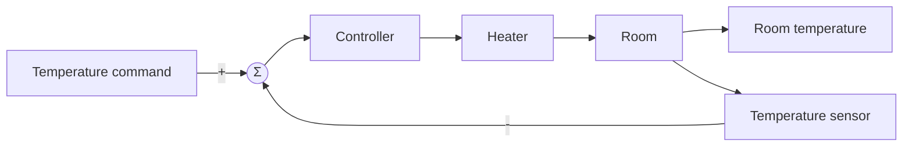

*Figure 1. Block diagram of the room heating temperature control system*

The requirements on this system come down to two.

1. The room temperature should reach the set temperature as quickly as possible.
2. After reaching the set temperature, it should hold the set temperature without error.

The first requirement concerns **transient performance**, and the second concerns **steady-state performance**. Section 1.3 defines the two kinds of performance.

**Quadcopter attitude control system.** A quadcopter is a drone that flies with four rotors. The flight controller controls each of the four motors to produce the thrust needed for attitude control, and it includes an angle sensor that measures the angle of the airframe. The structure, which drives the motors by comparing the angle command with the measured angle, is the same as that of the heating system.

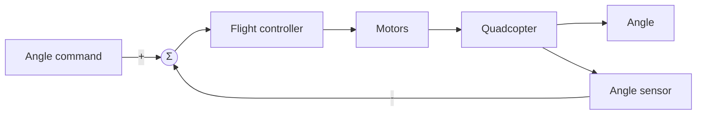

*Figure 2. Block diagram of the quadcopter attitude control system*

Even with the same structure, the response differs greatly with the performance of the control system. Figure 3 shows two responses in which a tilted airframe returns to the target angle 0. The left response passes the target angle several times, oscillating before it slowly converges, while the right response converges quickly without passing the target. Both eventually reach the target, but the right one performs better. How to express this difference in numbers is the subject of this unit.

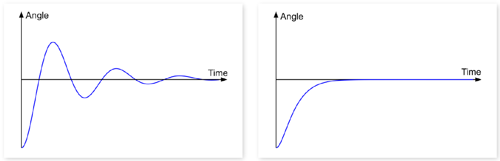

*Figure 3. Angle responses of two quadcopter attitude control systems with different performance*

### 1.2 Structure of a Feedback Control System

A general feedback control system is described by three transfer functions as in Figure 4. The reference input minus the feedback signal enters the controller, the controller's output drives the controlled system to produce the output, and the sensor measures the output and returns it to the summing point.

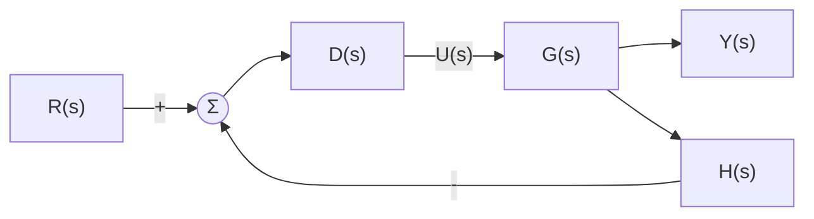

*Figure 4. General structure of a feedback control system*

| Symbol | Name | Role |
|:-----|:-----|:-----|
| $R(s)$ | Reference input | The command the output should follow |
| $D(s)$ | Transfer function of the controller | Produces the control input $U(s)$ from the output of the summing point |
| $G(s)$ | Transfer function of the plant, the system being controlled | Takes the control input and produces the output |
| $H(s)$ | Transfer function of the sensor | Measures the output and returns it to the summing point |
| $Y(s)$ | Output | The physical quantity to be controlled |

*Table 1. Components of a feedback control system*

Let the output of the summing point be $E_a(s) = R(s) - H(s)Y(s)$. Then $U = DE_a$ and $Y = GU$, so $Y = DG(R - HY)$. Solving for $Y$ gives the **closed-loop transfer function** derived in Week 5.

```math
Y(1 + DGH) = DGR \quad\Longrightarrow\quad T(s) = \frac{Y(s)}{R(s)} = \frac{D(s)G(s)}{1 + D(s)G(s)H(s)}
```

A system with $H(s) = 1$, which feeds the output back unchanged, is called a **unity feedback** system. Even a system that is not unity feedback can be converted into one by block diagram operations. Figure 5 is the same system as Figure 4.

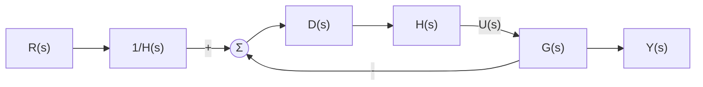

*Figure 5. Unity feedback system with the same input-output relation as Figure 4*

That the two systems are the same is checked by comparing the closed-loop transfer functions. The inner loop of Figure 5 is a unity feedback loop with forward path $DHG$, so its transfer function is $DHG/(1 + DHG)$, and it is multiplied by $1/H$ in front.

```math
T(s) = \frac{1}{H}\cdot\frac{DHG}{1 + DHG} = \frac{DG}{1 + DGH}
```

The result equals $T(s)$ of Figure 4. The control input is also $`U = HD\,(R/H - Y) = D(R - HY)`$, the same as in Figure 4, so the two block diagrams agree not only in input and output but also in the signal entering the plant. This conversion holds when $H(s)$ is a nonzero transfer function.

> **Key Point:** A system with a sensor transfer function $H(s)$ can be treated as a unity feedback system by placing $1/H(s)$ on the input side and moving $H(s)$ into the forward path. For this reason, performance analysis of control systems is usually done on unity feedback systems.

### 1.3 Comparing the Performance of a Simple Control System

Consider a unity feedback system whose plant is $G(s) = 1/(s+1)$ and whose controller is a constant gain $K$. A controller that only multiplies by a constant gain $K$ is called a **proportional controller** (Week 11).

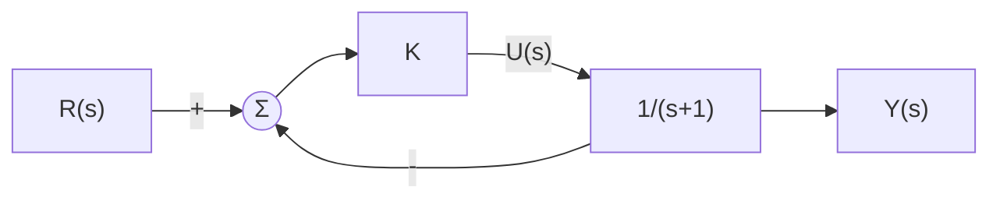

*Figure 6. Unity feedback system made of the plant 1/(s+1) and a proportional controller*

Substitute $D = K$, $G = 1/(s+1)$, and $H = 1$ into the closed-loop transfer function and multiply the numerator and denominator by $s + 1$.

```math
T(s) = \frac{K\cdot\frac{1}{s+1}}{1 + K\cdot\frac{1}{s+1}} = \frac{K}{s + 1 + K}
```

Figure 7 shows the output for a unit step command $r(t) = 1$ with $K = 5$ and $K = 10$. With $K = 10$ the output moves faster than with $K = 5$, and its final position is also closer to the command value 1. Hence the case $K = 10$ can be said to have better characteristics.

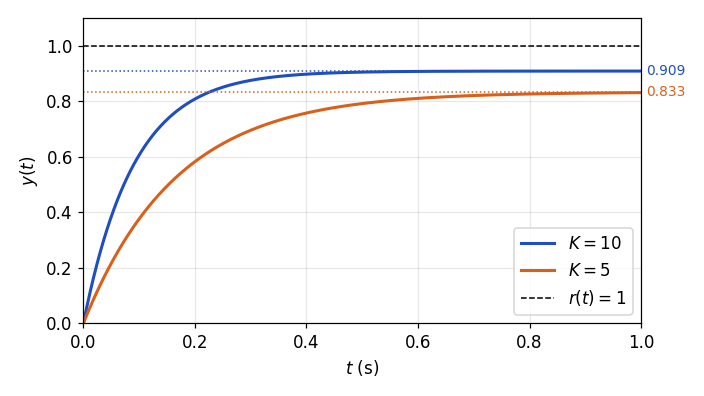

*Figure 7. Unit step responses for proportional gains K = 5 and K = 10*

This comparison reveals the two criteria for evaluating the performance of a control system.

1. How fast the output of the control system moves to the command value: **transient performance**
2. How close the final position is to the command value: **steady-state performance**

> **Definition:** The **transient response** is the response from the moment an input is applied until the output settles near its final value, and the **steady-state response** is the response after enough time has passed for the transient components to vanish. Transient performance is judged by the speed and shape of the transient response, and steady-state performance by the **steady-state error**, the difference between the output and the command value in the steady state.

### 1.4 Test Input Signals

> **Definition:** A **test input signal** is a standard signal applied to a control system to test its performance.

The three typical test inputs are the following, and all of them are 0 for $t < 0$.

```math
u_s(t) = \begin{cases} 1, & t \ge 0 \\ 0, & t < 0 \end{cases} \qquad u_r(t) = \begin{cases} t, & t \ge 0 \\ 0, & t < 0 \end{cases} \qquad u_p(t) = \begin{cases} \dfrac{t^2}{2}, & t \ge 0 \\ 0, & t < 0 \end{cases}
```

| Test input | Time function ($`t \ge 0`$) | Laplace transform | Command it represents |
|:-----|:-----|:-----|:-----|
| Unit step input | $u_s(t) = 1$ | $U_s(s) = 1/s$ | A target that changes suddenly and then stays at the new value |
| Unit ramp input | $u_r(t) = t$ | $U_r(s) = 1/s^2$ | A target that changes at a constant rate |
| Unit parabolic input | $u_p(t) = t^2/2$ | $U_p(s) = 1/s^3$ | A target that changes with constant acceleration |

*Table 2. The three test input signals and their Laplace transforms*

The ramp input is also called the slope input. Each of the three signals is the integral of the previous one. $`u_r(t) = \int_0^t u_s(\lambda)\,d\lambda`$ and $`u_p(t) = \int_0^t u_r(\lambda)\,d\lambda`$, and by the integration theorem of Week 3, integration in time corresponds to multiplication by $1/s$ in the $s$ domain, so the Laplace transforms run $1/s$, $1/s^2$, $1/s^3$. The factor $1/2$ in the parabolic input is there to make its transform exactly $1/s^3$.

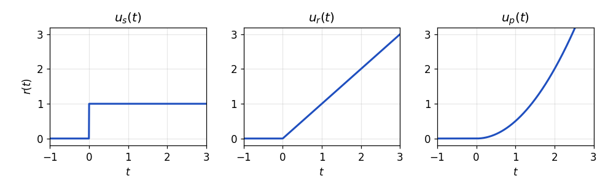

*Figure 8. Unit step, unit ramp, and unit parabolic inputs*

Test input signals are seldom used as command inputs in the actual operation of a control system. They are nevertheless widely used in performance evaluation and testing for the following reasons. First, their expressions are simple, so the responses can be found analytically. Second, a sudden change (step), a change at constant rate (ramp), and a change at constant acceleration (parabola) are typical components of real commands, so the responses to them indicate how the system behaves for real commands. Third, testing with the same inputs allows a fair comparison of the performance of different systems. This unit and Week 9 judge transient performance mainly by the unit step response, and Week 10 judges the steady-state error with all three inputs.

### 1.5 Transient and Steady-State Performance Seen Through the Differential Equation

Solving the system of Section 1.3 in the time domain makes clear which part of the response each kind of performance refers to. Moving the denominator of the closed-loop transfer function $Y(s)/R(s) = K/(s + 1 + K)$ to the other side gives $(s + 1 + K)Y(s) = KR(s)$. With zero initial conditions, $sY(s)$ is the Laplace transform of $\dot{y}(t)$ (Week 3), so this equation corresponds to the following **differential equation**.

```math
\dot{y}(t) + (K + 1)\,y(t) = K\,r(t)
```

Solve this first-order differential equation with the unit step input $r(t) = 1$ ($`t \ge 0`$) and the initial condition $y(0) = 0$ by the method of Week 2.

1. **Homogeneous solution:** The solution of $\dot{y} + (K+1)y = 0$ is $y_h(t) = Ce^{-(K+1)t}$.
2. **Particular solution:** The input is constant, so assume a constant $y_p$. Then $`\dot{y}_p = 0`$, and $(K + 1)y_p = K$ gives $y_p = K/(K+1)$.
3. **Initial condition:** $y(0) = C + K/(K+1) = 0$ gives $C = -K/(K+1)$.

```math
y(t) = -\frac{K}{K+1}\,e^{-(K+1)t} + \frac{K}{K+1}, \qquad t \ge 0
```

The Laplace transform gives the same result. The inverse transform of $Y(s) = \dfrac{K}{s(s + K + 1)} = \dfrac{K}{K+1}\left(\dfrac{1}{s} - \dfrac{1}{s + K + 1}\right)$ is the expression above.

The first term of the solution is the **transient component**, which vanishes as time passes, and the second term is the **steady-state component**, which remains to the end. How fast the transient component vanishes is set by the exponent $K + 1$, that is, by the closed-loop pole $s = -(K+1)$, and the final value is $K/(K+1)$.

| Gain | Closed-loop pole | Time $1/(K+1)$ for the transient component to shrink to $e^{-1}$ | Final value $K/(K+1)$ | Steady-state error $1/(K+1)$ |
|:-----|:-----|:-----|:-----|:-----|
| $K = 5$ | $-6$ | $0.167$ s | $0.833$ | $0.167$ |
| $K = 10$ | $-11$ | $0.0909$ s | $0.909$ | $0.0909$ |

*Table 3. Decay speed of the transient component and final value for each proportional gain*

With $K = 10$ the output reaches the steady state faster, and the steady-state value is also closer to 1. The gain $K$ changes both the transient performance (the pole location) and the steady-state performance (the final value).

> **Caution:** In this example both kinds of performance improve as $K$ grows, but this is not a general conclusion. In real systems a large gain causes actuator saturation and amplifies sensor noise, and in higher-order systems a large gain can cause severe oscillation or instability (Week 9). Moreover, the steady-state error $1/(K+1)$ of this system does not become 0 for any finite $K$. The condition that removes this error is treated with the system type in Week 10.

---

<br>

## 2. Transient Response of First-Order Systems

### 2.1 Quantitative Measures of Transient Performance

Transient performance is usually expressed with the unit step response. Figure 9 marks the four measures on a typical step response that passes the target once and then converges while oscillating.

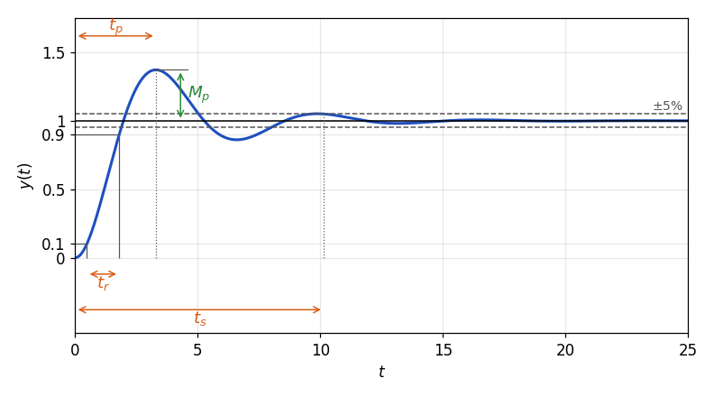

*Figure 9. Measures of transient performance marked on a unit step response*

**Maximum overshoot $M_p$.** The phenomenon in which the output, on reaching the target, swings above or below it is called **overshoot**, and its largest size is the maximum overshoot. It is the maximum output $y(t_p)$ minus the steady-state value $y_{ss}$, expressed as a ratio to $y_{ss}$, and it is often written as a percentage with the steady-state output taken as 100% [1].

```math
M_p = \frac{y(t_p) - y_{ss}}{y_{ss}}, \qquad \text{percent overshoot} = \frac{y(t_p) - y_{ss}}{y_{ss}} \times 100\,\%
```

The maximum overshoot is an important measure for evaluating the stability and performance of a control system. A large maximum overshoot means that the damping is small and oscillation occurs easily, so the margin of stability is small. In position control the system may also pass the target position and collide with something, so minimizing the maximum overshoot is important.

**Peak time $t_p$.** The time at which the output first reaches its maximum. In general, a shorter peak time indicates a faster system reaction, so the peak time is used to evaluate the speed of response, and reducing the peak time is important in systems that must react quickly.

**Settling time $t_s$.** The time at which the output enters a specified tolerance band around the final value and stays inside that band from then on. The band is set as a percentage of the final value, usually $`\pm 5\%`$ or $`\pm 2\%`$ [1]. For example, the 5% settling time is the time from which the output stays within $`\pm 5\%`$ of the final value. The settling time shows how quickly the system comes to hold a steady output.

**Rise time $t_r$.** The time the output takes to first get near the final value. It is usually computed as the time from 10% to 90% of the final value, and for oscillating responses the time from 0% to 100% is also used [1]. A short rise time means that the system reacts quickly to the input signal.

| Measure | Symbol | Definition | Property evaluated |
|:-----|:-----|:-----|:-----|
| Maximum overshoot | $M_p$ | $(y(t_p) - y_{ss})/y_{ss}$ | Amount of damping, margin of stability |
| Peak time | $t_p$ | Time at which the output first reaches its maximum | Speed of reaction |
| Settling time | $t_s$ | Time from which the output stays within $`\pm 5\%`$ (or $`\pm 2\%`$) | Speed of reaching a steady output |
| Rise time | $t_r$ | Time for the output to rise from 10% to 90% of the final value | Speed of the initial reaction |

*Table 4. The four quantitative measures of transient performance*

The response in Figure 9 is the second-order system derived in Section 3.6 with damping ratio $\zeta = 0.3$ and natural frequency $\omega_n = 1$ rad/s. For this response $`M_p \approx 37\%`$, $t_p \approx 3.3$ s, $t_r \approx 1.3$ s, and the 5% settling time is $t_s \approx 10.1$ s.

### 2.2 Unit Step Response of a First-Order System

A system whose transfer function has a denominator of first degree in $s$ is called a **first-order system**. The standard form of a first-order system with steady-state gain 1 is the following.

```math
\frac{Y(s)}{R(s)} = G_T(s) = \frac{1}{\tau s + 1}, \qquad \tau > 0
```

$\tau$ is called the **time constant**. The only pole is $s = -1/\tau$, the root of $\tau s + 1 = 0$. Applying the unit step input $U_s(s) = 1/s$ gives $(\tau s + 1)Y(s) = U_s(s)$, which in the time domain is the following differential equation.

```math
\tau\,\dot{y}(t) + y(t) = u_s(t)
```

Find the response with the Laplace transform. Divide the denominator by $\tau$ and expand in partial fractions (Week 3).

```math
Y(s) = \frac{1}{s(\tau s + 1)} = \frac{1/\tau}{s\,(s + 1/\tau)} = \frac{A}{s} + \frac{B}{s + 1/\tau}
```

```math
A = \left. sY(s) \right|_{s=0} = \frac{1/\tau}{1/\tau} = 1, \qquad B = \left. \left(s + \tfrac{1}{\tau}\right)Y(s) \right|_{s=-1/\tau} = \frac{1/\tau}{-1/\tau} = -1
```

```math
y(t) = 1 - e^{-t/\tau}, \qquad t \ge 0
```

The response starts at 0 and increases monotonically without exceeding 1. Its values at a few instants are the following.

| Time | $\tau$ | $2\tau$ | $3\tau$ | $4\tau$ | $5\tau$ |
|:-----|:-----|:-----|:-----|:-----|:-----|
| $y(t) = 1 - e^{-t/\tau}$ | $0.632$ | $0.865$ | $0.950$ | $0.982$ | $0.993$ |

*Table 5. Values of the first-order unit step response at multiples of the time constant*

The slope at $t = 0$ is $\dot{y}(0) = 1/\tau$. If the output kept its initial slope, it would reach the final value 1 at $t = \tau$. The actual output slows down as it approaches the target and reaches 63.2% of the final value at $t = \tau$.

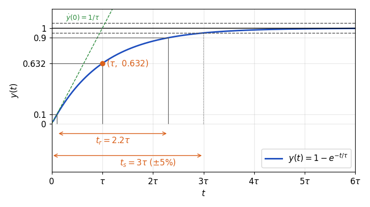

*Figure 10. Unit step response of a first-order system with its time constant, rise time, and settling time*

> **Definition:** The **time constant** $\tau$ is the time at which the step response of a first-order system reaches $`1 - e^{-1} \approx 63.2\%`$ of its final value, and it is the reciprocal of the distance between the pole $s = -1/\tau$ and the origin. The farther the pole is from the origin, the smaller the time constant and the faster the response.

### 2.3 Rise Time and Settling Time of a First-Order System

**Rise time.** Find the times at which the output reaches 10% and 90%.

```math
1 - e^{-t_{10}/\tau} = 0.1 \;\Rightarrow\; t_{10} = \tau\ln\frac{1}{0.9} \approx 0.105\,\tau, \qquad 1 - e^{-t_{90}/\tau} = 0.9 \;\Rightarrow\; t_{90} = \tau\ln\frac{1}{0.1} \approx 2.303\,\tau
```

```math
t_r = t_{90} - t_{10} = \tau\left(\ln 10 - \ln\frac{10}{9}\right) = \tau\ln 9 \approx 2.2\,\tau
```

**Settling time.** Because the response increases monotonically, the difference from the final value is $1 - y(t) = e^{-t/\tau}$, and from the moment this equals the tolerance, the output stays inside the band.

```math
e^{-t_s/\tau} = 0.05 \;\Rightarrow\; t_s = \tau\ln 20 \approx 3.0\,\tau \;(\pm 5\%), \qquad e^{-t_s/\tau} = 0.02 \;\Rightarrow\; t_s = \tau\ln 50 \approx 3.9\,\tau \;(\pm 2\%)
```

The $`\pm 2\%`$ settling time is commonly approximated as $4\tau$ [1]. The step response of a first-order system never exceeds its final value, so the maximum overshoot is 0, and since the maximum is not reached in finite time, the peak time is not defined.

> **Key Point:** The transient performance of a first-order system is set by the single time constant $\tau$. Since $t_r \approx 2.2\tau$ and $t_s \approx 3\tau$ ($`\pm 5\%`$), reducing the time constant, that is, moving the pole $-1/\tau$ to the left, shortens the rise time and settling time in the same proportion. If the transfer function has a steady-state gain $K_{dc}$, as in $K_{dc}/(\tau s + 1)$, the whole response is scaled by $K_{dc}$ and the time measures do not change.

### 2.4 Example: Time Constant of a DC Motor

The armature-controlled DC motor modeled in Week 4 is shown in Figure 11 [2]. When a voltage $e_a$ is applied to the armature circuit, a current $i_a$ flows through the resistance $R_a$ and inductance $L_a$, and when the motor turns, a **back electromotive force** $e_b$ proportional to the rotational speed appears. The motor torque turns a rotor with moment of inertia $J_a$, and viscous friction with coefficient $B$ acts on the rotation. The $\tau$ in the figure is the motor torque; to distinguish it from the time constant, the equations below write the torque as $T$.

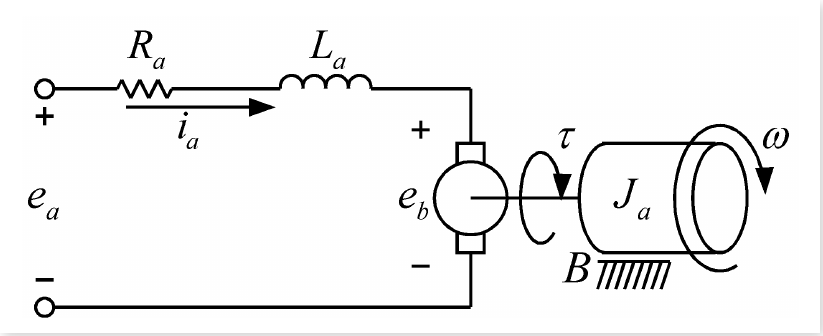

*Figure 11. Circuit and rotating part of an armature-controlled DC motor*

Apply Kirchhoff's voltage law to the armature circuit and the equation of rotational motion to the rotating part. $K_b$ is the back emf constant, $K_t$ is the torque constant, and $\omega = d\theta/dt$ is the angular velocity.

```math
e_a = R_a i_a + L_a\frac{di_a}{dt} + e_b = R_a i_a + L_a\frac{di_a}{dt} + K_b\frac{d\theta}{dt}
```

```math
T = K_t i_a = J_a\frac{d^2\theta}{dt^2} + B\frac{d\theta}{dt}
```

Taking the Laplace transform with zero initial conditions gives $E_a = (R_a + L_a s)I_a + K_b\Omega$ and $K_t I_a = (J_a s + B)\Omega$. Substituting $I_a = (J_a s + B)\Omega/K_t$ from the second equation into the first gives $\Omega/E_a$.

```math
\frac{\Omega(s)}{E_a(s)} = \frac{K_t}{(R_a + L_a s)(J_a s + B) + K_t K_b}
```

This expression has a second-degree denominator. In a typical DC motor the electrical time constant $L_a/R_a$ of the armature circuit is much smaller than the mechanical time constant of the rotor, so the current changes much faster than the rotational speed and $L_a \approx 0$ can be assumed [3]; assuming also that viscous friction is small, $B \approx 0$, the motor becomes a first-order system.

```math
\frac{\Omega(s)}{E_a(s)} = \frac{K_t}{R_a J_a s + K_t K_b} = \frac{1/K_b}{\dfrac{J_a R_a}{K_t K_b}\,s + 1} = \frac{1}{K_b}\times\frac{1/\tau_m}{s + 1/\tau_m}
```

The second equality divides the numerator and denominator by $K_t K_b$. Comparing with the standard form of Section 2.2 gives the time constant of the motor.

```math
\tau_m = \frac{J_a R_a}{K_t K_b}
```

The motor time constant is proportional to the moment of inertia $J_a$. A motor with a large inertia therefore has a large time constant and takes long for its speed to reach the target.

> **Note:** If only $L_a \approx 0$ is assumed and viscous friction is kept, $\Omega/E_a = K_t/(R_a J_a s + R_a B + K_t K_b)$, so the time constant becomes $J_a R_a/(R_a B + K_t K_b)$ and the steady-state gain $K_t/(R_a B + K_t K_b)$. Friction slightly reduces the time constant and also reduces the final speed.

### 2.5 Example: Motor Speed Control System

Attach a proportional controller $K$ and a speed sensor to the motor of Section 2.4 and control its speed with unity feedback. The output $Y(s)$ is the angular velocity of the motor.

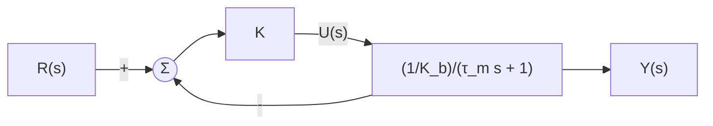

*Figure 12. Motor speed control system*

The forward path is $\dfrac{K/K_b}{\tau_m s + 1}$, so the closed-loop transfer function is the following. The second line multiplies the numerator and denominator by $K_b$ and then divides by $K_b + K$ to match the first-order standard form.

```math
T(s) = \frac{\dfrac{K/K_b}{\tau_m s + 1}}{1 + \dfrac{K/K_b}{\tau_m s + 1}} = \frac{K/K_b}{\tau_m s + 1 + K/K_b} = \frac{K}{K_b\tau_m s + K_b + K}
```

```math
T(s) = \frac{K/(K_b + K)}{\dfrac{K_b\tau_m}{K_b + K}\,s + 1}, \qquad \tau_c = \frac{K_b\,\tau_m}{K_b + K} = \frac{\tau_m}{1 + K/K_b}
```

The closed-loop system is also first order, and its time constant $\tau_c$ is smaller than the motor's own time constant $\tau_m$. Raising the constant gain $K$ of the controller shrinks $\tau_c$ and speeds up the response, so the time constant of the closed-loop system can be adjusted with $K$. For example, for a motor with $\tau_m = 1$ s and $K_b = 1$:

| Gain $K$ | Closed-loop time constant $\tau_c$ | 5% settling time $3\tau_c$ | Final value $K/(K_b + K)$ |
|:-----|:-----|:-----|:-----|
| No feedback (the motor alone) | $\tau_m = 1$ s | $3$ s | Not applicable |
| $4$ | $0.2$ s | $0.6$ s | $0.8$ |
| $9$ | $0.1$ s | $0.3$ s | $0.9$ |

*Table 6. Time constant and final value of the motor speed control system for each proportional gain*

> **Key Point:** Feedback moves the closed-loop pole to the left, from $-1/\tau_m$ to $-(K_b + K)/(K_b\tau_m)$, producing a response faster than that of the motor alone. The final value $K/(K_b + K)$ is still less than 1, however, so a steady-state error remains, the same property as in the example of Section 1.5.

---

<br>

## 3. Transient Response of Second-Order Systems

### 3.1 A Simple Second-Order System

Consider a unity feedback system whose plant is $G(s) = \dfrac{1}{s(s+1)}$ and whose controller is a constant gain $K$. If the output of the motor in Section 2.4 is taken as the rotation angle $\theta$ instead of the angular velocity $\omega$, then $\Theta(s) = \Omega(s)/s$ and $\Theta/E_a = \dfrac{1/K_b}{s(\tau_m s + 1)}$. This plant is the case $\tau_m = 1$, $K_b = 1$ of that, and the system is a motor position control system.

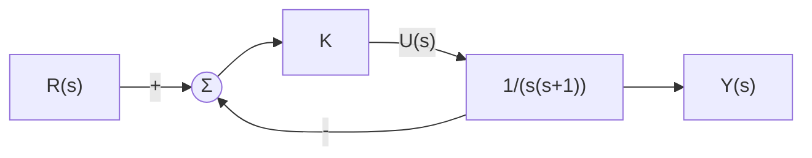

*Figure 13. Unity feedback system made of the plant 1/(s(s+1)) and a proportional controller*

Multiply the numerator and denominator of the closed-loop transfer function by $s(s+1)$.

```math
T(s) = \frac{\dfrac{K}{s(s+1)}}{1 + \dfrac{K}{s(s+1)}} = \frac{K}{s^2 + s + K}
```

Since the denominator is of second degree in $s$, this closed-loop system is a **second-order system**. The response of a second-order system may or may not oscillate depending on the denominator coefficients, so the denominator is rewritten in a standard form and classified.

### 3.2 Standard Second-Order System

A second-order system with steady-state gain 1 and no zeros is written in the following standard form.

```math
\frac{Y(s)}{R(s)} = G_T(s) = \frac{1}{(s/\omega_n)^2 + 2\zeta s/\omega_n + 1} = \frac{\omega_n^2}{s^2 + 2\zeta\omega_n s + \omega_n^2}
```

The second equality multiplies the numerator and denominator by $\omega_n^2$. $\zeta$ is called the **damping ratio** and $\omega_n > 0$ the **natural frequency**, and $\omega_n$ is measured in rad/s. For $\zeta > 0$ both poles lie in the left half-plane and $G_T(0) = 1$, so the final value for a unit step input is 1.

The physical meaning of the two parameters can be seen in the mass-spring-damper system of Week 4. When a force $f$ acts on a system with mass $M$, viscous friction coefficient $B$, and spring constant $K$, the equation of motion is $M\ddot{y} + B\dot{y} + Ky = f$, and comparing its transfer function with the standard form gives the following.

```math
\frac{Y(s)}{F(s)} = \frac{1}{Ms^2 + Bs + K} = \frac{1}{K}\cdot\frac{K/M}{s^2 + (B/M)s + K/M} \quad\Longrightarrow\quad \omega_n = \sqrt{\frac{K}{M}}, \qquad \zeta = \frac{B}{2\sqrt{KM}}
```

The natural frequency is the angular frequency at which the mass and spring oscillate without friction, and the damping ratio indicates how strongly the friction $B$ suppresses that oscillation. For the system of Section 3.1, comparing $s^2 + s + K$ with $s^2 + 2\zeta\omega_n s + \omega_n^2$ gives $\omega_n = \sqrt{K}$ and $\zeta = 1/(2\sqrt{K})$.

**Unit step response.** Since $U_s(s) = 1/s$, the Laplace transform of the output is the following.

```math
Y(s) = G_T(s)U_s(s) = \frac{\omega_n^2}{(s^2 + 2\zeta\omega_n s + \omega_n^2)\,s}
```

Finding $y(t)$ by the inverse Laplace transform requires a partial fraction expansion, and the partial fraction expansion requires factoring the denominator. That is, the roots of the following **characteristic equation** must be found, and the form of the response depends on the kind of roots.

```math
s^2 + 2\zeta\omega_n s + \omega_n^2 = 0
```

### 3.3 Classifying the Roots of the Characteristic Equation

Let the two roots of the characteristic equation be $s_1$ and $s_2$, so that $s^2 + 2\zeta\omega_n s + \omega_n^2 = (s - s_1)(s - s_2)$. Apply the quadratic formula.

```math
s = \frac{-2\zeta\omega_n \pm \sqrt{4\zeta^2\omega_n^2 - 4\omega_n^2}}{2} \quad\Longrightarrow\quad s_1 = -\zeta\omega_n + \sqrt{(\zeta^2 - 1)\,\omega_n^2}, \qquad s_2 = -\zeta\omega_n - \sqrt{(\zeta^2 - 1)\,\omega_n^2}
```

The sign under the square root is the sign of $\zeta^2 - 1$, which is decided by comparing $\zeta$ with 1. The case $\zeta > 0$ splits into the following three. The cases $\zeta = 0$ and $\zeta < 0$ are treated in Week 9.

| Damping ratio | $\zeta^2 - 1$ | Roots | Response type |
|:-----|:-----|:-----|:-----|
| $\zeta > 1$ | Positive | Two distinct negative real roots | Overdamped |
| $\zeta = 1$ | 0 | Double root $s_1 = s_2 = -\omega_n$ | Critically damped |
| $0 < \zeta < 1$ | Negative | Complex conjugate roots $-\zeta\omega_n \pm j\omega_n\sqrt{1 - \zeta^2}$ | Underdamped |

*Table 7. Roots of the characteristic equation and response type for each range of the damping ratio*

When the two roots are distinct ($`\zeta \ne 1`$), $Y(s)$ expands as follows. Each coefficient is found as in Week 3, by multiplying by the factor of its pole and evaluating at that pole.

```math
Y(s) = \frac{\omega_n^2}{(s - s_1)(s - s_2)\,s} = \frac{K_1}{s - s_1} + \frac{K_2}{s - s_2} + \frac{K_3}{s}
```

```math
K_1 = \frac{\omega_n^2}{(s_1 - s_2)\,s_1}, \qquad K_2 = \frac{\omega_n^2}{(s_2 - s_1)\,s_2}, \qquad K_3 = \frac{\omega_n^2}{s_1 s_2}
```

```math
y(t) = K_1e^{s_1t} + K_2e^{s_2t} + K_3, \qquad t \ge 0
```

By the relation between roots and coefficients, $s_1 s_2 = \omega_n^2$, so $K_3 = 1$. $K_3$ is the steady-state component (the particular solution) that comes from the input pole $s = 0$, and $K_1e^{s_1t}$ and $K_2e^{s_2t}$ are the transient components that come from the system poles.

### 3.4 Two Distinct Real Roots: Overdamped

If $\zeta > 1$, the two roots are distinct real numbers. Since $\omega_n\sqrt{\zeta^2 - 1} < \zeta\omega_n$, both roots are negative, and this case is called **overdamped**. Assign a time constant to each root as for a first-order system.

```math
\tau_1 = -\frac{1}{s_1} = \frac{1}{\zeta\omega_n - \sqrt{(\zeta^2 - 1)\,\omega_n^2}}, \qquad \tau_2 = -\frac{1}{s_2} = \frac{1}{\zeta\omega_n + \sqrt{(\zeta^2 - 1)\,\omega_n^2}}
```

```math
y(t) = 1 + K_1e^{-t/\tau_1} + K_2e^{-t/\tau_2}, \qquad t \ge 0
```

Both time constants are greater than 0, so both exponential terms vanish and the output converges to the value of the particular solution, $K_3 = 1$. Because the general solution consists only of exponential functions, the output does not oscillate. Since $\tau_1 > \tau_2$, the term of the pole $s_1$ closer to the origin vanishes more slowly, and this term mainly determines the later part of the response.

**Example 1.** Find the unit step response of the system with transfer function $G(s) = \dfrac{2}{s^2 + 3s + 2} = \dfrac{2}{(s+1)(s+2)}$.

Comparing with the standard form, $\omega_n^2 = 2$ gives $\omega_n = \sqrt{2} \approx 1.414$ rad/s, and $2\zeta\omega_n = 3$ gives $\zeta = 3/(2\sqrt{2}) \approx 1.061$. Since $\zeta > 1$, the system is overdamped, and its roots are $s_1 = -1$ and $s_2 = -2$. Multiply by $U_s(s) = 1/s$ and expand in partial fractions.

```math
Y(s) = \frac{2}{s(s+1)(s+2)} = \frac{A}{s} + \frac{B}{s+1} + \frac{C}{s+2}
```

```math
A = \left.\frac{2}{(s+1)(s+2)}\right|_{s=0} = 1, \qquad B = \left.\frac{2}{s(s+2)}\right|_{s=-1} = \frac{2}{(-1)(1)} = -2, \qquad C = \left.\frac{2}{s(s+1)}\right|_{s=-2} = \frac{2}{(-2)(-1)} = 1
```

```math
y(t) = 1 - 2e^{-t} + e^{-2t}, \qquad t \ge 0
```

The formulas of Section 3.3 give the same values: $K_1 = 2/[(-1+2)(-1)] = -2$, $K_2 = 2/[(-2+1)(-2)] = 1$, and $K_3 = 2/[(-1)(-2)] = 1$. $y(0) = 1 - 2 + 1 = 0$ and $\dot{y}(0) = 2 - 2 = 0$, so the response starts with zero slope. As Figure 14 shows, the output is 1 plus the sum of the two exponential terms $-2e^{-t}$ and $e^{-2t}$, and after $e^{-2t}$ dies out first, $-2e^{-t}$ determines the response.

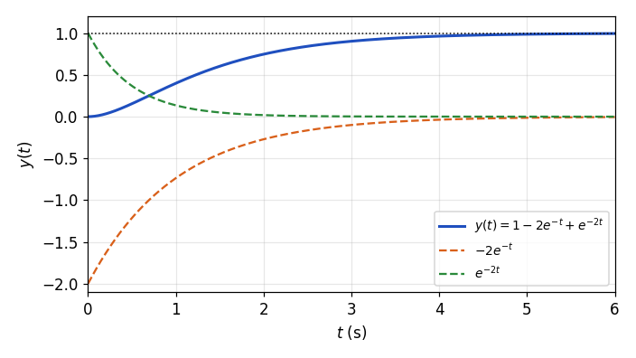

*Figure 14. Unit step response of the overdamped system 2/((s+1)(s+2)) and its two exponential components*

### 3.5 A Double Root: Critically Damped

If $\zeta = 1$, the expression under the square root becomes 0 and the two roots coincide at $s_1 = s_2 = -\omega_n$. This case is called **critically damped**. For a double root the formulas of Section 3.3 cannot be used (the factor $s_1 - s_2$ in the denominator becomes 0), so use the partial fraction expansion for a repeated factor.

```math
Y(s) = \frac{\omega_n^2}{s\,(s + \omega_n)^2} = \frac{A}{s} + \frac{B}{s + \omega_n} + \frac{C}{(s + \omega_n)^2}
```

```math
A = \left.\frac{\omega_n^2}{(s + \omega_n)^2}\right|_{s=0} = 1, \qquad C = \left.\frac{\omega_n^2}{s}\right|_{s=-\omega_n} = -\omega_n, \qquad B = \left.\frac{d}{ds}\left(\frac{\omega_n^2}{s}\right)\right|_{s=-\omega_n} = \left.-\frac{\omega_n^2}{s^2}\right|_{s=-\omega_n} = -1
```

Since $\mathcal{L}^{-1}\lbrace1/(s+a)^2 \rbrace= te^{-at}$ (Week 3), the response is the following.

```math
y(t) = 1 - e^{-\omega_n t} - \omega_n t\,e^{-\omega_n t} = 1 - e^{-\omega_n t}(1 + \omega_n t), \qquad t \ge 0
```

Even with the $te^{-\omega_n t}$ term, the exponential function shrinks faster, so the output converges to 1, and it does not oscillate. Critical damping is the boundary between overdamping and underdamping, and for the same $\omega_n$ it is the fastest among the responses that converge without oscillation (Week 9).

### 3.6 Complex Conjugate Roots: Underdamped

If $0 < \zeta < 1$, then $\zeta^2 - 1 < 0$, so the expression under the square root is negative and $\sqrt{(\zeta^2 - 1)\omega_n^2} = j\sqrt{(1 - \zeta^2)\omega_n^2}$. This case is called **underdamped**.

```math
s_1 = -\zeta\omega_n + j\sqrt{(1 - \zeta^2)\,\omega_n^2}, \qquad s_2 = -\zeta\omega_n - j\sqrt{(1 - \zeta^2)\,\omega_n^2}
```

Name the real and imaginary parts. $\omega_d$ is called the **damped natural frequency**.

```math
\sigma = -\zeta\omega_n, \qquad \omega_d = \sqrt{(1 - \zeta^2)\,\omega_n^2} = \omega_n\sqrt{1 - \zeta^2}, \qquad s_1 = \sigma + j\omega_d, \qquad s_2 = \sigma - j\omega_d
```

The two roots are complex conjugates of each other ($`s_2 = s_1^{\ast}`$). Because the roots are distinct, the expansion of Section 3.3 still applies, and since the coefficients of a rational function with real coefficients at conjugate poles are conjugates, $K_2 = K_1^{\ast}$.

```math
y(t) = K_1e^{s_1t} + K_2e^{s_2t} + K_3 = K_1e^{s_1t} + K_1^{\ast}e^{s_1^{\ast}t} + K_3, \qquad K_1 = \frac{\omega_n^2}{(s_1 - s_2)\,s_1} = \frac{\omega_n^2}{2j\omega_d\,(\sigma + j\omega_d)}
```

**Converting to a real form.** Write $K_1$ in polar form, $K_1 = \vert K_1\vert e^{j\angle K_1}$ (Week 2), and rearrange the exponentials.

```math
\begin{aligned}
y(t) &= K_1e^{\sigma t + j\omega_d t} + K_1^{\ast}e^{\sigma t - j\omega_d t} + K_3 \\
&= \vert K_1\vert e^{j\angle K_1}e^{\sigma t + j\omega_d t} + \vert K_1\vert e^{-j\angle K_1}e^{\sigma t - j\omega_d t} + K_3 \\
&= \vert K_1\vert e^{\sigma t}\left(e^{j(\omega_d t + \angle K_1)} + e^{-j(\omega_d t + \angle K_1)}\right) + K_3 \\
&= 2\vert K_1\vert e^{\sigma t}\cos(\omega_d t + \angle K_1) + K_3, \qquad t \ge 0
\end{aligned}
```

The last line uses $e^{jx} + e^{-jx} = 2\cos x$, which follows from Euler's formula $e^{jx} = \cos x + j\sin x$. The imaginary parts cancel, leaving a real response.

**Computing the coefficients.** $\vert s_1\vert^2 = \sigma^2 + \omega_d^2 = \zeta^2\omega_n^2 + (1 - \zeta^2)\omega_n^2 = \omega_n^2$, so $\vert s_1\vert = \omega_n$ and $K_3 = \omega_n^2/(s_1 s_1^{\ast}) = \omega_n^2/\vert s_1\vert^2 = 1$. The magnitude and argument of $K_1$ are the following. $\phi$ is the angle defined below, and since $s_1$ lies in the second quadrant, its argument is $\angle s_1 = \pi/2 + \phi$.

```math
\vert K_1\vert = \frac{\omega_n^2}{2\omega_d\,\vert s_1\vert} = \frac{\omega_n}{2\omega_d} = \frac{1}{2\sqrt{1 - \zeta^2}}, \qquad \angle K_1 = -\frac{\pi}{2} - \angle s_1 = -\pi - \phi \equiv \pi - \phi, \qquad \phi = \tan^{-1}\frac{\zeta}{\sqrt{1 - \zeta^2}}
```

Since $\cos(x + \pi - \phi) = -\cos(x - \phi)$, the unit step response of an underdamped second-order system is the following.

```math
y(t) = 1 - \frac{1}{\sqrt{1 - \zeta^2}}\,e^{-\zeta\omega_n t}\cos\left(\omega_n\sqrt{1 - \zeta^2}\,t - \phi\right), \qquad t \ge 0
```

Since $\sin\phi = \zeta$ and $\cos\phi = \sqrt{1 - \zeta^2}$, expanding the cosine also gives $y(t) = 1 - e^{-\zeta\omega_n t}\left(\cos\omega_d t + \dfrac{\zeta}{\sqrt{1 - \zeta^2}}\sin\omega_d t\right)$, and substituting $t = 0$ gives $y(0) = 1 - 1 = 0$.

**Interpreting the response.** The response is an oscillation at angular frequency $\omega_d$ around 1 whose amplitude shrinks along the envelope $e^{-\zeta\omega_n t}/\sqrt{1 - \zeta^2}$. How fast the oscillation dies is set by the magnitude of the real part of the pole, $\zeta\omega_n$, and how fast it oscillates by the imaginary part $\omega_d$. Also, since $\zeta\omega_n t$ and $`\omega_d t = \sqrt{1 - \zeta^2}\,\omega_n t`$ are both functions of $\omega_n t$, responses with the same $\zeta$ have the same shape, and only the time axis is stretched or shrunk by the factor $1/\omega_n$. The speed of the general solution is therefore proportional to $\omega_n$, and a larger $\omega_n$ gives a faster response. Figure 15 compares the responses for several values of $\zeta$ with $\omega_n t$ on the horizontal axis. The smaller $\zeta$ is, the larger the maximum overshoot and the longer the oscillation lasts.

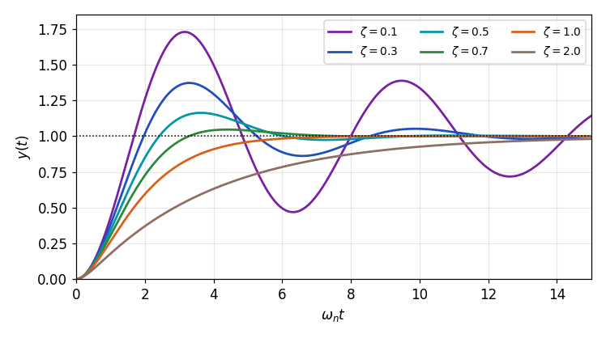

*Figure 15. Unit step responses of the standard second-order system for several damping ratios*

### 3.7 Geometric Meaning of Underdamped Poles

Plotting the underdamped pole $s_1 = \sigma + j\omega_d$ in the complex plane (the $s$-plane) gives Figure 16. As found in Section 3.6, the distance from the origin to the pole is $\vert s_1\vert = \sqrt{\zeta^2\omega_n^2 + (1 - \zeta^2)\omega_n^2} = \omega_n$, and this value is always $\omega_n$ regardless of $\zeta$. Let $\theta$ be the angle between the imaginary axis and the segment from the origin to the pole. The side opposite $\theta$ is $\zeta\omega_n$ and the hypotenuse is $\omega_n$, so the following holds.

```math
\sin\theta = \frac{\zeta\omega_n}{\omega_n} = \zeta
```

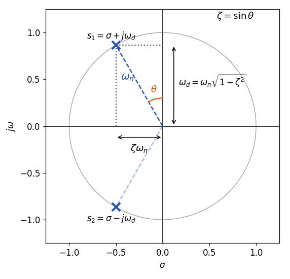

*Figure 16. Relation between the location of an underdamped pole and the damping ratio and natural frequency*

$\theta$ is the same angle as $\phi$ in Section 3.6 ($`\sin\phi = \zeta`$). Using instead the angle $\beta = 90^\circ - \theta$ between the same segment and the negative real axis, the relation can also be written $\cos\beta = \zeta$, and many textbooks use this form.

| Geometric quantity of the pole | Value | Meaning in the response |
|:-----|:-----|:-----|
| Distance from the origin | $\omega_n$ | Time scale of the whole response; larger is faster |
| Angle $\theta$ with the imaginary axis | $\sin\theta = \zeta$ | Amount of damping; larger means less oscillation |
| Magnitude of the real part | $\zeta\omega_n$ | Speed at which the envelope shrinks |
| Imaginary part | $\omega_d = \omega_n\sqrt{1 - \zeta^2}$ | Angular frequency of the oscillation |

*Table 8. Correspondence between the location of an underdamped pole and the response characteristics*

> **Key Point:** The transient response of a second-order system is determined by the pole locations. The farther the poles are from the origin (the larger $`\omega_n`$), the faster the response, and the larger the angle between the imaginary axis and the line from the origin to the poles (the larger $`\zeta`$), the smaller the oscillation. Week 9 uses this relation to treat quantitatively how changes in $\omega_n$ and $\zeta$ affect the speed of response, the maximum overshoot, and the settling time.

---

<br>

## Concept Applications

Compare the characteristic equation of each system below with the standard form to find the natural frequency, the damping ratio, and the response type. The first three rows change only the gain $K$ of the system $K/(s^2 + s + K)$ of Section 3.1.

| System | Characteristic equation | $\omega_n$ (rad/s) | $\zeta$ | Response type |
|:-----|:-----|:-----|:-----|:-----|
| Section 3.1, $K = 0.1$ | $s^2 + s + 0.1 = 0$ | $0.316$ | $1.58$ | Overdamped |
| Section 3.1, $K = 0.25$ | $s^2 + s + 0.25 = 0$ | $0.5$ | $1$ | Critically damped |
| Section 3.1, $K = 1$ | $s^2 + s + 1 = 0$ | $1$ | $0.5$ | Underdamped |
| Example 1 of Section 3.4 | $s^2 + 3s + 2 = 0$ | $1.414$ | $1.06$ | Overdamped |
| Mass-spring-damper, $M = 1$, $B = 2$, $K = 4$ | $s^2 + 2s + 4 = 0$ | $2$ | $0.5$ | Underdamped |

*Table 9. Natural frequency, damping ratio, and response type of several second-order systems*

For the system of Section 3.1, $\zeta = 1/(2\sqrt{K})$, so raising $K$ makes the response faster ($\omega_n = \sqrt{K}$ grows) but lowers the damping ratio and increases the oscillation. Unlike the first-order example of Section 1.3, raising the gain of a second-order system does not improve every aspect of transient performance.

**True/False Check:**

| Statement | Judgment and Reason |
|:-----|:------------|
| A feedback system with a sensor transfer function $H(s)$ cannot be converted into a unity feedback system. | **F.** Placing $1/H(s)$ on the input side and moving $H(s)$ into the forward path gives a unity feedback system with the same closed-loop transfer function. |
| In the system of Section 1.3, the steady-state error does not become 0 for any finite $K$, however large. | **T.** The steady-state error is $1/(K+1)$, which is greater than 0 for finite $K$. |
| The unit step response of a first-order system exceeds its final value and then comes back. | **F.** $y(t) = 1 - e^{-t/\tau}$ increases monotonically, so the maximum overshoot is 0. |
| The step response of a first-order system with time constant $\tau$ reaches 63.2% of the final value at $t = \tau$. | **T.** $1 - e^{-1} \approx 0.632$. |
| The angular frequency of oscillation of an underdamped second-order system is $\omega_n$. | **F.** The angular frequency of oscillation is $\omega_d = \omega_n\sqrt{1 - \zeta^2}$, which is less than $\omega_n$. |
| A second-order system with the same $\zeta$ and twice the $\omega_n$ has a step response of the same shape with the time axis halved. | **T.** The response is a function of $\omega_n t$ alone. |
| The distance between an underdamped pole and the origin decreases as the damping ratio increases. | **F.** The distance is always $\omega_n$, regardless of $\zeta$. |

---

<br>

## Summary

| Concept | Key Summary |
|:--------|:------------|
| Feedback control system | Consists of a controller $D(s)$, a plant $G(s)$, and a sensor $H(s)$, and its closed-loop transfer function is $DG/(1 + DGH)$. |
| Conversion to unity feedback | Placing $1/H(s)$ on the input side and moving $H(s)$ into the forward path gives a unity feedback system with the same input and output. |
| Transient and steady-state performance | Transient performance judges how fast the output reaches the command value; steady-state performance judges how close the final value is to it. |
| Test inputs | The unit step $1/s$, unit ramp $1/s^2$, and unit parabola $1/s^3$ are standard inputs for performance evaluation and comparison. |
| Transient performance measures | Maximum overshoot $M_p$, peak time $t_p$, settling time $t_s$ ($`\pm 5\%`$ or $`\pm 2\%`$), and rise time $t_r$ (10% to 90%). |
| First-order system | The step response of $1/(\tau s + 1)$ is $1 - e^{-t/\tau}$, with $t_r \approx 2.2\tau$, $t_s \approx 3\tau$ ($`\pm 5\%`$), and $M_p = 0$. |
| Time constant of a DC motor | With $L_a \approx 0$ and $B \approx 0$, $\tau_m = J_aR_a/(K_tK_b)$, and proportional feedback reduces the closed-loop time constant to $\tau_m/(1 + K/K_b)$. |
| Standard second-order form | In $\omega_n^2/(s^2 + 2\zeta\omega_n s + \omega_n^2)$, $\zeta$ is the damping ratio and $\omega_n$ the natural frequency. |
| Classification of roots | $\zeta > 1$ gives two negative real roots (overdamped), $\zeta = 1$ a double root (critically damped), and $0 < \zeta < 1$ complex conjugate roots (underdamped). |
| Overdamped and critically damped responses | The overdamped response is a sum of two exponential terms, the critically damped one is $1 - e^{-\omega_n t}(1 + \omega_n t)$, and neither oscillates. |
| Underdamped response | $1 - e^{-\zeta\omega_n t}\cos(\omega_d t - \phi)/\sqrt{1 - \zeta^2}$ with $\omega_d = \omega_n\sqrt{1 - \zeta^2}$ and $\phi = \tan^{-1}(\zeta/\sqrt{1 - \zeta^2})$. |
| Pole geometry | Underdamped poles lie at distance $\omega_n$ from the origin, and the angle $\theta$ with the imaginary axis satisfies $\sin\theta = \zeta$. |

---

<br>

## Self-Check Questions

1. **Conversion to unity feedback:** For the system of Figure 4 with $D(s) = 2$, $G(s) = 1/(s+3)$, and $H(s) = 4$, find the closed-loop transfer function and show that the system converted to the form of Figure 5 has the same transfer function.

   <details>
   <summary>Answer</summary>

   In the form of Figure 4, $T = DG/(1 + DGH) = \dfrac{2/(s+3)}{1 + 8/(s+3)} = \dfrac{2}{s + 11}$. In the form of Figure 5, the forward path of the inner unity feedback loop is $DHG = 8/(s+3)$, so the loop transfer function is $\dfrac{8/(s+3)}{1 + 8/(s+3)} = \dfrac{8}{s + 11}$, and multiplying by $1/H = 1/4$ in front gives the same $\dfrac{2}{s + 11}$.

   </details>

2. **Test inputs:** Explain with the Laplace transform why the unit parabolic input is defined as $t^2/2$ rather than $t^2$.

   <details>
   <summary>Answer</summary>

   Since $\mathcal{L}\lbrace t^n \rbrace= n!/s^{n+1}$, $\mathcal{L}\lbrace t^2 \rbrace= 2/s^3$. Multiplying by $1/2$ makes the transform $1/s^3$, which continues the pattern $1/s^k$ neatly together with the unit step $1/s$ and the unit ramp $1/s^2$. Also, $t^2/2$ is the integral of the unit ramp $t$, so the three inputs form a chain of integrals.

   </details>

3. **Transient and steady-state performance of proportional control:** For the system of Section 1.3 with $K = 20$, find the closed-loop pole, the time for the transient component to shrink to $e^{-1}$, the final value, and the 5% settling time.

   <details>
   <summary>Answer</summary>

   The closed-loop transfer function is $20/(s + 21)$, so the pole is $-21$ and the response is $y(t) = \frac{20}{21}(1 - e^{-21t})$. The transient component shrinks to $e^{-1}$ in $1/21 \approx 0.0476$ s, the final value is $20/21 \approx 0.952$, and the steady-state error is $1/21 \approx 0.048$. Since the response is first order, the 5% settling time is $3 \times 0.0476 \approx 0.143$ s.

   </details>

4. **Measures of a first-order system:** For the system $G(s) = \dfrac{5}{0.2s + 1}$, find the unit step response, the final value, the rise time, and the 2% settling time.

   <details>
   <summary>Answer</summary>

   The time constant is $\tau = 0.2$ s and the steady-state gain is 5, so $y(t) = 5(1 - e^{-5t})$ and the final value is 5. The time measures do not depend on the steady-state gain, so $t_r = \tau\ln 9 \approx 0.44$ s and the 2% settling time is $\tau\ln 50 \approx 0.78$ s (approximately $4\tau = 0.8$ s).

   </details>

5. **Motor time constant:** For the DC motor of Section 2.4, what happens to the motor time constant if the moment of inertia $J_a$ of the rotor doubles? In the speed control system of Section 2.5, how must the gain $K$ change to keep the same closed-loop time constant?

   <details>
   <summary>Answer</summary>

   $\tau_m = J_aR_a/(K_tK_b)$ is proportional to $J_a$, so it doubles. To keep the closed-loop time constant $\tau_c = K_b\tau_m/(K_b + K)$, $K_b + K$ must also double, so the new gain is $K' = 2(K_b + K) - K_b = K_b + 2K$. For example, with $K_b = 1$ and $K = 4$, $K' = 9$.

   </details>

6. **Gain of a second-order system:** For the system $K/(s^2 + s + K)$ of Section 3.1, find the $K$ that makes it critically damped and the $K$ that gives a damping ratio of 0.5.

   <details>
   <summary>Answer</summary>

   $\omega_n = \sqrt{K}$ and $2\zeta\omega_n = 1$, so $\zeta = 1/(2\sqrt{K})$. For $\zeta = 1$, $\sqrt{K} = 1/2$ gives $K = 0.25$, and for $\zeta = 0.5$, $\sqrt{K} = 1$ gives $K = 1$. The system is overdamped for $K < 0.25$ and underdamped for $K > 0.25$.

   </details>

7. **Critically damped response:** Find the unit step response of $G_T(s) = \dfrac{4}{s^2 + 4s + 4}$ by partial fraction expansion and compute $y(1)$.

   <details>
   <summary>Answer</summary>

   $\omega_n = 2$ and $\zeta = 4/(2 \cdot 2) = 1$, so the system is critically damped. $Y(s) = \dfrac{4}{s(s+2)^2} = \dfrac{1}{s} - \dfrac{1}{s+2} - \dfrac{2}{(s+2)^2}$, and $y(t) = 1 - e^{-2t} - 2te^{-2t} = 1 - e^{-2t}(1 + 2t)$. $y(1) = 1 - 3e^{-2} \approx 0.594$.

   </details>

8. **Underdamped response:** For $G_T(s) = \dfrac{9}{s^2 + 2s + 9}$, find $\omega_n$, $\zeta$, the poles, $\omega_d$, and $\phi$, and write the unit step response.

   <details>
   <summary>Answer</summary>

   $\omega_n^2 = 9$ gives $\omega_n = 3$ rad/s, and $2\zeta\omega_n = 2$ gives $\zeta = 1/3$. $\sigma = -\zeta\omega_n = -1$ and $\omega_d = 3\sqrt{1 - 1/9} = 2\sqrt{2} \approx 2.828$ rad/s, so the poles are $-1 \pm j2.828$. $\phi = \tan^{-1}\dfrac{1/3}{\sqrt{8/9}} = \tan^{-1}\dfrac{1}{2\sqrt{2}} \approx 0.340$ rad and $1/\sqrt{1 - \zeta^2} = 3/(2\sqrt{2}) \approx 1.061$, so $`y(t) = 1 - 1.061\,e^{-t}\cos(2.828t - 0.340)`$.

   </details>

9. **Pole geometry:** If the poles of a second-order system are $-2 \pm j2\sqrt{3}$, find $\omega_n$, $\zeta$, and the angle $\theta$ with the imaginary axis.

   <details>
   <summary>Answer</summary>

   $\omega_n = \sqrt{2^2 + (2\sqrt{3})^2} = \sqrt{16} = 4$ rad/s, and the magnitude of the real part is $\zeta\omega_n = 2$, so $\zeta = 0.5$. $\sin\theta = 0.5$ gives $\theta = 30^\circ$. The characteristic equation is $s^2 + 4s + 16 = 0$.

   </details>

10. **Steady-state component:** Explain in two ways why the final value of the unit step response of the standard second-order system with $\zeta > 0$ is 1 regardless of the value of $\zeta$.

    <details>
    <summary>Answer</summary>

    First, the steady-state coefficient of the partial fraction expansion is $K_3 = \omega_n^2/(s_1s_2)$, and by the relation between roots and coefficients $s_1s_2 = \omega_n^2$, so $K_3 = 1$. Second, when the transient components die out ($`\zeta > 0`$), the final value equals the steady-state gain $G_T(0) = \omega_n^2/\omega_n^2 = 1$. Hence $\zeta$ changes only the way the output reaches that value (the transient response), not the final value itself.

    </details>

---

<br>

## References

1. K. Ogata, *Modern Control Engineering*, 5th ed. Upper Saddle River, NJ, USA: Prentice Hall, 2010.
2. 임동진, *제어 시스템 공학*, 개정판. 파주: 생능출판사, 2019.
3. N. S. Nise, *Control Systems Engineering*, 7th ed. Hoboken, NJ, USA: Wiley, 2015.
