# 9주차 이론 — 제어시스템 성능 II

[레포지토리 안내](../../README.ko.md) | [English](Concepts_Lecture.md) | [한국어](Concepts_Lecture.ko.md)

> **최종 수정일:** 2026-11-04

> **학습 목표:**
> 1. 고유 진동수와 감쇠비가 바뀔 때 극점의 위치와 계단 응답의 속도가 어떻게 바뀌는지 설명할 수 있다
> 2. 부족 감쇠 2차 시스템의 최고점 시간, 최대 초과량, 정착 시간 공식을 유도하고 주어진 시스템에 적용할 수 있다
> 3. 임계 감쇠, 비감쇠, 음의 감쇠를 설명하고, 감쇠비에 따른 극점의 궤적과 단위 계단 응답의 관계를 설명할 수 있다
> 4. 전달함수의 극점으로 제어시스템의 안정도를 정의하고 BIBO 안정도와 임계 안정을 구분할 수 있다
> 5. Routh 표를 만들어 특성방정식의 우반평면 근의 개수를 구하고, 첫째 열에 0이 나오거나 한 행 전체가 0이 되는 경우를 처리할 수 있다

---

## 목차

- [1. 응답 속도의 변화](#1-응답-속도의-변화)
  - [1.1 부족 감쇠 응답과 극점](#11-부족-감쇠-응답과-극점)
  - [1.2 고유 진동수의 변화에 따른 응답](#12-고유-진동수의-변화에-따른-응답)
  - [1.3 감쇠비의 변화에 따른 응답](#13-감쇠비의-변화에-따른-응답)
  - [1.4 예제: 질량-댐퍼 시스템의 위치 제어](#14-예제-질량-댐퍼-시스템의-위치-제어)
  - [1.5 최고점 시간과 최대 초과량](#15-최고점-시간과-최대-초과량)
  - [1.6 감쇠비와 최대 초과량의 관계](#16-감쇠비와-최대-초과량의-관계)
  - [1.7 정착 시간](#17-정착-시간)
  - [1.8 상승 시간](#18-상승-시간)
  - [1.9 예제의 과도 성능 지표](#19-예제의-과도-성능-지표)
- [2. 극점의 위치에 따른 응답](#2-극점의-위치에-따른-응답)
  - [2.1 중근을 갖는 경우: 임계 감쇠](#21-중근을-갖는-경우-임계-감쇠)
  - [2.2 근이 허수축에 있는 경우: 비감쇠](#22-근이-허수축에-있는-경우-비감쇠)
  - [2.3 예제: 질량-스프링 시스템](#23-예제-질량-스프링-시스템)
  - [2.4 근이 우반평면에 있는 경우: 음의 감쇠](#24-근이-우반평면에-있는-경우-음의-감쇠)
  - [2.5 예제: 음의 마찰을 갖는 시스템](#25-예제-음의-마찰을-갖는-시스템)
  - [2.6 감쇠비에 따른 극점의 궤적](#26-감쇠비에-따른-극점의-궤적)
  - [2.7 극점의 위치와 단위 계단 응답의 관계](#27-극점의-위치와-단위-계단-응답의-관계)
- [3. 제어시스템의 안정도](#3-제어시스템의-안정도)
  - [3.1 불안정한 시스템과 안정한 시스템](#31-불안정한-시스템과-안정한-시스템)
  - [3.2 안정도의 정의](#32-안정도의-정의)
  - [3.3 BIBO 안정도](#33-bibo-안정도)
  - [3.4 계수의 부호로 보는 필요조건](#34-계수의-부호로-보는-필요조건)
  - [3.5 Routh 표와 Routh-Hurwitz 판별법](#35-routh-표와-routh-hurwitz-판별법)
  - [3.6 예제 1과 예제 2](#36-예제-1과-예제-2)
  - [3.7 특별한 경우 1: 첫째 열에 0이 나오는 경우](#37-특별한-경우-1-첫째-열에-0이-나오는-경우)
  - [3.8 특별한 경우 2: 한 행 전체가 0이 되는 경우](#38-특별한-경우-2-한-행-전체가-0이-되는-경우)
  - [3.9 안정한 이득의 범위](#39-안정한-이득의-범위)
- [개념 적용](#개념-적용)
- [요약](#요약)
- [점검 문제](#점검-문제)
- [참고 문헌](#참고-문헌)

---

<br>

## 1. 응답 속도의 변화

### 1.1 부족 감쇠 응답과 극점

7주차에서 표준형 2차 시스템 $G_T(s) = \omega_n^2/(s^2 + 2\zeta\omega_n s + \omega_n^2)$의 단위 계단 응답을 유도하였다. 감쇠비가 $0 < \zeta < 1$인 부족 감쇠의 경우 응답은 다음과 같다.

```math
y(t) = 2\vert K_1\vert e^{-\zeta\omega_n t}\cos\left(\omega_n\sqrt{1 - \zeta^2}\,t + \angle K_1\right) + 1 = 1 - \frac{1}{\sqrt{1 - \zeta^2}}\,e^{-\zeta\omega_n t}\cos\left(\omega_n\sqrt{1 - \zeta^2}\,t - \phi\right), \qquad t \ge 0
```

```math
\phi = \tan^{-1}\frac{\zeta}{\sqrt{1 - \zeta^2}}, \qquad \sigma = -\zeta\omega_n, \qquad \omega_d = \sqrt{(1 - \zeta^2)\,\omega_n^2} = \omega_n\sqrt{1 - \zeta^2}
```

극점은 $s = \sigma \pm j\omega_d$이며, 원점에서 극점까지의 거리는 $\omega_n$, 원점과 극점을 잇는 선분이 허수축과 이루는 각 $\theta$는 $\sin\theta = \zeta$를 만족한다. 이 절은 $\omega_n$과 $\zeta$를 하나씩 바꾸면서 극점과 응답이 어떻게 변하는지 보고, 응답의 빠르기와 모양을 나타내는 지표의 공식을 유도한다.

### 1.2 고유 진동수의 변화에 따른 응답

감쇠비를 $\zeta = 0.2$로 고정하고 고유 진동수를 $\omega_n = 1$에서 $\omega_n = 2$로 바꾼다. 극점은 다음과 같이 이동한다.

```math
\omega_n = 1:\; s = -0.2 \pm j0.980, \qquad \omega_n = 2:\; s = -0.4 \pm j1.960
```

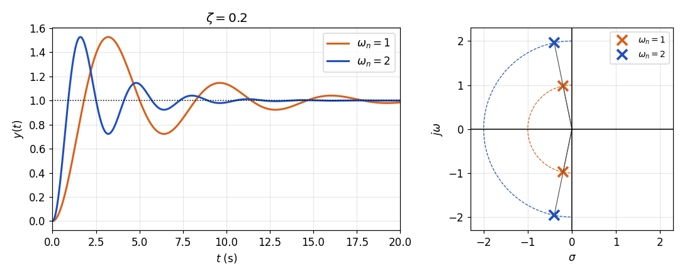

*그림 1. 감쇠비 0.2에서 고유 진동수 1과 2의 단위 계단 응답과 극점*

$\zeta$가 같으므로 허수축과 이루는 각 $\theta = \sin^{-1}0.2 \approx 11.5^\circ$는 그대로이고, 극점은 같은 반직선 위에서 원점으로부터 두 배 먼 곳으로 옮겨 간다. 7주차에서 보았듯이 응답은 $\omega_n t$만의 함수이므로, $\omega_n$이 두 배가 되면 응답의 모양은 같고 시간 축만 절반으로 줄어든다. 첫 최고점에 이르는 시간은 약 3.21 s에서 1.60 s로 줄지만, 최고점의 높이(최대 초과량 약 52.7%)는 같다.

### 1.3 감쇠비의 변화에 따른 응답

이번에는 고유 진동수를 $\omega_n = 1$로 고정하고 감쇠비를 0.1에서 0.8까지 바꾼다. 원점에서 극점까지의 거리가 $\omega_n = 1$로 일정하므로 극점은 반지름 1인 원 위를 움직이며, $\zeta$가 커질수록 허수축에서 멀어진다.

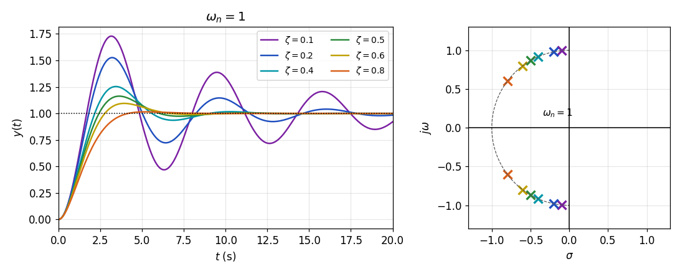

*그림 2. 고유 진동수 1에서 감쇠비에 따른 단위 계단 응답과 극점*

$\zeta$가 커지면 세 가지가 함께 바뀐다. 첫째, 포락선의 감소율 $\zeta\omega_n$이 커져 진동이 빨리 사라진다. 둘째, 진동의 각진동수 $\omega_d = \omega_n\sqrt{1 - \zeta^2}$가 작아져 첫 최고점에 이르는 시간이 조금 늘어난다. 셋째, 1.6절에서 보듯이 목표값을 넘는 정도가 크게 줄어든다.

| $\zeta$ | 극점 | 최대 초과량 | 최고점 시간 ($`\omega_n = 1`$) |
|:-----|:-----|:-----|:-----|
| $0.1$ | $-0.1 \pm j0.995$ | $`72.9\%`$ | $3.16$ s |
| $0.2$ | $-0.2 \pm j0.980$ | $`52.7\%`$ | $3.21$ s |
| $0.4$ | $-0.4 \pm j0.917$ | $`25.4\%`$ | $3.43$ s |
| $0.5$ | $-0.5 \pm j0.866$ | $`16.3\%`$ | $3.63$ s |
| $0.6$ | $-0.6 \pm j0.800$ | $`9.5\%`$ | $3.93$ s |
| $0.8$ | $-0.8 \pm j0.600$ | $`1.5\%`$ | $5.24$ s |

*표 1. 고유 진동수 1에서 감쇠비에 따른 극점과 응답 지표*

> **핵심:** 고유 진동수 $\omega_n$은 응답의 시간 척도(빠르기)를, 감쇠비 $\zeta$는 응답의 모양(목표값을 넘는 정도와 진동이 남는 정도)을 정한다. 그래서 2차 시스템을 설계할 때는 허용되는 최대 초과량으로 $\zeta$를 먼저 정하고, 원하는 빠르기에 맞게 $\omega_n$을 정하는 경우가 많다.

### 1.4 예제: 질량-댐퍼 시스템의 위치 제어

4주차의 질량-스프링-댐퍼 시스템에서 스프링을 제거하면 그림 3의 질량-댐퍼 시스템이 된다. 질량 $M$에 힘 $f$를 가하면 점성 마찰 계수 $B$의 댐퍼만 저항하므로, 운동방정식과 전달함수는 다음과 같다.

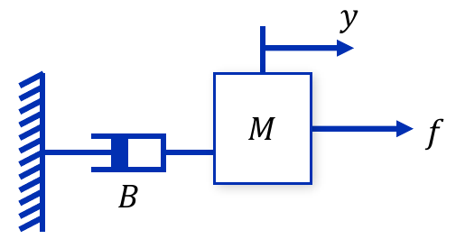

*그림 3. 스프링을 제거한 질량-댐퍼 시스템*

```math
M\ddot{y} + B\dot{y} = f \quad\Longrightarrow\quad \frac{Y(s)}{F(s)} = \frac{1}{s(Ms + B)}
```

이 시스템에 그림 4처럼 비례 제어기 $K$로 피드백 시스템을 구성한다. 위치 오차에 비례하는 힘 $f = K(r - y)$를 가하는 것이다.

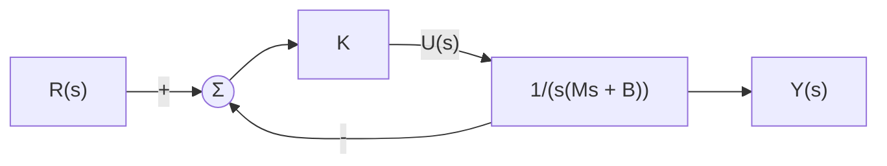

*그림 4. 질량-댐퍼 시스템의 위치 제어시스템*

폐루프 전달함수의 분자와 분모에 $s(Ms + B)$를 곱한 뒤 $M$으로 나누어 표준형과 비교한다.

```math
\frac{Y(s)}{R(s)} = \frac{\dfrac{K}{s(Ms + B)}}{1 + \dfrac{K}{s(Ms + B)}} = \frac{K}{Ms^2 + Bs + K} = \frac{K/M}{s^2 + (B/M)s + K/M}, \qquad \omega_n = \sqrt{\frac{K}{M}}, \quad \zeta = \frac{B}{2\sqrt{KM}}
```

이 폐루프 전달함수는 스프링 상수가 $K$인 질량-스프링-댐퍼 시스템의 전달함수와 같은 형태이다. 위치 오차에 비례하는 힘은 스프링의 복원력과 같은 역할을 하므로, 제어기의 이득 $K$가 가상의 스프링이 된다.

$M = 2$, $B = 6$, $K = 18$이면 다음과 같다.

```math
\frac{Y(s)}{R(s)} = \frac{18}{2s^2 + 6s + 18} = \frac{9}{s^2 + 3s + 9}, \qquad \omega_n^2 = 9 \Rightarrow \omega_n = 3 \text{ rad/s}, \qquad 2\zeta\omega_n = 3 \Rightarrow \zeta = 0.5
```

$0 < \zeta < 1$이므로 부족 감쇠이며, 극점은 $-\zeta\omega_n \pm j\omega_n\sqrt{1 - \zeta^2} = -1.5 \pm j2.598$이다. 이 시스템의 과도 성능 지표는 1.5절에서 1.8절까지의 공식을 유도한 뒤 1.9절에서 계산한다.

### 1.5 최고점 시간과 최대 초과량

**최고점 시간의 유도.** 출력이 최대가 되는 시점에서는 기울기가 0이므로, 단위 계단 응답을 미분하여 0으로 놓는다. 곱의 미분법으로 $\dfrac{d}{dt}\left[e^{-\zeta\omega_n t}\cos(\omega_d t - \phi)\right] = -\zeta\omega_n e^{-\zeta\omega_n t}\cos(\omega_d t - \phi) - \omega_d e^{-\zeta\omega_n t}\sin(\omega_d t - \phi)$이고, 여기에 $-1/\sqrt{1 - \zeta^2}$을 곱한 뒤 $\omega_d = \omega_n\sqrt{1 - \zeta^2}$을 넣는다.

```math
\begin{aligned}
\dot{y}(t) &= \frac{\omega_n}{\sqrt{1 - \zeta^2}}\,e^{-\zeta\omega_n t}\left[\zeta\cos\left(\omega_n\sqrt{1 - \zeta^2}\,t - \phi\right) + \sqrt{1 - \zeta^2}\,\sin\left(\omega_n\sqrt{1 - \zeta^2}\,t - \phi\right)\right] \\
&= \frac{\omega_n}{\sqrt{1 - \zeta^2}}\,e^{-\zeta\omega_n t}\left[\sin\phi\cos\left(\omega_n\sqrt{1 - \zeta^2}\,t - \phi\right) + \cos\phi\sin\left(\omega_n\sqrt{1 - \zeta^2}\,t - \phi\right)\right] \\
&= \frac{\omega_n}{\sqrt{1 - \zeta^2}}\,e^{-\zeta\omega_n t}\sin\left(\omega_n\sqrt{1 - \zeta^2}\,t\right)
\end{aligned}
```

둘째 줄은 $\tan\phi = \zeta/\sqrt{1 - \zeta^2}$에서 얻는 $\sin\phi = \zeta$, $\cos\phi = \sqrt{1 - \zeta^2}$을 넣은 것이고, 셋째 줄은 삼각함수의 덧셈 정리 $\sin(\alpha + \beta) = \sin\alpha\cos\beta + \cos\alpha\sin\beta$에 $\alpha = \phi$, $\beta = \omega_d t - \phi$를 넣은 것이다.

지수 함수는 0이 되지 않으므로 $\dot{y}(t) = 0$은 $\sin(\omega_d t) = 0$, 즉 $\omega_d t = n\pi$일 때 성립한다.

```math
\dot{y}(t) = 0 \quad\Longrightarrow\quad t = \frac{n\pi}{\omega_n\sqrt{1 - \zeta^2}}, \qquad n = 0, 1, 2, \ldots
```

여러 개의 답이 나오는데, $n = 0$은 출발점 $t = 0$이고(2차 시스템의 계단 응답은 기울기 0에서 출발한다), $n$이 홀수이면 극대, 짝수이면 극소이다. 그중 $n = 1$인 경우가 처음 최댓값에 이르는 시간, 즉 최고점 시간이다.

```math
t_p = \frac{\pi}{\omega_n\sqrt{1 - \zeta^2}} = \frac{\pi}{\omega_d}
```

**최대 초과량의 유도.** $t = t_p$에서 $\omega_d t_p = \pi$이고 $\zeta\omega_n t_p = \zeta\pi/\sqrt{1 - \zeta^2}$이다. 또 $\cos(\pi - \phi) = -\cos\phi = -\sqrt{1 - \zeta^2}$이므로 다음을 얻는다.

```math
y(t_p) = 1 - \frac{1}{\sqrt{1 - \zeta^2}}\,e^{-\zeta\pi/\sqrt{1 - \zeta^2}}\left(-\sqrt{1 - \zeta^2}\right) = 1 + e^{-\zeta\pi/\sqrt{1 - \zeta^2}}
```

정상 상태 값이 $y_{ss} = 1$이므로 최대 초과량은 다음과 같다.

```math
M_p = \frac{y(t_p) - 1}{1} = e^{-\zeta\pi/\sqrt{1 - \zeta^2}}
```

> **핵심:** 최고점 시간 $t_p = \pi/\omega_d$는 극점의 허수부 $\omega_d$에 반비례하고, 최대 초과량 $M_p = e^{-\zeta\pi/\sqrt{1 - \zeta^2}}$는 감쇠비 $\zeta$에만 의존하며 $\omega_n$과 무관하다. 1.2절에서 $\omega_n$을 바꾸어도 최고점의 높이가 같았던 이유이다.

### 1.6 감쇠비와 최대 초과량의 관계

그림 5는 $M_p = e^{-\zeta\pi/\sqrt{1 - \zeta^2}}$을 $\zeta$에 대해 그린 것이다. $\zeta \to 0$이면 $M_p \to 1$(100% 초과)이고, $\zeta$가 커질수록 빠르게 줄어 $\zeta \to 1$이면 0에 가까워진다.

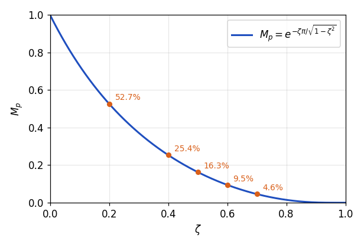

*그림 5. 감쇠비와 최대 초과량의 관계*

| $\zeta$ | $0.1$ | $0.2$ | $0.3$ | $0.4$ | $0.5$ | $0.6$ | $0.7$ | $0.8$ | $0.9$ |
|:-----|:-----|:-----|:-----|:-----|:-----|:-----|:-----|:-----|:-----|
| $M_p$ (%) | $72.9$ | $52.7$ | $37.2$ | $25.4$ | $16.3$ | $9.5$ | $4.6$ | $1.5$ | $0.15$ |

*표 2. 감쇠비에 따른 최대 초과량*

반대로 허용되는 최대 초과량에서 필요한 감쇠비를 구할 수도 있다. $\ln M_p = -\zeta\pi/\sqrt{1 - \zeta^2}$의 양변을 제곱하면 $(\ln M_p)^2(1 - \zeta^2) = \zeta^2\pi^2$이므로 다음과 같다.

```math
\zeta = \frac{-\ln M_p}{\sqrt{\pi^2 + (\ln M_p)^2}}
```

예를 들어 최대 초과량을 5% 이하로 하려면 $\ln 0.05 = -2.996$이므로 $\zeta \ge 2.996/\sqrt{9.870 + 8.974} \approx 0.69$이어야 한다.

### 1.7 정착 시간

정착 시간을 결정하려면 먼저 오차의 범위를 정해야 한다. 여기서는 오차의 범위를 5%로 정하여 **5% 정착 시간(5% settling time)** 을 구한다.

$\vert\cos(\cdot)\vert \le 1$이므로 부족 감쇠 응답은 항상 두 곡선 $1 \pm e^{-\zeta\omega_n t}/\sqrt{1 - \zeta^2}$ 사이에 있다. 이 두 곡선을 응답의 **포락선(envelope)** 이라 한다. 정현파 함수에 곱해진 지수 함수만으로 정착 시간을 구하면, 즉 포락선이 $`\pm 5\%`$ 범위 안으로 들어오는 시간을 구하면 대략의 정착 시간을 간편하게 구할 수 있다(그림 6).

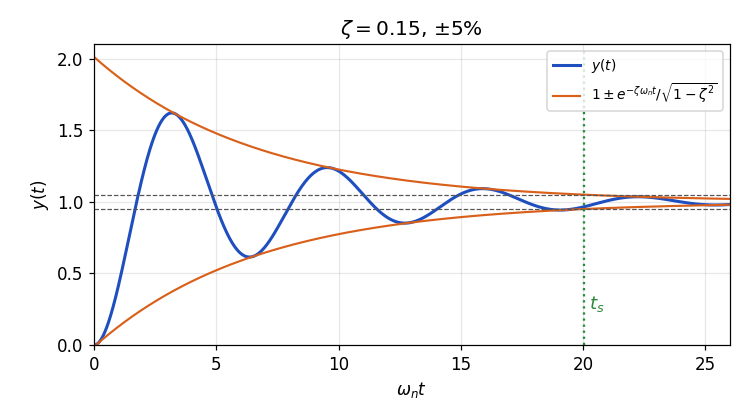

*그림 6. 부족 감쇠 응답의 포락선과 5% 정착 시간*

```math
\frac{e^{-\zeta\omega_n t_s}}{\sqrt{1 - \zeta^2}} = 0.05 \quad\Longrightarrow\quad -\zeta\omega_n t_s = \ln\left(0.05\sqrt{1 - \zeta^2}\right) \quad\Longrightarrow\quad \omega_n t_s = -\frac{\ln\left(0.05\sqrt{1 - \zeta^2}\right)}{\zeta}
```

그림 7은 이 식을 $\zeta$에 대해 그린 것이다. $\zeta$가 0.1에서 0.7 정도까지일 때 이 곡선은 오차 약 7% 안에서 $3.2/\zeta$로 근사할 수 있으므로, 5% 정착 시간은 다음과 같이 어림할 수 있다.

```math
t_s \approx \frac{3.2}{\zeta\omega_n} \quad (\pm 5\%)
```

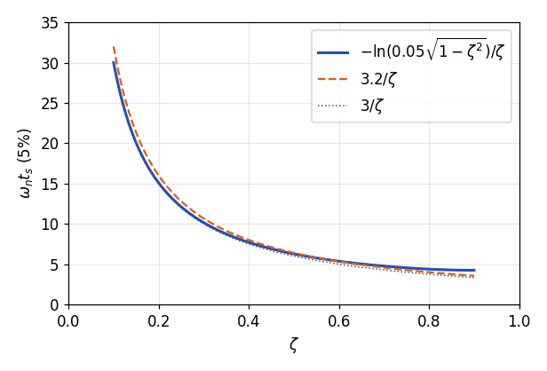

*그림 7. 감쇠비에 따른 5% 정착 시간과 그 근사식*

$\sqrt{1 - \zeta^2}$의 영향을 무시하면 $-\ln 0.05 \approx 3.0$, $-\ln 0.02 \approx 3.9$이므로, 많은 교재는 다음 근사식을 쓴다 [1].

```math
t_s \approx \frac{3}{\zeta\omega_n} \quad (\pm 5\%), \qquad t_s \approx \frac{4}{\zeta\omega_n} \quad (\pm 2\%)
```

어느 식이든 정착 시간은 극점의 실수부 크기 $\zeta\omega_n = \vert\sigma\vert$에 반비례한다. 극점이 허수축에서 멀리 왼쪽에 있을수록 응답이 빨리 자리 잡는다.

> **주의:** 이 식들은 포락선으로 구한 어림값이다. 실제 응답은 코사인이 극값이 아닐 때 범위 경계를 지나므로 실제 정착 시간은 어림값보다 짧을 수 있고, 감쇠비가 조금 바뀌어 어느 봉우리가 경계를 넘느냐 넘지 않느냐가 달라지면 실제 정착 시간은 불연속적으로 변한다. 예를 들어 1.4절의 예제에서 5% 정착 시간의 어림값은 2.1 s이지만 실제 값은 1.76 s이다(1.9절).

### 1.8 상승 시간

상승 시간은 2차 시스템에서 간단한 닫힌 식으로 나타나지 않으므로, 두 가지 방법을 쓴다.

**0%에서 100%까지의 상승 시간.** 진동하는 응답에서는 출력이 처음으로 최종값 1에 도달하는 시간을 상승 시간으로 쓰기도 한다 [1]. $y(t) = 1$이려면 $\cos(\omega_d t - \phi) = 0$이어야 하고, 처음으로 이를 만족하는 것은 $\omega_d t - \phi = \pi/2$일 때이다. $\pi/2 + \phi = \pi - \cos^{-1}\zeta$이므로 다음과 같다.

```math
t_r = \frac{\pi/2 + \phi}{\omega_d} = \frac{\pi - \cos^{-1}\zeta}{\omega_n\sqrt{1 - \zeta^2}}
```

**10%에서 90%까지의 상승 시간.** 이 정의의 상승 시간은 응답 식을 수치적으로 풀어 구한다. $\omega_n = 1$일 때의 값은 표 3과 같으며, 중간 정도의 감쇠($\zeta$가 0.5에서 0.6 근처)에서는 흔히 $t_r \approx 1.8/\omega_n$으로 어림한다 [2]. 표 3에 따르면 이 어림은 $\zeta = 0.6$에서 잘 맞고, $\zeta = 0.5$에서는 실제 값 $1.64/\omega_n$보다 약 10% 크다.

| $\zeta$ | $0.1$ | $0.2$ | $0.4$ | $0.5$ | $0.6$ | $0.7$ | $0.8$ |
|:-----|:-----|:-----|:-----|:-----|:-----|:-----|:-----|
| $\omega_n t_r$ (10%에서 90%) | $1.10$ | $1.20$ | $1.46$ | $1.64$ | $1.85$ | $2.13$ | $2.47$ |

*표 3. 감쇠비에 따른 10%에서 90%까지의 상승 시간*

상승 시간도 $\omega_n$에 반비례하며, $\zeta$가 커질수록 조금 길어진다. 감쇠를 늘려 최대 초과량을 줄이면 대가로 출발이 느려진다.

| 지표 | 공식 | 결정하는 극점의 양 |
|:-----|:-----|:-----|
| 최고점 시간 | $t_p = \pi/\omega_d$ | 허수부 $\omega_d$ |
| 최대 초과량 | $M_p = e^{-\zeta\pi/\sqrt{1 - \zeta^2}}$ | 감쇠비 $\zeta$ (허수축과 이루는 각) |
| 정착 시간 | $t_s \approx 3.2/(\zeta\omega_n)$ ($`\pm 5\%`$), $4/(\zeta\omega_n)$ ($`\pm 2\%`$) | 실수부 크기 $\zeta\omega_n$ |
| 상승 시간 | $t_r = (\pi - \cos^{-1}\zeta)/\omega_d$ (0%에서 100%), $\approx 1.8/\omega_n$ (10%에서 90%) | 원점에서의 거리 $\omega_n$ |

*표 4. 부족 감쇠 2차 시스템의 과도 성능 지표 공식*

### 1.9 예제의 과도 성능 지표

1.4절의 예제($\omega_n = 3$ rad/s, $`\zeta = 0.5`$)에 위의 공식을 적용한다. 먼저 $\sqrt{1 - \zeta^2} = \sqrt{0.75} = 0.866$이고 $\omega_d = 3 \times 0.866 = 2.598$ rad/s, $\zeta\omega_n = 1.5$이다.

1. **최고점 시간:** $t_p = \pi/2.598 \approx 1.209$ s이다.
2. **최대 초과량:** $\zeta\pi/\sqrt{1 - \zeta^2} = 0.5\pi/0.866 = 1.814$이므로 $M_p = e^{-1.814} \approx 0.163$, 즉 16.3%이며 출력의 최댓값은 약 1.163이다.
3. **5% 정착 시간:** 포락선 식으로는 $-\ln(0.05 \times 0.866)/1.5 = 3.140/1.5 \approx 2.09$ s이고, 근사식으로는 $3.2/1.5 \approx 2.13$ s이다. 2% 정착 시간의 근사는 $4/1.5 \approx 2.67$ s이다.
4. **상승 시간:** 0%에서 100%까지는 $(\pi - \cos^{-1}0.5)/2.598 = (\pi - \pi/3)/2.598 \approx 0.806$ s이고, 10%에서 90%까지는 $1.8/3 = 0.6$ s로 어림한다.

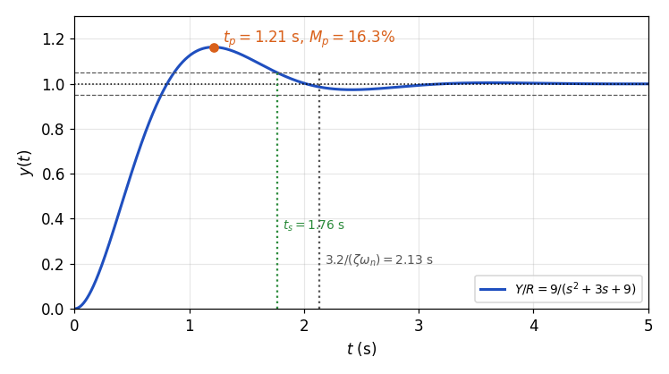

*그림 8. 질량-댐퍼 위치 제어시스템의 단위 계단 응답*

그림 8의 실제 응답에서 최고점 시간과 최대 초과량은 공식과 정확히 일치한다. 10%에서 90%까지의 실제 상승 시간은 0.546 s, 실제 5% 정착 시간은 1.76 s, 실제 2% 정착 시간은 2.69 s이다. 1.7절의 주의대로 5% 정착 시간은 어림값보다 짧고, 2% 정착 시간은 근사식 2.67 s와 가깝다.

---

<br>

## 2. 극점의 위치에 따른 응답

7주차에서는 $\zeta > 1$, $\zeta = 1$, $0 < \zeta < 1$인 경우의 응답을 유도하였다. 이 절은 임계 감쇠를 다시 살펴보고, 감쇠비가 0이거나 음수인 경우까지 넓혀 극점의 위치와 응답의 관계를 정리한다. 극점은 모두 특성방정식 $s^2 + 2\zeta\omega_n s + \omega_n^2 = 0$의 근 $s = -\zeta\omega_n \pm \omega_n\sqrt{\zeta^2 - 1}$이다.

### 2.1 중근을 갖는 경우: 임계 감쇠

$\zeta = 1$이면 근호 안이 0이 되어 두 개의 근이 $s = -\omega_n$으로 같아진다. 이 경우를 **임계 감쇠(critically damped)** 라 하며, 단위 계단 응답은 7주차에서 유도한 대로 다음과 같다.

```math
y(t) = 1 - e^{-\omega_n t}(1 + \omega_n t), \qquad t \ge 0
```

임계 감쇠는 진동하는 응답(부족 감쇠)과 진동하지 않는 응답(과감쇠)의 경계이다. 같은 $\omega_n$에서 목표값을 넘지 않는 응답 중 가장 빠르다. 예를 들어 $\omega_n = 1$일 때 5% 정착 시간은 임계 감쇠($`\zeta = 1`$)에서 4.74 s이지만, 과감쇠인 $\zeta = 2$에서는 원점에 가까운 극점 $-0.27$ 때문에 11.5 s로 길어진다. 다만 약간의 초과를 허용하면 더 빨리 자리 잡을 수 있어서, $\zeta = 0.7$이면 최대 초과량 4.6%를 대가로 5% 정착 시간이 2.90 s로 줄어든다.

### 2.2 근이 허수축에 있는 경우: 비감쇠

$\zeta = 0$이면 특성방정식이 $s^2 + \omega_n^2 = 0$이 되어 근이 허수축 위의 $s = \pm j\omega_n$이다. 이 경우를 **비감쇠(undamped)** 라 한다. 부족 감쇠 응답에 $\zeta = 0$($`\phi = 0`$)을 넣거나 부분분수 전개 $Y(s) = \omega_n^2/[s(s^2 + \omega_n^2)] = 1/s - s/(s^2 + \omega_n^2)$를 역변환하면 다음을 얻는다.

```math
y(t) = 1 - \cos\omega_n t, \qquad t \ge 0
```

감쇠비가 0이라는 것은 감쇠 현상 없이 지속적인 진동을 하게 된다는 뜻이다. 출력은 0과 2 사이를 영원히 오가며 최종값에 자리 잡지 않는다. 이때 진동의 각진동수는 $\omega_d = \omega_n\sqrt{1 - 0} = \omega_n$이다. 그래서 $\omega_n$을 **비감쇠 고유 진동수(undamped natural frequency)**, 즉 감쇠가 전혀 없을 때의 진동 각진동수라고도 부른다.

### 2.3 예제: 질량-스프링 시스템

질량-스프링-댐퍼 시스템에서 댐퍼를 제거하면 그림 9의 질량-스프링 시스템이 된다. 스프링 상수가 $K$이면 운동방정식과 전달함수는 다음과 같다.

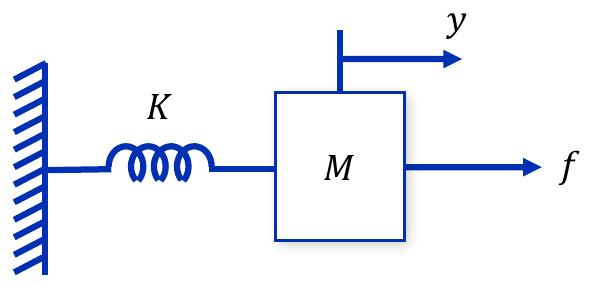

*그림 9. 댐퍼를 제거한 질량-스프링 시스템*

```math
M\ddot{y} + Ky = f \quad\Longrightarrow\quad \frac{Y(s)}{F(s)} = \frac{1}{Ms^2 + K} = \frac{1}{K}\cdot\frac{K/M}{s^2 + K/M}, \qquad \omega_n = \sqrt{\frac{K}{M}}, \quad \zeta = 0
```

1.4절의 위치 제어시스템에서 $B = 0$으로 둔 경우와 특성방정식이 같다. $K = 1$이고 단위 계단 힘을 가하면 $y(t) = 1 - \cos\omega_n t$이다. $M = 0.25$이면 $\omega_n = \sqrt{1/0.25} = 2$ rad/s로 주기가 $2\pi/2 \approx 3.14$ s이고, $M = 1$이면 $\omega_n = 1$ rad/s로 주기가 $2\pi \approx 6.28$ s이다. 질량이 작을수록 더 빨리 진동하지만, 어느 경우에도 진동은 줄어들지 않는다(그림 10).

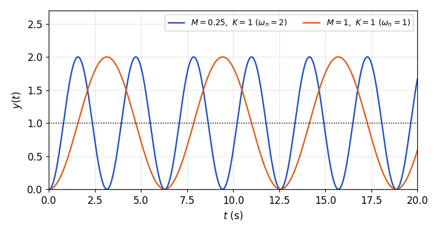

*그림 10. 질량-스프링 시스템의 단위 계단 응답*

### 2.4 근이 우반평면에 있는 경우: 음의 감쇠

$\zeta < 0$이면 근의 실수부 $-\zeta\omega_n$이 양수가 되어 근이 복소평면의 오른쪽 절반, 즉 **우반평면(right half-plane, RHP)** 에 놓인다. 이 경우를 **음의 감쇠(negative damping)** 라 한다. 응답의 지수 함수 $e^{-\zeta\omega_n t}$는 지수가 양수이므로 시간이 지날수록 커져 발산한다.

- $-1 < \zeta < 0$이면 근은 우반평면의 켤레 복소근이고, 응답은 진폭이 지수적으로 커지는 진동이다.
- $\zeta = -1$이면 근은 $s = +\omega_n$의 중근이고, $\zeta < -1$이면 서로 다른 두 양의 실근이다. 응답은 진동 없이 지수적으로 발산한다.

물리적으로 양의 감쇠는 운동 에너지를 열로 소모하지만, 음의 감쇠는 운동 방향으로 힘을 더해 에너지를 공급하는 것과 같다. 그래서 작은 흔들림도 점점 커진다.

### 2.5 예제: 음의 마찰을 갖는 시스템

1.4절의 위치 제어시스템에서 $M = 2$, $K = 18$은 그대로 두고 마찰 계수를 $B = -0.6$으로 바꾼다. 폐루프 전달함수와 매개변수는 다음과 같다.

```math
\frac{Y(s)}{R(s)} = \frac{18}{2s^2 - 0.6s + 18} = \frac{9}{s^2 - 0.3s + 9}, \qquad \omega_n = 3, \qquad 2\zeta\omega_n = -0.3 \Rightarrow \zeta = -0.05
```

극점은 $-\zeta\omega_n \pm j\omega_n\sqrt{1 - \zeta^2} = 0.15 \pm j2.996$으로 우반평면에 있다. 응답의 포락선은 $1 \pm e^{0.15t}/\sqrt{1 - \zeta^2}$이므로, 예를 들어 $t = 20$ s에서 $e^{0.15 \times 20} = e^3 \approx 20.1$이 되어 진동의 진폭이 20 정도까지 커진다(그림 11).

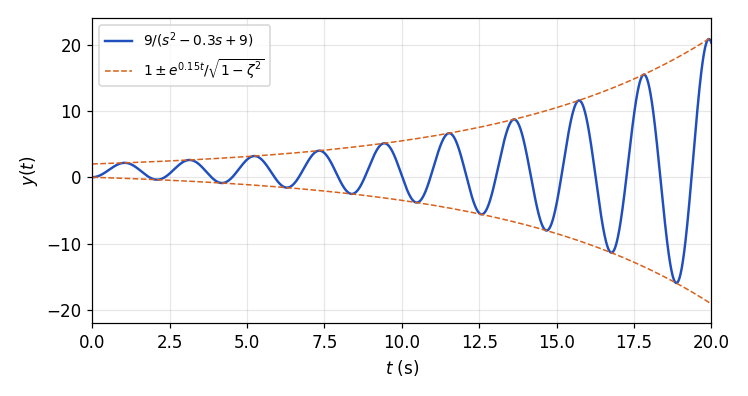

*그림 11. 음의 감쇠를 갖는 시스템의 단위 계단 응답*

### 2.6 감쇠비에 따른 극점의 궤적

$\omega_n$을 고정하고 $\zeta$를 $+\infty$에서 $-\infty$까지 줄여 가면 두 극점은 그림 12의 궤적을 그린다. 화살표는 $\zeta$가 줄어드는 방향이다.

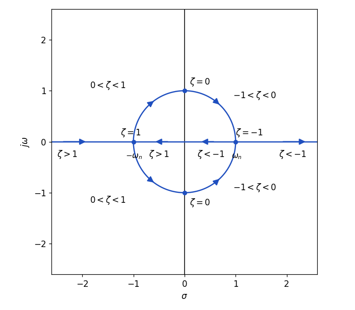

*그림 12. 감쇠비의 변화에 따른 극점의 궤적*

1. **$\zeta > 1$ (과감쇠):** 두 극점은 음의 실수축 위에 있다. 하나는 $-\omega_n$보다 왼쪽에서, 다른 하나는 $-\omega_n$과 원점 사이에서 $\zeta$가 줄어듦에 따라 $-\omega_n$으로 다가간다.
2. **$\zeta = 1$ (임계 감쇠):** 두 극점이 $-\omega_n$에서 만난다.
3. **$0 < \zeta < 1$ (부족 감쇠):** 두 극점이 실수축을 떠나 켤레 복소근이 되고, 원점에서의 거리가 $\omega_n$으로 일정하므로 반지름 $\omega_n$인 원의 왼쪽 반원 위를 따라 허수축으로 다가간다.
4. **$\zeta = 0$ (비감쇠):** 두 극점이 허수축 위의 $\pm j\omega_n$에 이른다.
5. **$-1 < \zeta < 0$ (음의 감쇠):** 두 극점이 원의 오른쪽 반원 위를 따라 양의 실수축으로 다가간다.
6. **$\zeta \le -1$ (음의 감쇠):** 두 극점이 $+\omega_n$에서 만난 뒤 양의 실수축 위에서 하나는 원점 쪽으로, 다른 하나는 $+\infty$ 쪽으로 갈라진다.

궤적은 허수축에 대해 좌우 대칭이다. $\zeta$를 $-\zeta$로 바꾸면 근 $-\zeta\omega_n \pm \omega_n\sqrt{\zeta^2 - 1}$의 실수부 부호만 바뀌기 때문이다.

### 2.7 극점의 위치와 단위 계단 응답의 관계

그림 13은 $\omega_n = 1$에서 여섯 가지 감쇠비의 극점 위치와 단위 계단 응답을 나란히 그린 것이다.

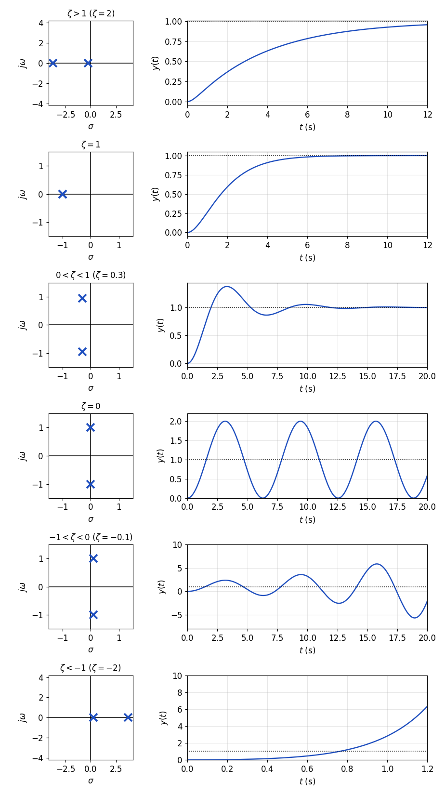

*그림 13. 감쇠비에 따른 극점의 위치와 단위 계단 응답*

| 감쇠비 | 응답 유형 | 극점의 위치 | 단위 계단 응답 |
|:-----|:-----|:-----|:-----|
| $\zeta > 1$ | 과감쇠 | 음의 실수축 위의 서로 다른 두 점 | 진동 없이 천천히 1로 수렴한다 |
| $\zeta = 1$ | 임계 감쇠 | 음의 실수축 위의 중근 $-\omega_n$ | 진동 없이 1로 수렴하며, 초과가 없는 응답 중 가장 빠르다 |
| $0 < \zeta < 1$ | 부족 감쇠 | 좌반평면의 켤레 복소근 | 목표값을 넘었다가 진동하며 1로 수렴한다 |
| $\zeta = 0$ | 비감쇠 | 허수축 위의 $\pm j\omega_n$ | 0과 2 사이에서 진폭이 일정한 진동을 계속한다 |
| $-1 < \zeta < 0$ | 음의 감쇠 | 우반평면의 켤레 복소근 | 진폭이 커지는 진동으로 발산한다 |
| $\zeta \le -1$ | 음의 감쇠 | 양의 실수축 위의 두 점 | 진동 없이 발산한다 |

*표 5. 감쇠비에 따른 극점의 위치와 단위 계단 응답*

> **핵심:** 극점이 **좌반평면(left half-plane, LHP)**, 즉 실수부가 음수인 영역에 있으면 응답이 최종값으로 수렴하고, 허수축 위에 있으면 진동이 줄지 않으며, 우반평면에 있으면 발산한다. 극점의 실수부 부호가 응답이 자리 잡을 수 있는지를 정하며, 이것이 3절의 안정도이다.

---

<br>

## 3. 제어시스템의 안정도

### 3.1 불안정한 시스템과 안정한 시스템

분자는 같고 분모가 다른 두 시스템의 단위 계단 응답을 비교한다.

**불안정한(unstable) 시스템.** $\dfrac{Y(s)}{R(s)} = G(s) = \dfrac{2}{s^2 + s - 2} = \dfrac{2}{(s-1)(s+2)}$의 극점은 $1$과 $-2$이다. 단위 계단 응답을 부분분수로 전개한다.

```math
Y(s) = \frac{2}{s(s-1)(s+2)} = \frac{A}{s} + \frac{B}{s-1} + \frac{C}{s+2}, \qquad A = \frac{2}{(-1)(2)} = -1, \quad B = \frac{2}{(1)(3)} = \frac{2}{3}, \quad C = \frac{2}{(-2)(-3)} = \frac{1}{3}
```

```math
y(t) = -1 + \frac{2}{3}e^{t} + \frac{1}{3}e^{-2t}, \qquad t \ge 0
```

우반평면의 극점 $s = 1$이 만드는 항 $\frac{2}{3}e^{t}$가 끝없이 커지므로 출력은 무한대로 발산한다.

**안정한(stable) 시스템.** $\dfrac{Y(s)}{R(s)} = G(s) = \dfrac{2}{s^2 + 3s + 2} = \dfrac{2}{(s+1)(s+2)}$는 7주차의 예제 1이며, 단위 계단 응답은 $y(t) = 1 - 2e^{-t} + e^{-2t}$이다. 두 극점 $-1$, $-2$가 모두 좌반평면에 있어 지수 항이 사라지고 출력은 1로 수렴한다.

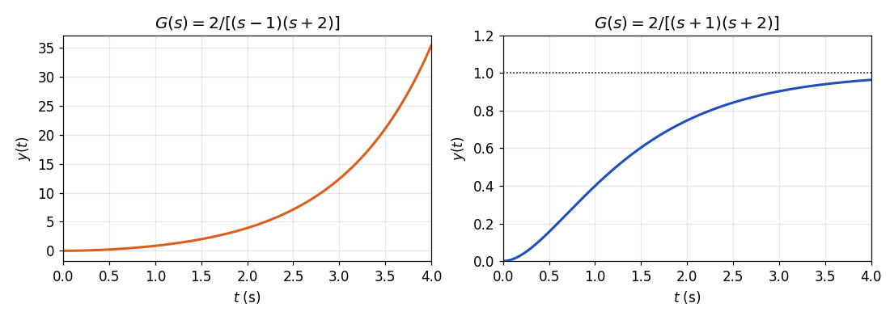

*그림 14. 불안정한 시스템과 안정한 시스템의 단위 계단 응답*

두 예에서 다음을 알 수 있다. 시스템이 불안정하지 않으려면 출력 함수가 무한대로 발산하는 지수 함수를 한 개라도 포함하지 않아야 한다. 출력 함수가 포함하는 지수 함수의 형태는 전달함수의 극점이 결정하므로, 시스템이 안정한 시스템이 되려면 전달함수의 모든 극점의 실수부가 0보다 작아야 한다. 또한 제어시스템의 과도 성능이나 정상 상태 성능을 평가하기 전에, 시스템 응답의 일반해의 항이 0으로 수렴하는지, 즉 정상 상태가 존재할 수 있는 시스템인지를 먼저 알아보는 것이 중요하다. 불안정한 시스템에서는 7주차와 1절의 성능 지표가 의미를 잃는다.

### 3.2 안정도의 정의

일반적인 전달함수를 분자와 분모의 다항식, 또는 영점 $z_i$와 극점 $p_i$로 쓴다.

```math
G_T(s) = \frac{Y(s)}{R(s)} = \frac{b_ms^m + b_{m-1}s^{m-1} + \cdots + b_1s + b_0}{s^n + a_{n-1}s^{n-1} + \cdots + a_1s + a_0} = K\,\frac{(s - z_1)(s - z_2)\cdots(s - z_m)}{(s - p_1)(s - p_2)\cdots(s - p_n)}
```

극점이 모두 서로 다르면, 입력에 대한 응답을 부분분수로 전개했을 때 시스템의 극점마다 지수 항이 하나씩 생기고, 입력의 극점에서 특수해 $y_p(t)$가 생긴다.

```math
y(t) = K_1e^{p_1t} + K_2e^{p_2t} + \cdots + K_ne^{p_nt} + y_p(t)
```

시스템이 안정하려면 지수 함수의 모든 항이 0으로 수렴해야 한다. 극점이 복소수 $p_i = \sigma_i + j\omega_i$이면 $\vert e^{p_it}\vert = e^{\sigma_it}$이므로, 각 항이 0으로 수렴하는 조건은 실수부만으로 정해진다.

```math
\mathrm{Re}\lbrace p_i \rbrace< 0, \qquad i = 1, 2, \ldots, n
```

즉 특성방정식 $s^n + a_{n-1}s^{n-1} + \cdots + a_1s + a_0 = 0$의 모든 근의 실수부가 0보다 작아야 한다. 영점은 각 항의 계수 $K_i$의 크기만 바꿀 뿐 수렴 여부에는 영향을 주지 않는다.

**다중 극점을 갖는 경우.** 전달함수가 $G_T(s) = K(s - z_1)\cdots(s - z_m)/(s - p_1)^n$처럼 같은 극점을 $n$번 가지면, 부분분수 전개에 $1/(s - p_1)^k$ 꼴의 항이 생기고 그 역변환은 $t^{k-1}e^{p_1t}$에 비례한다.

```math
y(t) = K_1e^{p_1t} + K_2te^{p_1t} + \cdots + K_nt^{n-1}e^{p_1t} + y_p(t)
```

$\mathrm{Re}\lbrace p_1 \rbrace< 0$이면 지수 함수의 감소 속도가 다항식의 증가 속도보다 빠르므로 $t^ke^{p_1t} \to 0$이고, 일반해의 모든 항이 0으로 수렴한다. 따라서 다중 극점이 있어도 안정 조건은 같다.

> **[미적분학]** $a > 0$이면 모든 자연수 $k$에 대해 $\lim_{t\to\infty} t^ke^{-at} = 0$이다. $t^k/e^{at}$은 $\infty/\infty$ 꼴이므로 로피탈 정리를 $k$번 적용하면 $k!/(a^ke^{at}) \to 0$을 얻는다. 즉 지수 함수는 어떤 다항식보다도 빠르게 커진다.

### 3.3 BIBO 안정도

> **용어 정의:** 유한한 크기의 입력 신호가 입력되면 출력의 크기도 항상 유한한 시스템을 **BIBO 안정(bounded-input bounded-output stable)** 하다고 한다. 크기가 유한하다는 것은 모든 시간에서 $\vert r(t)\vert \le M_r$을 만족하는 상수 $M_r$이 있다는 뜻이다.

전달함수가 유리함수인 선형 시불변 시스템의 BIBO 안정도는 전달함수(분자와 분모의 공통 인수를 약분한 것)의 극점이 모두 좌반평면에 존재하는지 아닌지로 결정된다. 극점이 모두 좌반평면에 있으면 BIBO 안정하고, 하나라도 우반평면이나 허수축 위에 있으면 BIBO 안정하지 않다.

허수축 위의 극점은 따로 주의해야 한다. 허수축 위에 겹치지 않는 극점이 있고 나머지 극점이 모두 좌반평면에 있으면, 입력이 없을 때의 응답은 발산하지도 사라지지도 않고 일정한 진폭으로 남는다. 이런 시스템을 **임계 안정(marginally stable)** 이라 한다 [1]. 임계 안정인 시스템은 BIBO 안정하지 않다. 유한한 입력 가운데 출력을 무한히 키우는 입력이 있기 때문이다.

- 적분기 $G(s) = 1/s$(원점의 극점)에 유한한 단위 계단 입력을 넣으면 출력 $Y = 1/s^2$, 즉 $y(t) = t$가 끝없이 커진다.
- 비감쇠 시스템 $G(s) = 1/(s^2 + 1)$(극점 $`\pm j`$)에 같은 진동수의 유한한 입력 $r(t) = \sin t$를 넣으면 $Y = 1/(s^2 + 1)^2$이고 $y(t) = \frac{1}{2}(\sin t - t\cos t)$가 되어 진폭이 시간에 비례하여 커진다. 이를 **공진(resonance)** 이라 한다.

허수축 위에 겹친 극점이 있으면 입력이 없어도 $t\cos\omega t$ 같은 항이 생겨 발산하므로 불안정하다.

| 극점의 위치 | 안정도 |
|:-----|:-----|
| 모든 극점이 좌반평면에 있다 | 안정, BIBO 안정 |
| 허수축 위에 겹치지 않는 극점이 있고 나머지는 좌반평면에 있다 | 임계 안정, BIBO 안정하지 않음 |
| 우반평면에 극점이 있거나 허수축 위에 겹친 극점이 있다 | 불안정 |

*표 6. 극점의 위치에 따른 안정도 판정*

### 3.4 계수의 부호로 보는 필요조건

차수가 높은 특성방정식은 근을 직접 구하기 어렵다. **Routh-Hurwitz 판별법(Routh-Hurwitz criterion)** 은 다음 형태의 방정식이 우반평면에 근을 몇 개나 가지는지를 근을 구하지 않고 판정하는 방법이다.

```math
s^n + a_{n-1}s^{n-1} + \cdots + a_1s + a_0 = 0
```

Routh-Hurwitz 판별법을 적용하기 전에 방정식 계수의 부호를 먼저 조사할 필요가 있다. 방정식의 계수 중 한 개라도 0과 같거나 0보다 작은 계수가 있으면 모든 근이 좌반평면에 있다고 할 수 없다. 그 이유를 3차 방정식으로 확인한다. 방정식이 0보다 작은 한 개의 실수 근 $-a$와 실수부가 0보다 작은 두 개의 켤레 복소수 근 $-b \pm jc$를 가진다고 가정한다($a > 0$, $`b > 0`$).

```math
(s + a)\left[(s + b)^2 + c^2\right] = s^3 + (a + 2b)\,s^2 + (2ab + b^2 + c^2)\,s + a(b^2 + c^2)
```

위의 식을 전개하면 $a$, $b$가 양수이므로 모든 항의 계수가 0보다 크다. 일반적으로 좌반평면의 실근 $-a$는 계수가 양수인 인수 $s + a$를, 좌반평면의 켤레 복소근 $-b \pm jc$는 계수가 양수인 인수 $s^2 + 2bs + b^2 + c^2$을 만들고, 계수가 모두 양수인 다항식끼리 곱하면 계수가 모두 양수이다. 즉 모든 항의 계수가 0보다 큰 것은 모든 근이 좌반평면에 있을 **필요조건**이다.


*그림 15. 모든 근이 좌반평면에 있을 조건과 계수 조건의 포함 관계*

그림 15처럼 모든 근이 좌반평면에 있는 다항식은 계수가 모두 양수인 다항식의 일부일 뿐이다. 따라서 방정식의 계수 중 0과 같거나 0보다 작은 계수가 있다면 모든 근이 좌반평면에 있다고 할 수 없으므로, Routh-Hurwitz 판별법을 적용하기 전에 이미 안정하지 않다고 판정된다(불안정하거나 기껏해야 임계 안정이다). 따라서 안정성 판정에 Routh 표가 필요한 것은 계수가 모두 양수일 때이며, 계수의 부호와 관계없이 우반평면 근의 개수를 세는 데에는 Routh 표를 그대로 쓸 수 있다. 2차 이하의 다항식에서는 계수가 모두 양수라는 조건이 충분조건이기도 하다. $s^2 + a_1s + a_0$의 두 근은 합이 $-a_1 < 0$, 곱이 $a_0 > 0$이므로 둘 다 음의 실근이거나 실수부가 $-a_1/2 < 0$인 켤레 복소근이기 때문이다.

> **주의:** 3차 이상에서는 계수가 모두 양수여도 불안정할 수 있다. 3.6절의 예제 1과 예제 2가 그런 예이다. 맨 앞 계수가 음수이면 방정식 전체에 $-1$을 곱하여 맨 앞 계수를 양수로 만든 뒤 판단한다.

### 3.5 Routh 표와 Routh-Hurwitz 판별법

특성방정식 $a_ns^n + a_{n-1}s^{n-1} + \cdots + a_1s + a_0 = 0$ ($`a_n > 0`$)에 대해 다음과 같은 **Routh 표(Routh array)** 를 만든다. 첫째 행에는 $a_n$부터 하나 걸러 계수를, 둘째 행에는 $a_{n-1}$부터 하나 걸러 계수를 적고, 없는 계수는 0으로 둔다.

| 행 | 1열 | 2열 | 3열 | $\cdots$ |
|:-----|:-----|:-----|:-----|:-----|
| $s^n$ | $a_n$ | $a_{n-2}$ | $a_{n-4}$ | $\cdots$ |
| $s^{n-1}$ | $a_{n-1}$ | $a_{n-3}$ | $a_{n-5}$ | $\cdots$ |
| $s^{n-2}$ | $b_1$ | $b_2$ | $b_3$ | $\cdots$ |
| $s^{n-3}$ | $c_1$ | $c_2$ | $c_3$ | $\cdots$ |
| $s^{n-4}$ | $d_1$ | $d_2$ | $d_3$ | $\cdots$ |
| $\vdots$ | $\vdots$ | | | |
| $s^0$ | | | | |

*표 7. Routh 표의 구성*

셋째 행부터는 바로 위 두 행으로 계산한다. 새 값은 위 두 행의 첫째 열과 구하려는 값의 오른쪽 열로 만든 2×2 행렬식에 $-1$을 곱하고, 바로 위 행의 첫째 값으로 나눈 것이다.

```math
b_1 = \frac{-\begin{vmatrix} a_n & a_{n-2} \\ a_{n-1} & a_{n-3} \end{vmatrix}}{a_{n-1}} = \frac{a_{n-1}a_{n-2} - a_na_{n-3}}{a_{n-1}}, \qquad b_2 = \frac{-\begin{vmatrix} a_n & a_{n-4} \\ a_{n-1} & a_{n-5} \end{vmatrix}}{a_{n-1}} = \frac{a_{n-1}a_{n-4} - a_na_{n-5}}{a_{n-1}}
```

```math
c_1 = \frac{b_1a_{n-3} - a_{n-1}b_2}{b_1}, \qquad c_2 = \frac{b_1a_{n-5} - a_{n-1}b_3}{b_1}, \qquad d_1 = \frac{c_1b_2 - b_1c_2}{c_1}
```

특성방정식이 $s^n + a_{n-1}s^{n-1} + \cdots$처럼 맨 앞 계수가 1이면 $a_n = 1$을 넣어 $b_1 = (a_{n-1}a_{n-2} - a_{n-3})/a_{n-1}$이 된다. 이 계산을 $s^0$ 행까지 반복하며, 행은 아래로 갈수록 짧아진다.

> **[선형대수학]** 첫째 행이 $(p, q)$, 둘째 행이 $(r, u)$인 2×2 행렬의 행렬식은 주대각선의 곱에서 반대 대각선의 곱을 뺀 $pu - qr$이다. 따라서 $b_1$의 분자는 $-(a_na_{n-3} - a_{n-2}a_{n-1}) = a_{n-1}a_{n-2} - a_na_{n-3}$이다.

> **핵심:** **Routh-Hurwitz 판별법.** Routh 표의 가장 왼쪽 열(첫째 열)의 값들이 부호를 바꾸는 횟수가 특성방정식이 우반평면에 가지는 근의 개수이다. 시스템이 안정하려면 첫째 열의 값이 모두 양의 부호를 가져야 한다.

> **참고:** 어떤 행 전체에 양수를 곱하거나 양수로 나누어도 첫째 열의 부호는 바뀌지 않으므로, 계산을 간단히 하기 위해 그렇게 해도 결과는 같다 [1].

### 3.6 예제 1과 예제 2

**예제 1.** $s^5 + 2s^4 + 3s^3 + 4s^2 + 5s + 2 = 0$의 우반평면 근의 개수를 구한다.

모든 계수가 양수이므로 필요조건은 만족한다. Routh 표의 처음 두 행은 $(1, 3, 5)$와 $(2, 4, 2)$이고, 나머지 행을 차례로 계산한다.

1. $s^3$ 행: $\dfrac{2 \cdot 3 - 1 \cdot 4}{2} = 1$, $\dfrac{2 \cdot 5 - 1 \cdot 2}{2} = 4$
2. $s^2$ 행: $\dfrac{1 \cdot 4 - 2 \cdot 4}{1} = -4$, $\dfrac{1 \cdot 2 - 2 \cdot 0}{1} = 2$
3. $s^1$ 행: $\dfrac{(-4) \cdot 4 - 1 \cdot 2}{-4} = \dfrac{-18}{-4} = \dfrac{9}{2}$
4. $s^0$ 행: $\dfrac{\frac{9}{2} \cdot 2 - (-4) \cdot 0}{\frac{9}{2}} = 2$

| 행 | 1열 | 2열 | 3열 |
|:-----|:-----|:-----|:-----|
| $s^5$ | $1$ | $3$ | $5$ |
| $s^4$ | $2$ | $4$ | $2$ |
| $s^3$ | $1$ | $4$ | |
| $s^2$ | $-4$ | $2$ | |
| $s^1$ | $9/2$ | | |
| $s^0$ | $2$ | | |

*표 8. 예제 1의 Routh 표*

가장 왼쪽 열 $1, 2, 1, -4, \frac{9}{2}, 2$의 부호는 $1 \to -4$에서 한 번, $-4 \to \frac{9}{2}$에서 한 번, 모두 두 번 바뀌므로 우반평면에 두 개의 근을 가진다. 실제 근은 $s = 0.3571 \pm j1.3262$, $-1.0627 \pm j0.8194$, $-0.5888$로, 실수부가 양수인 켤레 복소근 한 쌍이 있다. 모든 계수가 양수인데도 불안정한 예이다.

**예제 2.** $2s^4 + s^3 + 3s^2 + 5s + 10 = 0$의 우반평면 근의 개수를 구한다.

맨 앞 계수가 1이 아니므로 $a_n = 2$를 그대로 써서 일반식으로 계산한다. 처음 두 행은 $(2, 3, 10)$과 $(1, 5, 0)$이다.

1. $s^2$ 행: $\dfrac{1 \cdot 3 - 2 \cdot 5}{1} = -7$, $\dfrac{1 \cdot 10 - 2 \cdot 0}{1} = 10$
2. $s^1$ 행: $\dfrac{(-7) \cdot 5 - 1 \cdot 10}{-7} = \dfrac{-45}{-7} = \dfrac{45}{7}$
3. $s^0$ 행: $\dfrac{\frac{45}{7} \cdot 10 - (-7) \cdot 0}{\frac{45}{7}} = 10$

| 행 | 1열 | 2열 | 3열 |
|:-----|:-----|:-----|:-----|
| $s^4$ | $2$ | $3$ | $10$ |
| $s^3$ | $1$ | $5$ | $0$ |
| $s^2$ | $-7$ | $10$ | |
| $s^1$ | $45/7$ | | |
| $s^0$ | $10$ | | |

*표 9. 예제 2의 Routh 표*

첫째 열 $2, 1, -7, \frac{45}{7}, 10$의 부호가 두 번 바뀌므로 우반평면에 두 개의 근이 있다. 실제 근은 $0.7555 \pm j1.4444$와 $-1.0055 \pm j0.9331$이다.

### 3.7 특별한 경우 1: 첫째 열에 0이 나오는 경우

가장 왼쪽 열의 값이 0이 나오고 같은 행의 다른 열에는 0이 아닌 값이 나오면, 다음 행을 계산할 때 0으로 나누어야 하므로 표를 계속 만들 수 없다. 이때는 0의 자리에 무한히 작은, 그러나 0은 아니라고 가정한 양수 $\varepsilon$을 넣은 후 진행하고, 마지막에 $\varepsilon \to 0^{+}$으로 보내어 첫째 열의 부호를 센다 [1].

| 행 | 1열 | 2열 | 3열 |
|:-----|:-----|:-----|:-----|
| $s^n$ | $1$ | $a_{n-2}$ | $a_{n-4}$ |
| $s^{n-1}$ | $a_{n-1}$ | $a_{n-3}$ | $a_{n-5}$ |
| $s^{n-2}$ | $0 \to \varepsilon$ | $b_2$ | |
| $s^{n-3}$ | $\vdots$ | | |

*표 10. 첫째 열에 나온 0을 ε으로 바꾸는 방법*

**예제 3.** $s^5 + 2s^4 + 3s^3 + 6s^2 + 5s + 2 = 0$의 우반평면 근의 개수를 구한다.

처음 두 행은 $(1, 3, 5)$와 $(2, 6, 2)$이다. $s^3$ 행의 첫째 값이 $(2 \cdot 3 - 1 \cdot 6)/2 = 0$이고 둘째 값은 $(2 \cdot 5 - 1 \cdot 2)/2 = 4$이므로, 0을 $\varepsilon$으로 바꾼다.

1. $s^3$ 행: $\varepsilon$, $4$
2. $s^2$ 행: $\dfrac{\varepsilon \cdot 6 - 2 \cdot 4}{\varepsilon} = 6 - \dfrac{8}{\varepsilon} \approx -\dfrac{8}{\varepsilon}$, $\dfrac{\varepsilon \cdot 2 - 2 \cdot 0}{\varepsilon} = 2$
3. $s^1$ 행: $\dfrac{\left(6 - \frac{8}{\varepsilon}\right) \cdot 4 - \varepsilon \cdot 2}{6 - \frac{8}{\varepsilon}} = 4 - \dfrac{2\varepsilon^2}{6\varepsilon - 8} \to 4$
4. $s^0$ 행: $2$

| 행 | 1열 | 2열 | 3열 |
|:-----|:-----|:-----|:-----|
| $s^5$ | $1$ | $3$ | $5$ |
| $s^4$ | $2$ | $6$ | $2$ |
| $s^3$ | $\varepsilon$ | $4$ | |
| $s^2$ | $-8/\varepsilon$ | $2$ | |
| $s^1$ | $4$ | | |
| $s^0$ | $2$ | | |

*표 11. 예제 3의 Routh 표*

$\varepsilon$이 작은 양수이면 $-8/\varepsilon$은 절댓값이 매우 큰 음수이다. 첫째 열의 부호는 $+, +, +, -, +, +$로 두 번 바뀌므로 우반평면에 두 개의 근이 있다. 실제 근은 $s = 0.3226 \pm j1.5490$, $-0.5414 \pm j0.4671$, $-1.5624$이다.

### 3.8 특별한 경우 2: 한 행 전체가 0이 되는 경우

어떤 행의 값이 모두 0이 되는 경우도 있다. 이는 특성방정식이 원점에 대해 대칭인 근, 예를 들어 크기가 같고 부호가 반대인 실근 쌍($`\pm a`$), 허수축 위의 근 쌍($`\pm j\omega`$), 네 복소근 $\pm\sigma \pm j\omega$를 가질 때 생긴다. 이때는 다음 순서로 표를 이어 간다 [1].

1. 0이 된 행의 바로 위 행으로 **보조 다항식(auxiliary polynomial)** $A(s)$를 만든다. 그 행이 $s^k$ 행이면 값들을 차례로 $s^k, s^{k-2}, s^{k-4}, \ldots$의 계수로 쓴다.
2. $dA/ds$의 계수로 0이 된 행을 바꾸고, 나머지 행을 평소대로 계산한다.
3. 보조 방정식 $A(s) = 0$의 근은 원래 특성방정식의 근이기도 하므로, 이를 풀어 대칭인 근을 직접 확인한다.

**예제 4.** $s^3 + 2s^2 + s + 2 = 0$을 판정한다.

처음 두 행은 $(1, 1)$과 $(2, 2)$이고, $s^1$ 행은 $(2 \cdot 1 - 1 \cdot 2)/2 = 0$으로 행 전체가 0이 된다. 바로 위 $s^2$ 행 $(2, 2)$로 보조 다항식 $A(s) = 2s^2 + 2$를 만들고, $dA/ds = 4s$의 계수 4로 $s^1$ 행을 바꾼다. $s^0$ 행은 $(4 \cdot 2 - 2 \cdot 0)/4 = 2$이다.

| 행 | 1열 | 2열 |
|:-----|:-----|:-----|
| $s^3$ | $1$ | $1$ |
| $s^2$ | $2$ | $2$ |
| $s^1$ | $0 \to 4$ | |
| $s^0$ | $2$ | |

*표 12. 예제 4의 Routh 표*

첫째 열 $1, 2, 4, 2$에는 부호 변화가 없으므로 우반평면의 근은 없다. 그러나 보조 방정식 $2s^2 + 2 = 0$에서 $s = \pm j$가 허수축 위의 근으로 나온다. 실제로 $s^3 + 2s^2 + s + 2 = (s + 2)(s^2 + 1)$이다. 따라서 이 시스템은 임계 안정이며 BIBO 안정하지 않다.

> **주의:** 한 행 전체가 0이 되는 경우에는 첫째 열에 부호 변화가 없어도 안정하다고 결론 내리면 안 된다. 보조 방정식의 근이 허수축 위에 있는지 반드시 확인해야 한다.

### 3.9 안정한 이득의 범위

Routh 표는 이득 같은 매개변수가 들어 있는 특성방정식에도 쓸 수 있어서, 시스템이 안정한 매개변수의 범위를 구하는 데 쓰인다. 플랜트가 $G(s) = 1/[s(s+1)(s+2)]$이고 제어기가 이득 $K$인 단위 피드백 시스템의 특성방정식은 $1 + KG(s) = 0$에 분모를 곱하여 얻는다.

```math
s(s+1)(s+2) + K = s^3 + 3s^2 + 2s + K = 0
```

| 행 | 1열 | 2열 |
|:-----|:-----|:-----|
| $s^3$ | $1$ | $2$ |
| $s^2$ | $3$ | $K$ |
| $s^1$ | $(6 - K)/3$ | |
| $s^0$ | $K$ | |

*표 13. 이득 K가 들어 있는 3차 특성방정식의 Routh 표*

$s^1$ 행은 $(3 \cdot 2 - 1 \cdot K)/3 = (6 - K)/3$이다. 첫째 열이 모두 양수이려면 $6 - K > 0$이고 $K > 0$이어야 하므로, 안정한 이득의 범위는 $0 < K < 6$이다. $K = 6$이면 $s^1$ 행 전체가 0이 되고, 보조 방정식 $3s^2 + 6 = 0$에서 $s = \pm j\sqrt{2}$가 폐루프 극점이 되어 출력이 각진동수 $\sqrt{2} \approx 1.41$ rad/s로 지속 진동한다. $K > 6$이면 두 극점이 우반평면으로 넘어가 불안정해진다. 7주차에서 언급한 대로, 차수가 높은 시스템에서는 이득을 너무 키우면 불안정해진다.

---

<br>

## 개념 적용

1.4절의 질량-댐퍼 위치 제어시스템($M = 2$, $`B = 6`$)에서 제어기 이득 $K$만 바꾸면, 폐루프 전달함수가 $\dfrac{K/2}{s^2 + 3s + K/2}$이므로 $\omega_n = \sqrt{K/2}$, $\zeta = 3/(2\omega_n)$이고 $\zeta\omega_n = 1.5$는 $K$와 무관하다.

| $K$ | $\omega_n$ (rad/s) | $\zeta$ | 최대 초과량 | 최고점 시간 | 2% 정착 시간 (근사 $`4/(\zeta\omega_n)`$) | 2% 정착 시간 (실제) |
|:-----|:-----|:-----|:-----|:-----|:-----|:-----|
| $4.5$ | $1.5$ | $1$ | $`0\%`$ | 없음 | 해당 없음 (임계 감쇠) | $3.89$ s |
| $9$ | $2.12$ | $0.707$ | $`4.3\%`$ | $2.09$ s | $2.67$ s | $2.81$ s |
| $18$ | $3$ | $0.5$ | $`16.3\%`$ | $1.21$ s | $2.67$ s | $2.69$ s |
| $72$ | $6$ | $0.25$ | $`44.4\%`$ | $0.54$ s | $2.67$ s | $2.35$ s |

*표 14. 질량-댐퍼 위치 제어시스템에서 이득에 따른 과도 성능 지표*

이득을 키우면 극점이 실수부 $-1.5$를 유지한 채 위아래로 멀어진다. 그래서 최고점 시간은 짧아지지만 최대 초과량이 커지고, 포락선이 같으므로 정착 시간은 거의 줄지 않는다. 최대 초과량을 10% 이하로 하려면 1.6절의 식에서 $\zeta \ge 0.591$이어야 하므로 $\omega_n \le 1.5/0.591 = 2.54$, 즉 $K \le 2\omega_n^2 \approx 12.9$이다.

**T/F 점검:**

| 문장 | 판단과 근거 |
|:-----|:------------|
| 감쇠비가 같을 때 고유 진동수를 두 배로 하면 최대 초과량도 두 배가 된다. | **F.** 최대 초과량 $e^{-\zeta\pi/\sqrt{1 - \zeta^2}}$는 $\zeta$에만 의존한다. 최고점 시간과 정착 시간이 절반이 된다. |
| 2차 시스템의 정착 시간은 극점의 실수부 크기 $\zeta\omega_n$에 반비례한다. | **T.** 포락선 $e^{-\zeta\omega_n t}$로 어림하면 $t_s \approx 4/(\zeta\omega_n)$ ($`\pm 2\%`$)이다. |
| 비감쇠 시스템의 단위 계단 응답은 1로 천천히 수렴한다. | **F.** $1 - \cos\omega_n t$로 0과 2 사이에서 진동을 계속한다. |
| 특성방정식의 계수가 모두 양수이면 시스템은 안정하다. | **F.** 필요조건일 뿐이며, 3차 이상에서는 3.6절의 예제처럼 불안정할 수 있다. |
| 적분기 $1/s$는 입력이 없으면 출력이 발산하지 않으므로 BIBO 안정하다. | **F.** 유한한 계단 입력에 대해 출력 $t$가 끝없이 커지므로 BIBO 안정하지 않다. |
| Routh 표의 첫째 열의 부호 변화 횟수는 우반평면 근의 개수와 같다. | **T.** 이것이 Routh-Hurwitz 판별법이다. |
| Routh 표에서 한 행 전체가 0이 되고 첫째 열에 부호 변화가 없으면 시스템은 안정하다. | **F.** 보조 방정식의 근이 허수축 위에 있을 수 있으므로 임계 안정일 수 있다. |

---

<br>

## 요약

| 개념 | 핵심 요약 |
|:--------|:------------|
| 고유 진동수의 영향 | $\zeta$가 같으면 $\omega_n$은 극점과 원점 사이의 거리이자 응답의 시간 척도이며, 클수록 응답이 빠르고 모양은 같다. |
| 감쇠비의 영향 | $\omega_n$이 같으면 극점은 반지름 $\omega_n$인 원 위에 있고, $\zeta$가 클수록 허수축에서 멀어져 최대 초과량과 진동이 줄어든다. |
| 최고점 시간 | $\dot{y} = 0$에서 $\sin\omega_d t = 0$이므로 $t_p = \pi/\omega_d = \pi/(\omega_n\sqrt{1 - \zeta^2})$이다. |
| 최대 초과량 | $M_p = e^{-\zeta\pi/\sqrt{1 - \zeta^2}}$로 $\zeta$에만 의존하며, 거꾸로 $\zeta = -\ln M_p/\sqrt{\pi^2 + \ln^2M_p}$이다. |
| 정착 시간 | 포락선으로 어림하여 $t_s \approx 3.2/(\zeta\omega_n)$ ($`\pm 5\%`$), $4/(\zeta\omega_n)$ ($`\pm 2\%`$)이며 극점의 실수부 크기에 반비례한다. |
| 상승 시간 | 0%에서 100%까지는 $(\pi - \cos^{-1}\zeta)/\omega_d$이고, 10%에서 90%까지는 $\zeta$가 0.5에서 0.6 근처일 때 약 $1.8/\omega_n$이다. |
| 임계 감쇠와 비감쇠 | $\zeta = 1$은 중근 $-\omega_n$으로 초과 없는 응답 중 가장 빠르고, $\zeta = 0$은 $\pm j\omega_n$으로 $1 - \cos\omega_n t$의 지속 진동이다. |
| 음의 감쇠 | $\zeta < 0$이면 극점이 우반평면에 있어 응답이 진동하면서 발산하거나($`-1 < \zeta < 0`$) 진동 없이 발산한다($`\zeta \le -1`$). |
| 극점의 궤적 | $\zeta$가 줄면 극점은 음의 실수축에서 $-\omega_n$으로 모인 뒤 반지름 $\omega_n$인 원을 따라 허수축을 지나 우반평면으로 간다. |
| 안정도 | 전달함수의 모든 극점의 실수부가 0보다 작으면 일반해의 모든 항이 0으로 수렴하여 안정하다. |
| BIBO 안정과 임계 안정 | 선형 시불변 시스템은 모든 극점이 좌반평면에 있을 때 BIBO 안정하며, 허수축 위에 겹치지 않는 극점이 있는 임계 안정은 BIBO 안정하지 않다. |
| 계수의 필요조건 | 모든 근이 좌반평면에 있으려면 모든 계수가 같은 부호이고 0이 아니어야 하며, 3차 이상에서는 충분조건이 아니다. |
| Routh-Hurwitz 판별법 | Routh 표의 첫째 열의 부호 변화 횟수가 우반평면 근의 개수이며, 안정하려면 첫째 열이 모두 양수여야 한다. |
| Routh 표의 특별한 경우 | 첫째 열의 0은 $\varepsilon$으로 바꾸어 진행하고, 한 행 전체가 0이면 위 행의 보조 다항식을 미분한 계수로 바꾸며 그 근을 따로 확인한다. |

---

<br>

## 점검 문제

1. **고유 진동수의 영향:** 감쇠비를 고정하고 고유 진동수를 두 배로 하면 최고점 시간, 최대 초과량, 정착 시간은 각각 어떻게 바뀌는가?

   <details>
   <summary>정답</summary>

   응답이 $\omega_n t$만의 함수이므로 모양은 같고 시간 축만 절반이 된다. 따라서 최고점 시간 $\pi/(\omega_n\sqrt{1 - \zeta^2})$과 정착 시간 $\approx 4/(\zeta\omega_n)$은 절반이 되고, $\zeta$에만 의존하는 최대 초과량은 변하지 않는다. 극점은 같은 반직선 위에서 원점으로부터 두 배 먼 곳으로 옮겨 간다.

   </details>

2. **과도 성능 지표의 계산:** $G_T(s) = \dfrac{25}{s^2 + 6s + 25}$의 $\omega_n$, $\zeta$, $\omega_d$, 최고점 시간, 최대 초과량, 2% 정착 시간을 구하라.

   <details>
   <summary>정답</summary>

   $\omega_n^2 = 25$에서 $\omega_n = 5$ rad/s, $2\zeta\omega_n = 6$에서 $\zeta = 0.6$이다. $\omega_d = 5\sqrt{1 - 0.36} = 4$ rad/s이므로 $t_p = \pi/4 \approx 0.785$ s이다. $M_p = e^{-0.6\pi/0.8} = e^{-2.356} \approx 0.095$, 즉 약 9.5%이다. $\zeta\omega_n = 3$이므로 2% 정착 시간은 $4/3 \approx 1.33$ s로 어림한다.

   </details>

3. **감쇠비의 설계:** 최대 초과량이 20%가 되는 감쇠비를 구하라.

   <details>
   <summary>정답</summary>

   $\ln 0.2 = -1.609$이므로 $\zeta = 1.609/\sqrt{\pi^2 + 1.609^2} = 1.609/\sqrt{9.870 + 2.590} = 1.609/3.530 \approx 0.456$이다. 최대 초과량을 20% 이하로 하려면 $\zeta \ge 0.456$이어야 한다.

   </details>

4. **최고점 시간의 유도:** 부족 감쇠 응답에서 $\dot{y}(t) = 0$을 만족하는 시간 중 $n = 1$인 시간을 최고점 시간으로 택하는 이유와, $n = 2$인 시간에서 출력이 어떤 상태인지 설명하라.

   <details>
   <summary>정답</summary>

   $\dot{y}(t) = \dfrac{\omega_n}{\sqrt{1 - \zeta^2}}e^{-\zeta\omega_n t}\sin\omega_d t$이므로 $\omega_d t = n\pi$에서 기울기가 0이다. $n = 0$은 출발점 $t = 0$이고, $0 < \omega_d t < \pi$에서는 $\sin\omega_d t > 0$이어서 출력이 증가하다가 $\omega_d t = \pi$에서 처음으로 증가가 멈추므로 $n = 1$이 첫 최댓값이다. $\pi < \omega_d t < 2\pi$에서는 기울기가 음수이므로 $n = 2$에서는 출력이 첫 극솟값(1보다 작은 값)에 있다.

   </details>

5. **극점과 응답:** 다음 극점을 갖는 2차 시스템의 단위 계단 응답의 모양을 쓰라. (가) $-2$, $-2$ (나) $\pm j3$ (다) $1 \pm j2$ (라) $-1 \pm j2$

   <details>
   <summary>정답</summary>

   (가)는 중근이므로 임계 감쇠로, 진동 없이 수렴한다. (나)는 허수축 위의 근이므로 비감쇠로, 각진동수 3 rad/s의 진동이 줄지 않고 계속된다. (다)는 우반평면의 켤레 복소근이므로 음의 감쇠로, 진폭이 $e^{t}$처럼 커지는 진동으로 발산한다. (라)는 좌반평면의 켤레 복소근이므로 부족 감쇠로, 목표값을 넘었다가 진동하며 수렴한다($\omega_n = \sqrt{5}$, $`\zeta = 1/\sqrt{5} \approx 0.447`$).

   </details>

6. **BIBO 안정도:** 극점이 $-1$, $\pm j2$인 시스템은 입력이 없을 때 출력이 발산하지 않는다. 이 시스템이 BIBO 안정하지 않음을 보이는 유한한 입력의 예를 들라.

   <details>
   <summary>정답</summary>

   허수축 위의 극점 $\pm j2$와 같은 진동수의 입력 $r(t) = \sin 2t$를 넣으면, 출력의 라플라스 변환에 $(s^2 + 4)^2$이 생겨 $t\cos 2t$ 꼴의 항이 나타난다. 입력의 크기는 1 이하로 유한하지만 출력의 진폭은 시간에 비례하여 커지는 공진이 일어나므로 BIBO 안정하지 않다. 이 시스템은 임계 안정이다.

   </details>

7. **Routh 표:** $s^3 + s^2 + 2s + 8 = 0$의 Routh 표를 만들고 우반평면 근의 개수를 구하라.

   <details>
   <summary>정답</summary>

   처음 두 행은 $(1, 2)$와 $(1, 8)$이다. $s^1$ 행은 $(1 \cdot 2 - 1 \cdot 8)/1 = -6$, $s^0$ 행은 $(-6 \cdot 8 - 1 \cdot 0)/(-6) = 8$이다. 첫째 열 $1, 1, -6, 8$의 부호가 두 번 바뀌므로 우반평면 근은 2개이다. 실제 근은 $-2$와 $0.5 \pm j1.936$이다.

   </details>

8. **계수의 필요조건:** $s^4 + 2s^3 - s^2 + 3s + 1 = 0$이 안정한 시스템의 특성방정식이 될 수 있는지 Routh 표를 만들지 않고 판단하고, Routh 표로 우반평면 근의 개수를 구하라.

   <details>
   <summary>정답</summary>

   $s^2$의 계수가 음수이므로 필요조건을 만족하지 않아 안정할 수 없다. Routh 표의 처음 두 행은 $(1, -1, 1)$과 $(2, 3, 0)$이고, $s^2$ 행은 $(2 \cdot (-1) - 1 \cdot 3)/2 = -5/2$, $(2 \cdot 1 - 0)/2 = 1$, $s^1$ 행은 $(-\frac{5}{2} \cdot 3 - 2 \cdot 1)/(-\frac{5}{2}) = 3.8$, $s^0$ 행은 $1$이다. 첫째 열 $1, 2, -2.5, 3.8, 1$의 부호가 두 번 바뀌므로 우반평면 근은 2개이다.

   </details>

9. **첫째 열의 0:** $s^4 + s^3 + 2s^2 + 2s + 3 = 0$의 우반평면 근의 개수를 구하라.

   <details>
   <summary>정답</summary>

   처음 두 행은 $(1, 2, 3)$과 $(1, 2, 0)$이다. $s^2$ 행의 첫째 값이 $(1 \cdot 2 - 1 \cdot 2)/1 = 0$이고 둘째 값은 $(1 \cdot 3 - 1 \cdot 0)/1 = 3$이므로 0을 $\varepsilon$으로 바꾼다. $s^1$ 행은 $(\varepsilon \cdot 2 - 1 \cdot 3)/\varepsilon = 2 - 3/\varepsilon$으로 큰 음수이고, $s^0$ 행은 3이다. 첫째 열의 부호 $+, +, +, -, +$가 두 번 바뀌므로 우반평면 근은 2개이다. 실제 근은 $0.406 \pm j1.293$, $-0.906 \pm j0.902$이다.

   </details>

10. **안정한 이득의 범위:** 플랜트가 $G(s) = 1/[s(s+2)(s+3)]$이고 제어기가 이득 $K$인 단위 피드백 시스템이 안정한 $K$의 범위와, 경계에서 생기는 지속 진동의 각진동수를 구하라.

    <details>
    <summary>정답</summary>

    특성방정식은 $s(s+2)(s+3) + K = s^3 + 5s^2 + 6s + K = 0$이다. Routh 표는 $(1, 6)$, $(5, K)$, $s^1$ 행 $(30 - K)/5$, $s^0$ 행 $K$이므로 안정한 범위는 $0 < K < 30$이다. $K = 30$이면 $s^1$ 행 전체가 0이 되고, 보조 방정식 $5s^2 + 30 = 0$에서 $s = \pm j\sqrt{6}$이므로 각진동수 $\sqrt{6} \approx 2.45$ rad/s로 지속 진동한다.

    </details>

---

<br>

## 참고 문헌

1. K. Ogata, *Modern Control Engineering*, 5th ed. Upper Saddle River, NJ, USA: Prentice Hall, 2010.
2. G. F. Franklin, J. D. Powell, and A. Emami-Naeini, *Feedback Control of Dynamic Systems*, 8th ed. Hoboken, NJ, USA: Pearson, 2019.
