# Week 9 Lecture — Control System Performance II

[Repository Guide](../../README.md) | [English](Concepts_Lecture.md) | [한국어](Concepts_Lecture.ko.md)

> **Last Updated:** 2026-11-04

> **Learning Objectives:**
> 1. Explain how the pole locations and the speed of the step response change when the natural frequency and the damping ratio change
> 2. Derive the peak time, maximum overshoot, and settling time formulas of an underdamped second-order system and apply them to a given system
> 3. Explain critical damping, the undamped case, and negative damping, and explain the relation between the pole trajectory over the damping ratio and the unit step response
> 4. Define the stability of a control system by the poles of its transfer function and distinguish BIBO stability from marginal stability
> 5. Build a Routh array to find the number of right-half-plane roots of a characteristic equation, and handle the cases of a zero in the first column and an entire row of zeros

---

## Table of Contents

- [1. Changes in Response Speed](#1-changes-in-response-speed)
  - [1.1 Underdamped Response and Poles](#11-underdamped-response-and-poles)
  - [1.2 Response as the Natural Frequency Changes](#12-response-as-the-natural-frequency-changes)
  - [1.3 Response as the Damping Ratio Changes](#13-response-as-the-damping-ratio-changes)
  - [1.4 Example: Position Control of a Mass-Damper System](#14-example-position-control-of-a-mass-damper-system)
  - [1.5 Peak Time and Maximum Overshoot](#15-peak-time-and-maximum-overshoot)
  - [1.6 Relation Between the Damping Ratio and Maximum Overshoot](#16-relation-between-the-damping-ratio-and-maximum-overshoot)
  - [1.7 Settling Time](#17-settling-time)
  - [1.8 Rise Time](#18-rise-time)
  - [1.9 Transient Performance Measures of the Example](#19-transient-performance-measures-of-the-example)
- [2. Response by Pole Location](#2-response-by-pole-location)
  - [2.1 A Double Root: Critically Damped](#21-a-double-root-critically-damped)
  - [2.2 Roots on the Imaginary Axis: Undamped](#22-roots-on-the-imaginary-axis-undamped)
  - [2.3 Example: Mass-Spring System](#23-example-mass-spring-system)
  - [2.4 Roots in the Right Half-Plane: Negative Damping](#24-roots-in-the-right-half-plane-negative-damping)
  - [2.5 Example: A System with Negative Friction](#25-example-a-system-with-negative-friction)
  - [2.6 Pole Trajectory over the Damping Ratio](#26-pole-trajectory-over-the-damping-ratio)
  - [2.7 Relation Between Pole Location and the Unit Step Response](#27-relation-between-pole-location-and-the-unit-step-response)
- [3. Stability of Control Systems](#3-stability-of-control-systems)
  - [3.1 Unstable and Stable Systems](#31-unstable-and-stable-systems)
  - [3.2 Definition of Stability](#32-definition-of-stability)
  - [3.3 BIBO Stability](#33-bibo-stability)
  - [3.4 A Necessary Condition from the Signs of the Coefficients](#34-a-necessary-condition-from-the-signs-of-the-coefficients)
  - [3.5 The Routh Array and the Routh-Hurwitz Criterion](#35-the-routh-array-and-the-routh-hurwitz-criterion)
  - [3.6 Examples 1 and 2](#36-examples-1-and-2)
  - [3.7 Special Case 1: A Zero in the First Column](#37-special-case-1-a-zero-in-the-first-column)
  - [3.8 Special Case 2: An Entire Row of Zeros](#38-special-case-2-an-entire-row-of-zeros)
  - [3.9 Range of Gain for Stability](#39-range-of-gain-for-stability)
- [Concept Applications](#concept-applications)
- [Summary](#summary)
- [Self-Check Questions](#self-check-questions)
- [References](#references)

---

 

## 1. Changes in Response Speed

### 1.1 Underdamped Response and Poles

Week 7 derived the unit step response of the standard second-order system $G_T(s) = \omega_n^2/(s^2 + 2\zeta\omega_n s + \omega_n^2)$. In the underdamped case with damping ratio $0 < \zeta < 1$, the response is the following.

$$
y(t) = 2\vert K_1\vert e^{-\zeta\omega_n t}\cos\left(\omega_n\sqrt{1 - \zeta^2}\,t + \angle K_1\right) + 1 = 1 - \frac{1}{\sqrt{1 - \zeta^2}}\,e^{-\zeta\omega_n t}\cos\left(\omega_n\sqrt{1 - \zeta^2}\,t - \phi\right), \qquad t \ge 0
$$

$$
\phi = \tan^{-1}\frac{\zeta}{\sqrt{1 - \zeta^2}}, \qquad \sigma = -\zeta\omega_n, \qquad \omega_d = \sqrt{(1 - \zeta^2)\,\omega_n^2} = \omega_n\sqrt{1 - \zeta^2}
$$

The poles are $s = \sigma \pm j\omega_d$, the distance from the origin to a pole is $\omega_n$, and the angle $\theta$ between the imaginary axis and the segment joining the origin and the pole satisfies $\sin\theta = \zeta$. This section changes $\omega_n$ and $\zeta$ one at a time to see how the poles and the response change, and derives the formulas for the measures of the speed and shape of the response.

### 1.2 Response as the Natural Frequency Changes

Fix the damping ratio at $\zeta = 0.2$ and change the natural frequency from $\omega_n = 1$ to $\omega_n = 2$. The poles move as follows.

$$
\omega_n = 1:\; s = -0.2 \pm j0.980, \qquad \omega_n = 2:\; s = -0.4 \pm j1.960
$$

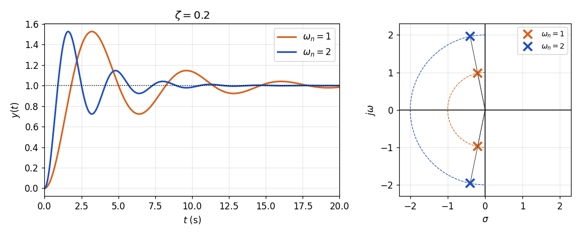

*Figure 1. Unit step responses and poles for natural frequencies 1 and 2 at damping ratio 0.2*

Since $\zeta$ is the same, the angle with the imaginary axis, $\theta = \sin^{-1}0.2 \approx 11.5^\circ$, is unchanged, and the poles move along the same rays to twice the distance from the origin. As seen in Week 7, the response is a function of $\omega_n t$ alone, so doubling $\omega_n$ keeps the shape of the response and halves the time axis. The time to the first peak drops from about 3.21 s to 1.60 s, but the height of the peak (a maximum overshoot of about 52.7%) stays the same.

### 1.3 Response as the Damping Ratio Changes

Now fix the natural frequency at $\omega_n = 1$ and vary the damping ratio from 0.1 to 0.8. Because the distance from the origin to the poles stays at $\omega_n = 1$, the poles move on the circle of radius 1, and as $\zeta$ grows they move away from the imaginary axis.

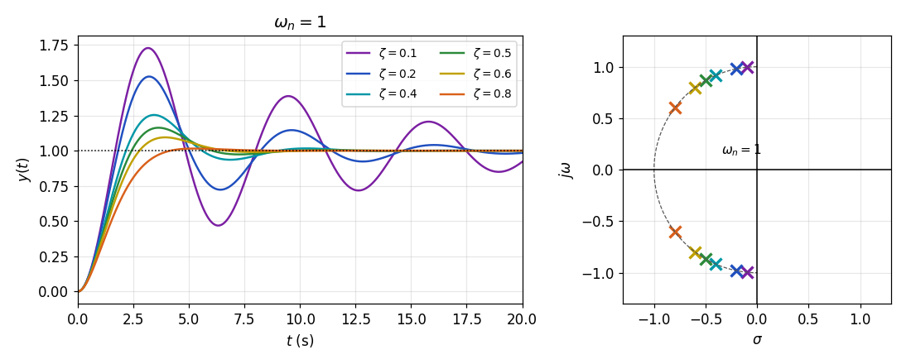

*Figure 2. Unit step responses and poles for several damping ratios at natural frequency 1*

As $\zeta$ grows, three things change together. First, the decay rate of the envelope, $\zeta\omega_n$, grows, so the oscillation dies out sooner. Second, the angular frequency of oscillation $\omega_d = \omega_n\sqrt{1 - \zeta^2}$ shrinks, so the time to the first peak grows slightly. Third, as Section 1.6 shows, the amount by which the output exceeds the target drops sharply.

| $\zeta$ | Poles | Maximum overshoot | Peak time ($\omega_n = 1$) |
|:-----|:-----|:-----|:-----|
| $0.1$ | $-0.1 \pm j0.995$ | $72.9\%$ | $3.16$ s |
| $0.2$ | $-0.2 \pm j0.980$ | $52.7\%$ | $3.21$ s |
| $0.4$ | $-0.4 \pm j0.917$ | $25.4\%$ | $3.43$ s |
| $0.5$ | $-0.5 \pm j0.866$ | $16.3\%$ | $3.63$ s |
| $0.6$ | $-0.6 \pm j0.800$ | $9.5\%$ | $3.93$ s |
| $0.8$ | $-0.8 \pm j0.600$ | $1.5\%$ | $5.24$ s |

*Table 1. Poles and response measures for several damping ratios at natural frequency 1*

> **Key Point:** The natural frequency $\omega_n$ sets the time scale (speed) of the response, and the damping ratio $\zeta$ sets its shape (how far the output exceeds the target and how long the oscillation lasts). For this reason, a second-order system is often designed by first choosing $\zeta$ from the allowed maximum overshoot and then choosing $\omega_n$ for the desired speed.

### 1.4 Example: Position Control of a Mass-Damper System

Removing the spring from the mass-spring-damper system of Week 4 gives the mass-damper system of Figure 3. When a force $f$ acts on the mass $M$, only the damper with viscous friction coefficient $B$ resists, so the equation of motion and transfer function are the following.

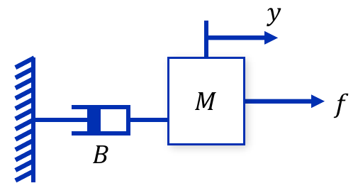

*Figure 3. Mass-damper system with the spring removed*

$$
M\ddot{y} + B\dot{y} = f \quad\Longrightarrow\quad \frac{Y(s)}{F(s)} = \frac{1}{s(Ms + B)}
$$

Build a feedback system around this plant with a proportional controller $K$ as in Figure 4. This applies a force $f = K(r - y)$ proportional to the position error.

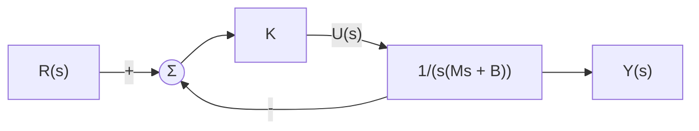

*Figure 4. Position control system for the mass-damper system*

Multiply the numerator and denominator of the closed-loop transfer function by $s(Ms + B)$, divide by $M$, and compare with the standard form.

$$
\frac{Y(s)}{R(s)} = \frac{\dfrac{K}{s(Ms + B)}}{1 + \dfrac{K}{s(Ms + B)}} = \frac{K}{Ms^2 + Bs + K} = \frac{K/M}{s^2 + (B/M)s + K/M}, \qquad \omega_n = \sqrt{\frac{K}{M}}, \quad \zeta = \frac{B}{2\sqrt{KM}}
$$

This closed-loop transfer function has the same form as that of a mass-spring-damper system with spring constant $K$. A force proportional to the position error plays the role of a spring's restoring force, so the controller gain $K$ acts as a virtual spring.

With $M = 2$, $B = 6$, and $K = 18$:

$$
\frac{Y(s)}{R(s)} = \frac{18}{2s^2 + 6s + 18} = \frac{9}{s^2 + 3s + 9}, \qquad \omega_n^2 = 9 \Rightarrow \omega_n = 3 \text{ rad/s}, \qquad 2\zeta\omega_n = 3 \Rightarrow \zeta = 0.5
$$

Since $0 < \zeta < 1$, the system is underdamped, and its poles are $-\zeta\omega_n \pm j\omega_n\sqrt{1 - \zeta^2} = -1.5 \pm j2.598$. The transient performance measures of this system are computed in Section 1.9 after the formulas of Sections 1.5 to 1.8 are derived.

### 1.5 Peak Time and Maximum Overshoot

**Deriving the peak time.** At the instant the output is largest, its slope is 0, so differentiate the unit step response and set it to 0. By the product rule, $\dfrac{d}{dt}\left[e^{-\zeta\omega_n t}\cos(\omega_d t - \phi)\right] = -\zeta\omega_n e^{-\zeta\omega_n t}\cos(\omega_d t - \phi) - \omega_d e^{-\zeta\omega_n t}\sin(\omega_d t - \phi)$; multiply this by $-1/\sqrt{1 - \zeta^2}$ and substitute $\omega_d = \omega_n\sqrt{1 - \zeta^2}$.

$$
\begin{aligned}
\dot{y}(t) &= \frac{\omega_n}{\sqrt{1 - \zeta^2}}\,e^{-\zeta\omega_n t}\left[\zeta\cos\left(\omega_n\sqrt{1 - \zeta^2}\,t - \phi\right) + \sqrt{1 - \zeta^2}\,\sin\left(\omega_n\sqrt{1 - \zeta^2}\,t - \phi\right)\right] \\
&= \frac{\omega_n}{\sqrt{1 - \zeta^2}}\,e^{-\zeta\omega_n t}\left[\sin\phi\cos\left(\omega_n\sqrt{1 - \zeta^2}\,t - \phi\right) + \cos\phi\sin\left(\omega_n\sqrt{1 - \zeta^2}\,t - \phi\right)\right] \\
&= \frac{\omega_n}{\sqrt{1 - \zeta^2}}\,e^{-\zeta\omega_n t}\sin\left(\omega_n\sqrt{1 - \zeta^2}\,t\right)
\end{aligned}
$$

The second line substitutes $\sin\phi = \zeta$ and $\cos\phi = \sqrt{1 - \zeta^2}$, which follow from $\tan\phi = \zeta/\sqrt{1 - \zeta^2}$, and the third line applies the angle addition formula $\sin(\alpha + \beta) = \sin\alpha\cos\beta + \cos\alpha\sin\beta$ with $\alpha = \phi$ and $\beta = \omega_d t - \phi$.

The exponential function is never 0, so $\dot{y}(t) = 0$ holds when $\sin(\omega_d t) = 0$, that is, when $\omega_d t = n\pi$.

$$
\dot{y}(t) = 0 \quad\Longrightarrow\quad t = \frac{n\pi}{\omega_n\sqrt{1 - \zeta^2}}, \qquad n = 0, 1, 2, \ldots
$$

There are several solutions: $n = 0$ is the starting point $t = 0$ (the step response of a second-order system starts with zero slope), odd $n$ give local maxima, and even $n$ give local minima. Among them, $n = 1$ is the time of the first maximum, that is, the peak time.

$$
t_p = \frac{\pi}{\omega_n\sqrt{1 - \zeta^2}} = \frac{\pi}{\omega_d}
$$

**Deriving the maximum overshoot.** At $t = t_p$, $\omega_d t_p = \pi$ and $\zeta\omega_n t_p = \zeta\pi/\sqrt{1 - \zeta^2}$. Also $\cos(\pi - \phi) = -\cos\phi = -\sqrt{1 - \zeta^2}$, which gives the following.

$$
y(t_p) = 1 - \frac{1}{\sqrt{1 - \zeta^2}}\,e^{-\zeta\pi/\sqrt{1 - \zeta^2}}\left(-\sqrt{1 - \zeta^2}\right) = 1 + e^{-\zeta\pi/\sqrt{1 - \zeta^2}}
$$

Since the steady-state value is $y_{ss} = 1$, the maximum overshoot is the following.

$$
M_p = \frac{y(t_p) - 1}{1} = e^{-\zeta\pi/\sqrt{1 - \zeta^2}}
$$

> **Key Point:** The peak time $t_p = \pi/\omega_d$ is inversely proportional to the imaginary part $\omega_d$ of the poles, and the maximum overshoot $M_p = e^{-\zeta\pi/\sqrt{1 - \zeta^2}}$ depends only on the damping ratio $\zeta$ and not on $\omega_n$. This is why the peak height stayed the same when $\omega_n$ changed in Section 1.2.

### 1.6 Relation Between the Damping Ratio and Maximum Overshoot

Figure 5 plots $M_p = e^{-\zeta\pi/\sqrt{1 - \zeta^2}}$ against $\zeta$. As $\zeta \to 0$, $M_p \to 1$ (100% overshoot), and as $\zeta$ grows it falls quickly, approaching 0 as $\zeta \to 1$.

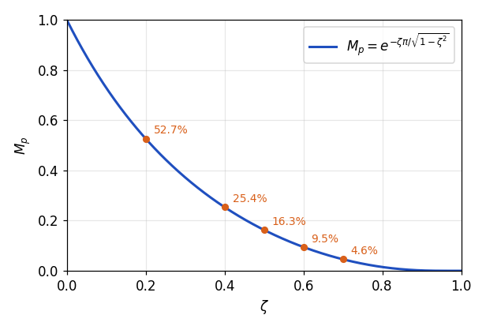

*Figure 5. Relation between the damping ratio and the maximum overshoot*

| $\zeta$ | $0.1$ | $0.2$ | $0.3$ | $0.4$ | $0.5$ | $0.6$ | $0.7$ | $0.8$ | $0.9$ |
|:-----|:-----|:-----|:-----|:-----|:-----|:-----|:-----|:-----|:-----|
| $M_p$ (%) | $72.9$ | $52.7$ | $37.2$ | $25.4$ | $16.3$ | $9.5$ | $4.6$ | $1.5$ | $0.15$ |

*Table 2. Maximum overshoot for several damping ratios*

Conversely, the damping ratio required for an allowed maximum overshoot can be found. Squaring both sides of $\ln M_p = -\zeta\pi/\sqrt{1 - \zeta^2}$ gives $(\ln M_p)^2(1 - \zeta^2) = \zeta^2\pi^2$, so:

$$
\zeta = \frac{-\ln M_p}{\sqrt{\pi^2 + (\ln M_p)^2}}
$$

For example, to keep the maximum overshoot at or below 5%, since $\ln 0.05 = -2.996$, the damping ratio must satisfy $\zeta \ge 2.996/\sqrt{9.870 + 8.974} \approx 0.69$.

### 1.7 Settling Time

To determine the settling time, the error band must be fixed first. Here the error band is set to 5% to find the **5% settling time**.

Since $\vert\cos(\cdot)\vert \le 1$, the underdamped response always lies between the two curves $1 \pm e^{-\zeta\omega_n t}/\sqrt{1 - \zeta^2}$. These two curves are called the **envelope** of the response. Finding the settling time from the exponential function multiplying the sinusoid alone, that is, finding when the envelope enters the $\pm 5\%$ band, gives an approximate settling time easily (Figure 6).

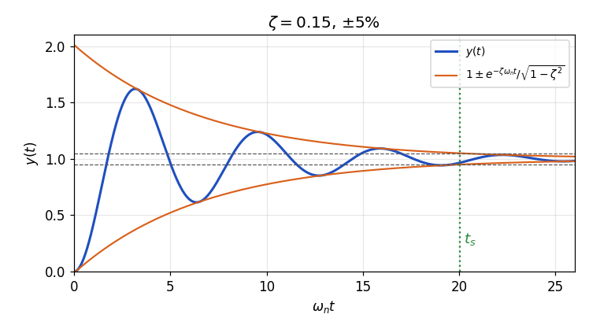

*Figure 6. Envelope of an underdamped response and the 5% settling time*

$$
\frac{e^{-\zeta\omega_n t_s}}{\sqrt{1 - \zeta^2}} = 0.05 \quad\Longrightarrow\quad -\zeta\omega_n t_s = \ln\left(0.05\sqrt{1 - \zeta^2}\right) \quad\Longrightarrow\quad \omega_n t_s = -\frac{\ln\left(0.05\sqrt{1 - \zeta^2}\right)}{\zeta}
$$

Figure 7 plots this expression against $\zeta$. For $\zeta$ from 0.1 up to about 0.7 the curve can be approximated by $3.2/\zeta$ within about 5%, so the 5% settling time can be estimated as follows.

$$
t_s \approx \frac{3.2}{\zeta\omega_n} \quad (\pm 5\%)
$$

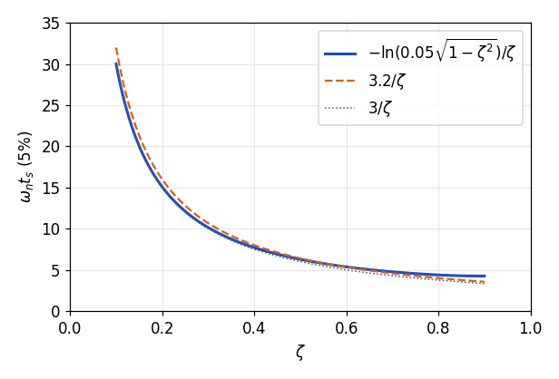

*Figure 7. The 5% settling time as a function of the damping ratio and its approximation*

Ignoring the effect of $\sqrt{1 - \zeta^2}$, $-\ln 0.05 \approx 3.0$ and $-\ln 0.02 \approx 3.9$, so many textbooks use the following approximations [1].

$$
t_s \approx \frac{3}{\zeta\omega_n} \quad (\pm 5\%), \qquad t_s \approx \frac{4}{\zeta\omega_n} \quad (\pm 2\%)
$$

In every form, the settling time is inversely proportional to the magnitude of the real part of the poles, $\zeta\omega_n = \vert\sigma\vert$. The farther to the left of the imaginary axis the poles lie, the sooner the response settles.

> **Caution:** These expressions are estimates from the envelope. The actual response crosses the band boundary when the cosine is not at an extreme, so the actual settling time can be shorter than the estimate, and when a small change in the damping ratio decides whether a particular peak crosses the boundary or not, the actual settling time changes discontinuously. For example, for the example of Section 1.4 the estimated 5% settling time is 2.1 s, while the actual value is 1.76 s (Section 1.9).

### 1.8 Rise Time

The rise time of a second-order system has no simple closed form, so two approaches are used.

**Rise time from 0% to 100%.** For oscillating responses, the time at which the output first reaches the final value 1 is sometimes used as the rise time [1]. $y(t) = 1$ requires $\cos(\omega_d t - \phi) = 0$, and this first holds when $\omega_d t - \phi = \pi/2$. Since $\pi/2 + \phi = \pi - \cos^{-1}\zeta$:

$$
t_r = \frac{\pi/2 + \phi}{\omega_d} = \frac{\pi - \cos^{-1}\zeta}{\omega_n\sqrt{1 - \zeta^2}}
$$

**Rise time from 10% to 90%.** The rise time under this definition is found by solving the response equation numerically. Its values for $\omega_n = 1$ are given in Table 3, and for moderate damping ($\zeta$ near 0.5 to 0.6) it is commonly approximated as $t_r \approx 1.8/\omega_n$ [2]. According to Table 3 this approximation fits well at $\zeta = 0.6$ and is about 10% larger than the actual value $1.64/\omega_n$ at $\zeta = 0.5$.

| $\zeta$ | $0.1$ | $0.2$ | $0.4$ | $0.5$ | $0.6$ | $0.7$ | $0.8$ |
|:-----|:-----|:-----|:-----|:-----|:-----|:-----|:-----|
| $\omega_n t_r$ (10% to 90%) | $1.10$ | $1.20$ | $1.46$ | $1.64$ | $1.85$ | $2.13$ | $2.47$ |

*Table 3. Rise time from 10% to 90% for several damping ratios*

The rise time is also inversely proportional to $\omega_n$ and grows slightly as $\zeta$ grows. Increasing the damping to reduce the maximum overshoot costs a slower start.

| Measure | Formula | Pole quantity that determines it |
|:-----|:-----|:-----|
| Peak time | $t_p = \pi/\omega_d$ | Imaginary part $\omega_d$ |
| Maximum overshoot | $M_p = e^{-\zeta\pi/\sqrt{1 - \zeta^2}}$ | Damping ratio $\zeta$ (angle with the imaginary axis) |
| Settling time | $t_s \approx 3.2/(\zeta\omega_n)$ ($\pm 5\%$), $4/(\zeta\omega_n)$ ($\pm 2\%$) | Magnitude of the real part $\zeta\omega_n$ |
| Rise time | $t_r = (\pi - \cos^{-1}\zeta)/\omega_d$ (0% to 100%), $\approx 1.8/\omega_n$ (10% to 90%) | Distance from the origin $\omega_n$ |

*Table 4. Formulas for the transient performance measures of an underdamped second-order system*

### 1.9 Transient Performance Measures of the Example

Apply the formulas above to the example of Section 1.4 ($\omega_n = 3$ rad/s, $\zeta = 0.5$). First, $\sqrt{1 - \zeta^2} = \sqrt{0.75} = 0.866$, $\omega_d = 3 \times 0.866 = 2.598$ rad/s, and $\zeta\omega_n = 1.5$.

1. **Peak time:** $t_p = \pi/2.598 \approx 1.209$ s.
2. **Maximum overshoot:** $\zeta\pi/\sqrt{1 - \zeta^2} = 0.5\pi/0.866 = 1.814$, so $M_p = e^{-1.814} \approx 0.163$, that is, 16.3%, and the maximum output is about 1.163.
3. **5% settling time:** The envelope expression gives $-\ln(0.05 \times 0.866)/1.5 = 3.140/1.5 \approx 2.09$ s, and the approximation gives $3.2/1.5 \approx 2.13$ s. The approximate 2% settling time is $4/1.5 \approx 2.67$ s.
4. **Rise time:** From 0% to 100% it is $(\pi - \cos^{-1}0.5)/2.598 = (\pi - \pi/3)/2.598 \approx 0.806$ s, and from 10% to 90% it is estimated as $1.8/3 = 0.6$ s.

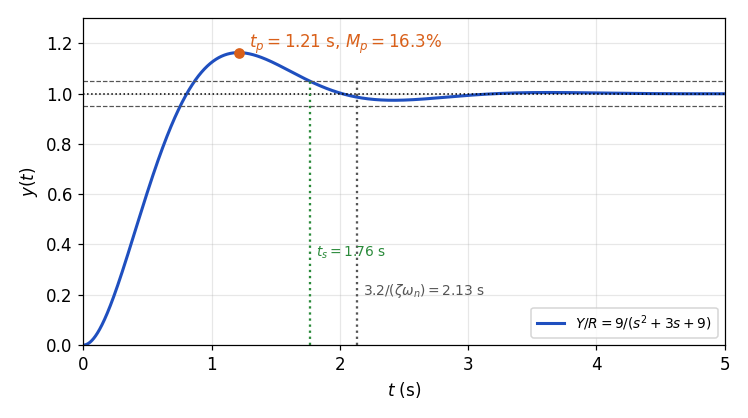

*Figure 8. Unit step response of the mass-damper position control system*

In the actual response of Figure 8, the peak time and maximum overshoot agree exactly with the formulas. The actual rise time from 10% to 90% is 0.546 s, the actual 5% settling time is 1.76 s, and the actual 2% settling time is 2.69 s. As the caution in Section 1.7 says, the 5% settling time is shorter than its estimate, and the 2% settling time is close to the approximation 2.67 s.

---

 

## 2. Response by Pole Location

Week 7 derived the responses for $\zeta > 1$, $\zeta = 1$, and $0 < \zeta < 1$. This section revisits critical damping and extends the discussion to damping ratios of zero and below, organizing the relation between pole location and response. In every case the poles are the roots $s = -\zeta\omega_n \pm \omega_n\sqrt{\zeta^2 - 1}$ of the characteristic equation $s^2 + 2\zeta\omega_n s + \omega_n^2 = 0$.

### 2.1 A Double Root: Critically Damped

If $\zeta = 1$, the expression under the square root becomes 0 and the two roots coincide at $s = -\omega_n$. This case is called **critically damped**, and its unit step response, derived in Week 7, is the following.

$$
y(t) = 1 - e^{-\omega_n t}(1 + \omega_n t), \qquad t \ge 0
$$

Critical damping is the boundary between oscillating responses (underdamped) and non-oscillating ones (overdamped). For the same $\omega_n$, it is the fastest among the responses that do not exceed the target. For example, with $\omega_n = 1$ the 5% settling time is 4.74 s for critical damping ($\zeta = 1$), but it grows to 11.5 s for the overdamped $\zeta = 2$ because of the pole $-0.27$ near the origin. If a little overshoot is allowed, however, the response can settle sooner: with $\zeta = 0.7$ the 5% settling time drops to 2.90 s at the cost of a 4.6% maximum overshoot.

### 2.2 Roots on the Imaginary Axis: Undamped

If $\zeta = 0$, the characteristic equation becomes $s^2 + \omega_n^2 = 0$, and its roots $s = \pm j\omega_n$ lie on the imaginary axis. This case is called **undamped**. Substituting $\zeta = 0$ ($\phi = 0$) into the underdamped response, or inverting the partial fraction expansion $Y(s) = \omega_n^2/[s(s^2 + \omega_n^2)] = 1/s - s/(s^2 + \omega_n^2)$, gives the following.

$$
y(t) = 1 - \cos\omega_n t, \qquad t \ge 0
$$

A damping ratio of 0 means continuous oscillation without any damping. The output swings between 0 and 2 forever and never settles at its final value. The angular frequency of this oscillation is $\omega_d = \omega_n\sqrt{1 - 0} = \omega_n$. For this reason $\omega_n$ is also called the **undamped natural frequency**, the angular frequency of oscillation when there is no damping at all.

### 2.3 Example: Mass-Spring System

Removing the damper from the mass-spring-damper system gives the mass-spring system of Figure 9. With spring constant $K$, the equation of motion and transfer function are the following.

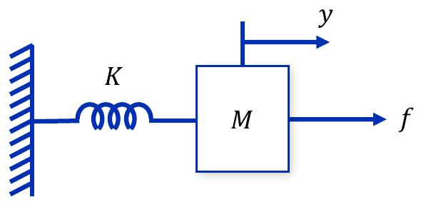

*Figure 9. Mass-spring system with the damper removed*

$$
M\ddot{y} + Ky = f \quad\Longrightarrow\quad \frac{Y(s)}{F(s)} = \frac{1}{Ms^2 + K} = \frac{1}{K}\cdot\frac{K/M}{s^2 + K/M}, \qquad \omega_n = \sqrt{\frac{K}{M}}, \quad \zeta = 0
$$

This system has the same characteristic equation as the position control system of Section 1.4 with $B = 0$. With $K = 1$ and a unit step force, $y(t) = 1 - \cos\omega_n t$. For $M = 0.25$, $\omega_n = \sqrt{1/0.25} = 2$ rad/s and the period is $2\pi/2 \approx 3.14$ s; for $M = 1$, $\omega_n = 1$ rad/s and the period is $2\pi \approx 6.28$ s. The smaller the mass, the faster the oscillation, but in neither case does the oscillation die out (Figure 10).

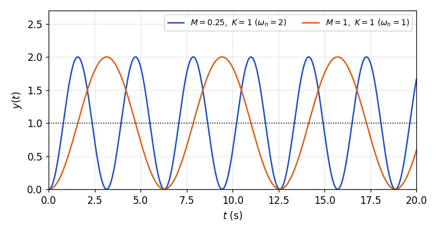

*Figure 10. Unit step responses of the mass-spring system*

### 2.4 Roots in the Right Half-Plane: Negative Damping

If $\zeta < 0$, the real part of the roots, $-\zeta\omega_n$, is positive, and the roots lie in the right half of the complex plane, the **right half-plane (RHP)**. This case is called **negative damping**. The exponential function $e^{-\zeta\omega_n t}$ in the response has a positive exponent, so it grows over time and diverges.

- If $-1 < \zeta < 0$, the roots are complex conjugates in the right half-plane, and the response is an oscillation whose amplitude grows exponentially.
- If $\zeta = -1$, the roots are a double root at $s = +\omega_n$, and if $\zeta < -1$, they are two distinct positive real roots. The response diverges exponentially without oscillation.

Physically, positive damping dissipates kinetic energy as heat, while negative damping is like pushing in the direction of motion and thus supplying energy. Even a small disturbance therefore grows larger and larger.

### 2.5 Example: A System with Negative Friction

In the position control system of Section 1.4, keep $M = 2$ and $K = 18$ and change the friction coefficient to $B = -0.6$. The closed-loop transfer function and parameters are the following.

$$
\frac{Y(s)}{R(s)} = \frac{18}{2s^2 - 0.6s + 18} = \frac{9}{s^2 - 0.3s + 9}, \qquad \omega_n = 3, \qquad 2\zeta\omega_n = -0.3 \Rightarrow \zeta = -0.05
$$

The poles are $-\zeta\omega_n \pm j\omega_n\sqrt{1 - \zeta^2} = 0.15 \pm j2.996$, in the right half-plane. The envelope of the response is $1 \pm e^{0.15t}/\sqrt{1 - \zeta^2}$, so at $t = 20$ s, for example, $e^{0.15 \times 20} = e^3 \approx 20.1$, and the amplitude of the oscillation grows to about 20 (Figure 11).

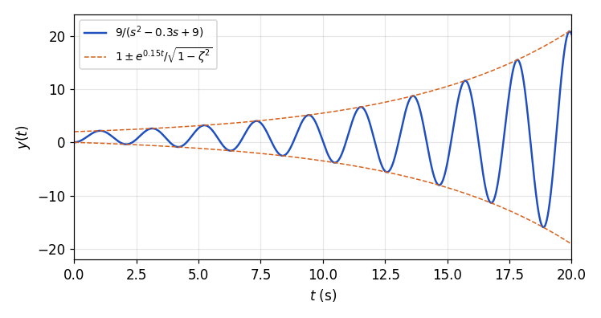

*Figure 11. Unit step response of a system with negative damping*

### 2.6 Pole Trajectory over the Damping Ratio

With $\omega_n$ fixed, decreasing $\zeta$ from $+\infty$ to $-\infty$ makes the two poles trace the trajectory of Figure 12. The arrows point in the direction of decreasing $\zeta$.

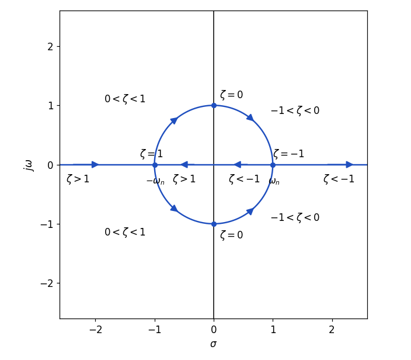

*Figure 12. Trajectory of the poles as the damping ratio changes*

1. **$\zeta > 1$ (overdamped):** Both poles lie on the negative real axis. As $\zeta$ decreases, one approaches $-\omega_n$ from the left and the other from between $-\omega_n$ and the origin.
2. **$\zeta = 1$ (critically damped):** The two poles meet at $-\omega_n$.
3. **$0 < \zeta < 1$ (underdamped):** The two poles leave the real axis as complex conjugates, and since their distance from the origin stays $\omega_n$, they move along the left half of the circle of radius $\omega_n$ toward the imaginary axis.
4. **$\zeta = 0$ (undamped):** The two poles reach $\pm j\omega_n$ on the imaginary axis.
5. **$-1 < \zeta < 0$ (negative damping):** The two poles move along the right half of the circle toward the positive real axis.
6. **$\zeta \le -1$ (negative damping):** The two poles meet at $+\omega_n$ and then split along the positive real axis, one toward the origin and the other toward $+\infty$.

The trajectory is symmetric about the imaginary axis, because replacing $\zeta$ by $-\zeta$ changes only the sign of the real part of the roots $-\zeta\omega_n \pm \omega_n\sqrt{\zeta^2 - 1}$.

### 2.7 Relation Between Pole Location and the Unit Step Response

Figure 13 shows the pole locations and unit step responses for six damping ratios side by side, with $\omega_n = 1$.

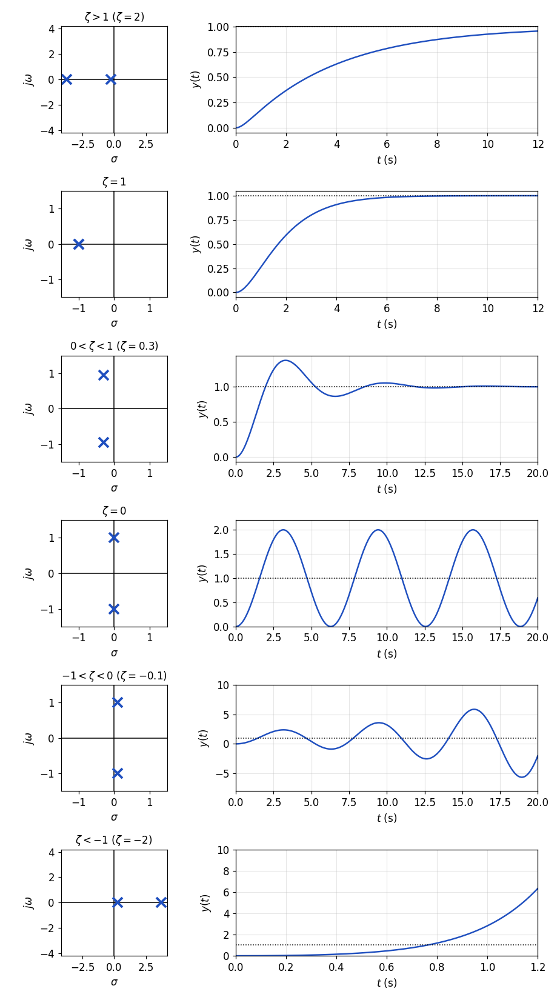

*Figure 13. Pole locations and unit step responses for several damping ratios*

| Damping ratio | Response type | Pole location | Unit step response |
|:-----|:-----|:-----|:-----|
| $\zeta > 1$ | Overdamped | Two distinct points on the negative real axis | Converges slowly to 1 without oscillation |
| $\zeta = 1$ | Critically damped | Double root $-\omega_n$ on the negative real axis | Converges to 1 without oscillation; fastest among responses without overshoot |
| $0 < \zeta < 1$ | Underdamped | Complex conjugate roots in the left half-plane | Exceeds the target, then converges to 1 while oscillating |
| $\zeta = 0$ | Undamped | $\pm j\omega_n$ on the imaginary axis | Keeps oscillating between 0 and 2 with constant amplitude |
| $-1 < \zeta < 0$ | Negative damping | Complex conjugate roots in the right half-plane | Diverges as an oscillation of growing amplitude |
| $\zeta \le -1$ | Negative damping | Two points on the positive real axis | Diverges without oscillation |

*Table 5. Pole location and unit step response for each range of the damping ratio*

> **Key Point:** If the poles lie in the **left half-plane (LHP)**, the region where the real part is negative, the response converges to its final value; if they lie on the imaginary axis, the oscillation does not die out; and if they lie in the right half-plane, the response diverges. The sign of the real part of the poles decides whether the response can settle, and this is the stability of Section 3.

---

 

## 3. Stability of Control Systems

### 3.1 Unstable and Stable Systems

Compare the unit step responses of two systems that have the same numerator and different denominators.

**An unstable system.** $\dfrac{Y(s)}{R(s)} = G(s) = \dfrac{2}{s^2 + s - 2} = \dfrac{2}{(s-1)(s+2)}$ has poles $1$ and $-2$. Expand the unit step response in partial fractions.

$$
Y(s) = \frac{2}{s(s-1)(s+2)} = \frac{A}{s} + \frac{B}{s-1} + \frac{C}{s+2}, \qquad A = \frac{2}{(-1)(2)} = -1, \quad B = \frac{2}{(1)(3)} = \frac{2}{3}, \quad C = \frac{2}{(-2)(-3)} = \frac{1}{3}
$$

$$
y(t) = -1 + \frac{2}{3}e^{t} + \frac{1}{3}e^{-2t}, \qquad t \ge 0
$$

The term $\frac{2}{3}e^{t}$ produced by the right-half-plane pole $s = 1$ grows without bound, so the output diverges to infinity.

**A stable system.** $\dfrac{Y(s)}{R(s)} = G(s) = \dfrac{2}{s^2 + 3s + 2} = \dfrac{2}{(s+1)(s+2)}$ is Example 1 of Week 7, and its unit step response is $y(t) = 1 - 2e^{-t} + e^{-2t}$. Both poles $-1$ and $-2$ lie in the left half-plane, so the exponential terms vanish and the output converges to 1.

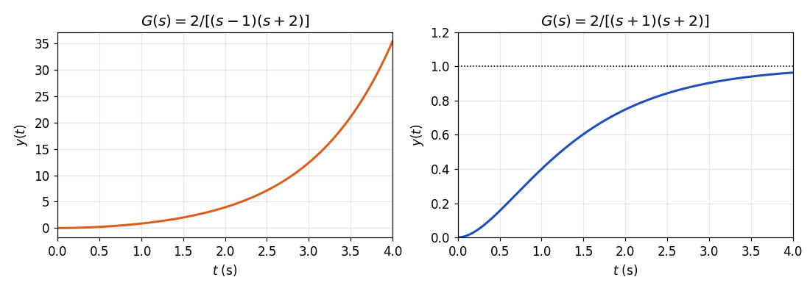

*Figure 14. Unit step responses of an unstable system and a stable system*

The two examples show the following. For a system not to be unstable, its output function must not contain even one exponential function that diverges to infinity. The forms of the exponential functions in the output are determined by the poles of the transfer function, so for a system to be stable, the real parts of all poles of its transfer function must be less than 0. Also, before evaluating the transient or steady-state performance of a control system, it is important to check first whether the terms of the general solution of its response converge to 0, that is, whether the system can have a steady state at all. For an unstable system, the performance measures of Week 7 and Section 1 lose their meaning.

### 3.2 Definition of Stability

Write a general transfer function as a ratio of polynomials, or in terms of its zeros $z_i$ and poles $p_i$.

$$
G_T(s) = \frac{Y(s)}{R(s)} = \frac{b_ms^m + b_{m-1}s^{m-1} + \cdots + b_1s + b_0}{s^n + a_{n-1}s^{n-1} + \cdots + a_1s + a_0} = K\,\frac{(s - z_1)(s - z_2)\cdots(s - z_m)}{(s - p_1)(s - p_2)\cdots(s - p_n)}
$$

If all poles are distinct, expanding the response to an input in partial fractions gives one exponential term for each system pole and a particular solution $y_p(t)$ from the poles of the input.

$$
y(t) = K_1e^{p_1t} + K_2e^{p_2t} + \cdots + K_ne^{p_nt} + y_p(t)
$$

For the system to be stable, every exponential term must converge to 0. If a pole is complex, $p_i = \sigma_i + j\omega_i$, then $\vert e^{p_it}\vert = e^{\sigma_it}$, so whether each term converges to 0 is decided by the real part alone.

$$
\mathrm{Re}\lbrace p_i \rbrace < 0, \qquad i = 1, 2, \ldots, n
$$

That is, every root of the characteristic equation $s^n + a_{n-1}s^{n-1} + \cdots + a_1s + a_0 = 0$ must have a real part less than 0. The zeros change only the sizes of the coefficients $K_i$ and do not affect convergence.

**Multiple poles.** If the transfer function has the same pole $n$ times, as in $G_T(s) = K(s - z_1)\cdots(s - z_m)/(s - p_1)^n$, the partial fraction expansion contains terms of the form $1/(s - p_1)^k$, whose inverse transforms are proportional to $t^{k-1}e^{p_1t}$.

$$
y(t) = K_1e^{p_1t} + K_2te^{p_1t} + \cdots + K_nt^{n-1}e^{p_1t} + y_p(t)
$$

If $\mathrm{Re}\lbrace p_1 \rbrace < 0$, the exponential function decays faster than the polynomial grows, so $t^ke^{p_1t} \to 0$ and every term of the general solution converges to 0. The stability condition is therefore the same even with multiple poles.

> **[Calculus]** If $a > 0$, then $\lim_{t\to\infty} t^ke^{-at} = 0$ for every natural number $k$. Since $t^k/e^{at}$ is of the form $\infty/\infty$, applying L'Hôpital's rule $k$ times gives $k!/(a^ke^{at}) \to 0$. That is, an exponential function grows faster than any polynomial.

### 3.3 BIBO Stability

> **Definition:** A system is called **BIBO stable (bounded-input bounded-output stable)** if a bounded input signal always produces a bounded output. A signal is bounded if there is a constant $M_r$ with $\vert r(t)\vert \le M_r$ for all time.

The BIBO stability of a linear time-invariant system with a rational transfer function is determined by whether all poles of the transfer function lie in the left half-plane. If all poles lie in the left half-plane, the system is BIBO stable; if even one lies in the right half-plane or on the imaginary axis, it is not BIBO stable.

Poles on the imaginary axis need separate attention. If there are non-repeated poles on the imaginary axis and all other poles lie in the left half-plane, the response with no input neither diverges nor dies out but stays at a constant amplitude. Such a system is called **marginally stable** [1]. A marginally stable system is not BIBO stable, because some bounded inputs make the output grow without bound.

- Feeding a bounded unit step input into the integrator $G(s) = 1/s$ (a pole at the origin) gives the output $Y = 1/s^2$, that is, $y(t) = t$, which grows without bound.
- Feeding the bounded input $r(t) = \sin t$ of the same frequency into the undamped system $G(s) = 1/(s^2 + 1)$ (poles $\pm j$) gives $Y = 1/(s^2 + 1)^2$ and $y(t) = \frac{1}{2}(\sin t - t\cos t)$, whose amplitude grows in proportion to time. This is called **resonance**.

If there are repeated poles on the imaginary axis, terms such as $t\cos\omega t$ appear even without an input and diverge, so the system is unstable.

| Pole location | Verdict |
|:-----|:-----|
| All poles lie in the left half-plane | Stable, BIBO stable |
| Non-repeated poles on the imaginary axis, the rest in the left half-plane | Marginally stable, not BIBO stable |
| A pole in the right half-plane or a repeated pole on the imaginary axis | Unstable |

*Table 6. Stability verdict by pole location*

### 3.4 A Necessary Condition from the Signs of the Coefficients

The roots of high-order characteristic equations are hard to find directly. The **Routh-Hurwitz criterion** is a method that decides how many roots an equation of the following form has in the right half-plane without finding the roots.

$$
s^n + a_{n-1}s^{n-1} + \cdots + a_1s + a_0 = 0
$$

Before applying the Routh-Hurwitz criterion, the signs of the coefficients of the equation should be examined first. If even one coefficient of the equation is equal to 0 or less than 0, it cannot be said that all roots lie in the left half-plane. Check the reason with a cubic equation. Suppose the equation has one real root $-a$ less than 0 and two complex conjugate roots $-b \pm jc$ with real part less than 0 ($a > 0$, $b > 0$).

$$
(s + a)\left[(s + b)^2 + c^2\right] = s^3 + (a + 2b)\,s^2 + (2ab + b^2 + c^2)\,s + a(b^2 + c^2)
$$

Expanding the expression above, all coefficients are greater than 0 because $a$ and $b$ are positive. In general, a real root $-a$ in the left half-plane gives a factor $s + a$ with positive coefficients, a complex conjugate pair $-b \pm jc$ in the left half-plane gives a factor $s^2 + 2bs + b^2 + c^2$ with positive coefficients, and a product of polynomials with all positive coefficients has all positive coefficients. That is, all coefficients being greater than 0 is a **necessary condition** for all roots to lie in the left half-plane.

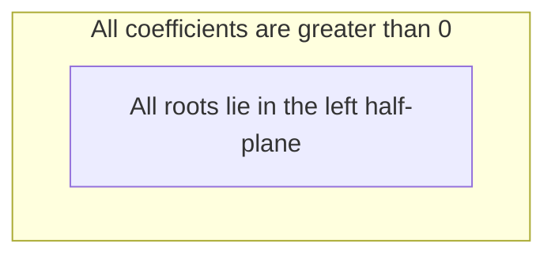

*Figure 15. Inclusion relation between the condition that all roots lie in the left half-plane and the coefficient condition*

As Figure 15 shows, the polynomials with all roots in the left half-plane are only a part of the polynomials with all positive coefficients. Therefore, if a coefficient of the equation is equal to 0 or less than 0, it cannot be said that all roots lie in the left half-plane, so the system is judged not stable before the Routh-Hurwitz criterion is applied (it is unstable or at best marginally stable). The Routh array is therefore needed to decide stability only when all coefficients are positive, and it can still be used to count the right half-plane roots whatever the signs of the coefficients. For polynomials of degree 2 or less, the condition that all coefficients are positive is also sufficient. The two roots of $s^2 + a_1s + a_0$ have sum $-a_1 < 0$ and product $a_0 > 0$, so they are either both negative real roots or complex conjugates with real part $-a_1/2 < 0$.

> **Caution:** For degree 3 and higher, a system can be unstable even when all coefficients are positive. Examples 1 and 2 of Section 3.6 are such cases. If the leading coefficient is negative, multiply the whole equation by $-1$ to make it positive before judging.

### 3.5 The Routh Array and the Routh-Hurwitz Criterion

For the characteristic equation $a_ns^n + a_{n-1}s^{n-1} + \cdots + a_1s + a_0 = 0$ ($a_n > 0$), build the following **Routh array**. Write every other coefficient starting from $a_n$ in the first row and every other coefficient starting from $a_{n-1}$ in the second row, setting missing coefficients to 0.

| Row | Column 1 | Column 2 | Column 3 | $\cdots$ |
|:-----|:-----|:-----|:-----|:-----|
| $s^n$ | $a_n$ | $a_{n-2}$ | $a_{n-4}$ | $\cdots$ |
| $s^{n-1}$ | $a_{n-1}$ | $a_{n-3}$ | $a_{n-5}$ | $\cdots$ |
| $s^{n-2}$ | $b_1$ | $b_2$ | $b_3$ | $\cdots$ |
| $s^{n-3}$ | $c_1$ | $c_2$ | $c_3$ | $\cdots$ |
| $s^{n-4}$ | $d_1$ | $d_2$ | $d_3$ | $\cdots$ |
| $\vdots$ | $\vdots$ | | | |
| $s^0$ | | | | |

*Table 7. Structure of the Routh array*

From the third row on, compute from the two rows directly above. Each new entry is $-1$ times the 2×2 determinant formed by the first column of the two rows above and the column to the right of the entry being computed, divided by the first entry of the row directly above.

$$
b_1 = \frac{-\begin{vmatrix} a_n & a_{n-2} \\ a_{n-1} & a_{n-3} \end{vmatrix}}{a_{n-1}} = \frac{a_{n-1}a_{n-2} - a_na_{n-3}}{a_{n-1}}, \qquad b_2 = \frac{-\begin{vmatrix} a_n & a_{n-4} \\ a_{n-1} & a_{n-5} \end{vmatrix}}{a_{n-1}} = \frac{a_{n-1}a_{n-4} - a_na_{n-5}}{a_{n-1}}
$$

$$
c_1 = \frac{b_1a_{n-3} - a_{n-1}b_2}{b_1}, \qquad c_2 = \frac{b_1a_{n-5} - a_{n-1}b_3}{b_1}, \qquad d_1 = \frac{c_1b_2 - b_1c_2}{c_1}
$$

If the leading coefficient of the characteristic equation is 1, as in $s^n + a_{n-1}s^{n-1} + \cdots$, substituting $a_n = 1$ gives $b_1 = (a_{n-1}a_{n-2} - a_{n-3})/a_{n-1}$. Repeat this computation down to the $s^0$ row; the rows get shorter toward the bottom.

> **[Linear Algebra]** The determinant of a 2×2 matrix whose first row is $(p, q)$ and second row is $(r, u)$ is $pu - qr$, the product of the main diagonal minus the product of the other diagonal. Hence the numerator of $b_1$ is $-(a_na_{n-3} - a_{n-2}a_{n-1}) = a_{n-1}a_{n-2} - a_na_{n-3}$.

> **Key Point:** **Routh-Hurwitz criterion.** The number of sign changes in the leftmost column (the first column) of the Routh array is the number of roots of the characteristic equation in the right half-plane. For the system to be stable, all entries in the first column must be positive.

> **Note:** Multiplying or dividing an entire row by a positive number does not change the signs in the first column, so doing so to simplify the computation gives the same result [1].

### 3.6 Examples 1 and 2

**Example 1.** Find the number of right-half-plane roots of $s^5 + 2s^4 + 3s^3 + 4s^2 + 5s + 2 = 0$.

All coefficients are positive, so the necessary condition holds. The first two rows of the Routh array are $(1, 3, 5)$ and $(2, 4, 2)$; compute the remaining rows in order.

1. $s^3$ row: $\dfrac{2 \cdot 3 - 1 \cdot 4}{2} = 1$, $\dfrac{2 \cdot 5 - 1 \cdot 2}{2} = 4$
2. $s^2$ row: $\dfrac{1 \cdot 4 - 2 \cdot 4}{1} = -4$, $\dfrac{1 \cdot 2 - 2 \cdot 0}{1} = 2$
3. $s^1$ row: $\dfrac{(-4) \cdot 4 - 1 \cdot 2}{-4} = \dfrac{-18}{-4} = \dfrac{9}{2}$
4. $s^0$ row: $\dfrac{\frac{9}{2} \cdot 2 - (-4) \cdot 0}{\frac{9}{2}} = 2$

| Row | Column 1 | Column 2 | Column 3 |
|:-----|:-----|:-----|:-----|
| $s^5$ | $1$ | $3$ | $5$ |
| $s^4$ | $2$ | $4$ | $2$ |
| $s^3$ | $1$ | $4$ | |
| $s^2$ | $-4$ | $2$ | |
| $s^1$ | $9/2$ | | |
| $s^0$ | $2$ | | |

*Table 8. Routh array of Example 1*

The signs of the leftmost column $1, 2, 1, -4, \frac{9}{2}, 2$ change once at $1 \to -4$ and once at $-4 \to \frac{9}{2}$, twice in total, so the equation has two roots in the right half-plane. The actual roots are $s = 0.3571 \pm j1.3262$, $-1.0627 \pm j0.8194$, and $-0.5888$, including one pair of complex conjugate roots with positive real part. This is an example of an unstable system whose coefficients are all positive.

**Example 2.** Find the number of right-half-plane roots of $2s^4 + s^3 + 3s^2 + 5s + 10 = 0$.

The leading coefficient is not 1, so keep $a_n = 2$ and use the general formulas. The first two rows are $(2, 3, 10)$ and $(1, 5, 0)$.

1. $s^2$ row: $\dfrac{1 \cdot 3 - 2 \cdot 5}{1} = -7$, $\dfrac{1 \cdot 10 - 2 \cdot 0}{1} = 10$
2. $s^1$ row: $\dfrac{(-7) \cdot 5 - 1 \cdot 10}{-7} = \dfrac{-45}{-7} = \dfrac{45}{7}$
3. $s^0$ row: $\dfrac{\frac{45}{7} \cdot 10 - (-7) \cdot 0}{\frac{45}{7}} = 10$

| Row | Column 1 | Column 2 | Column 3 |
|:-----|:-----|:-----|:-----|
| $s^4$ | $2$ | $3$ | $10$ |
| $s^3$ | $1$ | $5$ | $0$ |
| $s^2$ | $-7$ | $10$ | |
| $s^1$ | $45/7$ | | |
| $s^0$ | $10$ | | |

*Table 9. Routh array of Example 2*

The signs of the first column $2, 1, -7, \frac{45}{7}, 10$ change twice, so there are two roots in the right half-plane. The actual roots are $0.7555 \pm j1.4444$ and $-1.0055 \pm j0.9331$.

### 3.7 Special Case 1: A Zero in the First Column

If an entry in the leftmost column is 0 while another column of the same row has a nonzero entry, the next row would require division by 0, so the array cannot be continued. In this case, put in place of the 0 a positive number $\varepsilon$ assumed to be infinitely small but not 0, continue, and finally let $\varepsilon \to 0^{+}$ to count the signs of the first column [1].

| Row | Column 1 | Column 2 | Column 3 |
|:-----|:-----|:-----|:-----|
| $s^n$ | $1$ | $a_{n-2}$ | $a_{n-4}$ |
| $s^{n-1}$ | $a_{n-1}$ | $a_{n-3}$ | $a_{n-5}$ |
| $s^{n-2}$ | $0 \to \varepsilon$ | $b_2$ | |
| $s^{n-3}$ | $\vdots$ | | |

*Table 10. Replacing a zero in the first column with ε*

**Example 3.** Find the number of right-half-plane roots of $s^5 + 2s^4 + 3s^3 + 6s^2 + 5s + 2 = 0$.

The first two rows are $(1, 3, 5)$ and $(2, 6, 2)$. The first entry of the $s^3$ row is $(2 \cdot 3 - 1 \cdot 6)/2 = 0$ and the second is $(2 \cdot 5 - 1 \cdot 2)/2 = 4$, so replace the 0 with $\varepsilon$.

1. $s^3$ row: $\varepsilon$, $4$
2. $s^2$ row: $\dfrac{\varepsilon \cdot 6 - 2 \cdot 4}{\varepsilon} = 6 - \dfrac{8}{\varepsilon} \approx -\dfrac{8}{\varepsilon}$, $\dfrac{\varepsilon \cdot 2 - 2 \cdot 0}{\varepsilon} = 2$
3. $s^1$ row: $\dfrac{\left(6 - \frac{8}{\varepsilon}\right) \cdot 4 - \varepsilon \cdot 2}{6 - \frac{8}{\varepsilon}} = 4 - \dfrac{2\varepsilon^2}{6\varepsilon - 8} \to 4$
4. $s^0$ row: $2$

| Row | Column 1 | Column 2 | Column 3 |
|:-----|:-----|:-----|:-----|
| $s^5$ | $1$ | $3$ | $5$ |
| $s^4$ | $2$ | $6$ | $2$ |
| $s^3$ | $\varepsilon$ | $4$ | |
| $s^2$ | $-8/\varepsilon$ | $2$ | |
| $s^1$ | $4$ | | |
| $s^0$ | $2$ | | |

*Table 11. Routh array of Example 3*

If $\varepsilon$ is a small positive number, $-8/\varepsilon$ is a negative number of very large magnitude. The signs of the first column, $+, +, +, -, +, +$, change twice, so there are two roots in the right half-plane. The actual roots are $s = 0.3226 \pm j1.5490$, $-0.5414 \pm j0.4671$, and $-1.5624$.

### 3.8 Special Case 2: An Entire Row of Zeros

Sometimes every entry of a row becomes 0. This happens when the characteristic equation has roots symmetric about the origin, for example pairs of real roots of equal magnitude and opposite sign ($\pm a$), pairs of roots on the imaginary axis ($\pm j\omega$), or quadruplets of complex roots $\pm\sigma \pm j\omega$. In this case, continue the array as follows [1].

1. Form the **auxiliary polynomial** $A(s)$ from the row directly above the zero row. If that row is the $s^k$ row, use its entries in order as the coefficients of $s^k, s^{k-2}, s^{k-4}, \ldots$.
2. Replace the zero row with the coefficients of $dA/ds$, and compute the remaining rows as usual.
3. The roots of the auxiliary equation $A(s) = 0$ are also roots of the original characteristic equation, so solve it to check the symmetric roots directly.

**Example 4.** Judge $s^3 + 2s^2 + s + 2 = 0$.

The first two rows are $(1, 1)$ and $(2, 2)$, and the $s^1$ row is $(2 \cdot 1 - 1 \cdot 2)/2 = 0$, so the entire row is 0. Form the auxiliary polynomial $A(s) = 2s^2 + 2$ from the $s^2$ row $(2, 2)$ directly above, and replace the $s^1$ row with the coefficient 4 of $dA/ds = 4s$. The $s^0$ row is $(4 \cdot 2 - 2 \cdot 0)/4 = 2$.

| Row | Column 1 | Column 2 |
|:-----|:-----|:-----|
| $s^3$ | $1$ | $1$ |
| $s^2$ | $2$ | $2$ |
| $s^1$ | $0 \to 4$ | |
| $s^0$ | $2$ | |

*Table 12. Routh array of Example 4*

The first column $1, 2, 4, 2$ has no sign change, so there is no root in the right half-plane. However, the auxiliary equation $2s^2 + 2 = 0$ yields $s = \pm j$, roots on the imaginary axis. Indeed, $s^3 + 2s^2 + s + 2 = (s + 2)(s^2 + 1)$. This system is therefore marginally stable and not BIBO stable.

> **Caution:** When an entire row becomes 0, do not conclude that the system is stable just because the first column has no sign change. Always check whether the roots of the auxiliary equation lie on the imaginary axis.

### 3.9 Range of Gain for Stability

The Routh array also works for characteristic equations containing a parameter such as a gain, and so it is used to find the range of the parameter for which the system is stable. For a unity feedback system with plant $G(s) = 1/[s(s+1)(s+2)]$ and a controller of gain $K$, the characteristic equation is obtained by multiplying $1 + KG(s) = 0$ by the denominator.

$$
s(s+1)(s+2) + K = s^3 + 3s^2 + 2s + K = 0
$$

| Row | Column 1 | Column 2 |
|:-----|:-----|:-----|
| $s^3$ | $1$ | $2$ |
| $s^2$ | $3$ | $K$ |
| $s^1$ | $(6 - K)/3$ | |
| $s^0$ | $K$ | |

*Table 13. Routh array of a cubic characteristic equation containing the gain K*

The $s^1$ row is $(3 \cdot 2 - 1 \cdot K)/3 = (6 - K)/3$. For the first column to be all positive, $6 - K > 0$ and $K > 0$ must hold, so the range of gain for stability is $0 < K < 6$. At $K = 6$ the entire $s^1$ row becomes 0, and the auxiliary equation $3s^2 + 6 = 0$ gives closed-loop poles $s = \pm j\sqrt{2}$, so the output oscillates steadily at angular frequency $\sqrt{2} \approx 1.41$ rad/s. For $K > 6$, two poles cross into the right half-plane and the system becomes unstable. As noted in Week 7, raising the gain too far makes a higher-order system unstable.

---

 

## Concept Applications

If only the controller gain $K$ of the mass-damper position control system of Section 1.4 ($M = 2$, $B = 6$) is changed, the closed-loop transfer function is $\dfrac{K/2}{s^2 + 3s + K/2}$, so $\omega_n = \sqrt{K/2}$, $\zeta = 3/(2\omega_n)$, and $\zeta\omega_n = 1.5$ does not depend on $K$.

| $K$ | $\omega_n$ (rad/s) | $\zeta$ | Maximum overshoot | Peak time | 2% settling time (approximation $4/(\zeta\omega_n)$) | 2% settling time (actual) |
|:-----|:-----|:-----|:-----|:-----|:-----|:-----|
| $4.5$ | $1.5$ | $1$ | $0\%$ | None | Not applicable (critically damped) | $3.89$ s |
| $9$ | $2.12$ | $0.707$ | $4.3\%$ | $2.09$ s | $2.67$ s | $2.81$ s |
| $18$ | $3$ | $0.5$ | $16.3\%$ | $1.21$ s | $2.67$ s | $2.69$ s |
| $72$ | $6$ | $0.25$ | $44.4\%$ | $0.54$ s | $2.67$ s | $2.35$ s |

*Table 14. Transient performance measures of the mass-damper position control system for several gains*

Raising the gain moves the poles farther up and down while keeping the real part at $-1.5$. The peak time therefore gets shorter but the maximum overshoot grows, and since the envelope stays the same, the settling time hardly decreases. To keep the maximum overshoot at or below 10%, the formula of Section 1.6 requires $\zeta \ge 0.591$, so $\omega_n \le 1.5/0.591 = 2.54$, that is, $K \le 2\omega_n^2 \approx 12.9$.

**True/False Check:**

| Statement | Verdict and reason |
|:-----|:------------|
| Doubling the natural frequency at the same damping ratio doubles the maximum overshoot. | **F.** The maximum overshoot $e^{-\zeta\pi/\sqrt{1 - \zeta^2}}$ depends only on $\zeta$. The peak time and settling time are halved. |
| The settling time of a second-order system is inversely proportional to the magnitude of the real part of the poles, $\zeta\omega_n$. | **T.** Estimated from the envelope $e^{-\zeta\omega_n t}$, $t_s \approx 4/(\zeta\omega_n)$ ($\pm 2\%$). |
| The unit step response of an undamped system converges slowly to 1. | **F.** It is $1 - \cos\omega_n t$, which keeps oscillating between 0 and 2. |
| If all coefficients of the characteristic equation are positive, the system is stable. | **F.** This is only a necessary condition; for degree 3 and higher the system can be unstable, as in the examples of Section 3.6. |
| The integrator $1/s$ is BIBO stable because its output does not diverge without an input. | **F.** For a bounded step input its output $t$ grows without bound, so it is not BIBO stable. |
| The number of sign changes in the first column of the Routh array equals the number of right-half-plane roots. | **T.** This is the Routh-Hurwitz criterion. |
| If an entire row of the Routh array becomes 0 and the first column has no sign change, the system is stable. | **F.** The roots of the auxiliary equation may lie on the imaginary axis, so the system may be marginally stable. |

---

 

## Summary

| Concept | Key Summary |
|:--------|:------------|
| Effect of the natural frequency | At the same $\zeta$, $\omega_n$ is the distance between the poles and the origin and the time scale of the response; a larger $\omega_n$ gives a faster response of the same shape. |
| Effect of the damping ratio | At the same $\omega_n$, the poles lie on the circle of radius $\omega_n$, and a larger $\zeta$ moves them away from the imaginary axis and reduces the maximum overshoot and oscillation. |
| Peak time | $\dot{y} = 0$ gives $\sin\omega_d t = 0$, so $t_p = \pi/\omega_d = \pi/(\omega_n\sqrt{1 - \zeta^2})$. |
| Maximum overshoot | $M_p = e^{-\zeta\pi/\sqrt{1 - \zeta^2}}$ depends only on $\zeta$, and conversely $\zeta = -\ln M_p/\sqrt{\pi^2 + \ln^2M_p}$. |
| Settling time | Estimated from the envelope as $t_s \approx 3.2/(\zeta\omega_n)$ ($\pm 5\%$) or $4/(\zeta\omega_n)$ ($\pm 2\%$), inversely proportional to the magnitude of the real part of the poles. |
| Rise time | From 0% to 100% it is $(\pi - \cos^{-1}\zeta)/\omega_d$, and from 10% to 90% it is about $1.8/\omega_n$ for $\zeta$ near 0.5 to 0.6. |
| Critical damping and the undamped case | $\zeta = 1$ gives a double root $-\omega_n$ and the fastest response without overshoot; $\zeta = 0$ gives $\pm j\omega_n$ and the sustained oscillation $1 - \cos\omega_n t$. |
| Negative damping | If $\zeta < 0$, the poles lie in the right half-plane and the response diverges, oscillating ($-1 < \zeta < 0$) or without oscillation ($\zeta \le -1$). |
| Pole trajectory | As $\zeta$ decreases, the poles gather at $-\omega_n$ on the negative real axis and then follow the circle of radius $\omega_n$ through the imaginary axis into the right half-plane. |
| Stability | If the real parts of all poles of the transfer function are less than 0, every term of the general solution converges to 0 and the system is stable. |
| BIBO stability and marginal stability | A linear time-invariant system is BIBO stable when all poles lie in the left half-plane; a marginally stable system with non-repeated poles on the imaginary axis is not BIBO stable. |
| Necessary condition on the coefficients | For all roots to lie in the left half-plane, all coefficients must be nonzero and of the same sign; for degree 3 and higher this is not sufficient. |
| Routh-Hurwitz criterion | The number of sign changes in the first column of the Routh array is the number of right-half-plane roots, and stability requires the first column to be all positive. |
| Special cases of the Routh array | Replace a zero in the first column with $\varepsilon$ and continue; if an entire row is 0, replace it with the coefficients of the derivative of the auxiliary polynomial from the row above and check its roots separately. |

---

 

## Self-Check Questions

1. **Effect of the natural frequency:** If the natural frequency is doubled with the damping ratio fixed, how do the peak time, the maximum overshoot, and the settling time change?

   

   
Answer

   The response is a function of $\omega_n t$ alone, so its shape stays the same and only the time axis is halved. The peak time $\pi/(\omega_n\sqrt{1 - \zeta^2})$ and the settling time $\approx 4/(\zeta\omega_n)$ are therefore halved, and the maximum overshoot, which depends only on $\zeta$, does not change. The poles move along the same rays to twice the distance from the origin.

   

2. **Computing transient performance measures:** For $G_T(s) = \dfrac{25}{s^2 + 6s + 25}$, find $\omega_n$, $\zeta$, $\omega_d$, the peak time, the maximum overshoot, and the 2% settling time.

   

   
Answer

   $\omega_n^2 = 25$ gives $\omega_n = 5$ rad/s, and $2\zeta\omega_n = 6$ gives $\zeta = 0.6$. $\omega_d = 5\sqrt{1 - 0.36} = 4$ rad/s, so $t_p = \pi/4 \approx 0.785$ s. $M_p = e^{-0.6\pi/0.8} = e^{-2.356} \approx 0.095$, about 9.5%. Since $\zeta\omega_n = 3$, the 2% settling time is estimated as $4/3 \approx 1.33$ s.

   

3. **Designing the damping ratio:** Find the damping ratio that gives a maximum overshoot of 20%.

   

   
Answer

   $\ln 0.2 = -1.609$, so $\zeta = 1.609/\sqrt{\pi^2 + 1.609^2} = 1.609/\sqrt{9.870 + 2.590} = 1.609/3.530 \approx 0.456$. To keep the maximum overshoot at or below 20%, $\zeta \ge 0.456$ is required.

   

4. **Deriving the peak time:** Among the times at which the underdamped response satisfies $\dot{y}(t) = 0$, explain why the time with $n = 1$ is taken as the peak time, and describe the state of the output at the time with $n = 2$.

   

   
Answer

   Since $\dot{y}(t) = \dfrac{\omega_n}{\sqrt{1 - \zeta^2}}e^{-\zeta\omega_n t}\sin\omega_d t$, the slope is 0 at $\omega_d t = n\pi$. $n = 0$ is the starting point $t = 0$, and for $0 < \omega_d t < \pi$, $\sin\omega_d t > 0$, so the output increases until its increase first stops at $\omega_d t = \pi$; hence $n = 1$ is the first maximum. For $\pi < \omega_d t < 2\pi$ the slope is negative, so at $n = 2$ the output is at its first local minimum (a value less than 1).

   

5. **Poles and response:** Describe the shape of the unit step response of second-order systems with the following poles. (a) $-2$, $-2$ (b) $\pm j3$ (c) $1 \pm j2$ (d) $-1 \pm j2$

   

   
Answer

   (a) is a double root, so the system is critically damped and converges without oscillation. (b) has roots on the imaginary axis, so it is undamped and oscillates at 3 rad/s without decay. (c) has complex conjugate roots in the right half-plane, so it has negative damping and diverges as an oscillation whose amplitude grows like $e^{t}$. (d) has complex conjugate roots in the left half-plane, so it is underdamped, exceeds the target, and converges while oscillating ($\omega_n = \sqrt{5}$, $\zeta = 1/\sqrt{5} \approx 0.447$).

   

6. **BIBO stability:** A system with poles $-1$ and $\pm j2$ has an output that does not diverge when there is no input. Give an example of a bounded input showing that this system is not BIBO stable.

   

   
Answer

   Feeding the input $r(t) = \sin 2t$, whose frequency equals that of the imaginary-axis poles $\pm j2$, puts a factor $(s^2 + 4)^2$ into the Laplace transform of the output, producing a term of the form $t\cos 2t$. The input is bounded by 1, but the amplitude of the output grows in proportion to time, a resonance, so the system is not BIBO stable. The system is marginally stable.

   

7. **Routh array:** Build the Routh array of $s^3 + s^2 + 2s + 8 = 0$ and find the number of right-half-plane roots.

   

   
Answer

   The first two rows are $(1, 2)$ and $(1, 8)$. The $s^1$ row is $(1 \cdot 2 - 1 \cdot 8)/1 = -6$, and the $s^0$ row is $(-6 \cdot 8 - 1 \cdot 0)/(-6) = 8$. The signs of the first column $1, 1, -6, 8$ change twice, so there are 2 right-half-plane roots. The actual roots are $-2$ and $0.5 \pm j1.936$.

   

8. **Necessary condition on the coefficients:** Without building a Routh array, decide whether $s^4 + 2s^3 - s^2 + 3s + 1 = 0$ can be the characteristic equation of a stable system, and then find the number of right-half-plane roots with a Routh array.

   

   
Answer

   The coefficient of $s^2$ is negative, so the necessary condition fails and the system cannot be stable. The first two rows of the Routh array are $(1, -1, 1)$ and $(2, 3, 0)$; the $s^2$ row is $(2 \cdot (-1) - 1 \cdot 3)/2 = -5/2$ and $(2 \cdot 1 - 0)/2 = 1$, the $s^1$ row is $(-\frac{5}{2} \cdot 3 - 2 \cdot 1)/(-\frac{5}{2}) = 3.8$, and the $s^0$ row is $1$. The signs of the first column $1, 2, -2.5, 3.8, 1$ change twice, so there are 2 right-half-plane roots.

   

9. **A zero in the first column:** Find the number of right-half-plane roots of $s^4 + s^3 + 2s^2 + 2s + 3 = 0$.

   

   
Answer

   The first two rows are $(1, 2, 3)$ and $(1, 2, 0)$. The first entry of the $s^2$ row is $(1 \cdot 2 - 1 \cdot 2)/1 = 0$ and the second is $(1 \cdot 3 - 1 \cdot 0)/1 = 3$, so replace the 0 with $\varepsilon$. The $s^1$ row is $(\varepsilon \cdot 2 - 1 \cdot 3)/\varepsilon = 2 - 3/\varepsilon$, a large negative number, and the $s^0$ row is 3. The signs of the first column, $+, +, +, -, +$, change twice, so there are 2 right-half-plane roots. The actual roots are $0.406 \pm j1.293$ and $-0.906 \pm j0.902$.

   

10. **Range of gain for stability:** For a unity feedback system with plant $G(s) = 1/[s(s+2)(s+3)]$ and a controller of gain $K$, find the range of $K$ for stability and the angular frequency of the sustained oscillation at the boundary.

    

    
Answer

    The characteristic equation is $s(s+2)(s+3) + K = s^3 + 5s^2 + 6s + K = 0$. The Routh array has rows $(1, 6)$, $(5, K)$, the $s^1$ row $(30 - K)/5$, and the $s^0$ row $K$, so the range for stability is $0 < K < 30$. At $K = 30$ the entire $s^1$ row becomes 0, and the auxiliary equation $5s^2 + 30 = 0$ gives $s = \pm j\sqrt{6}$, so the system oscillates steadily at angular frequency $\sqrt{6} \approx 2.45$ rad/s.

    

---

 

## References

1. K. Ogata, *Modern Control Engineering*, 5th ed. Upper Saddle River, NJ, USA: Prentice Hall, 2010.
2. G. F. Franklin, J. D. Powell, and A. Emami-Naeini, *Feedback Control of Dynamic Systems*, 8th ed. Hoboken, NJ, USA: Pearson, 2019.
