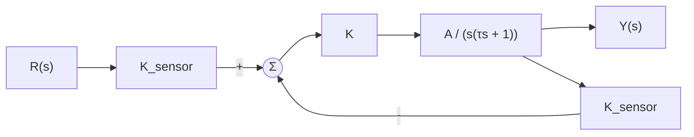
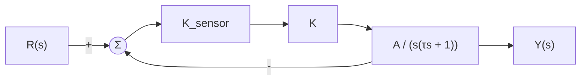
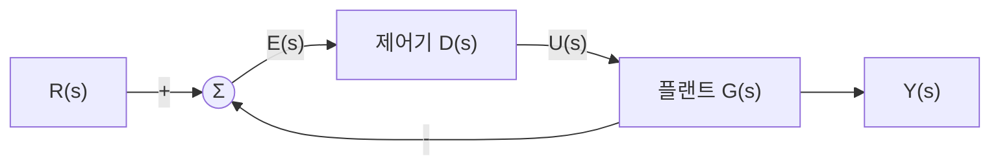
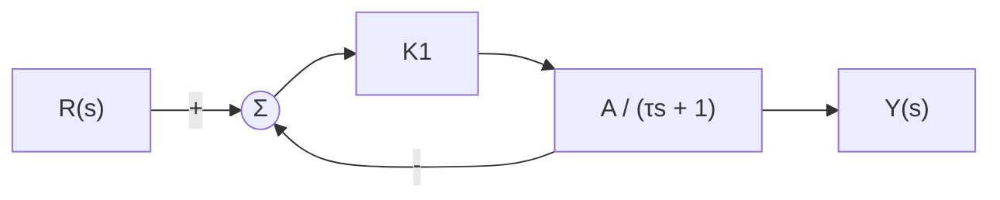
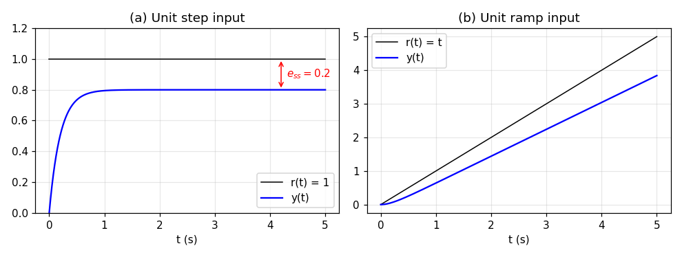
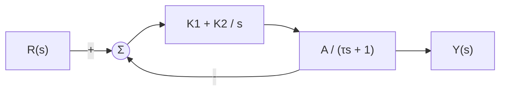
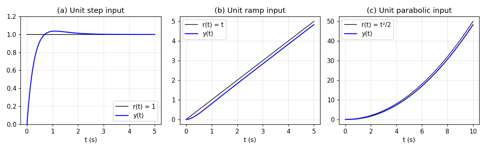
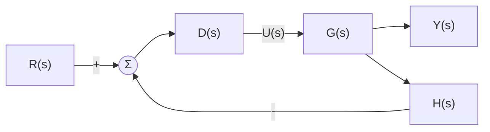

# 10주차 이론 — 제어시스템 성능 III

[레포지토리 안내](../../README.ko.md) | [English](Concepts_Lecture.md) | [한국어](Concepts_Lecture.ko.md)

> **최종 수정일:** 2026-11-04

> **학습 목표:**
> 1. 정상 상태 오차를 정의하고, 최종값 정리로 단위 피드백 시스템의 정상 상태 오차를 구할 수 있다
> 2. 위치, 속도, 가속도 오차 상수를 정의하고 단위 계단, 경사, 포물선 입력에 대한 정상 상태 오차를 계산할 수 있다
> 3. 시스템 타입을 정의하고, 단위 피드백 시스템의 타입을 개루프 전달함수의 원점 극점 개수로 판별할 수 있다
> 4. 단위 피드백이 아닌 시스템의 정상 상태 오차를 폐루프 전달함수의 계수로 구하고, 타입 N이 되기 위한 조건을 설명할 수 있다
> 5. 제어기에 적분 동작을 더하면 시스템 타입이 올라가 정상 상태 오차가 줄어드는 이유를 예제로 설명할 수 있다

---

## 목차

- [1. 정상 상태 성능](#1-정상-상태-성능)
  - [1.1 과도 응답과 정상 상태](#11-과도-응답과-정상-상태)
  - [1.2 정상 상태 오차와 최종값 정리](#12-정상-상태-오차와-최종값-정리)
  - [1.3 단위 피드백 시스템](#13-단위-피드백-시스템)
  - [1.4 단위 피드백 시스템의 오차](#14-단위-피드백-시스템의-오차)
  - [1.5 세 가지 표준 입력](#15-세-가지-표준-입력)
  - [1.6 단위 계단 입력과 위치 오차 상수](#16-단위-계단-입력과-위치-오차-상수)
  - [1.7 단위 경사 입력과 속도 오차 상수](#17-단위-경사-입력과-속도-오차-상수)
  - [1.8 단위 포물선 입력과 가속도 오차 상수](#18-단위-포물선-입력과-가속도-오차-상수)
- [2. 시스템 타입 개요](#2-시스템-타입-개요)
  - [2.1 시스템 타입의 정의](#21-시스템-타입의-정의)
  - [2.2 예제 1: 비례 제어기와 1차 플랜트](#22-예제-1-비례-제어기와-1차-플랜트)
  - [2.3 예제 2: PI 제어기와 1차 플랜트](#23-예제-2-pi-제어기와-1차-플랜트)
  - [2.4 시스템 타입별 정상 상태 오차](#24-시스템-타입별-정상-상태-오차)
- [3. 시스템 타입 조건](#3-시스템-타입-조건)
  - [3.1 단위 피드백이 아닌 시스템의 정상 상태 오차](#31-단위-피드백이-아닌-시스템의-정상-상태-오차)
  - [3.2 타입 0, 1, 2가 되기 위한 조건](#32-타입-0-1-2가-되기-위한-조건)
  - [3.3 타입 N이 되기 위한 조건](#33-타입-n이-되기-위한-조건)
  - [3.4 예제 1: PI 제어시스템의 타입](#34-예제-1-pi-제어시스템의-타입)
  - [3.5 예제 2: 2차 플랜트의 비례 제어](#35-예제-2-2차-플랜트의-비례-제어)
  - [3.6 예제 3: 피드백 경로에 이득이 있는 시스템](#36-예제-3-피드백-경로에-이득이-있는-시스템)
- [개념 적용](#개념-적용)
- [요약](#요약)
- [점검 문제](#점검-문제)
- [참고 문헌](#참고-문헌)

---

 

## 1. 정상 상태 성능

### 1.1 과도 응답과 정상 상태

제어시스템에 명령을 주면 출력은 곧바로 명령값에 닿지 못하고 일정 시간 동안 변하다가 어떤 값이나 궤적에 자리 잡는다. 명령을 준 직후 출력이 변해 가는 구간의 응답을 **과도 응답(transient response)** 이라 하고, 시간이 충분히 지나 과도 응답이 사라진 뒤의 상태를 **정상 상태(steady state)** 라 한다. 7주차와 9주차는 과도 응답을 상승 시간, 최대 초과량, 정착 시간 같은 지표로 평가했다. 이 단원은 정상 상태에서 출력이 명령을 얼마나 정확하게 따라가는지, 즉 **정상 상태 성능(steady-state performance)** 을 다룬다.

제어시스템의 정상 상태 성능은 정상 상태 오차로 나타낸다. 과도 응답의 지표가 출력이 명령값에 얼마나 빠르고 매끄럽게 도달하는지를 나타낸다면, 정상 상태 오차는 출력이 결국 얼마나 정확하게 도달하는지를 나타낸다. 두 성능은 서로 다른 성질이므로 제어기를 설계할 때는 함께 고려해야 한다.

### 1.2 정상 상태 오차와 최종값 정리

> **용어 정의:** **정상 상태 오차(steady-state error)** 는 정상 상태에서 제어시스템에 입력된 명령 값과 출력 값의 차이이다. 명령 입력을 $r(t)$, 출력을 $y(t)$라 하고 오차를 $e(t) = r(t) - y(t)$로 정의하면, 정상 상태 오차는 $e_{ss} = \lim_{t\to\infty} e(t)$이다.

정상 상태 오차는 정상 상태 성능을 정량적으로 나타내는 지표이다. $e(t)$를 시간 영역에서 직접 구한 뒤 극한을 취해도 되지만, 3주차의 **최종값 정리(final value theorem)** 를 쓰면 라플라스 변환 $E(s)$에서 바로 구할 수 있다.

$$
e_{ss} = \lim_{t\to\infty} e(t) = \lim_{s\to 0} sE(s)
$$

> **주의:** 최종값 정리는 $sE(s)$의 모든 극점이 복소평면의 좌반평면에 있을 때만 성립한다. 폐루프 시스템이 불안정하면 오차가 발산하거나 끝없이 진동하므로 정상 상태 오차라는 값이 존재하지 않는데, 이때도 공식에 대입하면 그럴듯한 유한한 값이 나온다. 따라서 정상 상태 오차를 계산하기 전에 9주차의 방법(특성방정식의 근, Routh-Hurwitz 판별법)으로 폐루프 시스템이 안정한지 먼저 확인한다. 또한 계산 결과가 $\infty$로 나오는 경우는 $sE(s)$에 원점 극점이 남아 엄밀히는 정리의 조건을 벗어나지만, 오차가 시간에 따라 한없이 커진다는 뜻으로 해석하며 이는 시간 영역에서 직접 확인할 수 있다(2.2절).

### 1.3 단위 피드백 시스템

출력을 그대로 되먹여 명령과 비교하는 피드백 구조, 즉 피드백 경로의 전달함수가 $H(s) = 1$인 구조를 **단위 피드백(unity feedback)** 시스템이라 한다. 단위 피드백 시스템에서는 가합점에서 빼는 두 신호가 명령과 출력 자체이므로, 가합점의 출력이 곧 오차 $e = r - y$이다. 이 단원은 먼저 단위 피드백 시스템의 정상 상태 오차를 다루고, 단위 피드백이 아닌 시스템은 3절에서 다룬다.

가합점에서 두 신호를 빼려면 두 신호의 단위가 같아야 한다. 모터의 회전각을 제어하는 시스템을 예로 들면, 출력 $Y(s)$는 각도(rad)이고 이를 측정하는 센서(예: 퍼텐쇼미터)는 각도를 전압으로 바꾸어 $K_{sensor}$ (V/rad)를 곱한 신호를 내보낸다. 반면 명령 $R(s)$는 원하는 각도(rad)로 주어지므로, 명령도 같은 이득 $K_{sensor}$를 거쳐 전압으로 바꾼 뒤 센서 출력과 비교해야 한다. 그림 1의 $K$는 증폭기의 이득이고, $\frac{A}{s(\tau s + 1)}$은 입력 전압에서 회전각까지의 모터와 부하의 전달함수(4주차)이다.

*그림 1. 명령과 센서 출력의 단위를 맞춘 모터 제어시스템*

그림 1의 가합점 출력은 $K_{sensor}R(s) - K_{sensor}Y(s) = K_{sensor}\,[R(s) - Y(s)]$이다. 즉 가합점은 명령과 출력의 차이 $R - Y$를 먼저 구한 뒤 $K_{sensor}$를 곱한 것과 같다. 따라서 $K_{sensor}$ 블록을 가합점 뒤로 옮기면 그림 2의 단위 피드백 시스템이 되고, 두 블록선도의 입출력 관계는 같다.

*그림 2. 단위 피드백 시스템으로 변형한 모터 제어시스템*

> **핵심:** 겉보기에 단위 피드백이 아닌 시스템이라도, 명령과 출력의 단위를 맞추는 이득이 양쪽 경로에 함께 있으면 단위 피드백 시스템으로 바꾸어 그릴 수 있다. 실제로 명령과 출력이 같은 물리량이고 오차를 그 물리량으로 정의하려면, 이처럼 단위 피드백 시스템으로 구성해야 하는 경우가 많다.

### 1.4 단위 피드백 시스템의 오차

일반적인 단위 피드백 시스템은 그림 3과 같다. 시간 영역에서는 명령 $r(t)$와 출력 $y(t)$의 차이 $e(t)$가 **제어기(controller)** 에 들어가고, 제어기는 제어 입력 $u(t)$를 만들어 제어 대상인 **플랜트(plant)** 를 움직인다. 라플라스 영역에서 제어기의 전달함수를 $D(s)$, 플랜트의 전달함수를 $G(s)$라 한다.

*그림 3. 제어기와 플랜트로 이루어진 단위 피드백 시스템*

오차 $E(s)$를 $R(s)$로 나타낸다. 가합점에서 $E = R - Y$이고, 출력은 오차가 제어기와 플랜트를 차례로 거친 결과이므로 $Y = D G E$이다. 두 식에서 $Y$를 소거한다.

$$
E = R - DGE \quad\Longrightarrow\quad E\,(1 + DG) = R \quad\Longrightarrow\quad E(s) = \frac{R(s)}{1 + D(s)G(s)}
$$

여기에 최종값 정리를 적용하면 단위 피드백 시스템의 정상 상태 오차는 다음과 같다.

$$
e_{ss} = \lim_{s\to 0} sE(s) = \lim_{s\to 0} \frac{sR(s)}{1 + D(s)G(s)}
$$

$D(s)G(s)$는 루프를 한 바퀴 도는 경로의 전달함수로, **개루프 전달함수(open-loop transfer function)** 라 한다. 위 식은 정상 상태 오차가 명령 입력의 형태 $R(s)$와 개루프 전달함수의 $s \to 0$ 부근의 성질로 정해진다는 것을 보여 준다. 참고로 **폐루프 전달함수(closed-loop transfer function)** $T(s) = \frac{DG}{1 + DG}$를 쓰면 $1 - T = \frac{1}{1 + DG}$이므로 $E(s) = [1 - T(s)]\,R(s)$로도 쓸 수 있다. 이 형태는 3절에서 단위 피드백이 아닌 시스템을 다룰 때 쓴다.

### 1.5 세 가지 표준 입력

정상 상태 오차는 명령 입력의 형태에 따라 달라지므로, 비교의 기준이 되는 입력을 정해 두어야 한다. 정상 상태 오차는 다음 세 가지 표준 입력에 대해 계산한다(시험 입력은 7주차 참고). 여기서 $u_s(t)$는 $t \ge 0$에서 1이고 $t < 0$에서 0인 단위 계단 함수이다.

| 입력 | 시간 함수 $r(t)$ | 라플라스 변환 $R(s)$ | 차수 | 출력이 위치일 때의 의미 |
|:-----|:-----|:-----|:-----|:-----|
| 단위 계단 입력(unit step input) | $u_s(t)$ | $\dfrac{1}{s}$ | 0차 | 일정한 위치로 이동하라는 명령 |
| 단위 경사 입력(unit ramp input) | $t\,u_s(t)$ | $\dfrac{1}{s^2}$ | 1차 | 일정한 속도로 움직이는 목표를 따라가라는 명령 |
| 단위 포물선 입력(unit parabolic input) | $\dfrac{t^2}{2}\,u_s(t)$ | $\dfrac{1}{s^3}$ | 2차 | 일정한 가속도로 움직이는 목표를 따라가라는 명령 |

*표 1. 정상 상태 오차를 계산하는 세 가지 표준 입력*

실제 시스템에는 이 세 가지와 전혀 다른 형태의 함수가 명령 입력으로 들어오는 경우가 더 많다. 그러나 복잡한 형태의 무수히 많은 명령 입력 함수에 대해 정상 상태 오차를 일일이 계산하는 것은 불가능하다. 성능을 상대적으로 평가하려면 세 가지 표준 입력에 대한 정상 상태 오차를 계산하여 비교의 지표로 삼는 것이 현실적이고 합리적이다. 또한 명령 입력이 복잡한 형태라도 짧은 구간을 부분적으로 보면 상수, 직선, 포물선 같은 함수로 근사할 수 있는 경우가 많으므로, 세 가지 표준 입력을 잘 따라가는 제어기를 적용하면 많은 경우 실용적으로 큰 문제가 없다.

### 1.6 단위 계단 입력과 위치 오차 상수

$R(s) = 1/s$를 1.4절의 식에 대입한다. 분자의 $s$와 $R(s)$의 $1/s$가 약분된다.

$$
e_{ss} = \lim_{s\to 0} \frac{s\cdot\frac{1}{s}}{1 + D(s)G(s)} = \lim_{s\to 0}\frac{1}{1 + D(s)G(s)} = \frac{1}{1 + \lim_{s\to 0} D(s)G(s)}
$$

분모에 남은 극한을 **위치 오차 상수(position error constant)** $K_p$로 정의한다.

$$
K_p = \lim_{s\to 0} D(s)G(s), \qquad e_{ss} = \frac{1}{1 + K_p}
$$

$K_p$는 개루프 전달함수의 직류 이득, 즉 $s = 0$에서의 값이다. $K_p$가 클수록 계단 입력에 대한 오차가 작아지고, 개루프 전달함수가 원점에 극점을 가지면 $K_p = \infty$가 되어 오차가 0이 된다.

### 1.7 단위 경사 입력과 속도 오차 상수

$R(s) = 1/s^2$를 대입하면 $s$ 하나가 약분되고 분모에 $s$가 하나 남는다. 분자와 분모를 정리하면 다음과 같다.

$$
e_{ss} = \lim_{s\to 0} \frac{s\cdot\frac{1}{s^2}}{1 + D(s)G(s)} = \lim_{s\to 0}\frac{1}{s + sD(s)G(s)} = \frac{1}{\lim_{s\to 0} sD(s)G(s)}
$$

마지막 단계에서는 $s \to 0$일 때 분모의 첫 항 $s$가 0으로 사라지는 것을 썼다. 분모의 극한을 **속도 오차 상수(velocity error constant)** $K_v$로 정의한다.

$$
K_v = \lim_{s\to 0} sD(s)G(s), \qquad e_{ss} = \frac{1}{K_v}
$$

### 1.8 단위 포물선 입력과 가속도 오차 상수

$R(s) = 1/s^3$를 대입하면 같은 방식으로 분모에 $s^2$가 남는다.

$$
e_{ss} = \lim_{s\to 0} \frac{s\cdot\frac{1}{s^3}}{1 + D(s)G(s)} = \lim_{s\to 0}\frac{1}{s^2 + s^2D(s)G(s)} = \frac{1}{\lim_{s\to 0} s^2D(s)G(s)}
$$

분모의 극한을 **가속도 오차 상수(acceleration error constant)** $K_a$로 정의한다.

$$
K_a = \lim_{s\to 0} s^2D(s)G(s), \qquad e_{ss} = \frac{1}{K_a}
$$

세 오차 상수의 이름은 출력이 위치인 시스템에서 각 입력이 위치, 속도, 가속도의 명령에 해당한다는 데서 왔다(표 1). 세 결과를 정리하면 표 2와 같다. 세 공식은 모두 1.4절의 $E(s) = R/(1 + DG)$에서 나왔으므로 단위 피드백 시스템에만 쓸 수 있고, 폐루프 시스템이 안정할 때만 의미가 있다.

| 입력 | 오차 상수 | 정상 상태 오차 |
|:-----|:-----|:-----|
| 단위 계단 입력 | $K_p = \lim_{s\to 0} D(s)G(s)$ | $\dfrac{1}{1 + K_p}$ |
| 단위 경사 입력 | $K_v = \lim_{s\to 0} sD(s)G(s)$ | $\dfrac{1}{K_v}$ |
| 단위 포물선 입력 | $K_a = \lim_{s\to 0} s^2D(s)G(s)$ | $\dfrac{1}{K_a}$ |

*표 2. 단위 피드백 시스템의 오차 상수와 정상 상태 오차*

---

 

## 2. 시스템 타입 개요

### 2.1 시스템 타입의 정의

1절의 결과를 보면 같은 시스템이라도 어떤 입력에는 오차가 0이고, 어떤 입력에는 유한한 오차가 남으며, 어떤 입력에는 오차가 한없이 커진다. 이 차이를 하나의 정수로 분류한 것이 시스템 타입이다.

> **용어 정의:** **시스템 타입(system type)** 은 제어시스템의 정상 상태 오차가 0이 아닌 유한한 크기가 되도록 하는 명령 입력 함수의 차수(order)이다. 시간 변수에 대한 $N$차 명령 함수 $\frac{t^N}{N!}u_s(t)$를 입력했을 때 0이 아닌 유한한 크기의 정상 상태 오차가 발생하면, 이 시스템의 시스템 타입은 $N$이다.

| 시스템 타입 | 정의 |
|:-----|:-----|
| 타입 0 시스템 | 단위 계단 입력(0차)에 대해 정상 상태 오차가 0이 아닌 유한한 크기를 갖는 시스템 |
| 타입 1 시스템 | 단위 경사 입력(1차)에 대해 정상 상태 오차가 0이 아닌 유한한 크기를 갖는 시스템 |
| 타입 2 시스템 | 단위 포물선 입력(2차)에 대해 정상 상태 오차가 0이 아닌 유한한 크기를 갖는 시스템 |

*표 3. 시스템 타입의 정의*

타입 $N$ 시스템은 $N$보다 낮은 차수의 입력은 오차 없이 따라가고, $N$보다 높은 차수의 입력에는 오차가 한없이 커진다(2.4절). 따라서 시스템 타입은 그 시스템이 정상 상태에서 오차 없이 따라갈 수 있는 명령의 복잡도를 나타낸다. 다음 두 예제로 이를 확인한다.

### 2.2 예제 1: 비례 제어기와 1차 플랜트

그림 4는 상수 이득 $K_1$인 제어기가 1차 플랜트 $\frac{A}{\tau s + 1}$을 제어하는 단위 피드백 시스템이다 [1]. 이득만 곱하는 제어기를 **비례 제어기(proportional controller)** 라 하며, 11주차에서 자세히 다룬다.

*그림 4. 비례 제어기와 1차 플랜트의 단위 피드백 시스템*

개루프 전달함수는 $D(s)G(s) = \frac{K_1A}{\tau s + 1}$이다. 수치 $K_1 = 2$, $A = 2$, $\tau = 1$을 대입하면 $D(s)G(s) = \frac{4}{s + 1}$이고, 폐루프 전달함수는 다음과 같다.

$$
T(s) = \frac{DG}{1 + DG} = \frac{\frac{4}{s+1}}{1 + \frac{4}{s+1}} = \frac{4}{(s + 1) + 4} = \frac{4}{s + 5}
$$

폐루프 극점이 $s = -5$로 좌반평면에 있으므로 시스템은 안정하고, 최종값 정리를 쓸 수 있다.

**단위 계단 입력에 대한 정상 상태 오차.** 위치 오차 상수와 정상 상태 오차는 다음과 같다.

$$
K_p = \lim_{s\to 0}\frac{4}{s + 1} = 4, \qquad e_{ss} = \frac{1}{1 + K_p} = \frac{1}{5} = 0.2
$$

시간 영역에서 확인한다. 출력은 $Y(s) = T(s)\cdot\frac{1}{s} = \frac{4}{s(s + 5)}$이고, 부분분수 전개(3주차)의 계수는 각 극점에서 나머지 인수의 값으로 구한다. $s = 0$의 계수는 $\frac{4}{0 + 5} = 0.8$, $s = -5$의 계수는 $\frac{4}{-5} = -0.8$이다.

$$
Y(s) = \frac{0.8}{s} - \frac{0.8}{s + 5} \quad\Longrightarrow\quad y(t) = 0.8\,(1 - e^{-5t}), \qquad e(t) = 1 - y(t) = 0.2 + 0.8e^{-5t}
$$

지수 항이 사라지면 출력은 0.8에 머물고 오차는 0.2로 남는다(그림 5의 (a)). 일반적으로 $e_{ss} = \frac{1}{1 + K_1A}$이므로 이득 $K_1$을 키우면 오차가 줄지만, 유한한 이득으로는 0이 되지 않는다.

**단위 경사 입력에 대한 정상 상태 오차.** 속도 오차 상수가 0이므로 오차는 무한대이다.

$$
K_v = \lim_{s\to 0} s\cdot\frac{4}{s + 1} = 0, \qquad e_{ss} = \frac{1}{K_v} = \infty
$$

시간 영역에서 확인한다. $Y(s) = \frac{4}{s+5}\cdot\frac{1}{s^2} = \frac{4}{(s + 5)s^2}$이고, 이를 $\frac{C_1}{s + 5} + \frac{C_2}{s} + \frac{C_3}{s^2}$으로 전개한다. $C_3$은 $s^2$을 곱한 뒤 $s = 0$을 넣은 값 $\frac{4}{5} = 0.8$, $C_1$은 $s + 5$를 곱한 뒤 $s = -5$를 넣은 값 $\frac{4}{25} = 0.16$이다. 중근 $s = 0$의 나머지 계수 $C_2$는 $\frac{4}{s+5}$를 $s$로 미분한 값 $-\frac{4}{(s+5)^2}$에 $s = 0$을 넣은 $-0.16$이다.

$$
Y(s) = \frac{4}{(s + 5)s^2} = \frac{0.16}{s + 5} - \frac{0.16}{s} + \frac{0.8}{s^2}
$$

$$
y(t) = 0.8t - 0.16 + 0.16e^{-5t}, \qquad e(t) = t - y(t) = 0.2t + 0.16 - 0.16e^{-5t}
$$

출력의 기울기는 0.8로 명령의 기울기 1보다 작으므로, 오차 $e(t)$는 시간에 비례하여 한없이 커진다(그림 5의 (b)). 이는 $e_{ss} = \infty$라는 계산과 일치한다. 따라서 이 시스템은 단위 계단 입력에 대해 0이 아닌 유한한 오차 0.2를 갖는 **타입 0 시스템**이다.

*그림 5. 예제 1의 단위 계단 응답과 단위 경사 응답*

### 2.3 예제 2: PI 제어기와 1차 플랜트

예제 1의 제어기에 적분 항 $\frac{K_2}{s}$를 더하여 $D(s) = K_1 + \frac{K_2}{s}$로 바꾼다. 오차에 비례하는 항과 오차의 적분에 비례하는 항을 더한 이 제어기를 **PI 제어기(proportional-integral controller)** 라 한다(11주차).

*그림 6. PI 제어기와 1차 플랜트의 단위 피드백 시스템*

개루프 전달함수는 $D(s)G(s) = \left(K_1 + \frac{K_2}{s}\right)\frac{A}{\tau s + 1} = \frac{A(K_1 s + K_2)}{s(\tau s + 1)}$이다. 적분 항이 개루프 전달함수에 원점 극점 $s = 0$을 하나 만든다. 수치 $K_1 = 2$, $K_2 = 3$, $A = 2$, $\tau = 1$을 대입하면 다음과 같다.

$$
D(s)G(s) = \frac{2(2s + 3)}{s(s + 1)} = \frac{4s + 6}{s(s + 1)}, \qquad T(s) = \frac{4s + 6}{s(s + 1) + 4s + 6} = \frac{4s + 6}{s^2 + 5s + 6} = \frac{2(2s + 3)}{(s + 2)(s + 3)}
$$

폐루프 극점은 $-2$와 $-3$이므로 안정하다. 오차의 전달함수는 $1 - T(s) = \frac{s^2 + 5s + 6 - 4s - 6}{s^2 + 5s + 6} = \frac{s(s + 1)}{(s + 2)(s + 3)}$이다.

**단위 계단 입력.** 개루프 전달함수의 분모에 $s$가 있으므로 $K_p$는 무한대이고 오차는 0이다.

$$
K_p = \lim_{s\to 0}\frac{4s + 6}{s(s + 1)} = \infty, \qquad e_{ss} = \frac{1}{1 + K_p} = 0
$$

시간 영역의 출력은 $Y(s) = \frac{4s + 6}{s(s + 2)(s + 3)} = \frac{1}{s} + \frac{1}{s + 2} - \frac{2}{s + 3}$이다. 계수는 $s = 0$에서 $\frac{6}{2\cdot 3} = 1$, $s = -2$에서 $\frac{-8 + 6}{(-2)(1)} = 1$, $s = -3$에서 $\frac{-12 + 6}{(-3)(-1)} = -2$이다. 따라서 $y(t) = 1 + e^{-2t} - 2e^{-3t}$이고 $y(t) \to 1$이다. $\dot{y}(t) = -2e^{-2t} + 6e^{-3t} = 0$에서 $e^{-t} = \frac{1}{3}$, 즉 $t = \ln 3 \approx 1.10$ s일 때 출력이 최댓값 $1 + \frac{1}{9} - \frac{2}{27} = \frac{28}{27} \approx 1.037$에 이른다(그림 7의 (a)). 폐루프 극점이 모두 실수인데도 출력이 목표값을 약 3.7% 넘어서는 것은 폐루프 영점 $s = -1.5$의 영향이다.

**단위 경사 입력.** 속도 오차 상수는 유한한 값이다.

$$
K_v = \lim_{s\to 0} s\cdot\frac{4s + 6}{s(s + 1)} = \lim_{s\to 0}\frac{4s + 6}{s + 1} = 6, \qquad e_{ss} = \frac{1}{K_v} = \frac{1}{6} \approx 0.167
$$

시간 영역에서 확인한다. $E(s) = [1 - T(s)]\frac{1}{s^2} = \frac{s(s + 1)}{(s + 2)(s + 3)}\cdot\frac{1}{s^2} = \frac{s + 1}{s(s + 2)(s + 3)}$이고, 계수는 $s = 0$에서 $\frac{1}{2\cdot 3} = \frac{1}{6}$, $s = -2$에서 $\frac{-1}{(-2)(1)} = \frac{1}{2}$, $s = -3$에서 $\frac{-2}{(-3)(-1)} = -\frac{2}{3}$이다.

$$
e(t) = \frac{1}{6} + \frac{1}{2}e^{-2t} - \frac{2}{3}e^{-3t} \;\longrightarrow\; \frac{1}{6}
$$

출력은 명령과 같은 기울기로 따라가되 $\frac{1}{6}$만큼 뒤처진다(그림 7의 (b)).

**단위 포물선 입력.** 가속도 오차 상수가 0이므로 오차는 무한대이다.

$$
K_a = \lim_{s\to 0} s^2\cdot\frac{4s + 6}{s(s + 1)} = 0, \qquad e_{ss} = \frac{1}{K_a} = \infty
$$

$E(s) = \frac{s + 1}{s^2(s + 2)(s + 3)}$을 같은 방법으로 전개하면 $e(t) = \frac{t}{6} + \frac{1}{36} - \frac{1}{4}e^{-2t} + \frac{2}{9}e^{-3t}$이다. 오차가 $\frac{t}{6}$로 계속 커지므로, 예를 들어 $t = 10$ s에서 명령은 $\frac{10^2}{2} = 50$이지만 출력은 약 48.3이고 오차는 약 1.69이다(그림 7의 (c)).

*그림 7. 예제 2의 단위 계단, 경사, 포물선 응답*

따라서 이 시스템은 단위 경사 입력에 대해 0이 아닌 유한한 오차 $\frac{1}{6}$을 갖는 **타입 1 시스템**이다. 예제 1과 비교하면, 제어기에 적분 항을 더해 개루프 전달함수에 원점 극점이 하나 생기자 타입이 0에서 1로 올라가 계단 입력의 오차가 0이 되었다. 일반적으로 이 시스템의 속도 오차 상수는 $K_v = AK_2$이므로, 경사 입력의 오차는 적분 이득 $K_2$로 조절한다.

### 2.4 시스템 타입별 정상 상태 오차

두 예제의 결과를 일반화한다. 단위 피드백 시스템의 개루프 전달함수가 원점에 $N$개의 극점을 가지면, 원점 극점을 뺀 나머지 부분이 $s = 0$에서 1이 되도록 정리하여 다음과 같이 쓸 수 있다.

$$
D(s)G(s) = \frac{K_N\,(1 + \beta_1 s)(1 + \beta_2 s)\cdots}{s^N\,(1 + \alpha_1 s)(1 + \alpha_2 s)\cdots}, \qquad K_N \ne 0
$$

$s \to 0$이면 괄호 안의 인수는 모두 1에 가까워지므로 $D(s)G(s) \approx \frac{K_N}{s^N}$이다. 이를 1절의 오차 상수에 대입한다.

- $N = 0$이면 $K_p = K_0$, $K_v = \lim s K_0 = 0$, $K_a = 0$이다.
- $N = 1$이면 $K_p = \lim \frac{K_1}{s} = \infty$, $K_v = \lim s\cdot\frac{K_1}{s} = K_1$, $K_a = \lim s^2\cdot\frac{K_1}{s} = 0$이다.
- $N = 2$이면 $K_p = \infty$, $K_v = \lim s\cdot\frac{K_2}{s^2} = \infty$, $K_a = K_2$이다.

각 오차 상수를 표 2의 공식에 넣으면 표 4를 얻는다. 단위 피드백 시스템에서는 2.1절의 정의에 따른 시스템 타입이 개루프 전달함수 $D(s)G(s)$의 **원점 극점의 개수**, 즉 루프 안의 적분기 개수와 같다.

| | 단위 계단 입력 (0차) | 단위 경사 입력 (1차) | 단위 포물선 입력 (2차) |
|:-----|:-----|:-----|:-----|
| 타입 0 시스템 | $\dfrac{1}{1 + K_p}$ | $\infty$ | $\infty$ |
| 타입 1 시스템 | $0$ | $\dfrac{1}{K_v}$ | $\infty$ |
| 타입 2 시스템 | $0$ | $0$ | $\dfrac{1}{K_a}$ |

*표 4. 단위 피드백 시스템의 타입별 정상 상태 오차*

표 4의 대각선에 유한한 오차가 있고, 그 왼쪽(낮은 차수의 입력)은 0, 오른쪽(높은 차수의 입력)은 $\infty$이다. 예제 1은 타입 0의 첫 행, 예제 2는 타입 1의 둘째 행에 해당한다.

1.3절의 모터 제어시스템에도 적용한다. 그림 2의 개루프 전달함수는 $\frac{K_{sensor}KA}{s(\tau s + 1)}$이고 원점 극점이 하나이므로 타입 1이다. 따라서 모터는 일정한 각도 명령을 오차 없이 따라가고, 일정한 각속도로 회전하라는 경사 명령에는 $e_{ss} = \frac{1}{K_v} = \frac{1}{K_{sensor}KA}$만큼 뒤처진다. 플랜트 자체가 적분기($\frac{1}{s}$, 전압을 넣으면 각속도가 생기고 각도는 그 적분)를 갖고 있어 비례 제어기만으로도 타입 1이 된다.

> **참고:** 적분기를 더하면 타입이 올라가 정상 상태 오차가 줄지만, 루프에 극점이 늘어나 폐루프 시스템을 안정하게 만들기가 어려워진다. 그래서 실제 제어시스템은 대부분 타입 0, 1, 2이고, 타입 3 이상은 드물다 [2].

---

 

## 3. 시스템 타입 조건

### 3.1 단위 피드백이 아닌 시스템의 정상 상태 오차

피드백 경로에 전달함수 $H(s)$가 있는 그림 8의 시스템을 생각한다. $H(s)$는 센서의 동특성이나 이득, 피드백 보상기 등을 나타낸다.

*그림 8. 피드백 경로에 H(s)가 있는 시스템*

가합점의 출력은 $R - HY$이고 $Y = DG(R - HY)$이므로, 이를 $Y$에 대해 풀면 폐루프 전달함수를 얻는다.

$$
Y\,(1 + DGH) = DGR \quad\Longrightarrow\quad T(s) = \frac{Y(s)}{R(s)} = \frac{D(s)G(s)}{1 + D(s)G(s)H(s)}
$$

이때 가합점의 출력 $R - HY$는 오차 $R - Y$가 아니다. 출력 자체가 아니라 $H$를 거친 신호가 명령과 비교되기 때문이다. 따라서 표 2의 오차 상수를 $D(s)G(s)H(s)$로 계산하면 가합점 신호의 정상 상태 값을 얻을 뿐, 명령과 출력의 오차를 얻지 못한다(3.6절). 단위 피드백이 아닌 시스템에서는 오차를 정의대로 $E = R - Y$로 두고 폐루프 전달함수로 직접 계산한다.

$$
E(s) = R(s) - Y(s) = [1 - T(s)]\,R(s)
$$

폐루프 전달함수를 분자와 분모의 다항식으로 쓴다. 분자의 차수가 분모보다 낮으면 빈 자리의 계수 $b_i$를 0으로 둔다.

$$
T(s) = \frac{b_n s^n + b_{n-1}s^{n-1} + \cdots + b_1 s + b_0}{a_n s^n + a_{n-1}s^{n-1} + \cdots + a_1 s + a_0}
$$

그러면 $1 - T(s)$는 분모에서 분자를 뺀 다항식을 분모로 나눈 것이다.

$$
1 - T(s) = \frac{(a_n - b_n)s^n + (a_{n-1} - b_{n-1})s^{n-1} + \cdots + (a_1 - b_1)s + (a_0 - b_0)}{a_n s^n + a_{n-1}s^{n-1} + \cdots + a_1 s + a_0}
$$

### 3.2 타입 0, 1, 2가 되기 위한 조건

**타입 0이 되기 위한 조건.** 단위 계단 입력 $R(s) = \frac{1}{s}$에 대해 최종값 정리를 쓴다.

$$
e_{ss} = \lim_{s\to 0} s\left(\frac{(a_n - b_n)s^n + (a_{n-1} - b_{n-1})s^{n-1} + \cdots + (a_1 - b_1)s + (a_0 - b_0)}{a_n s^n + a_{n-1}s^{n-1} + \cdots + a_1 s + a_0}\right)\frac{1}{s} = \frac{a_0 - b_0}{a_0}
$$

$s$와 $\frac{1}{s}$이 약분되고, $s \to 0$이면 분자와 분모에 상수항만 남기 때문이다. 이 값이 0이 아닌 유한한 값이 되려면 $a_0 \ne 0$이고 $a_0 - b_0 \ne 0$이어야 한다. 조건 $a_0 \ne 0$은 폐루프 시스템이 원점에 극점을 갖지 않는다는 뜻이며, 안정한 시스템은 이 조건을 항상 만족한다. 또한 $\frac{a_0 - b_0}{a_0} = 1 - \frac{b_0}{a_0} = 1 - T(0)$이므로, 계단 입력의 오차는 1에서 폐루프의 직류 이득을 뺀 값이다.

**타입 1이 되기 위한 조건.** 단위 경사 입력 $R(s) = \frac{1}{s^2}$에 대해 계산하면 분모에 $s$가 하나 남는다.

$$
e_{ss} = \lim_{s\to 0} s\left(\frac{(a_n - b_n)s^n + \cdots + (a_1 - b_1)s + (a_0 - b_0)}{a_n s^n + \cdots + a_1 s + a_0}\right)\frac{1}{s^2} = \lim_{s\to 0}\frac{(a_n - b_n)s^n + \cdots + (a_1 - b_1)s + (a_0 - b_0)}{s\,(a_n s^n + \cdots + a_1 s + a_0)}
$$

$a_0 - b_0 \ne 0$이면 분자는 0이 아닌 상수로 가고 분모는 0으로 가므로 $e_{ss} = \infty$이다. $a_0 - b_0 = 0$이면 분자의 모든 항에 $s$가 있으므로 분모의 $s$와 약분된다.

$$
e_{ss} = \lim_{s\to 0}\frac{(a_n - b_n)s^{n-1} + \cdots + (a_2 - b_2)s + (a_1 - b_1)}{a_n s^n + \cdots + a_1 s + a_0} = \frac{a_1 - b_1}{a_0}
$$

따라서 타입 1이 되기 위한 조건은 $(a_1 - b_1) \ne 0$, $(a_0 - b_0) = 0$, $a_0 \ne 0$이다.

**타입 2가 되기 위한 조건.** 단위 포물선 입력 $R(s) = \frac{1}{s^3}$에 대해 계산하면 분모에 $s^2$이 남는다.

$$
e_{ss} = \lim_{s\to 0} s\left(\frac{(a_n - b_n)s^n + \cdots + (a_1 - b_1)s + (a_0 - b_0)}{a_n s^n + \cdots + a_1 s + a_0}\right)\frac{1}{s^3} = \lim_{s\to 0}\frac{(a_n - b_n)s^n + \cdots + (a_1 - b_1)s + (a_0 - b_0)}{s^2\,(a_n s^n + \cdots + a_1 s + a_0)}
$$

분모의 $s^2$을 약분하려면 분자의 상수항과 $s$의 1차 항이 모두 없어야 한다. $a_0 - b_0 = 0$이고 $a_1 - b_1 = 0$이면 다음과 같다.

$$
e_{ss} = \lim_{s\to 0}\frac{(a_n - b_n)s^{n-2} + \cdots + (a_2 - b_2)}{a_n s^n + \cdots + a_0} = \frac{a_2 - b_2}{a_0}
$$

따라서 타입 2가 되기 위한 조건은 $(a_2 - b_2) \ne 0$, $(a_1 - b_1) = 0$, $(a_0 - b_0) = 0$, $a_0 \ne 0$이다.

### 3.3 타입 N이 되기 위한 조건

같은 논리를 $N$차 명령 $\frac{t^N}{N!}u_s(t)$, 즉 $R(s) = \frac{1}{s^{N+1}}$로 확장한다. 최종값 정리를 쓰면 분모에 $s^N$이 남으므로, 분자의 $s^0$부터 $s^{N-1}$까지의 계수가 모두 0이어야 오차가 유한하고, $s^N$의 계수가 0이 아니어야 오차가 0이 아니다. 시스템 타입 $N$이 되기 위한 조건과 그때의 오차는 다음과 같다.

$$
(a_N - b_N) \ne 0, \quad (a_{N-1} - b_{N-1}) = 0, \quad \ldots, \quad (a_0 - b_0) = 0, \quad a_0 \ne 0, \qquad e_{ss} = \frac{a_N - b_N}{a_0}
$$

| 시스템 타입 | 조건 | 0이 아닌 유한한 오차 |
|:-----|:-----|:-----|
| 0 | $(a_0 - b_0) \ne 0$, $a_0 \ne 0$ | 단위 계단 입력: $\dfrac{a_0 - b_0}{a_0}$ |
| 1 | $(a_1 - b_1) \ne 0$, $(a_0 - b_0) = 0$, $a_0 \ne 0$ | 단위 경사 입력: $\dfrac{a_1 - b_1}{a_0}$ |
| 2 | $(a_2 - b_2) \ne 0$, $(a_1 - b_1) = 0$, $(a_0 - b_0) = 0$, $a_0 \ne 0$ | 단위 포물선 입력: $\dfrac{a_2 - b_2}{a_0}$ |
| $N$ | $(a_N - b_N) \ne 0$, $(a_{N-1} - b_{N-1}) = 0$, $\ldots$, $(a_0 - b_0) = 0$, $a_0 \ne 0$ | $N$차 입력: $\dfrac{a_N - b_N}{a_0}$ |

*표 5. 폐루프 전달함수의 계수로 나타낸 시스템 타입의 조건*

즉 시스템 타입은 $1 - T(s)$의 분자에서 0이 아닌 가장 낮은 차수의 항의 차수이다. 이 조건은 폐루프 전달함수만 쓰므로 단위 피드백 여부와 관계없이 성립한다. 단위 피드백 시스템에서는 개루프 전달함수를 $D(s)G(s) = \frac{N_L(s)}{s^N D_L(s)}$ ($N_L(0) \ne 0$, $D_L(0) \ne 0$)로 쓰면 $T(s) = \frac{N_L}{s^N D_L + N_L}$이므로, $1 - T$의 분자가 $s^N D_L(s)$가 되어 정확히 $s^0$부터 $s^{N-1}$까지의 계수가 0이다. 따라서 두 판별법(원점 극점의 개수와 계수 조건)은 단위 피드백 시스템에서 같은 답을 준다.

> **핵심:** 단위 피드백이 아닌 시스템의 타입과 정상 상태 오차는 오차 $E = R - Y$의 정의에서 출발하여 폐루프 전달함수 $T(s)$의 분자와 분모의 낮은 차수 계수를 비교해 구한다. 특히 $a_0 = b_0$, 즉 $T(0) = 1$이어야 계단 입력의 오차가 0이 된다.

### 3.4 예제 1: PI 제어시스템의 타입

2.3절의 시스템(그림 6)을 계수 조건으로 다시 판별한다. 기호로 폐루프 전달함수를 구한다.

$$
T(s) = \frac{\frac{A(K_1 s + K_2)}{s(\tau s + 1)}}{1 + \frac{A(K_1 s + K_2)}{s(\tau s + 1)}} = \frac{AK_1 s + AK_2}{\tau s^2 + (1 + AK_1)s + AK_2}
$$

계수를 읽으면 $a_2 = \tau$, $a_1 = 1 + AK_1$, $a_0 = AK_2$, $b_2 = 0$, $b_1 = AK_1$, $b_0 = AK_2$이다. 따라서 $a_0 - b_0 = 0$이고 $a_1 - b_1 = 1 \ne 0$이며, $AK_2 \ne 0$이면 $a_0 \ne 0$이므로 시스템은 타입 1이다. 단위 경사 입력에 대한 오차는 다음과 같다.

$$
e_{ss} = \frac{a_1 - b_1}{a_0} = \frac{1}{AK_2} = \frac{1}{2 \cdot 3} = \frac{1}{6}
$$

수치로는 $T(s) = \frac{4s + 6}{s^2 + 5s + 6}$이므로 $a_1 - b_1 = 5 - 4 = 1$, $a_0 = 6$이다. 2.3절에서 $K_v = 6$으로 구한 값과 같다. 단, 이 결과는 폐루프 시스템이 안정할 때만 의미가 있으며, 2차 특성방정식 $\tau s^2 + (1 + AK_1)s + AK_2 = 0$은 세 계수가 모두 양수이면 안정하다.

### 3.5 예제 2: 2차 플랜트의 비례 제어

그림 3의 구조에서 제어기가 상수 이득 $D(s) = K = 1$이고 플랜트가 $G(s) = \frac{4}{s^2 + 2s + 2}$인 시스템의 타입을 판별한다.

$$
T(s) = \frac{\frac{4}{s^2 + 2s + 2}}{1 + \frac{4}{s^2 + 2s + 2}} = \frac{4}{s^2 + 2s + 6}
$$

특성방정식 $s^2 + 2s + 6 = 0$의 근은 $s = -1 \pm j\sqrt{5}$로 좌반평면에 있으므로 안정하다. 계수는 $a_0 = 6$, $b_0 = 4$이고 $a_0 - b_0 = 2 \ne 0$이므로 시스템은 **타입 0**이다. 단위 계단 입력에 대한 오차는 다음과 같다.

$$
e_{ss} = \frac{a_0 - b_0}{a_0} = \frac{2}{6} = \frac{1}{3}
$$

단위 피드백이므로 1절의 방법으로도 확인할 수 있다. $K_p = \lim_{s\to 0}\frac{4}{s^2 + 2s + 2} = 2$이므로 $e_{ss} = \frac{1}{1 + 2} = \frac{1}{3}$이고, 출력은 $T(0) = \frac{4}{6} = \frac{2}{3}$에 머문다. 플랜트에 원점 극점이 없고 제어기도 상수이므로 개루프 전달함수에 적분기가 없어 타입 0이라는 판단과도 일치한다.

### 3.6 예제 3: 피드백 경로에 이득이 있는 시스템

단위 피드백이 아닐 때 개루프 전달함수만 보고 타입을 판단하면 틀릴 수 있음을 보이는 예이다. 그림 8에서 $D(s) = 10$, $G(s) = \frac{1}{s(s + 2)}$, $H(s) = 0.5$라 한다. 개루프 전달함수 $D(s)G(s)H(s) = \frac{5}{s(s + 2)}$는 원점 극점을 하나 가지므로, 표 4를 그대로 적용하면 타입 1이고 계단 입력의 오차가 0이라고 잘못 판단하게 된다.

정의대로 계산한다. 폐루프 전달함수는 다음과 같다.

$$
T(s) = \frac{\frac{10}{s(s + 2)}}{1 + \frac{10}{s(s + 2)}\cdot 0.5} = \frac{10}{s(s + 2) + 5} = \frac{10}{s^2 + 2s + 5}
$$

특성방정식의 근은 $s = -1 \pm j2$로 안정하다. $a_0 = 5$, $b_0 = 10$이므로 $a_0 - b_0 = -5 \ne 0$이고 시스템은 **타입 0**이다. 단위 계단 입력에 대한 오차는 $e_{ss} = \frac{-5}{5} = -1$이다. 실제로 출력은 $y(t) = 2 - e^{-t}(2\cos 2t + \sin 2t)$이므로 $y(t) \to 2$가 되어, 명령 1보다 1만큼 크다.

이 결과는 다음과 같이 해석한다. 루프 안의 적분기는 가합점의 신호 $R - HY$를 0으로 만든다. 따라서 정상 상태에서 $HY = R$, 즉 $Y = \frac{R}{H} = \frac{1}{0.5} = 2$가 된다. 적분기가 0으로 만든 것은 가합점의 신호이지 오차 $R - Y$가 아니다. $H$가 센서의 이득이라면 1.3절의 모터 예처럼 명령에도 같은 이득을 곱해 단위 피드백 구조로 만들어야 출력이 명령을 오차 없이 따라간다.

> **주의:** 표 2와 표 4의 오차 상수 공식은 단위 피드백 시스템에서만 명령과 출력의 오차를 준다. $H(s) \ne 1$이면 오차 $E = R - Y$를 폐루프 전달함수로 직접 계산하거나 3.3절의 계수 조건을 쓴다.

---

 

## 개념 적용

| 상황 | 연결할 개념과 이유 |
|:-----|:-----|
| 온도 조절기가 설정 온도보다 항상 0.5도 낮은 온도에서 머문다. | **타입 0 시스템의 계단 오차.** 루프에 적분기가 없으면 $e_{ss} = \frac{1}{1 + K_p}$가 남는다. 이득을 키우거나 적분 동작을 더한다. |
| 일정한 속도로 움직이는 표적을 추적하는 안테나가 표적을 같은 속도로 따라가지만 일정한 각도만큼 뒤처진다. | **타입 1 시스템의 경사 오차.** $e_{ss} = \frac{1}{K_v}$이며, 오차를 줄이려면 $K_v$를 키우거나 타입을 2로 올린다. |
| 같은 안테나가 가속하는 표적을 따라가자 뒤처지는 각도가 시간에 따라 계속 커진다. | **타입보다 높은 차수의 입력.** 타입 1 시스템에 2차 입력이 들어오면 $e_{ss} = \infty$이다. |
| 센서의 이득이 0.5인데 명령을 그대로 가합점에 넣었더니, 적분기가 있는데도 출력이 명령의 두 배가 되었다. | **단위 피드백이 아닌 시스템.** 적분기는 $R - HY$를 0으로 만들 뿐이다. 명령에도 센서 이득을 곱해 단위 피드백으로 구성한다. |
| 정상 상태 오차를 계산했더니 유한한 값이 나왔지만, 실제 출력은 점점 크게 진동한다. | **최종값 정리의 조건.** 폐루프 시스템이 불안정하면 공식의 결과는 의미가 없다. 먼저 안정성을 확인한다. |

*표 6. 상황별로 연결할 개념*

**T/F 점검:**

| 문장 | 판단과 근거 |
|:-----|:-----|
| 타입 1 시스템은 단위 계단 입력을 정상 상태 오차 없이 따라간다. | **T.** $K_p = \infty$이므로 $e_{ss} = \frac{1}{1 + K_p} = 0$이다(안정할 때). |
| 타입 0 시스템도 비례 이득을 충분히 크게 하면 계단 입력의 정상 상태 오차가 정확히 0이 된다. | **F.** $e_{ss} = \frac{1}{1 + K_p}$는 유한한 $K_p$에서 0이 되지 않으며, 이득이 너무 크면 불안정해질 수도 있다. |
| 단위 피드백 시스템의 시스템 타입은 개루프 전달함수의 원점 극점의 개수와 같다. | **T.** 2.4절과 3.3절의 두 판별법이 같은 답을 준다. |
| $H(s) \ne 1$인 시스템에서도 $D(s)G(s)H(s)$의 원점 극점 개수가 곧 시스템 타입이다. | **F.** 3.6절처럼 $DGH$에 적분기가 있어도 오차 $R - Y$의 타입은 0일 수 있다. |
| 시스템 타입이 $N$이면 $N$차 입력의 정상 상태 오차는 $\frac{a_N - b_N}{a_0}$이다. | **T.** 3.3절의 결과이며, 폐루프 시스템이 안정해야 한다. |

---

 

## 요약

| 개념 | 핵심 요약 |
|:-----|:-----|
| 정상 상태 오차 | 과도 응답이 사라진 뒤 명령과 출력의 차이 $e_{ss} = \lim_{t\to\infty}[r(t) - y(t)]$이며, 정상 상태 성능을 정량적으로 나타낸다. |
| 최종값 정리 | $e_{ss} = \lim_{s\to 0} sE(s)$이고, $sE(s)$의 극점이 모두 좌반평면에 있을 때만 쓸 수 있으며, 폐루프 시스템의 안정은 그 필요조건이다. |
| 단위 피드백 | 피드백 경로가 $H(s) = 1$인 구조로, 명령과 출력의 단위를 맞추는 이득이 양쪽 경로에 있으면 단위 피드백으로 바꾸어 그릴 수 있다. |
| 단위 피드백의 오차 | $E(s) = \frac{R(s)}{1 + D(s)G(s)}$이므로 정상 상태 오차는 입력의 형태와 개루프 전달함수의 $s \to 0$ 부근의 성질로 정해진다. |
| 표준 입력 | 단위 계단($1/s$), 단위 경사($1/s^2$), 단위 포물선($1/s^3$)은 각각 0차, 1차, 2차 입력이며, 복잡한 명령도 부분적으로 이들로 근사할 수 있다. |
| 오차 상수 | $K_p = \lim DG$, $K_v = \lim sDG$, $K_a = \lim s^2DG$이고, 오차는 각각 $\frac{1}{1 + K_p}$, $\frac{1}{K_v}$, $\frac{1}{K_a}$이다. |
| 시스템 타입 | $N$차 명령에 대해 정상 상태 오차가 0이 아닌 유한한 값이 되는 $N$이며, 단위 피드백에서는 개루프 전달함수의 원점 극점 개수이다. |
| 타입별 오차 | 타입 $N$ 시스템은 $N$보다 낮은 차수의 입력에서 오차가 0, $N$차 입력에서 유한, 높은 차수의 입력에서 $\infty$이다. |
| 적분 동작 | PI 제어기의 적분 항은 원점 극점을 더해 타입을 하나 올리고, 계단 입력의 오차를 0으로 만든다. |
| 비단위 피드백 | $E = (1 - T)R$로 계산하며, 타입 $N$의 조건은 $(a_N - b_N) \ne 0$, $(a_{N-1} - b_{N-1}) = \cdots = (a_0 - b_0) = 0$, $a_0 \ne 0$이고 오차는 $\frac{a_N - b_N}{a_0}$이다. |
| 주의할 점 | $H(s) \ne 1$이면 $DGH$의 적분기는 가합점 신호를 0으로 만들 뿐이므로, 오차 상수 공식을 그대로 쓰지 않는다. |

---

 

## 점검 문제

1. **최종값 정리의 조건:** 정상 상태 오차를 최종값 정리로 계산하기 전에 폐루프 시스템의 안정성을 먼저 확인해야 하는 이유를 설명하라.

   

   
정답

   최종값 정리 $\lim_{t\to\infty} e(t) = \lim_{s\to 0} sE(s)$는 $sE(s)$의 극점이 모두 좌반평면에 있을 때만 성립한다. 폐루프 시스템이 불안정하면 $e(t)$는 발산하거나 끝없이 진동하여 극한값이 없지만, 공식에 대입하면 유한한 값이 나올 수 있다. 그 값은 실제 응답과 무관하므로, 먼저 특성방정식의 근이나 Routh-Hurwitz 판별법으로 안정성을 확인한 뒤에 계산해야 한다.

   

2. **오차 상수 계산:** 개루프 전달함수가 $D(s)G(s) = \frac{10}{s(s + 4)}$인 단위 피드백 시스템의 시스템 타입과 단위 계단, 경사, 포물선 입력에 대한 정상 상태 오차를 구하라.

   

   
정답

   폐루프 특성방정식은 $s(s + 4) + 10 = s^2 + 4s + 10 = 0$이고 근은 $-2 \pm j\sqrt{6}$이므로 안정하다. 원점 극점이 하나이므로 타입 1이다. $K_p = \infty$, $K_v = \lim_{s\to 0} s\cdot\frac{10}{s(s + 4)} = \frac{10}{4} = 2.5$, $K_a = 0$이므로 계단 입력의 오차는 0, 경사 입력의 오차는 $\frac{1}{2.5} = 0.4$, 포물선 입력의 오차는 $\infty$이다.

   

3. **타입 2 시스템:** $D(s)G(s) = \frac{5(s + 1)}{s^2(s + 3)(s + 4)}$인 단위 피드백 시스템의 타입과 단위 포물선 입력에 대한 정상 상태 오차를 구하라. 이 폐루프 시스템은 안정하다.

   

   
정답

   원점 극점이 두 개이므로 타입 2이다. $K_a = \lim_{s\to 0} s^2\cdot\frac{5(s + 1)}{s^2(s + 3)(s + 4)} = \frac{5\cdot 1}{3\cdot 4} = \frac{5}{12}$이므로 $e_{ss} = \frac{1}{K_a} = \frac{12}{5} = 2.4$이다. 계단과 경사 입력에 대한 오차는 0이다. 특성방정식 $s^4 + 7s^3 + 12s^2 + 5s + 5 = 0$의 Routh 표 첫 열이 $1, 7, \frac{79}{7}, \frac{150}{79} \approx 1.90, 5$로 모두 양수이므로 안정하다는 사실도 확인할 수 있다.

   

4. **이득 설계:** 2.2절의 예제 1에서 $A = 2$일 때, 단위 계단 입력의 정상 상태 오차를 0.05 이하로 만드는 $K_1$의 범위를 구하라. 이 범위의 $K_1$로도 경사 입력을 따라갈 수 없는 이유는 무엇인가?

   

   
정답

   $e_{ss} = \frac{1}{1 + 2K_1} \le 0.05$에서 $1 + 2K_1 \ge 20$, 즉 $K_1 \ge 9.5$이다. 폐루프 극점 $-(1 + 2K_1)$은 $K_1 > -0.5$이면 음수이므로 이 범위에서 안정하다. 그러나 개루프 전달함수 $\frac{2K_1}{s + 1}$에는 원점 극점이 없어 타입 0이므로, 이득을 아무리 키워도 $K_v = 0$이고 경사 입력의 오차는 $\infty$이다.

   

5. **비단위 피드백의 계수 조건:** 어떤 안정한 시스템의 폐루프 전달함수가 $T(s) = \frac{2s + 5}{s^2 + 3s + 5}$이다. 시스템 타입과 그 타입에서 유한한 정상 상태 오차를 구하라.

   

   
정답

   $a_0 = 5$, $b_0 = 5$이므로 $a_0 - b_0 = 0$이고, $a_1 = 3$, $b_1 = 2$이므로 $a_1 - b_1 = 1 \ne 0$이다. 따라서 타입 1이며, 단위 경사 입력의 오차는 $\frac{a_1 - b_1}{a_0} = \frac{1}{5} = 0.2$이다. 단위 계단 입력의 오차는 0이고, 단위 포물선 입력의 오차는 $\infty$이다.

   

6. **피드백 경로의 이득:** 3.6절의 시스템에서 출력이 단위 계단 명령을 오차 없이 따라가게 하려면 블록선도를 어떻게 바꾸어야 하는가? 바꾼 뒤의 폐루프 전달함수를 쓰라.

   

   
정답

   명령도 센서와 같은 이득 0.5를 거친 뒤 가합점에 들어가게 한다. 그러면 가합점 신호가 $0.5(R - Y)$가 되어 그림 2와 같은 단위 피드백 시스템이 되고, 루프의 적분기가 $R - Y$를 0으로 만든다. 폐루프 전달함수는 $T(s) = \frac{0.5\cdot 10}{s^2 + 2s + 5} = \frac{5}{s^2 + 2s + 5}$이며, $a_0 = b_0 = 5$이므로 $T(0) = 1$이고 계단 입력의 정상 상태 오차는 0이다.

   

7. **적분 동작의 효과:** 3.5절의 시스템에서 제어기를 $D(s) = K_1 + \frac{K_2}{s}$로 바꾸면 시스템 타입과 단위 계단 입력의 정상 상태 오차가 어떻게 달라지는가? 무엇을 함께 확인해야 하는가?

   

   
정답

   개루프 전달함수가 $\frac{4(K_1 s + K_2)}{s(s^2 + 2s + 2)}$가 되어 원점 극점이 하나 생기므로 타입 1이 되고, 계단 입력의 정상 상태 오차는 $\frac{1}{3}$에서 0으로 줄어든다. 다만 폐루프 특성방정식이 $s^3 + 2s^2 + (2 + 4K_1)s + 4K_2 = 0$인 3차식이 되므로, Routh-Hurwitz 판별법으로 $K_2 > 0$이고 $2(2 + 4K_1) > 4K_2$인지, 즉 폐루프 시스템이 안정한지 함께 확인해야 한다.

   

---

 

## 참고 문헌

1. 임동진, *제어 시스템 공학*, 개정판. 파주: 생능출판사, 2019.
2. K. Ogata, *Modern Control Engineering*, 5th ed. Upper Saddle River, NJ, USA: Prentice Hall, 2010.
