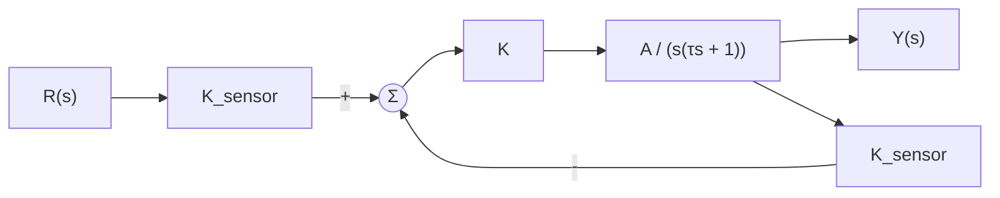
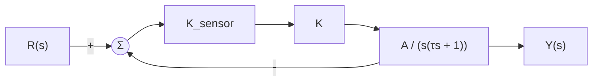
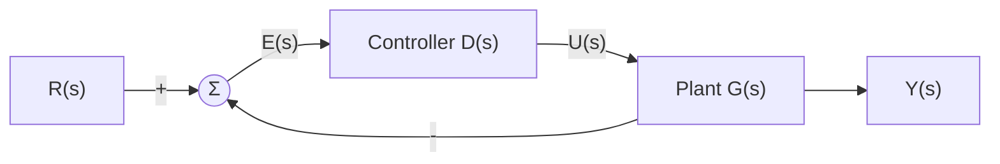
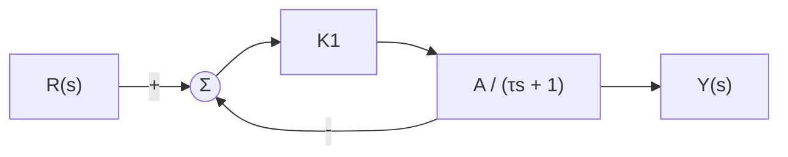
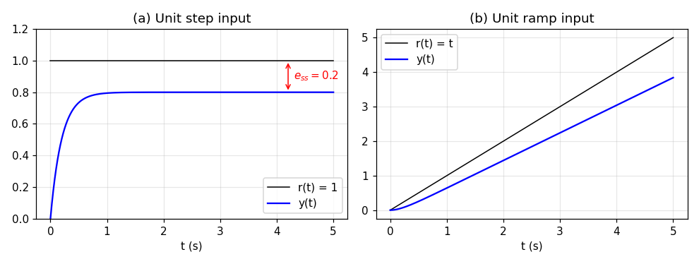
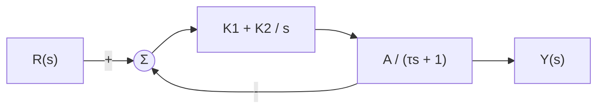
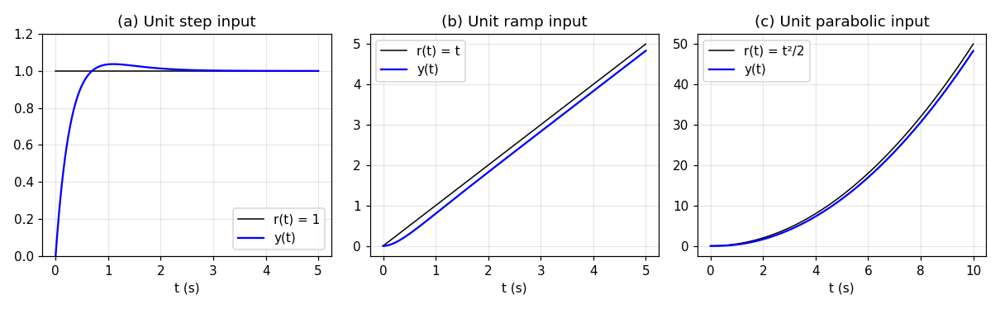
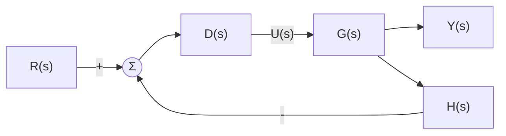

# Week 10 Lecture — Control System Performance III

[Repository Guide](../../README.md) | [English](Concepts_Lecture.md) | [한국어](Concepts_Lecture.ko.md)

> **Last Updated:** 2026-11-04

> **Learning Objectives:**
> 1. Define the steady-state error and compute the steady-state error of a unity feedback system with the final value theorem
> 2. Define the position, velocity, and acceleration error constants and compute the steady-state errors for unit step, ramp, and parabolic inputs
> 3. Define the system type and determine the type of a unity feedback system from the number of poles at the origin of the open-loop transfer function
> 4. Compute the steady-state error of a non-unity feedback system from the coefficients of the closed-loop transfer function and explain the conditions for type N
> 5. Explain with examples why adding integral action to the controller raises the system type and reduces the steady-state error

---

## Table of Contents

- [1. Steady-State Performance](#1-steady-state-performance)
  - [1.1 Transient Response and Steady State](#11-transient-response-and-steady-state)
  - [1.2 Steady-State Error and the Final Value Theorem](#12-steady-state-error-and-the-final-value-theorem)
  - [1.3 Unity Feedback Systems](#13-unity-feedback-systems)
  - [1.4 Error of a Unity Feedback System](#14-error-of-a-unity-feedback-system)
  - [1.5 Three Standard Inputs](#15-three-standard-inputs)
  - [1.6 Unit Step Input and the Position Error Constant](#16-unit-step-input-and-the-position-error-constant)
  - [1.7 Unit Ramp Input and the Velocity Error Constant](#17-unit-ramp-input-and-the-velocity-error-constant)
  - [1.8 Unit Parabolic Input and the Acceleration Error Constant](#18-unit-parabolic-input-and-the-acceleration-error-constant)
- [2. Overview of System Type](#2-overview-of-system-type)
  - [2.1 Definition of System Type](#21-definition-of-system-type)
  - [2.2 Example 1: Proportional Controller and a First-Order Plant](#22-example-1-proportional-controller-and-a-first-order-plant)
  - [2.3 Example 2: PI Controller and a First-Order Plant](#23-example-2-pi-controller-and-a-first-order-plant)
  - [2.4 Steady-State Error by System Type](#24-steady-state-error-by-system-type)
- [3. Conditions for System Type](#3-conditions-for-system-type)
  - [3.1 Steady-State Error of Non-Unity Feedback Systems](#31-steady-state-error-of-non-unity-feedback-systems)
  - [3.2 Conditions for Types 0, 1, and 2](#32-conditions-for-types-0-1-and-2)
  - [3.3 Conditions for Type N](#33-conditions-for-type-n)
  - [3.4 Example 1: Type of a PI Control System](#34-example-1-type-of-a-pi-control-system)
  - [3.5 Example 2: Proportional Control of a Second-Order Plant](#35-example-2-proportional-control-of-a-second-order-plant)
  - [3.6 Example 3: A System with Gain in the Feedback Path](#36-example-3-a-system-with-gain-in-the-feedback-path)
- [Concept Applications](#concept-applications)
- [Summary](#summary)
- [Self-Check Questions](#self-check-questions)
- [References](#references)

---

<br>

## 1. Steady-State Performance

### 1.1 Transient Response and Steady State

When a command is applied to a control system, the output cannot reach the commanded value at once; it changes for a while and then settles to some value or trajectory. The response during the interval right after the command, while the output is still changing, is called the **transient response**, and the state after enough time has passed and the transient response has died out is called the **steady state**. Weeks 7 and 9 evaluated the transient response with measures such as rise time, maximum overshoot, and settling time. This unit deals with how accurately the output follows the command in the steady state, that is, the **steady-state performance**.

The steady-state performance of a control system is expressed by the steady-state error. While the transient measures describe how quickly and smoothly the output reaches the command value, the steady-state error describes how accurately the output reaches it in the end. The two kinds of performance are different properties, so both must be considered when a controller is designed.

### 1.2 Steady-State Error and the Final Value Theorem

> **Definition:** The **steady-state error** is the difference between the command value applied to a control system and the output value in the steady state. If the command input is $r(t)$, the output is $y(t)$, and the error is defined as $e(t) = r(t) - y(t)$, the steady-state error is $e_{ss} = \lim_{t\to\infty} e(t)$.

The steady-state error is the measure that expresses steady-state performance quantitatively. One may find $e(t)$ directly in the time domain and take the limit, but the **final value theorem** of Week 3 gives it directly from the Laplace transform $E(s)$.

```math
e_{ss} = \lim_{t\to\infty} e(t) = \lim_{s\to 0} sE(s)
```

> **Caution:** The final value theorem holds only when all poles of $sE(s)$ lie in the left half of the complex plane. If the closed-loop system is unstable, the error diverges or oscillates forever, so no steady-state error exists, yet substituting into the formula can still produce a plausible finite value. Therefore, before computing a steady-state error, first check that the closed-loop system is stable with the methods of Week 9 (roots of the characteristic equation, the Routh-Hurwitz criterion). Also, when the result comes out as $\infty$, a pole at the origin remains in $sE(s)$, so strictly speaking the conditions of the theorem are not met; the result is interpreted as the error growing without bound over time, which can be confirmed directly in the time domain (Section 2.2).

### 1.3 Unity Feedback Systems

A feedback structure that feeds the output back unchanged and compares it with the command, that is, a structure whose feedback path transfer function is $H(s) = 1$, is called a **unity feedback** system. In a unity feedback system the two signals subtracted at the summing point are the command and the output themselves, so the output of the summing point is exactly the error $e = r - y$. This unit first treats the steady-state error of unity feedback systems; non-unity feedback systems are treated in Section 3.

To subtract two signals at a summing point, the two signals must have the same units. Take a system that controls the rotation angle of a motor as an example: the output $Y(s)$ is an angle (rad), and the sensor that measures it (for example, a potentiometer) converts the angle into a voltage and outputs a signal multiplied by $K_{sensor}$ (V/rad). The command $R(s)$, on the other hand, is given as the desired angle (rad), so the command must also pass through the same gain $K_{sensor}$ to be converted into a voltage before it is compared with the sensor output. In Figure 1, $K$ is the gain of the amplifier and $\frac{A}{s(\tau s + 1)}$ is the transfer function of the motor and load from the input voltage to the rotation angle (Week 4).



*Figure 1. Motor control system with the units of the command and the sensor output matched*

The output of the summing point in Figure 1 is $`K_{sensor}R(s) - K_{sensor}Y(s) = K_{sensor}\,[R(s) - Y(s)]`$. That is, the summing point is equivalent to first forming the difference $R - Y$ between the command and the output and then multiplying by $K_{sensor}$. Therefore, moving the $K_{sensor}$ block behind the summing point gives the unity feedback system of Figure 2, and the two block diagrams have the same input-output relation.



*Figure 2. Motor control system transformed into a unity feedback system*

> **Key Point:** Even a system that does not look like unity feedback can be redrawn as a unity feedback system if the gain that matches the units of the command and the output appears in both paths. In practice, when the command and the output are the same physical quantity and the error is to be defined in that quantity, the system often has to be configured as a unity feedback system in this way.

### 1.4 Error of a Unity Feedback System

A general unity feedback system is shown in Figure 3. In the time domain, the difference $e(t)$ between the command $r(t)$ and the output $y(t)$ enters the **controller**, and the controller produces the control input $u(t)$ that drives the controlled object, the **plant**. In the Laplace domain the transfer function of the controller is $D(s)$ and that of the plant is $G(s)$.



*Figure 3. Unity feedback system consisting of a controller and a plant*

Let us express the error $E(s)$ in terms of $R(s)$. At the summing point $E = R - Y$, and the output is the result of the error passing through the controller and then the plant, so $Y = D G E$. Eliminate $Y$ from the two equations.

```math
E = R - DGE \quad\Longrightarrow\quad E\,(1 + DG) = R \quad\Longrightarrow\quad E(s) = \frac{R(s)}{1 + D(s)G(s)}
```

Applying the final value theorem gives the steady-state error of a unity feedback system.

```math
e_{ss} = \lim_{s\to 0} sE(s) = \lim_{s\to 0} \frac{sR(s)}{1 + D(s)G(s)}
```

$D(s)G(s)$ is the transfer function of the path once around the loop and is called the **open-loop transfer function**. The equation shows that the steady-state error is determined by the form $R(s)$ of the command input and by the behavior of the open-loop transfer function near $s \to 0$. Note that with the **closed-loop transfer function** $T(s) = \frac{DG}{1 + DG}$ we have $1 - T = \frac{1}{1 + DG}$, so the error can also be written as $`E(s) = [1 - T(s)]\,R(s)`$. This form is used in Section 3 for non-unity feedback systems.

### 1.5 Three Standard Inputs

Since the steady-state error depends on the form of the command input, reference inputs for comparison must be fixed. The steady-state error is computed for the following three standard inputs (see Week 7 for test inputs). Here $u_s(t)$ is the unit step function, which is 1 for $t \ge 0$ and 0 for $t < 0$.

| Input | Time function $r(t)$ | Laplace transform $R(s)$ | Order | Meaning when the output is a position |
|:-----|:-----|:-----|:-----|:-----|
| Unit step input | $u_s(t)$ | $\dfrac{1}{s}$ | 0th | Command to move to a fixed position |
| Unit ramp input | $`t\,u_s(t)`$ | $\dfrac{1}{s^2}$ | 1st | Command to follow a target moving at constant velocity |
| Unit parabolic input | $`\dfrac{t^2}{2}\,u_s(t)`$ | $\dfrac{1}{s^3}$ | 2nd | Command to follow a target moving at constant acceleration |

*Table 1. Three standard inputs for computing the steady-state error*

In real systems, functions of forms completely different from these three are more often used as command inputs. However, it is impossible to compute the steady-state error one by one for the countless kinds of command functions of complex shape. To evaluate performance relatively, it is realistic and reasonable to compute the steady-state errors for the three standard inputs and use them as indices of comparison. Moreover, even a complex command can often be approximated piece by piece, over short intervals, by functions such as constants, straight lines, and parabolas, so a controller that follows the three standard inputs well usually causes no serious problem in practical use.

### 1.6 Unit Step Input and the Position Error Constant

Substitute $R(s) = 1/s$ into the equation of Section 1.4. The $s$ in the numerator cancels the $1/s$ of $R(s)$.

```math
e_{ss} = \lim_{s\to 0} \frac{s\cdot\frac{1}{s}}{1 + D(s)G(s)} = \lim_{s\to 0}\frac{1}{1 + D(s)G(s)} = \frac{1}{1 + \lim_{s\to 0} D(s)G(s)}
```

The limit remaining in the denominator is defined as the **position error constant** $K_p$.

```math
K_p = \lim_{s\to 0} D(s)G(s), \qquad e_{ss} = \frac{1}{1 + K_p}
```

$K_p$ is the DC gain of the open-loop transfer function, that is, its value at $s = 0$. The larger $K_p$, the smaller the error for a step input, and if the open-loop transfer function has a pole at the origin, $K_p = \infty$ and the error becomes 0.

### 1.7 Unit Ramp Input and the Velocity Error Constant

Substituting $R(s) = 1/s^2$ cancels one $s$ and leaves one $s$ in the denominator. Rearranging the numerator and denominator gives the following.

```math
e_{ss} = \lim_{s\to 0} \frac{s\cdot\frac{1}{s^2}}{1 + D(s)G(s)} = \lim_{s\to 0}\frac{1}{s + sD(s)G(s)} = \frac{1}{\lim_{s\to 0} sD(s)G(s)}
```

The last step uses the fact that the first term $s$ of the denominator vanishes as $s \to 0$. The limit in the denominator is defined as the **velocity error constant** $K_v$.

```math
K_v = \lim_{s\to 0} sD(s)G(s), \qquad e_{ss} = \frac{1}{K_v}
```

### 1.8 Unit Parabolic Input and the Acceleration Error Constant

Substituting $R(s) = 1/s^3$ leaves $s^2$ in the denominator in the same way.

```math
e_{ss} = \lim_{s\to 0} \frac{s\cdot\frac{1}{s^3}}{1 + D(s)G(s)} = \lim_{s\to 0}\frac{1}{s^2 + s^2D(s)G(s)} = \frac{1}{\lim_{s\to 0} s^2D(s)G(s)}
```

The limit in the denominator is defined as the **acceleration error constant** $K_a$.

```math
K_a = \lim_{s\to 0} s^2D(s)G(s), \qquad e_{ss} = \frac{1}{K_a}
```

The names of the three error constants come from the fact that, in a system whose output is a position, the inputs correspond to commands of position, velocity, and acceleration (Table 1). The three results are summarized in Table 2. All three formulas come from $E(s) = R/(1 + DG)$ of Section 1.4, so they apply only to unity feedback systems, and they are meaningful only when the closed-loop system is stable.

| Input | Error constant | Steady-state error |
|:-----|:-----|:-----|
| Unit step input | $K_p = \lim_{s\to 0} D(s)G(s)$ | $\dfrac{1}{1 + K_p}$ |
| Unit ramp input | $K_v = \lim_{s\to 0} sD(s)G(s)$ | $\dfrac{1}{K_v}$ |
| Unit parabolic input | $K_a = \lim_{s\to 0} s^2D(s)G(s)$ | $\dfrac{1}{K_a}$ |

*Table 2. Error constants and steady-state errors of a unity feedback system*

---

<br>

## 2. Overview of System Type

### 2.1 Definition of System Type

The results of Section 1 show that the same system can have zero error for one input, a finite error for another, and an unboundedly growing error for yet another. The system type classifies this difference with a single integer.

> **Definition:** The **system type** is the order of the command input function for which the steady-state error of the control system has a nonzero finite magnitude. If a command function of order $N$ in the time variable, $\frac{t^N}{N!}u_s(t)$, produces a nonzero finite steady-state error, the system type of the system is $N$.

| System type | Definition |
|:-----|:-----|
| Type 0 system | A system whose steady-state error for a unit step input (0th order) has a nonzero finite magnitude |
| Type 1 system | A system whose steady-state error for a unit ramp input (1st order) has a nonzero finite magnitude |
| Type 2 system | A system whose steady-state error for a unit parabolic input (2nd order) has a nonzero finite magnitude |

*Table 3. Definition of system type*

A type $N$ system follows inputs of order lower than $N$ with zero error, and its error grows without bound for inputs of order higher than $N$ (Section 2.4). The system type therefore indicates how complex a command the system can follow without error in the steady state. The following two examples confirm this.

### 2.2 Example 1: Proportional Controller and a First-Order Plant

Figure 4 is a unity feedback system in which a controller of constant gain $K_1$ controls a first-order plant $\frac{A}{\tau s + 1}$ [1]. A controller that only multiplies by a gain is called a **proportional controller**, and it is treated in detail in Week 11.



*Figure 4. Unity feedback system with a proportional controller and a first-order plant*

The open-loop transfer function is $D(s)G(s) = \frac{K_1A}{\tau s + 1}$. With the values $K_1 = 2$, $A = 2$, $\tau = 1$, $D(s)G(s) = \frac{4}{s + 1}$, and the closed-loop transfer function is as follows.

```math
T(s) = \frac{DG}{1 + DG} = \frac{\frac{4}{s+1}}{1 + \frac{4}{s+1}} = \frac{4}{(s + 1) + 4} = \frac{4}{s + 5}
```

The closed-loop pole $s = -5$ lies in the left half-plane, so the system is stable and the final value theorem can be used.

**Steady-state error for a unit step input.** The position error constant and the steady-state error are as follows.

```math
K_p = \lim_{s\to 0}\frac{4}{s + 1} = 4, \qquad e_{ss} = \frac{1}{1 + K_p} = \frac{1}{5} = 0.2
```

Check this in the time domain. The output is $Y(s) = T(s)\cdot\frac{1}{s} = \frac{4}{s(s + 5)}$, and the coefficients of the partial fraction expansion (Week 3) are found as the value of the remaining factors at each pole. The coefficient for $s = 0$ is $\frac{4}{0 + 5} = 0.8$, and the coefficient for $s = -5$ is $\frac{4}{-5} = -0.8$.

```math
Y(s) = \frac{0.8}{s} - \frac{0.8}{s + 5} \quad\Longrightarrow\quad y(t) = 0.8\,(1 - e^{-5t}), \qquad e(t) = 1 - y(t) = 0.2 + 0.8e^{-5t}
```

Once the exponential term dies out, the output stays at 0.8 and an error of 0.2 remains ((a) of Figure 5). In general $e_{ss} = \frac{1}{1 + K_1A}$, so increasing the gain $K_1$ reduces the error, but no finite gain makes it 0.

**Steady-state error for a unit ramp input.** The velocity error constant is 0, so the error is infinite.

```math
K_v = \lim_{s\to 0} s\cdot\frac{4}{s + 1} = 0, \qquad e_{ss} = \frac{1}{K_v} = \infty
```

Check this in the time domain. $Y(s) = \frac{4}{s+5}\cdot\frac{1}{s^2} = \frac{4}{(s + 5)s^2}$, which is expanded as $\frac{C_1}{s + 5} + \frac{C_2}{s} + \frac{C_3}{s^2}$. $C_3$ is the value after multiplying by $s^2$ and setting $s = 0$, $\frac{4}{5} = 0.8$, and $C_1$ is the value after multiplying by $s + 5$ and setting $s = -5$, $\frac{4}{25} = 0.16$. The remaining coefficient $C_2$ of the double root $s = 0$ is the derivative of $\frac{4}{s+5}$ with respect to $s$, $-\frac{4}{(s+5)^2}$, evaluated at $s = 0$, which is $-0.16$.

```math
Y(s) = \frac{4}{(s + 5)s^2} = \frac{0.16}{s + 5} - \frac{0.16}{s} + \frac{0.8}{s^2}
```

```math
y(t) = 0.8t - 0.16 + 0.16e^{-5t}, \qquad e(t) = t - y(t) = 0.2t + 0.16 - 0.16e^{-5t}
```

The slope of the output is 0.8, smaller than the slope 1 of the command, so the error $e(t)$ grows without bound in proportion to time ((b) of Figure 5). This agrees with the result $e_{ss} = \infty$. The system is therefore a **type 0 system**, with a nonzero finite error of 0.2 for a unit step input.



*Figure 5. Unit step and unit ramp responses of Example 1*

### 2.3 Example 2: PI Controller and a First-Order Plant

Add an integral term $\frac{K_2}{s}$ to the controller of Example 1, changing it to $D(s) = K_1 + \frac{K_2}{s}$. This controller, the sum of a term proportional to the error and a term proportional to the integral of the error, is called a **PI controller (proportional-integral controller)** (Week 11).



*Figure 6. Unity feedback system with a PI controller and a first-order plant*

The open-loop transfer function is $D(s)G(s) = \left(K_1 + \frac{K_2}{s}\right)\frac{A}{\tau s + 1} = \frac{A(K_1 s + K_2)}{s(\tau s + 1)}$. The integral term creates one pole at the origin $s = 0$ in the open-loop transfer function. With the values $K_1 = 2$, $K_2 = 3$, $A = 2$, $\tau = 1$:

```math
D(s)G(s) = \frac{2(2s + 3)}{s(s + 1)} = \frac{4s + 6}{s(s + 1)}, \qquad T(s) = \frac{4s + 6}{s(s + 1) + 4s + 6} = \frac{4s + 6}{s^2 + 5s + 6} = \frac{2(2s + 3)}{(s + 2)(s + 3)}
```

The closed-loop poles are $-2$ and $-3$, so the system is stable. The transfer function of the error is $1 - T(s) = \frac{s^2 + 5s + 6 - 4s - 6}{s^2 + 5s + 6} = \frac{s(s + 1)}{(s + 2)(s + 3)}$.

**Unit step input.** The denominator of the open-loop transfer function contains $s$, so $K_p$ is infinite and the error is 0.

```math
K_p = \lim_{s\to 0}\frac{4s + 6}{s(s + 1)} = \infty, \qquad e_{ss} = \frac{1}{1 + K_p} = 0
```

In the time domain the output is $Y(s) = \frac{4s + 6}{s(s + 2)(s + 3)} = \frac{1}{s} + \frac{1}{s + 2} - \frac{2}{s + 3}$. The coefficients are $\frac{6}{2\cdot 3} = 1$ at $s = 0$, $\frac{-8 + 6}{(-2)(1)} = 1$ at $s = -2$, and $\frac{-12 + 6}{(-3)(-1)} = -2$ at $s = -3$. Hence $y(t) = 1 + e^{-2t} - 2e^{-3t}$ and $y(t) \to 1$. Setting $\dot{y}(t) = -2e^{-2t} + 6e^{-3t} = 0$ gives $e^{-t} = \frac{1}{3}$, that is, at $t = \ln 3 \approx 1.10$ s the output reaches its maximum $1 + \frac{1}{9} - \frac{2}{27} = \frac{28}{27} \approx 1.037$ ((a) of Figure 7). The output exceeds the target by about 3.7% even though both closed-loop poles are real because of the closed-loop zero at $s = -1.5$.

**Unit ramp input.** The velocity error constant is finite.

```math
K_v = \lim_{s\to 0} s\cdot\frac{4s + 6}{s(s + 1)} = \lim_{s\to 0}\frac{4s + 6}{s + 1} = 6, \qquad e_{ss} = \frac{1}{K_v} = \frac{1}{6} \approx 0.167
```

Check this in the time domain. $E(s) = [1 - T(s)]\frac{1}{s^2} = \frac{s(s + 1)}{(s + 2)(s + 3)}\cdot\frac{1}{s^2} = \frac{s + 1}{s(s + 2)(s + 3)}$, and the coefficients are $\frac{1}{2\cdot 3} = \frac{1}{6}$ at $s = 0$, $\frac{-1}{(-2)(1)} = \frac{1}{2}$ at $s = -2$, and $\frac{-2}{(-3)(-1)} = -\frac{2}{3}$ at $s = -3$.

```math
e(t) = \frac{1}{6} + \frac{1}{2}e^{-2t} - \frac{2}{3}e^{-3t} \;\longrightarrow\; \frac{1}{6}
```

The output follows the command with the same slope but lags behind it by $\frac{1}{6}$ ((b) of Figure 7).

**Unit parabolic input.** The acceleration error constant is 0, so the error is infinite.

```math
K_a = \lim_{s\to 0} s^2\cdot\frac{4s + 6}{s(s + 1)} = 0, \qquad e_{ss} = \frac{1}{K_a} = \infty
```

Expanding $E(s) = \frac{s + 1}{s^2(s + 2)(s + 3)}$ in the same way gives $e(t) = \frac{t}{6} + \frac{1}{36} - \frac{1}{4}e^{-2t} + \frac{2}{9}e^{-3t}$. The error keeps growing like $\frac{t}{6}$, so at $t = 10$ s, for example, the command is $\frac{10^2}{2} = 50$ while the output is about 48.3, an error of about 1.69 ((c) of Figure 7).



*Figure 7. Unit step, ramp, and parabolic responses of Example 2*

The system is therefore a **type 1 system**, with a nonzero finite error of $\frac{1}{6}$ for a unit ramp input. Compared with Example 1, adding the integral term to the controller created one pole at the origin in the open-loop transfer function, which raised the type from 0 to 1 and made the error for a step input 0. In general the velocity error constant of this system is $K_v = AK_2$, so the ramp error is adjusted with the integral gain $K_2$.

### 2.4 Steady-State Error by System Type

Let us generalize the results of the two examples. If the open-loop transfer function of a unity feedback system has $N$ poles at the origin, it can be written as follows, arranging the part other than the poles at the origin so that it equals 1 at $s = 0$.

```math
D(s)G(s) = \frac{K_N\,(1 + \beta_1 s)(1 + \beta_2 s)\cdots}{s^N\,(1 + \alpha_1 s)(1 + \alpha_2 s)\cdots}, \qquad K_N \ne 0
```

As $s \to 0$, every factor in parentheses approaches 1, so $D(s)G(s) \approx \frac{K_N}{s^N}$. Substitute this into the error constants of Section 1.

- If $N = 0$, then $K_p = K_0$, $K_v = \lim s K_0 = 0$, and $K_a = 0$.
- If $N = 1$, then $K_p = \lim \frac{K_1}{s} = \infty$, $K_v = \lim s\cdot\frac{K_1}{s} = K_1$, and $K_a = \lim s^2\cdot\frac{K_1}{s} = 0$.
- If $N = 2$, then $K_p = \infty$, $K_v = \lim s\cdot\frac{K_2}{s^2} = \infty$, and $K_a = K_2$.

Putting each error constant into the formulas of Table 2 gives Table 4. In a unity feedback system the system type as defined in Section 2.1 equals the **number of poles at the origin** of the open-loop transfer function $D(s)G(s)$, that is, the number of integrators in the loop.

| | Unit step input (0th order) | Unit ramp input (1st order) | Unit parabolic input (2nd order) |
|:-----|:-----|:-----|:-----|
| Type 0 system | $\dfrac{1}{1 + K_p}$ | $\infty$ | $\infty$ |
| Type 1 system | $0$ | $\dfrac{1}{K_v}$ | $\infty$ |
| Type 2 system | $0$ | $0$ | $\dfrac{1}{K_a}$ |

*Table 4. Steady-state error of unity feedback systems by type*

The finite errors lie on the diagonal of Table 4; to their left (lower-order inputs) the errors are 0, and to their right (higher-order inputs) they are $\infty$. Example 1 corresponds to the first row (type 0), and Example 2 to the second row (type 1).

Apply this to the motor control system of Section 1.3 as well. The open-loop transfer function of Figure 2 is $\frac{K_{sensor}KA}{s(\tau s + 1)}$, which has one pole at the origin, so the system is type 1. The motor therefore follows a constant angle command with zero error and lags a ramp command to rotate at constant angular velocity by $e_{ss} = \frac{1}{K_v} = \frac{1}{K_{sensor}KA}$. Because the plant itself contains an integrator ($\frac{1}{s}$: an input voltage produces an angular velocity, and the angle is its integral), a proportional controller alone already gives type 1.

> **Note:** Adding integrators raises the type and reduces the steady-state error, but it adds poles to the loop and makes it harder to stabilize the closed-loop system. For this reason most practical control systems are of type 0, 1, or 2, and type 3 or higher is rare [2].

---

<br>

## 3. Conditions for System Type

### 3.1 Steady-State Error of Non-Unity Feedback Systems

Consider the system of Figure 8, which has a transfer function $H(s)$ in the feedback path. $H(s)$ represents, for example, the dynamics or gain of a sensor or a feedback compensator.



*Figure 8. System with H(s) in the feedback path*

The output of the summing point is $R - HY$ and $Y = DG(R - HY)$, so solving for $Y$ gives the closed-loop transfer function.

```math
Y\,(1 + DGH) = DGR \quad\Longrightarrow\quad T(s) = \frac{Y(s)}{R(s)} = \frac{D(s)G(s)}{1 + D(s)G(s)H(s)}
```

Here the output of the summing point, $R - HY$, is not the error $R - Y$, because the signal compared with the command is the output passed through $H$, not the output itself. Computing the error constants of Table 2 with $D(s)G(s)H(s)$ therefore gives only the steady-state value of the summing-point signal, not the error between the command and the output (Section 3.6). In a non-unity feedback system the error is taken by definition as $E = R - Y$ and computed directly from the closed-loop transfer function.

```math
E(s) = R(s) - Y(s) = [1 - T(s)]\,R(s)
```

Write the closed-loop transfer function as a ratio of numerator and denominator polynomials. If the numerator has a lower degree than the denominator, the coefficients $b_i$ of the missing powers are set to 0.

```math
T(s) = \frac{b_n s^n + b_{n-1}s^{n-1} + \cdots + b_1 s + b_0}{a_n s^n + a_{n-1}s^{n-1} + \cdots + a_1 s + a_0}
```

Then $1 - T(s)$ is the denominator minus the numerator, divided by the denominator.

```math
1 - T(s) = \frac{(a_n - b_n)s^n + (a_{n-1} - b_{n-1})s^{n-1} + \cdots + (a_1 - b_1)s + (a_0 - b_0)}{a_n s^n + a_{n-1}s^{n-1} + \cdots + a_1 s + a_0}
```

### 3.2 Conditions for Types 0, 1, and 2

**Condition for type 0.** Apply the final value theorem to a unit step input $R(s) = \frac{1}{s}$.

```math
e_{ss} = \lim_{s\to 0} s\left(\frac{(a_n - b_n)s^n + (a_{n-1} - b_{n-1})s^{n-1} + \cdots + (a_1 - b_1)s + (a_0 - b_0)}{a_n s^n + a_{n-1}s^{n-1} + \cdots + a_1 s + a_0}\right)\frac{1}{s} = \frac{a_0 - b_0}{a_0}
```

This is because $s$ and $\frac{1}{s}$ cancel and only the constant terms remain in the numerator and denominator as $s \to 0$. For this value to be nonzero and finite, $a_0 \ne 0$ and $a_0 - b_0 \ne 0$ are required. The condition $a_0 \ne 0$ means that the closed-loop system has no pole at the origin, which a stable system always satisfies. Also, $\frac{a_0 - b_0}{a_0} = 1 - \frac{b_0}{a_0} = 1 - T(0)$, so the error for a step input is 1 minus the DC gain of the closed loop.

**Condition for type 1.** For a unit ramp input $R(s) = \frac{1}{s^2}$, one $s$ remains in the denominator.

```math
e_{ss} = \lim_{s\to 0} s\left(\frac{(a_n - b_n)s^n + \cdots + (a_1 - b_1)s + (a_0 - b_0)}{a_n s^n + \cdots + a_1 s + a_0}\right)\frac{1}{s^2} = \lim_{s\to 0}\frac{(a_n - b_n)s^n + \cdots + (a_1 - b_1)s + (a_0 - b_0)}{s\,(a_n s^n + \cdots + a_1 s + a_0)}
```

If $a_0 - b_0 \ne 0$, the numerator tends to a nonzero constant while the denominator tends to 0, so $e_{ss} = \infty$. If $a_0 - b_0 = 0$, every term of the numerator contains $s$, which cancels the $s$ of the denominator.

```math
e_{ss} = \lim_{s\to 0}\frac{(a_n - b_n)s^{n-1} + \cdots + (a_2 - b_2)s + (a_1 - b_1)}{a_n s^n + \cdots + a_1 s + a_0} = \frac{a_1 - b_1}{a_0}
```

The conditions for type 1 are therefore $(a_1 - b_1) \ne 0$, $(a_0 - b_0) = 0$, and $a_0 \ne 0$.

**Condition for type 2.** For a unit parabolic input $R(s) = \frac{1}{s^3}$, $s^2$ remains in the denominator.

```math
e_{ss} = \lim_{s\to 0} s\left(\frac{(a_n - b_n)s^n + \cdots + (a_1 - b_1)s + (a_0 - b_0)}{a_n s^n + \cdots + a_1 s + a_0}\right)\frac{1}{s^3} = \lim_{s\to 0}\frac{(a_n - b_n)s^n + \cdots + (a_1 - b_1)s + (a_0 - b_0)}{s^2\,(a_n s^n + \cdots + a_1 s + a_0)}
```

To cancel the $s^2$ of the denominator, both the constant term and the first-order term in $s$ of the numerator must vanish. If $a_0 - b_0 = 0$ and $a_1 - b_1 = 0$:

```math
e_{ss} = \lim_{s\to 0}\frac{(a_n - b_n)s^{n-2} + \cdots + (a_2 - b_2)}{a_n s^n + \cdots + a_0} = \frac{a_2 - b_2}{a_0}
```

The conditions for type 2 are therefore $(a_2 - b_2) \ne 0$, $(a_1 - b_1) = 0$, $(a_0 - b_0) = 0$, and $a_0 \ne 0$.

### 3.3 Conditions for Type N

Extend the same reasoning to the command of order $N$, $\frac{t^N}{N!}u_s(t)$, that is, $R(s) = \frac{1}{s^{N+1}}$. Applying the final value theorem leaves $s^N$ in the denominator, so the error is finite only if all coefficients of the numerator from $s^0$ to $s^{N-1}$ are 0, and nonzero only if the coefficient of $s^N$ is not 0. The conditions for system type $N$ and the corresponding error are as follows.

```math
(a_N - b_N) \ne 0, \quad (a_{N-1} - b_{N-1}) = 0, \quad \ldots, \quad (a_0 - b_0) = 0, \quad a_0 \ne 0, \qquad e_{ss} = \frac{a_N - b_N}{a_0}
```

| System type | Conditions | Nonzero finite error |
|:-----|:-----|:-----|
| 0 | $(a_0 - b_0) \ne 0$, $a_0 \ne 0$ | Unit step input: $\dfrac{a_0 - b_0}{a_0}$ |
| 1 | $(a_1 - b_1) \ne 0$, $(a_0 - b_0) = 0$, $a_0 \ne 0$ | Unit ramp input: $\dfrac{a_1 - b_1}{a_0}$ |
| 2 | $(a_2 - b_2) \ne 0$, $(a_1 - b_1) = 0$, $(a_0 - b_0) = 0$, $a_0 \ne 0$ | Unit parabolic input: $\dfrac{a_2 - b_2}{a_0}$ |
| $N$ | $(a_N - b_N) \ne 0$, $(a_{N-1} - b_{N-1}) = 0$, $\ldots$, $(a_0 - b_0) = 0$, $a_0 \ne 0$ | Input of order $N$: $\dfrac{a_N - b_N}{a_0}$ |

*Table 5. Conditions for system type in terms of the coefficients of the closed-loop transfer function*

In other words, the system type is the degree of the lowest-order nonzero term in the numerator of $1 - T(s)$. Since these conditions use only the closed-loop transfer function, they hold whether or not the feedback is unity. For a unity feedback system, writing the open-loop transfer function as $D(s)G(s) = \frac{N_L(s)}{s^N D_L(s)}$ ($N_L(0) \ne 0$, $`D_L(0) \ne 0`$) gives $T(s) = \frac{N_L}{s^N D_L + N_L}$, so the numerator of $1 - T$ is $s^N D_L(s)$ and exactly the coefficients from $s^0$ to $s^{N-1}$ are 0. The two tests (the number of poles at the origin and the coefficient conditions) therefore give the same answer for unity feedback systems.

> **Key Point:** The type and the steady-state error of a non-unity feedback system are found by starting from the definition of the error $E = R - Y$ and comparing the low-order coefficients of the numerator and denominator of the closed-loop transfer function $T(s)$. In particular, $a_0 = b_0$, that is, $T(0) = 1$, is needed for the error for a step input to be 0.

### 3.4 Example 1: Type of a PI Control System

Determine the type of the system of Section 2.3 (Figure 6) again with the coefficient conditions. Find the closed-loop transfer function symbolically.

```math
T(s) = \frac{\frac{A(K_1 s + K_2)}{s(\tau s + 1)}}{1 + \frac{A(K_1 s + K_2)}{s(\tau s + 1)}} = \frac{AK_1 s + AK_2}{\tau s^2 + (1 + AK_1)s + AK_2}
```

Reading the coefficients gives $a_2 = \tau$, $a_1 = 1 + AK_1$, $a_0 = AK_2$, $b_2 = 0$, $b_1 = AK_1$, and $b_0 = AK_2$. Hence $a_0 - b_0 = 0$ and $a_1 - b_1 = 1 \ne 0$, and if $AK_2 \ne 0$ then $a_0 \ne 0$, so the system is type 1. The error for a unit ramp input is as follows.

```math
e_{ss} = \frac{a_1 - b_1}{a_0} = \frac{1}{AK_2} = \frac{1}{2 \cdot 3} = \frac{1}{6}
```

Numerically $T(s) = \frac{4s + 6}{s^2 + 5s + 6}$, so $a_1 - b_1 = 5 - 4 = 1$ and $a_0 = 6$. This agrees with the value found from $K_v = 6$ in Section 2.3. The result is meaningful only when the closed-loop system is stable; the second-order characteristic equation $\tau s^2 + (1 + AK_1)s + AK_2 = 0$ is stable when all three coefficients are positive.

### 3.5 Example 2: Proportional Control of a Second-Order Plant

Determine the type of the system with the structure of Figure 3 in which the controller is a constant gain $D(s) = K = 1$ and the plant is $G(s) = \frac{4}{s^2 + 2s + 2}$.

```math
T(s) = \frac{\frac{4}{s^2 + 2s + 2}}{1 + \frac{4}{s^2 + 2s + 2}} = \frac{4}{s^2 + 2s + 6}
```

The roots of the characteristic equation $s^2 + 2s + 6 = 0$ are $s = -1 \pm j\sqrt{5}$, in the left half-plane, so the system is stable. The coefficients are $a_0 = 6$ and $b_0 = 4$, and $a_0 - b_0 = 2 \ne 0$, so the system is **type 0**. The error for a unit step input is as follows.

```math
e_{ss} = \frac{a_0 - b_0}{a_0} = \frac{2}{6} = \frac{1}{3}
```

Since the feedback is unity, the method of Section 1 also confirms this. $K_p = \lim_{s\to 0}\frac{4}{s^2 + 2s + 2} = 2$, so $e_{ss} = \frac{1}{1 + 2} = \frac{1}{3}$, and the output stays at $T(0) = \frac{4}{6} = \frac{2}{3}$. This also agrees with the observation that the plant has no pole at the origin and the controller is a constant, so the open-loop transfer function has no integrator and the system is type 0.

### 3.6 Example 3: A System with Gain in the Feedback Path

This example shows that judging the type from the open-loop transfer function alone can be wrong when the feedback is not unity. In Figure 8, let $D(s) = 10$, $G(s) = \frac{1}{s(s + 2)}$, and $H(s) = 0.5$. The open-loop transfer function $D(s)G(s)H(s) = \frac{5}{s(s + 2)}$ has one pole at the origin, so applying Table 4 as is would wrongly suggest that the system is type 1 with zero error for a step input.

Compute by the definition. The closed-loop transfer function is as follows.

```math
T(s) = \frac{\frac{10}{s(s + 2)}}{1 + \frac{10}{s(s + 2)}\cdot 0.5} = \frac{10}{s(s + 2) + 5} = \frac{10}{s^2 + 2s + 5}
```

The roots of the characteristic equation are $s = -1 \pm j2$, so the system is stable. Since $a_0 = 5$ and $b_0 = 10$, $a_0 - b_0 = -5 \ne 0$ and the system is **type 0**. The error for a unit step input is $e_{ss} = \frac{-5}{5} = -1$. Indeed the output is $y(t) = 2 - e^{-t}(2\cos 2t + \sin 2t)$, so $y(t) \to 2$, which exceeds the command 1 by 1.

The result is interpreted as follows. The integrator in the loop drives the summing-point signal $R - HY$ to 0. In the steady state, therefore, $HY = R$, that is, $Y = \frac{R}{H} = \frac{1}{0.5} = 2$. What the integrator drives to zero is the summing-point signal, not the error $R - Y$. If $H$ is the gain of a sensor, the command must also be multiplied by the same gain to form a unity feedback structure, as in the motor example of Section 1.3, for the output to follow the command without error.

> **Caution:** The error constant formulas of Tables 2 and 4 give the error between the command and the output only for unity feedback systems. If $H(s) \ne 1$, compute the error $E = R - Y$ directly from the closed-loop transfer function or use the coefficient conditions of Section 3.3.

---

<br>

## Concept Applications

| Situation | Concept to connect and reason |
|:-----|:-----|
| A thermostat always settles 0.5 degrees below the set temperature. | **Step error of a type 0 system.** Without an integrator in the loop, $e_{ss} = \frac{1}{1 + K_p}$ remains. Increase the gain or add integral action. |
| An antenna tracking a target that moves at constant velocity follows it at the same speed but lags by a constant angle. | **Ramp error of a type 1 system.** $e_{ss} = \frac{1}{K_v}$; to reduce the error, increase $K_v$ or raise the type to 2. |
| When the same antenna tracks an accelerating target, the lag angle keeps growing over time. | **Input of order higher than the type.** A second-order input applied to a type 1 system gives $e_{ss} = \infty$. |
| The sensor gain is 0.5 and the command was fed directly to the summing point, so the output became twice the command even though there is an integrator. | **Non-unity feedback system.** The integrator only drives $R - HY$ to 0. Multiply the command by the sensor gain as well to form unity feedback. |
| A computed steady-state error came out finite, but the actual output oscillates with growing amplitude. | **Condition of the final value theorem.** If the closed-loop system is unstable, the formula's result is meaningless. Check stability first. |

*Table 6. Concepts to connect in each situation*

**True/False Check:**

| Statement | Judgment and Reason |
|:-----|:-----|
| A type 1 system follows a unit step input with no steady-state error. | **T.** $K_p = \infty$, so $e_{ss} = \frac{1}{1 + K_p} = 0$ (when stable). |
| Even a type 0 system has exactly zero steady-state error for a step input if the proportional gain is made large enough. | **F.** $e_{ss} = \frac{1}{1 + K_p}$ is not 0 for finite $K_p$, and too large a gain may even cause instability. |
| The system type of a unity feedback system equals the number of poles at the origin of the open-loop transfer function. | **T.** The two tests of Sections 2.4 and 3.3 give the same answer. |
| Even for a system with $H(s) \ne 1$, the number of poles at the origin of $D(s)G(s)H(s)$ is the system type. | **F.** As in Section 3.6, the type for the error $R - Y$ can be 0 even if $DGH$ contains an integrator. |
| If the system type is $N$, the steady-state error for an input of order $N$ is $\frac{a_N - b_N}{a_0}$. | **T.** This is the result of Section 3.3, and the closed-loop system must be stable. |

---

<br>

## Summary

| Concept | Key Summary |
|:-----|:-----|
| Steady-state error | The difference between the command and the output after the transient response has died out, $e_{ss} = \lim_{t\to\infty}[r(t) - y(t)]$, which expresses steady-state performance quantitatively. |
| Final value theorem | $e_{ss} = \lim_{s\to 0} sE(s)$, usable only when all poles of $sE(s)$ lie in the left half-plane, for which closed-loop stability is a necessary condition. |
| Unity feedback | A structure whose feedback path is $H(s) = 1$; if a gain matching the units of the command and the output appears in both paths, the system can be redrawn as unity feedback. |
| Error of unity feedback | Since $E(s) = \frac{R(s)}{1 + D(s)G(s)}$, the steady-state error is determined by the form of the input and the behavior of the open-loop transfer function near $s \to 0$. |
| Standard inputs | The unit step ($`1/s`$), unit ramp ($`1/s^2`$), and unit parabola ($`1/s^3`$) are inputs of order 0, 1, and 2, and complex commands can be approximated piecewise by them. |
| Error constants | $K_p = \lim DG$, $K_v = \lim sDG$, $K_a = \lim s^2DG$, and the errors are $\frac{1}{1 + K_p}$, $\frac{1}{K_v}$, and $\frac{1}{K_a}$, respectively. |
| System type | The $N$ for which the steady-state error for a command of order $N$ is nonzero and finite; with unity feedback it is the number of poles at the origin of the open-loop transfer function. |
| Error by type | A type $N$ system has zero error for inputs of order lower than $N$, a finite error for the input of order $N$, and $\infty$ for higher-order inputs. |
| Integral action | The integral term of a PI controller adds a pole at the origin, raises the type by one, and makes the error for a step input 0. |
| Non-unity feedback | The error is computed as $E = (1 - T)R$; the conditions for type $N$ are $(a_N - b_N) \ne 0$, $(a_{N-1} - b_{N-1}) = \cdots = (a_0 - b_0) = 0$, $a_0 \ne 0$, and the error is $\frac{a_N - b_N}{a_0}$. |
| Point of caution | If $H(s) \ne 1$, an integrator in $DGH$ only drives the summing-point signal to 0, so the error constant formulas are not used as is. |

---

<br>

## Self-Check Questions

1. **Condition of the final value theorem:** Explain why the stability of the closed-loop system must be checked before computing the steady-state error with the final value theorem.

   <details>
   <summary>Answer</summary>

   The final value theorem $\lim_{t\to\infty} e(t) = \lim_{s\to 0} sE(s)$ holds only when all poles of $sE(s)$ lie in the left half-plane. If the closed-loop system is unstable, $e(t)$ diverges or oscillates forever and has no limit, yet substituting into the formula can still give a finite value. That value has nothing to do with the actual response, so stability must first be checked with the roots of the characteristic equation or the Routh-Hurwitz criterion before the computation.

   </details>

2. **Computing error constants:** For a unity feedback system with open-loop transfer function $D(s)G(s) = \frac{10}{s(s + 4)}$, find the system type and the steady-state errors for unit step, ramp, and parabolic inputs.

   <details>
   <summary>Answer</summary>

   The closed-loop characteristic equation is $s(s + 4) + 10 = s^2 + 4s + 10 = 0$ with roots $-2 \pm j\sqrt{6}$, so the system is stable. There is one pole at the origin, so the system is type 1. $K_p = \infty$, $K_v = \lim_{s\to 0} s\cdot\frac{10}{s(s + 4)} = \frac{10}{4} = 2.5$, and $K_a = 0$, so the error is 0 for a step input, $\frac{1}{2.5} = 0.4$ for a ramp input, and $\infty$ for a parabolic input.

   </details>

3. **Type 2 system:** For the unity feedback system with $D(s)G(s) = \frac{5(s + 1)}{s^2(s + 3)(s + 4)}$, find the type and the steady-state error for a unit parabolic input. This closed-loop system is stable.

   <details>
   <summary>Answer</summary>

   There are two poles at the origin, so the system is type 2. $K_a = \lim_{s\to 0} s^2\cdot\frac{5(s + 1)}{s^2(s + 3)(s + 4)} = \frac{5\cdot 1}{3\cdot 4} = \frac{5}{12}$, so $e_{ss} = \frac{1}{K_a} = \frac{12}{5} = 2.4$. The errors for step and ramp inputs are 0. Stability can also be confirmed: the first column of the Routh array of the characteristic equation $s^4 + 7s^3 + 12s^2 + 5s + 5 = 0$ is $1, 7, \frac{79}{7}, \frac{150}{79} \approx 1.90, 5$, all positive.

   </details>

4. **Gain design:** In Example 1 of Section 2.2 with $A = 2$, find the range of $K_1$ that makes the steady-state error for a unit step input 0.05 or less. Why can the system still not follow a ramp input with $K_1$ in this range?

   <details>
   <summary>Answer</summary>

   From $e_{ss} = \frac{1}{1 + 2K_1} \le 0.05$, $1 + 2K_1 \ge 20$, that is, $K_1 \ge 9.5$. The closed-loop pole $-(1 + 2K_1)$ is negative for $K_1 > -0.5$, so the system is stable in this range. However, the open-loop transfer function $\frac{2K_1}{s + 1}$ has no pole at the origin and is type 0, so no matter how large the gain, $K_v = 0$ and the error for a ramp input is $\infty$.

   </details>

5. **Coefficient conditions for non-unity feedback:** The closed-loop transfer function of a stable system is $T(s) = \frac{2s + 5}{s^2 + 3s + 5}$. Find the system type and the finite steady-state error at that type.

   <details>
   <summary>Answer</summary>

   Since $a_0 = 5$ and $b_0 = 5$, $a_0 - b_0 = 0$, and since $a_1 = 3$ and $b_1 = 2$, $a_1 - b_1 = 1 \ne 0$. The system is therefore type 1, and the error for a unit ramp input is $\frac{a_1 - b_1}{a_0} = \frac{1}{5} = 0.2$. The error for a unit step input is 0, and the error for a unit parabolic input is $\infty$.

   </details>

6. **Gain in the feedback path:** How should the block diagram of the system in Section 3.6 be changed so that the output follows a unit step command without error? Write the closed-loop transfer function after the change.

   <details>
   <summary>Answer</summary>

   Make the command pass through the same gain 0.5 as the sensor before entering the summing point. The summing-point signal then becomes $0.5(R - Y)$, giving a unity feedback system like Figure 2, and the integrator in the loop drives $R - Y$ to 0. The closed-loop transfer function is $T(s) = \frac{0.5\cdot 10}{s^2 + 2s + 5} = \frac{5}{s^2 + 2s + 5}$; since $a_0 = b_0 = 5$, $T(0) = 1$ and the steady-state error for a step input is 0.

   </details>

7. **Effect of integral action:** If the controller of the system in Section 3.5 is changed to $D(s) = K_1 + \frac{K_2}{s}$, how do the system type and the steady-state error for a unit step input change? What must be checked at the same time?

   <details>
   <summary>Answer</summary>

   The open-loop transfer function becomes $\frac{4(K_1 s + K_2)}{s(s^2 + 2s + 2)}$, which has one pole at the origin, so the system becomes type 1 and the steady-state error for a step input drops from $\frac{1}{3}$ to 0. However, the closed-loop characteristic equation becomes the cubic $s^3 + 2s^2 + (2 + 4K_1)s + 4K_2 = 0$, so the Routh-Hurwitz criterion must also be used to check that $K_2 > 0$ and $2(2 + 4K_1) > 4K_2$, that is, that the closed-loop system is stable.

   </details>

---

<br>

## References

1. 임동진, *제어 시스템 공학*, 개정판. 파주: 생능출판사, 2019.
2. K. Ogata, *Modern Control Engineering*, 5th ed. Upper Saddle River, NJ, USA: Prentice Hall, 2010.
