# 11주차 이론 — 최적화 기반 PID 제어

[레포지토리 안내](../../README.ko.md) | [English](Concepts_Lecture.md) | [한국어](Concepts_Lecture.ko.md)

> **최종 수정일:** 2026-11-04

> **학습 목표:**
> 1. PID 제어기의 구조와 비례, 적분, 미분 항의 역할을 설명하고 대표적인 사용 사례와 장단점을 들 수 있다
> 2. 라플라스 변환으로 PID 제어기의 전달함수를 유도할 수 있다
> 3. 질량-스프링-댐퍼 시스템에 P, PD, PI, PID 제어기를 적용했을 때의 폐루프 전달함수를 구하고, 이득에 따른 응답의 변화를 극점과 영점으로 설명할 수 있다
> 4. 설계 변수, 목적 함수, 제한조건으로 최적화 문제를 수식화하고, 기울기와 경사 하강법으로 설계점을 갱신하는 과정을 계산할 수 있다
> 5. 상승 시간, 최대 초과량, 정상 상태 오차를 이용해 PID 이득 조정을 제한조건이 있는 최적화 문제로 수식화하고, 그 결과와 한계를 해석할 수 있다

---

## 목차

- [1. PID 제어 개요](#1-pid-제어-개요)
  - [1.1 PID 제어란](#11-pid-제어란)
  - [1.2 PID 제어의 사용 사례](#12-pid-제어의-사용-사례)
  - [1.3 PID 제어의 장점과 단점](#13-pid-제어의-장점과-단점)
  - [1.4 비례, 적분, 미분 항의 역할](#14-비례-적분-미분-항의-역할)
  - [1.5 PID 제어기의 전달함수](#15-pid-제어기의-전달함수)
- [2. PID 제어 예제](#2-pid-제어-예제)
  - [2.1 질량-스프링-댐퍼 시스템](#21-질량-스프링-댐퍼-시스템)
  - [2.2 개루프 계단 응답](#22-개루프-계단-응답)
  - [2.3 비례 제어](#23-비례-제어)
  - [2.4 비례-미분 제어](#24-비례-미분-제어)
  - [2.5 비례-적분 제어](#25-비례-적분-제어)
  - [2.6 비례-적분-미분 제어](#26-비례-적분-미분-제어)
  - [2.7 이득이 응답에 미치는 영향](#27-이득이-응답에-미치는-영향)
- [3. 최적화 기반 PID 제어](#3-최적화-기반-pid-제어)
  - [3.1 최적화 모델](#31-최적화-모델)
  - [3.2 기울기](#32-기울기)
  - [3.3 경사 하강법](#33-경사-하강법)
  - [3.4 기울기 기반 최적화 절차](#34-기울기-기반-최적화-절차)
  - [3.5 예제: 경사 하강법의 반복 계산](#35-예제-경사-하강법의-반복-계산)
  - [3.6 PID 이득 조정의 최적화 수식화](#36-pid-이득-조정의-최적화-수식화)
  - [3.7 MATLAB 구현](#37-matlab-구현)
  - [3.8 최적화 결과와 초기 설계](#38-최적화-결과와-초기-설계)
  - [3.9 Python 구현](#39-python-구현)
  - [3.10 결과의 해석과 한계](#310-결과의-해석과-한계)
- [개념 적용](#개념-적용)
- [요약](#요약)
- [점검 문제](#점검-문제)
- [참고 문헌](#참고-문헌)

---

<br>

## 1. PID 제어 개요

### 1.1 PID 제어란

**PID 제어(PID control)** 는 비례(proportional), 적분(integral), 미분(derivative) 제어를 뜻한다. 다양한 엔지니어링과 산업 응용 분야에서 널리 쓰이는 피드백 제어 방식으로, 원하는 **설정점(setpoint)** 과 실제 출력의 차이를 바탕으로 제어 입력을 조정하여 시스템의 출력을 원하는 값으로 유지한다.

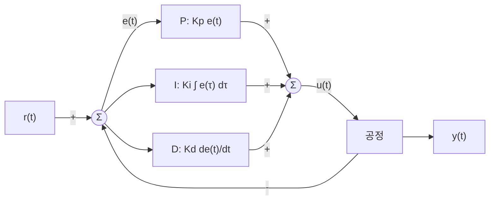

*그림 1. PID 제어시스템의 구조*

그림 1에서 설정점 $r(t)$와 출력 $y(t)$의 차이가 오차 $e(t) = r(t) - y(t)$이다. PID 제어기는 오차를 세 갈래로 나누어 처리한다. P 블록은 오차에 비례 이득 $K_p$를 곱하고, I 블록은 오차를 시간에 대해 적분한 값에 적분 이득 $K_i$를 곱하며, D 블록은 오차의 변화율에 미분 이득 $K_d$를 곱한다. 세 값을 더한 것이 제어 대상인 **공정(process)** 에 들어가는 제어 입력 $u(t)$이다.

$$
u(t) = P(t) + I(t) + D(t) = K_p e(t) + K_i \int_0^t e(\tau)\,d\tau + K_d \frac{de(t)}{dt}
$$

여기서 $\tau$는 0부터 현재 시각 $t$까지 움직이는 적분 변수이다. 즉 제어기는 제어하려는 대상의 출력값(output)을 측정하여 원하는 **참조값(reference value)** 과 비교해 오차(error)를 계산하고, 오차값과 오차값의 적분(integral), 오차값의 미분(derivative)에 각각 비례하는 제어값을 계산하여 더한다. 세 이득 $K_p$, $K_i$, $K_d$를 정하는 일을 **이득 조정(gain tuning)** 이라 하며, 3절은 이를 최적화 문제로 푼다.

> **주의:** 이 문서의 $K_p$는 PID 제어기의 비례 이득이다. 10주차의 위치 오차 상수도 같은 기호 $K_p$로 쓰지만 서로 다른 양이다. 이 문서에서는 위치 오차 상수를 기호 없이 "위치 오차 상수"라고 부른다.

### 1.2 PID 제어의 사용 사례

PID 제어는 구조가 단순하고 플랜트의 정확한 모델 없이도 조정할 수 있어, 산업 현장의 피드백 루프 대부분에 쓰인다 [1]. 대표적인 사용 사례는 표 1과 같다.

| 분야 | 제어 대상과 목적 |
|:-----|:-----|
| 온도 제어시스템 | 가열기나 냉각기에서 PID 제어로 원하는 온도를 유지하여 제품 품질과 에너지 효율을 높인다. |
| 모터 속도 제어 | 공장 자동화나 로봇 공학에서 모터의 속도를 일정하게 유지하거나 변속할 때 정확한 속도 조절을 구현한다. |
| 압력 제어 | 석유화학 공정, 보일러 시스템 등에서 압력을 일정하게 유지하거나 조정하여 안전하고 효율적인 공정을 유지한다. |
| 유체 레벨 제어 | 정수 처리 시설이나 연료 탱크에서 유체의 높이를 일정하게 유지하여 넘침이나 부족을 막는다. |
| 드론과 자율주행차 | 위치, 속도, 높이 등을 실시간으로 조절하여 안정적인 비행과 주행을 가능하게 하고, 바람이나 노면 같은 외부 요인에 대응한다. |

*표 1. PID 제어의 대표적인 사용 사례*

### 1.3 PID 제어의 장점과 단점

**장점**

- 다양한 환경에 적용할 수 있는 보편적인 제어 기법이다.
- 설계가 비교적 간단하며, 경험적인 조정만으로도 성능을 높일 수 있다.
- 오차를 빠르게 줄이면서도 과도한 응답을 억제하여 높은 안정성과 정확성을 제공한다.

**단점**

- 세 이득을 미세하게 조정해야 하며, 이득을 잘못 설정하면 최대 초과량이 커지거나 시스템이 불안정해질 수 있다.
- 복잡한 시스템이나 비선형성이 강한 시스템에서는 PID 제어만으로 충분하지 않을 수 있다. 이런 시스템을 위한 인공신경망 기반 제어는 14주차에서 다룬다.
- 미분 제어는 측정 잡음에 취약하다(1.4절).

### 1.4 비례, 적분, 미분 항의 역할

**비례(P) 항.** 현재 오차, 즉 목표값과 현재값의 차이에 비례하는 제어 신호 $K_p e(t)$를 만든다. $K_p$가 클수록 같은 오차에 더 크게 반응한다. 큰 오차에는 즉각 크게 반응하지만, 오차가 작아지면 제어량도 작아져 출력을 목표값까지 밀어붙이지 못하므로 **잔류 오차(steady-state error)**, 즉 정상 상태 오차가 남을 수 있다. 10주차의 용어로 말하면, 적분기가 없는 플랜트에 비례 제어기만 쓰면 타입 0 시스템이 되어 계단 입력에 대해 위치 오차 상수로 정해지는 유한한 오차가 남는다.

**적분(I) 항.** 시간에 따라 오차를 누적한 값 $\int_0^t e(\tau)\,d\tau$를 바탕으로 제어 신호를 만들어 잔류 오차를 제거한다. 적분 이득 $K_i$는 누적된 오차에 대한 반응의 크기를 정한다. 오차가 작더라도 0이 아닌 한 적분값은 시간이 지남에 따라 계속 커지므로, 제어 신호는 오차가 0이 될 때까지 변하고 출력은 목표값에 붙어 있게 된다. 10주차의 관점에서는 적분 항이 개루프 전달함수에 원점 극점을 더해 시스템 타입을 하나 올리는 것이다. 그러나 적분 동작이 지나치면 누적된 값이 출력을 목표값 너머로 밀어 최대 초과량이 커지거나 시스템이 불안정해질 수 있다.

**미분(D) 항.** 오차의 변화율 $\frac{de(t)}{dt}$, 즉 오차가 변하는 속도를 바탕으로 제어 신호를 만든다. 미분 이득 $K_d$는 오차 변화율에 대한 반응의 크기를 정한다. 출력이 목표값을 향해 빠르게 다가오면 오차가 빠르게 줄어 $\frac{de}{dt} < 0$이므로, 미분 항은 제어 입력을 미리 줄여 목표값을 지나치지 않게 한다. 이처럼 미분 항은 빠르게 변하는 오차를 억제하여 시스템을 안정화하고 응답성을 높인다. 그러나 측정 잡음처럼 빠르게 변하는 작은 신호도 미분하면 크게 증폭되므로 제어 신호가 불안정해질 수 있다.

> **참고:** 실제 PID 제어기는 미분 항을 그대로 쓰지 않고 저역 통과 필터를 붙인 $\frac{K_d s}{T_f s + 1}$ 형태로 구현하여 고주파 잡음의 증폭을 제한한다. 또한 설정점이 계단처럼 갑자기 바뀌면 오차의 미분이 순간적으로 매우 커지므로(미분 킥), 오차 대신 출력 $-y(t)$만 미분하는 구현도 널리 쓰인다 [1].

### 1.5 PID 제어기의 전달함수

PID 제어기의 전달함수를 구하기 위해 3주차의 라플라스 변환을 다시 정리한다. 함수 $f(t)$ ($t \ge 0$)의 **라플라스 변환(Laplace transform)** 은 다음과 같이 정의한다.

$$
F(s) = \mathcal{L}\lbrace f(t) \rbrace = \int_0^\infty f(t)\,e^{-st}\,dt
$$

**단위 계단(unit-step) 함수** $u_s(t)$는 $t \ge 0$에서 1이므로, 정의에 대입하면 다음과 같다($s$의 실수부가 양수일 때 $e^{-st} \to 0$).

$$
\mathcal{L}\lbrace u_s(t) \rbrace = \int_0^\infty e^{-st}\,dt = \left[-\frac{1}{s}e^{-st}\right]_0^\infty = 0 - \left(-\frac{1}{s}\right) = \frac{1}{s}
$$

**지수 함수** $e^{-at}$는 지수를 합쳐 같은 방법으로 적분한다($s$의 실수부가 $-a$보다 클 때).

$$
\mathcal{L}\lbrace e^{-at} \rbrace = \int_0^\infty e^{-at}e^{-st}\,dt = \int_0^\infty e^{-(s + a)t}\,dt = \left[-\frac{1}{s + a}e^{-(s + a)t}\right]_0^\infty = \frac{1}{s + a}
$$

이제 PID 제어기의 세 항을 변환한다. 오차의 라플라스 변환을 $E(s)$라 한다.

**비례(P) 항.** 라플라스 변환은 선형이므로 상수배는 그대로 남는다: $\mathcal{L}\lbrace K_p e(t) \rbrace = K_p E(s)$.

**미분(D) 항.** 정의에 부분적분 $\int u\,dv = uv - \int v\,du$를 적용한다($u = e^{-st}$, $dv = e'(t)\,dt$).

$$
\mathcal{L}\left\lbrace \frac{de(t)}{dt}\right \rbrace = \int_0^\infty e'(t)\,e^{-st}\,dt = \Big[e(t)\,e^{-st}\Big]_0^\infty + s\int_0^\infty e(t)\,e^{-st}\,dt = sE(s) - e(0)
$$

초기 조건 $e(0) = 0$을 가정하면 $\mathcal{L}\lbrace K_d \frac{de}{dt} \rbrace = K_d\,sE(s)$이다. 즉 시간 영역의 미분은 $s$ 영역에서 $s$를 곱하는 것이다.

**적분(I) 항.** $g(t) = \int_0^t e(\tau)\,d\tau$라 하면 $g'(t) = e(t)$이고 $g(0) = 0$이다. 위의 미분 공식을 $g$에 적용하면 $E(s) = sG(s) - g(0) = sG(s)$이므로 $G(s) = \frac{E(s)}{s}$이다. 즉 시간 영역의 적분은 $s$ 영역에서 $s$로 나누는 것이고, $\mathcal{L}\lbrace K_i\int_0^t e\,d\tau \rbrace = K_i\frac{E(s)}{s}$이다.

세 항을 더하면 $U(s) = \left(K_p + \frac{K_i}{s} + K_d s\right)E(s)$이므로, 오차에서 제어 입력까지의 전달함수인 **PID 제어기의 전달함수**는 다음과 같다.

$$
C(s) = \frac{U(s)}{E(s)} = K_p + \frac{K_i}{s} + K_d s = \frac{K_d s^2 + K_p s + K_i}{s}
$$

PID 제어기는 원점에 극점 하나와, $K_d s^2 + K_p s + K_i = 0$의 근인 영점 두 개를 갖는다. 원점 극점이 적분 동작이며, 10주차에서 본 것처럼 루프의 시스템 타입을 하나 올린다. $K_i = 0$이면 PD 제어기 $C(s) = K_p + K_d s$, $K_d = 0$이면 PI 제어기 $C(s) = K_p + \frac{K_i}{s}$, $K_i = K_d = 0$이면 P 제어기 $C(s) = K_p$가 된다.

---

<br>

## 2. PID 제어 예제

### 2.1 질량-스프링-댐퍼 시스템

PID 제어기의 각 항이 응답에 미치는 영향을 그림 2의 **질량-스프링-댐퍼(mass-spring-damper)** 시스템으로 확인한다 [2]. 질량 $m$인 물체가 스프링(강성 $k$)과 댐퍼(감쇠 계수 $b$)로 벽에 연결되어 있고, 외력 $f$를 받아 변위 $x$만큼 움직인다.

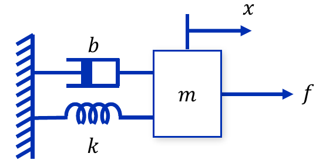

*그림 2. 질량-스프링-댐퍼 시스템*

물체에는 외력 $f$와 함께 스프링의 복원력 $-kx$와 댐퍼의 감쇠력 $-b\dot{x}$가 작용한다. 뉴턴의 운동 제2법칙(4주차)에 따라 운동방정식은 다음과 같다.

$$
m\ddot{x} = f - b\dot{x} - kx \quad\Longrightarrow\quad m\ddot{x} + b\dot{x} + kx = f
$$

초기 조건을 0으로 두고 라플라스 변환하면 $(ms^2 + bs + k)X(s) = F(s)$이므로, 외력에서 변위까지의 전달함수는 다음과 같다. 매개변수는 $m = 1$ kg, $b = 10$ N s/m, $k = 20$ N/m이다.

$$
P(s) = \frac{X(s)}{F(s)} = \frac{1}{ms^2 + bs + k} = \frac{1}{s^2 + 10s + 20}
$$

제어 목표는 빠른 **상승 시간(rise time)**, 최소의 **최대 초과량(maximum overshoot, 오버슈트)**, 최소의 **정상 상태 오차(steady-state error)** 를 함께 달성하는 것이다. 이 예제에서 상승 시간은 출력이 최종값의 10%에서 90%까지 오르는 데 걸리는 시간이고, 최대 초과량은 출력의 최댓값이 최종값을 넘는 정도를 최종값에 대한 백분율로 나타낸 것이다. 제어 구조는 그림 3의 단위 피드백이며, 제어기 $C(s)$가 원하는 위치 $r$과 실제 위치 $y = x$의 오차 $e$로부터 힘 $u = f$를 만든다.

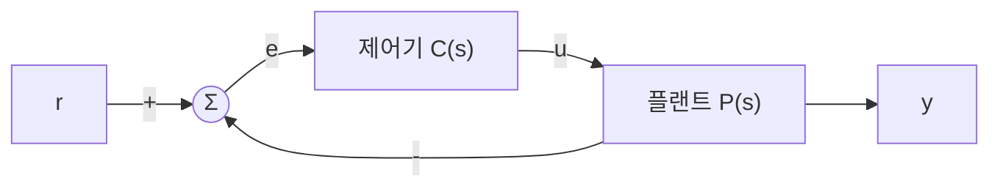

*그림 3. 질량-스프링-댐퍼 시스템의 단위 피드백 제어 구조*

### 2.2 개루프 계단 응답

제어기 없이 플랜트에 크기 1 N의 계단 힘을 가했을 때의 응답을 MATLAB으로 구한다.

```matlab
%% Open loop step response
s = tf('s');
P = 1/(s^2 + 10*s + 20);

t = 0:0.01:2;
response = step(P,t)
stepinfo(response,t)
```

- `s = tf('s');`는 라플라스 변수 $s$를 전달함수 객체로 만든다. 이후 $s$를 쓴 식은 전달함수가 된다.
- `P = 1/(s^2 + 10*s + 20);`는 플랜트 $P(s)$를 만든다.
- `t = 0:0.01:2;`는 0초부터 2초까지 0.01초 간격의 시간 벡터이다.
- `response = step(P,t)`는 시각 `t`마다의 단위 계단 응답 값을 벡터로 돌려준다. 줄 끝에 세미콜론이 없으므로 값이 화면에 출력된다.
- `stepinfo(response,t)`는 응답 데이터로부터 상승 시간, 정착 시간, 최대 초과량 등의 지표를 계산한다. 응답을 데이터로 넘기면 마지막 표본 `response(end)`를 최종값으로 본다.

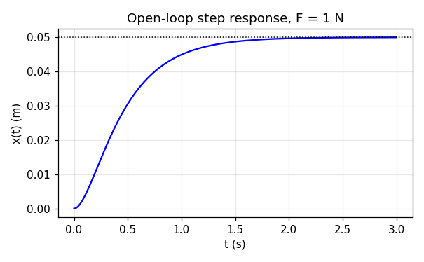

*그림 4. 질량-스프링-댐퍼 시스템의 개루프 계단 응답*

플랜트의 극점은 $s^2 + 10s + 20 = 0$의 근 $s = -5 \pm \sqrt{5}$, 즉 약 $-2.76$과 $-7.24$로 서로 다른 두 실수이므로 과감쇠 응답이다(7주차). 최종값은 최종값 정리로 $\lim_{s\to 0} s\cdot P(s)\cdot\frac{1}{s} = P(0) = \frac{1}{20} = 0.05$ m이다. 즉 1 N의 힘으로는 스프링이 0.05 m만 늘어난다. 최종값 기준의 상승 시간은 약 0.88 s, 2% 정착 시간은 약 1.59 s로 느리다. 출력을 1 m로 보내는 것이 목표라면 오차가 $1 - 0.05 = 0.95$나 되므로, 피드백 제어기로 상승 시간과 정상 상태 오차를 모두 줄여야 한다.

### 2.3 비례 제어

제어기를 $C(s) = K_p$로 둔다.

```matlab
%% Proportional control
s = tf('s');
P = 1/(s^2 + 10*s + 20);

Kp = 300;
C = pid(Kp)
T = feedback(C*P,1)

t = 0:0.01:2;
step(T,t)
response = step(T,t);
result = stepinfo(response,t);
```

- `C = pid(Kp)`는 PID 제어기 객체 $C(s) = K_p + \frac{K_i}{s} + K_d s$를 만들며, 인자를 하나만 주면 $K_i = K_d = 0$인 비례 제어기가 된다.
- `T = feedback(C*P,1)`은 전방향 경로 $C(s)P(s)$와 피드백 경로 1로 이루어진 폐루프 전달함수 $\frac{CP}{1 + CP}$를 만든다.
- `step(T,t)`는 계단 응답을 그리고, `response = step(T,t);`는 응답 값을 벡터로 받는다. `result = stepinfo(response,t);`는 지표를 구조체 `result`에 저장한다.

폐루프 전달함수를 구한다.

$$
T(s) = \frac{K_p P(s)}{1 + K_p P(s)} = \frac{K_p}{s^2 + 10s + 20 + K_p}
$$

분모를 7주차의 2차 표준형의 분모 $s^2 + 2\zeta\omega_n s + \omega_n^2$과 비교하면 고유 진동수와 감쇠비는 다음과 같다.

$$
\omega_n^2 = 20 + K_p, \qquad 2\zeta\omega_n = 10 \quad\Longrightarrow\quad \omega_n = \sqrt{20 + K_p}, \qquad \zeta = \frac{5}{\sqrt{20 + K_p}}
$$

$K_p = 300$이면 $\omega_n = \sqrt{320} \approx 17.89$ rad/s, $\zeta = 5/17.89 \approx 0.280$이고, 최대 초과량 공식 $M_p = e^{-\pi\zeta/\sqrt{1 - \zeta^2}} \times 100\% = e^{-\pi(0.280)/0.960} \times 100\% \approx 40\%$를 얻는다. 정상 상태 값은 직류 이득 $T(0) = \frac{K_p}{20 + K_p} = \frac{300}{320} = 0.9375$이므로 오차는 다음과 같다.

$$
e_{ss} = 1 - T(0) = \frac{20}{20 + K_p} = \frac{20}{320} = 0.0625
$$

이는 10주차의 결과와 같다. 개루프 전달함수 $K_p P(s)$에는 원점 극점이 없어 타입 0이고, 위치 오차 상수가 $K_p P(0) = \frac{K_p}{20} = 15$이므로 $e_{ss} = \frac{1}{1 + 15} = 0.0625$이다. 세 가지 $K_p$에 대한 결과는 표 2와 그림 5와 같다. 상승 시간과 최대 초과량은 $t = 0 \sim 2$ s의 응답으로 구한 값이다.

| $K_p$ | $\omega_n$ (rad/s) | $\zeta$ | 공식의 $M_p$ (%) | 상승 시간 (s) | 최대 초과량 (%) | 정상 상태 오차 |
|:-----|:-----|:-----|:-----|:-----|:-----|:-----|
| 100 | 10.95 | 0.456 | 20.0 | 0.1424 | 20 | 0.1667 |
| 300 | 17.89 | 0.280 | 40.1 | 0.0728 | 40 | 0.0625 |
| 500 | 22.80 | 0.219 | 49.4 | 0.0539 | 49.3 | 0.0385 |

*표 2. 비례 이득에 따른 폐루프 응답의 특성*

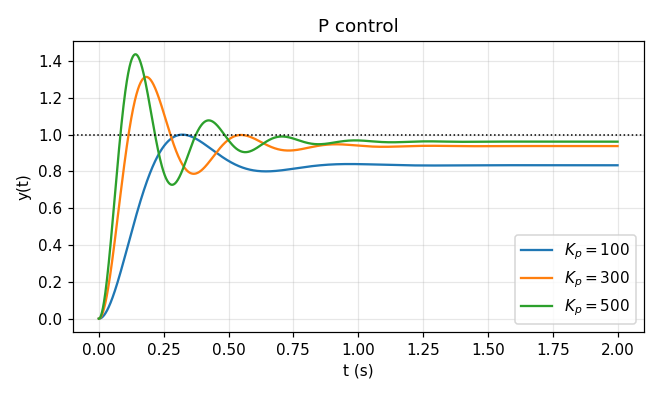

*그림 5. 비례 이득에 따른 계단 응답*

비례 이득을 키우면 $\omega_n$이 커져 응답이 빨라지므로 상승 시간이 줄고, 직류 이득이 1에 가까워져 정상 상태 오차가 준다. 반면 $\zeta$가 작아져 최대 초과량이 커진다. 극점의 실수부 $-\zeta\omega_n = -5$는 $K_p$와 무관하므로, 진동이 줄어드는 포락선의 속도는 변하지 않고 2% 정착 시간은 $\frac{4}{\zeta\omega_n} \approx 0.8$ s 근처에 머문다(실제로 0.74~0.77 s). 정리하면 **비례 제어기는 상승 시간과 정상 상태 오차를 모두 줄이고 최대 초과량을 늘리며 정착 시간은 약간만 줄인다.** 비례 제어만으로는 정상 상태 오차를 0으로 만들 수 없고, 오차를 줄이려 이득을 키울수록 최대 초과량이 커지는 상충 관계가 있다.

### 2.4 비례-미분 제어

제어기를 $C(s) = K_p + K_d s$로 둔다. 코드는 2.3절과 같고 제어기 부분만 다르다.

```matlab
%% Proportional-derivative control
Kp = 300;
Kd = 10;
C = pid(Kp,0,Kd)
T = feedback(C*P,1)
```

`pid(Kp,0,Kd)`는 적분 이득을 0으로 둔 PD 제어기이다. 폐루프 전달함수는 다음과 같다.

$$
T(s) = \frac{(K_d s + K_p)P(s)}{1 + (K_d s + K_p)P(s)} = \frac{K_d s + K_p}{s^2 + (10 + K_d)s + (20 + K_p)}
$$

분모를 2차 표준형과 비교하면 $\omega_n = \sqrt{20 + K_p}$는 비례 제어와 같고, $2\zeta\omega_n = 10 + K_d$이므로 감쇠비가 $\zeta = \frac{10 + K_d}{2\sqrt{20 + K_p}}$로 커진다. 미분 항은 분모의 $s$ 계수, 즉 시스템의 감쇠를 키우는 효과를 낸다. 2.1절의 운동방정식에서 보면 $K_d s$는 속도에 비례하는 힘이므로 댐퍼의 감쇠 계수를 $b$에서 $b + K_d$로 늘린 것과 같다. $K_p = 300$일 때의 결과는 표 3과 그림 6과 같다.

| $K_d$ | $\zeta$ | 공식의 $M_p$ (%) | 영점 $-K_p/K_d$ | 상승 시간 (s) | 최대 초과량 (%) | 정상 상태 오차 |
|:-----|:-----|:-----|:-----|:-----|:-----|:-----|
| 5 | 0.419 | 23.4 | $-60$ | 0.0784 | 24.6 | 0.0625 |
| 10 | 0.559 | 12.0 | $-30$ | 0.0779 | 15.3 | 0.0625 |
| 20 | 0.839 | 0.8 | $-15$ | 0.0704 | 5.79 | 0.0625 |

*표 3. 미분 이득에 따른 폐루프 응답의 특성 ($K_p = 300$)*

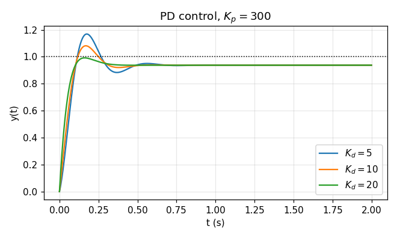

*그림 6. 미분 이득에 따른 계단 응답*

$K_d$가 클수록 감쇠비가 커져 최대 초과량이 줄어든다. 실제 최대 초과량이 2차 표준형의 공식보다 큰 것은 PD 제어기가 만든 폐루프 영점 $s = -K_p/K_d$ 때문이다. 영점은 응답에 그 신호의 미분 성분을 더해 초기 상승을 가파르게 하고 초과량을 키우며, 영점이 원점에 가까울수록(그림의 $K_d = 20$에서 $-15$) 이 효과가 커진다. 직류 이득 $T(0) = \frac{K_p}{20 + K_p}$는 $K_d$와 무관하므로 정상 상태 오차는 0.0625 그대로이다. 정리하면 **미분 항을 추가하면 최대 초과량이 줄고, 상승 시간과 정상 상태 오차에는 무시할 만한 영향만 있다.**

### 2.5 비례-적분 제어

제어기를 $C(s) = K_p + \frac{K_i}{s}$로 둔다.

```matlab
%% Proportional-integral control
Kp = 300;
Ki = 70;
C = pid(Kp,Ki)
T = feedback(C*P,1)
```

`pid(Kp,Ki)`는 미분 이득을 0으로 둔 PI 제어기이다. 개루프 전달함수 $C(s)P(s) = \frac{K_p s + K_i}{s(s^2 + 10s + 20)}$에 원점 극점이 생기므로 시스템은 타입 1이 되고, 10주차의 결과에 따라 계단 입력의 정상 상태 오차는 0이다. 폐루프 전달함수는 분자와 분모에 $s(s^2 + 10s + 20)$을 곱해 정리한다.

$$
T(s) = \frac{K_p s + K_i}{s(s^2 + 10s + 20) + K_p s + K_i} = \frac{K_p s + K_i}{s^3 + 10s^2 + (20 + K_p)s + K_i}
$$

$K_p = 300$이면 특성방정식은 $s^3 + 10s^2 + 320s + K_i = 0$이다. 9주차의 Routh 표를 만든다.

$$
\begin{array}{c|cc}
s^3 & 1 & 320 \\
s^2 & 10 & K_i \\
s^1 & \dfrac{10 \cdot 320 - K_i}{10} & 0 \\
s^0 & K_i &
\end{array}
$$

첫 열의 부호가 모두 양수이려면 $3200 - K_i > 0$이고 $K_i > 0$이어야 하므로, $0 < K_i < 3200$에서 안정하다. $K_i = 70$이면 폐루프 극점은 약 $-4.89 \pm j17.14$와 $-0.220$이고, 폐루프 영점은 $-K_i/K_p \approx -0.233$이다. 복소 극점 쌍은 비례 제어의 극점($-5 \pm j17.18$)과 거의 같아 빠른 진동 응답을 만들고, 원점 가까이의 실수 극점 $-0.220$은 시정수가 $\frac{1}{0.220} \approx 4.5$ s인 느린 성분을 만든다. 이 느린 극점은 영점 $-0.233$과 가까워 그 성분의 크기는 작지만, 출력이 1에 다가가는 마지막 구간을 느리게 만든다.

| $K_i$ | 느린 극점 | 영점 $-K_i/K_p$ | 상승 시간 (s) | 최대 초과량 (%) | $\vert 1 - y(2) \vert$ | 출력의 최댓값 |
|:-----|:-----|:-----|:-----|:-----|:-----|:-----|
| 30 | $-0.094$ | $-0.100$ | 0.0734 | 38.9 | 0.0496 | 1.321 |
| 70 | $-0.220$ | $-0.233$ | 0.0740 | 38.0 | 0.0363 | 1.331 |
| 100 | $-0.316$ | $-0.333$ | 0.0743 | 37.7 | 0.0287 | 1.338 |

*표 4. 적분 이득에 따른 폐루프 응답의 특성 ($K_p = 300$)*

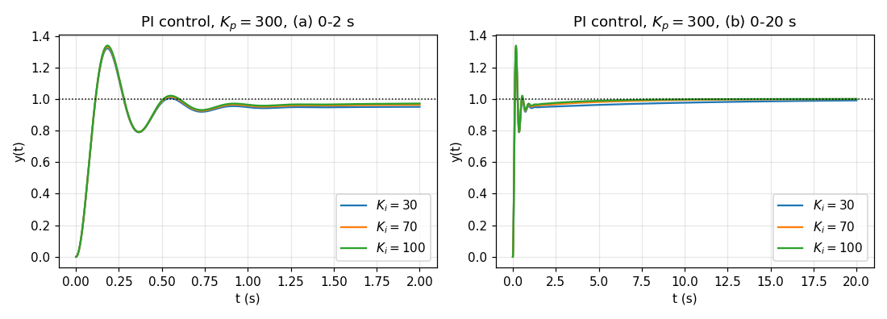

*그림 7. 적분 이득에 따른 계단 응답*

표 4의 상승 시간, 최대 초과량, $\vert 1 - y(2) \vert$는 MATLAB의 `stepinfo`처럼 $t = 2$ s의 마지막 표본 $y(2)$를 최종값으로 보고 구한 값이다. 이론적인 정상 상태 오차는 0이지만, 느린 극점 때문에 2초 시점에는 출력이 아직 1에 닿지 않아 0.0363($K_i = 70$)의 차이가 남는다. 같은 시스템에서 이 차이는 $t = 10$ s에 약 0.006, $t = 30$ s에 약 0.0001로 줄어든다(그림 7의 (b)). $K_i$가 클수록 느린 극점이 원점에서 멀어져 출력이 1에 더 빨리 다가간다. 즉 **적분 제어기는 정상 상태 오차를 제거한다.**

> **참고:** 표 4에서 $K_i$를 키울수록 "최대 초과량"의 수치가 38.9에서 37.7로 줄고 비례 제어(40)보다도 작아, 적분 제어기가 최대 초과량을 줄이는 것처럼 보인다. 그러나 이 수치는 아직 1에 닿지 않은 $y(2)$를 기준으로 계산한 것이다. 기준값 1에 대한 출력의 최댓값은 비례 제어 1.313에서 PI 제어 1.321, 1.331, 1.338로 오히려 커진다. 일반적으로 적분 동작은 정상 상태 오차를 없애는 대신 최대 초과량과 정착 시간을 늘리는 경향이 있다 [2]. 지표를 비교할 때는 같은 기준의 최종값을 쓰는지 확인해야 한다.

### 2.6 비례-적분-미분 제어

세 항을 모두 쓴 PID 제어기 $C(s) = K_p + \frac{K_i}{s} + K_d s$를 적용한다.

```matlab
%% Proportional-integral-derivative control
Kp = 300;
Ki = 70;
Kd = 30;
C = pid(Kp,Ki,Kd)
T = feedback(C*P,1)
```

폐루프 전달함수는 $C(s) = \frac{K_d s^2 + K_p s + K_i}{s}$를 대입하여 구한다.

$$
T(s) = \frac{K_d s^2 + K_p s + K_i}{s^3 + (10 + K_d)s^2 + (20 + K_p)s + K_i} = \frac{30s^2 + 300s + 70}{s^3 + 40s^2 + 320s + 70}
$$

폐루프 극점은 약 $-29.08$, $-10.70$, $-0.225$로 모두 음의 실수이고, 영점은 $30s^2 + 300s + 70 = 0$의 근인 약 $-9.76$과 $-0.239$이다. 미분 항이 감쇠를 크게 늘려 복소 극점 쌍이 사라졌으므로 진동이 없다. 극점 $-10.70$은 영점 $-9.76$과, 느린 극점 $-0.225$는 영점 $-0.239$와 가까워 각 성분의 크기가 작다. 그 결과 출력은 약 0.17 s에 0.959까지 빠르게 오른 뒤 0.948까지 약간 내려갔다가 1을 향해 천천히 올라간다(그림 8).

MATLAB이 계산한 지표는 상승 시간 0.0659 s, 최대 초과량 0, $\vert 1 - y(2)\vert = 0.0376$이다. 최대 초과량이 0인 것은 구간 $0 \sim 2$ s에서 출력의 최댓값이 마지막 표본 $y(2) \approx 0.962$이기 때문이다. 시스템은 타입 1이므로 이론적인 정상 상태 오차는 0이며, 2초 시점의 차이 0.0376은 느린 성분이 아직 남은 것이다. 정리하면 **PID 제어는 상승 속도가 빨라지고 최대 초과량과 정상 상태 오차가 함께 줄어든다.**

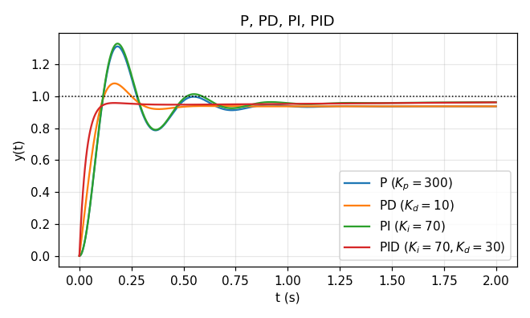

*그림 8. P, PD, PI, PID 제어기의 계단 응답 비교*

### 2.7 이득이 응답에 미치는 영향

2.3~2.6절의 관찰을 일반화하면, 각 이득을 독립적으로 키웠을 때의 경향은 표 5와 같다 [2].

| 이득을 키울 때 | 상승 시간 | 최대 초과량 | 정착 시간 | 정상 상태 오차 |
|:-----|:-----|:-----|:-----|:-----|
| $K_p$ | 감소 | 증가 | 작은 변화 | 감소 |
| $K_i$ | 감소 | 증가 | 증가 | 제거 |
| $K_d$ | 작은 변화 | 감소 | 감소 | 변화 없음 |

*표 5. PID 이득을 독립적으로 키울 때 폐루프 응답의 일반적인 경향*

> **주의:** 표 5는 경험적인 경향일 뿐 정확한 규칙이 아니다. 세 이득은 서로 영향을 주므로 한 이득을 바꾸면 다른 이득의 효과도 달라진다. 예를 들어 2.5절에서 $K_i$를 더했을 때 상승 시간은 0.0728 s에서 0.0740 s로 오히려 조금 늘었다. 따라서 표 5는 조정의 방향을 정하는 출발점으로 쓰고, 최종 이득은 응답을 확인하며 정한다. 3절은 이 시행착오를 최적화 문제로 바꾸어 체계적으로 푼다.

---

<br>

## 3. 최적화 기반 PID 제어

### 3.1 최적화 모델

2절에서는 이득을 하나씩 바꾸어 가며 응답을 비교했다. 이득이 셋이고 목표가 여럿(빠른 상승, 작은 초과량, 작은 오차)이면 시행착오로 좋은 조합을 찾기 어렵다. **최적화(optimization)** 는 이 문제를 수식으로 바꾸어 수치 알고리즘으로 푼다. 설계 최적화의 기본 모델은 다음과 같다 [3].

$$
\begin{aligned}
\underset{\mathbf{d}}{\text{minimize}} \quad & f(d_1, d_2, \ldots, d_n) \\
\text{subject to} \quad & g_i(d_1, d_2, \ldots, d_n) \le 0, \quad i = 1, 2, \ldots, n_i \\
& h_j(d_1, d_2, \ldots, d_n) = 0, \quad j = 1, 2, \ldots, n_e \\
& d_k^l \le d_k \le d_k^u, \quad k = 1, 2, \ldots, n
\end{aligned}
$$

| 기호 | 이름 | 의미 |
|:-----|:-----|:-----|
| $\mathbf{d} = (d_1, d_2, \ldots, d_n)$ | 설계 변수(design variable) | 설계 도중에 결정되는 변수 |
| $f(d_1, d_2, \ldots, d_n)$ | 목적 함수(objective function) | 최소화할 함수 |
| $g_i(d_1, d_2, \ldots, d_n)$ | 부등식 제한조건 함수(inequality constraint function) | $g_i \le 0$을 만족해야 하는 함수, 개수 $n_i$ |
| $h_j(d_1, d_2, \ldots, d_n)$ | 등식 제한조건 함수(equality constraint function) | $h_j = 0$을 만족해야 하는 함수, 개수 $n_e$ |
| $d_k^l$, $d_k^u$ | 설계 변수의 하한과 상한(lower and upper bounds) | 각 설계 변수가 움직일 수 있는 범위 |

*표 6. 최적화 기본 모델의 구성 요소*

최적화 문제의 세 가지 기본 구성 요소는 설계 변수, 목적 함수, 제한조건이다. 최적화 모델은 부등식 제한조건 $g_i \le 0$과 등식 제한조건 $h_j = 0$을 만족하면서 목적 함수 $f$를 최소화하는 설계 변수 $\mathbf{d}$를 범위 $d_k^l \le d_k \le d_k^u$ 안에서 찾는 것이다. 모든 제한조건을 만족하는 설계를 **실행 가능한 설계(feasible design)** 라 하며, 최적해는 실행 가능한 설계 가운데 목적 함수가 가장 작은 것이다. 최대화 문제는 $-f$를 최소화하는 문제로, $g \ge 0$ 형태의 조건은 $-g \le 0$으로 바꾸어 같은 모델로 쓸 수 있다.

### 3.2 기울기

목적 함수를 줄이는 방향을 찾는 데는 기울기를 쓴다.

> **용어 정의:** 다변수 함수 $f(x_1, x_2, \ldots, x_n)$의 **기울기(gradient)** 는 각 변수에 대한 편미분을 모은 벡터 $\nabla f = \left[\frac{\partial f}{\partial x_1}, \frac{\partial f}{\partial x_2}, \ldots, \frac{\partial f}{\partial x_n}\right]^T$이다. 기울기는 특정 지점에서 함수가 가장 가파르게 증가하는 방향, 즉 함수의 증가율이 가장 큰 방향을 가리키는 벡터이다.

$$
\nabla f = \begin{bmatrix} \dfrac{\partial f}{\partial x_1} \\ \dfrac{\partial f}{\partial x_2} \\ \vdots \\ \dfrac{\partial f}{\partial x_n} \end{bmatrix}
$$

예를 들어 $f(x, y) = x^2 + y^2$이면 $\frac{\partial f}{\partial x} = 2x$, $\frac{\partial f}{\partial y} = 2y$이므로 $\nabla f = (2x, 2y)$이다. 점 $(1, 0.5)$에서 기울기는 $(2, 1)$로 원점에서 멀어지는 방향을 가리킨다. 그림 9의 왼쪽은 이 함수의 그래프(원점이 바닥인 그릇 모양)와 바닥면의 등고선이고, 오른쪽은 평면 위의 각 점에서 기울기 벡터를 화살표로 그린 것이다. 화살표는 모두 원점에서 바깥쪽을 향하고, 등고선(원)에 수직이며, 원점에서 멀수록 길다.

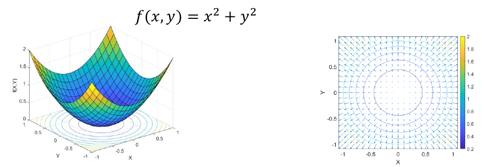

*그림 9. 함수 f(x, y) = x² + y²의 그래프와 기울기 벡터장*

> **[미적분학]** 단위 벡터 $\mathbf{u}$ 방향으로의 변화율인 방향 도함수는 $D_{\mathbf{u}}f = \nabla f \cdot \mathbf{u} = \lVert\nabla f\rVert\cos\theta$이다($\theta$는 $\nabla f$와 $\mathbf{u}$ 사이의 각). 이 값은 $\theta = 0$, 즉 $\mathbf{u}$가 기울기와 같은 방향일 때 최대 $\lVert\nabla f\rVert$이고, $\theta = \pi$일 때 최소 $-\lVert\nabla f\rVert$이다. 그래서 기울기는 가장 가파른 상승 방향이고, $-\nabla f$는 가장 가파른 하강 방향이다. 또한 $\theta = \pi/2$이면 변화율이 0이므로 기울기는 등고선에 수직이다.

### 3.3 경사 하강법

기울기는 가장 큰 증가 방향을 나타내므로, 함수를 최소화하려면 기울기의 반대 방향으로 이동해야 한다. **경사 하강법(steepest descent method, gradient descent)** 은 기울기를 이용해 매개변수를 반복적으로 갱신하여 함수(기계 학습에서는 손실 함수)를 최소화하는 최적화 알고리즘이다. 현재 점 $\mathbf{d}^k$에서 탐색 방향을 $\mathbf{a}^k = -\nabla f(\mathbf{d}^k)$로 잡고 이동 크기 $\beta^k > 0$만큼 움직인다.

$$
\mathbf{d}^{k+1} = \mathbf{d}^k - \beta^k\,\nabla f(\mathbf{d}^k)
$$

그림 10은 봉우리와 골짜기가 여럿인 함수에서 높은 지점에서 출발한 점이 매 단계 가장 가파른 내리막을 따라 골짜기 바닥으로 내려가는 경로를 보여 준다. 아래의 등고선 위에 같은 경로를 투영해 그렸다. 경로는 출발점 근처의 골짜기로 내려가므로, 다른 곳에서 출발하면 다른 골짜기에 도착할 수 있다(3.8절).

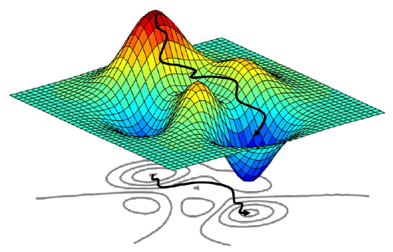

*그림 10. 경사 하강법의 경로*

> **[기계학습]** 기계 학습에서는 모델의 매개변수 $\boldsymbol{\theta}$에 대한 손실 함수 $L(\boldsymbol{\theta})$를 같은 방식 $\boldsymbol{\theta} \leftarrow \boldsymbol{\theta} - \eta\nabla L(\boldsymbol{\theta})$로 줄이며, 이동 크기 $\eta$를 학습률(learning rate)이라 부른다. 이 과목에서는 13주차에서 인공신경망의 가중치를 학습할 때 이 방법을 쓴다.

### 3.4 기울기 기반 최적화 절차

일반적인 기울기 기반 최적화 프로그램은 그림 11의 절차를 따른다.

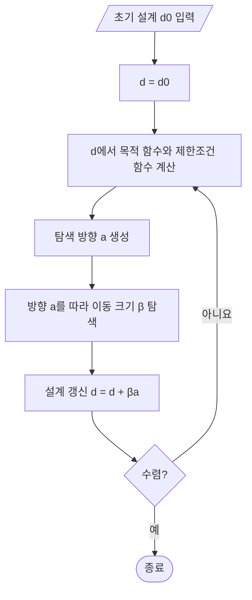

*그림 11. 기울기 기반 최적화의 절차*

1. 설계 최적화는 **초기 설계(initial design)** $\mathbf{d}^0$에서 시작한다.
2. 수치 최적화 프로그램은 현재 설계에서 목적 함수와 제한조건 함수, 그리고 그 도함수(기울기)를 계산한다.
3. 함수 값과 도함수를 바탕으로 목적 함수가 줄어들 가능성이 있는 **탐색 방향(search direction)** $\mathbf{a}$를 정한다. 제한조건이 없으면 $\mathbf{a} = -\nabla f$가 가장 단순한 선택이다.
4. 탐색 방향을 따라 움직일 **이동 크기(step size)** $\beta$를 정한다. 이동 크기는 어떤 제한조건도 위반하지 않으면서 목적 함수가 가능한 한 낮은 값으로 줄어들도록 정한다. 방향을 고정하고 $\beta$ 하나만 찾는 이 1차원 탐색을 **선 탐색(line search)** 이라 한다.
5. 현재 설계를 탐색 방향을 따라 이동 크기만큼 옮겨 새로운 설계점 $\mathbf{d} + \beta\mathbf{a}$를 얻는다.
6. 새로운 설계점에서 목적 함수와 제한조건 함수를 다시 평가하고 해가 수렴했는지 확인한다. 수렴하지 않았으면 다음 반복을 위한 새로운 탐색 방향과 이동 크기를 만든다. 이 절차를 최적해에 도달할 때까지 반복한다.

반복 횟수를 $k$, $k$번째 반복의 현재 설계점을 $\mathbf{d}^k$, 탐색 방향을 $\mathbf{a}^k$, 이동 크기를 $\beta^k$라 하면 새로운 설계점 $\mathbf{d}^{k+1}$은 다음과 같다(그림 12).

$$
\mathbf{d}^{k+1} = \mathbf{d}^k + \beta^k\mathbf{a}^k
$$

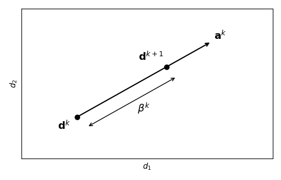

*그림 12. 현재 설계점에서 새로운 설계점으로의 이동*

탐색은 다음 가운데 하나의 수렴 조건에 도달할 때까지 진행한다. $\varepsilon_1$, $\varepsilon_2$는 미리 정한 작은 양수(허용 오차)이다.

- 연속한 두 설계점의 차이가 작을 때: $\lVert\mathbf{d}^{k+1} - \mathbf{d}^k\rVert \le \varepsilon_1$
- 연속한 두 목적 함수 값의 차이가 작을 때: $\lvert f(\mathbf{d}^{k+1}) - f(\mathbf{d}^k)\rvert \le \varepsilon_2$

### 3.5 예제: 경사 하강법의 반복 계산

다음 목적 함수를 제한조건 없이 최소화한다. 최솟값은 $\mathbf{d}^* = (2, 1)$에서 $f = 0$이다.

$$
f(\mathbf{d}) = (d_1 - 2)^2 + 2(d_2 - 1)^2, \qquad \nabla f(\mathbf{d}) = \begin{bmatrix} 2(d_1 - 2) \\ 4(d_2 - 1) \end{bmatrix}
$$

초기 설계 $\mathbf{d}^0 = (0, 0)$, 고정된 이동 크기 $\beta = 0.25$, 탐색 방향 $\mathbf{a}^k = -\nabla f(\mathbf{d}^k)$를 쓴다. 첫 반복을 계산한다.

$$
f(\mathbf{d}^0) = (0 - 2)^2 + 2(0 - 1)^2 = 4 + 2 = 6, \qquad \nabla f(\mathbf{d}^0) = \begin{bmatrix} 2(0 - 2) \\ 4(0 - 1) \end{bmatrix} = \begin{bmatrix} -4 \\ -4 \end{bmatrix}
$$

$$
\mathbf{d}^1 = \mathbf{d}^0 - 0.25\,\nabla f(\mathbf{d}^0) = \begin{bmatrix} 0 \\ 0 \end{bmatrix} - 0.25\begin{bmatrix} -4 \\ -4 \end{bmatrix} = \begin{bmatrix} 1 \\ 1 \end{bmatrix}, \qquad f(\mathbf{d}^1) = (1 - 2)^2 + 2(1 - 1)^2 = 1
$$

두 번째 반복에서는 $\nabla f(\mathbf{d}^1) = (2(1 - 2), 4(1 - 1)) = (-2, 0)$이므로 $\mathbf{d}^2 = (1, 1) - 0.25(-2, 0) = (1.5, 1)$이고 $f(\mathbf{d}^2) = 0.25$이다. 같은 계산을 반복하면 표 7을 얻는다.

| $k$ | $\mathbf{d}^k$ | $f(\mathbf{d}^k)$ | $\nabla f(\mathbf{d}^k)$ | $\mathbf{d}^{k+1}$ | $\lVert\mathbf{d}^{k+1} - \mathbf{d}^k\rVert$ | $\lvert f(\mathbf{d}^{k+1}) - f(\mathbf{d}^k)\rvert$ |
|:-----|:-----|:-----|:-----|:-----|:-----|:-----|
| 0 | $(0, 0)$ | 6 | $(-4, -4)$ | $(1, 1)$ | 1.414 | 5 |
| 1 | $(1, 1)$ | 1 | $(-2, 0)$ | $(1.5, 1)$ | 0.5 | 0.75 |
| 2 | $(1.5, 1)$ | 0.25 | $(-1, 0)$ | $(1.75, 1)$ | 0.25 | 0.1875 |
| 3 | $(1.75, 1)$ | 0.0625 | $(-0.5, 0)$ | $(1.875, 1)$ | 0.125 | 0.0469 |
| 4 | $(1.875, 1)$ | 0.0156 | $(-0.25, 0)$ | $(1.9375, 1)$ | 0.0625 | 0.0117 |
| 5 | $(1.9375, 1)$ | 0.0039 | $(-0.125, 0)$ | $(1.96875, 1)$ | 0.03125 | 0.0029 |

*표 7. 경사 하강법의 반복 계산 ($\beta = 0.25$)*

허용 오차를 $\varepsilon_1 = 0.05$, $\varepsilon_2 = 0.01$로 정하면 $k = 4$에서는 두 값이 0.0625와 0.0117로 아직 크지만, $k = 5$에서 0.03125와 0.0029로 두 조건을 모두 만족하므로 탐색을 멈춘다. 최종 설계는 $\mathbf{d}^6 = (1.96875, 1)$이고 $f = 0.03125^2 \approx 0.00098$로 최솟값 0에 가깝다(그림 13).

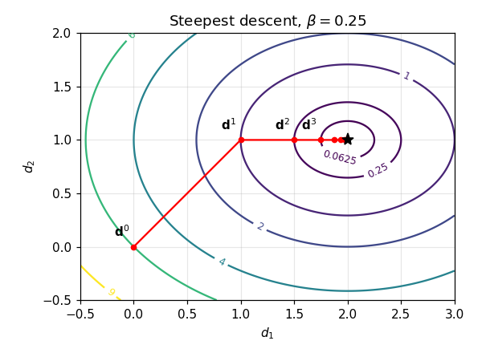

*그림 13. 경사 하강법의 반복 경로와 목적 함수의 등고선*

갱신식을 성분별로 쓰면 이동 크기의 역할이 보인다. $d_1 - 2 \leftarrow (1 - 2\beta)(d_1 - 2)$, $d_2 - 1 \leftarrow (1 - 4\beta)(d_2 - 1)$이므로 $\beta = 0.25$에서는 $d_1$ 방향의 오차가 매번 절반으로 줄고, $d_2$ 방향의 오차는 한 번에 0이 된다. 두 계수의 절댓값이 1보다 작아야 수렴하므로 이 함수에서는 $0 < \beta < 0.5$가 필요하며, $\beta$가 0.5보다 크면 $d_2$가 최솟값 양쪽을 오가며 발산한다. 이동 크기가 너무 작으면 수렴이 느리고 너무 크면 발산하므로, 실제 알고리즘은 4단계의 선 탐색으로 매번 $\beta$를 정한다. 예를 들어 첫 반복에서 $\phi(\beta) = f(\mathbf{d}^0 + \beta\mathbf{a}^0) = (4\beta - 2)^2 + 2(4\beta - 1)^2$를 최소화하면 $\phi'(\beta) = 8(4\beta - 2) + 16(4\beta - 1) = 96\beta - 32 = 0$에서 $\beta^0 = \frac{1}{3}$이고, $\mathbf{d}^1 = (\frac{4}{3}, \frac{4}{3})$, $f(\mathbf{d}^1) = \frac{4}{9} + \frac{2}{9} = \frac{2}{3}$으로 고정 이동 크기의 결과(1)보다 더 많이 줄어든다.

### 3.6 PID 이득 조정의 최적화 수식화

2절의 질량-스프링-댐퍼 시스템에서 PID 이득을 최적화로 정한다. 목표는 상승 시간을 최소화하면서 최대 초과량과 정상 상태 오차가 0이 되도록 하는 것이다. 3.1절의 모델에 맞추면 다음과 같다.

$$
\begin{aligned}
\underset{\mathbf{d} = (K_p, K_i, K_d)}{\text{minimize}} \quad & f(\mathbf{d}) = t_r(K_p, K_i, K_d) \\
\text{subject to} \quad & h_1(\mathbf{d}) = M_p(K_p, K_i, K_d) = 0 \\
& h_2(\mathbf{d}) = \lvert 1 - y(4;\,K_p, K_i, K_d)\rvert = 0 \\
& 1 \le K_p,\ K_i,\ K_d \le 500
\end{aligned}
$$

- 설계 변수는 세 이득 $\mathbf{d} = (K_p, K_i, K_d)$이다.
- 목적 함수 $t_r$은 폐루프 계단 응답의 상승 시간이다.
- 등식 제한조건은 두 개로, $h_1$은 최대 초과량 $M_p$(%), $h_2$는 $t = 4$ s의 출력과 기준값 1의 차이이다. 부등식 제한조건은 없다($n_i = 0$, $n_e = 2$).
- 이득의 하한과 상한은 1과 500이다.

목적 함수와 제한조건 함수는 식으로 주어지지 않고, 주어진 이득으로 폐루프 계단 응답을 시뮬레이션한 뒤 계산하는 값이다. 따라서 기울기도 식으로 미분할 수 없고, 각 이득을 조금씩 바꾸어 함숫값의 변화를 보는 **유한 차분(finite difference)** $\frac{\partial f}{\partial K_p} \approx \frac{f(K_p + \delta, K_i, K_d) - f(K_p, K_i, K_d)}{\delta}$로 근사한다.

이 문제는 **순차 이차 계획법(sequential quadratic programming, SQP)** 으로 푼다. SQP는 매 반복에서 목적 함수를 이차식으로, 제한조건을 일차식으로 근사한 부분 문제(이차 계획 문제)를 풀어 탐색 방향 $\mathbf{a}^k$를 정하고, 선 탐색으로 이동 크기 $\beta^k$를 정하는 기울기 기반 방법이다 [4]. 즉 3.4절의 절차에서 탐색 방향을 만드는 방법이 경사 하강법보다 정교하고 제한조건을 직접 다룰 수 있는 방법이다.

### 3.7 MATLAB 구현

MATLAB의 제한조건 최적화 함수 `fmincon`으로 구현한다 [5]. 먼저 최적화를 실행하는 스크립트이다.

```matlab
%% SQP
x0 = [100 100 100];

vfun=@(x)obj_function(x);

%Select algorithm
sAlgo='sqp';
tol = 1.0e-6;
my_options = optimset('display','iter','LargeScale','off','TolX',tol, ...
    'TolFun',tol,'TolCon',tol,'Algorithm',sAlgo);

%fmincon
[opt_var_new,fval,exitflag,output,lambda,grad,hessian] = fmincon(vfun, ...
    x0,[],[],[],[],lb,ub,'nonlcon',my_options)
```

- `x0 = [100 100 100];`는 초기 설계 $(K_p, K_i, K_d) = (100, 100, 100)$이다.
- `vfun=@(x)obj_function(x);`는 아래에 정의한 목적 함수 `obj_function`을 가리키는 함수 핸들이다.
- `sAlgo='sqp';`는 알고리즘으로 SQP를 고르고, `tol = 1.0e-6;`은 허용 오차이다.
- `optimset(...)`은 최적화 옵션을 만든다. `'display','iter'`는 반복마다 진행 상황을 출력하고, `'TolX'`, `'TolFun'`, `'TolCon'`은 각각 설계 변수의 변화, 목적 함수의 변화, 제한조건 위반에 대한 허용 오차이며, 앞의 둘은 3.4절의 $\varepsilon_1$, $\varepsilon_2$에 해당한다. `'LargeScale','off'`는 이전 버전의 옵션으로 대규모 알고리즘을 쓰지 않게 한다.
- `fmincon(fun, x0, A, b, Aeq, beq, lb, ub, nonlcon, options)`은 선형 부등식 $A\mathbf{x} \le b$, 선형 등식 $A_{eq}\mathbf{x} = b_{eq}$, 범위 $lb \le \mathbf{x} \le ub$, 비선형 제한조건 `nonlcon`을 만족하면서 `fun`을 최소화한다. 선형 제한조건이 없으므로 네 자리에 빈 행렬 `[]`를 넣고, 비선형 제한조건은 아래의 함수 `nonlcon`으로 준다.
- 출력 `opt_var_new`는 최적 설계, `fval`은 그때의 목적 함수 값, `exitflag`는 종료 이유, `output`은 반복 정보, `lambda`는 라그랑주 승수, `grad`와 `hessian`은 최적점에서의 기울기와 헤세 행렬이다.

> **참고:** 위 스크립트는 `fmincon`에 넘기는 범위 `lb`와 `ub`를 정의하지 않는다. 실행하려면 호출 전에 3.8절의 다중 시작 코드처럼 `lb=[1 1 1];`과 `ub=[500 500 500];`을 두어야 한다.

목적 함수는 이득을 받아 폐루프 계단 응답의 상승 시간을 돌려준다.

```matlab
function z = obj_function(x)
    s = tf('s');
    P = 1/(s^2 + 10*s + 20);

    Kp = x(1);
    Ki = x(2);
    Kd = x(3);
    C = pid(Kp,Ki,Kd);
    T = feedback(C*P,1);

    t = 0:0.01:4;
    response = step(T,t);
    result = stepinfo(response,t);

    output = [result.RiseTime,...
        result.Overshoot,abs(1-response(end))];

z = output(1);
```

- 설계 변수 벡터 `x`의 세 성분을 $K_p$, $K_i$, $K_d$로 꺼내 PID 제어기와 폐루프 전달함수를 만든다(2.3절과 같은 함수).
- $t = 0 \sim 4$ s의 계단 응답을 0.01 s 간격으로 구하고 `stepinfo`로 지표를 계산한다.
- `output`은 세 지표 [상승 시간, 최대 초과량(%), $\lvert 1 - y(4)\rvert$]를 모은 벡터이다. `response(end)`는 마지막 표본 $y(4)$이다.
- `z = output(1);`로 상승 시간을 목적 함수 값으로 돌려준다.

비선형 제한조건 함수는 같은 응답을 계산한 뒤 두 등식 제한조건의 값을 돌려준다.

```matlab
function [gineq,geq] = nonlcon(x)

gineq = [];
geq = [];

    s = tf('s');
    P = 1/(s^2 + 10*s + 20);

    Kp = x(1);
    Ki = x(2);
    Kd = x(3);
    C = pid(Kp,Ki,Kd);
    T = feedback(C*P,1);

    t = 0:0.01:4;
    response = step(T,t);
    result = stepinfo(response,t);

    output = [result.RiseTime,...
        result.Overshoot,abs(1-response(end))];

    geq(1) = output(2);
    geq(2) = output(3);
```

- `fmincon`은 비선형 제한조건 함수가 부등식 $g(\mathbf{x}) \le 0$의 값 `gineq`와 등식 $h(\mathbf{x}) = 0$의 값 `geq`를 돌려주기를 요구한다.
- 부등식 제한조건은 없으므로 `gineq = []`이다.
- `geq(1)`은 최대 초과량, `geq(2)`는 $\lvert 1 - y(4)\rvert$이며, `fmincon`은 두 값이 모두 0(허용 오차 `TolCon` 이내)이 되는 설계를 찾는다.

### 3.8 최적화 결과와 초기 설계

초기 설계 $(100, 100, 100)$에서 출발하면 최적 설계는 $(K_p, K_i, K_d) = (110.1, 89.6, 100.7)$이고, 상승 시간 0.0358 s, 최대 초과량 0, 정상 상태 오차 0을 얻는다. 2.6절에서 손으로 고른 PID 이득(상승 시간 0.0659 s)보다 상승 시간이 약 절반이다. 초기 설계를 바꾸어 같은 문제를 풀면 표 8의 결과를 얻는다(이득은 소수 첫째 자리로 반올림).

| 초기 설계 | $K_p$ | $K_i$ | $K_d$ | 상승 시간 (s) | 최대 초과량 | 정상 상태 오차 $\lvert 1 - y(4)\rvert$ |
|:-----|:-----|:-----|:-----|:-----|:-----|:-----|
| $[100\ 100\ 100]$ | 110.1 | 89.6 | 100.7 | 0.0358 | 0 | 0 |
| $[250\ 250\ 250]$ | 294.3 | 215.8 | 249.4 | 0.0100 | 0 | 0 |
| $[500\ 500\ 500]$ | 489.7 | 347.9 | 388.7 | 0.0083 | 0 | 0 |
| $[0\ 0\ 0]$ | 61.6 | 93.3 | 1.5 | 0.2709 | 0 | 0.001 |
| $[100\ 250\ 300]$ | 171.3 | 195.4 | 343.4 | 0.0085 | 0 | 0 |

*표 8. 초기 설계에 따른 최적화 결과*

초기점에 따라 서로 다른 최적 설계가 나온다. 기울기 기반 방법은 현재 점 근처의 정보만 쓰므로, 출발점에서 내리막을 따라 내려가 가장 가까운 **국소 최솟값(local minimum)** 에서 멈춘다. 그림 14는 이를 1차원으로 나타낸 것이다. 곡선 위의 세 출발점(빨간 점)이 각각 가까운 골짜기의 바닥(파란 점)으로 내려가며, 오른쪽 골짜기만이 전체에서 가장 낮은 **전역 최솟값(global minimum)** 이다.

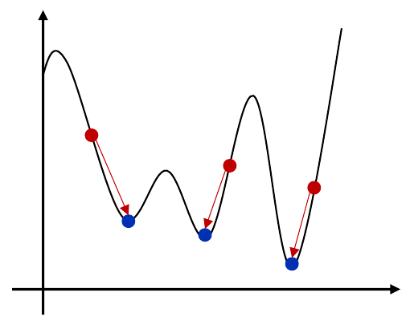

*그림 14. 초기점에 따라 서로 다른 국소 최솟값에 도달하는 기울기 기반 탐색*

전역 최솟값에 가까운 해를 찾는 간단한 방법은 무작위로 고른 여러 초기 설계에서 최적화를 반복하고 가장 좋은 결과를 고르는 **다중 시작(multi-start)** 이다.

```matlab
for loop = 1:1000

    %% SQP

    x0 = randi(500,1,3);

    lb=[1 1 1];
    ub=[500 500 500];

    vfun=@(x)obj_function(x);

    %Select algorithm
    sAlgo='sqp';
    tol = 1.0e-6;
    my_options = optimset('display','iter','LargeScale','off','TolX',tol, ...
        'TolFun',tol,'TolCon',tol,'Algorithm',sAlgo);

    %fmincon
    [opt_var_new,fval,exitflag,output,lambda,grad,hessian] = fmincon(vfun, ...
        x0,[],[],[],[],lb,ub,'nonlcon',my_options)
end
```

- `for loop = 1:1000`은 최적화를 1000번 반복한다.
- `x0 = randi(500,1,3);`은 1부터 500 사이의 정수 세 개를 무작위로 뽑아 1행 3열의 초기 설계를 만든다.
- `lb`와 `ub`는 세 이득의 하한 1과 상한 500이다. 나머지는 3.7절과 같다.

> **참고:** 위 반복문은 매번 결과를 같은 변수에 덮어쓰므로, 실제로 가장 좋은 설계를 남기려면 반복마다 `fval`을 지금까지의 최솟값과 비교하여 더 작으면 `opt_var_new`를 따로 저장하는 줄이 필요하다.

1000개의 무작위 초기 설계 가운데 가장 좋은 결과는 초기 설계 $[161\ 481\ 477]$에서 얻은 $(K_p, K_i, K_d) = (500.0, 372.2, 500.0)$이며, 상승 시간 0.0082 s, 최대 초과량 0, 정상 상태 오차 0이다. $K_p$와 $K_d$가 상한 500에 닿아 있으므로 이 해는 범위 제한에 걸린 해이며, 3.10절에서 보듯 이 영역에서는 목적 함수가 거의 평평하다.

### 3.9 Python 구현

같은 문제를 Python의 SciPy로 풀 수 있다 [6]. `scipy.signal.step`으로 계단 응답을 구하고, `scipy.optimize.minimize`의 SLSQP(sequential least squares programming, SQP의 한 형태)로 최적화한다.

```python
import numpy as np
from scipy import signal
from scipy.optimize import minimize

t = np.arange(0, 4.0 + 1e-9, 0.01)

def step_metrics(x):
    Kp, Ki, Kd = x
    num = [Kd, Kp, Ki]
    den = np.polyadd(np.polymul([1, 0], [1, 10, 20]), num)
    _, y = signal.step((num, den), T=t)
    yf = y[-1]
    def cross(level):
        i = np.argmax(y >= level)
        return t[i-1] + (level - y[i-1]) * (t[i] - t[i-1]) / (y[i] - y[i-1])
    rise = cross(0.9 * yf) - cross(0.1 * yf)
    overshoot = max(0.0, 100 * (y.max() - yf) / yf)
    ss_error = abs(1 - yf)
    return rise, overshoot, ss_error

res = minimize(lambda x: step_metrics(x)[0], x0=[100, 100, 100], method='SLSQP',
               bounds=[(1, 500)] * 3,
               constraints=[{'type': 'ineq', 'fun': lambda x: 1e-3 - step_metrics(x)[1]},
                            {'type': 'ineq', 'fun': lambda x: 1e-3 - step_metrics(x)[2]}],
               options={'ftol': 1e-6, 'maxiter': 200})
print(res.x, step_metrics(res.x))
```

- `t`는 MATLAB의 `0:0.01:4`와 같은 0~4 s, 0.01 s 간격의 시간 벡터이다. 끝점 4.0이 포함되도록 상한에 작은 값을 더한다.
- `step_metrics(x)`는 MATLAB의 `obj_function`과 `nonlcon`이 함께 계산하던 세 지표를 돌려준다.
- `num = [Kd, Kp, Ki]`는 폐루프 전달함수의 분자 $K_d s^2 + K_p s + K_i$의 계수이다.
- `den`은 분모 $s(s^2 + 10s + 20) + (K_d s^2 + K_p s + K_i)$의 계수이다. `np.polymul`이 다항식 $s$와 $s^2 + 10s + 20$을 곱하고, `np.polyadd`가 분자를 더한다(2.6절의 폐루프 전달함수).
- `signal.step((num, den), T=t)`는 시각 `t`에서의 단위 계단 응답 `y`를 돌려준다. `yf = y[-1]`은 마지막 표본 $y(4)$로, `stepinfo`처럼 이를 최종값으로 쓴다.
- 내부 함수 `cross(level)`은 응답이 `level`을 처음 넘는 표본 `i`를 찾고, 그 앞의 표본과 직선으로 보간하여 넘는 시각을 구한다.
- `rise`는 최종값의 90%와 10%를 넘는 시각의 차이인 상승 시간, `overshoot`는 최종값에 대한 최대 초과량(%), `ss_error`는 $\lvert 1 - y(4)\rvert$이다.
- `minimize(...)`는 상승 시간을 목적 함수로 하고, `bounds`로 세 이득의 범위를 $[1, 500]$으로 제한한다.
- `constraints`의 `'ineq'`는 `fun`의 값이 0 이상이어야 한다는 부등식 제한조건이다. 즉 최대 초과량 $\le 10^{-3}$%, $\lvert 1 - y(4)\rvert \le 10^{-3}$을 요구한다.
- `options`의 `ftol`은 목적 함수 변화의 허용 오차, `maxiter`는 최대 반복 횟수이다. 마지막 줄은 최적 이득과 그때의 세 지표를 출력한다.

MATLAB 코드는 두 지표를 등식 제한조건 $= 0$으로 두었지만, 여기서는 작은 허용 오차의 부등식으로 바꾸었다. 최대 초과량은 넓은 이득 영역에서 정확히 0이므로, 그 영역에서 유한 차분으로 구한 제한조건의 기울기가 0 벡터가 되어 SQP의 선형화된 부분 문제가 특이(singular)해질 수 있기 때문이다. 같은 초기 설계에서 출발한 결과는 표 9와 같으며, MATLAB의 결과(표 8)와 가깝다. 수치 최적화의 결과는 라이브러리의 구현과 설정에 따라 조금씩 달라질 수 있다.

| 초기 설계 | $K_p$ | $K_i$ | $K_d$ | 상승 시간 (s) | 최대 초과량 (%) | $\lvert 1 - y(4)\rvert$ |
|:-----|:-----|:-----|:-----|:-----|:-----|:-----|
| $[100\ 100\ 100]$ | 110.6 | 88.3 | 101.6 | 0.0349 | 0 | 0.0010 |
| $[250\ 250\ 250]$ | 286.9 | 221.3 | 249.6 | 0.0101 | 0 | 0.0010 |
| $[500\ 500\ 500]$ | 500.0 | 347.0 | 490.4 | 0.0082 | 0 | 0.0009 |
| $[100\ 250\ 300]$ | 168.1 | 198.0 | 341.3 | 0.0085 | 0 | 0.0010 |

*표 9. SciPy SLSQP로 구한 최적화 결과*

### 3.10 결과의 해석과 한계

최적화로 얻은 이득은 정의된 문제에 대해서만 최적이다. 표 8의 설계를 해석할 때는 다음을 고려해야 한다.

**응답의 모양.** 그림 15는 최적화한 세 설계와 2.6절의 PID 설계의 계단 응답이다. 최적 설계는 출력이 0.9~0.98까지 매우 빠르게 오른 뒤, 남은 부분을 수 초에 걸쳐 천천히 채운다. 예를 들어 $(110.1, 89.6, 100.7)$은 약 0.91까지 오른 뒤 0.9 근처에 머물다가 4 s에 1에 닿는다. 상승 시간과 최대 초과량을 모두 마지막 표본 $y(4)$ 기준으로 계산하므로, 4 s 안에만 1에 닿으면 이 느린 꼬리는 목적 함수에 거의 반영되지 않는다. 극점으로 보면 큰 $K_d$가 만든 빠른 실수 극점(약 $-110 \sim -509$)이 응답의 앞부분을 정하고, 원점 가까운 복소 극점 쌍(실수부 약 $-0.5 \sim -0.6$, 허수부 약 $\pm 0.69$)이 제어기의 영점과 거의 상쇄되어 작은 크기의 느린 성분으로 남는다.

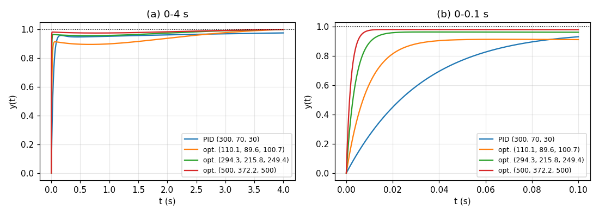

*그림 15. 최적화한 PID 설계와 2.6절 PID 설계의 계단 응답*

**표본 간격의 한계.** 응답을 0.01 s 간격으로 계산하므로 0.01 s보다 짧은 상승 시간은 정확히 측정되지 않는다. $(500, 372.2, 500)$의 응답은 첫 표본 $t = 0.01$ s에서 이미 0.976에 이르므로, 보간으로 구한 상승 시간 0.0082 s는 실제로는 첫 표본 구간 안에서의 직선 보간 값이다. 훨씬 촘촘한 시간 격자로 계산한 실제 상승 시간은 약 0.0047 s이다. 이득이 큰 영역에서는 목적 함수가 표본 간격 때문에 0.008 s 근처에서 평평해지므로, 초기 설계에 따라 서로 다른 큰 이득 조합이 모두 "최적"으로 나온다. 표 8에서 초기 설계마다 결과가 다른 이유는 국소 최솟값뿐 아니라 이 평평한 목적 함수에도 있다.

**제어 입력의 크기.** 목적 함수와 제한조건에 제어 입력 $u(t)$가 들어 있지 않다. 계단 명령이 들어오는 순간 오차가 0에서 1로 뛰므로, 이상적인 미분 항은 크기 $K_d$인 임펄스를 내고 비례 항만으로도 $K_p \times 1$의 힘을 낸다. $(500, 372.2, 500)$ 설계는 시작 순간 비례 항만으로 500 N을 내는데, 정상 상태에서 1 m의 변위를 유지하는 데 필요한 힘은 $kx = 20$ N이다. 실제 구동기는 출력의 한계(포화)가 있고 큰 $K_d$는 측정 잡음을 증폭하므로, 실용적인 설계는 제어 입력의 크기 제한이나 잡음에 대한 민감도를 제한조건이나 목적 함수에 함께 넣는다 [1].

> **핵심:** 최적화 기반 PID 제어는 설계 목표를 목적 함수와 제한조건으로 명시하면 이득 조정을 자동으로 수행한다. 그러나 결과는 수식화한 대로만 최적이므로, 목적 함수와 제한조건의 정의(평가 시간 구간, 표본 간격, 최종값의 기준, 제어 입력의 제한)가 실제 요구를 충실히 나타내는지 확인하고, 여러 초기 설계를 시도하며, 얻은 설계의 응답과 제어 입력을 직접 검토해야 한다.

---

<br>

## 개념 적용

| 상황 | 연결할 개념과 이유 |
|:-----|:-----|
| 비례 제어로 위치를 제어하는데 출력이 목표보다 항상 조금 모자란 위치에 멈춘다. | **비례 제어의 잔류 오차.** 타입 0 시스템이므로 $\frac{20}{20 + K_p}$ 같은 오차가 남는다. 적분 항을 더해 타입 1로 만든다. |
| 비례 이득을 키웠더니 오차는 줄었지만 출력이 목표값을 크게 넘었다가 흔들린다. | **$K_p$와 감쇠비의 상충.** $\zeta = 5/\sqrt{20 + K_p}$가 작아진다. 미분 항으로 감쇠를 늘린다. |
| 미분 이득을 키웠더니 측정값의 작은 잡음에 따라 구동기 명령이 심하게 떨린다. | **미분 항의 잡음 증폭.** 미분 항에 저역 통과 필터를 붙이거나 $K_d$를 줄인다. |
| PI 제어의 계단 응답이 빠르게 0.96까지 오른 뒤 1에 닿는 데 수 초가 걸린다. | **원점 가까운 느린 극점.** 적분 동작이 만든 느린 극점과 영점의 쌍이 느린 꼬리를 만든다. $K_i$를 키우면 극점이 원점에서 멀어진다. |
| 같은 최적화 문제를 다른 초기 설계에서 풀었더니 전혀 다른 이득이 나왔다. | **국소 최솟값과 평평한 목적 함수.** 기울기 기반 방법은 가까운 국소 최솟값에서 멈춘다. 다중 시작으로 여러 결과를 비교한다. |

*표 10. 상황별로 연결할 개념*

**T/F 점검:**

| 문장 | 판단과 근거 |
|:-----|:-----|
| PID 제어기의 전달함수는 원점에 극점 하나를 갖는다. | **T.** $C(s) = \frac{K_d s^2 + K_p s + K_i}{s}$이며, 이 극점이 적분 동작이다. |
| 질량-스프링-댐퍼 시스템의 비례 제어에서 $K_p$를 키우면 정상 상태 오차가 0이 된다. | **F.** $e_{ss} = \frac{20}{20 + K_p}$는 유한한 $K_p$에서 0이 되지 않는다. |
| 2.4절의 PD 제어에서 $K_d$는 정상 상태 오차에 영향을 주지 않는다. | **T.** 직류 이득 $T(0) = \frac{K_p}{20 + K_p}$에 $K_d$가 없다. |
| 기울기의 방향으로 이동하면 함수 값이 가장 빠르게 줄어든다. | **F.** 기울기는 가장 가파른 상승 방향이며, 함수를 줄이려면 $-\nabla f$ 방향으로 이동한다. |
| 기울기 기반 최적화의 결과는 초기 설계와 무관하게 항상 같다. | **F.** 출발점 근처의 국소 최솟값에서 멈추므로 초기 설계에 따라 결과가 달라질 수 있다. |

---

<br>

## 요약

| 개념 | 핵심 요약 |
|:-----|:-----|
| PID 제어 | 오차에 비례, 적분, 미분한 값을 더해 제어 입력 $u = K_p e + K_i\int e\,d\tau + K_d\dot{e}$를 만드는 피드백 제어이며, 온도, 속도, 압력, 레벨, 드론과 자율주행차 등에 널리 쓰인다. |
| 장점과 단점 | 보편적이고 설계가 간단하지만, 이득을 미세하게 조정해야 하고 강한 비선형 시스템에는 부족할 수 있으며 미분 항은 잡음에 취약하다. |
| 세 항의 역할 | 비례 항은 현재 오차에 반응하지만 잔류 오차가 남고, 적분 항은 누적 오차로 잔류 오차를 제거하며, 미분 항은 오차의 변화율로 초과량을 억제한다. |
| PID 전달함수 | 미분은 $s$를 곱하고 적분은 $s$로 나누므로 $C(s) = K_p + \frac{K_i}{s} + K_d s = \frac{K_d s^2 + K_p s + K_i}{s}$이다. |
| 예제 플랜트 | 질량-스프링-댐퍼 시스템의 전달함수는 $P(s) = \frac{1}{s^2 + 10s + 20}$이고, 개루프 응답은 느리며 최종값이 0.05이다. |
| P 제어 | $\omega_n = \sqrt{20 + K_p}$, $\zeta = 5/\sqrt{20 + K_p}$이므로 $K_p$를 키우면 상승 시간과 오차 $\frac{20}{20 + K_p}$가 줄고 최대 초과량이 커진다. |
| PD 제어 | 미분 항이 분모의 감쇠 항을 $10 + K_d$로 키워 최대 초과량을 줄이며, 직류 이득은 그대로이다. |
| PI 제어 | 적분 항이 타입을 1로 올려 정상 상태 오차를 없애지만, 원점 가까운 느린 극점 때문에 1에 다가가는 마지막 구간이 느리다. |
| PID 제어 | 세 항을 함께 쓰면 빠른 상승, 작은 초과량, 0의 정상 상태 오차를 함께 얻을 수 있다. |
| 최적화 모델 | 설계 변수, 목적 함수, 부등식과 등식 제한조건, 설계 변수의 범위로 구성되며, 제한조건을 만족하면서 목적 함수를 최소화하는 설계를 찾는다. |
| 기울기와 경사 하강법 | 기울기는 가장 가파른 상승 방향이므로 $\mathbf{d}^{k+1} = \mathbf{d}^k - \beta^k\nabla f(\mathbf{d}^k)$로 내려가며, 설계점이나 목적 함수의 변화가 허용 오차 이하가 되면 멈춘다. |
| 최적화 기반 PID | 상승 시간을 최소화하고 최대 초과량과 정상 상태 오차를 0으로 하는 문제를 SQP(`fmincon`)로 풀며, 초기 설계에 따라 결과가 달라진다. |
| 결과의 한계 | 표본 간격, 평가 구간, 제어 입력의 크기가 수식화에 빠지면 최적해가 실제로 바람직하지 않을 수 있으므로 응답과 제어 입력을 함께 검토한다. |

---

<br>

## 점검 문제

1. **PID 전달함수:** $K_p = 300$, $K_i = 70$, $K_d = 30$인 PID 제어기의 전달함수를 하나의 분수로 쓰고, 극점과 영점을 구하라.

   <details>
   <summary>정답</summary>

   $C(s) = 300 + \frac{70}{s} + 30s = \frac{30s^2 + 300s + 70}{s}$이다. 극점은 분모의 근 $s = 0$ 하나이고, 영점은 $30s^2 + 300s + 70 = 0$, 즉 $s^2 + 10s + \frac{7}{3} = 0$의 근 $s = -5 \pm \sqrt{25 - \frac{7}{3}} \approx -5 \pm 4.761$, 곧 약 $-0.239$와 $-9.761$이다.

   </details>

2. **비례 제어의 상충 관계:** 2.3절의 시스템에서 단위 계단 입력의 정상 상태 오차를 0.02 이하로 만드는 $K_p$의 최솟값을 구하고, 그때의 감쇠비와 최대 초과량을 구하라.

   <details>
   <summary>정답</summary>

   $\frac{20}{20 + K_p} \le 0.02$에서 $20 + K_p \ge 1000$이므로 $K_p \ge 980$이다. $K_p = 980$이면 $\omega_n = \sqrt{1000} \approx 31.6$ rad/s, $\zeta = \frac{5}{31.6} \approx 0.158$이고, $M_p = e^{-\pi(0.158)/\sqrt{1 - 0.158^2}} \times 100\% \approx 60\%$이다. 정상 상태 오차를 줄이려고 비례 이득만 키우면 최대 초과량이 매우 커진다.

   </details>

3. **PD 이득 설계:** 2.4절의 시스템에서 $K_p = 300$일 때 폐루프 분모의 감쇠비가 0.7이 되는 $K_d$를 구하라. 실제 최대 초과량이 2차 표준형 공식의 값(약 4.6%)보다 클 것으로 예상되는 이유는 무엇인가?

   <details>
   <summary>정답</summary>

   $2\zeta\omega_n = 10 + K_d$이고 $\omega_n = \sqrt{320} \approx 17.89$이므로 $K_d = 2(0.7)(17.89) - 10 \approx 15.0$이다. 이때 폐루프 전달함수에 영점 $s = -K_p/K_d = -20$이 있다. 영점은 응답에 미분 성분을 더해 상승을 가파르게 하고 초과량을 키우므로, 실제 최대 초과량은 공식의 값보다 크다(약 9.5%).

   </details>

4. **PI 제어의 지표 해석:** 2.5절의 PI 제어에서 $t = 2$ s의 $\lvert 1 - y(2)\rvert = 0.0363$이 0이 아닌데도 정상 상태 오차가 0이라고 할 수 있는 이유를 설명하라.

   <details>
   <summary>정답</summary>

   개루프 전달함수 $\frac{K_p s + K_i}{s(s^2 + 10s + 20)}$에 원점 극점이 있어 타입 1이고, 폐루프 시스템이 안정하므로($0 < K_i < 3200$) 최종값 정리에 따라 계단 입력의 정상 상태 오차는 0이다. 0.0363은 $t \to \infty$의 값이 아니라 2초 시점의 차이이며, 시정수 약 4.5 s인 느린 극점 $-0.220$의 성분이 아직 사라지지 않았기 때문에 남은 것이다. 시간이 지나면 이 차이는 0으로 줄어든다.

   </details>

5. **경사 하강법 한 단계:** $f(\mathbf{d}) = d_1^2 + 3d_2^2 - 2d_1$에서 $\mathbf{d}^0 = (2, 1)$, $\beta = 0.1$로 경사 하강법을 한 번 적용한 $\mathbf{d}^1$과 $f$의 변화를 구하라.

   <details>
   <summary>정답</summary>

   $\nabla f = (2d_1 - 2, 6d_2)$이므로 $\nabla f(\mathbf{d}^0) = (2, 6)$이다. $\mathbf{d}^1 = (2, 1) - 0.1(2, 6) = (1.8, 0.4)$이다. $f(\mathbf{d}^0) = 4 + 3 - 4 = 3$이고 $f(\mathbf{d}^1) = 3.24 + 0.48 - 3.6 = 0.12$이므로 목적 함수가 3에서 0.12로 줄었다.

   </details>

6. **최적화 수식화:** 3.6절의 PID 최적화 문제에서 설계 변수, 목적 함수, 등식 제한조건, 부등식 제한조건, 설계 변수의 범위를 각각 쓰라.

   <details>
   <summary>정답</summary>

   설계 변수는 $\mathbf{d} = (K_p, K_i, K_d)$, 목적 함수는 폐루프 계단 응답의 상승 시간 $t_r$이다. 등식 제한조건은 최대 초과량 $M_p = 0$과 $\lvert 1 - y(4)\rvert = 0$의 두 개이고, 부등식 제한조건은 없다. 설계 변수의 범위는 $1 \le K_p, K_i, K_d \le 500$이다.

   </details>

7. **초기 설계와 결과:** 표 8에서 초기 설계에 따라 최적 이득이 크게 달라지는 이유를 두 가지 쓰라.

   <details>
   <summary>정답</summary>

   첫째, SQP 같은 기울기 기반 방법은 출발점 근처의 정보만 써서 내리막을 따라가므로, 출발점에 가까운 국소 최솟값에서 멈춘다. 둘째, 응답을 0.01 s 간격으로만 평가하므로 이득이 큰 영역에서는 상승 시간이 표본 간격 때문에 약 0.008 s 근처에서 거의 변하지 않아 목적 함수가 평평하고, 서로 다른 큰 이득 조합이 모두 비슷한 목적 함수 값을 가진다.

   </details>

8. **수식화의 개선:** 3.8절에서 얻은 $(500, 372.2, 500)$ 설계를 실제 시스템에 그대로 쓰기 어려운 이유를 쓰고, 수식화를 어떻게 바꾸면 좋은지 제안하라.

   <details>
   <summary>정답</summary>

   목적 함수와 제한조건에 제어 입력이 없어서, 계단 명령 순간 비례 항만으로 500 N(정상 상태에 필요한 힘 20 N의 25배)을 내고 이상적인 미분 항은 임펄스를 내는 설계가 나왔다. 실제 구동기는 포화되고 큰 $K_d$는 측정 잡음을 증폭한다. 또한 0.01 s 표본 간격과 4 s 평가 구간 때문에 상승 시간과 느린 꼬리가 정확히 반영되지 않는다. 제어 입력의 최댓값 제한 $\max\lvert u(t)\rvert \le u_{max}$를 부등식 제한조건으로 더하고, 미분 항에 필터를 넣으며, 더 촘촘한 표본 간격과 충분히 긴 평가 구간을 쓰거나, 오차의 적분(예: $\int e^2\,dt$)처럼 응답 전체를 반영하는 목적 함수를 쓰는 방법이 있다.

   </details>

---

<br>

## 참고 문헌

1. K. J. Åström and R. M. Murray, *Feedback Systems: An Introduction for Scientists and Engineers*, 2nd ed. Princeton, NJ, USA: Princeton University Press, 2021.
2. University of Michigan, Carnegie Mellon University, and University of Detroit Mercy, "Introduction: PID Controller Design," *Control Tutorials for MATLAB and Simulink*. https://ctms.engin.umich.edu/CTMS/index.php?example=Introduction&section=ControlPID
3. J. S. Arora, *Introduction to Optimum Design*, 4th ed. London, U.K.: Academic Press, 2017.
4. J. Nocedal and S. J. Wright, *Numerical Optimization*, 2nd ed. New York, NY, USA: Springer, 2006.
5. MathWorks, "fmincon: Find minimum of constrained nonlinear multivariable function," *Optimization Toolbox Documentation*. https://www.mathworks.com/help/optim/ug/fmincon.html
6. P. Virtanen et al., "SciPy 1.0: Fundamental algorithms for scientific computing in Python," *Nature Methods*, vol. 17, pp. 261-272, 2020.
