# Week 11 Lecture — Optimization-Based PID Control

[Repository Guide](../../README.md) | [English](Concepts_Lecture.md) | [한국어](Concepts_Lecture.ko.md)

> **Last Updated:** 2026-11-04

> **Learning Objectives:**
> 1. Explain the structure of a PID controller and the roles of its proportional, integral, and derivative terms, and give typical applications, advantages, and disadvantages
> 2. Derive the transfer function of a PID controller with the Laplace transform
> 3. Find the closed-loop transfer functions when P, PD, PI, and PID controllers are applied to a mass-spring-damper system, and explain the change of the response with the gains in terms of poles and zeros
> 4. Formulate an optimization problem with design variables, an objective function, and constraints, and compute the update of a design point by the gradient and gradient descent
> 5. Formulate PID gain tuning as a constrained optimization problem using rise time, maximum overshoot, and steady-state error, and interpret its results and limitations

---

## Table of Contents

- [1. Overview of PID Control](#1-overview-of-pid-control)
  - [1.1 What Is PID Control](#11-what-is-pid-control)
  - [1.2 Applications of PID Control](#12-applications-of-pid-control)
  - [1.3 Advantages and Disadvantages of PID Control](#13-advantages-and-disadvantages-of-pid-control)
  - [1.4 Roles of the Proportional, Integral, and Derivative Terms](#14-roles-of-the-proportional-integral-and-derivative-terms)
  - [1.5 Transfer Function of a PID Controller](#15-transfer-function-of-a-pid-controller)
- [2. PID Control Example](#2-pid-control-example)
  - [2.1 Mass-Spring-Damper System](#21-mass-spring-damper-system)
  - [2.2 Open-Loop Step Response](#22-open-loop-step-response)
  - [2.3 Proportional Control](#23-proportional-control)
  - [2.4 Proportional-Derivative Control](#24-proportional-derivative-control)
  - [2.5 Proportional-Integral Control](#25-proportional-integral-control)
  - [2.6 Proportional-Integral-Derivative Control](#26-proportional-integral-derivative-control)
  - [2.7 Effects of the Gains on the Response](#27-effects-of-the-gains-on-the-response)
- [3. Optimization-Based PID Control](#3-optimization-based-pid-control)
  - [3.1 Optimization Model](#31-optimization-model)
  - [3.2 Gradient](#32-gradient)
  - [3.3 Gradient Descent](#33-gradient-descent)
  - [3.4 Gradient-Based Optimization Procedure](#34-gradient-based-optimization-procedure)
  - [3.5 Example: Iterations of Gradient Descent](#35-example-iterations-of-gradient-descent)
  - [3.6 Formulating PID Gain Tuning as Optimization](#36-formulating-pid-gain-tuning-as-optimization)
  - [3.7 MATLAB Implementation](#37-matlab-implementation)
  - [3.8 Optimization Results and the Initial Design](#38-optimization-results-and-the-initial-design)
  - [3.9 Python Implementation](#39-python-implementation)
  - [3.10 Interpretation and Limitations of the Results](#310-interpretation-and-limitations-of-the-results)
- [Concept Applications](#concept-applications)
- [Summary](#summary)
- [Self-Check Questions](#self-check-questions)
- [References](#references)

---

<br>

## 1. Overview of PID Control

### 1.1 What Is PID Control

**PID control** stands for proportional-integral-derivative control. It is a feedback control method widely used in many engineering and industrial applications: it adjusts the control input based on the difference between the desired **setpoint** and the actual output, so that the output of the system is kept at the desired value.

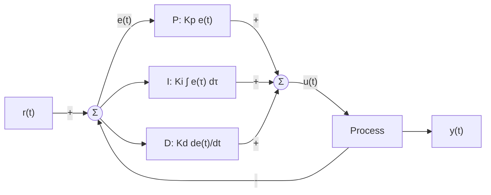

*Figure 1. Structure of a PID control system*

In Figure 1, the difference between the setpoint $r(t)$ and the output $y(t)$ is the error $e(t) = r(t) - y(t)$. The PID controller processes the error along three branches. The P block multiplies the error by the proportional gain $K_p$, the I block multiplies the time integral of the error by the integral gain $K_i$, and the D block multiplies the rate of change of the error by the derivative gain $K_d$. The sum of the three is the control input $u(t)$ applied to the controlled object, the **process**.

$$
u(t) = P(t) + I(t) + D(t) = K_p e(t) + K_i \int_0^t e(\tau)\,d\tau + K_d \frac{de(t)}{dt}
$$

Here $\tau$ is the integration variable running from 0 to the current time $t$. In other words, the controller measures the output of the object to be controlled, compares it with the desired **reference value** to compute the error, and then computes and adds control values proportional to the error, to the integral of the error, and to the derivative of the error. Choosing the three gains $K_p$, $K_i$, and $K_d$ is called **gain tuning**, and Section 3 solves it as an optimization problem.

> **Caution:** In this unit $K_p$ is the proportional gain of the PID controller. Week 10 uses the same symbol $K_p$ for the position error constant, but the two are different quantities. This unit refers to the position error constant in words, without a symbol.

### 1.2 Applications of PID Control

PID control has a simple structure and can be tuned without an accurate model of the plant, so it is used in most feedback loops in industry [1]. Typical applications are listed in Table 1.

| Field | Controlled object and purpose |
|:-----|:-----|
| Temperature control systems | PID control keeps heaters or coolers at the desired temperature, improving product quality and energy efficiency. |
| Motor speed control | In factory automation and robotics, PID control achieves accurate speed regulation when a motor's speed is held constant or changed. |
| Pressure control | In petrochemical processes, boiler systems, and the like, pressure is held constant or adjusted to keep the process safe and efficient. |
| Fluid level control | In water treatment plants and fuel tanks, the fluid level is held constant to prevent overflow or shortage. |
| Drones and autonomous vehicles | Position, velocity, altitude, and so on are adjusted in real time to enable stable flight and driving and to respond to external factors such as wind or road conditions. |

*Table 1. Typical applications of PID control*

### 1.3 Advantages and Disadvantages of PID Control

**Advantages**

- It is a universal control technique applicable in many environments.
- The design is relatively simple, and performance can be improved even by empirical tuning.
- It reduces the error quickly while suppressing excessive response, providing high stability and accuracy.

**Disadvantages**

- The three gains must be fine-tuned, and badly chosen gains can cause large maximum overshoot or instability.
- For complex systems or systems with strong nonlinearity, PID control alone may not be sufficient. Neural network-based control for such systems is treated in Week 14.
- Derivative control is vulnerable to measurement noise (Section 1.4).

### 1.4 Roles of the Proportional, Integral, and Derivative Terms

**Proportional (P) term.** It produces a control signal $K_p e(t)$ proportional to the current error, the difference between the target value and the current value. The larger $K_p$, the stronger the reaction to the same error. It reacts immediately and strongly to a large error, but as the error becomes small the control effort also becomes small and cannot push the output all the way to the target, so a **residual error**, that is, a steady-state error, can remain. In the terms of Week 10, using only a proportional controller on a plant without an integrator gives a type 0 system, and a finite error determined by the position error constant remains for a step input.

**Integral (I) term.** It produces a control signal based on the error accumulated over time, $\int_0^t e(\tau)\,d\tau$, and eliminates the residual error. The integral gain $K_i$ sets the size of the reaction to the accumulated error. As long as the error is nonzero, however small, the integral keeps growing over time, so the control signal keeps changing until the error becomes zero and the output stays at the target. From the viewpoint of Week 10, the integral term adds a pole at the origin to the open-loop transfer function and raises the system type by one. However, excessive integral action lets the accumulated value push the output beyond the target, which can increase the maximum overshoot or make the system unstable.

**Derivative (D) term.** It produces a control signal based on the rate of change of the error, $\frac{de(t)}{dt}$, that is, the speed at which the error changes. The derivative gain $K_d$ sets the size of the reaction to the rate of change of the error. When the output approaches the target quickly, the error decreases quickly and $\frac{de}{dt} < 0$, so the derivative term reduces the control input in advance and keeps the output from passing the target. In this way the derivative term suppresses rapidly changing errors, stabilizes the system, and improves responsiveness. However, differentiating a small but rapidly changing signal such as measurement noise amplifies it strongly, which can make the control signal unstable.

> **Note:** Practical PID controllers do not use the derivative term as is but implement it with a low-pass filter, in the form $\frac{K_d s}{T_f s + 1}$, to limit the amplification of high-frequency noise. Also, when the setpoint changes abruptly like a step, the derivative of the error becomes momentarily very large (derivative kick), so implementations that differentiate only the output $-y(t)$ instead of the error are also widely used [1].

### 1.5 Transfer Function of a PID Controller

To find the transfer function of a PID controller, recall the Laplace transform of Week 3. The **Laplace transform** of a function $f(t)$ ($t \ge 0$) is defined as follows.

$$
F(s) = \mathcal{L}\lbrace f(t) \rbrace= \int_0^\infty f(t)\,e^{-st}\,dt
$$

The **unit-step function** $u_s(t)$ equals 1 for $t \ge 0$, so substituting into the definition gives the following ($e^{-st} \to 0$ when the real part of $s$ is positive).

$$
\mathcal{L}\lbrace u_s(t) \rbrace= \int_0^\infty e^{-st}\,dt = \left[-\frac{1}{s}e^{-st}\right]_0^\infty = 0 - \left(-\frac{1}{s}\right) = \frac{1}{s}
$$

The **exponential function** $e^{-at}$ is integrated in the same way after combining the exponents (when the real part of $s$ is greater than $-a$).

$$
\mathcal{L}\lbrace e^{-at} \rbrace= \int_0^\infty e^{-at}e^{-st}\,dt = \int_0^\infty e^{-(s + a)t}\,dt = \left[-\frac{1}{s + a}e^{-(s + a)t}\right]_0^\infty = \frac{1}{s + a}
$$

Now transform the three terms of the PID controller. Let $E(s)$ be the Laplace transform of the error.

**Proportional (P) term.** The Laplace transform is linear, so a constant factor stays: $\mathcal{L}\lbrace K_p e(t) \rbrace= K_p E(s)$.

**Derivative (D) term.** Apply integration by parts $\int u\,dv = uv - \int v\,du$ to the definition ($u = e^{-st}$, $dv = e'(t)\,dt$).

$$
\mathcal{L}\left\lbrace\frac{de(t)}{dt}\right \rbrace= \int_0^\infty e'(t)\,e^{-st}\,dt = \Big[e(t)\,e^{-st}\Big]_0^\infty + s\int_0^\infty e(t)\,e^{-st}\,dt = sE(s) - e(0)
$$

Assuming the initial condition $e(0) = 0$, $\mathcal{L}\lbrace K_d \frac{de}{dt} \rbrace= K_d\,sE(s)$. That is, differentiation in the time domain is multiplication by $s$ in the $s$ domain.

**Integral (I) term.** Let $g(t) = \int_0^t e(\tau)\,d\tau$; then $g'(t) = e(t)$ and $g(0) = 0$. Applying the derivative formula above to $g$ gives $E(s) = sG(s) - g(0) = sG(s)$, so $G(s) = \frac{E(s)}{s}$. That is, integration in the time domain is division by $s$ in the $s$ domain, and $\mathcal{L}\lbrace K_i\int_0^t e\,d\tau \rbrace= K_i\frac{E(s)}{s}$.

Adding the three terms gives $U(s) = \left(K_p + \frac{K_i}{s} + K_d s\right)E(s)$, so the **transfer function of the PID controller**, from the error to the control input, is as follows.

$$
C(s) = \frac{U(s)}{E(s)} = K_p + \frac{K_i}{s} + K_d s = \frac{K_d s^2 + K_p s + K_i}{s}
$$

The PID controller has one pole at the origin and two zeros, the roots of $K_d s^2 + K_p s + K_i = 0$. The pole at the origin is the integral action, and as seen in Week 10 it raises the system type of the loop by one. With $K_i = 0$ it becomes a PD controller $C(s) = K_p + K_d s$, with $K_d = 0$ a PI controller $C(s) = K_p + \frac{K_i}{s}$, and with $K_i = K_d = 0$ a P controller $C(s) = K_p$.

---

<br>

## 2. PID Control Example

### 2.1 Mass-Spring-Damper System

The effect of each term of the PID controller on the response is examined with the **mass-spring-damper** system of Figure 2 [2]. An object of mass $m$ is connected to a wall by a spring (stiffness $k$) and a damper (damping coefficient $b$), and it moves by a displacement $x$ under an external force $f$.

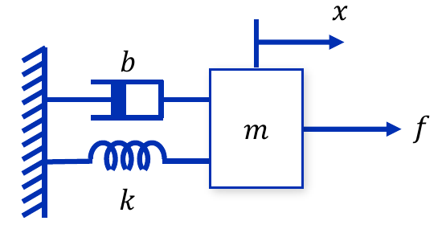

*Figure 2. Mass-spring-damper system*

Besides the external force $f$, the restoring force of the spring $-kx$ and the damping force of the damper $-b\dot{x}$ act on the object. By Newton's second law of motion (Week 4), the equation of motion is as follows.

$$
m\ddot{x} = f - b\dot{x} - kx \quad\Longrightarrow\quad m\ddot{x} + b\dot{x} + kx = f
$$

Taking the Laplace transform with zero initial conditions gives $(ms^2 + bs + k)X(s) = F(s)$, so the transfer function from the external force to the displacement is as follows. The parameters are $m = 1$ kg, $b = 10$ N s/m, and $k = 20$ N/m.

$$
P(s) = \frac{X(s)}{F(s)} = \frac{1}{ms^2 + bs + k} = \frac{1}{s^2 + 10s + 20}
$$

The control goal is to achieve a fast **rise time**, minimal **maximum overshoot**, and minimal **steady-state error** together. In this example the rise time is the time the output takes to go from 10% to 90% of its final value, and the maximum overshoot is the amount by which the maximum of the output exceeds the final value, expressed as a percentage of the final value. The control structure is the unity feedback of Figure 3, in which the controller $C(s)$ produces the force $u = f$ from the error $e$ between the desired position $r$ and the actual position $y = x$.

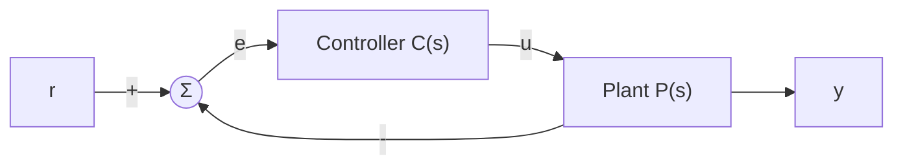

*Figure 3. Unity feedback control structure of the mass-spring-damper system*

### 2.2 Open-Loop Step Response

The response when a step force of 1 N is applied to the plant without a controller is computed with MATLAB.

```matlab
%% Open loop step response
s = tf('s');
P = 1/(s^2 + 10*s + 20);

t = 0:0.01:2;
response = step(P,t)
stepinfo(response,t)
```

- `s = tf('s');` creates the Laplace variable $s$ as a transfer function object. Any expression in $s$ written afterwards becomes a transfer function.
- `P = 1/(s^2 + 10*s + 20);` creates the plant $P(s)$.
- `t = 0:0.01:2;` is a time vector from 0 s to 2 s in steps of 0.01 s.
- `response = step(P,t)` returns the unit step response at each time in `t` as a vector. Because the line has no semicolon at the end, the values are printed on the screen.
- `stepinfo(response,t)` computes measures such as rise time, settling time, and maximum overshoot from the response data. When the response is passed as data, the last sample `response(end)` is taken as the final value.

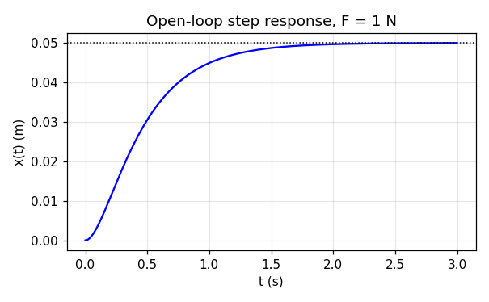

*Figure 4. Open-loop step response of the mass-spring-damper system*

The poles of the plant are the roots of $s^2 + 10s + 20 = 0$, $s = -5 \pm \sqrt{5}$, that is, about $-2.76$ and $-7.24$, two distinct real numbers, so the response is overdamped (Week 7). By the final value theorem the final value is $\lim_{s\to 0} s\cdot P(s)\cdot\frac{1}{s} = P(0) = \frac{1}{20} = 0.05$ m. That is, a force of 1 N stretches the spring by only 0.05 m. The rise time based on the final value is about 0.88 s and the 2% settling time is about 1.59 s, which is slow. If the goal is to move the output to 1 m, the error is as large as $1 - 0.05 = 0.95$, so a feedback controller must reduce both the rise time and the steady-state error.

### 2.3 Proportional Control

Let the controller be $C(s) = K_p$.

```matlab
%% Proportional control
s = tf('s');
P = 1/(s^2 + 10*s + 20);

Kp = 300;
C = pid(Kp)
T = feedback(C*P,1)

t = 0:0.01:2;
step(T,t)
response = step(T,t);
result = stepinfo(response,t);
```

- `C = pid(Kp)` creates a PID controller object $C(s) = K_p + \frac{K_i}{s} + K_d s$; given only one argument, it is a proportional controller with $K_i = K_d = 0$.
- `T = feedback(C*P,1)` creates the closed-loop transfer function $\frac{CP}{1 + CP}$ with forward path $C(s)P(s)$ and feedback path 1.
- `step(T,t)` plots the step response, and `response = step(T,t);` receives the response values as a vector. `result = stepinfo(response,t);` stores the measures in the structure `result`.

Find the closed-loop transfer function.

$$
T(s) = \frac{K_p P(s)}{1 + K_p P(s)} = \frac{K_p}{s^2 + 10s + 20 + K_p}
$$

Comparing the denominator with the denominator of the standard second-order form of Week 7, $s^2 + 2\zeta\omega_n s + \omega_n^2$, gives the natural frequency and the damping ratio.

$$
\omega_n^2 = 20 + K_p, \qquad 2\zeta\omega_n = 10 \quad\Longrightarrow\quad \omega_n = \sqrt{20 + K_p}, \qquad \zeta = \frac{5}{\sqrt{20 + K_p}}
$$

For $K_p = 300$, $\omega_n = \sqrt{320} \approx 17.89$ rad/s and $\zeta = 5/17.89 \approx 0.280$, and the maximum overshoot formula gives $M_p = e^{-\pi\zeta/\sqrt{1 - \zeta^2}} \times 100\% = e^{-\pi(0.280)/0.960} \times 100\% \approx 40\%$. The steady-state value is the DC gain $T(0) = \frac{K_p}{20 + K_p} = \frac{300}{320} = 0.9375$, so the error is as follows.

$$
e_{ss} = 1 - T(0) = \frac{20}{20 + K_p} = \frac{20}{320} = 0.0625
$$

This agrees with the result of Week 10. The open-loop transfer function $K_p P(s)$ has no pole at the origin, so the system is type 0, and the position error constant is $K_p P(0) = \frac{K_p}{20} = 15$, so $e_{ss} = \frac{1}{1 + 15} = 0.0625$. The results for three values of $K_p$ are shown in Table 2 and Figure 5. The rise time and maximum overshoot are computed from the response over $t = 0 \sim 2$ s.

| $K_p$ | $\omega_n$ (rad/s) | $\zeta$ | $M_p$ by formula (%) | Rise time (s) | Maximum overshoot (%) | Steady-state error |
|:-----|:-----|:-----|:-----|:-----|:-----|:-----|
| 100 | 10.95 | 0.456 | 20.0 | 0.1424 | 20 | 0.1667 |
| 300 | 17.89 | 0.280 | 40.1 | 0.0728 | 40 | 0.0625 |
| 500 | 22.80 | 0.219 | 49.4 | 0.0539 | 49.3 | 0.0385 |

*Table 2. Characteristics of the closed-loop response for different proportional gains*

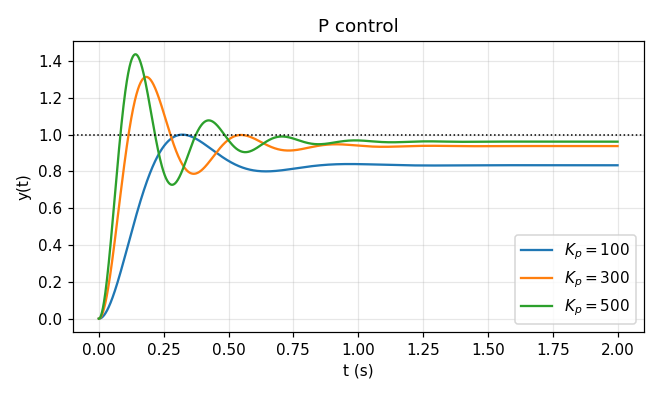

*Figure 5. Step responses for different proportional gains*

Increasing the proportional gain increases $\omega_n$, so the response becomes faster and the rise time decreases, and the DC gain approaches 1, so the steady-state error decreases. On the other hand, $\zeta$ decreases and the maximum overshoot increases. The real part of the poles, $-\zeta\omega_n = -5$, does not depend on $K_p$, so the decay rate of the envelope of the oscillation does not change and the 2% settling time stays near $\frac{4}{\zeta\omega_n} \approx 0.8$ s (0.74-0.77 s in fact). In summary, **a proportional controller reduces both the rise time and the steady-state error, increases the maximum overshoot, and reduces the settling time only slightly.** Proportional control alone cannot make the steady-state error zero, and there is a trade-off: the more the gain is raised to reduce the error, the larger the maximum overshoot becomes.

### 2.4 Proportional-Derivative Control

Let the controller be $C(s) = K_p + K_d s$. The code is the same as in Section 2.3 except for the controller part.

```matlab
%% Proportional-derivative control
Kp = 300;
Kd = 10;
C = pid(Kp,0,Kd)
T = feedback(C*P,1)
```

`pid(Kp,0,Kd)` is a PD controller with the integral gain set to 0. The closed-loop transfer function is as follows.

$$
T(s) = \frac{(K_d s + K_p)P(s)}{1 + (K_d s + K_p)P(s)} = \frac{K_d s + K_p}{s^2 + (10 + K_d)s + (20 + K_p)}
$$

Comparing the denominator with the standard second-order form, $\omega_n = \sqrt{20 + K_p}$ is the same as in proportional control, while $2\zeta\omega_n = 10 + K_d$, so the damping ratio increases to $\zeta = \frac{10 + K_d}{2\sqrt{20 + K_p}}$. The derivative term increases the coefficient of $s$ in the denominator, that is, the damping of the system. In terms of the equation of motion of Section 2.1, $K_d s$ is a force proportional to velocity, so it is equivalent to increasing the damping coefficient of the damper from $b$ to $b + K_d$. The results for $K_p = 300$ are shown in Table 3 and Figure 6.

| $K_d$ | $\zeta$ | $M_p$ by formula (%) | Zero $-K_p/K_d$ | Rise time (s) | Maximum overshoot (%) | Steady-state error |
|:-----|:-----|:-----|:-----|:-----|:-----|:-----|
| 5 | 0.419 | 23.4 | $-60$ | 0.0784 | 24.6 | 0.0625 |
| 10 | 0.559 | 12.0 | $-30$ | 0.0779 | 15.3 | 0.0625 |
| 20 | 0.839 | 0.8 | $-15$ | 0.0704 | 5.79 | 0.0625 |

*Table 3. Characteristics of the closed-loop response for different derivative gains ($K_p = 300$)*

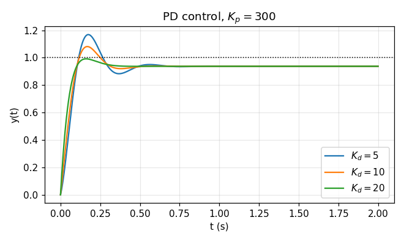

*Figure 6. Step responses for different derivative gains*

The larger $K_d$, the larger the damping ratio and the smaller the maximum overshoot. The actual maximum overshoot is larger than the value from the standard second-order formula because of the closed-loop zero $s = -K_p/K_d$ created by the PD controller. A zero adds a derivative component of the signal to the response, which makes the initial rise steeper and increases the overshoot, and the effect becomes stronger as the zero gets closer to the origin ($-15$ for $K_d = 20$ in the figure). The DC gain $T(0) = \frac{K_p}{20 + K_p}$ does not depend on $K_d$, so the steady-state error remains 0.0625. In summary, **adding the derivative term reduces the maximum overshoot and has only a negligible effect on the rise time and the steady-state error.**

### 2.5 Proportional-Integral Control

Let the controller be $C(s) = K_p + \frac{K_i}{s}$.

```matlab
%% Proportional-integral control
Kp = 300;
Ki = 70;
C = pid(Kp,Ki)
T = feedback(C*P,1)
```

`pid(Kp,Ki)` is a PI controller with the derivative gain set to 0. The open-loop transfer function $C(s)P(s) = \frac{K_p s + K_i}{s(s^2 + 10s + 20)}$ now has a pole at the origin, so the system becomes type 1, and by the results of Week 10 the steady-state error for a step input is 0. The closed-loop transfer function is simplified by multiplying the numerator and denominator by $s(s^2 + 10s + 20)$.

$$
T(s) = \frac{K_p s + K_i}{s(s^2 + 10s + 20) + K_p s + K_i} = \frac{K_p s + K_i}{s^3 + 10s^2 + (20 + K_p)s + K_i}
$$

For $K_p = 300$ the characteristic equation is $s^3 + 10s^2 + 320s + K_i = 0$. Build the Routh array of Week 9.

$$
\begin{array}{c|cc}
s^3 & 1 & 320 \\
s^2 & 10 & K_i \\
s^1 & \dfrac{10 \cdot 320 - K_i}{10} & 0 \\
s^0 & K_i &
\end{array}
$$

For all entries of the first column to be positive, $3200 - K_i > 0$ and $K_i > 0$ are required, so the system is stable for $0 < K_i < 3200$. For $K_i = 70$ the closed-loop poles are about $-4.89 \pm j17.14$ and $-0.220$, and the closed-loop zero is $-K_i/K_p \approx -0.233$. The complex pole pair is almost the same as the poles of proportional control ($-5 \pm j17.18$) and produces a fast oscillatory response, while the real pole $-0.220$ near the origin produces a slow component with time constant $\frac{1}{0.220} \approx 4.5$ s. This slow pole is close to the zero $-0.233$, so the size of its component is small, but it makes the last part of the approach of the output to 1 slow.

| $K_i$ | Slow pole | Zero $-K_i/K_p$ | Rise time (s) | Maximum overshoot (%) | $\vert 1 - y(2) \vert$ | Maximum of the output |
|:-----|:-----|:-----|:-----|:-----|:-----|:-----|
| 30 | $-0.094$ | $-0.100$ | 0.0734 | 38.9 | 0.0496 | 1.321 |
| 70 | $-0.220$ | $-0.233$ | 0.0740 | 38.0 | 0.0363 | 1.331 |
| 100 | $-0.316$ | $-0.333$ | 0.0743 | 37.7 | 0.0287 | 1.338 |

*Table 4. Characteristics of the closed-loop response for different integral gains ($K_p = 300$)*

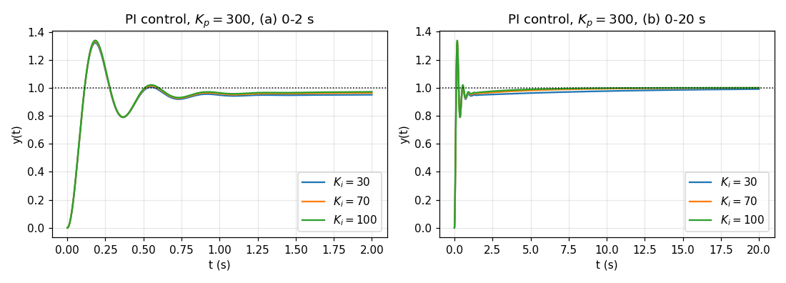

*Figure 7. Step responses for different integral gains*

The rise time, maximum overshoot, and $\vert 1 - y(2) \vert$ in Table 4 are computed, as MATLAB's `stepinfo` does, by taking the last sample $y(2)$ at $t = 2$ s as the final value. The theoretical steady-state error is 0, but because of the slow pole the output has not yet reached 1 at 2 s, so a difference of 0.0363 ($K_i = 70$) remains. For the same system this difference shrinks to about 0.006 at $t = 10$ s and about 0.0001 at $t = 30$ s ((b) of Figure 7). The larger $K_i$, the farther the slow pole moves from the origin and the faster the output approaches 1. That is, **an integral controller eliminates the steady-state error.**

> **Note:** In Table 4, the "maximum overshoot" figure decreases from 38.9 to 37.7 as $K_i$ grows and is even smaller than for proportional control (40), so it looks as if the integral controller reduced the maximum overshoot. However, these figures are computed relative to $y(2)$, which has not yet reached 1. Relative to the reference value 1, the maximum of the output actually increases, from 1.313 for proportional control to 1.321, 1.331, and 1.338 for PI control. In general, integral action eliminates the steady-state error at the cost of tending to increase the maximum overshoot and the settling time [2]. When measures are compared, one must check that they use final values on the same basis.

### 2.6 Proportional-Integral-Derivative Control

Apply the PID controller $C(s) = K_p + \frac{K_i}{s} + K_d s$ with all three terms.

```matlab
%% Proportional-integral-derivative control
Kp = 300;
Ki = 70;
Kd = 30;
C = pid(Kp,Ki,Kd)
T = feedback(C*P,1)
```

The closed-loop transfer function is found by substituting $C(s) = \frac{K_d s^2 + K_p s + K_i}{s}$.

$$
T(s) = \frac{K_d s^2 + K_p s + K_i}{s^3 + (10 + K_d)s^2 + (20 + K_p)s + K_i} = \frac{30s^2 + 300s + 70}{s^3 + 40s^2 + 320s + 70}
$$

The closed-loop poles are about $-29.08$, $-10.70$, and $-0.225$, all negative real numbers, and the zeros are the roots of $30s^2 + 300s + 70 = 0$, about $-9.76$ and $-0.239$. The derivative term has increased the damping so much that the complex pole pair has disappeared, so there is no oscillation. The pole $-10.70$ is close to the zero $-9.76$ and the slow pole $-0.225$ is close to the zero $-0.239$, so the size of each of those components is small. As a result, the output rises quickly to 0.959 at about 0.17 s, dips slightly to 0.948, and then rises slowly toward 1 (Figure 8).

The measures computed by MATLAB are a rise time of 0.0659 s, a maximum overshoot of 0, and $\vert 1 - y(2)\vert = 0.0376$. The maximum overshoot is 0 because, over the interval $0 \sim 2$ s, the maximum of the output is the last sample $y(2) \approx 0.962$. The system is type 1, so the theoretical steady-state error is 0, and the difference of 0.0376 at 2 s is the slow component that still remains. In summary, **PID control makes the rise faster and reduces both the maximum overshoot and the steady-state error.**

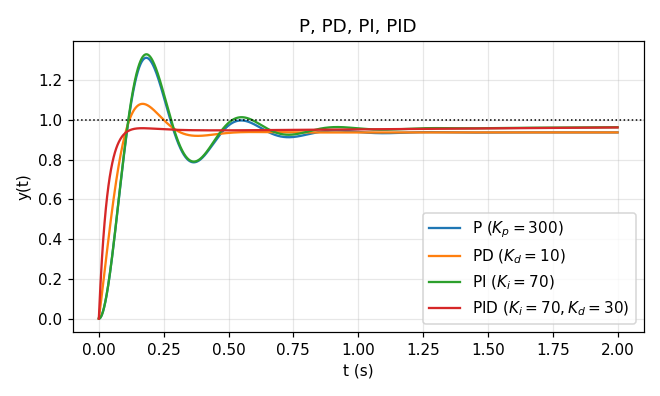

*Figure 8. Comparison of the step responses of P, PD, PI, and PID controllers*

### 2.7 Effects of the Gains on the Response

Generalizing the observations of Sections 2.3-2.6, the tendencies when each gain is increased independently are shown in Table 5 [2].

| When the gain is increased | Rise time | Maximum overshoot | Settling time | Steady-state error |
|:-----|:-----|:-----|:-----|:-----|
| $K_p$ | Decrease | Increase | Small change | Decrease |
| $K_i$ | Decrease | Increase | Increase | Eliminate |
| $K_d$ | Small change | Decrease | Decrease | No change |

*Table 5. General tendencies of the closed-loop response when each PID gain is increased independently*

> **Caution:** Table 5 shows empirical tendencies, not exact rules. The three gains affect one another, so changing one gain also changes the effects of the others. For example, when $K_i$ was added in Section 2.5, the rise time actually increased slightly, from 0.0728 s to 0.0740 s. Table 5 should therefore be used as a starting point for deciding the direction of tuning, and the final gains are chosen while checking the response. Section 3 turns this trial and error into an optimization problem and solves it systematically.

---

<br>

## 3. Optimization-Based PID Control

### 3.1 Optimization Model

Section 2 compared responses while changing one gain at a time. With three gains and several goals (fast rise, small overshoot, small error), it is hard to find a good combination by trial and error. **Optimization** turns the problem into equations and solves it with a numerical algorithm. The basic model of design optimization is as follows [3].

$$
\begin{aligned}
\underset{\mathbf{d}}{\text{minimize}} \quad & f(d_1, d_2, \ldots, d_n) \\
\text{subject to} \quad & g_i(d_1, d_2, \ldots, d_n) \le 0, \quad i = 1, 2, \ldots, n_i \\
& h_j(d_1, d_2, \ldots, d_n) = 0, \quad j = 1, 2, \ldots, n_e \\
& d_k^l \le d_k \le d_k^u, \quad k = 1, 2, \ldots, n
\end{aligned}
$$

| Symbol | Name | Meaning |
|:-----|:-----|:-----|
| $\mathbf{d} = (d_1, d_2, \ldots, d_n)$ | Design variable | Variables determined during the design |
| $f(d_1, d_2, \ldots, d_n)$ | Objective function | Function to be minimized |
| $g_i(d_1, d_2, \ldots, d_n)$ | Inequality constraint function | Functions that must satisfy $g_i \le 0$; there are $n_i$ of them |
| $h_j(d_1, d_2, \ldots, d_n)$ | Equality constraint function | Functions that must satisfy $h_j = 0$; there are $n_e$ of them |
| $d_k^l$, $d_k^u$ | Lower and upper bounds of the design variables | Range within which each design variable may move |

*Table 6. Components of the basic optimization model*

The three basic components of an optimization problem are the design variables, the objective function, and the constraints. The optimization model seeks, within the range $d_k^l \le d_k \le d_k^u$, the design variables $\mathbf{d}$ that minimize the objective function $f$ while satisfying the inequality constraints $g_i \le 0$ and the equality constraints $h_j = 0$. A design that satisfies all constraints is called a **feasible design**, and the optimum is the feasible design with the smallest objective function value. A maximization problem can be written in the same model by minimizing $-f$, and a condition of the form $g \ge 0$ by rewriting it as $-g \le 0$.

### 3.2 Gradient

The gradient is used to find a direction that decreases the objective function.

> **Definition:** The **gradient** of a multivariable function $f(x_1, x_2, \ldots, x_n)$ is the vector of its partial derivatives with respect to each variable, $\nabla f = \left[\frac{\partial f}{\partial x_1}, \frac{\partial f}{\partial x_2}, \ldots, \frac{\partial f}{\partial x_n}\right]^T$. The gradient is the vector pointing in the direction in which the function increases most steeply at a given point, that is, the direction of the largest rate of increase of the function.

$$
\nabla f = \begin{bmatrix} \dfrac{\partial f}{\partial x_1} \\ \dfrac{\partial f}{\partial x_2} \\ \vdots \\ \dfrac{\partial f}{\partial x_n} \end{bmatrix}
$$

For example, for $f(x, y) = x^2 + y^2$, $\frac{\partial f}{\partial x} = 2x$ and $\frac{\partial f}{\partial y} = 2y$, so $\nabla f = (2x, 2y)$. At the point $(1, 0.5)$ the gradient is $(2, 1)$, pointing away from the origin. The left of Figure 9 shows the graph of this function (a bowl whose bottom is at the origin) with contour lines on the base plane, and the right shows the gradient vector at each point of the plane as an arrow. All arrows point outward from the origin, are perpendicular to the contour lines (circles), and are longer farther from the origin.

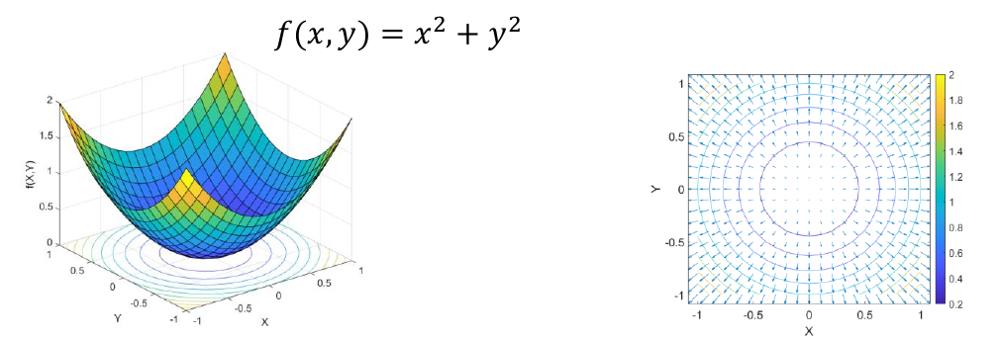

*Figure 9. Graph and gradient vector field of the function f(x, y) = x² + y²*

> **[Calculus]** The directional derivative, the rate of change in the direction of a unit vector $\mathbf{u}$, is $D_{\mathbf{u}}f = \nabla f \cdot \mathbf{u} = \lVert\nabla f\rVert\cos\theta$ ($\theta$ is the angle between $\nabla f$ and $\mathbf{u}$). This value is largest, $\lVert\nabla f\rVert$, when $\theta = 0$, that is, when $\mathbf{u}$ points in the same direction as the gradient, and smallest, $-\lVert\nabla f\rVert$, when $\theta = \pi$. This is why the gradient is the direction of steepest ascent and $-\nabla f$ is the direction of steepest descent. Also, when $\theta = \pi/2$ the rate of change is 0, so the gradient is perpendicular to the contour lines.

### 3.3 Gradient Descent

Since the gradient indicates the direction of largest increase, minimizing a function requires moving in the direction opposite to the gradient. **Gradient descent (the steepest descent method)** is an optimization algorithm that minimizes a function (a loss function, in machine learning) by repeatedly updating the parameters using the gradient. At the current point $\mathbf{d}^k$ it takes the search direction $\mathbf{a}^k = -\nabla f(\mathbf{d}^k)$ and moves by a step size $\beta^k > 0$.

$$
\mathbf{d}^{k+1} = \mathbf{d}^k - \beta^k\,\nabla f(\mathbf{d}^k)
$$

Figure 10 shows, for a function with several peaks and valleys, the path of a point that starts at a high location and goes down to the bottom of a valley by following the steepest downhill direction at every step. The same path is projected onto the contour lines below. The path goes down into the valley near the starting point, so starting elsewhere may end in a different valley (Section 3.8).

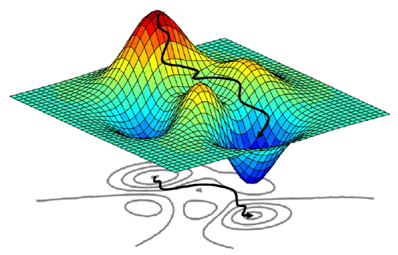

*Figure 10. Path of gradient descent*

> **[Machine Learning]** In machine learning, a loss function $L(\boldsymbol{\theta})$ of the model parameters $\boldsymbol{\theta}$ is reduced in the same way, $\boldsymbol{\theta} \leftarrow \boldsymbol{\theta} - \eta\nabla L(\boldsymbol{\theta})$, and the step size $\eta$ is called the learning rate. In this course, Week 13 uses this method to learn the weights of artificial neural networks.

### 3.4 Gradient-Based Optimization Procedure

A typical gradient-based optimization program follows the procedure of Figure 11.

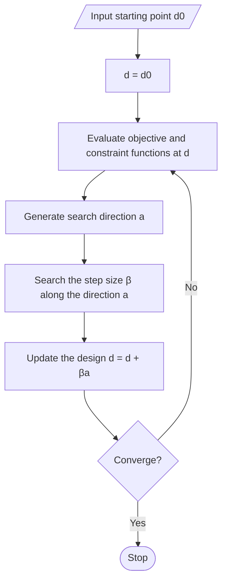

*Figure 11. Procedure of gradient-based optimization*

1. Design optimization starts from an **initial design** $\mathbf{d}^0$.
2. The numerical optimization program computes the objective function, the constraint functions, and their derivatives (gradients) at the current design.
3. Based on the function values and derivatives, it determines a **search direction** $\mathbf{a}$ along which the objective function is likely to decrease. Without constraints, $\mathbf{a} = -\nabla f$ is the simplest choice.
4. It determines the **step size** $\beta$ along the search direction. The step size is chosen so that the objective function decreases to the lowest possible value without violating any constraint. This one-dimensional search for $\beta$ alone, with the direction fixed, is called a **line search**.
5. The current design is moved along the search direction by the step size to obtain the new design point $\mathbf{d} + \beta\mathbf{a}$.
6. The objective and constraint functions are evaluated again at the new design point, and convergence is checked. If it has not converged, a new search direction and step size are generated for the next iteration. This procedure is repeated until the optimum is reached.

With $k$ the iteration number, $\mathbf{d}^k$ the current design point at iteration $k$, $\mathbf{a}^k$ the search direction, and $\beta^k$ the step size, the new design point $\mathbf{d}^{k+1}$ is as follows (Figure 12).

$$
\mathbf{d}^{k+1} = \mathbf{d}^k + \beta^k\mathbf{a}^k
$$

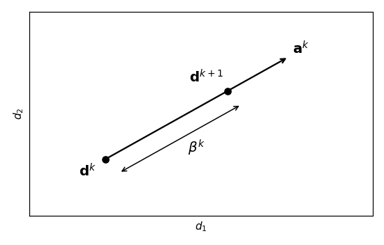

*Figure 12. Move from the current design point to the new design point*

The search continues until one of the following convergence conditions is reached, where $\varepsilon_1$ and $\varepsilon_2$ are small positive numbers (tolerances) chosen in advance.

- When the difference between two successive design points is small: $\lVert\mathbf{d}^{k+1} - \mathbf{d}^k\rVert \le \varepsilon_1$
- When the difference between two successive objective function values is small: $\lvert f(\mathbf{d}^{k+1}) - f(\mathbf{d}^k)\rvert \le \varepsilon_2$

### 3.5 Example: Iterations of Gradient Descent

Minimize the following objective function without constraints. The minimum is $f = 0$ at $\mathbf{d}^* = (2, 1)$.

$$
f(\mathbf{d}) = (d_1 - 2)^2 + 2(d_2 - 1)^2, \qquad \nabla f(\mathbf{d}) = \begin{bmatrix} 2(d_1 - 2) \\ 4(d_2 - 1) \end{bmatrix}
$$

Use the initial design $\mathbf{d}^0 = (0, 0)$, a fixed step size $\beta = 0.25$, and the search direction $\mathbf{a}^k = -\nabla f(\mathbf{d}^k)$. Compute the first iteration.

$$
f(\mathbf{d}^0) = (0 - 2)^2 + 2(0 - 1)^2 = 4 + 2 = 6, \qquad \nabla f(\mathbf{d}^0) = \begin{bmatrix} 2(0 - 2) \\ 4(0 - 1) \end{bmatrix} = \begin{bmatrix} -4 \\ -4 \end{bmatrix}
$$

$$
\mathbf{d}^1 = \mathbf{d}^0 - 0.25\,\nabla f(\mathbf{d}^0) = \begin{bmatrix} 0 \\ 0 \end{bmatrix} - 0.25\begin{bmatrix} -4 \\ -4 \end{bmatrix} = \begin{bmatrix} 1 \\ 1 \end{bmatrix}, \qquad f(\mathbf{d}^1) = (1 - 2)^2 + 2(1 - 1)^2 = 1
$$

In the second iteration $\nabla f(\mathbf{d}^1) = (2(1 - 2), 4(1 - 1)) = (-2, 0)$, so $\mathbf{d}^2 = (1, 1) - 0.25(-2, 0) = (1.5, 1)$ and $f(\mathbf{d}^2) = 0.25$. Repeating the same computation gives Table 7.

| $k$ | $\mathbf{d}^k$ | $f(\mathbf{d}^k)$ | $\nabla f(\mathbf{d}^k)$ | $\mathbf{d}^{k+1}$ | $\lVert\mathbf{d}^{k+1} - \mathbf{d}^k\rVert$ | $\lvert f(\mathbf{d}^{k+1}) - f(\mathbf{d}^k)\rvert$ |
|:-----|:-----|:-----|:-----|:-----|:-----|:-----|
| 0 | $(0, 0)$ | 6 | $(-4, -4)$ | $(1, 1)$ | 1.414 | 5 |
| 1 | $(1, 1)$ | 1 | $(-2, 0)$ | $(1.5, 1)$ | 0.5 | 0.75 |
| 2 | $(1.5, 1)$ | 0.25 | $(-1, 0)$ | $(1.75, 1)$ | 0.25 | 0.1875 |
| 3 | $(1.75, 1)$ | 0.0625 | $(-0.5, 0)$ | $(1.875, 1)$ | 0.125 | 0.0469 |
| 4 | $(1.875, 1)$ | 0.0156 | $(-0.25, 0)$ | $(1.9375, 1)$ | 0.0625 | 0.0117 |
| 5 | $(1.9375, 1)$ | 0.0039 | $(-0.125, 0)$ | $(1.96875, 1)$ | 0.03125 | 0.0029 |

*Table 7. Iterations of gradient descent ($\beta = 0.25$)*

With tolerances $\varepsilon_1 = 0.05$ and $\varepsilon_2 = 0.01$, the two values at $k = 4$ are still large (0.0625 and 0.0117), but at $k = 5$ they are 0.03125 and 0.0029 and satisfy both conditions, so the search stops. The final design is $\mathbf{d}^6 = (1.96875, 1)$ with $f = 0.03125^2 \approx 0.00098$, close to the minimum 0 (Figure 13).

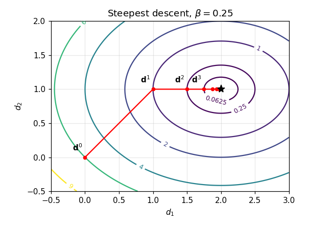

*Figure 13. Iteration path of gradient descent and contour lines of the objective function*

Writing the update componentwise reveals the role of the step size. Since $d_1 - 2 \leftarrow (1 - 2\beta)(d_1 - 2)$ and $d_2 - 1 \leftarrow (1 - 4\beta)(d_2 - 1)$, with $\beta = 0.25$ the error in the $d_1$ direction is halved at every step and the error in the $d_2$ direction becomes 0 in a single step. Convergence requires both factors to have absolute value less than 1, so this function needs $0 < \beta < 0.5$; for $\beta$ larger than 0.5, $d_2$ jumps back and forth across the minimum and diverges. A step size that is too small makes convergence slow and one that is too large causes divergence, so practical algorithms choose $\beta$ at each iteration by the line search of step 4. For example, minimizing $\phi(\beta) = f(\mathbf{d}^0 + \beta\mathbf{a}^0) = (4\beta - 2)^2 + 2(4\beta - 1)^2$ in the first iteration gives $\phi'(\beta) = 8(4\beta - 2) + 16(4\beta - 1) = 96\beta - 32 = 0$, so $\beta^0 = \frac{1}{3}$, $\mathbf{d}^1 = (\frac{4}{3}, \frac{4}{3})$, and $f(\mathbf{d}^1) = \frac{4}{9} + \frac{2}{9} = \frac{2}{3}$, a larger decrease than with the fixed step size (1).

### 3.6 Formulating PID Gain Tuning as Optimization

The PID gains of the mass-spring-damper system of Section 2 are determined by optimization. The goal is to minimize the rise time while making the maximum overshoot and the steady-state error 0. Fitted to the model of Section 3.1, the problem is as follows.

$$
\begin{aligned}
\underset{\mathbf{d} = (K_p, K_i, K_d)}{\text{minimize}} \quad & f(\mathbf{d}) = t_r(K_p, K_i, K_d) \\
\text{subject to} \quad & h_1(\mathbf{d}) = M_p(K_p, K_i, K_d) = 0 \\
& h_2(\mathbf{d}) = \lvert 1 - y(4;\,K_p, K_i, K_d)\rvert = 0 \\
& 1 \le K_p,\ K_i,\ K_d \le 500
\end{aligned}
$$

- The design variables are the three gains $\mathbf{d} = (K_p, K_i, K_d)$.
- The objective function $t_r$ is the rise time of the closed-loop step response.
- There are two equality constraints: $h_1$ is the maximum overshoot $M_p$ (%), and $h_2$ is the difference between the output at $t = 4$ s and the reference value 1. There are no inequality constraints ($n_i = 0$, $n_e = 2$).
- The lower and upper bounds of the gains are 1 and 500.

The objective and constraint functions are not given as formulas; they are values computed after simulating the closed-loop step response with the given gains. The gradient therefore cannot be obtained by symbolic differentiation and is approximated by a **finite difference**, which changes each gain slightly and observes the change of the function value: $\frac{\partial f}{\partial K_p} \approx \frac{f(K_p + \delta, K_i, K_d) - f(K_p, K_i, K_d)}{\delta}$.

The problem is solved by **sequential quadratic programming (SQP)**. SQP is a gradient-based method that, at each iteration, solves a subproblem (a quadratic program) in which the objective function is approximated by a quadratic and the constraints by linear functions, to determine the search direction $\mathbf{a}^k$, and then determines the step size $\beta^k$ by a line search [4]. In other words, within the procedure of Section 3.4 it uses a more elaborate way of generating the search direction than gradient descent, one that can handle constraints directly.

### 3.7 MATLAB Implementation

The problem is implemented with `fmincon`, MATLAB's constrained optimization function [5]. First, the script that runs the optimization.

```matlab
%% SQP
x0 = [100 100 100];

vfun=@(x)obj_function(x);

%Select algorithm
sAlgo='sqp';
tol = 1.0e-6;
my_options = optimset('display','iter','LargeScale','off','TolX',tol, ...
    'TolFun',tol,'TolCon',tol,'Algorithm',sAlgo);

%fmincon
[opt_var_new,fval,exitflag,output,lambda,grad,hessian] = fmincon(vfun, ...
    x0,[],[],[],[],lb,ub,'nonlcon',my_options)
```

- `x0 = [100 100 100];` is the initial design $(K_p, K_i, K_d) = (100, 100, 100)$.
- `vfun=@(x)obj_function(x);` is a function handle pointing to the objective function `obj_function` defined below.
- `sAlgo='sqp';` selects SQP as the algorithm, and `tol = 1.0e-6;` is the tolerance.
- `optimset(...)` creates the optimization options. `'display','iter'` prints the progress at each iteration, and `'TolX'`, `'TolFun'`, and `'TolCon'` are the tolerances on the change of the design variables, the change of the objective function, and the constraint violation, respectively; the first two correspond to $\varepsilon_1$ and $\varepsilon_2$ of Section 3.4. `'LargeScale','off'` is an option from earlier versions that turns off the large-scale algorithm.
- `fmincon(fun, x0, A, b, Aeq, beq, lb, ub, nonlcon, options)` minimizes `fun` subject to the linear inequalities $A\mathbf{x} \le b$, the linear equalities $A_{eq}\mathbf{x} = b_{eq}$, the bounds $lb \le \mathbf{x} \le ub$, and the nonlinear constraints `nonlcon`. There are no linear constraints, so empty matrices `[]` fill those four places, and the nonlinear constraints are given by the function `nonlcon` below.
- Among the outputs, `opt_var_new` is the optimal design, `fval` the objective function value there, `exitflag` the reason for termination, `output` information about the iterations, `lambda` the Lagrange multipliers, and `grad` and `hessian` the gradient and Hessian matrix at the optimum.

> **Note:** The script above does not define the bounds `lb` and `ub` passed to `fmincon`. To run it, `lb=[1 1 1];` and `ub=[500 500 500];` must be placed before the call, as in the multi-start code of Section 3.8.

The objective function takes the gains and returns the rise time of the closed-loop step response.

```matlab
function z = obj_function(x)
    s = tf('s');
    P = 1/(s^2 + 10*s + 20);

    Kp = x(1);
    Ki = x(2);
    Kd = x(3);
    C = pid(Kp,Ki,Kd);
    T = feedback(C*P,1);

    t = 0:0.01:4;
    response = step(T,t);
    result = stepinfo(response,t);

    output = [result.RiseTime,...
        result.Overshoot,abs(1-response(end))];

z = output(1);
```

- It takes the three components of the design variable vector `x` as $K_p$, $K_i$, and $K_d$, and builds the PID controller and the closed-loop transfer function (the same functions as in Section 2.3).
- It computes the step response over $t = 0 \sim 4$ s at 0.01 s intervals and computes the measures with `stepinfo`.
- `output` is a vector of the three measures [rise time, maximum overshoot (%), $\lvert 1 - y(4)\rvert$]. `response(end)` is the last sample $y(4)$.
- `z = output(1);` returns the rise time as the objective function value.

The nonlinear constraint function computes the same response and returns the values of the two equality constraints.

```matlab
function [gineq,geq] = nonlcon(x)

gineq = [];
geq = [];

    s = tf('s');
    P = 1/(s^2 + 10*s + 20);

    Kp = x(1);
    Ki = x(2);
    Kd = x(3);
    C = pid(Kp,Ki,Kd);
    T = feedback(C*P,1);

    t = 0:0.01:4;
    response = step(T,t);
    result = stepinfo(response,t);

    output = [result.RiseTime,...
        result.Overshoot,abs(1-response(end))];

    geq(1) = output(2);
    geq(2) = output(3);
```

- `fmincon` requires the nonlinear constraint function to return `gineq`, the values of the inequalities $g(\mathbf{x}) \le 0$, and `geq`, the values of the equalities $h(\mathbf{x}) = 0$.
- There are no inequality constraints, so `gineq = []`.
- `geq(1)` is the maximum overshoot and `geq(2)` is $\lvert 1 - y(4)\rvert$, and `fmincon` looks for a design that makes both values 0 (within the tolerance `TolCon`).

### 3.8 Optimization Results and the Initial Design

Starting from the initial design $(100, 100, 100)$, the optimal design is $(K_p, K_i, K_d) = (110.1, 89.6, 100.7)$, with a rise time of 0.0358 s, a maximum overshoot of 0, and a steady-state error of 0. The rise time is about half that of the PID gains chosen by hand in Section 2.6 (rise time 0.0659 s). Solving the same problem from different initial designs gives the results of Table 8 (gains rounded to one decimal place).

| Initial design | $K_p$ | $K_i$ | $K_d$ | Rise time (s) | Maximum overshoot | Steady-state error $\lvert 1 - y(4)\rvert$ |
|:-----|:-----|:-----|:-----|:-----|:-----|:-----|
| $[100\ 100\ 100]$ | 110.1 | 89.6 | 100.7 | 0.0358 | 0 | 0 |
| $[250\ 250\ 250]$ | 294.3 | 215.8 | 249.4 | 0.0100 | 0 | 0 |
| $[500\ 500\ 500]$ | 489.7 | 347.9 | 388.7 | 0.0083 | 0 | 0 |
| $[0\ 0\ 0]$ | 61.6 | 93.3 | 1.5 | 0.2709 | 0 | 0.001 |
| $[100\ 250\ 300]$ | 171.3 | 195.4 | 343.4 | 0.0085 | 0 | 0 |

*Table 8. Optimization results for different initial designs*

Different initial points lead to different optimal designs. A gradient-based method uses only information near the current point, so it goes downhill from the starting point and stops at the nearest **local minimum**. Figure 14 illustrates this in one dimension. Three starting points on the curve (red dots) each go down to the bottom of the nearby valley (blue dots), and only the right valley is the **global minimum**, the lowest point overall.

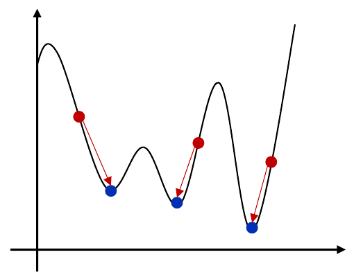

*Figure 14. Gradient-based search reaching different local minima depending on the initial point*

A simple way to find a solution close to the global minimum is **multi-start**: repeat the optimization from several randomly chosen initial designs and pick the best result.

```matlab
for loop = 1:1000

    %% SQP

    x0 = randi(500,1,3);

    lb=[1 1 1];
    ub=[500 500 500];

    vfun=@(x)obj_function(x);

    %Select algorithm
    sAlgo='sqp';
    tol = 1.0e-6;
    my_options = optimset('display','iter','LargeScale','off','TolX',tol, ...
        'TolFun',tol,'TolCon',tol,'Algorithm',sAlgo);

    %fmincon
    [opt_var_new,fval,exitflag,output,lambda,grad,hessian] = fmincon(vfun, ...
        x0,[],[],[],[],lb,ub,'nonlcon',my_options)
end
```

- `for loop = 1:1000` repeats the optimization 1000 times.
- `x0 = randi(500,1,3);` draws three random integers between 1 and 500 to form a 1-by-3 initial design.
- `lb` and `ub` are the lower bound 1 and upper bound 500 of the three gains. The rest is the same as in Section 3.7.

> **Note:** The loop above overwrites the same variables with every result, so to actually keep the best design, a line is needed in each iteration that compares `fval` with the smallest value so far and, if it is smaller, stores `opt_var_new` separately.

The best of the 1000 random initial designs was the result $(K_p, K_i, K_d) = (500.0, 372.2, 500.0)$ obtained from the initial design $[161\ 481\ 477]$, with a rise time of 0.0082 s, a maximum overshoot of 0, and a steady-state error of 0. $K_p$ and $K_d$ are at the upper bound 500, so this solution is limited by the bounds, and as Section 3.10 shows, the objective function is nearly flat in this region.

### 3.9 Python Implementation

The same problem can be solved with SciPy in Python [6]. The step response is computed with `scipy.signal.step`, and the optimization uses SLSQP (sequential least squares programming, a form of SQP) in `scipy.optimize.minimize`.

```python
import numpy as np
from scipy import signal
from scipy.optimize import minimize

t = np.arange(0, 4.0 + 1e-9, 0.01)

def step_metrics(x):
    Kp, Ki, Kd = x
    num = [Kd, Kp, Ki]
    den = np.polyadd(np.polymul([1, 0], [1, 10, 20]), num)
    _, y = signal.step((num, den), T=t)
    yf = y[-1]
    def cross(level):
        i = np.argmax(y >= level)
        return t[i-1] + (level - y[i-1]) * (t[i] - t[i-1]) / (y[i] - y[i-1])
    rise = cross(0.9 * yf) - cross(0.1 * yf)
    overshoot = max(0.0, 100 * (y.max() - yf) / yf)
    ss_error = abs(1 - yf)
    return rise, overshoot, ss_error

res = minimize(lambda x: step_metrics(x)[0], x0=[100, 100, 100], method='SLSQP',
               bounds=[(1, 500)] * 3,
               constraints=[{'type': 'ineq', 'fun': lambda x: 1e-3 - step_metrics(x)[1]},
                            {'type': 'ineq', 'fun': lambda x: 1e-3 - step_metrics(x)[2]}],
               options={'ftol': 1e-6, 'maxiter': 200})
print(res.x, step_metrics(res.x))
```

- `t` is a time vector from 0 to 4 s in steps of 0.01 s, the same as MATLAB's `0:0.01:4`. A tiny value is added to the upper limit so that the end point 4.0 is included.
- `step_metrics(x)` returns the three measures that MATLAB's `obj_function` and `nonlcon` computed together.
- `num = [Kd, Kp, Ki]` holds the coefficients of the numerator of the closed-loop transfer function, $K_d s^2 + K_p s + K_i$.
- `den` holds the coefficients of the denominator $s(s^2 + 10s + 20) + (K_d s^2 + K_p s + K_i)$. `np.polymul` multiplies the polynomials $s$ and $s^2 + 10s + 20$, and `np.polyadd` adds the numerator (the closed-loop transfer function of Section 2.6).
- `signal.step((num, den), T=t)` returns the unit step response `y` at the times `t`. `yf = y[-1]` is the last sample $y(4)$, used as the final value as in `stepinfo`.
- The inner function `cross(level)` finds the first sample `i` at which the response exceeds `level` and interpolates linearly with the previous sample to obtain the crossing time.
- `rise` is the rise time, the difference between the times at which the response crosses 90% and 10% of the final value; `overshoot` is the maximum overshoot relative to the final value (%); and `ss_error` is $\lvert 1 - y(4)\rvert$.
- `minimize(...)` uses the rise time as the objective function, and `bounds` limits the three gains to $[1, 500]$.
- `'ineq'` in `constraints` denotes an inequality constraint requiring the value of `fun` to be at least 0. That is, it requires maximum overshoot $\le 10^{-3}$% and $\lvert 1 - y(4)\rvert \le 10^{-3}$.
- In `options`, `ftol` is the tolerance on the change of the objective function and `maxiter` the maximum number of iterations. The last line prints the optimal gains and the three measures there.

The MATLAB code sets the two measures as equality constraints $= 0$, but here they are changed into inequalities with a small tolerance. This is because the maximum overshoot is exactly 0 over a wide region of gains, so in that region the gradient of the constraint obtained by finite differences becomes the zero vector and the linearized subproblem of SQP can become singular. The results starting from the same initial designs are shown in Table 9 and are close to the MATLAB results (Table 8). The results of numerical optimization can vary slightly with the implementation and settings of the library.

| Initial design | $K_p$ | $K_i$ | $K_d$ | Rise time (s) | Maximum overshoot (%) | $\lvert 1 - y(4)\rvert$ |
|:-----|:-----|:-----|:-----|:-----|:-----|:-----|
| $[100\ 100\ 100]$ | 110.6 | 88.3 | 101.6 | 0.0349 | 0 | 0.0010 |
| $[250\ 250\ 250]$ | 286.9 | 221.3 | 249.6 | 0.0101 | 0 | 0.0010 |
| $[500\ 500\ 500]$ | 500.0 | 347.0 | 490.4 | 0.0082 | 0 | 0.0009 |
| $[100\ 250\ 300]$ | 168.1 | 198.0 | 341.3 | 0.0085 | 0 | 0.0010 |

*Table 9. Optimization results obtained with SciPy SLSQP*

### 3.10 Interpretation and Limitations of the Results

Gains obtained by optimization are optimal only for the problem as defined. The following must be considered when interpreting the designs of Table 8.

**Shape of the response.** Figure 15 shows the step responses of three optimized designs and the PID design of Section 2.6. In the optimized designs the output rises very quickly to 0.9-0.98 and then fills in the remainder slowly over several seconds. For example, $(110.1, 89.6, 100.7)$ rises to about 0.91, stays near 0.9, and reaches 1 at 4 s. Because both the rise time and the maximum overshoot are computed relative to the last sample $y(4)$, this slow tail is hardly reflected in the objective function as long as the output reaches 1 within 4 s. In terms of poles, the fast real pole created by the large $K_d$ (about $-110 \sim -509$) sets the front part of the response, while a complex pole pair near the origin (real part about $-0.5 \sim -0.6$, imaginary part about $\pm 0.69$) almost cancels with the zeros of the controller and remains as a slow component of small size.

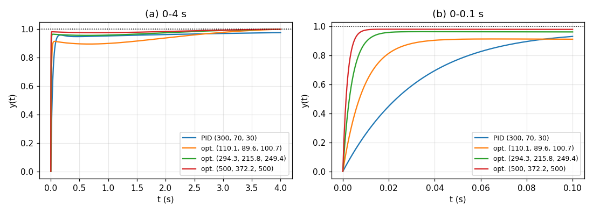

*Figure 15. Step responses of the optimized PID designs and the PID design of Section 2.6*

**Limit of the sampling interval.** The response is computed at 0.01 s intervals, so rise times shorter than 0.01 s are not measured accurately. The response of $(500, 372.2, 500)$ already reaches 0.976 at the first sample, $t = 0.01$ s, so the interpolated rise time of 0.0082 s is in fact a linear interpolation within the first sample interval. The actual rise time computed on a much finer time grid is about 0.0047 s. In the region of large gains the objective function flattens out near 0.008 s because of the sampling interval, so different combinations of large gains all come out as optimal solutions depending on the initial design. The reason why the results in Table 8 differ for each initial design lies not only in local minima but also in this flat objective function.

**Size of the control input.** The control input $u(t)$ appears in neither the objective function nor the constraints. At the instant a step command arrives, the error jumps from 0 to 1, so the ideal derivative term produces an impulse of size $K_d$ and the proportional term alone produces a force of $K_p \times 1$. The design $(500, 372.2, 500)$ produces 500 N from the proportional term alone at the start, whereas the force needed to hold a displacement of 1 m in the steady state is $kx = 20$ N. Real actuators have output limits (saturation) and a large $K_d$ amplifies measurement noise, so practical designs include limits on the size of the control input or on the sensitivity to noise in the constraints or the objective function [1].

> **Key Point:** Optimization-based PID control performs gain tuning automatically once the design goals are stated as an objective function and constraints. However, the result is optimal only as formulated, so one must check that the definitions of the objective function and constraints (evaluation time interval, sampling interval, reference for the final value, limits on the control input) faithfully represent the actual requirements, try several initial designs, and examine the response and the control input of the resulting design directly.

---

<br>

## Concept Applications

| Situation | Concept to connect and reason |
|:-----|:-----|
| A position is controlled with proportional control, and the output always stops slightly short of the target. | **Residual error of proportional control.** The system is type 0, so an error like $\frac{20}{20 + K_p}$ remains. Add an integral term to make it type 1. |
| Raising the proportional gain reduced the error, but the output now overshoots the target strongly and oscillates. | **Trade-off between $K_p$ and the damping ratio.** $\zeta = 5/\sqrt{20 + K_p}$ decreases. Increase the damping with a derivative term. |
| Raising the derivative gain made the actuator command jitter strongly with small noise in the measurement. | **Noise amplification by the derivative term.** Add a low-pass filter to the derivative term or reduce $K_d$. |
| The step response of PI control rises quickly to 0.96 but takes several seconds to reach 1. | **Slow pole near the origin.** The slow pole-zero pair created by integral action produces a slow tail. Increasing $K_i$ moves the pole away from the origin. |
| Solving the same optimization problem from a different initial design gave completely different gains. | **Local minima and a flat objective function.** Gradient-based methods stop at a nearby local minimum. Compare several results with multi-start. |

*Table 10. Concepts to connect in each situation*

**True/False Check:**

| Statement | Judgment and Reason |
|:-----|:-----|
| The transfer function of a PID controller has one pole at the origin. | **T.** $C(s) = \frac{K_d s^2 + K_p s + K_i}{s}$, and this pole is the integral action. |
| In proportional control of the mass-spring-damper system, increasing $K_p$ makes the steady-state error 0. | **F.** $e_{ss} = \frac{20}{20 + K_p}$ is not 0 for finite $K_p$. |
| In the PD control of Section 2.4, $K_d$ does not affect the steady-state error. | **T.** $K_d$ does not appear in the DC gain $T(0) = \frac{K_p}{20 + K_p}$. |
| Moving in the direction of the gradient decreases the function value fastest. | **F.** The gradient is the direction of steepest ascent; to decrease the function, move in the direction $-\nabla f$. |
| The result of gradient-based optimization is always the same regardless of the initial design. | **F.** It stops at a local minimum near the starting point, so the result can depend on the initial design. |

---

<br>

## Summary

| Concept | Key Summary |
|:-----|:-----|
| PID control | Feedback control that forms the control input $u = K_p e + K_i\int e\,d\tau + K_d\dot{e}$ by adding values proportional to the error, its integral, and its derivative; widely used for temperature, speed, pressure, level, drones, and autonomous vehicles. |
| Advantages and disadvantages | It is universal and simple to design, but the gains must be fine-tuned, it may be insufficient for strongly nonlinear systems, and the derivative term is vulnerable to noise. |
| Roles of the three terms | The proportional term reacts to the current error but leaves a residual error, the integral term removes the residual error with the accumulated error, and the derivative term suppresses overshoot with the rate of change of the error. |
| PID transfer function | Differentiation multiplies by $s$ and integration divides by $s$, so $C(s) = K_p + \frac{K_i}{s} + K_d s = \frac{K_d s^2 + K_p s + K_i}{s}$. |
| Example plant | The transfer function of the mass-spring-damper system is $P(s) = \frac{1}{s^2 + 10s + 20}$; its open-loop response is slow and its final value is 0.05. |
| P control | $\omega_n = \sqrt{20 + K_p}$ and $\zeta = 5/\sqrt{20 + K_p}$, so increasing $K_p$ reduces the rise time and the error $\frac{20}{20 + K_p}$ and increases the maximum overshoot. |
| PD control | The derivative term raises the damping term of the denominator to $10 + K_d$ and reduces the maximum overshoot, while the DC gain stays the same. |
| PI control | The integral term raises the type to 1 and removes the steady-state error, but a slow pole near the origin makes the last part of the approach to 1 slow. |
| PID control | Using all three terms together can give a fast rise, small overshoot, and zero steady-state error at the same time. |
| Optimization model | It consists of design variables, an objective function, inequality and equality constraints, and bounds on the design variables, and seeks the design that minimizes the objective function while satisfying the constraints. |
| Gradient and gradient descent | The gradient is the direction of steepest ascent, so the method descends by $\mathbf{d}^{k+1} = \mathbf{d}^k - \beta^k\nabla f(\mathbf{d}^k)$ and stops when the change of the design point or the objective function falls below a tolerance. |
| Optimization-based PID | The problem of minimizing the rise time with zero maximum overshoot and zero steady-state error is solved by SQP (`fmincon`), and the result depends on the initial design. |
| Limitations of the results | If the sampling interval, the evaluation interval, or the size of the control input is missing from the formulation, the optimum may not be desirable in practice, so the response and the control input are examined together. |

---

<br>

## Self-Check Questions

1. **PID transfer function:** Write the transfer function of the PID controller with $K_p = 300$, $K_i = 70$, and $K_d = 30$ as a single fraction, and find its poles and zeros.

   <details>
   <summary>Answer</summary>

   $C(s) = 300 + \frac{70}{s} + 30s = \frac{30s^2 + 300s + 70}{s}$. The only pole is the root of the denominator, $s = 0$, and the zeros are the roots of $30s^2 + 300s + 70 = 0$, that is, of $s^2 + 10s + \frac{7}{3} = 0$: $s = -5 \pm \sqrt{25 - \frac{7}{3}} \approx -5 \pm 4.761$, namely about $-0.239$ and $-9.761$.

   </details>

2. **Trade-off of proportional control:** For the system of Section 2.3, find the smallest $K_p$ that makes the steady-state error for a unit step input 0.02 or less, and find the damping ratio and the maximum overshoot at that gain.

   <details>
   <summary>Answer</summary>

   From $\frac{20}{20 + K_p} \le 0.02$, $20 + K_p \ge 1000$, so $K_p \ge 980$. For $K_p = 980$, $\omega_n = \sqrt{1000} \approx 31.6$ rad/s, $\zeta = \frac{5}{31.6} \approx 0.158$, and $M_p = e^{-\pi(0.158)/\sqrt{1 - 0.158^2}} \times 100\% \approx 60\%$. Raising only the proportional gain to reduce the steady-state error makes the maximum overshoot very large.

   </details>

3. **PD gain design:** For the system of Section 2.4 with $K_p = 300$, find the $K_d$ that makes the damping ratio of the closed-loop denominator 0.7. Why is the actual maximum overshoot expected to be larger than the value from the standard second-order formula (about 4.6%)?

   <details>
   <summary>Answer</summary>

   $2\zeta\omega_n = 10 + K_d$ and $\omega_n = \sqrt{320} \approx 17.89$, so $K_d = 2(0.7)(17.89) - 10 \approx 15.0$. The closed-loop transfer function then has a zero at $s = -K_p/K_d = -20$. A zero adds a derivative component to the response, making the rise steeper and increasing the overshoot, so the actual maximum overshoot is larger than the formula's value (about 9.5%).

   </details>

4. **Interpreting the measures of PI control:** For the PI control of Section 2.5, explain why the steady-state error can be said to be 0 even though $\lvert 1 - y(2)\rvert = 0.0363$ at $t = 2$ s is not 0.

   <details>
   <summary>Answer</summary>

   The open-loop transfer function $\frac{K_p s + K_i}{s(s^2 + 10s + 20)}$ has a pole at the origin, so the system is type 1, and the closed-loop system is stable ($0 < K_i < 3200$), so by the final value theorem the steady-state error for a step input is 0. The value 0.0363 is not the value as $t \to \infty$ but the difference at 2 s, which remains because the component of the slow pole $-0.220$, with a time constant of about 4.5 s, has not yet died out. Over time this difference shrinks to 0.

   </details>

5. **One step of gradient descent:** For $f(\mathbf{d}) = d_1^2 + 3d_2^2 - 2d_1$ with $\mathbf{d}^0 = (2, 1)$ and $\beta = 0.1$, apply gradient descent once and find $\mathbf{d}^1$ and the change in $f$.

   <details>
   <summary>Answer</summary>

   $\nabla f = (2d_1 - 2, 6d_2)$, so $\nabla f(\mathbf{d}^0) = (2, 6)$. $\mathbf{d}^1 = (2, 1) - 0.1(2, 6) = (1.8, 0.4)$. $f(\mathbf{d}^0) = 4 + 3 - 4 = 3$ and $f(\mathbf{d}^1) = 3.24 + 0.48 - 3.6 = 0.12$, so the objective function decreased from 3 to 0.12.

   </details>

6. **Formulating the optimization:** For the PID optimization problem of Section 3.6, write the design variables, the objective function, the equality constraints, the inequality constraints, and the bounds on the design variables.

   <details>
   <summary>Answer</summary>

   The design variables are $\mathbf{d} = (K_p, K_i, K_d)$, and the objective function is the rise time $t_r$ of the closed-loop step response. There are two equality constraints, maximum overshoot $M_p = 0$ and $\lvert 1 - y(4)\rvert = 0$, and no inequality constraints. The bounds on the design variables are $1 \le K_p, K_i, K_d \le 500$.

   </details>

7. **Initial design and results:** Give two reasons why the optimal gains in Table 8 differ greatly with the initial design.

   <details>
   <summary>Answer</summary>

   First, a gradient-based method such as SQP uses only information near the starting point and follows the downhill direction, so it stops at a local minimum close to the starting point. Second, because the response is evaluated only at 0.01 s intervals, in the region of large gains the rise time hardly changes from about 0.008 s owing to the sampling interval, so the objective function is flat and different combinations of large gains all have similar objective function values.

   </details>

8. **Improving the formulation:** Explain why the design $(500, 372.2, 500)$ obtained in Section 3.8 is hard to use as is on a real system, and suggest how to change the formulation.

   <details>
   <summary>Answer</summary>

   Because the control input appears in neither the objective function nor the constraints, the result is a design that produces 500 N from the proportional term alone at the instant of a step command (25 times the 20 N needed in the steady state), while the ideal derivative term produces an impulse. Real actuators saturate, and a large $K_d$ amplifies measurement noise. In addition, the 0.01 s sampling interval and the 4 s evaluation interval keep the rise time and the slow tail from being reflected accurately. Possible remedies include adding a limit on the maximum control input, $\max\lvert u(t)\rvert \le u_{max}$, as an inequality constraint, adding a filter to the derivative term, using a finer sampling interval and a sufficiently long evaluation interval, or using an objective function that reflects the whole response, such as an integral of the error (for example, $\int e^2\,dt$).

   </details>

---

<br>

## References

1. K. J. Åström and R. M. Murray, *Feedback Systems: An Introduction for Scientists and Engineers*, 2nd ed. Princeton, NJ, USA: Princeton University Press, 2021.
2. University of Michigan, Carnegie Mellon University, and University of Detroit Mercy, "Introduction: PID Controller Design," *Control Tutorials for MATLAB and Simulink*. https://ctms.engin.umich.edu/CTMS/index.php?example=Introduction&section=ControlPID
3. J. S. Arora, *Introduction to Optimum Design*, 4th ed. London, U.K.: Academic Press, 2017.
4. J. Nocedal and S. J. Wright, *Numerical Optimization*, 2nd ed. New York, NY, USA: Springer, 2006.
5. MathWorks, "fmincon: Find minimum of constrained nonlinear multivariable function," *Optimization Toolbox Documentation*. https://www.mathworks.com/help/optim/ug/fmincon.html
6. P. Virtanen et al., "SciPy 1.0: Fundamental algorithms for scientific computing in Python," *Nature Methods*, vol. 17, pp. 261-272, 2020.
