# 12주차 이론 — 인공지능 개론

[레포지토리 안내](../../README.ko.md) | [English](Concepts_Lecture.md) | [한국어](Concepts_Lecture.ko.md)

> **최종 수정일:** 2026-11-04

> **학습 목표:**
> 1. 지능과 인공지능을 정의하고 인공지능, 기계 학습, 딥러닝의 포함 관계와 튜링 테스트를 설명할 수 있다
> 2. 1950년대부터 2000년대 이후까지 인공지능 연구의 흐름과 침체기, 부활의 원인을 설명할 수 있다
> 3. 지도 학습, 비지도 학습, 강화 학습을 구분하고 K-평균 군집화, k-최근접 이웃 분류, 서포트 벡터 머신의 동작을 설명할 수 있다
> 4. 최소제곱법으로 선형 회귀의 계수를 구하고 결정계수와 RMSE로 모델을 평가할 수 있다
> 5. 학습, 검증, 시험 데이터의 역할과 과소적합, 과적합을 설명하고 교차 검증 오차를 계산할 수 있다
> 6. 강화 학습의 에이전트, 환경, 상태, 행동, 보상을 정의하고 격자 세계 예제의 정책과 보상을 해석할 수 있다

---

## 목차

- [1. 인공지능의 역사](#1-인공지능의-역사)
  - [1.1 지능과 인공지능](#11-지능과-인공지능)
  - [1.2 인공지능, 기계 학습, 딥러닝](#12-인공지능-기계-학습-딥러닝)
  - [1.3 튜링 테스트](#13-튜링-테스트)
  - [1.4 1950년대와 1960년대: 탄생과 초기 연구](#14-1950년대와-1960년대-탄생과-초기-연구)
  - [1.5 1970년대와 1980년대: 전문가 시스템과 침체기](#15-1970년대와-1980년대-전문가-시스템과-침체기)
  - [1.6 1990년대 이후: 통계적 기계 학습과 데이터](#16-1990년대-이후-통계적-기계-학습과-데이터)
  - [1.7 학습이 필요한 이유](#17-학습이-필요한-이유)
  - [1.8 기계 학습](#18-기계-학습)
- [2. 학습 타입 I: 지도 학습과 비지도 학습](#2-학습-타입-i-지도-학습과-비지도-학습)
  - [2.1 학습의 세 가지 타입](#21-학습의-세-가지-타입)
  - [2.2 학습 데이터의 표현](#22-학습-데이터의-표현)
  - [2.3 비지도 학습과 군집화](#23-비지도-학습과-군집화)
  - [2.4 K-평균 군집화](#24-k-평균-군집화)
  - [2.5 K-평균 군집화의 수렴과 한계](#25-k-평균-군집화의-수렴과-한계)
  - [2.6 지도 학습: 분류](#26-지도-학습-분류)
  - [2.7 k-최근접 이웃 분류](#27-k-최근접-이웃-분류)
  - [2.8 서포트 벡터 머신](#28-서포트-벡터-머신)
  - [2.9 지도 학습: 회귀](#29-지도-학습-회귀)
  - [2.10 선형 회귀와 최소제곱법](#210-선형-회귀와-최소제곱법)
  - [2.11 선형 회귀 예제](#211-선형-회귀-예제)
- [3. 학습 타입 II: 모델 평가와 강화 학습](#3-학습-타입-ii-모델-평가와-강화-학습)
  - [3.1 학습 오차와 손실 함수](#31-학습-오차와-손실-함수)
  - [3.2 시험 오차, 과소적합, 과적합](#32-시험-오차-과소적합-과적합)
  - [3.3 학습, 검증, 시험 데이터](#33-학습-검증-시험-데이터)
  - [3.4 평가 지표](#34-평가-지표)
  - [3.5 결정계수](#35-결정계수)
  - [3.6 평균 제곱근 오차](#36-평균-제곱근-오차)
  - [3.7 교차 검증](#37-교차-검증)
  - [3.8 교차 검증 예제](#38-교차-검증-예제)
  - [3.9 강화 학습](#39-강화-학습)
  - [3.10 강화 학습의 사례](#310-강화-학습의-사례)
  - [3.11 격자 세계 예제](#311-격자-세계-예제)
- [개념 적용](#개념-적용)
- [요약](#요약)
- [점검 문제](#점검-문제)
- [참고 문헌](#참고-문헌)

---

<br>

## 1. 인공지능의 역사

인공지능이 무엇인지 정의하고, 1950년대에 시작된 인공지능 연구가 어떤 기대와 실망을 거쳐 오늘날의 데이터 중심 기계 학습에 이르렀는지 살펴본다. 이 흐름을 알면 인공지능이 왜 학습을 중심에 두게 되었는지 이해할 수 있다.

### 1.1 지능과 인공지능

**지능(intelligence)** 은 넓은 맥락에서 지식과 정보를 획득하고, 이해하고, 적용하며, 새로운 상황에 적응하는 능력을 아우르는 복합적이고 다면적인 개념이다. 지능을 하나의 능력으로 정의하기는 어려우므로 보통 지능을 이루는 요소로 나누어 설명한다.

| 요소 | 의미 |
|:-----|:-----|
| 인지 능력(cognitive abilities) | 생각하고, 이해하고, 기억하는 정신 작용 전반이다. |
| 추론(reasoning) | 알고 있는 사실에서 새로운 결론을 이끌어 내는 능력이다. |
| 지각(perception) | 감각 정보를 받아들여 주변 환경을 인식하는 능력이다. |
| 문제 해결 능력(problem-solving skills) | 현재 상태와 목표 사이의 차이를 줄이는 방법을 찾는 능력이다. |
| 창의성(creativity) | 새롭고 쓸모 있는 생각이나 해결책을 만들어 내는 능력이다. |
| 적응성(adaptability) | 환경이 바뀌었을 때 지식과 행동을 바꾸어 대응하는 능력이다. |

*표 1. 지능의 주요 요소*

이러한 요소 덕분에 인간은 생각하고, 이해하고, 인식하고, 일반화하고, 적응하고, 학습하고, 결정을 내리며 일상의 문제를 해결한다.

> **용어 정의:** **인공지능(artificial intelligence, AI)** 은 일반적으로 인간의 지능이 필요한 작업을 수행할 수 있는 컴퓨터 시스템을 개발하는 일, 또는 그러한 시스템을 가리킨다.

인공지능 시스템은 기계 학습, 신경망, 자연어 처리, 컴퓨터 비전, 로봇 공학 같은 폭넓은 기술과 접근 방식을 이용하여 대규모 데이터를 분석하고, 패턴을 인식하고, 예측하고, 자연어를 이해하고, 환경과 상호 작용한다. 인공지능 연구개발의 궁극적인 목표는 여러 영역에 걸쳐 인간과 같거나 더 나은 수준으로 작업을 수행하는 시스템을 만드는 것이다.

### 1.2 인공지능, 기계 학습, 딥러닝

인공지능은 지능형 시스템을 만드는 가장 넓은 개념이고, 그 안에 기계 학습이, 기계 학습 안에 딥러닝이 들어 있다.

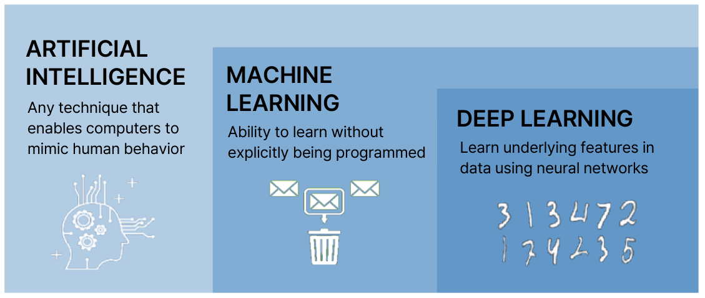

*그림 1. 인공지능, 기계 학습, 딥러닝의 포함 관계*

- **인공지능:** 컴퓨터가 인간의 행동을 흉내 내게 하는 모든 기법이다. 사람이 규칙을 하나하나 작성한 프로그램도 여기에 속한다.
- **기계 학습(machine learning):** 명시적으로 프로그래밍하지 않고도 데이터에서 학습하는 능력이다. 머신러닝이라고도 부른다. 그림 1의 가운데 그림처럼, 스팸 메일을 걸러 내는 규칙을 사람이 직접 쓰는 대신 스팸 여부가 표시된 메일을 보고 컴퓨터가 스스로 걸러 내는 기준을 찾는 것이 기계 학습이다.
- **딥러닝(deep learning):** 여러 층으로 쌓은 신경망을 이용해 데이터에 숨어 있는 특성을 스스로 학습하는 기계 학습의 한 분야이다. 그림 1의 오른쪽처럼 손으로 쓴 숫자 이미지에서 획의 모양 같은 특성을 사람이 정의하지 않아도 신경망이 찾아낸다. 인공신경망의 구조와 학습은 13주차에서 다룬다.

> **핵심:** 기계 학습은 컴퓨터가 데이터를 학습하여 데이터를 기반으로 예측이나 결정을 내릴 수 있게 하는 알고리즘과 모델의 개발에 중점을 두는 인공지능의 하위 분야이다. 규칙을 사람이 주는가, 데이터에서 얻는가가 기계 학습과 그 밖의 인공지능 기법을 가르는 기준이다.

### 1.3 튜링 테스트

**튜링 테스트(Turing test)** 는 영국의 수학자이자 컴퓨터 과학자인 앨런 튜링(Alan Turing)이 1950년에 제안한 시험으로, 인간과 같거나 구별할 수 없는 지능적인 행동을 보이는 기계의 능력을 측정한다 [1]. 튜링은 "기계가 생각할 수 있는가?"라는 모호한 질문을 관찰할 수 있는 행동의 시험으로 바꾸고, 이를 **모방 게임(imitation game)** 이라고 불렀다 [1].

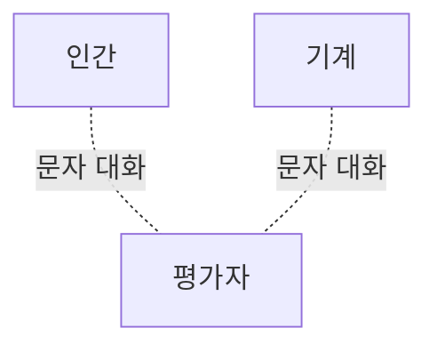

*그림 2. 튜링 테스트의 구성*

평가자는 상대를 보지 못한 채 인간과 기계 모두와 문자로만 대화한다. 평가자가 대화만으로 어느 쪽이 기계인지 확실하게 구별하지 못하면, 그 기계는 튜링 테스트를 통과했다고 평가한다.

> **주의:** 튜링 테스트는 겉으로 드러나는 대화 행동이 인간과 구별되지 않는지를 볼 뿐, 기계가 내용을 이해하는지는 직접 측정하지 않는다. 1.4절의 ELIZA처럼 단순한 규칙만으로도 짧은 시간 동안 사람을 속일 수 있으므로, 통과 여부만으로 지능의 정도를 단정할 수는 없다.

### 1.4 1950년대와 1960년대: 탄생과 초기 연구

**1950년대.** 이 시기에 컴퓨터는 대중에게 **전자 두뇌(electronic brain)** 로 여겨졌다. 인공지능 분야의 출발점이 된 사건은 다음과 같다.

- 존 매카시(John McCarthy)가 1956년 다트머스 워크숍을 제안하는 1955년의 제안서에서 "인공지능(artificial intelligence)"이라는 용어를 처음 사용했다 [2].
- 앨런 튜링은 지능을 모방 게임, 즉 튜링 테스트를 통과하는 능력으로 정의했다 [1].
- 마빈 민스키(Marvin Minsky)는 1951년에 신경망을 하드웨어로 구현한 최초의 컴퓨터인 SNARC를 만들었다 [3].

인공지능 연구는 주로 간단한 영역을 중심으로 이루어졌다. 그 시대의 컴퓨터에는 실용적인 문제를 풀 만큼 충분한 연산 성능과 메모리가 없었기 때문이다. 연구된 문제는 게임(체커 등), 원시적인 기계 번역, 자연어 이해, 자동화된 정리 증명과 수학 문제 해결이었다. 정리 증명은 신경망이 아니라 논리 규칙을 기호로 다루는 프로그램(1956년의 Logic Theorist 등)으로 연구되었다 [3]. 같은 시기에 연구된 초기 신경망이 **퍼셉트론(perceptron)** 으로, 프랭크 로젠블랫(Frank Rosenblatt)이 1958년에 발표한 이 모델은 예제로부터 가중치를 조정하여 입력을 두 부류로 나누는 법을 학습한다 [4]. 퍼셉트론의 구조는 13주차에서 자세히 다룬다.

**1960년대.** 인공지능은 간단한 영역을 넘어서려고 시도했고, 그 과정에서 해당 영역의 지식이 필요하다는 사실이 드러났다. 기계 번역이 대표적인 예이다. 초기 기계 번역은 러시아어와 영어 사이를 번역할 수 있었지만, 단어를 문맥 없이 대응시키는 수준이었다. 이 한계를 보여 주는 일화로, "the spirit is willing but the flesh is weak"(마음은 원하지만 육신이 약하다)를 러시아어로 번역했다가 다시 영어로 옮기자 "the vodka is good but the meat is spoiled"(보드카는 좋지만 고기는 상했다)가 되었다는 이야기가 널리 알려져 있다 [3]. 관용구의 의미를 알려면 언어와 세계에 대한 지식이 필요하다는 뜻이다.

- 가장 초기의 **전문가 시스템(expert system)** 인 Dendral이 1960년대 중반 스탠퍼드 대학에서 개발되었다. Dendral은 화학자의 지식을 규칙으로 담아 질량 분석 데이터로부터 분자 구조를 추론했다 [3].
- 미국에서는 1966년의 ALPAC 보고서가 기계 번역 연구의 성과가 부족하다고 결론을 내린 뒤 기계 번역 연구비가 크게 줄었고, 정부는 기계 번역을 제외한 특정 영역의 인공지능 연구를 후원했다 [3].
- 조지프 와이젠바움(Joseph Weizenbaum)은 초기 자연어 처리 프로그램인 **ELIZA**를 1966년에 발표했다 [5]. ELIZA는 사용자의 문장에서 핵심 구절을 찾아 미리 정한 규칙에 따라 질문으로 바꾸어 되묻는 간단한 대화형 프로그램이다. 가장 유명한 스크립트인 DOCTOR에서 ELIZA는 상담하는 의사 역할을, 사용자는 의사를 찾아온 환자 역할을 맡으며, 프로그램은 간단한 질문에 답하고 되묻기도 한다.

다음은 이러한 규칙이 만들어 내는 대화의 형태를 보인 예이다. 사용자 문장의 "I am"을 "you are"로 바꾸어 질문 틀에 끼워 넣을 뿐, 프로그램은 문장의 의미를 이해하지 않는다.

```text
User:  I am unhappy.
ELIZA: WHY DO YOU SAY YOU ARE UNHAPPY?
```

### 1.5 1970년대와 1980년대: 전문가 시스템과 침체기

**1970년대.** 인공지능 연구자들은 지식 기반 전문가 시스템으로 의료 진단, 음성 인식, 계획, 설계 같은 현실 세계의 문제를 풀었다. 전문가 시스템은 특정 분야 전문가의 지식을 조건과 결론의 쌍인 if-then 규칙으로 모은 **지식 베이스(knowledge base)** 와, 그 규칙을 사실에 적용해 결론을 이끌어 내는 **추론 엔진(inference engine)** 으로 이루어진다.

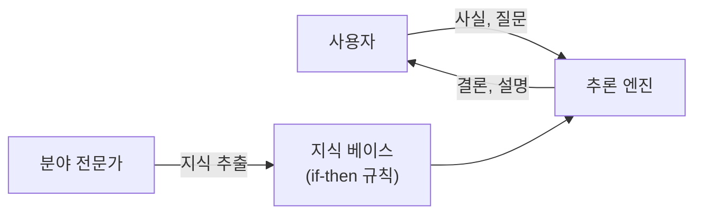

*그림 3. 전문가 시스템의 구성*

이러한 성공으로 인공지능이 주목받기 시작했다. 인공지능 연구가 늘어나고, 인공지능 연구소가 곳곳에 생겨나고, 인공지능 개발 도구들이 만들어졌다. 그러나 비판도 있었다. 인공지능 시스템은 좁은 영역을 조금만 벗어나도 동작하지 않을 만큼 취약하고, 전문가의 지식을 규칙으로 옮기는 데 너무 많은 시간과 노력이 들며, 스스로 학습하지 않는다는 점이다.

**1980년대.** 인공지능에 침체기가 찾아와 연구 자금이 고갈되었다. 많은 기대가 충족되지 못했고, 전문가 시스템을 개발하는 데 너무 오랜 시간이 걸렸으며, 투자한 돈에 비해 만족스러운 성과를 내지 못했다.

이때 구조대 역할로 나선 것이 신경망이다. 단층 퍼셉트론은 입력 공간을 직선(일반적으로 초평면) 하나로만 나눌 수 있어서, 표 2의 **XOR**처럼 직선 하나로 나눌 수 없는 문제를 풀지 못한다. 민스키와 페퍼트(Papert)가 1969년에 이 한계를 분석한 뒤 신경망 연구는 한동안 위축되었다 [6].

| $x_1$ | $x_2$ | XOR 출력 |
|:-----|:-----|:-----|
| 0 | 0 | 0 |
| 0 | 1 | 1 |
| 1 | 0 | 1 |
| 1 | 1 | 0 |

*표 2. XOR 함수의 진리표*

평면 위에서 출력이 1인 두 점 $(0, 1)$, $(1, 0)$과 출력이 0인 두 점 $(0, 0)$, $(1, 1)$은 대각선 방향으로 엇갈려 있으므로 어떤 직선으로도 둘로 가를 수 없다. 1986년에 럼멜하트(Rumelhart), 힌턴(Hinton), 윌리엄스(Williams)가 **역전파(backpropagation)** 로 여러 층의 신경망을 학습시키는 방법을 널리 알렸고 [7], 은닉층이 있는 다층 역전파 네트워크(multilayer backpropagation network)는 곡선 형태의 결정 경계를 만들어 퍼셉트론의 이 문제를 해결했다. 그러나 1990년 무렵에는 신경망 연구에 대한 자금 지원도 서서히 사라졌다. 신경망에도 학습이 느리고 많은 데이터와 연산이 필요하다는 자체적인 문제가 있었고, 당시 다루던 인공지능 문제의 대부분을 해결하지 못했기 때문이다. 역전파의 원리는 13주차에서 다룬다.

> **참고:** 인공지능 연구가 위축된 시기를 **인공지능의 겨울(AI winter)** 이라고 한다. 보통 두 시기를 가리키며, 첫째는 기계 번역과 초기 연구의 기대가 무너진 1970년대 중반이고, 둘째는 전문가 시스템 산업이 붕괴한 1980년대 후반부터 1990년대 초까지이다 [3]. 앞에서 설명한 1980년대의 침체기는 둘째 시기에 해당한다.

### 1.6 1990년대 이후: 통계적 기계 학습과 데이터

**1990년대.** 1990년대 중반부터 여러 기술적 혁신과 실용적인 응용을 통해 인공지능에 대한 관심이 다시 살아났다.

- 기계 학습, 특히 통계적 접근법과 확률 기반 모델이 인공지능 연구의 주류로 자리 잡았다.
- 베이즈 네트워크, 의사결정 트리, 서포트 벡터 머신(SVM) [8] 같은 알고리즘이 개발되었고, 많은 연구자가 규칙을 직접 쓰는 대신 데이터에서 모델을 얻는 데이터 중심 접근법을 선호하게 되었다.
- 인공지능 기술이 상용화되어 금융, 의료 등 다양한 산업에 적용되면서 실용적인 응용이 확산되었다.
- 인공지능 연구가 통계적 접근법과 기계 학습 중심으로 재편되었고, 특히 강화 학습과 자연어 처리 분야에서 큰 발전이 있었다.
- 컴퓨팅 성능이 발전하면서 신경망이 다시 주목받았고, 이후 딥러닝의 기초가 마련되었다.

**2000년대 이후.** 2000년대의 인공지능은 주로 실용적인 기술 적용과 기계 학습의 발전에 집중했으며, 여러 분야에서 큰 변화를 이루었다.

- 컴퓨팅 성능이 향상되고 데이터에 접근하기 쉬워지면서 기계 학습이 빠르게 발전했다. 인터넷과 모바일 기기가 확산되며 생성된 대규모 데이터를 바탕으로 인공지능 모델이 정교해졌고, 이미지 인식과 얼굴 인식 기술이 진화하면서 여러 분야에 컴퓨터 비전이 도입되었다.
- 인공지능과 로봇 공학이 융합되면서 로봇 제어와 무인 시스템이 발전했다. 자율 주행 연구가 활발해졌고 이를 위한 경로 계획과 장애물 회피 기술이 개발되었다. 2005년 DARPA 그랜드 챌린지에서 무인 자동차가 사막의 경주 구간을 완주한 것이 대표적인 예이다 [3].
- 고객 서비스, 추천 시스템 같은 상업적 활용이 본격화되면서 인공지능이 소비자와 직접 연결되었고, 다양한 산업에서 상용화되었다.

| 시기 | 주요 흐름 | 대표 사례와 한계 |
|:-----|:-----|:-----|
| 1950년대 | 인공지능이라는 용어의 등장, 간단한 영역의 연구 | 튜링 테스트, 퍼셉트론, 정리 증명 프로그램. 컴퓨터의 성능과 메모리가 부족했다. |
| 1960년대 | 간단한 영역을 넘어서려는 시도, 영역 지식의 필요성 인식 | Dendral, ELIZA. 문맥 없는 기계 번역이 실패하여 연구비가 줄었다. |
| 1970년대 | 지식 기반 전문가 시스템으로 현실 문제 해결 | 의료 진단, 음성 인식, 계획, 설계. 취약하고 만들기 어려우며 학습하지 않는다는 비판을 받았다. |
| 1980년대 | 침체기와 자금 고갈, 다층 역전파 신경망의 등장 | 전문가 시스템의 기대가 충족되지 못했다. 신경망도 1990년 무렵 자금이 줄었다. |
| 1990년대 | 통계적 접근법과 기계 학습 중심으로 재편 | 베이즈 네트워크, 의사결정 트리, SVM, 강화 학습. 신경망이 다시 주목받았다. |
| 2000년대 이후 | 대규모 데이터와 컴퓨팅 성능에 기반한 기계 학습의 실용화 | 컴퓨터 비전, 자율 주행, 추천 시스템. 딥러닝으로 이어졌다. |

*표 3. 시기별 인공지능 연구의 흐름*

### 1.7 학습이 필요한 이유

**학습(learning)** 은 연구, 경험, 실습, 교육을 통해 지식, 기술, 행동, 태도, 가치를 습득하는 과정이다. 인공지능에서 학습은 모델이 데이터를 통해 패턴을 찾고 문제 해결 능력을 향상시키는 데 필수적이다. 1.5절에서 전문가 시스템이 받은 비판, 즉 만들기 어렵고 스스로 나아지지 않는다는 문제를 해결하는 수단이 학습이다.

- 학습을 통해 인공지능은 환경이 변하거나 새로운 데이터가 들어와도 적응하여 성능을 유지할 수 있다.
- 반복적인 학습을 통해 인공지능은 특정 작업을 사람 없이 자동으로 처리할 수 있다.
- 인간의 인지 과정과 비슷하게, 학습을 통해 여러 문제 해결 전략과 지식을 습득할 수 있다.
- 학습 과정을 통해 오류를 줄이고 성능을 개선하여 더 정확한 결과를 낼 수 있다.

### 1.8 기계 학습

> **용어 정의:** **기계 학습(machine learning)** 은 컴퓨터가 명시적인 프로그래밍 없이 데이터에서 패턴을 학습하고 스스로 성능을 개선할 수 있도록 하는 인공지능의 한 분야이다. 기계 학습은 예시 데이터나 과거의 경험을 사용하여 정해진 성능 기준을 최적화하도록 컴퓨터를 프로그래밍한다.

기계 학습은 예측, 분류, 추천 등 다양한 작업에 쓰이며, 일반적으로 데이터가 많아질수록 성능이 개선된다. 기계 학습은 통계학과 컴퓨터 과학이 함께 만든 분야이다.

| 분야 | 기계 학습에서의 역할 |
|:-----|:-----|
| 통계학 | 표본으로부터 모집단에 대해 추론한다. 관측한 일부 데이터로 데이터 전체의 규칙을 추정하는 이론을 제공한다. |
| 컴퓨터 과학 | 추론을 위한 모델을 표현하고 평가하는 최적화 문제를 효율적으로 푸는 알고리즘을 개발한다. |

*표 4. 기계 학습에서 통계학과 컴퓨터 과학의 역할*

예를 들어 2.10절의 선형 회귀에서 몇 개의 표본으로 변수 사이의 관계를 추정하는 것은 통계학의 역할이고, 그 관계를 나타내는 직선의 계수를 오차를 최소로 하도록 빠르게 계산하는 것은 컴퓨터 과학의 역할이다.

데이터를 기반으로 예측하는 데에는 다양한 기술을 사용할 수 있지만, 기본 흐름은 그림 4처럼 학습 단계와 예측 단계로 나뉜다.

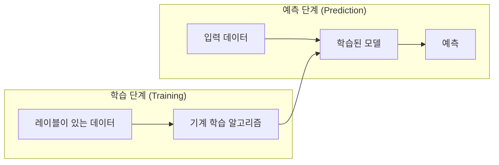

*그림 4. 기계 학습의 학습 단계와 예측 단계*

학습 단계에서는 정답(레이블)이 붙은 데이터를 기계 학습 알고리즘에 넣어 모델을 만든다. 예측 단계에서는 정답을 모르는 새 입력 데이터를 학습된 모델에 넣어 예측을 얻는다. 그림 4는 정답이 있는 데이터로 학습하는 지도 학습의 흐름이며, 정답 없이 학습하는 방식은 2절에서 함께 다룬다.

---

<br>

## 2. 학습 타입 I: 지도 학습과 비지도 학습

기계 학습은 학습에 쓰는 정보의 종류에 따라 크게 세 가지 타입으로 나뉜다. 이 절에서는 세 타입을 비교한 뒤 비지도 학습의 K-평균 군집화와 지도 학습의 분류(k-최근접 이웃, 서포트 벡터 머신)와 회귀(선형 회귀)를 다룬다.

### 2.1 학습의 세 가지 타입

> **용어 정의:** **레이블(label)** 은 각 데이터에 붙은 정답이다. 메일이 스팸인지 아닌지, 과일이 바나나인지 오렌지인지 같은 범주일 수도 있고, 과일의 무게처럼 실수일 수도 있다.

| 타입 | 학습에 쓰는 정보 | 예 |
|:-----|:-----|:-----|
| 비지도 학습(unsupervised learning) | 레이블이 지정되지 않은 데이터에서 패턴을 발견한다. | 텍스트 내용을 기반으로 비슷한 문서끼리 묶는 군집화 |
| 지도 학습(supervised learning) | 레이블이 지정된 학습 데이터를 사용하여 입력과 정답의 관계를 학습한다. | 스팸 여부가 이미 지정된 메일로 학습한 메일 분류 |
| 강화 학습(reinforcement learning) | 행동에 대한 피드백, 즉 보상을 기반으로 행동하는 방법을 학습한다. | 바둑 학습. 보상은 승리 또는 패배이다. |

*표 5. 학습의 세 가지 타입*

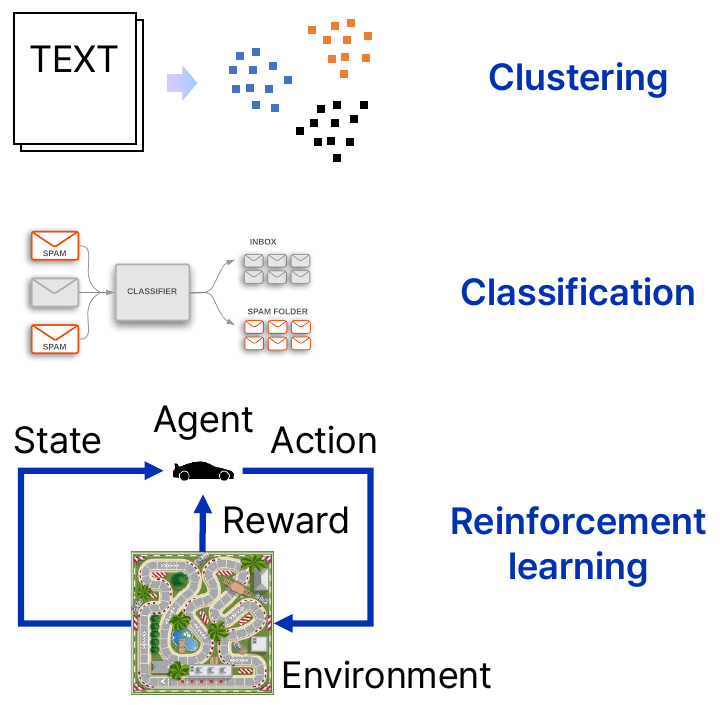

*그림 5. 군집화, 분류, 강화 학습의 예*

그림 5의 위쪽은 문서(TEXT)를 내용이 비슷한 것끼리 세 무리로 묶는 군집화(clustering), 가운데는 메일을 분류기(classifier)에 넣어 받은 편지함과 스팸 폴더로 나누는 분류(classification), 아래쪽은 자동차(에이전트)가 경주 트랙(환경)의 상태를 보고 행동을 고른 뒤 보상을 받는 강화 학습이다. 군집화는 비지도 학습, 분류는 지도 학습의 대표적인 작업이다. 강화 학습은 3.9절에서 다룬다.

### 2.2 학습 데이터의 표현

학습 데이터는 $n$개의 **샘플(sample)** 로 이루어진다. 지도 학습의 학습 데이터 세트는 입력과 레이블의 쌍으로 쓴다.

$$
(x_1, y_1), (x_2, y_2), \ldots, (x_n, y_n), \qquad x_i \in \mathbb{R}^d
$$

여기서 $x_i$는 $i$번째 샘플의 입력으로, $d$개의 **특성(feature)** 값을 모은 $d$차원 벡터이며 **특성 벡터(feature vector)** 라고도 한다. $y_i$는 그 샘플의 레이블이다. $x_i$의 $j$번째 특성 값을 $x_{ij}$로 쓰면 학습 데이터는 그림 6처럼 행이 샘플, 열이 특성인 표가 된다.

```text
          입력 (특성 1 ... 특성 d)        레이블
  x_1  │  x_11   x_12   ...   x_1d   │    y_1
  x_2  │  x_21   x_22   ...   x_2d   │    y_2
   ⋮   │            ⋮                │     ⋮
  x_n  │  x_n1   x_n2   ...   x_nd   │    y_n
```

*그림 6. 학습 데이터의 행렬 표현*

예를 들어 과일 데이터에서 각 과일은 길이, 너비, 무게의 세 특성($d = 3$)을 갖고, 레이블은 과일의 종류이다.

| 과일 | 길이 | 너비 | 무게 | 레이블 |
|:-----|:-----|:-----|:-----|:-----|
| 과일 1 | 165 | 38 | 172 | 바나나 |
| 과일 2 | 218 | 39 | 230 | 바나나 |
| 과일 3 | 76 | 80 | 145 | 오렌지 |
| 과일 4 | 145 | 35 | 150 | 바나나 |
| 과일 5 | 90 | 88 | 160 | 오렌지 |
| ⋮ | ⋮ | ⋮ | ⋮ | ⋮ |
| 과일 $n$ | ⋯ | ⋯ | ⋯ | ⋯ |

*표 6. 과일 데이터의 특성과 레이블*

표 6의 첫 번째 행은 $x_1 = (165, 38, 172)$, $y_1 = \text{바나나}$를 뜻한다. 바나나는 길고 가늘며 오렌지는 길이와 너비가 비슷하므로, 길이와 너비만 보아도 두 과일을 대체로 구별할 수 있다.

- **지도 학습:** 표 6처럼 레이블이 지정된 데이터에서 모델을 학습한다. 모델은 새 과일의 특성을 받아 종류를 맞히는 법을 배운다.
- **비지도 학습:** 표 6에서 레이블 열을 지운 데이터, 즉 레이블이 지정되지 않은 데이터에서 모델을 학습한다. 모델은 정답을 모르는 채로 비슷한 과일끼리 묶는 구조를 찾는다.

### 2.3 비지도 학습과 군집화

비지도 학습의 학습 데이터에는 입력만 있다.

$$
x_1, x_2, \ldots, x_n, \qquad x_i \in \mathbb{R}^d
$$

대표적인 비지도 학습 작업은 **군집화(clustering)** 또는 **분할(segmentation)** 이다. 군집화는 각 데이터를 $K$개의 **군집(cluster)** 중 하나에 대응시키는 함수 $f$를 찾는 문제이다.

$$
f : \mathbb{R}^d \to \lbrace C_1, C_2, \ldots, C_K\rbrace\quad (\text{군집의 집합})
$$

> **용어 정의:** **군집(cluster)** 은 서로 비슷한 데이터의 무리이다. 비슷한 정도는 보통 특성 공간에서의 거리로 재며, 같은 군집 안의 데이터는 서로 가깝고 다른 군집의 데이터와는 멀다. **특성 공간(feature space)** 은 각 특성을 하나의 축으로 하는 공간으로, 샘플 하나가 그 공간의 점 하나가 된다.

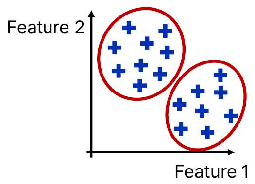

*그림 7. 레이블이 없는 데이터에서 찾은 두 군집*

그림 7의 점들에는 레이블이 없지만, 특성 1과 특성 2의 평면에서 왼쪽 위와 오른쪽 아래의 두 무리로 뚜렷하게 모여 있다. 군집화는 이처럼 데이터 스스로가 가진 구조를 찾는다. 인구 데이터에서 소비 성향이 비슷한 고객 집단을 찾거나, 과일 데이터에서 모양이 비슷한 과일끼리 묶는 것이 그 예이다.

### 2.4 K-평균 군집화

**K-평균 군집화(K-means clustering)** 는 데이터 세트를 서로 겹치지 않는 $K$개의 군집으로 분할하는 데 널리 쓰이는 비지도 학습 알고리즘이다 [9]. 각 군집은 그 군집에 속한 데이터의 평균 위치인 **중심(centroid)** 으로 대표되며, 군집의 수 $K$는 사용자가 미리 정한다.

K-평균 군집화는 다음 네 단계로 진행한다.

1. **초기 중심 설정:** 데이터 영역 안에서 $K$개의 군집 중심 $\mu_1, \ldots, \mu_K$를 임의로 선택한다.
2. **군집 할당:** 각 데이터를 가장 가까운 중심의 군집에 할당한다.

   $$
   c(i) = \arg\min_{k \in \lbrace1, \ldots, K\rbrace} \lVert x_i - \mu_k \rVert
   $$

   여기서 $c(i)$는 데이터 $x_i$가 할당된 군집의 번호이고, $\lVert x_i - \mu_k \rVert$는 $x_i$와 중심 $\mu_k$ 사이의 유클리드 거리이다.
3. **중심 갱신:** 각 군집에 속한 데이터들의 평균 위치로 중심을 옮긴다. $C_k$를 $k$번째 군집에 속한 데이터의 집합, $\lvert C_k \rvert$를 그 개수라 하면 다음과 같다.

   $$
   \mu_k = \frac{1}{\lvert C_k \rvert} \sum_{x_i \in C_k} x_i
   $$

4. **반복과 수렴:** 군집 할당과 중심 갱신을 반복하여, 할당이 더 이상 바뀌지 않거나 중심이 거의 움직이지 않을 때 멈춘다.

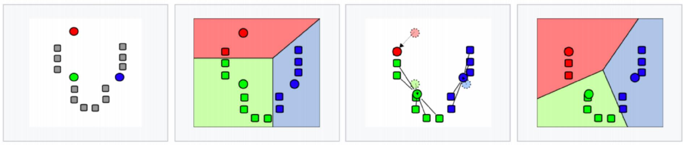

*그림 8. K-평균 군집화의 반복 과정 (K = 3)*

그림 8은 U자 모양으로 놓인 회색 데이터에 $K = 3$으로 K-평균 군집화를 적용한 과정이다. 첫째 그림에서 세 개의 초기 중심(빨강, 초록, 파랑 원)이 데이터 영역 안에 무작위로 생성된다. 둘째 그림에서 모든 데이터가 가장 가까운 중심에 할당되어 세 군집이 생긴다. 이때 평면을 나눈 색 영역은 각 점이 어느 중심에 가장 가까운지를 나타내는 **보로노이 다이어그램(Voronoi diagram)** 이다. 셋째 그림에서 각 군집의 중심(평균)이 새로운 중심이 되어 이동한다(옅은 원이 이전 위치이다). 넷째 그림처럼 수렴에 도달할 때까지 둘째와 셋째 단계가 반복된다.

**예제.** 평면 위의 여섯 점 $A(1, 1)$, $B(2, 1)$, $C(1, 2)$, $D(5, 4)$, $E(6, 5)$, $F(5, 5)$를 $K = 2$로 군집화한다. 초기 중심은 일부러 서로 가까운 $\mu_1 = A(1, 1)$과 $\mu_2 = B(2, 1)$로 고른다.

**1회차 할당.** 각 점에서 두 중심까지의 거리를 구한다. 예를 들어 $D$에서 $\mu_1$까지의 거리는 $\sqrt{(5-1)^2 + (4-1)^2} = \sqrt{25} = 5$이고, $\mu_2$까지는 $\sqrt{(5-2)^2 + (4-1)^2} = \sqrt{18} \approx 4.243$이므로 $D$는 군집 2에 할당된다.

| 점 | $\mu_1 = (1, 1)$까지 | $\mu_2 = (2, 1)$까지 | 할당 |
|:-----|:-----|:-----|:-----|
| $A(1, 1)$ | 0 | 1 | 군집 1 |
| $B(2, 1)$ | 1 | 0 | 군집 2 |
| $C(1, 2)$ | 1 | 1.414 | 군집 1 |
| $D(5, 4)$ | 5 | 4.243 | 군집 2 |
| $E(6, 5)$ | 6.403 | 5.657 | 군집 2 |
| $F(5, 5)$ | 5.657 | 5 | 군집 2 |

*표 7. K-평균 예제의 1회차 거리와 할당*

**1회차 갱신.** 군집 1은 $\lbrace A, C\rbrace$, 군집 2는 $\lbrace B, D, E, F\rbrace$이므로 새 중심은 다음과 같다.

$$
\mu_1 = \left(\frac{1 + 1}{2}, \frac{1 + 2}{2}\right) = (1, 1.5), \qquad \mu_2 = \left(\frac{2 + 5 + 6 + 5}{4}, \frac{1 + 4 + 5 + 5}{4}\right) = (4.5, 3.75)
$$

**2회차 할당.** 새 중심으로 거리를 다시 구한다. $B(2, 1)$은 $\mu_1$까지 $\sqrt{1^2 + 0.5^2} \approx 1.118$, $\mu_2$까지 $\sqrt{2.5^2 + 2.75^2} \approx 3.717$이므로 군집 1로 옮겨 간다.

| 점 | $\mu_1 = (1, 1.5)$까지 | $\mu_2 = (4.5, 3.75)$까지 | 할당 |
|:-----|:-----|:-----|:-----|
| $A(1, 1)$ | 0.5 | 4.451 | 군집 1 |
| $B(2, 1)$ | 1.118 | 3.717 | 군집 1 |
| $C(1, 2)$ | 0.5 | 3.913 | 군집 1 |
| $D(5, 4)$ | 4.717 | 0.559 | 군집 2 |
| $E(6, 5)$ | 6.103 | 1.953 | 군집 2 |
| $F(5, 5)$ | 5.315 | 1.346 | 군집 2 |

*표 8. K-평균 예제의 2회차 거리와 할당*

**2회차 갱신.** 군집 1은 $\lbrace A, B, C\rbrace$, 군집 2는 $\lbrace D, E, F\rbrace$이므로 $\mu_1 = (4/3, 4/3) \approx (1.333, 1.333)$, $\mu_2 = (16/3, 14/3) \approx (5.333, 4.667)$이다. 이 중심으로 3회차 할당을 하면 모든 점의 군집이 2회차와 같으므로 알고리즘이 수렴한다. 최종 군집은 왼쪽 아래의 $\lbrace A, B, C\rbrace$와 오른쪽 위의 $\lbrace D, E, F\rbrace$이다.

### 2.5 K-평균 군집화의 수렴과 한계

K-평균 군집화가 줄여 나가는 값은 각 데이터와 그 군집 중심 사이의 거리 제곱을 모두 더한 **군집 내 제곱합(within-cluster sum of squares)** 이다.

$$
J = \sum_{k=1}^{K} \sum_{x_i \in C_k} \lVert x_i - \mu_k \rVert^2
$$

군집 할당 단계는 각 점을 가장 가까운 중심에 붙이므로 $J$를 늘리지 않고, 중심 갱신 단계는 군집마다 거리 제곱의 합을 최소로 하는 점인 평균으로 중심을 옮기므로 역시 $J$를 늘리지 않는다. 가능한 할당의 수는 유한하므로 알고리즘은 유한 번 안에 멈춘다 [9]. 2.4절의 예제에서 $J$는 처음 할당에서 76, 1회차 갱신 뒤 20.25, 2회차 할당 뒤 7.6875, 2회차 갱신 뒤 약 2.667로 줄어든다.

그러나 이 수렴점은 $J$의 **전역 최솟값(global minimum)** 이 아니라 **지역 최솟값(local minimum)** 일 수 있다. 각 단계는 현재 상태에서 $J$를 줄일 뿐 더 나은 배치를 찾아 멀리 이동하지 않기 때문이다.

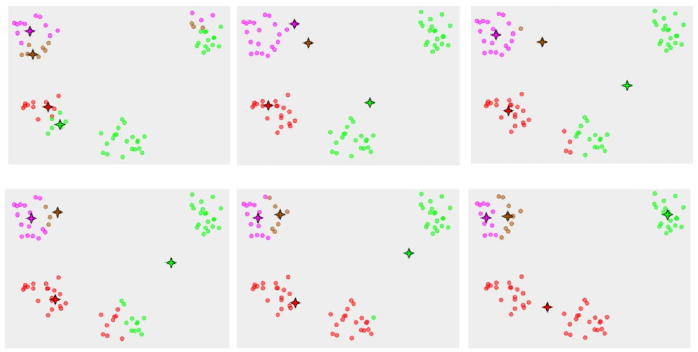

*그림 9. 초기 중심에 따라 지역 최솟값으로 수렴한 K-평균 군집화*

그림 9의 데이터에는 네 개의 무리가 있고, 별 모양은 네 개의 중심, 점의 색은 각 점이 할당된 군집이다. 여섯 그림은 한 번의 실행을 왼쪽 위에서 오른쪽 아래 순서로 보인 것이다. 처음에 두 중심(보라, 갈색)이 왼쪽 위의 한 무리 안에 함께 놓이고, 초록 중심과 빨간 중심은 왼쪽 가운데 무리 근처에서 출발한다. 반복할수록 초록 중심은 오른쪽 위의 무리로 옮겨 가고, 빨간 중심은 왼쪽 가운데와 아래 가운데의 두 무리를 함께 맡아 두 무리 사이의 빈 자리로 간다. 마지막 그림에서는 두 중심이 왼쪽 위의 한 무리를 나누어 갖고 한 중심이 떨어진 두 무리를 함께 맡은 채로, 할당과 갱신을 반복해도 더 이상 바뀌는 것이 없으므로 알고리즘이 그대로 멈춘다. 초기 중심이 다르면 이처럼 결과도 달라진다. 그래서 실제로는 서로 다른 초기 중심으로 여러 번 실행한 뒤 $J$가 가장 작은 결과를 고른다 [9].

| 구분 | 내용 |
|:-----|:-----|
| 장점 | 계산이 간단하고 비교적 빠르게 군집화를 수행할 수 있다. 큰 데이터 세트에서도 효율적으로 동작하고 확장할 수 있다. 이해하기 쉽고 다양한 환경에서 구현할 수 있다. |
| 단점 | 군집의 수 $K$를 사전에 지정해야 하며 최적의 $K$를 찾기 어렵다. 이상치 데이터의 영향을 쉽게 받는다. 초기 중심값에 따라 결과가 달라질 수 있어 최적화를 위해 여러 번 수행해야 할 수 있다. |

*표 9. K-평균 군집화의 장점과 단점*

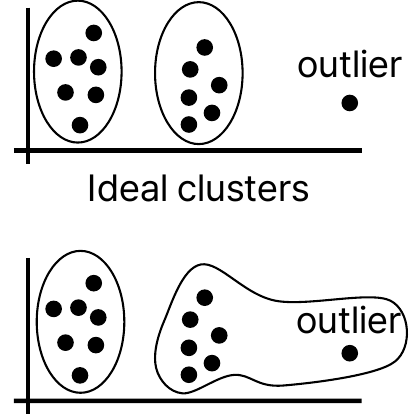

*그림 10. 이상치가 K-평균 군집화에 미치는 영향*

> **용어 정의:** **이상치(outlier)** 는 대부분의 데이터와 동떨어진 값을 갖는 데이터이다. 측정 오류로 생기기도 하고 드문 실제 현상을 나타내기도 한다.

그림 10의 위쪽은 이상적인 군집으로, 두 무리가 각각 군집을 이루고 오른쪽 끝의 이상치는 어느 군집에도 억지로 넣지 않는다. 그러나 $K = 2$인 K-평균 군집화는 모든 점을 반드시 어느 한 군집에 할당하므로, 아래쪽처럼 이상치가 가까운 군집에 섞여 들어간다. 평균은 극단적인 값에 민감하므로 이 군집의 중심이 이상치 쪽으로 끌려가고, 그 결과 군집의 경계와 이후의 할당이 왜곡된다.

### 2.6 지도 학습: 분류

지도 학습의 학습 데이터는 입력 $x$와 레이블 $y$의 쌍 $(x_1, y_1), \ldots, (x_n, y_n)$, $x_i \in \mathbb{R}^d$이다. 레이블의 종류에 따라 지도 학습은 분류와 회귀로 나뉜다.

**분류(classification)** 에서 레이블 $y$는 이산적인 값, 즉 몇 개의 범주 중 하나이다. 두 범주만 있으면 보통 $y \in \lbrace-1, +1\rbrace$로 쓰며, 이때 입력을 두 범주 중 하나로 보내는 함수

$$
f : \mathbb{R}^d \to \lbrace-1, +1\rbrace
$$

를 **이진 분류기(binary classifier)** 라고 한다. 예/아니요, 바나나/오렌지, 스팸/햄(정상 메일)을 가리는 문제가 이진 분류이다.

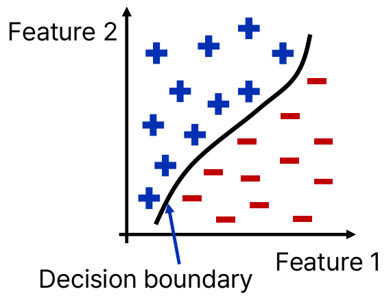

*그림 11. 이진 분류의 결정 경계*

> **용어 정의:** **결정 경계(decision boundary)** 는 특성 공간에서 분류기의 예측이 한 범주에서 다른 범주로 바뀌는 경계이다. 그림 11에서 곡선의 왼쪽 위는 $+1$, 오른쪽 아래는 $-1$로 분류된다.

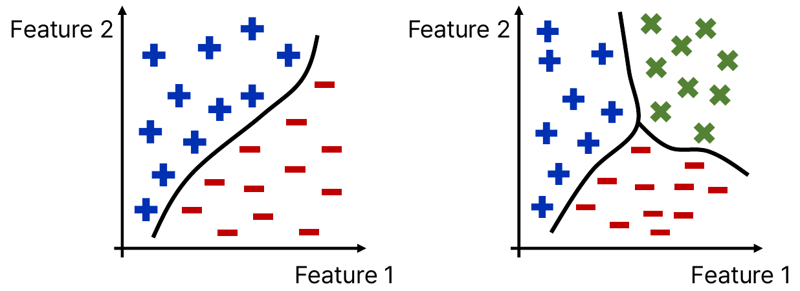

*그림 12. 이진 분류와 세 범주 분류의 결정 경계*

그림 12의 왼쪽은 두 범주($+$, $-$)를 곡선 하나로 나누는 이진 분류이고, 오른쪽은 세 범주($+$, $-$, $\times$)를 세 곡선이 만나는 경계로 나누는 **다중 분류(multiclass classification)** 이다. 범주가 $C$개이면 레이블은 $y \in \lbrace1, 2, \ldots, C\rbrace$처럼 쓴다.

### 2.7 k-최근접 이웃 분류

**k-최근접 이웃(k-nearest neighbors, k-NN) 분류기**는 유유상종의 원리, 즉 어떤 개체가 이웃 개체와 비슷하다면 같은 클래스에 속할 가능성이 높다는 생각에 기반한다. 여기서 **클래스(class)** 는 분류의 범주를 말한다. k-NN은 보통 표준 **유클리드 거리(Euclidean distance)** 로 가장 가까운 이웃을 정한다. 두 점 $x = (x_1, \ldots, x_d)$, $x' = (x'_1, \ldots, x'_d)$ 사이의 유클리드 거리는 다음과 같다.

$$
\mathrm{dist}(x, x') = \sqrt{\sum_{j=1}^{d} (x_j - x'_j)^2}
$$

k-NN 분류기는 다음 과정으로 동작한다.

1. **학습 단계:** 학습 데이터 세트의 특성 벡터와 그 클래스 레이블을 기억한다. 다른 계산은 하지 않는다.
2. **예측 단계:** 클래스를 모르는 새 데이터 포인트가 주어지면, 이 포인트와 학습 데이터 세트의 모든 포인트 사이의 거리를 계산한다.
3. **가장 가까운 이웃 식별:** 계산한 거리를 기준으로 새 포인트에 가장 가까운 $k$개의 이웃을 찾는다.
4. **다수결 투표:** $k$개의 이웃 중 가장 많은 클래스를 새 포인트의 클래스 레이블로 정한다.

학습 단계에서 모델을 미리 만들지 않고 예측할 때 모든 계산을 하므로 k-NN을 **게으른 학습(lazy learning)** 이라고도 한다.

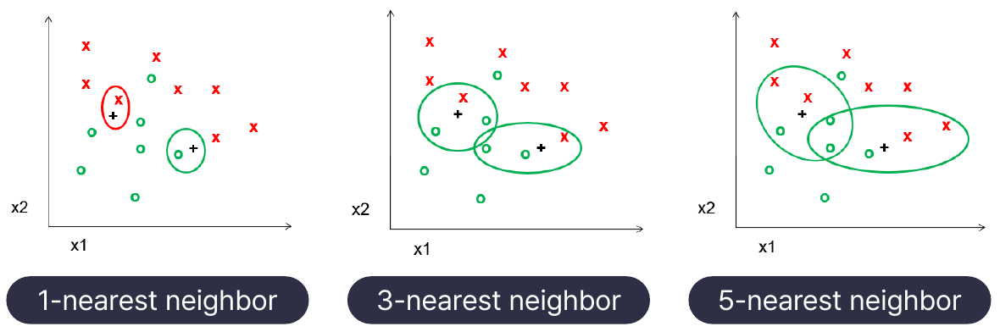

*그림 13. k에 따른 k-NN 분류의 이웃*

그림 13에는 두 클래스($\times$와 $\circ$)의 학습 데이터와 클래스를 모르는 두 점($+$)이 있다. 왼쪽 $+$는 바로 옆에 $\times$ 하나가 있지만 그 주변은 대부분 $\circ$이다.

- **1-NN:** 왼쪽 $+$의 가장 가까운 이웃은 $\times$이므로 $\times$로 분류된다(빨간 원). 오른쪽 $+$는 가장 가까운 $\circ$를 따라 $\circ$가 된다.
- **3-NN:** 왼쪽 $+$의 세 이웃은 $\times$ 하나와 $\circ$ 둘이므로 $\circ$로 분류된다. 오른쪽 $+$도 $\circ$ 둘, $\times$ 하나로 $\circ$이다.
- **5-NN:** 두 점 모두 다섯 이웃 중 $\circ$가 셋, $\times$가 둘이므로 $\circ$로 분류된다.

이처럼 $k$가 작으면 예측이 바로 옆의 샘플 하나, 특히 잡음이 섞인 샘플에 민감하고, $k$가 크면 결과가 안정되지만 너무 크면 멀리 있는 다른 클래스의 샘플까지 투표에 참여한다. 두 클래스를 분류할 때는 동률을 피하려고 $k$를 홀수로 고르는 경우가 많으며, 적절한 $k$는 3.3절의 검증 데이터로 고른다.

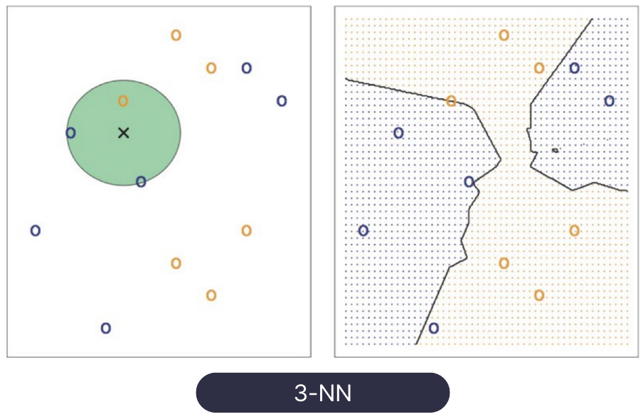

*그림 14. 3-NN의 이웃과 결정 경계*

그림 14의 왼쪽에서 새 점($\times$)의 가장 가까운 세 이웃(초록 원 안)은 파란 점 둘과 주황 점 하나이므로 새 점은 파란 클래스로 분류된다. 오른쪽은 평면의 모든 위치를 3-NN으로 분류하여 칠한 결과로, 경계가 직선이 아니라 데이터 배치를 따라 구불구불한 비선형 결정 경계가 된다.

**예제.** 표 6의 과일 다섯 개를 학습 데이터로 하여 길이 150, 너비 40, 무게 165인 새 과일을 3-NN으로 분류한다. 새 과일 $q = (150, 40, 165)$에서 과일 1까지의 거리는

$$
\mathrm{dist}(q, x_1) = \sqrt{(150 - 165)^2 + (40 - 38)^2 + (165 - 172)^2} = \sqrt{225 + 4 + 49} = \sqrt{278} \approx 16.67
$$

이고, 나머지도 같은 방식으로 구하면 표 10과 같다.

| 순위 | 학습 샘플 | 레이블 | 거리의 제곱 | 거리 |
|:-----|:-----|:-----|:-----|:-----|
| 1 | 과일 4 $(145, 35, 150)$ | 바나나 | $25 + 25 + 225 = 275$ | 16.58 |
| 2 | 과일 1 $(165, 38, 172)$ | 바나나 | $225 + 4 + 49 = 278$ | 16.67 |
| 3 | 과일 5 $(90, 88, 160)$ | 오렌지 | $3600 + 2304 + 25 = 5929$ | 77.00 |
| 4 | 과일 3 $(76, 80, 145)$ | 오렌지 | $5476 + 1600 + 400 = 7476$ | 86.46 |
| 5 | 과일 2 $(218, 39, 230)$ | 바나나 | $4624 + 1 + 4225 = 8850$ | 94.07 |

*표 10. 새 과일에서 학습 샘플까지의 거리*

가장 가까운 세 이웃의 레이블은 바나나, 바나나, 오렌지이므로 다수결에 따라 새 과일은 **바나나**로 분류된다. 1-NN이면 과일 4만 보므로 역시 바나나이다.

> **[기계학습]** k-NN은 특성의 단위와 범위에 민감하다. 표 6에서 길이는 76에서 218까지 142만큼 변하지만 너비는 35에서 88까지 53만큼 변하므로, 그대로 거리를 재면 길이의 차이가 너비의 차이보다 큰 비중을 갖는다. 또 길이와 무게처럼 단위가 다른 값을 그대로 더하면 단위를 바꾸는 것만으로 이웃이 달라질 수 있다. 그래서 보통 각 특성을 평균 0, 표준편차 1로 표준화하거나 같은 범위로 정규화한 뒤 거리를 계산한다.

| 구분 | 내용 |
|:-----|:-----|
| 장점 | 구현이 쉽고, 데이터 분포에 따라 동작이 명확하게 이해된다. 학습 단계에서 별도의 학습이 필요하지 않아 학습이 빠르다. 복잡한 데이터 분포에 대해서도 비선형 분류가 가능하다. 모델을 갱신하지 않고 새로운 데이터를 추가할 수 있다. |
| 단점 | 모든 학습 데이터와의 거리를 계산해야 하므로 예측 시간이 길어질 수 있다. 모든 학습 데이터를 저장해야 하므로 메모리 사용량이 크다. 데이터의 차원이 높아지면 거리 기반 접근이 부정확해지는 차원의 저주가 발생한다. 가까운 이상치 데이터의 영향을 쉽게 받는다. |

*표 11. k-NN 분류기의 장점과 단점*

> **용어 정의:** **차원의 저주(curse of dimensionality)** 는 특성의 수(차원)가 커질수록 같은 양의 데이터가 공간을 매우 듬성듬성하게 채우게 되어, 가장 가까운 이웃조차 멀리 떨어지고 점들 사이의 거리가 서로 비슷해지는 현상이다 [9]. 거리가 비슷해지면 "가장 가까운" 이웃이라는 기준이 의미를 잃으므로 거리에 의존하는 k-NN의 성능이 떨어진다.

### 2.8 서포트 벡터 머신

**서포트 벡터 머신(support vector machine, SVM) 분류기**는 특성 공간에서 서로 다른 클래스를 가장 잘 분리하는 **초평면(hyperplane)** 을 찾는다 [8]. 초평면은 $d$차원 공간을 둘로 나누는 $(d-1)$차원의 평평한 경계로, 2차원에서는 직선, 3차원에서는 평면이다. SVM이 찾는 선형 분류 함수는 다음과 같다.

$$
f(x) = \operatorname{sgn}(w \cdot x + b)
$$

여기서 $w \in \mathbb{R}^d$는 초평면에 수직인 **가중치 벡터(weight vector)**, $b$는 초평면의 위치를 정하는 **편향(bias)**, $w \cdot x$는 내적, $\operatorname{sgn}$은 양수이면 $+1$, 음수이면 $-1$을 내는 부호 함수이다. 초평면은 $w \cdot x + b = 0$인 점들의 집합이고, 점 $x$에서 초평면까지의 거리는 $\lvert w \cdot x + b \rvert / \lVert w \rVert$이다.

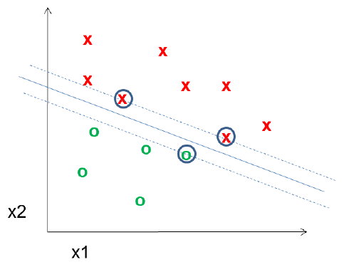

*그림 15. 서포트 벡터 머신의 초평면, 마진, 서포트 벡터*

두 클래스를 나누는 직선은 무수히 많다. SVM은 그중 초평면과 각 클래스의 가장 가까운 데이터 포인트 사이의 거리인 **마진(margin)** 을 최대화하는 초평면을 고르며, 이 가장 가까운 포인트들을 **서포트 벡터(support vector)** 라고 한다. 그림 15에서 실선이 초평면, 두 점선이 마진의 경계이고, 동그라미로 표시한 세 점이 서포트 벡터이다. 결정 경계는 서포트 벡터만으로 정해지며, 나머지 점을 조금 옮겨도 경계는 바뀌지 않는다.

$w$와 $b$에 같은 양수를 곱해도 초평면은 같으므로, 서포트 벡터에서 $\lvert w \cdot x + b \rvert = 1$이 되도록 크기를 맞추면 마진의 폭은 $2 / \lVert w \rVert$가 된다. 따라서 마진을 최대화하는 문제는 모든 학습 샘플을 올바른 쪽에 두면서 $\lVert w \rVert$를 최소화하는 문제와 같다 [8].

$$
\min_{w, b} \ \frac{1}{2} \lVert w \rVert^2 \quad \text{subject to} \quad y_i (w \cdot x_i + b) \ge 1, \quad i = 1, \ldots, n
$$

**예제.** $w = (1, 1)$, $b = -3$이면 초평면은 직선 $x_1 + x_2 = 3$이다. 점 $(2, 2)$에서 $w \cdot x + b = 2 + 2 - 3 = 1 > 0$이므로 $f = +1$, 점 $(1, 1)$에서 $1 + 1 - 3 = -1 < 0$이므로 $f = -1$이다. 두 점에서 $\lvert w \cdot x + b \rvert = 1$이므로 둘이 서포트 벡터라면 마진의 폭은 $2 / \lVert w \rVert = 2 / \sqrt{2} = \sqrt{2} \approx 1.414$이다.

> **[기계학습]** 클래스가 직선으로 완전히 나뉘지 않으면 일부 샘플이 마진 안에 들어오는 것을 벌점과 함께 허용하는 소프트 마진(soft margin)을 쓰고, 경계가 곡선이어야 하면 데이터를 더 높은 차원으로 옮긴 것과 같은 효과를 내는 커널(kernel) 함수를 써서 비선형 결정 경계를 얻는다 [8], [9].

### 2.9 지도 학습: 회귀

**회귀(regression)** 에서 레이블 $y$는 실수이다($y \in \mathbb{R}$). 입력을 실수로 보내는 함수

$$
f : \mathbb{R}^d \to \mathbb{R}
$$

를 **회귀 모델(regressor)** 이라고 한다. 과일의 특성으로 무게를 예측하거나, 사람의 다른 신체 정보로 키를 예측하는 문제가 회귀이다.

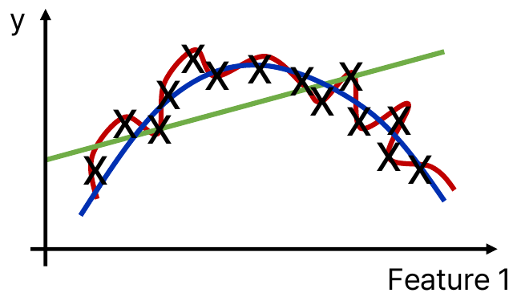

*그림 16. 같은 데이터에 맞춘 세 회귀 모델*

그림 16의 데이터($\times$)는 올라갔다가 내려오는 추세를 보인다. 초록 직선은 이 추세를 따라가지 못할 만큼 단순하고, 빨간 곡선은 모든 점을 지나도록 지나치게 구불구불하며, 파란 곡선은 점들의 전체 추세를 적당히 따라간다. 어떤 모델이 좋은지 판단하는 기준은 3.2절에서 다룬다.

### 2.10 선형 회귀와 최소제곱법

**회귀 분석(regression analysis)** 은 예측하려는 값인 **종속 변수(dependent variable)** 와 예측에 쓰는 값인 하나 이상의 **독립 변수(independent variable)** 사이의 관계를 모델링하는 통계적 방법이다. **선형 회귀(linear regression)** 는 이 관계를 1차식으로 나타내며, 관찰된 데이터에 가장 잘 맞는 계수를 추정하여 관찰된 값과 선형 방정식으로 예측한 값의 차이를 최소화하는 것을 목표로 한다. 특성이 $d$개인 **다중 선형 회귀(multiple linear regression)** 의 선형 방정식은 다음과 같다.

$$
\hat{y} = b_0 + b_1 x_1 + b_2 x_2 + \cdots + b_d x_d
$$

여기서 $b_0$은 절편, $b_1, \ldots, b_d$는 각 특성의 계수이다. 특성이 하나뿐인 **단순 선형 회귀(simple linear regression)** 는 직선 $\hat{y} = ax + b$로 쓴다. 이 절의 $b$는 직선의 절편이며, 2.8절 SVM의 편향 $b$와 글자는 같지만 다른 양이다. 기호의 의미는 다음과 같다.

- $y_i$: $i$번째 샘플의 실제 값(true value)
- $\hat{y}_i = a x_i + b$: 모델이 추정한 값(estimated value, 곡선 맞춤 값)
- $e_i = y_i - \hat{y}_i$: 오차 또는 **잔차(residual)**
- $\mathrm{SSE} = \sum_{i=1}^{n} e_i^2$: **오차 제곱합(sum of squared errors)**

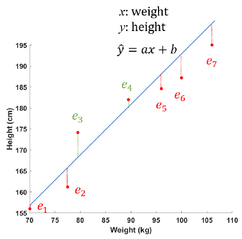

*그림 17. 몸무게와 키 데이터의 회귀 직선과 잔차*

그림 17은 몸무게 $x$(kg)로 키 $y$(cm)를 예측하는 회귀 직선 $\hat{y} = ax + b$와 일곱 샘플의 잔차 $e_1, \ldots, e_7$을 보인다. 점이 직선 위에 있으면 잔차가 양수(초록 $e_3$, $e_4$), 아래에 있으면 음수(빨강)이다. 잔차를 그대로 더하면 양수와 음수가 상쇄되므로, 제곱하여 더한 SSE로 직선이 데이터에 얼마나 맞지 않는지를 잰다. 제곱은 큰 오차에 더 큰 벌점을 주고 미분하기도 쉽다.

가장 적합한 직선을 찾으려면 SSE를 최소화해야 하며, 이 방법을 **최소제곱법(least squares method)** 이라고 한다. SSE는 $a$와 $b$의 함수이다.

$$
\mathrm{SSE}(a, b) = \sum_{i=1}^{n} (y_i - a x_i - b)^2
$$

최솟값에서는 두 편미분이 모두 0이어야 한다. 연쇄 법칙으로 각 항을 미분하면 $\frac{\partial}{\partial a}(y_i - ax_i - b)^2 = 2(y_i - ax_i - b)\cdot(-x_i)$, $\frac{\partial}{\partial b}(y_i - ax_i - b)^2 = 2(y_i - ax_i - b)\cdot(-1)$이므로 다음을 얻는다.

$$
\frac{\partial\,\mathrm{SSE}}{\partial a} = -2 \sum_{i=1}^{n} x_i (y_i - a x_i - b) = 0, \qquad \frac{\partial\,\mathrm{SSE}}{\partial b} = -2 \sum_{i=1}^{n} (y_i - a x_i - b) = 0
$$

양변을 $-2$로 나누고 항을 정리하면 **정규 방정식(normal equations)** 이 된다.

$$
a \sum_{i=1}^{n} x_i^2 + b \sum_{i=1}^{n} x_i = \sum_{i=1}^{n} x_i y_i, \qquad a \sum_{i=1}^{n} x_i + n b = \sum_{i=1}^{n} y_i
$$

둘째 식을 $n$으로 나누면 $b = \bar{y} - a\bar{x}$이다($\bar{x}$, $\bar{y}$는 평균). 이를 첫째 식에 대입하여 정리하면 피팅 직선의 $a$와 $b$를 얻을 수 있다.

$$
a = \frac{\sum_{i=1}^{n} (x_i - \bar{x})(y_i - \bar{y})}{\sum_{i=1}^{n} (x_i - \bar{x})^2}, \qquad b = \bar{y} - a \bar{x}
$$

> **[미적분학]** 미분 가능한 함수가 극값을 가지는 점에서는 모든 편미분이 0이다. SSE는 $a$와 $b$에 대한 아래로 볼록한 2차 함수이므로($x_i$가 모두 같지 않다면), 편미분이 0인 점이 하나뿐이고 그 점이 최솟값이다.

> **[선형대수학]** 다중 선형 회귀에서는 각 샘플의 특성 앞에 1을 붙인 행을 쌓은 행렬 $X$와 실제 값의 벡터 $\mathbf{y}$로 정규 방정식을 $X^{T} X \boldsymbol{\beta} = X^{T} \mathbf{y}$로 쓰고, $X^{T} X$가 역행렬을 가지면 계수 벡터는 $\boldsymbol{\beta} = (X^{T} X)^{-1} X^{T} \mathbf{y}$이다. 3주차의 역행렬과 연립일차방정식이 이 계산의 기초이다.

### 2.11 선형 회귀 예제

세 샘플 $(1, 2)$, $(2, 3)$, $(3, 5)$에 직선 $\hat{y} = ax + b$를 맞추고, $x = 1.5$일 때의 $y$값을 추정한다.

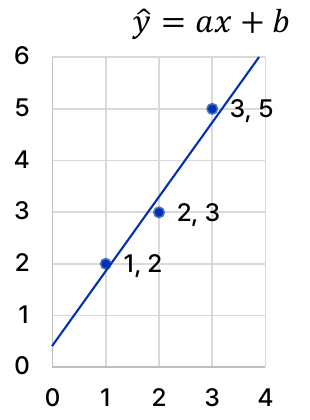

*그림 18. 세 샘플과 최소제곱 회귀 직선*

**1단계: SSE 세우기.** 각 샘플의 잔차는 $y_i - a x_i - b$이므로

$$
\mathrm{SSE} = \sum_{i=1}^{3} e_i^2 = (2 - a - b)^2 + (3 - 2a - b)^2 + (5 - 3a - b)^2
$$

이다.

**2단계: 편미분하여 0으로 놓기.**

$$
\frac{\partial\,\mathrm{SSE}}{\partial a} = -2\big[1 \cdot (2 - a - b) + 2(3 - 2a - b) + 3(5 - 3a - b)\big] = -2\big[23 - 14a - 6b\big] = 0
$$

$$
\frac{\partial\,\mathrm{SSE}}{\partial b} = -2\big[(2 - a - b) + (3 - 2a - b) + (5 - 3a - b)\big] = -2\big[10 - 6a - 3b\big] = 0
$$

첫째 식의 괄호 안은 상수항 $2 + 6 + 15 = 23$, $a$의 계수 $1 + 4 + 9 = 14$, $b$의 계수 $1 + 2 + 3 = 6$을 모은 것이다. 따라서 연립방정식은 다음과 같다.

$$
14a + 6b = 23, \qquad 6a + 3b = 10
$$

**3단계: 연립방정식 풀기.** 둘째 식에 2를 곱하면 $12a + 6b = 20$이고, 첫째 식에서 빼면 $2a = 3$이므로 $a = 1.5$이다. 둘째 식에 대입하면 $3b = 10 - 9 = 1$이므로 $b = 1/3 \approx 0.3333$이다. 평균을 쓰는 공식으로도 확인할 수 있다. $\bar{x} = 2$, $\bar{y} = 10/3$이고 $\sum (x_i - \bar{x})(y_i - \bar{y}) = (-1)(-\tfrac{4}{3}) + 0 + (1)(\tfrac{5}{3}) = 3$, $\sum (x_i - \bar{x})^2 = 1 + 0 + 1 = 2$이므로 $a = 3/2 = 1.5$, $b = 10/3 - 1.5 \times 2 = 1/3$이다.

**4단계: 추정.** 회귀 직선은 $\hat{y} = 1.5x + 0.3333$이고, $x = 1.5$에서의 추정값은

$$
\hat{y}(1.5) = 1.5 \times 1.5 + \frac{1}{3} = 2.25 + 0.3333 \approx 2.583
$$

이다.

| $x_i$ | $y_i$ | $\hat{y}_i = 1.5x_i + 1/3$ | 잔차 $e_i = y_i - \hat{y}_i$ | $e_i^2$ |
|:-----|:-----|:-----|:-----|:-----|
| 1 | 2 | 1.8333 | 0.1667 | 0.0278 |
| 2 | 3 | 3.3333 | $-0.3333$ | 0.1111 |
| 3 | 5 | 4.8333 | 0.1667 | 0.0278 |

*표 12. 선형 회귀 예제의 예측값과 잔차*

최소화된 오차 제곱합은 $\mathrm{SSE} = 0.0278 + 0.1111 + 0.0278 = 1/6 \approx 0.1667$이다. 잔차의 합은 $0.1667 - 0.3333 + 0.1667 = 0$인데, 이는 정규 방정식의 둘째 식 $\sum (y_i - a x_i - b) = 0$이 그대로 나타난 것이다.

---

<br>

## 3. 학습 타입 II: 모델 평가와 강화 학습

모델을 학습한 뒤에는 그 모델이 얼마나 좋은지 평가해야 한다. 이 절에서는 학습 오차와 시험 오차, 데이터를 학습, 검증, 시험용으로 나누는 방법, 회귀 모델을 평가하는 지표(결정계수, RMSE, 교차 검증)를 다루고, 마지막으로 세 번째 학습 타입인 강화 학습을 다룬다.

### 3.1 학습 오차와 손실 함수

**손실 함수(loss function)** $\mathrm{loss}(y_i, f(x_i))$는 샘플 하나에 대해 모델의 예측 $f(x_i)$가 실제 값 $y_i$와 얼마나 다른지를 수치로 나타낸다. 학습 데이터 전체의 손실을 더한 값을 **학습 오차(training error)** 또는 **경험적 오차(empirical error)** 라고 한다.

$$
E^{\text{train}}(f) = \sum_{i=1}^{n} \mathrm{loss}\big(y_i, f(x_i)\big)
$$

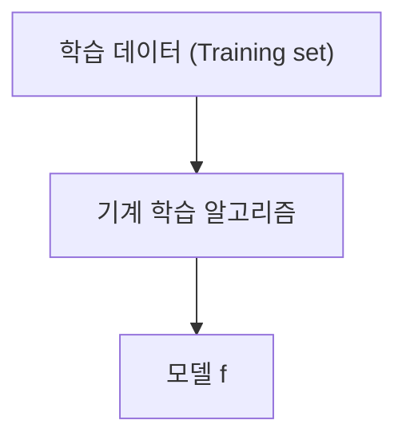

*그림 19. 학습 데이터에서 모델을 얻는 과정*

기계 학습 알고리즘은 그림 19처럼 학습 데이터를 받아 $E^{\text{train}}$을 작게 만드는 모델 $f$를 찾는다. 손실 함수의 대표적인 예는 다음 두 가지이다.

- **분류 오차(classification error):** 예측의 부호가 실제 레이블의 부호와 다르면 1, 같으면 0이다. 이를 0-1 손실이라고도 하며, 학습 오차는 잘못 분류한 샘플의 개수가 된다.

  $$
  \mathrm{loss}\big(y_i, f(x_i)\big) = \begin{cases} 1, & \operatorname{sign}(y_i) \ne \operatorname{sign}\big(f(x_i)\big) \\ 0, & \text{otherwise} \end{cases}
  $$

- **최소 제곱 손실(least squares loss):** 실제 값과 예측의 차이를 제곱한다. 이 손실을 쓰면 학습 오차는 2.10절의 SSE와 같다.

  $$
  \mathrm{loss}\big(y_i, f(x_i)\big) = \big(y_i - f(x_i)\big)^2
  $$

**예제.** 레이블이 $y = (+1, -1, +1, +1, -1)$인 다섯 샘플에 대해 모델의 출력이 $f(x) = (0.8, 0.3, -0.2, 1.5, -0.7)$이라 하자.

| 샘플 $i$ | $y_i$ | $f(x_i)$ | 분류 오차 | 최소 제곱 손실 $(y_i - f(x_i))^2$ |
|:-----|:-----|:-----|:-----|:-----|
| 1 | $+1$ | 0.8 | 0 | $0.2^2 = 0.04$ |
| 2 | $-1$ | 0.3 | 1 | $(-1.3)^2 = 1.69$ |
| 3 | $+1$ | $-0.2$ | 1 | $1.2^2 = 1.44$ |
| 4 | $+1$ | 1.5 | 0 | $(-0.5)^2 = 0.25$ |
| 5 | $-1$ | $-0.7$ | 0 | $(-0.3)^2 = 0.09$ |

*표 13. 다섯 샘플의 분류 오차와 최소 제곱 손실*

분류 오차로 잰 학습 오차는 부호가 틀린 샘플 2, 3의 개수인 $E^{\text{train}} = 2$이고, 최소 제곱 손실로 잰 학습 오차는 $0.04 + 1.69 + 1.44 + 0.25 + 0.09 = 3.51$이다. 샘플 4는 부호가 맞아 분류 오차는 0이지만, 1.5가 목표값 1에서 벗어나므로 제곱 손실은 0이 아니다. 손실 함수에 따라 같은 예측도 다르게 평가된다.

> **참고:** 학습 오차를 샘플 수 $n$으로 나눈 평균으로 정의하기도 한다. $n$은 상수이므로 합을 최소화하는 모델과 평균을 최소화하는 모델은 같다.

### 3.2 시험 오차, 과소적합, 과적합

모델을 학습할 때는 $E^{\text{train}}$을 최소화해야 하지만, 그것만으로는 충분하지 않다. 모델의 목적은 이미 본 데이터가 아니라 처음 보는 데이터를 잘 예측하는 것이므로, 학습에 쓰지 않은 데이터에서 잰 **표본 외 오차(out-of-sample error)**, 즉 **시험 오차(test error)** $E^{\text{test}}$ 역시 작아져야 한다. 학습에 쓰지 않은 데이터에서도 좋은 성능을 내는 능력을 **일반화(generalization)** 라고 한다.

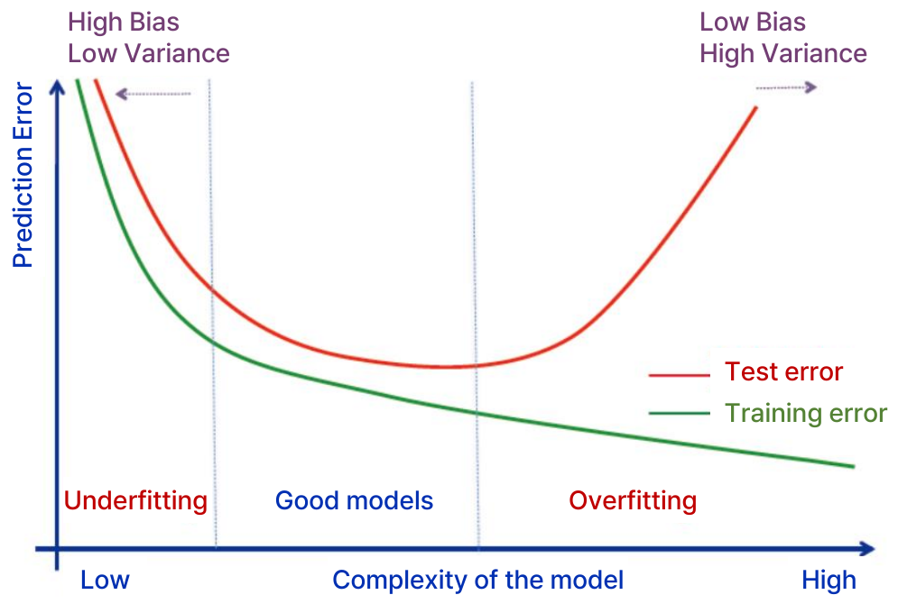

*그림 20. 모델 복잡도에 따른 학습 오차와 시험 오차*

그림 20의 가로축은 모델의 복잡도(낮음에서 높음), 세로축은 예측 오차이다. 초록 곡선인 학습 오차는 모델이 복잡해질수록 계속 줄어든다. 복잡한 모델일수록 학습 데이터에 더 정확히 맞출 수 있기 때문이다. 반면 빨간 곡선인 시험 오차는 처음에는 줄다가 어느 지점부터 다시 커지는 U자 모양이다. 이 곡선은 세 구간으로 나뉜다.

- **과소적합(underfitting):** 모델이 너무 단순하여 학습 데이터의 구조조차 표현하지 못한다. 학습 오차와 시험 오차가 모두 크다. 이 영역의 모델은 **편향(bias)** 이 높고 **분산(variance)** 이 낮다.
- **좋은 모델(good models):** 시험 오차가 가장 작은 영역으로, 데이터의 실제 구조를 잡아내면서 잡음에는 휘둘리지 않는다.
- **과적합(overfitting):** 모델이 너무 복잡하여 학습 데이터의 잡음까지 외운다. 학습 오차는 매우 작지만 시험 오차는 크다. 이 영역의 모델은 편향이 낮고 분산이 높다.

> **용어 정의:** 모델의 **편향(bias)** 은 모델이 너무 단순한 가정을 하여 생기는 체계적인 오차이고, **분산(variance)** 은 학습 데이터가 조금만 바뀌어도 학습된 모델이 크게 달라지는 정도이다. 복잡도를 높이면 편향은 줄고 분산은 커지므로, 둘 사이의 균형을 맞추어야 한다. 이를 **편향-분산 절충(bias-variance tradeoff)** 이라고 한다.

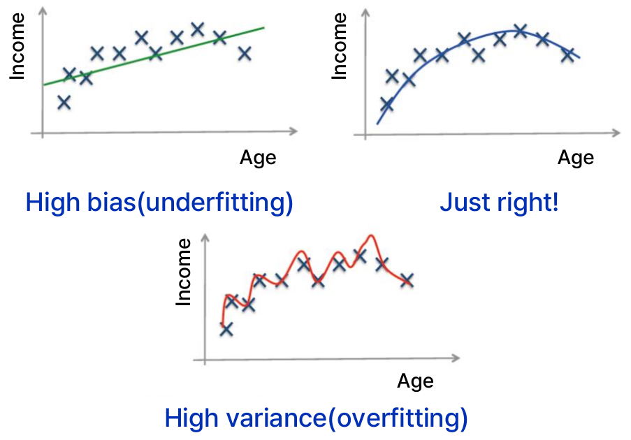

*그림 21. 과소적합, 적절한 적합, 과적합의 예*

그림 21은 나이(Age)로 소득(Income)을 예측하는 세 모델이다. 왼쪽 위의 직선은 나이가 들수록 소득이 오르다가 다시 줄어드는 추세를 잡지 못하는 높은 편향(과소적합) 모델이고, 오른쪽 위의 곡선은 추세를 알맞게 따르는 모델이다. 아래의 곡선은 모든 점을 지나려고 심하게 구불거리는 높은 분산(과적합) 모델로, 학습 데이터에서는 오차가 거의 없지만 새로운 사람의 소득은 오히려 잘 예측하지 못한다. 2.9절의 그림 16도 같은 세 경우를 보여 준다.

> **핵심:** 학습 오차가 작다고 시험 오차가 작은 것은 아니다. 모델의 성능은 반드시 학습에 쓰지 않은 데이터로 평가해야 하며, 학습 오차와 시험 오차의 차이가 크면 과적합을 의심한다.

> **참고:** 손실이 제곱 오차일 때, 새로운 입력에서의 기대 시험 오차는 모델의 편향의 제곱, 모델의 분산, 데이터 자체의 잡음 분산(어떤 모델로도 줄일 수 없는 오차)의 합으로 분해된다 [9]. 신경망에서 과적합을 줄이는 정규화 기법은 13주차에서 다룬다.

### 3.3 학습, 검증, 시험 데이터

모델을 고르고 평가하려면 가진 데이터를 용도에 따라 나눈다. 예를 들어 데이터를 무작위로 섞어 학습용 60%, 검증용 20%, 시험용 20%로 분할할 수 있다. 무작위로 나누는 것은 세 부분이 같은 분포를 따르게 하기 위해서이다.

```text
|<----------------- 60% ----------------->|<----- 20% ----->|<----- 20% ----->|
|           학습 데이터 (Train)           |  검증 (Valid.)  |   시험 (Test)   |
```

*그림 22. 학습, 검증, 시험 데이터의 분할 예*

| 데이터 | 역할 |
|:-----|:-----|
| **학습 데이터(training data)** | 모델을 학습하는 데 사용하는 데이터 세트이다. 예를 들어 분류 모델의 가중치를 이 데이터로 정한다. |
| **검증 데이터(validation data)** | 모델의 학습(가중치 결정)에는 사용하지 않지만, 모델의 초매개변수를 조정하고 여러 후보 모델 중 하나를 고르는 데 쓰는 데이터 세트이다. |
| **시험 데이터(test data)** | 최종 모델의 성능을 평가하고 시험 오차를 추정하는 데 사용하는 데이터 세트이다. |

*표 14. 학습, 검증, 시험 데이터의 역할*

> **용어 정의:** 모델의 **매개변수(parameter)** 는 선형 회귀의 계수나 신경망의 가중치처럼 학습 데이터로부터 학습되는 값이다. **초매개변수(hyperparameter)** 는 k-NN의 $k$, 다항식 회귀의 차수, 신경망의 층 수처럼 학습 전에 사람이 정하는 값으로, 검증 데이터에서의 성능을 비교하여 고른다.

예를 들어 k-NN의 $k$를 정할 때는 $k = 1, 3, 5, \ldots$마다 학습 데이터로 분류기를 만들고, 검증 데이터에서 오차가 가장 작은 $k$를 고른다. 그 다음 고른 모델을 시험 데이터에 한 번 적용하여 최종 성능을 보고한다.

> **주의:** 매개변수를 추가로 조정하거나 모델을 수정하기 위해 어떤 방식으로든 시험 데이터를 사용해서는 안 된다. 시험 데이터의 결과를 보고 모델을 고치면 그 시험 데이터는 사실상 학습에 쓰인 것이 되어, 시험 오차가 실제로 새 데이터에서 나올 오차보다 낙관적으로 추정된다.

### 3.4 평가 지표

회귀 모델을 평가하는 데 쓰는 세 가지 **평가 지표(evaluation metric)** 를 비교하면 다음과 같다.

| 지표 | 식 | 특징 |
|:-----|:-----|:-----|
| 결정계수 $R^2$ | $1 - \dfrac{\sum_i (y_i - \hat{y}_i)^2}{\sum_i (y_i - \bar{y})^2}$ | 이미 확보한 데이터로 측정할 수 있다. 회귀 모델에서 사용한다. |
| RMSE | $\sqrt{\dfrac{1}{N_{\text{test}}} \sum_{i=1}^{N_{\text{test}}} \big(y(x_i) - \hat{y}(x_i)\big)^2}$ | 추가적인 시험 데이터가 필요하다. 큰 오차에 더 많은 가중치를 두어 큰 오류를 강조한다. 원래 데이터와 단위가 같아 해석하기 쉽다. |
| 교차 검증 | $e_{cv}(j) = \mathbf{Y}^{(j)} - \hat{\mathbf{y}}_{-j}\big(\mathbf{X}^{(j)}\big)$ | 이미 확보한 데이터로 측정할 수 있다. 데이터 세트를 여러 부분으로 나누어 모델을 평가하므로 과적합을 막는 데 도움이 된다. |

*표 15. 세 가지 평가 지표의 비교*

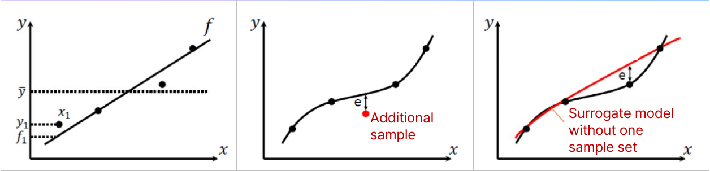

*그림 23. 결정계수, RMSE, 교차 검증이 측정하는 오차*

그림 23의 왼쪽은 결정계수로, 데이터 점과 회귀 직선 $f$ 사이의 차이($y_1 - f_1$ 등)를 데이터 점과 평균 $\bar{y}$ 사이의 차이와 비교한다. 가운데는 RMSE로, 모델을 만들 때 쓰지 않은 추가 샘플(빨간 점)에서 예측 곡선과의 오차 $e$를 잰다. 오른쪽은 교차 검증으로, 샘플 하나(또는 한 묶음)를 빼고 만든 대리 모델(surrogate model, 빨간 곡선)이 뺀 샘플 위치에서 내는 오차 $e$를 잰다. 대리 모델은 실제 함수를 근사하는 모델을 말한다.

### 3.5 결정계수

**결정계수(coefficient of determination)** $R^2$은 회귀선(regression line)이 데이터에 얼마나 잘 맞는지 측정하는 값이다.

$$
R^2 = 1 - \frac{SS_{\text{RES}}}{SS_{\text{TOT}}} = 1 - \frac{\sum_i (y_i - \hat{y}_i)^2}{\sum_i (y_i - \bar{y})^2}
$$

- $SS_{\text{RES}} = \sum_i (y_i - \hat{y}_i)^2$는 **잔차 제곱합(residual sum of squares)** 으로, 모델이 설명하지 못하고 남은 변동이다.
- $SS_{\text{TOT}} = \sum_i (y_i - \bar{y})^2$는 **전체 제곱합(total sum of squares)** 으로, 데이터가 평균 주위에 흩어진 정도이다. 입력을 전혀 보지 않고 항상 평균 $\bar{y}$를 예측하는 모델의 오차 제곱합과 같다.

따라서 $R^2$은 실제 값의 전체 변동 가운데 모델이 설명하는 비율이다. $R^2 = 1$이면 모든 예측이 실제 값과 같고, $R^2 = 0$이면 모델이 평균을 예측하는 것보다 나을 것이 없다.

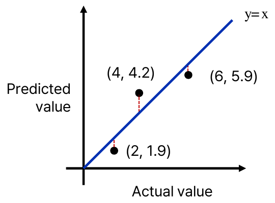

*그림 24. 실제 값과 예측값으로 본 결정계수 예제*

**예제.** 그림 24는 실제 값(가로축)이 2, 4, 6인 세 샘플에 대해 모델이 1.9, 4.2, 5.9를 예측한 결과이다. 대각선 $y = x$ 위의 점은 예측이 정확한 경우이고, 빨간 점선이 각 오차이다.

| $i$ | 실제 값 $y_i$ | 예측값 $\hat{y}_i$ | $y_i - \hat{y}_i$ | $(y_i - \hat{y}_i)^2$ | $y_i - \bar{y}$ | $(y_i - \bar{y})^2$ |
|:-----|:-----|:-----|:-----|:-----|:-----|:-----|
| 1 | 2 | 1.9 | 0.1 | 0.01 | $-2$ | 4 |
| 2 | 4 | 4.2 | $-0.2$ | 0.04 | 0 | 0 |
| 3 | 6 | 5.9 | 0.1 | 0.01 | 2 | 4 |

*표 16. 결정계수 예제의 계산*

평균은 $\bar{y} = (2 + 4 + 6)/3 = 4$이고, $SS_{\text{RES}} = 0.01 + 0.04 + 0.01 = 0.06$, $SS_{\text{TOT}} = 4 + 0 + 4 = 8$이다. 따라서

$$
R^2 = 1 - \frac{0.06}{8} = 1 - 0.0075 = 0.9925
$$

이며, 모델이 실제 값 변동의 99.25%를 설명한다. 2.11절의 선형 회귀 예제에 적용하면 $SS_{\text{RES}} = 1/6$, $\bar{y} = 10/3$, $SS_{\text{TOT}} = (-\tfrac{4}{3})^2 + (-\tfrac{1}{3})^2 + (\tfrac{5}{3})^2 = 14/3$이므로 $R^2 = 1 - (1/6)/(14/3) = 1 - 1/28 = 27/28 \approx 0.964$이다.

> **주의:** $R^2$이 0에서 1 사이에 있다는 성질은 절편이 있는 선형 회귀를 최소제곱법으로 맞추고 같은 학습 데이터에서 잴 때 성립한다. 시험 데이터에서 재거나 다른 방식으로 만든 모델에 적용하면, 모델이 평균보다 못한 예측을 할 때 $SS_{\text{RES}} > SS_{\text{TOT}}$가 되어 $R^2$이 음수가 될 수 있다.

**R 값.** 회귀 결과를 보고할 때는 결정계수와 함께 실제 값과 예측값 사이의 **상관계수(correlation coefficient)** $R$을 쓰는 경우가 많다. 예를 들어 MATLAB의 신경망 회귀 그래프는 출력과 목표값 사이의 $R$ 값을 표시하며, $R = 1$이면 둘 사이에 정확한 선형 관계가 있고 $R$이 0에 가까우면 선형 관계가 없음을 뜻한다 [10].

> **[확률및통계]** 두 변수 $u$, $v$의 표본 상관계수는 $r = \dfrac{\sum_i (u_i - \bar{u})(v_i - \bar{v})}{\sqrt{\sum_i (u_i - \bar{u})^2}\sqrt{\sum_i (v_i - \bar{v})^2}}$이며 $-1 \le r \le 1$이다. 절편이 있는 단순 선형 회귀를 최소제곱법으로 맞추면 결정계수는 $x$와 $y$의 상관계수의 제곱과 같다($R^2 = r^2$) [9]. 2.11절의 예제에서 $r^2 = 27/28$로 결정계수와 같다. 반면 그림 24처럼 예측값이 최소제곱 직선에서 나온 것이 아니면 둘이 일치하지 않는다. 그림 24의 데이터에서 $r = 8 / \sqrt{8 \times 8.06} \approx 0.9963$, $r^2 \approx 0.9926$으로 $R^2 = 0.9925$와 조금 다르다.

### 3.6 평균 제곱근 오차

**평균 제곱근 오차(root mean square error, RMSE)** 는 오차의 제곱을 평균한 뒤 제곱근을 취한 값이다.

$$
\mathrm{RMSE} = \sqrt{\frac{1}{n} \sum_{i=1}^{n} (\hat{y}_i - y_i)^2}
$$

제곱근을 취하므로 RMSE는 원래 데이터와 단위가 같다. 예를 들어 키를 cm로 예측하는 모델의 RMSE가 3이면 예측 오차의 전형적인 크기가 약 3 cm라고 해석할 수 있다. 오차의 절댓값의 평균(평균 절대 오차)은 RMSE보다 크지 않다. RMSE는 0 이상이며 0이면 모든 예측이 정확하다. RMSE는 보통 모델을 만들 때 쓰지 않은 추가 시험 데이터에서 계산하여 모델의 예측 능력을 잰다.

**예제.** 그림 24의 세 샘플에서 오차는 0.1, $-0.2$, 0.1이므로

$$
\mathrm{RMSE} = \sqrt{\frac{0.1^2 + (-0.2)^2 + 0.1^2}{3}} = \sqrt{\frac{0.06}{3}} = \sqrt{0.02} \approx 0.1414
$$

이다.

오차를 제곱하므로 RMSE는 큰 오차에 더 많은 가중치를 둔다. 오차의 절댓값을 평균하는 **평균 절대 오차(mean absolute error, MAE)** 와 비교하면 차이가 분명하다. 네 샘플의 오차가 $(1, 1, 1, 1)$이면 MAE와 RMSE가 모두 1이다. 오차가 $(0, 0, 0, 4)$이면 MAE는 $4/4 = 1$로 같지만 RMSE는 $\sqrt{16/4} = 2$로 두 배가 된다. 따라서 RMSE는 가끔 생기는 큰 오류를 강조하여 드러낸다.

### 3.7 교차 검증

**교차 검증(cross-validation)** 은 모델의 결과가 주어진 데이터 세트 밖의 데이터에 얼마나 잘 일반화될 수 있는지 평가하는 모델 검증 방법이다. 데이터가 적어 별도의 시험 데이터를 떼어 두기 어려울 때, 추가적인 샘플 없이 가진 데이터만으로 시험 오차를 추정하기 위해 널리 쓰인다.

**k-겹 교차 검증(k-fold cross-validation)** 은 $N$개의 샘플로 이루어진 데이터 세트를 크기가 비슷한 $k$개의 하위 세트(fold)로 나눈다. $j$번째 반복에서는 $j$번째 하위 세트를 시험용(test fold)으로 남기고 나머지 $k - 1$개(training fold)로 모델을 학습한 뒤, 남겨 둔 하위 세트에서 오차 $E_j$를 잰다. 이를 $j = 1, \ldots, k$에 대해 반복하고 평균을 낸다.

$$
E = \frac{1}{k} \sum_{j=1}^{k} E_j
$$

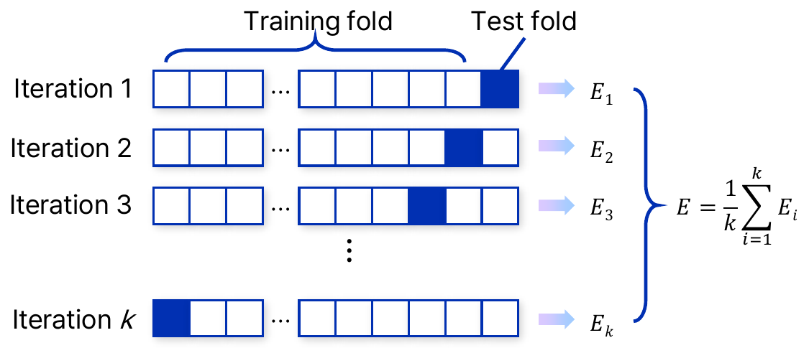

*그림 25. k-겹 교차 검증의 반복 과정*

그림 25에서 각 줄은 한 번의 반복이고, 진하게 칠한 칸이 그 반복의 시험용 하위 세트이다. 모든 샘플이 정확히 한 번씩 시험에 쓰이므로, 데이터를 한 번만 나누어 평가할 때보다 분할 방식의 우연에 덜 좌우되는 안정적인 추정을 얻는다. 이 추정으로 모델이나 초매개변수를 고르면 학습 데이터에만 잘 맞는 과적합 모델을 피하는 데 도움이 된다.

$j$번째 하위 세트에서의 교차 검증 오차 $e_{cv}$는 다음과 같이 정의된다.

$$
e_{cv}(j) = \mathbf{Y}^{(j)} - \hat{\mathbf{y}}_{-j}\big(\mathbf{X}^{(j)}\big), \qquad j = 1, 2, \ldots, k
$$

여기서 $\mathbf{X}^{(j)}$는 남겨 둔 $j$번째 하위 세트의 입력, $\mathbf{Y}^{(j)}$는 그 하위 세트의 실제 값이고, $\hat{\mathbf{y}}_{-j}\big(\mathbf{X}^{(j)}\big)$는 $j$번째 하위 세트를 제외하고 만든 모델이 남겨 둔 입력 $\mathbf{X}^{(j)}$에 대해 내는 예측값이다. 아래 첨자 $-j$는 "$j$번째를 뺀"이라는 뜻이다.

> **용어 정의:** $k = N$, 즉 하위 세트 하나에 샘플이 하나씩 들어가면 샘플 하나를 빼고 나머지 $N - 1$개로 학습하는 일을 $N$번 반복한다. 이를 **하나 남기기 교차 검증(leave-one-out cross-validation, LOOCV)** 이라고 한다. 실무에서는 계산량과 추정의 안정성을 함께 고려하여 $k = 5$나 $k = 10$을 많이 쓴다 [9].

### 3.8 교차 검증 예제

**예제 1: Branin-Hoo 함수.** Branin-Hoo 함수는 최적화와 대리 모델 연구에서 시험용으로 널리 쓰는 2변수 함수이다 [11].

$$
f(x_1, x_2) = \left(x_2 - \frac{5.1}{4\pi^2} x_1^2 + \frac{5}{\pi} x_1 - 6\right)^2 + 10\left(1 - \frac{1}{8\pi}\right)\cos x_1 + 10
$$

보통 $x_1 \in [-5, 10]$, $x_2 \in [0, 15]$에서 정의한다. 이 함수에서 얻은 10개의 학습 샘플 $X_1, \ldots, X_{10}$로 하나 남기기 교차 검증을 한다. 각 $X_j$에서의 예측은 $X_j$를 뺀 나머지 9개의 샘플로 만든 대리 모델이 낸 값이다.

| 학습 샘플 | 실제 응답 $y_j$ | 나머지 9개로 만든 모델의 예측 | 오차 $e_j$ (실제 $-$ 예측) | $e_j^2$ | $(e_j / y_j)^2$ |
|:-----|:-----|:-----|:-----|:-----|:-----|
| $X_1$ | 23.41 | 31.25 | $-7.84$ | 61.47 | 0.1122 |
| $X_2$ | 118.1 | 126.1 | $-8.00$ | 64.00 | 0.0046 |
| $X_3$ | 69.99 | 52.97 | 17.02 | 289.68 | 0.0591 |
| $X_4$ | 62.02 | 98.57 | $-36.55$ | 1335.90 | 0.3473 |
| $X_5$ | 223.3 | 159.9 | 63.40 | 4019.56 | 0.0806 |
| $X_6$ | 33.16 | 57.90 | $-24.74$ | 612.07 | 0.5566 |
| $X_7$ | 155.9 | 120.4 | 35.50 | 1260.25 | 0.0519 |
| $X_8$ | 72.71 | 92.65 | $-19.94$ | 397.60 | 0.0752 |
| $X_9$ | 13.42 | $-20.89$ | 34.31 | 1177.18 | 6.5364 |
| $X_{10}$ | 16.89 | 91.61 | $-74.72$ | 5583.08 | 19.5711 |

*표 17. Branin-Hoo 함수의 하나 남기기 교차 검증 결과*

이 결과로 세 가지 교차 검증 오차(cross-validation error, CVE)를 계산한다. 여기서 $N_{\text{test}} = 10$이다.

**(1) 평균 제곱근 CVE.** 오차 제곱의 합은 $61.47 + 64.00 + \cdots + 5583.08 = 14800.78$이므로

$$
E = \sqrt{\frac{1}{N_{\text{test}}} \sum_{j=1}^{N_{\text{test}}} e_j^2} = \sqrt{\frac{14800.78}{10}} = \sqrt{1480.08} \approx 38.47
$$

이다. 이는 3.6절의 RMSE를 교차 검증 오차에 적용한 것이다.

**(2) 상대 평균 제곱근 CVE.** 각 오차를 실제 값으로 나눈 상대 오차의 제곱을 평균한다. 표 17의 마지막 열의 합은 27.39이므로

$$
E_{\text{rel}} = \sqrt{\frac{1}{N_{\text{test}}} \sum_{j=1}^{N_{\text{test}}} \frac{e_j^2}{y_j^2}} = \sqrt{\frac{27.39}{10}} = \sqrt{2.739} \approx 1.655
$$

이다. 상대 오차는 실제 값이 작은 샘플에서 커진다. $X_9$와 $X_{10}$은 실제 값이 13.42, 16.89로 작아서 두 샘플의 항(6.5364와 19.5711)이 합 27.39의 약 95%를 차지한다.

> **참고:** 상대 평균 제곱근 CVE의 값으로 5.234가 제시되기도 하는데, 이는 $1/N_{\text{test}}$를 빼고 계산한 $\sqrt{\sum_j e_j^2 / y_j^2} = \sqrt{27.39} \approx 5.234$이다. 위의 정의대로 평균을 취하면 1.655이다.

**(3) 정규화 평균 제곱근 CVE.** 평균 제곱근 CVE를 실제 값의 범위로 나누어, 오차가 출력 범위의 몇 퍼센트인지 나타낸다.

$$
E_{\text{norm}} = \frac{\sqrt{\frac{1}{N_{\text{test}}} \sum_{j=1}^{N_{\text{test}}} e_j^2}}{\max(y_j) - \min(y_j)} = \frac{38.47}{223.3 - 13.42} = \frac{38.47}{209.88} \approx 0.1833
$$

평균적인 예측 오차가 출력 범위의 약 18%에 이르므로, 이 대리 모델은 아직 정확하다고 하기 어렵다. 예측 모델의 정확성을 높이려면 더 많은 샘플이 필요하다.

**예제 2: 세 샘플의 하나 남기기 교차 검증.** 세 샘플 $(0, 0)$, $(1, 2)$, $(2, 3)$에 대해 CVE 제곱의 평균을 추정한다. 모델은 남은 두 점을 지나는 직선, 즉 선형 보간(interpolation)이다.

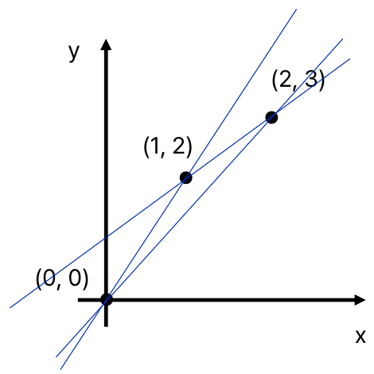

*그림 26. 샘플 하나를 뺀 세 보간 직선*

- **$(0, 0)$을 뺄 때:** $(1, 2)$와 $(2, 3)$을 지나는 직선은 기울기 $(3 - 2)/(2 - 1) = 1$, 절편 $2 - 1 = 1$이므로 $\hat{y} = x + 1$이다. $x = 0$에서 예측은 1이므로 오차는 $0 - 1 = -1$이다.
- **$(1, 2)$를 뺄 때:** $(0, 0)$과 $(2, 3)$을 지나는 직선은 $\hat{y} = 1.5x$이다. $x = 1$에서 예측은 1.5이므로 오차는 $2 - 1.5 = 0.5$이다.
- **$(2, 3)$을 뺄 때:** $(0, 0)$과 $(1, 2)$를 지나는 직선은 $\hat{y} = 2x$이다. $x = 2$에서 예측은 4이므로 오차는 $3 - 4 = -1$이다.

| 뺀 샘플 | 보간 직선 | 예측 | 오차 $e_j$ | $e_j^2$ |
|:-----|:-----|:-----|:-----|:-----|
| $(0, 0)$ | $\hat{y} = x + 1$ | 1 | $-1$ | 1 |
| $(1, 2)$ | $\hat{y} = 1.5x$ | 1.5 | 0.5 | 0.25 |
| $(2, 3)$ | $\hat{y} = 2x$ | 4 | $-1$ | 1 |

*표 18. 세 샘플의 하나 남기기 교차 검증*

CVE 제곱의 평균은 $(1 + 0.25 + 1)/3 = 2.25/3 = 0.75$이고, 그 제곱근인 평균 제곱근 CVE는 $\sqrt{0.75} \approx 0.866$이다. 세 직선이 서로 크게 다르다는 것은 샘플이 적을 때 모델이 데이터 한 점에 크게 좌우된다는 뜻이다.

### 3.9 강화 학습

> **용어 정의:** **강화 학습(reinforcement learning)** 은 에이전트가 환경과 상호 작용하면서 결정을 내리는 방법을 배우는 학습 패러다임이다.

강화 학습의 목표는 시간에 따라 받는 보상의 합을 최대화하는 것이다.

$$
\text{Maximize} \ \sum_{i=1}^{\infty} \text{Reward}(\text{State}_i, \text{Action}_i)
$$

지도 학습과 달리 강화 학습에는 상태마다 정답 행동을 알려 주는 레이블이 없다. 학습에 쓰는 데이터는 에이전트가 직접 행동하여 얻는다. 상태 $\text{State}_i$에서 행동 $\text{Action}_i$를 하면 환경이 보상과 다음 상태를 돌려준다.

$$
\text{Reward}_i, \ \text{State}_{i+1} = \text{Interact}(\text{State}_i, \text{Action}_i)
$$

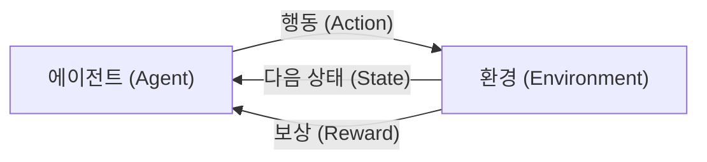

*그림 27. 강화 학습에서 에이전트와 환경의 상호 작용*

| 구성 요소 | 의미 |
|:-----|:-----|
| **에이전트(agent)** | 의사결정을 학습하는 개체이다. 상태를 관찰하고 환경과 상호 작용하는 행동을 선택한다. |
| **환경(environment)** | 에이전트가 상호 작용하는 외부 시스템이다. 에이전트로부터 행동을 받아 새로운 상태로 전환하고, 보상의 형태로 피드백을 준다. |
| **상태(state)** | 주어진 시간의 환경을 표현한 것이다. |
| **행동(action)** | 현재 상태를 기반으로 에이전트가 내린 결정이다. 행동에 따라 환경의 상태가 바뀔 수 있다. |
| **보상(reward)** | 에이전트의 행동이 얼마나 바람직한지를 나타내는 수치이다. |

*표 19. 강화 학습의 구성 요소*

강화 학습의 결과로 에이전트가 얻는 것은 각 상태에서 어떤 행동을 할지 정한 규칙이며, 이를 **정책(policy)** 이라고 한다 [12]. 그림 27은 그림 5의 자동차 예와 같다. 자동차(에이전트)는 트랙(환경)에서 현재 위치와 속도(상태)를 보고 조향과 가속(행동)을 정하며, 트랙을 벗어나지 않고 빨리 달릴수록 큰 보상을 받는다.

> **참고:** 보상을 무한히 더하면 합이 발산할 수 있으므로 보통 **할인율(discount factor)** $\gamma$ $(0 \le \gamma < 1)$를 곱한 **반환값(return)** $G = \sum_{t=0}^{\infty} \gamma^{t} r_{t+1}$을 최대화한다 [12]. 여기서 $r_{t+1}$은 $t$번째 행동 뒤에 받는 보상이다. $\gamma < 1$이면 보상이 유계일 때 합이 유한하고, 같은 보상이라도 일찍 받을수록 더 큰 가치를 가진다.

### 3.10 강화 학습의 사례

**Atari 게임.** 딥마인드의 DQN(deep Q-network)은 Atari 2600 비디오 게임 49개에 같은 모델 구조와 같은 초매개변수를 그대로 적용하여 학습했다 [13]. Atari는 미국의 비디오 게임 회사이다. 이 문제에서 강화 학습의 요소는 다음과 같다.

- **상태:** 게임 화면의 원시 픽셀(raw pixels)
- **행동:** 그 게임에서 가능한 조작(valid moves)
- **보상:** 게임 점수(game score)

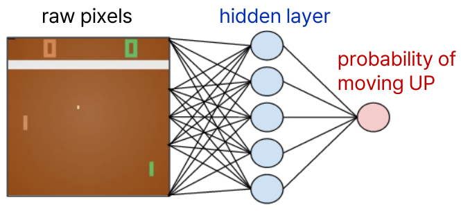

*그림 28. 게임 화면의 픽셀에서 행동을 고르는 신경망*

그림 28은 탁구 게임(Pong) 화면의 픽셀을 입력으로 받아 은닉층을 거쳐 라켓을 위로 움직일 확률을 출력하는 신경망을 단순하게 나타낸 것이다. 사람이 게임 규칙이나 공의 위치를 따로 알려 주지 않고, 화면 픽셀과 점수만으로 어떤 행동이 좋은지를 배운다.

> **[딥러닝]** 실제 DQN은 최근 네 프레임의 화면을 쌓은 입력을 합성곱 신경망(CNN)으로 처리하고, 확률 대신 가능한 행동마다 앞으로 받을 보상의 기댓값(행동 가치)을 출력하여 그중 가장 큰 행동을 고른다 [13]. 인공신경망의 기본 구조는 13주차에서 다룬다.

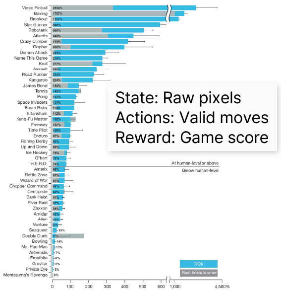

*그림 29. Atari 게임별 DQN의 성능*

그림 29의 막대는 게임별 점수를 무작위로 조작할 때의 점수가 0%, 전문 게임 테스터의 점수가 100%가 되도록 정규화한 것이다 [13]. 파란 막대가 DQN, 회색 막대가 기존의 가장 좋은 선형 학습기(best linear learner)이다. 가로선 위쪽의 게임은 사람 수준(75%) 이상, 아래쪽은 사람 수준 미만이다. DQN은 Video Pinball, Boxing, Breakout 같은 게임에서 사람보다 훨씬 높은 점수를 얻었고 49개 중 29개 게임에서 사람 수준 이상에 이르렀지만, Montezuma's Revenge처럼 오랜 시간에 걸친 계획이 필요한 게임에서는 거의 점수를 얻지 못했다 [13].

**바둑.** 강화 학습은 검색 공간이 너무 커서 어려운 게임에서도 인간을 이기는 방법을 배웠다.

- 딥마인드의 AlphaGo Zero는 사람의 기보 없이 스스로 대국하는 강화 학습만으로 학습하여, 사람의 기보로 지도 학습한 이전 버전을 크게 능가했다 [14].
- 같은 계열의 알고리즘인 AlphaZero는 게임 규칙만 주어진 상태에서 시작하여 24시간 안에 체스, 쇼기, 바둑에서 초인적인 수준에 도달했다 [15].

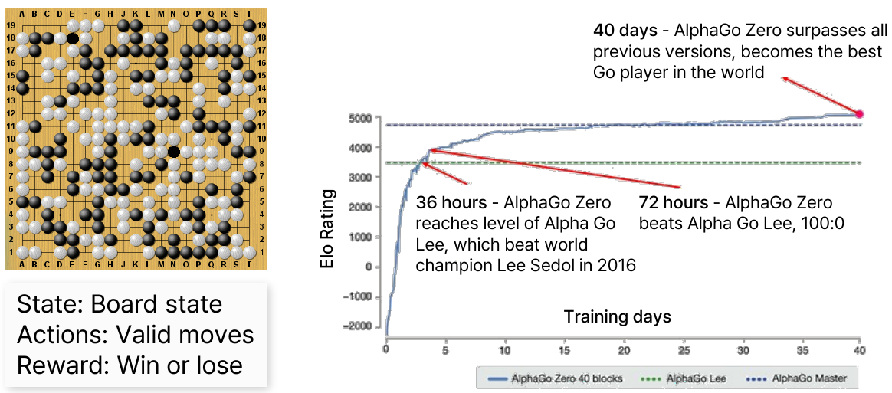

*그림 30. AlphaGo Zero의 학습 일수에 따른 Elo 등급*

바둑에서 상태는 바둑판의 상태(board state), 행동은 둘 수 있는 자리(valid moves), 보상은 승리 또는 패배(win or lose)이다. 그림 30의 세로축은 대국 결과로부터 상대적인 실력을 수치로 나타내는 **Elo 등급(Elo rating)** 이고, 가로축은 학습 일수이다. AlphaGo Zero는 학습 36시간 만에 2016년 세계 챔피언 이세돌을 이긴 AlphaGo Lee의 수준에 이르렀고, 72시간 뒤에는 AlphaGo Lee를 100:0으로 이겼으며, 40일 뒤에는 AlphaGo Master를 포함한 이전의 모든 버전을 넘어섰다 [14].

> **[인공지능]** 바둑은 한 수마다 고를 수 있는 자리가 평균 약 250개로 체스(약 35개)보다 훨씬 많아, 가능한 수를 모두 내다보는 게임 트리 탐색으로는 풀 수 없다 [16]. AlphaGo Zero는 신경망으로 국면의 가치와 유망한 수를 평가하여 탐색할 가지를 크게 줄였다 [14].

### 3.11 격자 세계 예제

강화 학습을 간단한 예제로 정리한다. 에이전트는 $3 \times 3$ 격자로 된 지도 위를 움직이며, 목적은 9번 칸의 보물 상자에 도달하는 것이다.

- **상태:** 지도에서의 위치 $\lbrace1, 2, \ldots, 9\rbrace$
- **행동:** 지도 안에서의 이동(위, 오른쪽 등)과 제자리에 머무르기
- **보상:** 보물 상자에 도달하면 100, 그 외에는 0

```text
┌──────────┬──────────┬──────────┐
│ 7    →   │ 8    →   │ 9    ★   │
├──────────┼──────────┼──────────┤
│ 4    →   │ 5    ↑   │ 6    ↑   │
├──────────┼──────────┼──────────┤
│ 1    ↑   │ 2    →   │ 3    ↑   │
└──────────┴──────────┴──────────┘
```

*그림 31. 격자 세계와 각 상태에서 고른 행동 (★: 보물 상자)*

그림 31의 화살표는 각 상태에서 에이전트가 고르는 행동이다. 상태 $s$에서의 행동을 $A_s$로 쓰면 $A_1 = \lbrace\text{up}\rbrace$, $A_2 = \lbrace\text{right}\rbrace$, $A_3 = \lbrace\text{up}\rbrace$, $\ldots$, $A_9 = \lbrace\text{stay}\rbrace$이며, 이 아홉 개의 행동을 모은 것이 3.9절의 정책이다.

| 상태 | 행동 | 다음 상태 | 9번 칸까지의 이동 횟수 |
|:-----|:-----|:-----|:-----|
| 1 | up | 4 | 4 |
| 2 | right | 3 | 3 |
| 3 | up | 6 | 2 |
| 4 | right | 5 | 3 |
| 5 | up | 8 | 2 |
| 6 | up | 9 | 1 |
| 7 | right | 8 | 2 |
| 8 | right | 9 | 1 |
| 9 | stay | 9 | 0 |

*표 20. 격자 세계 정책의 행동과 이동 횟수*

상태 1에서 출발하면 $1 \to 4 \to 5 \to 8 \to 9$로 네 번 이동하여 보물에 도달한다. 보물에 도달하면 한 번의 시도(에피소드)가 끝난다고 하면, 할인하지 않을 때는 보물이 아닌 어느 상태에서 출발하든 반환값이 100으로 같다. 할인율 $\gamma = 0.9$를 쓰면 보상을 받는 시점에 따라 반환값이 달라진다. 상태 1에서는 네 번째 이동에서 보상을 받으므로 $G = \gamma^{3} \times 100 = 0.729 \times 100 = 72.9$이고, 상태 2에서는 $\gamma^{2} \times 100 = 81$, 상태 7에서는 $\gamma \times 100 = 90$, 상태 6과 8에서는 100이다.

그림 31의 정책은 모든 상태에서 보물까지 가장 적은 횟수로 이동하므로, $\gamma < 1$일 때 반환값을 최대로 하는 최적 정책 가운데 하나이다. 상태 1에서 $1 \to 2 \to 3 \to 6 \to 9$로 가도 이동 횟수가 4로 같으므로 최적 정책은 하나뿐이 아니다. 강화 학습의 에이전트는 이러한 정책을 미리 알지 못하고, 여러 번 움직여 보며 받은 보상으로부터 어떤 상태에서 어떤 행동이 보물로 이어지는지를 스스로 학습한다.

---

<br>

## 개념 적용

| 상황 | 결과와 이유 |
|:-----|:------------|
| 고객의 구매 기록만 있고 고객 유형에 대한 정답이 없을 때 비슷한 고객끼리 묶으려 한다. | **비지도 학습(군집화).** 레이블이 없으므로 K-평균 군집화 같은 방법으로 데이터 자체의 구조를 찾는다. |
| 스팸 여부가 표시된 메일 10,000통으로 새 메일을 분류하려 한다. | **지도 학습(이진 분류).** 레이블이 있고 레이블이 이산적인 두 값이므로 k-NN, SVM 같은 분류기를 학습한다. |
| 과일의 길이와 너비로 무게(g)를 예측하려 한다. | **지도 학습(회귀).** 레이블인 무게가 실수이므로 선형 회귀 같은 회귀 모델을 쓰고 RMSE나 $R^2$으로 평가한다. |
| 로봇이 넘어지지 않고 걷는 법을 시행착오로 익히게 하려 한다. | **강화 학습.** 동작마다 정답이 주어지지 않고, 넘어지지 않고 전진한 정도를 보상으로 주어 정책을 학습한다. |
| K-평균 군집화를 두 번 실행했더니 결과가 다르다. | **초기 중심이 달라 서로 다른 지역 최솟값에 수렴했다.** 여러 번 실행하여 군집 내 제곱합 $J$가 가장 작은 결과를 고른다. |
| 다항식 회귀의 차수를 올렸더니 학습 오차는 0에 가까워졌지만 시험 오차는 커졌다. | **과적합이다.** 모델이 학습 데이터의 잡음까지 외웠으므로 차수를 낮추거나 검증 데이터로 차수를 고른다. |
| 시험 데이터의 결과를 보고 k-NN의 $k$를 다시 골랐다. | **시험 오차가 낙관적으로 추정된다.** 시험 데이터가 모델 선택에 쓰였으므로 $k$는 검증 데이터나 교차 검증으로 골라야 한다. |
| 샘플이 20개뿐이라 시험 데이터를 따로 떼기 어렵다. | **k-겹 교차 검증이나 하나 남기기 교차 검증을 쓴다.** 모든 샘플이 한 번씩 시험에 쓰이므로 적은 데이터로도 시험 오차를 추정할 수 있다. |

*표 21. 학습 타입과 평가 방법을 적용한 상황별 판단*

**T/F 점검:**

| 문장 | 판단과 근거 |
|:-----|:------------|
| 모든 인공지능 기법은 기계 학습이다. | **F.** 기계 학습은 인공지능의 하위 분야이다. 사람이 규칙을 직접 작성한 전문가 시스템도 인공지능이지만 학습하지 않는다. |
| 단층 퍼셉트론은 XOR 문제를 풀 수 있다. | **F.** XOR의 두 부류는 직선 하나로 나뉘지 않는다. 은닉층이 있는 다층 신경망이 필요하다. |
| K-평균 군집화는 항상 군집 내 제곱합의 전역 최솟값을 찾는다. | **F.** 각 단계가 $J$를 늘리지 않아 수렴은 하지만, 초기 중심에 따라 지역 최솟값에 머물 수 있다. |
| k-NN의 학습 단계에서는 거리를 계산하지 않는다. | **T.** 학습 단계에서는 데이터를 저장만 하고, 거리는 예측할 때 계산한다. |
| SVM의 결정 경계는 모든 학습 샘플의 위치에 똑같이 영향을 받는다. | **F.** 경계는 서포트 벡터만으로 정해지며, 마진 밖의 샘플을 조금 옮겨도 경계는 바뀌지 않는다. |
| 최소제곱 선형 회귀의 잔차를 모두 더하면 0이다(절편이 있을 때). | **T.** $b$에 대한 정규 방정식 $\sum (y_i - a x_i - b) = 0$이 바로 잔차의 합이 0이라는 조건이다. |
| $R^2$은 어떤 데이터에서 재더라도 0 이상이다. | **F.** 시험 데이터처럼 학습에 쓰지 않은 데이터에서는 모델이 평균보다 못하면 음수가 될 수 있다. |
| RMSE와 MAE가 같다면 오차의 분포도 같다. | **F.** 오차 $(1, 1, 1, 1)$은 MAE와 RMSE가 모두 1이지만, MAE가 1인 $(0, 0, 0, 4)$는 RMSE가 2이다. 둘이 같다는 것은 오차의 크기가 모두 같다는 뜻이다. |
| 하나 남기기 교차 검증은 $k = N$인 k-겹 교차 검증이다. | **T.** 하위 세트마다 샘플이 하나씩 들어가므로 모델을 $N$번 학습한다. |
| 강화 학습의 학습 데이터는 미리 레이블이 붙어 주어진다. | **F.** 에이전트가 직접 행동하여 얻은 상태, 행동, 보상의 기록이 학습 데이터가 된다. |

---

<br>

## 요약

| 개념 | 핵심 요약 |
|:--------|:------------|
| 인공지능 | 인간의 지능이 필요한 작업을 수행하는 컴퓨터 시스템을 개발하는 일이다. 인공지능 안에 기계 학습, 그 안에 딥러닝이 있다. |
| 튜링 테스트 | 평가자가 문자 대화만으로 기계와 인간을 구별하지 못하면 기계가 통과한다. 1950년 튜링이 제안했다. |
| 인공지능의 역사 | 1950년대 탄생, 1960년대 영역 지식의 필요성, 1970년대 전문가 시스템, 1980년대 침체기와 역전파, 1990년대 통계적 기계 학습, 2000년대 이후 데이터 중심 실용화로 이어졌다. |
| 기계 학습 | 명시적인 프로그래밍 없이 데이터에서 패턴을 학습하여 성능 기준을 최적화한다. 통계학은 표본으로부터의 추론을, 컴퓨터 과학은 효율적인 최적화 알고리즘을 맡는다. |
| 학습의 세 타입 | 비지도 학습은 레이블 없는 데이터에서 패턴을, 지도 학습은 레이블이 있는 데이터에서 입력과 정답의 관계를, 강화 학습은 보상으로부터 행동 방법을 배운다. |
| K-평균 군집화 | 초기 중심 설정, 가장 가까운 중심에 할당, 평균으로 중심 갱신을 반복한다. 군집 내 제곱합이 줄며 수렴하지만 지역 최솟값일 수 있고 이상치와 $K$의 선택에 민감하다. |
| 분류 | 레이블이 이산적인 지도 학습이다. 이진 분류기는 $f: \mathbb{R}^d \to \lbrace-1, +1\rbrace$이고, 결정 경계에서 예측이 바뀐다. |
| k-NN | 학습 데이터를 저장해 두고, 새 점에 유클리드 거리로 가장 가까운 $k$개 이웃의 다수결로 분류한다. 예측이 느리고 특성 스케일과 차원의 저주에 민감하다. |
| SVM | $f(x) = \operatorname{sgn}(w \cdot x + b)$의 초평면 중 마진 $2/\lVert w \rVert$를 최대화하는 것을 고른다. 경계는 서포트 벡터만으로 정해진다. |
| 선형 회귀 | 오차 제곱합 SSE를 최소화하는 계수를 정규 방정식으로 구한다. 단순 선형 회귀는 $a = \sum (x_i - \bar{x})(y_i - \bar{y}) / \sum (x_i - \bar{x})^2$, $b = \bar{y} - a\bar{x}$이다. |
| 학습 오차와 손실 함수 | $E^{\text{train}}(f) = \sum_i \mathrm{loss}(y_i, f(x_i))$이다. 손실 함수의 예로 분류 오차(0-1 손실)와 최소 제곱 손실이 있다. |
| 과소적합과 과적합 | 모델이 너무 단순하면 편향이 커 두 오차가 모두 크고, 너무 복잡하면 분산이 커 학습 오차는 작지만 시험 오차가 크다. |
| 학습, 검증, 시험 데이터 | 학습 데이터로 매개변수를, 검증 데이터로 초매개변수와 모델을 정하고, 시험 데이터로 최종 성능만 평가한다. 시험 데이터로 모델을 조정하면 안 된다. |
| 결정계수 | $R^2 = 1 - SS_{\text{RES}}/SS_{\text{TOT}}$로, 실제 값의 변동 중 모델이 설명하는 비율이다. 최소제곱 직선의 학습 데이터에서는 0과 1 사이이고 상관계수의 제곱과 같다. |
| RMSE | $\sqrt{\frac{1}{n}\sum (\hat{y}_i - y_i)^2}$이다. 원래 데이터와 단위가 같고 큰 오차를 강조한다. |
| 교차 검증 | 데이터를 $k$개의 하위 세트로 나누어 하나씩 남기고 학습한 모델의 오차를 평균한다. $k = N$이면 하나 남기기 교차 검증이다. |
| 강화 학습 | 에이전트가 환경과 상호 작용하며 상태, 행동, 보상으로부터 보상의 합을 최대화하는 정책을 학습한다. 할인율로 반환값을 유한하게 만들고 이른 보상을 우대한다. |

---

<br>

## 점검 문제

1. **포함 관계:** 인공지능, 기계 학습, 딥러닝의 관계를 쓰고, 사람이 규칙을 직접 작성한 스팸 필터가 셋 중 어디에 속하는지 설명하라.

   <details>
   <summary>정답</summary>

   딥러닝은 기계 학습의 한 분야이고, 기계 학습은 인공지능의 한 분야이다. 사람이 규칙을 직접 작성한 스팸 필터는 인간의 판단을 흉내 내는 프로그램이므로 인공지능에는 속하지만, 데이터에서 규칙을 학습하지 않으므로 기계 학습에는 속하지 않는다.

   </details>

2. **인공지능의 침체기:** 1970년대 전문가 시스템이 받은 비판 세 가지를 쓰고, 그것이 기계 학습의 등장과 어떻게 이어지는지 설명하라.

   <details>
   <summary>정답</summary>

   전문가 시스템은 좁은 영역을 벗어나면 동작하지 않을 만큼 취약하고, 전문가의 지식을 규칙으로 옮기는 데 많은 시간과 노력이 들며, 스스로 학습하지 않는다는 비판을 받았다. 이러한 한계로 기대가 충족되지 못해 1980년대에 침체기가 왔고, 이후 규칙을 사람이 쓰는 대신 데이터로부터 모델을 학습하는 통계적 기계 학습이 1990년대에 주류가 되었다.

   </details>

3. **K-평균 계산:** 1차원 데이터 1, 2, 6, 7, 8을 $K = 2$로 군집화한다. 초기 중심이 1과 2일 때 수렴할 때까지의 중심 변화를 구하라.

   <details>
   <summary>정답</summary>

   1회차 할당에서 1은 중심 1에, 2, 6, 7, 8은 중심 2에 가장 가깝다. 갱신하면 $\mu_1 = 1$, $\mu_2 = (2 + 6 + 7 + 8)/4 = 5.75$이다. 2회차 할당에서 2는 $\lvert 2 - 1 \rvert = 1 < \lvert 2 - 5.75 \rvert = 3.75$이므로 군집 1로 옮기고, 6, 7, 8은 군집 2에 남는다. 갱신하면 $\mu_1 = (1 + 2)/2 = 1.5$, $\mu_2 = (6 + 7 + 8)/3 = 7$이다. 3회차 할당은 2회차와 같으므로 수렴하며, 최종 군집은 $\lbrace1, 2\rbrace$와 $\lbrace6, 7, 8\rbrace$이다.

   </details>

4. **k-NN과 $k$:** 표 10에서 5-NN으로 분류하면 새 과일은 어떻게 분류되는가? 이 경우처럼 $k$가 학습 샘플 수와 같으면 어떤 문제가 생기는지 설명하라.

   <details>
   <summary>정답</summary>

   다섯 이웃은 바나나 3개(과일 1, 2, 4)와 오렌지 2개(과일 3, 5)이므로 바나나로 분류된다. 이 예에서는 $k = 5$가 학습 샘플 수와 같으므로 모든 샘플이 투표하며, 새 과일의 특성이 어떻든 항상 전체에서 가장 많은 클래스인 바나나로 분류된다. 이처럼 $k$가 너무 크면 가까운 이웃을 본다는 의미가 사라지므로, $k$는 검증 데이터로 적당한 크기를 골라야 한다.

   </details>

5. **SVM:** $w = (2, 0)$, $b = -4$인 SVM에서 점 $(3, 1)$과 $(1, 5)$의 분류 결과를 구하고, 서포트 벡터가 $\lvert w \cdot x + b \rvert = 1$을 만족하도록 크기를 맞추었을 때의 마진 폭을 구하라.

   <details>
   <summary>정답</summary>

   $(3, 1)$에서 $w \cdot x + b = 6 + 0 - 4 = 2 > 0$이므로 $+1$, $(1, 5)$에서 $2 + 0 - 4 = -2 < 0$이므로 $-1$이다. 초평면은 $2x_1 - 4 = 0$, 즉 직선 $x_1 = 2$이다. $\lVert w \rVert = 2$이므로 마진 폭은 $2 / \lVert w \rVert = 1$이다.

   </details>

6. **선형 회귀:** 세 샘플 $(0, 1)$, $(1, 3)$, $(2, 4)$에 최소제곱 직선을 맞추고 $x = 3$에서의 예측값을 구하라.

   <details>
   <summary>정답</summary>

   $\bar{x} = 1$, $\bar{y} = 8/3$이다. $\sum (x_i - \bar{x})(y_i - \bar{y}) = (-1)(-\tfrac{5}{3}) + 0 + (1)(\tfrac{4}{3}) = 3$, $\sum (x_i - \bar{x})^2 = 2$이므로 $a = 1.5$, $b = 8/3 - 1.5 = 7/6 \approx 1.167$이다. 직선은 $\hat{y} = 1.5x + 7/6$이고 $x = 3$에서 $\hat{y} = 4.5 + 1.167 \approx 5.667$이다.

   </details>

7. **결정계수와 RMSE:** 실제 값이 1, 3, 5이고 예측값이 2, 3, 4일 때 $R^2$과 RMSE를 구하라.

   <details>
   <summary>정답</summary>

   오차는 $-1$, 0, 1이므로 $SS_{\text{RES}} = 1 + 0 + 1 = 2$이다. $\bar{y} = 3$이므로 $SS_{\text{TOT}} = 4 + 0 + 4 = 8$이고 $R^2 = 1 - 2/8 = 0.75$이다. $\mathrm{RMSE} = \sqrt{2/3} \approx 0.816$이다.

   </details>

8. **과적합 판단:** 두 모델의 학습 오차와 검증 오차가 모델 A는 (5.0, 5.3), 모델 B는 (0.2, 9.8)이다. 어느 모델을 고르고, 모델 B에서 일어난 현상은 무엇인지 설명하라.

   <details>
   <summary>정답</summary>

   새 데이터에서의 성능을 나타내는 검증 오차가 작은 모델 A를 고른다. 모델 B는 학습 오차가 매우 작지만 검증 오차가 크므로, 학습 데이터의 잡음까지 외운 과적합(높은 분산) 상태이다.

   </details>

9. **데이터 분할:** 데이터를 학습, 검증, 시험 데이터로 나누는 이유를 각 데이터의 역할로 설명하고, 시험 데이터를 모델 수정에 쓰면 안 되는 이유를 쓰라.

   <details>
   <summary>정답</summary>

   학습 데이터로 모델의 매개변수를 정하고, 검증 데이터로 초매개변수와 모델을 고르며, 시험 데이터로 최종 모델의 성능을 한 번 평가한다. 시험 데이터를 보고 모델을 고치면 그 데이터에 맞추어진 모델이 되어, 시험 오차가 실제 새 데이터에서의 오차보다 작게, 즉 낙관적으로 추정된다.

   </details>

10. **교차 검증 계산:** 네 샘플의 하나 남기기 교차 검증 오차가 2, $-1$, 1, $-2$일 때 평균 제곱근 CVE를 구하고, 실제 값의 최댓값과 최솟값이 각각 20과 10이라면 정규화 평균 제곱근 CVE를 구하라.

    <details>
    <summary>정답</summary>

    오차 제곱의 합은 $4 + 1 + 1 + 4 = 10$이므로 $E = \sqrt{10/4} = \sqrt{2.5} \approx 1.581$이다. 정규화 값은 $1.581 / (20 - 10) \approx 0.158$로, 평균 오차가 출력 범위의 약 16%이다.

    </details>

11. **교차 검증의 장점:** 데이터를 한 번만 학습용과 시험용으로 나누는 방법과 비교하여 k-겹 교차 검증의 장점을 설명하라.

    <details>
    <summary>정답</summary>

    한 번만 나누면 어떤 샘플이 시험용으로 뽑혔는지에 따라 오차 추정이 크게 달라지고, 시험용으로 뗀 데이터는 학습에 쓰지 못한다. k-겹 교차 검증은 모든 샘플을 정확히 한 번씩 시험에 쓰고 나머지로 학습하므로, 추가 데이터 없이 가진 데이터를 모두 활용하면서 분할의 우연에 덜 좌우되는 안정적인 오차 추정을 얻는다.

    </details>

12. **강화 학습:** 그림 31의 격자 세계에서 할인율이 $\gamma = 0.5$일 때 상태 1, 5, 8에서 출발한 반환값을 구하고, 지도 학습과 강화 학습의 학습 데이터가 어떻게 다른지 설명하라.

    <details>
    <summary>정답</summary>

    상태 1은 네 번째 이동에서 보상을 받으므로 $0.5^{3} \times 100 = 12.5$, 상태 5는 $5 \to 8 \to 9$로 두 번째 이동에서 받으므로 $0.5 \times 100 = 50$, 상태 8은 첫 이동에서 받으므로 100이다. 지도 학습은 입력마다 정답 레이블이 미리 붙은 데이터로 학습하지만, 강화 학습은 정답 행동이 주어지지 않으며 에이전트가 직접 행동하여 얻은 상태, 행동, 보상의 기록으로 학습한다.

    </details>

---

<br>

## 참고 문헌

1. A. M. Turing, "Computing machinery and intelligence," *Mind*, vol. 59, no. 236, pp. 433-460, 1950.
2. J. McCarthy, M. L. Minsky, N. Rochester, and C. E. Shannon, "A proposal for the Dartmouth summer research project on artificial intelligence, August 31, 1955," *AI Magazine*, vol. 27, no. 4, pp. 12-14, 2006.
3. S. Russell and P. Norvig, *Artificial Intelligence: A Modern Approach*, 4th ed. Hoboken, NJ, USA: Pearson, 2021.
4. F. Rosenblatt, "The perceptron: A probabilistic model for information storage and organization in the brain," *Psychological Review*, vol. 65, no. 6, pp. 386-408, 1958.
5. J. Weizenbaum, "ELIZA: A computer program for the study of natural language communication between man and machine," *Communications of the ACM*, vol. 9, no. 1, pp. 36-45, 1966.
6. M. Minsky and S. Papert, *Perceptrons: An Introduction to Computational Geometry*. Cambridge, MA, USA: MIT Press, 1969.
7. D. E. Rumelhart, G. E. Hinton, and R. J. Williams, "Learning representations by back-propagating errors," *Nature*, vol. 323, no. 6088, pp. 533-536, 1986.
8. C. Cortes and V. Vapnik, "Support-vector networks," *Machine Learning*, vol. 20, no. 3, pp. 273-297, 1995.
9. G. James, D. Witten, T. Hastie, and R. Tibshirani, *An Introduction to Statistical Learning: with Applications in R*, 2nd ed. New York, NY, USA: Springer, 2021.
10. MathWorks, "Analyze shallow neural network performance after training," *Deep Learning Toolbox Documentation*, R2024a. https://www.mathworks.com/help/releases/R2024a/deeplearning/ug/analyze-neural-network-performance-after-training.html
11. S. Surjanovic and D. Bingham, "Branin function," *Virtual Library of Simulation Experiments: Test Functions and Datasets*, Simon Fraser University. https://www.sfu.ca/~ssurjano/branin.html
12. R. S. Sutton and A. G. Barto, *Reinforcement Learning: An Introduction*, 2nd ed. Cambridge, MA, USA: MIT Press, 2018.
13. V. Mnih et al., "Human-level control through deep reinforcement learning," *Nature*, vol. 518, no. 7540, pp. 529-533, 2015.
14. D. Silver et al., "Mastering the game of Go without human knowledge," *Nature*, vol. 550, no. 7676, pp. 354-359, 2017.
15. D. Silver et al., "Mastering chess and shogi by self-play with a general reinforcement learning algorithm," arXiv:1712.01815, 2017.
16. D. Silver et al., "Mastering the game of Go with deep neural networks and tree search," *Nature*, vol. 529, no. 7587, pp. 484-489, 2016.
