# Week 12 Lecture — Introduction to Artificial Intelligence

[Repository Guide](../../README.md) | [English](Concepts_Lecture.md) | [한국어](Concepts_Lecture.ko.md)

> **Last Updated:** 2026-11-04

> **Learning Objectives:**
> 1. Define intelligence and artificial intelligence, and explain the inclusion relationship among artificial intelligence, machine learning, and deep learning and the Turing test
> 2. Explain the course of artificial intelligence research from the 1950s to the 2000s and beyond, including the causes of its periods of stagnation and revival
> 3. Distinguish supervised, unsupervised, and reinforcement learning, and explain how K-means clustering, k-nearest neighbors classification, and support vector machines work
> 4. Compute the coefficients of linear regression with the least squares method and evaluate the model with the coefficient of determination and RMSE
> 5. Explain the roles of training, validation, and test data and the concepts of underfitting and overfitting, and compute cross-validation errors
> 6. Define the agent, environment, state, action, and reward of reinforcement learning, and interpret the policy and rewards of a grid world example

---

## Table of Contents

- [1. History of Artificial Intelligence](#1-history-of-artificial-intelligence)
  - [1.1 Intelligence and Artificial Intelligence](#11-intelligence-and-artificial-intelligence)
  - [1.2 Artificial Intelligence, Machine Learning, and Deep Learning](#12-artificial-intelligence-machine-learning-and-deep-learning)
  - [1.3 The Turing Test](#13-the-turing-test)
  - [1.4 The 1950s and 1960s: Birth and Early Research](#14-the-1950s-and-1960s-birth-and-early-research)
  - [1.5 The 1970s and 1980s: Expert Systems and Stagnation](#15-the-1970s-and-1980s-expert-systems-and-stagnation)
  - [1.6 The 1990s and After: Statistical Machine Learning and Data](#16-the-1990s-and-after-statistical-machine-learning-and-data)
  - [1.7 Why Learning Is Needed](#17-why-learning-is-needed)
  - [1.8 Machine Learning](#18-machine-learning)
- [2. Learning Types I: Supervised and Unsupervised Learning](#2-learning-types-i-supervised-and-unsupervised-learning)
  - [2.1 Three Types of Learning](#21-three-types-of-learning)
  - [2.2 Representation of Training Data](#22-representation-of-training-data)
  - [2.3 Unsupervised Learning and Clustering](#23-unsupervised-learning-and-clustering)
  - [2.4 K-Means Clustering](#24-k-means-clustering)
  - [2.5 Convergence and Limitations of K-Means Clustering](#25-convergence-and-limitations-of-k-means-clustering)
  - [2.6 Supervised Learning: Classification](#26-supervised-learning-classification)
  - [2.7 k-Nearest Neighbors Classification](#27-k-nearest-neighbors-classification)
  - [2.8 Support Vector Machines](#28-support-vector-machines)
  - [2.9 Supervised Learning: Regression](#29-supervised-learning-regression)
  - [2.10 Linear Regression and the Least Squares Method](#210-linear-regression-and-the-least-squares-method)
  - [2.11 Linear Regression Example](#211-linear-regression-example)
- [3. Learning Types II: Model Evaluation and Reinforcement Learning](#3-learning-types-ii-model-evaluation-and-reinforcement-learning)
  - [3.1 Training Error and Loss Functions](#31-training-error-and-loss-functions)
  - [3.2 Test Error, Underfitting, and Overfitting](#32-test-error-underfitting-and-overfitting)
  - [3.3 Training, Validation, and Test Data](#33-training-validation-and-test-data)
  - [3.4 Evaluation Metrics](#34-evaluation-metrics)
  - [3.5 Coefficient of Determination](#35-coefficient-of-determination)
  - [3.6 Root Mean Square Error](#36-root-mean-square-error)
  - [3.7 Cross-Validation](#37-cross-validation)
  - [3.8 Cross-Validation Examples](#38-cross-validation-examples)
  - [3.9 Reinforcement Learning](#39-reinforcement-learning)
  - [3.10 Applications of Reinforcement Learning](#310-applications-of-reinforcement-learning)
  - [3.11 Grid World Example](#311-grid-world-example)
- [Concept Applications](#concept-applications)
- [Summary](#summary)
- [Self-Check Questions](#self-check-questions)
- [References](#references)

---

<br>

## 1. History of Artificial Intelligence

This part defines artificial intelligence and traces how artificial intelligence research, which began in the 1950s, went through expectations and disappointments to reach today's data-driven machine learning. Knowing this history explains why artificial intelligence came to place learning at its center.

### 1.1 Intelligence and Artificial Intelligence

**Intelligence** is a complex, multifaceted construct that covers the ability to acquire, understand, and apply knowledge and information in a broad range of contexts and to adapt to new situations. Because intelligence is hard to define as a single ability, it is usually described through the elements that make it up.

| Element | Meaning |
|:-----|:-----|
| Cognitive abilities | The mental processes of thinking, understanding, and remembering in general. |
| Reasoning | The ability to draw new conclusions from known facts. |
| Perception | The ability to take in sensory information and recognize the surrounding environment. |
| Problem-solving skills | The ability to find ways to reduce the gap between the current state and a goal. |
| Creativity | The ability to produce new and useful ideas or solutions. |
| Adaptability | The ability to change knowledge and behavior in response to a changed environment. |

*Table 1. Main elements of intelligence*

Thanks to these elements, humans can think, understand, recognize, generalize, adapt, learn, and make decisions, and so solve everyday problems.

> **Definition:** **Artificial intelligence (AI)** generally refers to the development of computer systems that can perform tasks normally requiring human intelligence, or to such systems themselves.

Artificial intelligence systems use a wide range of techniques and approaches, such as machine learning, neural networks, natural language processing, computer vision, and robotics, to analyze large datasets, recognize patterns, make predictions, understand natural language, and interact with their environment. The ultimate goal of artificial intelligence research and development is to build systems that perform tasks across many domains as well as or better than humans.

### 1.2 Artificial Intelligence, Machine Learning, and Deep Learning

Artificial intelligence is the broadest concept of building intelligent systems; machine learning lies inside it, and deep learning lies inside machine learning.

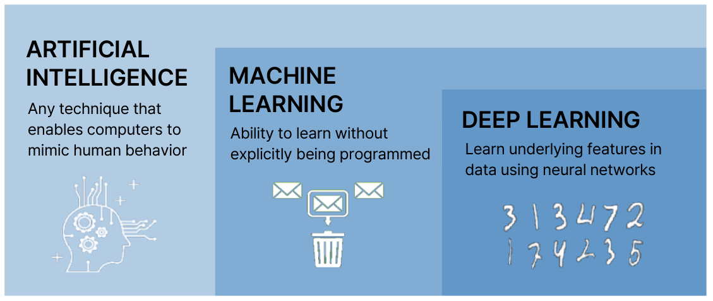

*Figure 1. Inclusion relationship among artificial intelligence, machine learning, and deep learning*

- **Artificial intelligence:** Any technique that enables computers to mimic human behavior. Programs whose rules were written one by one by people also belong here.
- **Machine learning:** The ability to learn from data without being explicitly programmed. As in the middle of Figure 1, instead of a person writing the rules for filtering spam, the computer looks at messages labeled as spam or not and finds the filtering criterion by itself; that is machine learning.
- **Deep learning:** A branch of machine learning that uses neural networks stacked in many layers to learn the features hidden in data by itself. As on the right of Figure 1, a neural network finds features such as the shapes of strokes in images of handwritten digits without a person defining them. The structure and training of artificial neural networks are covered in Week 13.

> **Key Point:** Machine learning is a subfield of artificial intelligence that focuses on developing algorithms and models that let computers learn from data and make predictions or decisions based on data. Whether the rules are given by people or obtained from data is what separates machine learning from other artificial intelligence techniques.

### 1.3 The Turing Test

The **Turing test** is a test proposed in 1950 by the British mathematician and computer scientist Alan Turing that measures a machine's ability to exhibit intelligent behavior equivalent to, or indistinguishable from, that of a human [1]. Turing replaced the vague question "Can machines think?" with a test of observable behavior, which he called the **imitation game** [1].

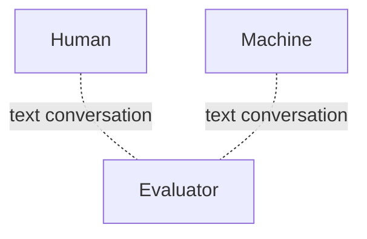

*Figure 2. Setup of the Turing test*

The evaluator cannot see the other parties and converses with both the human and the machine only through text. If the evaluator cannot reliably tell from the conversation alone which one is the machine, the machine is judged to have passed the Turing test.

> **Caution:** The Turing test only checks whether outward conversational behavior is indistinguishable from a human's; it does not directly measure whether the machine understands the content. As the ELIZA program in Section 1.4 shows, simple rules can fool people for a short time, so passing or failing alone does not settle how intelligent a machine is.

### 1.4 The 1950s and 1960s: Birth and Early Research

**The 1950s.** In this period, the public thought of computers as **electronic brains**. The events that marked the starting point of the field were as follows.

- John McCarthy first used the term "artificial intelligence" in the 1955 proposal for the 1956 Dartmouth workshop [2].
- Alan Turing defined intelligence as the ability to pass the imitation game, that is, the Turing test [1].
- Marvin Minsky built SNARC in 1951, the first computer that implemented a neural network in hardware [3].

Artificial intelligence research focused mainly on simple domains, because the computers of the time did not have enough computing power or memory to solve practical problems. The problems studied were games (such as checkers), primitive machine translation, natural language understanding, and automated theorem proving and mathematical problem solving. Theorem proving was studied not with neural networks but with programs that manipulate logical rules as symbols (such as the Logic Theorist of 1956) [3]. An early neural network studied in the same period was the **perceptron**, a model published by Frank Rosenblatt in 1958 that learns to separate inputs into two classes by adjusting its weights from examples [4]. The structure of the perceptron is covered in detail in Week 13.

**The 1960s.** Artificial intelligence attempted to go beyond simple domains, and in doing so it became clear that knowledge of the domain was required. Machine translation is a typical example. Early machine translation could translate between Russian and English, but only at the level of matching words without context. A widely known anecdote illustrating this limitation says that "the spirit is willing but the flesh is weak," translated into Russian and back into English, became "the vodka is good but the meat is spoiled" [3]. The meaning of an idiom requires knowledge of language and of the world.

- Dendral, the earliest **expert system**, was developed at Stanford University in the mid-1960s. Dendral encoded chemists' knowledge as rules and inferred molecular structures from mass spectrometry data [3].
- In the United States, after the 1966 ALPAC report concluded that machine translation research had produced too little, funding for machine translation was cut sharply, and the government sponsored artificial intelligence research in specific domains that excluded machine translation [3].
- Joseph Weizenbaum published **ELIZA**, an early natural language processing program, in 1966 [5]. ELIZA is a simple conversational program that finds key phrases in the user's sentence and turns them into questions according to predefined rules. In its most famous script, DOCTOR, ELIZA plays the role of a counseling doctor and the user plays a patient visiting the doctor; the program answers simple questions and also asks questions back.

The following example shows the form of conversation such rules produce. The program only replaces "I am" in the user's sentence with "you are" and inserts it into a question template; it does not understand the meaning of the sentence.

```text
User:  I am unhappy.
ELIZA: WHY DO YOU SAY YOU ARE UNHAPPY?
```

### 1.5 The 1970s and 1980s: Expert Systems and Stagnation

**The 1970s.** Artificial intelligence researchers used knowledge-based expert systems to solve real-world problems such as medical diagnosis, speech recognition, planning, and design. An expert system consists of a **knowledge base**, which collects the knowledge of experts in a specific field as if-then rules that pair conditions with conclusions, and an **inference engine**, which applies those rules to facts to derive conclusions.

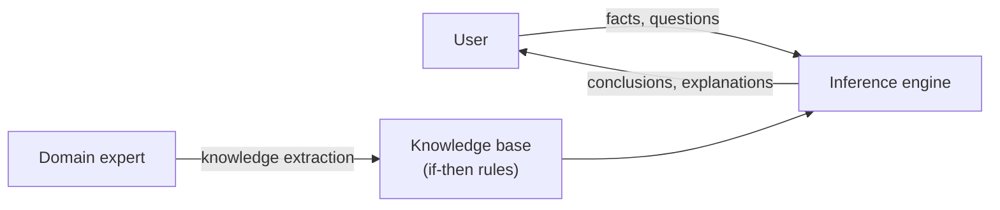

*Figure 3. Structure of an expert system*

These successes drew attention to artificial intelligence. Research on artificial intelligence grew, artificial intelligence laboratories appeared in many places, and artificial intelligence development tools were built. There was also criticism, however: artificial intelligence systems were so brittle that they failed as soon as they stepped slightly outside a narrow domain, converting experts' knowledge into rules took too much time and effort, and the systems did not learn by themselves.

**The 1980s.** A period of stagnation came to artificial intelligence, and research funding dried up. Many expectations were not met, expert systems took too long to develop, and the results were unsatisfactory relative to the money invested.

Neural networks then stepped in as a rescuer. A single-layer perceptron can divide the input space only with a single straight line (in general, a hyperplane), so it cannot solve problems such as **XOR** in Table 2 that cannot be separated by one line. After Minsky and Papert analyzed this limitation in 1969, neural network research shrank for a while [6].

| $x_1$ | $x_2$ | XOR output |
|:-----|:-----|:-----|
| 0 | 0 | 0 |
| 0 | 1 | 1 |
| 1 | 0 | 1 |
| 1 | 1 | 0 |

*Table 2. Truth table of the XOR function*

On the plane, the two points with output 1, $(0, 1)$ and $(1, 0)$, and the two points with output 0, $(0, 0)$ and $(1, 1)$, lie crosswise along the diagonals, so no straight line can split them into two groups. In 1986, Rumelhart, Hinton, and Williams popularized a way to train multilayer neural networks with **backpropagation** [7], and multilayer backpropagation networks with hidden layers solved this problem of the perceptron by forming curved decision boundaries. By around 1990, however, funding for neural network research also gradually disappeared. Neural networks had problems of their own, namely slow training and the need for large amounts of data and computation, and they could not solve most of the artificial intelligence problems being tackled at the time. The principle of backpropagation is covered in Week 13.

> **Note:** The periods in which artificial intelligence research shrank are called **AI winters**. The term usually refers to two periods: the first in the mid-1970s, when the expectations for machine translation and early research collapsed, and the second from the late 1980s to the early 1990s, when the expert system industry collapsed [3]. The stagnation of the 1980s described above corresponds to the second period.

### 1.6 The 1990s and After: Statistical Machine Learning and Data

**The 1990s.** From the mid-1990s, interest in artificial intelligence revived through several technical innovations and practical applications.

- Machine learning, especially statistical approaches and probability-based models, became the mainstream of artificial intelligence research.
- Algorithms such as Bayesian networks, decision trees, and support vector machines (SVM) [8] were developed, and many researchers came to prefer data-driven approaches that obtain models from data instead of writing rules by hand.
- Artificial intelligence technology was commercialized and applied to industries such as finance and medicine, spreading practical applications.
- Artificial intelligence research was reorganized around statistical approaches and machine learning, and reinforcement learning and natural language processing in particular made great progress.
- As computing power advanced, neural networks drew attention again, laying the foundation for later deep learning.

**The 2000s and after.** Artificial intelligence in the 2000s concentrated mainly on practical applications of technology and on the advance of machine learning, bringing major changes to many fields.

- As computing power improved and data became easier to access, machine learning advanced rapidly. Artificial intelligence models became more sophisticated on the basis of the large amounts of data generated by the spread of the Internet and mobile devices, and computer vision was introduced into many fields as image recognition and face recognition technologies evolved.
- As artificial intelligence merged with robotics, robot control and unmanned systems advanced. Research on autonomous driving became active, and path planning and obstacle avoidance techniques for it were developed. A representative example is the 2005 DARPA Grand Challenge, in which driverless cars completed a race course through the desert [3].
- As commercial uses such as customer service and recommender systems took off, artificial intelligence became directly connected to consumers and was commercialized across many industries.

| Period | Main trend | Representative examples and limitations |
|:-----|:-----|:-----|
| 1950s | The term artificial intelligence appears; research on simple domains | Turing test, perceptron, theorem-proving programs. Computers lacked performance and memory. |
| 1960s | Attempts to go beyond simple domains; recognition of the need for domain knowledge | Dendral, ELIZA. Context-free machine translation failed and funding was cut. |
| 1970s | Solving real-world problems with knowledge-based expert systems | Medical diagnosis, speech recognition, planning, design. Criticized as brittle, hard to build, and unable to learn. |
| 1980s | Stagnation and loss of funding; emergence of multilayer backpropagation networks | Expectations for expert systems were not met. Funding for neural networks also shrank around 1990. |
| 1990s | Reorganization around statistical approaches and machine learning | Bayesian networks, decision trees, SVM, reinforcement learning. Neural networks drew attention again. |
| 2000s and after | Practical machine learning based on large data and computing power | Computer vision, autonomous driving, recommender systems. Led to deep learning. |

*Table 3. Trends in artificial intelligence research by period*

### 1.7 Why Learning Is Needed

**Learning** is the process of acquiring knowledge, skills, behaviors, attitudes, or values through study, experience, practice, or education. In artificial intelligence, learning is essential for a model to find patterns in data and improve its problem-solving ability. Learning is the means of overcoming the criticism that expert systems received in Section 1.5, namely that they are hard to build and do not improve by themselves.

- Through learning, artificial intelligence can adapt to changes in the environment or to new data and maintain its performance.
- Through repeated learning, artificial intelligence can handle specific tasks automatically without people.
- Similarly to human cognition, it can acquire various problem-solving strategies and knowledge through learning.
- Through the learning process, it can reduce errors and improve performance to produce more accurate results.

### 1.8 Machine Learning

> **Definition:** **Machine learning** is a field of artificial intelligence that enables computers to learn patterns from data and improve their own performance without explicit programming. Machine learning programs computers to optimize a given performance criterion using example data or past experience.

Machine learning is used for many tasks such as prediction, classification, and recommendation, and its performance generally improves as more data become available. Machine learning is a field built jointly by statistics and computer science.

| Field | Role in machine learning |
|:-----|:-----|
| Statistics | Makes inferences about a population from samples. It provides the theory for estimating the rules of all the data from the part of the data that was observed. |
| Computer science | Develops efficient algorithms that solve the optimization problems used to represent and evaluate models for inference. |

*Table 4. Roles of statistics and computer science in machine learning*

For example, in the linear regression of Section 2.10, estimating the relationship between variables from a few samples is the role of statistics, and quickly computing the coefficients of the line that represents this relationship so that the error is minimized is the role of computer science.

Many techniques can be used to make predictions from data, but the basic flow is divided into a training phase and a prediction phase, as in Figure 4.

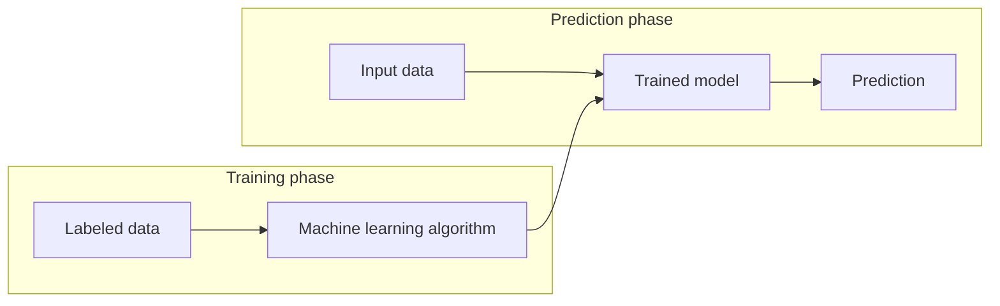

*Figure 4. Training phase and prediction phase of machine learning*

In the training phase, data with correct answers (labels) are fed into a machine learning algorithm to build a model. In the prediction phase, new input data whose answers are unknown are fed into the trained model to obtain predictions. Figure 4 shows the flow of supervised learning, which learns from data with answers; methods that learn without answers are covered together in Part 2.

---

<br>

## 2. Learning Types I: Supervised and Unsupervised Learning

Machine learning is broadly divided into three types according to the kind of information used for learning. This part compares the three types and then covers K-means clustering in unsupervised learning, and classification (k-nearest neighbors, support vector machines) and regression (linear regression) in supervised learning.

### 2.1 Three Types of Learning

> **Definition:** A **label** is the correct answer attached to each data item. It may be a category, such as whether a message is spam or whether a fruit is a banana or an orange, or a real number, such as the weight of a fruit.

| Type | Information used for learning | Example |
|:-----|:-----|:-----|
| Unsupervised learning | Discovers patterns in unlabeled data. | Clustering documents with similar text content |
| Supervised learning | Learns the relationship between inputs and answers using a labeled training set. | Email classification learned from messages already labeled as spam or not |
| Reinforcement learning | Learns how to act based on feedback for its actions, that is, rewards. | Learning to play Go. The reward is a win or a loss. |

*Table 5. Three types of learning*

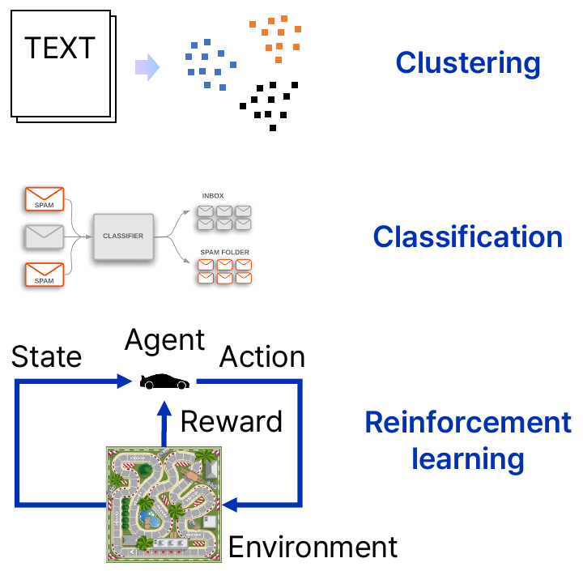

*Figure 5. Examples of clustering, classification, and reinforcement learning*

The top of Figure 5 shows clustering, which groups documents (TEXT) into three clusters of similar content; the middle shows classification, which feeds messages into a classifier and sorts them into the inbox and the spam folder; and the bottom shows reinforcement learning, in which a car (the agent) observes the state of a race track (the environment), chooses an action, and receives a reward. Clustering is a typical task of unsupervised learning, and classification is a typical task of supervised learning. Reinforcement learning is covered in Section 3.9.

### 2.2 Representation of Training Data

Training data consist of $n$ **samples**. A training dataset for supervised learning is written as pairs of inputs and labels.

$$
(x_1, y_1), (x_2, y_2), \ldots, (x_n, y_n), \qquad x_i \in \mathbb{R}^d
$$

Here $x_i$ is the input of the $i$-th sample, a $d$-dimensional vector collecting $d$ **feature** values, also called a **feature vector**. $y_i$ is the label of that sample. Writing the $j$-th feature value of $x_i$ as $x_{ij}$, the training data become a table whose rows are samples and whose columns are features, as in Figure 6.

```text
          Input (feature 1 ... feature d)     Label
  x_1  │  x_11   x_12   ...   x_1d   │    y_1
  x_2  │  x_21   x_22   ...   x_2d   │    y_2
   ⋮   │            ⋮                │     ⋮
  x_n  │  x_n1   x_n2   ...   x_nd   │    y_n
```

*Figure 6. Matrix representation of training data*

For example, in fruit data, each fruit has three features ($d = 3$), its length, width, and weight, and its label is the kind of fruit.

| Fruit | Length | Width | Weight | Label |
|:-----|:-----|:-----|:-----|:-----|
| Fruit 1 | 165 | 38 | 172 | Banana |
| Fruit 2 | 218 | 39 | 230 | Banana |
| Fruit 3 | 76 | 80 | 145 | Orange |
| Fruit 4 | 145 | 35 | 150 | Banana |
| Fruit 5 | 90 | 88 | 160 | Orange |
| ⋮ | ⋮ | ⋮ | ⋮ | ⋮ |
| Fruit $n$ | ⋯ | ⋯ | ⋯ | ⋯ |

*Table 6. Features and labels of the fruit data*

The first row of Table 6 means $x_1 = (165, 38, 172)$ and $y_1 = \text{Banana}$. A banana is long and thin, whereas an orange has a similar length and width, so the two fruits can be told apart fairly well from their length and width alone.

- **Supervised learning:** Learns a model from labeled data, as in Table 6. The model learns to take the features of a new fruit and guess its kind.
- **Unsupervised learning:** Learns a model from the data of Table 6 with the label column removed, that is, from unlabeled data. The model finds a structure that groups similar fruits without knowing the answers.

### 2.3 Unsupervised Learning and Clustering

The training data of unsupervised learning contain only inputs.

$$
x_1, x_2, \ldots, x_n, \qquad x_i \in \mathbb{R}^d
$$

A typical unsupervised learning task is **clustering**, also called **segmentation**. Clustering is the problem of finding a function $f$ that maps each data point to one of $K$ **clusters**.

$$
f : \mathbb{R}^d \to \lbrace C_1, C_2, \ldots, C_K\rbrace\quad (\text{set of clusters})
$$

> **Definition:** A **cluster** is a group of mutually similar data points. Similarity is usually measured by distance in the feature space: data in the same cluster are close to each other and far from data in other clusters. The **feature space** is the space with one axis per feature, in which each sample becomes a single point.

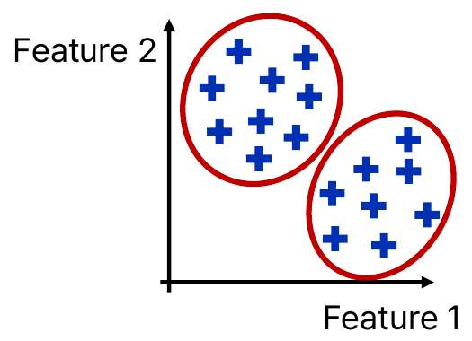

*Figure 7. Two clusters found in unlabeled data*

The points in Figure 7 have no labels, but on the plane of feature 1 and feature 2 they clearly gather into two groups, one at the upper left and one at the lower right. Clustering finds such structure that the data themselves have. Finding customer groups with similar spending habits in population data, or grouping fruits of similar shape in fruit data, are examples.

### 2.4 K-Means Clustering

**K-means clustering** is a widely used unsupervised learning algorithm that partitions a dataset into $K$ distinct, non-overlapping clusters [9]. Each cluster is represented by its **centroid**, the mean position of the data in the cluster, and the number of clusters $K$ is chosen by the user in advance.

K-means clustering proceeds in the following four steps.

1. **Initial centroids:** Choose $K$ cluster centroids $\mu_1, \ldots, \mu_K$ at random within the data region.
2. **Cluster assignment:** Assign each data point to the cluster of its nearest centroid.

   $$
   c(i) = \arg\min_{k \in \lbrace1, \ldots, K\rbrace} \lVert x_i - \mu_k \rVert
   $$

   Here $c(i)$ is the index of the cluster to which the data point $x_i$ is assigned, and $\lVert x_i - \mu_k \rVert$ is the Euclidean distance between $x_i$ and the centroid $\mu_k$.
3. **Centroid update:** Move each centroid to the mean position of the data in its cluster. With $C_k$ the set of data in the $k$-th cluster and $\lvert C_k \rvert$ their number, this is:

   $$
   \mu_k = \frac{1}{\lvert C_k \rvert} \sum_{x_i \in C_k} x_i
   $$

4. **Repetition and convergence:** Repeat cluster assignment and centroid update, and stop when the assignment no longer changes or the centroids barely move.

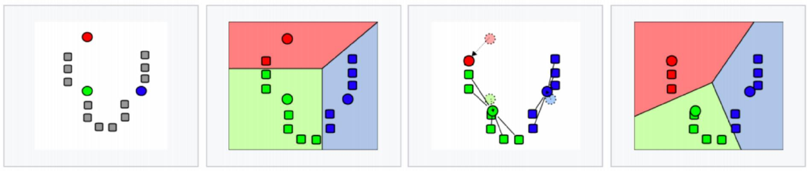

*Figure 8. Iterations of K-means clustering (K = 3)*

Figure 8 shows K-means clustering with $K = 3$ applied to gray data arranged in a U shape. In the first picture, three initial centroids (red, green, and blue circles) are generated at random within the data region. In the second picture, every data point is assigned to its nearest centroid, forming three clusters. The colored regions that divide the plane form a **Voronoi diagram**, which shows which centroid each location is closest to. In the third picture, the centroid (mean) of each cluster becomes the new centroid, and the centroids move (the faint circles are the previous positions). As in the fourth picture, the second and third steps are repeated until convergence is reached.

**Example.** Cluster the six points $A(1, 1)$, $B(2, 1)$, $C(1, 2)$, $D(5, 4)$, $E(6, 5)$, $F(5, 5)$ on the plane with $K = 2$. The initial centroids are deliberately chosen close to each other as $\mu_1 = A(1, 1)$ and $\mu_2 = B(2, 1)$.

**Assignment in iteration 1.** Compute the distance from each point to the two centroids. For example, the distance from $D$ to $\mu_1$ is $\sqrt{(5-1)^2 + (4-1)^2} = \sqrt{25} = 5$, and to $\mu_2$ it is $\sqrt{(5-2)^2 + (4-1)^2} = \sqrt{18} \approx 4.243$, so $D$ is assigned to cluster 2.

| Point | To $\mu_1 = (1, 1)$ | To $\mu_2 = (2, 1)$ | Assignment |
|:-----|:-----|:-----|:-----|
| $A(1, 1)$ | 0 | 1 | Cluster 1 |
| $B(2, 1)$ | 1 | 0 | Cluster 2 |
| $C(1, 2)$ | 1 | 1.414 | Cluster 1 |
| $D(5, 4)$ | 5 | 4.243 | Cluster 2 |
| $E(6, 5)$ | 6.403 | 5.657 | Cluster 2 |
| $F(5, 5)$ | 5.657 | 5 | Cluster 2 |

*Table 7. Distances and assignments in iteration 1 of the K-means example*

**Update in iteration 1.** Cluster 1 is $\lbrace A, C\rbrace$ and cluster 2 is $\lbrace B, D, E, F\rbrace$, so the new centroids are:

$$
\mu_1 = \left(\frac{1 + 1}{2}, \frac{1 + 2}{2}\right) = (1, 1.5), \qquad \mu_2 = \left(\frac{2 + 5 + 6 + 5}{4}, \frac{1 + 4 + 5 + 5}{4}\right) = (4.5, 3.75)
$$

**Assignment in iteration 2.** Recompute the distances with the new centroids. $B(2, 1)$ is $\sqrt{1^2 + 0.5^2} \approx 1.118$ from $\mu_1$ and $\sqrt{2.5^2 + 2.75^2} \approx 3.717$ from $\mu_2$, so it moves to cluster 1.

| Point | To $\mu_1 = (1, 1.5)$ | To $\mu_2 = (4.5, 3.75)$ | Assignment |
|:-----|:-----|:-----|:-----|
| $A(1, 1)$ | 0.5 | 4.451 | Cluster 1 |
| $B(2, 1)$ | 1.118 | 3.717 | Cluster 1 |
| $C(1, 2)$ | 0.5 | 3.913 | Cluster 1 |
| $D(5, 4)$ | 4.717 | 0.559 | Cluster 2 |
| $E(6, 5)$ | 6.103 | 1.953 | Cluster 2 |
| $F(5, 5)$ | 5.315 | 1.346 | Cluster 2 |

*Table 8. Distances and assignments in iteration 2 of the K-means example*

**Update in iteration 2.** Cluster 1 is $\lbrace A, B, C\rbrace$ and cluster 2 is $\lbrace D, E, F\rbrace$, so $\mu_1 = (4/3, 4/3) \approx (1.333, 1.333)$ and $\mu_2 = (16/3, 14/3) \approx (5.333, 4.667)$. Assigning again with these centroids in iteration 3 gives the same cluster for every point as in iteration 2, so the algorithm has converged. The final clusters are $\lbrace A, B, C\rbrace$ at the lower left and $\lbrace D, E, F\rbrace$ at the upper right.

### 2.5 Convergence and Limitations of K-Means Clustering

The quantity that K-means clustering decreases is the **within-cluster sum of squares**, the sum of the squared distances between each data point and the centroid of its cluster.

$$
J = \sum_{k=1}^{K} \sum_{x_i \in C_k} \lVert x_i - \mu_k \rVert^2
$$

The assignment step attaches each point to its nearest centroid, so it does not increase $J$, and the update step moves each centroid to the mean, which is the point that minimizes the sum of squared distances within the cluster, so it does not increase $J$ either. Because the number of possible assignments is finite, the algorithm stops after a finite number of iterations [9]. In the example of Section 2.4, $J$ decreases from 76 at the first assignment to 20.25 after the first update, 7.6875 after the second assignment, and about 2.667 after the second update.

This point of convergence, however, may be a **local minimum** of $J$ rather than its **global minimum**, because each step only decreases $J$ from the current state and never jumps far away to look for a better configuration.

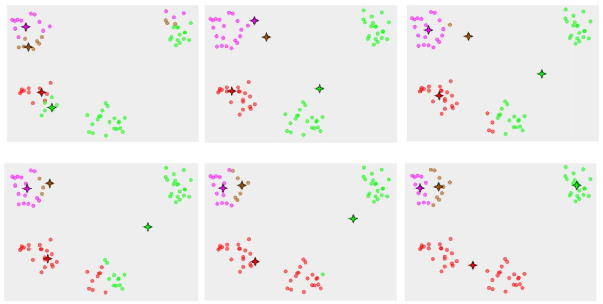

*Figure 9. K-means clustering converging to local minima depending on the initial centroids*

The data in Figure 9 contain four groups, the stars are four centroids, and the color of each point is the cluster it is assigned to. The six pictures show one run in order from the upper left to the lower right. At first, two centroids (purple and brown) lie together inside the single group at the upper left, and the green and red centroids start near the group at the middle left. As the iterations proceed, the green centroid moves to the group at the upper right, and the red centroid takes the two groups at the middle left and the bottom center together and moves into the empty space between them. In the last picture, two centroids share the single group at the upper left and one centroid takes two separate groups together; repeating assignment and update changes nothing in this state, so the algorithm simply stops. Different initial centroids thus give different results. In practice, therefore, the algorithm is run several times from different initial centroids and the result with the smallest $J$ is chosen [9].

| Aspect | Description |
|:-----|:-----|
| Advantages | The computation is simple and clustering can be performed relatively quickly. It works efficiently and scales to large datasets. It is easy to understand and can be implemented in many environments. |
| Disadvantages | The number of clusters $K$ must be specified in advance, and the best $K$ is hard to find. It is easily affected by outlier data. Results can vary with the initial centroids, so it may have to be run several times for optimization. |

*Table 9. Advantages and disadvantages of K-means clustering*

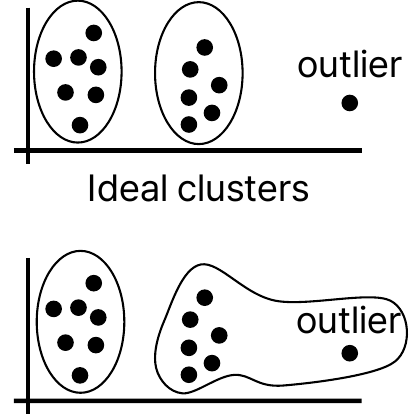

*Figure 10. Effect of an outlier on K-means clustering*

> **Definition:** An **outlier** is a data point whose value lies far from most of the data. It may arise from a measurement error or represent a rare real phenomenon.

The top of Figure 10 shows ideal clusters: the two groups each form a cluster, and the outlier at the right end is not forced into either cluster. K-means clustering with $K = 2$, however, must assign every point to some cluster, so the outlier gets mixed into the nearer cluster, as at the bottom. Because the mean is sensitive to extreme values, the centroid of this cluster is pulled toward the outlier, distorting the cluster boundary and subsequent assignments.

### 2.6 Supervised Learning: Classification

The training data of supervised learning are pairs of inputs $x$ and labels $y$, $(x_1, y_1), \ldots, (x_n, y_n)$, $x_i \in \mathbb{R}^d$. Depending on the kind of label, supervised learning is divided into classification and regression.

In **classification**, the label $y$ is discrete, that is, one of a few categories. With only two categories, one usually writes $y \in \lbrace-1, +1\rbrace$, and the function that sends an input to one of the two categories,

$$
f : \mathbb{R}^d \to \lbrace-1, +1\rbrace
$$

is called a **binary classifier**. Problems such as yes/no, banana/orange, and spam/ham (legitimate mail) are binary classification.

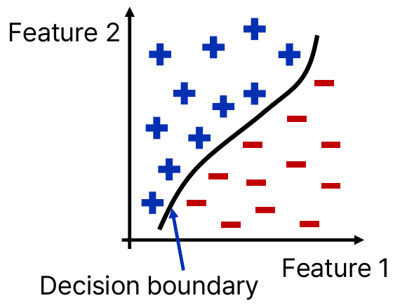

*Figure 11. Decision boundary of binary classification*

> **Definition:** A **decision boundary** is the boundary in feature space where the classifier's prediction changes from one category to another. In Figure 11, the region to the upper left of the curve is classified as $+1$ and the region to the lower right as $-1$.

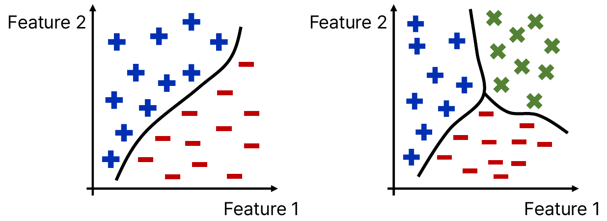

*Figure 12. Decision boundaries of binary and three-class classification*

The left of Figure 12 is binary classification, which separates two categories ($+$ and $-$) with a single curve, and the right is **multiclass classification**, which separates three categories ($+$, $-$, $\times$) with boundaries where three curves meet. With $C$ categories, the label is written as $y \in \lbrace1, 2, \ldots, C\rbrace$.

### 2.7 k-Nearest Neighbors Classification

The **k-nearest neighbors (k-NN) classifier** is based on the principle that birds of a feather flock together: if an object is similar to its neighbors, it is likely to belong to the same class. Here a **class** means a category of the classification. k-NN usually determines the nearest neighbors with the standard **Euclidean distance**. The Euclidean distance between two points $x = (x_1, \ldots, x_d)$ and $x' = (x'_1, \ldots, x'_d)$ is:

$$
\mathrm{dist}(x, x') = \sqrt{\sum_{j=1}^{d} (x_j - x'_j)^2}
$$

The k-NN classifier works through the following process.

1. **Training phase:** Store the feature vectors of the training dataset and their class labels. No other computation is done.
2. **Prediction phase:** When a new data point with an unknown class is given, compute the distance between this point and every point in the training dataset.
3. **Identifying the nearest neighbors:** Based on the computed distances, find the $k$ neighbors nearest to the new point.
4. **Majority voting:** Assign to the new point the class label that is most common among the $k$ neighbors.

Because it builds no model in advance in the training phase and does all the computation at prediction time, k-NN is also called **lazy learning**.

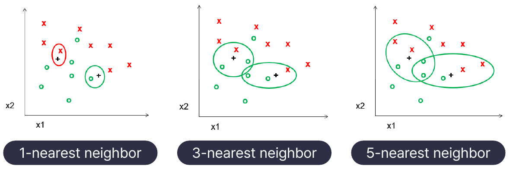

*Figure 13. Neighbors in k-NN classification for different k*

Figure 13 contains training data of two classes ($\times$ and $\circ$) and two points ($+$) whose classes are unknown. The left $+$ has a single $\times$ right next to it, but its surroundings are mostly $\circ$.

- **1-NN:** The nearest neighbor of the left $+$ is a $\times$, so it is classified as $\times$ (red circle). The right $+$ follows its nearest $\circ$ and becomes $\circ$.
- **3-NN:** The three neighbors of the left $+$ are one $\times$ and two $\circ$, so it is classified as $\circ$. The right $+$ also has two $\circ$ and one $\times$, so it is $\circ$.
- **5-NN:** For both points, three of the five neighbors are $\circ$ and two are $\times$, so both are classified as $\circ$.

Thus, with a small $k$ the prediction is sensitive to the single sample right next to the point, especially a noisy one, while with a large $k$ the result is more stable, but a $k$ that is too large lets samples of other classes far away join the vote. For two classes, $k$ is often chosen odd to avoid ties, and a suitable $k$ is chosen with the validation data of Section 3.3.

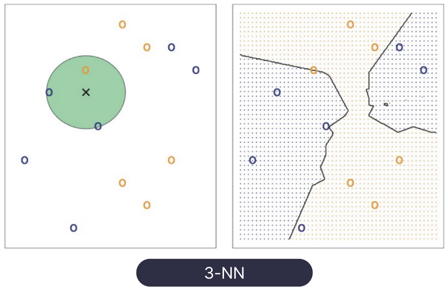

*Figure 14. Neighbors and decision boundary of 3-NN*

On the left of Figure 14, the three nearest neighbors of the new point ($\times$), inside the green circle, are two blue points and one orange point, so the new point is classified into the blue class. The right shows the result of classifying every location on the plane with 3-NN and coloring it; the boundary is not a straight line but a winding nonlinear decision boundary that follows the arrangement of the data.

**Example.** Using the five fruits of Table 6 as training data, classify a new fruit with length 150, width 40, and weight 165 by 3-NN. The distance from the new fruit $q = (150, 40, 165)$ to fruit 1 is

$$
\mathrm{dist}(q, x_1) = \sqrt{(150 - 165)^2 + (40 - 38)^2 + (165 - 172)^2} = \sqrt{225 + 4 + 49} = \sqrt{278} \approx 16.67
$$

and computing the rest in the same way gives Table 10.

| Rank | Training sample | Label | Squared distance | Distance |
|:-----|:-----|:-----|:-----|:-----|
| 1 | Fruit 4 $(145, 35, 150)$ | Banana | $25 + 25 + 225 = 275$ | 16.58 |
| 2 | Fruit 1 $(165, 38, 172)$ | Banana | $225 + 4 + 49 = 278$ | 16.67 |
| 3 | Fruit 5 $(90, 88, 160)$ | Orange | $3600 + 2304 + 25 = 5929$ | 77.00 |
| 4 | Fruit 3 $(76, 80, 145)$ | Orange | $5476 + 1600 + 400 = 7476$ | 86.46 |
| 5 | Fruit 2 $(218, 39, 230)$ | Banana | $4624 + 1 + 4225 = 8850$ | 94.07 |

*Table 10. Distances from the new fruit to the training samples*

The labels of the three nearest neighbors are banana, banana, and orange, so by majority vote the new fruit is classified as a **banana**. With 1-NN, only fruit 4 is considered, so it is also a banana.

> **[Machine Learning]** k-NN is sensitive to the units and ranges of the features. In Table 6, the length varies by 142, from 76 to 218, while the width varies by 53, from 35 to 88, so measuring distances directly gives differences in length more weight than differences in width. Moreover, adding values with different units, such as length and weight, directly means that merely changing a unit can change the neighbors. Therefore, each feature is usually standardized to mean 0 and standard deviation 1, or normalized to a common range, before computing distances.

| Aspect | Description |
|:-----|:-----|
| Advantages | It is easy to implement, and its behavior is clearly understood from the data distribution. No separate learning is needed in the training phase, so training is fast. It can perform nonlinear classification even for complex data distributions. New data can be added without updating a model. |
| Disadvantages | It must compute the distance to all training data, so prediction can take long. It must store all training data, so memory use is large. As the dimension of the data grows, distance-based approaches become inaccurate, which is the curse of dimensionality. It is easily affected by nearby outlier data. |

*Table 11. Advantages and disadvantages of the k-NN classifier*

> **Definition:** The **curse of dimensionality** is the phenomenon that as the number of features (the dimension) grows, the same amount of data fills the space very sparsely, so that even the nearest neighbors are far away and the distances between points become similar to one another [9]. When distances become similar, the criterion of the "nearest" neighbor loses its meaning, so the performance of k-NN, which depends on distances, degrades.

### 2.8 Support Vector Machines

The **support vector machine (SVM) classifier** finds the **hyperplane** that best separates the different classes in feature space [8]. A hyperplane is a flat $(d-1)$-dimensional boundary that divides a $d$-dimensional space into two; it is a line in two dimensions and a plane in three dimensions. The linear classification function found by an SVM is:

$$
f(x) = \operatorname{sgn}(w \cdot x + b)
$$

Here $w \in \mathbb{R}^d$ is the **weight vector** perpendicular to the hyperplane, $b$ is the **bias** that sets the position of the hyperplane, $w \cdot x$ is the dot product, and $\operatorname{sgn}$ is the sign function, which outputs $+1$ for positive values and $-1$ for negative values. The hyperplane is the set of points with $w \cdot x + b = 0$, and the distance from a point $x$ to the hyperplane is $\lvert w \cdot x + b \rvert / \lVert w \rVert$.

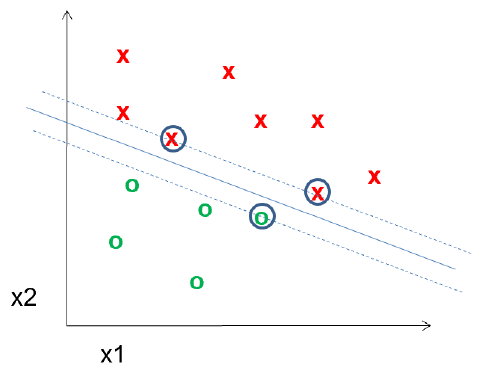

*Figure 15. Hyperplane, margin, and support vectors of a support vector machine*

There are infinitely many lines that separate two classes. Among them, an SVM chooses the hyperplane that maximizes the **margin**, the distance between the hyperplane and the nearest data points of each class, and these nearest points are called **support vectors**. In Figure 15, the solid line is the hyperplane, the two dashed lines are the edges of the margin, and the three circled points are the support vectors. The decision boundary is determined by the support vectors alone; moving the other points slightly does not change the boundary.

Multiplying $w$ and $b$ by the same positive number gives the same hyperplane, so if they are scaled so that $\lvert w \cdot x + b \rvert = 1$ at the support vectors, the width of the margin becomes $2 / \lVert w \rVert$. Maximizing the margin is therefore equivalent to minimizing $\lVert w \rVert$ while keeping every training sample on the correct side [8].

$$
\min_{w, b} \ \frac{1}{2} \lVert w \rVert^2 \quad \text{subject to} \quad y_i (w \cdot x_i + b) \ge 1, \quad i = 1, \ldots, n
$$

**Example.** With $w = (1, 1)$ and $b = -3$, the hyperplane is the line $x_1 + x_2 = 3$. At the point $(2, 2)$, $w \cdot x + b = 2 + 2 - 3 = 1 > 0$, so $f = +1$; at the point $(1, 1)$, $1 + 1 - 3 = -1 < 0$, so $f = -1$. Since $\lvert w \cdot x + b \rvert = 1$ at both points, if they are support vectors the width of the margin is $2 / \lVert w \rVert = 2 / \sqrt{2} = \sqrt{2} \approx 1.414$.

> **[Machine Learning]** If the classes cannot be separated completely by a line, a soft margin is used, which allows some samples inside the margin with a penalty; if the boundary must be curved, a kernel function, which has the same effect as mapping the data into a higher-dimensional space, is used to obtain a nonlinear decision boundary [8], [9].

### 2.9 Supervised Learning: Regression

In **regression**, the label $y$ is a real number ($y \in \mathbb{R}$). The function that sends an input to a real number,

$$
f : \mathbb{R}^d \to \mathbb{R}
$$

is called a **regressor**. Predicting the weight of a fruit from its features, or predicting a person's height from other body measurements, are regression problems.

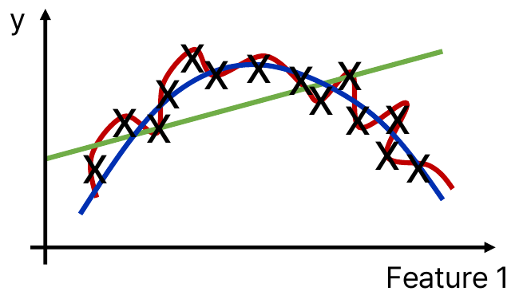

*Figure 16. Three regression models fitted to the same data*

The data ($\times$) in Figure 16 show a trend that rises and then falls. The green line is too simple to follow this trend, the red curve wiggles excessively to pass through every point, and the blue curve follows the overall trend of the points reasonably. The criteria for judging which model is good are covered in Section 3.2.

### 2.10 Linear Regression and the Least Squares Method

**Regression analysis** is a statistical method for modeling the relationship between a **dependent variable**, the value to be predicted, and one or more **independent variables**, the values used for prediction. **Linear regression** expresses this relationship with a first-degree equation, and its goal is to estimate the coefficients that best fit the observed data and minimize the difference between the observed values and the values predicted by the linear equation. The linear equation of **multiple linear regression** with $d$ features is:

$$
\hat{y} = b_0 + b_1 x_1 + b_2 x_2 + \cdots + b_d x_d
$$

Here $b_0$ is the intercept and $b_1, \ldots, b_d$ are the coefficients of the features. **Simple linear regression**, with only one feature, is written as the line $\hat{y} = ax + b$. The $b$ in this section is the intercept of the line, a different quantity from the bias $b$ of the SVM in Section 2.8 despite the same letter. The symbols mean the following.

- $y_i$: the true value of the $i$-th sample
- $\hat{y}_i = a x_i + b$: the value estimated by the model (the curve fitting value)
- $e_i = y_i - \hat{y}_i$: the error, or **residual**
- $\mathrm{SSE} = \sum_{i=1}^{n} e_i^2$: the **sum of squared errors**

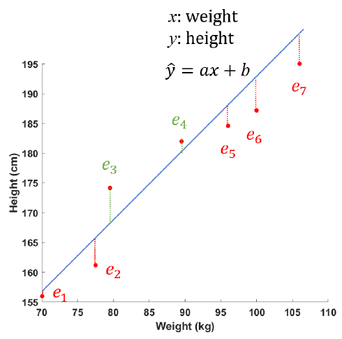

*Figure 17. Regression line and residuals of weight and height data*

Figure 17 shows the regression line $\hat{y} = ax + b$ that predicts height $y$ (cm) from weight $x$ (kg) and the residuals $e_1, \ldots, e_7$ of seven samples. A point above the line has a positive residual (green $e_3$, $e_4$), and a point below it has a negative residual (red). Adding the residuals directly would let positive and negative values cancel, so the SSE, which adds their squares, measures how poorly the line fits the data. Squaring also penalizes large errors more heavily and is easy to differentiate.

To find the best-fitting line, the SSE must be minimized; this is called the **least squares method**. The SSE is a function of $a$ and $b$.

$$
\mathrm{SSE}(a, b) = \sum_{i=1}^{n} (y_i - a x_i - b)^2
$$

At the minimum, both partial derivatives must be zero. Differentiating each term with the chain rule gives $\frac{\partial}{\partial a}(y_i - ax_i - b)^2 = 2(y_i - ax_i - b)\cdot(-x_i)$ and $\frac{\partial}{\partial b}(y_i - ax_i - b)^2 = 2(y_i - ax_i - b)\cdot(-1)$, so:

$$
\frac{\partial\,\mathrm{SSE}}{\partial a} = -2 \sum_{i=1}^{n} x_i (y_i - a x_i - b) = 0, \qquad \frac{\partial\,\mathrm{SSE}}{\partial b} = -2 \sum_{i=1}^{n} (y_i - a x_i - b) = 0
$$

Dividing both sides by $-2$ and rearranging the terms gives the **normal equations**.

$$
a \sum_{i=1}^{n} x_i^2 + b \sum_{i=1}^{n} x_i = \sum_{i=1}^{n} x_i y_i, \qquad a \sum_{i=1}^{n} x_i + n b = \sum_{i=1}^{n} y_i
$$

Dividing the second equation by $n$ gives $b = \bar{y} - a\bar{x}$ ($\bar{x}$ and $\bar{y}$ are the means). Substituting this into the first equation and rearranging yields the $a$ and $b$ of the fitting line.

$$
a = \frac{\sum_{i=1}^{n} (x_i - \bar{x})(y_i - \bar{y})}{\sum_{i=1}^{n} (x_i - \bar{x})^2}, \qquad b = \bar{y} - a \bar{x}
$$

> **[Calculus]** At a point where a differentiable function has an extremum, all partial derivatives are zero. The SSE is a convex quadratic function of $a$ and $b$ (provided the $x_i$ are not all equal), so there is exactly one point where the partial derivatives vanish, and that point is the minimum.

> **[Linear Algebra]** In multiple linear regression, with the matrix $X$ formed by stacking rows that prepend 1 to each sample's features and the vector $\mathbf{y}$ of true values, the normal equations are written as $X^{T} X \boldsymbol{\beta} = X^{T} \mathbf{y}$, and if $X^{T} X$ is invertible, the coefficient vector is $\boldsymbol{\beta} = (X^{T} X)^{-1} X^{T} \mathbf{y}$. The inverse matrices and systems of linear equations of Week 3 are the basis of this computation.

### 2.11 Linear Regression Example

Fit a line $\hat{y} = ax + b$ to the three samples $(1, 2)$, $(2, 3)$, $(3, 5)$, and estimate the value of $y$ at $x = 1.5$.

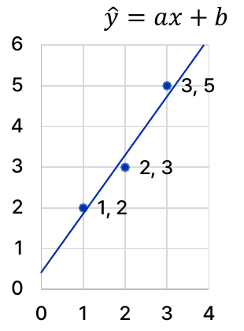

*Figure 18. Three samples and the least squares regression line*

**Step 1: Set up the SSE.** The residual of each sample is $y_i - a x_i - b$, so

$$
\mathrm{SSE} = \sum_{i=1}^{3} e_i^2 = (2 - a - b)^2 + (3 - 2a - b)^2 + (5 - 3a - b)^2
$$

is the function to be minimized.

**Step 2: Set the partial derivatives to zero.**

$$
\frac{\partial\,\mathrm{SSE}}{\partial a} = -2\big[1 \cdot (2 - a - b) + 2(3 - 2a - b) + 3(5 - 3a - b)\big] = -2\big[23 - 14a - 6b\big] = 0
$$

$$
\frac{\partial\,\mathrm{SSE}}{\partial b} = -2\big[(2 - a - b) + (3 - 2a - b) + (5 - 3a - b)\big] = -2\big[10 - 6a - 3b\big] = 0
$$

The bracket of the first equation collects the constant $2 + 6 + 15 = 23$, the coefficient of $a$, $1 + 4 + 9 = 14$, and the coefficient of $b$, $1 + 2 + 3 = 6$. The system of equations is therefore:

$$
14a + 6b = 23, \qquad 6a + 3b = 10
$$

**Step 3: Solve the system.** Multiplying the second equation by 2 gives $12a + 6b = 20$, and subtracting it from the first gives $2a = 3$, so $a = 1.5$. Substituting into the second equation gives $3b = 10 - 9 = 1$, so $b = 1/3 \approx 0.3333$. The formula using means confirms this: $\bar{x} = 2$, $\bar{y} = 10/3$, $\sum (x_i - \bar{x})(y_i - \bar{y}) = (-1)(-\tfrac{4}{3}) + 0 + (1)(\tfrac{5}{3}) = 3$, and $\sum (x_i - \bar{x})^2 = 1 + 0 + 1 = 2$, so $a = 3/2 = 1.5$ and $b = 10/3 - 1.5 \times 2 = 1/3$.

**Step 4: Estimate.** The regression line is $\hat{y} = 1.5x + 0.3333$, and the estimate at $x = 1.5$ is

$$
\hat{y}(1.5) = 1.5 \times 1.5 + \frac{1}{3} = 2.25 + 0.3333 \approx 2.583
$$

to three decimal places.

| $x_i$ | $y_i$ | $\hat{y}_i = 1.5x_i + 1/3$ | Residual $e_i = y_i - \hat{y}_i$ | $e_i^2$ |
|:-----|:-----|:-----|:-----|:-----|
| 1 | 2 | 1.8333 | 0.1667 | 0.0278 |
| 2 | 3 | 3.3333 | $-0.3333$ | 0.1111 |
| 3 | 5 | 4.8333 | 0.1667 | 0.0278 |

*Table 12. Predictions and residuals of the linear regression example*

The minimized sum of squared errors is $\mathrm{SSE} = 0.0278 + 0.1111 + 0.0278 = 1/6 \approx 0.1667$. The sum of the residuals is $0.1667 - 0.3333 + 0.1667 = 0$, which is exactly the second normal equation $\sum (y_i - a x_i - b) = 0$.

---

<br>

## 3. Learning Types II: Model Evaluation and Reinforcement Learning

After a model is trained, it must be evaluated. This part covers training error and test error, how to split data for training, validation, and testing, and the metrics for evaluating regression models (the coefficient of determination, RMSE, and cross-validation), and finally the third type of learning, reinforcement learning.

### 3.1 Training Error and Loss Functions

A **loss function** $\mathrm{loss}(y_i, f(x_i))$ expresses numerically how far the model's prediction $f(x_i)$ is from the true value $y_i$ for a single sample. The sum of the losses over all training data is called the **training error** or **empirical error**.

$$
E^{\text{train}}(f) = \sum_{i=1}^{n} \mathrm{loss}\big(y_i, f(x_i)\big)
$$

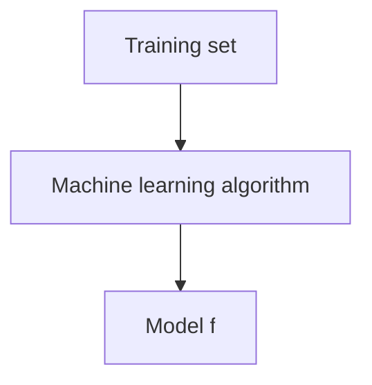

*Figure 19. Obtaining a model from training data*

As in Figure 19, a machine learning algorithm takes the training data and finds a model $f$ that makes $E^{\text{train}}$ small. Two typical examples of loss functions are as follows.

- **Classification error:** 1 if the sign of the prediction differs from the sign of the true label, and 0 if they are the same. This is also called the 0-1 loss, and the training error becomes the number of misclassified samples.

  $$
  \mathrm{loss}\big(y_i, f(x_i)\big) = \begin{cases} 1, & \operatorname{sign}(y_i) \ne \operatorname{sign}\big(f(x_i)\big) \\ 0, & \text{otherwise} \end{cases}
  $$

- **Least squares loss:** Squares the difference between the true value and the prediction. With this loss, the training error equals the SSE of Section 2.10.

  $$
  \mathrm{loss}\big(y_i, f(x_i)\big) = \big(y_i - f(x_i)\big)^2
  $$

**Example.** For five samples with labels $y = (+1, -1, +1, +1, -1)$, let the model outputs be $f(x) = (0.8, 0.3, -0.2, 1.5, -0.7)$.

| Sample $i$ | $y_i$ | $f(x_i)$ | Classification error | Least squares loss $(y_i - f(x_i))^2$ |
|:-----|:-----|:-----|:-----|:-----|
| 1 | $+1$ | 0.8 | 0 | $0.2^2 = 0.04$ |
| 2 | $-1$ | 0.3 | 1 | $(-1.3)^2 = 1.69$ |
| 3 | $+1$ | $-0.2$ | 1 | $1.2^2 = 1.44$ |
| 4 | $+1$ | 1.5 | 0 | $(-0.5)^2 = 0.25$ |
| 5 | $-1$ | $-0.7$ | 0 | $(-0.3)^2 = 0.09$ |

*Table 13. Classification error and least squares loss of five samples*

The training error measured by classification error is the number of samples with the wrong sign, samples 2 and 3, so $E^{\text{train}} = 2$, and the training error measured by least squares loss is $0.04 + 1.69 + 1.44 + 0.25 + 0.09 = 3.51$. Sample 4 has the correct sign, so its classification error is 0, but its squared loss is not 0 because 1.5 deviates from the target value 1. The same predictions are evaluated differently depending on the loss function.

> **Note:** The training error is sometimes defined as the average, divided by the number of samples $n$. Since $n$ is a constant, the model that minimizes the sum and the model that minimizes the average are the same.

### 3.2 Test Error, Underfitting, and Overfitting

When training a model, $E^{\text{train}}$ must be minimized, but that alone is not enough. The purpose of a model is to predict data it has never seen, not data it has already seen, so the **out-of-sample error** measured on data not used for training, that is, the **test error** $E^{\text{test}}$, must also be small. The ability to perform well on data not used for training is called **generalization**.

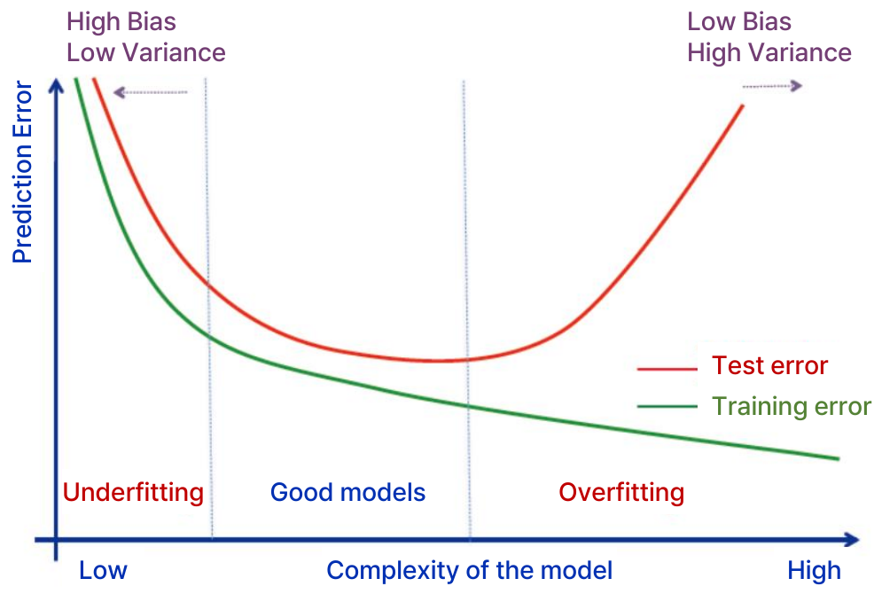

*Figure 20. Training error and test error versus model complexity*

The horizontal axis of Figure 20 is the complexity of the model (from low to high), and the vertical axis is the prediction error. The training error, the green curve, keeps decreasing as the model becomes more complex, because a more complex model can fit the training data more precisely. The test error, the red curve, on the other hand, is U-shaped: it first decreases and then increases again from some point. The curve is divided into three regions.

- **Underfitting:** The model is too simple to represent even the structure of the training data. Both the training error and the test error are large. Models in this region have high **bias** and low **variance**.
- **Good models:** The region where the test error is smallest; the model captures the real structure of the data without being swayed by noise.
- **Overfitting:** The model is so complex that it memorizes even the noise of the training data. The training error is very small, but the test error is large. Models in this region have low bias and high variance.

> **Definition:** The **bias** of a model is the systematic error caused by the model making overly simple assumptions, and the **variance** is the degree to which the trained model changes when the training data change slightly. Raising the complexity reduces the bias and increases the variance, so the two must be balanced. This is called the **bias-variance tradeoff**.

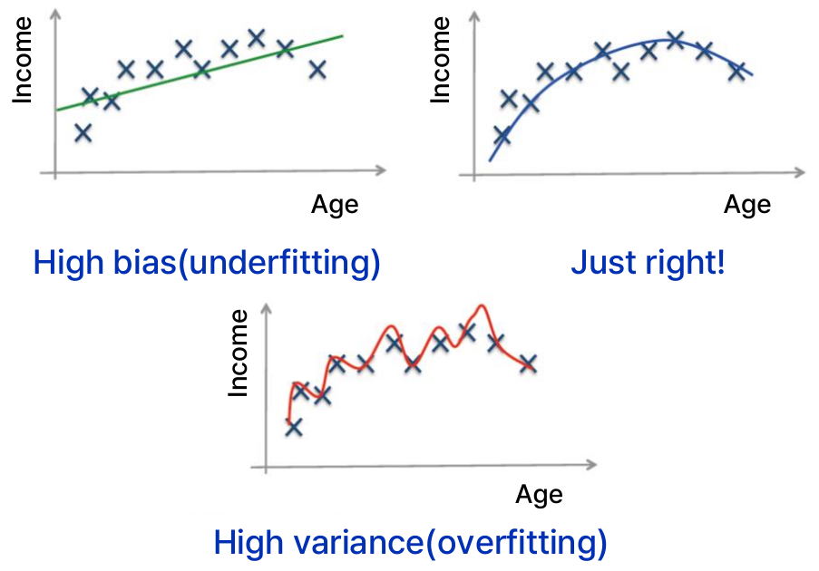

*Figure 21. Examples of underfitting, a good fit, and overfitting*

Figure 21 shows three models that predict income from age. The line at the upper left is a high-bias (underfitting) model that cannot capture the trend of income rising with age and then falling again, and the curve at the upper right is a model that follows the trend appropriately. The curve at the bottom is a high-variance (overfitting) model that wiggles severely to pass through every point; it has almost no error on the training data but predicts the income of a new person poorly. Figure 16 in Section 2.9 shows the same three cases.

> **Key Point:** A small training error does not mean a small test error. The performance of a model must always be evaluated on data not used for training, and a large gap between the training error and the test error suggests overfitting.

> **Note:** When the loss is the squared error, the expected test error at a new input decomposes into the sum of the squared bias of the model, the variance of the model, and the noise variance of the data itself (the error that no model can reduce) [9]. Regularization techniques that reduce overfitting in neural networks are covered in Week 13.

### 3.3 Training, Validation, and Test Data

To select and evaluate a model, the available data are divided by purpose. For example, the data can be shuffled at random and split into 60% for training, 20% for validation, and 20% for testing. The split is random so that the three parts follow the same distribution.

```text
|<----------------- 60% ----------------->|<----- 20% ----->|<----- 20% ----->|
|              Training data              |   Validation    |      Test       |
```

*Figure 22. Example of splitting data into training, validation, and test data*

| Data | Role |
|:-----|:-----|
| **Training data** | The dataset used to train the model. For example, the weights of a classification model are set with these data. |
| **Validation data** | A dataset that is not used to train the model (to set its weights) but is used to tune the model's hyperparameters and to choose one of several candidate models. |
| **Test data** | The dataset used to evaluate the performance of the final model and estimate the test error. |

*Table 14. Roles of training, validation, and test data*

> **Definition:** A model's **parameters** are values learned from the training data, such as the coefficients of linear regression or the weights of a neural network. **Hyperparameters** are values set by people before training, such as the $k$ of k-NN, the degree of polynomial regression, or the number of layers of a neural network, and they are chosen by comparing performance on the validation data.

For example, to choose the $k$ of k-NN, a classifier is built from the training data for each of $k = 1, 3, 5, \ldots$, and the $k$ with the smallest error on the validation data is chosen. The chosen model is then applied once to the test data to report the final performance.

> **Caution:** The test data must not be used in any way to further tune parameters or modify the model. If the model is changed after looking at the results on the test data, those test data have effectively been used for training, and the test error becomes an optimistic estimate of the error that will actually occur on new data.

### 3.4 Evaluation Metrics

The three **evaluation metrics** used to evaluate regression models compare as follows.

| Metric | Formula | Characteristics |
|:-----|:-----|:-----|
| Coefficient of determination $R^2$ | $1 - \dfrac{\sum_i (y_i - \hat{y}_i)^2}{\sum_i (y_i - \bar{y})^2}$ | Can be measured with the data already obtained. Used for regression models. |
| RMSE | $\sqrt{\dfrac{1}{N_{\text{test}}} \sum_{i=1}^{N_{\text{test}}} \big(y(x_i) - \hat{y}(x_i)\big)^2}$ | Requires additional test data. Gives more weight to large errors, emphasizing large mistakes. Has the same unit as the original data, so it is easy to interpret. |
| Cross-validation | $e_{cv}(j) = \mathbf{Y}^{(j)} - \hat{\mathbf{y}}_{-j}\big(\mathbf{X}^{(j)}\big)$ | Can be measured with the data already obtained. Evaluates the model by dividing the dataset into several parts, which helps prevent overfitting. |

*Table 15. Comparison of the three evaluation metrics*

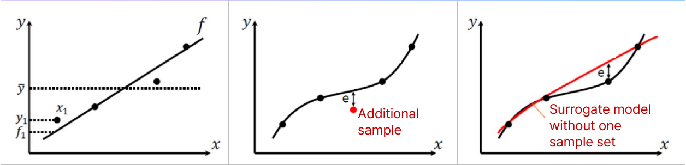

*Figure 23. Errors measured by the coefficient of determination, RMSE, and cross-validation*

The left of Figure 23 is the coefficient of determination, which compares the differences between the data points and the regression line $f$ (such as $y_1 - f_1$) with the differences between the data points and the mean $\bar{y}$. The middle is RMSE, which measures the error $e$ from the prediction curve at an additional sample (red point) not used in building the model. The right is cross-validation, which measures the error $e$ that a surrogate model (red curve) built without one sample (or one set of samples) makes at the position of the left-out sample. A surrogate model is a model that approximates the real function.

### 3.5 Coefficient of Determination

The **coefficient of determination** $R^2$ measures how well the regression line fits the data.

$$
R^2 = 1 - \frac{SS_{\text{RES}}}{SS_{\text{TOT}}} = 1 - \frac{\sum_i (y_i - \hat{y}_i)^2}{\sum_i (y_i - \bar{y})^2}
$$

- $SS_{\text{RES}} = \sum_i (y_i - \hat{y}_i)^2$ is the **residual sum of squares**, the variation that the model leaves unexplained.
- $SS_{\text{TOT}} = \sum_i (y_i - \bar{y})^2$ is the **total sum of squares**, the spread of the data around their mean. It equals the sum of squared errors of a model that ignores the input and always predicts the mean $\bar{y}$.

$R^2$ is therefore the fraction of the total variation of the true values that the model explains. $R^2 = 1$ means every prediction equals the true value, and $R^2 = 0$ means the model is no better than predicting the mean.

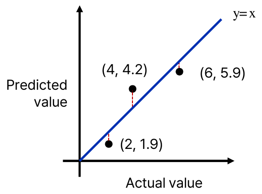

*Figure 24. Coefficient of determination example in terms of true and predicted values*

**Example.** Figure 24 shows a model that predicts 1.9, 4.2, and 5.9 for three samples whose true values (horizontal axis) are 2, 4, and 6. Points on the diagonal $y = x$ are exact predictions, and the red dashed lines are the errors.

| $i$ | True value $y_i$ | Prediction $\hat{y}_i$ | $y_i - \hat{y}_i$ | $(y_i - \hat{y}_i)^2$ | $y_i - \bar{y}$ | $(y_i - \bar{y})^2$ |
|:-----|:-----|:-----|:-----|:-----|:-----|:-----|
| 1 | 2 | 1.9 | 0.1 | 0.01 | $-2$ | 4 |
| 2 | 4 | 4.2 | $-0.2$ | 0.04 | 0 | 0 |
| 3 | 6 | 5.9 | 0.1 | 0.01 | 2 | 4 |

*Table 16. Computation of the coefficient of determination example*

The mean is $\bar{y} = (2 + 4 + 6)/3 = 4$, $SS_{\text{RES}} = 0.01 + 0.04 + 0.01 = 0.06$, and $SS_{\text{TOT}} = 4 + 0 + 4 = 8$. Therefore

$$
R^2 = 1 - \frac{0.06}{8} = 1 - 0.0075 = 0.9925
$$

and the model explains 99.25% of the variation of the true values. Applied to the linear regression example of Section 2.11, $SS_{\text{RES}} = 1/6$, $\bar{y} = 10/3$, and $SS_{\text{TOT}} = (-\tfrac{4}{3})^2 + (-\tfrac{1}{3})^2 + (\tfrac{5}{3})^2 = 14/3$, so $R^2 = 1 - (1/6)/(14/3) = 1 - 1/28 = 27/28 \approx 0.964$.

> **Caution:** The property that $R^2$ lies between 0 and 1 holds when a linear regression with an intercept is fitted by least squares and $R^2$ is measured on the same training data. When it is measured on test data or applied to a model built another way, $SS_{\text{RES}} > SS_{\text{TOT}}$ can occur when the model predicts worse than the mean, and $R^2$ can be negative.

**R value.** Regression results are often reported together with the **correlation coefficient** $R$ between the true values and the predictions. For example, MATLAB's neural network regression plot shows the $R$ value between outputs and targets; $R = 1$ means there is an exact linear relationship between them, and $R$ close to 0 means there is no linear relationship [10].

> **[Probability and Statistics]** The sample correlation coefficient of two variables $u$ and $v$ is $r = \dfrac{\sum_i (u_i - \bar{u})(v_i - \bar{v})}{\sqrt{\sum_i (u_i - \bar{u})^2}\sqrt{\sum_i (v_i - \bar{v})^2}}$, with $-1 \le r \le 1$. When a simple linear regression with an intercept is fitted by least squares, the coefficient of determination equals the square of the correlation coefficient of $x$ and $y$ ($R^2 = r^2$) [9]. In the example of Section 2.11, $r^2 = 27/28$, the same as the coefficient of determination. If the predictions do not come from a least squares line, as in Figure 24, the two do not coincide. For the data of Figure 24, $r = 8 / \sqrt{8 \times 8.06} \approx 0.9963$ and $r^2 \approx 0.9926$, slightly different from $R^2 = 0.9925$.

### 3.6 Root Mean Square Error

The **root mean square error (RMSE)** is the square root of the mean of the squared errors.

$$
\mathrm{RMSE} = \sqrt{\frac{1}{n} \sum_{i=1}^{n} (\hat{y}_i - y_i)^2}
$$

Because of the square root, RMSE has the same unit as the original data. For example, if a model that predicts height in cm has an RMSE of 3, the typical size of its prediction errors can be interpreted as about 3 cm. The mean of the absolute errors (the mean absolute error) is never larger than the RMSE. RMSE is nonnegative, and an RMSE of 0 means every prediction is exact. RMSE is usually computed on additional test data not used in building the model, to measure the model's predictive ability.

**Example.** For the three samples of Figure 24, the errors are 0.1, $-0.2$, and 0.1, so

$$
\mathrm{RMSE} = \sqrt{\frac{0.1^2 + (-0.2)^2 + 0.1^2}{3}} = \sqrt{\frac{0.06}{3}} = \sqrt{0.02} \approx 0.1414
$$

is obtained.

Because the errors are squared, RMSE gives more weight to large errors. The difference becomes clear in comparison with the **mean absolute error (MAE)**, which averages the absolute values of the errors. If the errors of four samples are $(1, 1, 1, 1)$, both MAE and RMSE are 1. If the errors are $(0, 0, 0, 4)$, the MAE is the same at $4/4 = 1$, but the RMSE doubles to $\sqrt{16/4} = 2$. RMSE thus emphasizes and exposes occasional large mistakes.

### 3.7 Cross-Validation

**Cross-validation** is a model validation method that evaluates how well the results of a model generalize to data outside the given dataset. When data are scarce and a separate test set is hard to set aside, it is widely used to estimate the test error from the available data alone, without additional samples.

**k-fold cross-validation** divides a dataset of $N$ samples into $k$ subsets (folds) of similar size. In the $j$-th iteration, the $j$-th subset is held out for testing (the test fold), the model is trained on the remaining $k - 1$ subsets (the training folds), and the error $E_j$ is measured on the held-out subset. This is repeated for $j = 1, \ldots, k$, and the results are averaged.

$$
E = \frac{1}{k} \sum_{j=1}^{k} E_j
$$

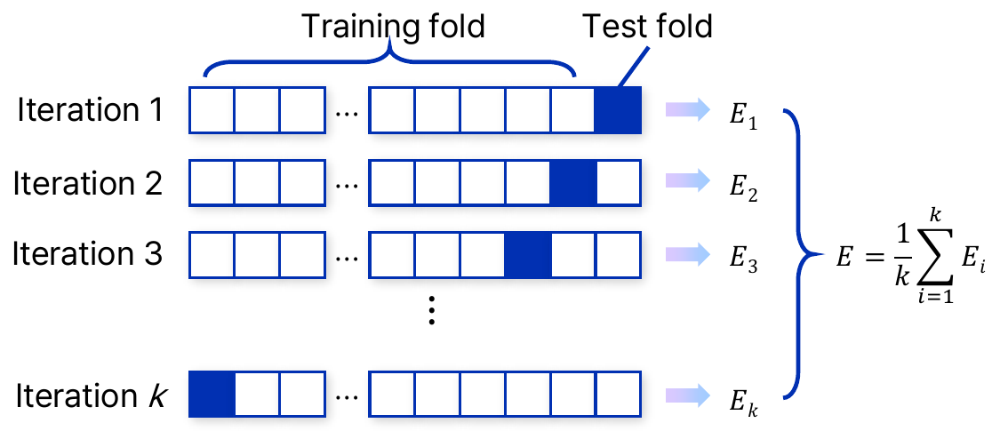

*Figure 25. Iterations of k-fold cross-validation*

In Figure 25, each row is one iteration, and the shaded cell is the test subset of that iteration. Every sample is used for testing exactly once, so the estimate is more stable and depends less on the luck of the split than an evaluation with a single split. Choosing a model or hyperparameters with this estimate helps avoid overfitted models that fit only the training data.

The cross-validation error $e_{cv}$ on the $j$-th subset is defined as follows.

$$
e_{cv}(j) = \mathbf{Y}^{(j)} - \hat{\mathbf{y}}_{-j}\big(\mathbf{X}^{(j)}\big), \qquad j = 1, 2, \ldots, k
$$

Here $\mathbf{X}^{(j)}$ is the input of the held-out $j$-th subset, $\mathbf{Y}^{(j)}$ is the true values of that subset, and $\hat{\mathbf{y}}_{-j}\big(\mathbf{X}^{(j)}\big)$ is the prediction for the held-out inputs $\mathbf{X}^{(j)}$ made by the model built without the $j$-th subset. The subscript $-j$ means "without the $j$-th."

> **Definition:** When $k = N$, that is, each subset holds one sample, training on the remaining $N - 1$ samples with one sample left out is repeated $N$ times. This is called **leave-one-out cross-validation (LOOCV)**. In practice, $k = 5$ or $k = 10$ is often used, balancing computation against the stability of the estimate [9].

### 3.8 Cross-Validation Examples

**Example 1: The Branin-Hoo function.** The Branin-Hoo function is a two-variable function widely used as a test case in optimization and surrogate modeling research [11].

$$
f(x_1, x_2) = \left(x_2 - \frac{5.1}{4\pi^2} x_1^2 + \frac{5}{\pi} x_1 - 6\right)^2 + 10\left(1 - \frac{1}{8\pi}\right)\cos x_1 + 10
$$

It is usually defined on $x_1 \in [-5, 10]$, $x_2 \in [0, 15]$. Leave-one-out cross-validation is performed with 10 training samples $X_1, \ldots, X_{10}$ obtained from this function. The prediction at each $X_j$ is the value given by a surrogate model built from the remaining 9 samples without $X_j$.

| Training sample | True response $y_j$ | Prediction by the model from the other 9 | Error $e_j$ (true $-$ prediction) | $e_j^2$ | $(e_j / y_j)^2$ |
|:-----|:-----|:-----|:-----|:-----|:-----|
| $X_1$ | 23.41 | 31.25 | $-7.84$ | 61.47 | 0.1122 |
| $X_2$ | 118.1 | 126.1 | $-8.00$ | 64.00 | 0.0046 |
| $X_3$ | 69.99 | 52.97 | 17.02 | 289.68 | 0.0591 |
| $X_4$ | 62.02 | 98.57 | $-36.55$ | 1335.90 | 0.3473 |
| $X_5$ | 223.3 | 159.9 | 63.40 | 4019.56 | 0.0806 |
| $X_6$ | 33.16 | 57.90 | $-24.74$ | 612.07 | 0.5566 |
| $X_7$ | 155.9 | 120.4 | 35.50 | 1260.25 | 0.0519 |
| $X_8$ | 72.71 | 92.65 | $-19.94$ | 397.60 | 0.0752 |
| $X_9$ | 13.42 | $-20.89$ | 34.31 | 1177.18 | 6.5364 |
| $X_{10}$ | 16.89 | 91.61 | $-74.72$ | 5583.08 | 19.5711 |

*Table 17. Leave-one-out cross-validation results for the Branin-Hoo function*

From these results, three cross-validation errors (CVE) are computed. Here $N_{\text{test}} = 10$.

**(1) Root mean squared CVE.** The sum of the squared errors is $61.47 + 64.00 + \cdots + 5583.08 = 14800.78$, so

$$
E = \sqrt{\frac{1}{N_{\text{test}}} \sum_{j=1}^{N_{\text{test}}} e_j^2} = \sqrt{\frac{14800.78}{10}} = \sqrt{1480.08} \approx 38.47
$$

is obtained. This is the RMSE of Section 3.6 applied to cross-validation errors.

**(2) Relative root mean squared CVE.** The squares of the relative errors, each error divided by the true value, are averaged. The last column of Table 17 sums to 27.39, so

$$
E_{\text{rel}} = \sqrt{\frac{1}{N_{\text{test}}} \sum_{j=1}^{N_{\text{test}}} \frac{e_j^2}{y_j^2}} = \sqrt{\frac{27.39}{10}} = \sqrt{2.739} \approx 1.655
$$

is obtained. Relative errors become large for samples with small true values. $X_9$ and $X_{10}$ have small true values, 13.42 and 16.89, so their two terms (6.5364 and 19.5711) make up about 95% of the sum 27.39.

> **Note:** The value 5.234 is sometimes given for the relative root mean squared CVE; it is $\sqrt{\sum_j e_j^2 / y_j^2} = \sqrt{27.39} \approx 5.234$, computed without the factor $1/N_{\text{test}}$. Taking the average as in the definition above gives 1.655.

**(3) Normalized root mean squared CVE.** The root mean squared CVE is divided by the range of the true values to express the error as a percentage of the output range.

$$
E_{\text{norm}} = \frac{\sqrt{\frac{1}{N_{\text{test}}} \sum_{j=1}^{N_{\text{test}}} e_j^2}}{\max(y_j) - \min(y_j)} = \frac{38.47}{223.3 - 13.42} = \frac{38.47}{209.88} \approx 0.1833
$$

The average prediction error reaches about 18% of the output range, so this surrogate model can hardly be called accurate yet. More samples are needed to improve the accuracy of the prediction model.

**Example 2: Leave-one-out cross-validation with three samples.** For the three samples $(0, 0)$, $(1, 2)$, $(2, 3)$, estimate the mean of the squared CVE. The model is the line through the remaining two points, that is, linear interpolation.

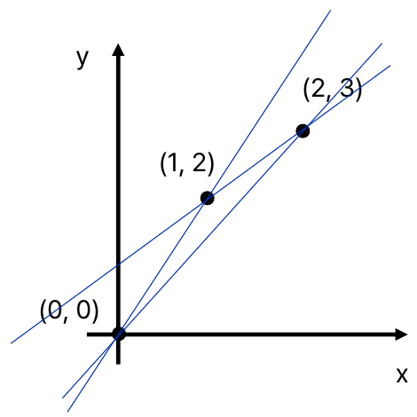

*Figure 26. Three interpolating lines, each with one sample left out*

- **Leaving out $(0, 0)$:** The line through $(1, 2)$ and $(2, 3)$ has slope $(3 - 2)/(2 - 1) = 1$ and intercept $2 - 1 = 1$, so $\hat{y} = x + 1$. The prediction at $x = 0$ is 1, so the error is $0 - 1 = -1$.
- **Leaving out $(1, 2)$:** The line through $(0, 0)$ and $(2, 3)$ is $\hat{y} = 1.5x$. The prediction at $x = 1$ is 1.5, so the error is $2 - 1.5 = 0.5$.
- **Leaving out $(2, 3)$:** The line through $(0, 0)$ and $(1, 2)$ is $\hat{y} = 2x$. The prediction at $x = 2$ is 4, so the error is $3 - 4 = -1$.

| Left-out sample | Interpolating line | Prediction | Error $e_j$ | $e_j^2$ |
|:-----|:-----|:-----|:-----|:-----|
| $(0, 0)$ | $\hat{y} = x + 1$ | 1 | $-1$ | 1 |
| $(1, 2)$ | $\hat{y} = 1.5x$ | 1.5 | 0.5 | 0.25 |
| $(2, 3)$ | $\hat{y} = 2x$ | 4 | $-1$ | 1 |

*Table 18. Leave-one-out cross-validation with three samples*

The mean of the squared CVE is $(1 + 0.25 + 1)/3 = 2.25/3 = 0.75$, and its square root, the root mean squared CVE, is $\sqrt{0.75} \approx 0.866$. The fact that the three lines differ greatly means that with few samples the model depends heavily on a single data point.

### 3.9 Reinforcement Learning

> **Definition:** **Reinforcement learning** is a learning paradigm in which an agent learns how to make decisions by interacting with an environment.

The goal of reinforcement learning is to maximize the sum of the rewards received over time.

$$
\text{Maximize} \ \sum_{i=1}^{\infty} \text{Reward}(\text{State}_i, \text{Action}_i)
$$

Unlike supervised learning, reinforcement learning has no labels that tell the correct action for each state. The data used for learning are obtained by the agent's own actions. When the agent takes action $\text{Action}_i$ in state $\text{State}_i$, the environment returns a reward and the next state.

$$
\text{Reward}_i, \ \text{State}_{i+1} = \text{Interact}(\text{State}_i, \text{Action}_i)
$$

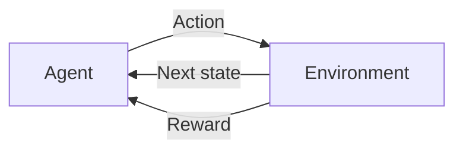

*Figure 27. Interaction between the agent and the environment in reinforcement learning*

| Component | Meaning |
|:-----|:-----|
| **Agent** | The entity that learns to make decisions. It observes the state and chooses actions that interact with the environment. |
| **Environment** | The external system with which the agent interacts. It receives actions from the agent, transitions to a new state, and gives feedback in the form of rewards. |
| **State** | A representation of the environment at a given time. |
| **Action** | A decision made by the agent based on the current state. Actions can change the state of the environment. |
| **Reward** | A number that indicates how desirable the agent's action is. |

*Table 19. Components of reinforcement learning*

What the agent obtains as the result of reinforcement learning is a rule that decides which action to take in each state, called a **policy** [12]. Figure 27 is the same as the car example in Figure 5. The car (agent) observes its current position and speed (state) on the track (environment), decides on steering and acceleration (action), and receives a larger reward the faster it drives without leaving the track.

> **Note:** Since an infinite sum of rewards can diverge, one usually maximizes the **return** $G = \sum_{t=0}^{\infty} \gamma^{t} r_{t+1}$, which multiplies the rewards by a **discount factor** $\gamma$ $(0 \le \gamma < 1)$ [12]. Here $r_{t+1}$ is the reward received after the $t$-th action. With $\gamma < 1$, the sum is finite when the rewards are bounded, and the same reward is worth more the earlier it is received.

### 3.10 Applications of Reinforcement Learning

**Atari games.** DeepMind's DQN (deep Q-network) learned 49 Atari 2600 video games while applying the same model architecture and the same hyperparameters to all of them [13]. Atari is an American video game company. The elements of reinforcement learning in this problem are as follows.

- **State:** the raw pixels of the game screen
- **Action:** the valid moves in the game
- **Reward:** the game score

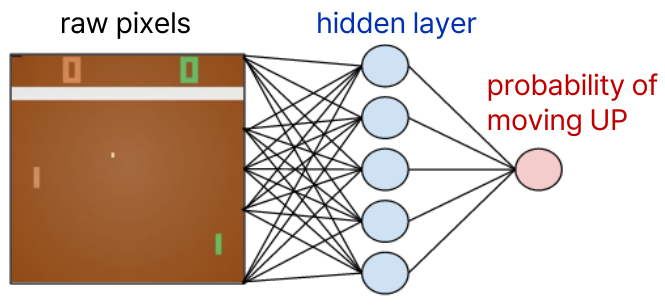

*Figure 28. Neural network that chooses actions from the pixels of a game screen*

Figure 28 is a simplified picture of a neural network that takes the pixels of a table tennis game (Pong) screen as input and, through a hidden layer, outputs the probability of moving the paddle up. Without being told the rules of the game or the position of the ball, the network learns which actions are good from the screen pixels and the score alone.

> **[Deep Learning]** The actual DQN processes an input formed by stacking the four most recent frames with a convolutional neural network (CNN) and, instead of probabilities, outputs for each possible action the expected value of the future rewards (the action value), choosing the action with the largest value [13]. The basic structure of artificial neural networks is covered in Week 13.

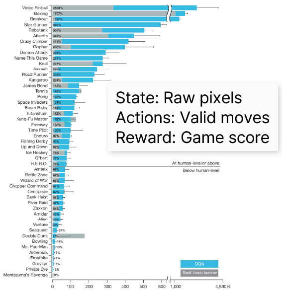

*Figure 29. Performance of DQN on each Atari game*

The bars in Figure 29 are the scores for each game normalized so that the score of random play is 0% and the score of a professional human games tester is 100% [13]. The blue bars are DQN, and the gray bars are the best existing linear learner. The games above the horizontal line are at human level (75%) or above, and those below it are below human level. DQN achieved scores far higher than humans in games such as Video Pinball, Boxing, and Breakout and reached human level or above in 29 of the 49 games, but it scored almost nothing in games such as Montezuma's Revenge that require planning over a long time [13].

**Go.** Reinforcement learning has also learned how to beat humans in games that are hard because their search space is too large.

- DeepMind's AlphaGo Zero learned only through reinforcement learning by playing against itself, without human game records, and far surpassed the earlier version trained by supervised learning on human game records [14].
- AlphaZero, an algorithm of the same family, started from nothing but the rules of the game and reached a superhuman level in chess, shogi, and Go within 24 hours [15].

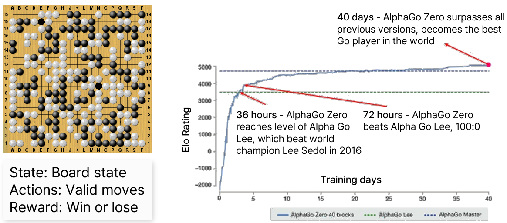

*Figure 30. Elo rating of AlphaGo Zero versus days of training*

In Go, the state is the board state, the actions are the valid moves, and the reward is a win or a loss. The vertical axis of Figure 30 is the **Elo rating**, which expresses relative playing strength as a number derived from game results, and the horizontal axis is the number of training days. AlphaGo Zero reached the level of AlphaGo Lee, which beat world champion Lee Sedol in 2016, after 36 hours of training, beat AlphaGo Lee 100:0 after 72 hours, and after 40 days surpassed all previous versions, including AlphaGo Master [14].

> **[Artificial Intelligence]** In Go, there are on average about 250 possible moves per turn, far more than in chess (about 35), so it cannot be solved by game tree search that looks ahead at every possible move [16]. AlphaGo Zero used a neural network to evaluate the value of positions and promising moves, greatly reducing the branches to search [14].

### 3.11 Grid World Example

A simple example summarizes reinforcement learning. The agent moves on a map made of a $3 \times 3$ grid, and its goal is to reach the treasure chest in cell 9.

- **State:** the position on the map, $\lbrace1, 2, \ldots, 9\rbrace$
- **Action:** moves within the map (up, right, and so on) and staying in place
- **Reward:** 100 on reaching the treasure chest, 0 otherwise

```text
┌──────────┬──────────┬──────────┐
│ 7    →   │ 8    →   │ 9    ★   │
├──────────┼──────────┼──────────┤
│ 4    →   │ 5    ↑   │ 6    ↑   │
├──────────┼──────────┼──────────┤
│ 1    ↑   │ 2    →   │ 3    ↑   │
└──────────┴──────────┴──────────┘
```

*Figure 31. Grid world and the action chosen in each state (★: treasure chest)*

The arrows in Figure 31 are the actions the agent chooses in each state. With the action in state $s$ written as $A_s$, the actions are $A_1 = \lbrace\text{up}\rbrace$, $A_2 = \lbrace\text{right}\rbrace$, $A_3 = \lbrace\text{up}\rbrace$, $\ldots$, $A_9 = \lbrace\text{stay}\rbrace$, and the collection of these nine actions is the policy of Section 3.9.

| State | Action | Next state | Moves to cell 9 |
|:-----|:-----|:-----|:-----|
| 1 | up | 4 | 4 |
| 2 | right | 3 | 3 |
| 3 | up | 6 | 2 |
| 4 | right | 5 | 3 |
| 5 | up | 8 | 2 |
| 6 | up | 9 | 1 |
| 7 | right | 8 | 2 |
| 8 | right | 9 | 1 |
| 9 | stay | 9 | 0 |

*Table 20. Actions and numbers of moves under the grid world policy*

Starting from state 1, the agent reaches the treasure in four moves, $1 \to 4 \to 5 \to 8 \to 9$. If reaching the treasure ends one attempt (an episode), then without discounting the return is 100 from any starting state other than the treasure. With the discount factor $\gamma = 0.9$, the return depends on when the reward is received. From state 1, the reward is received at the fourth move, so $G = \gamma^{3} \times 100 = 0.729 \times 100 = 72.9$; from state 2 it is $\gamma^{2} \times 100 = 81$, from state 7 it is $\gamma \times 100 = 90$, and from states 6 and 8 it is 100.

The policy in Figure 31 reaches the treasure from every state in the fewest moves, so it is one of the optimal policies that maximize the return when $\gamma < 1$. Going $1 \to 2 \to 3 \to 6 \to 9$ from state 1 also takes 4 moves, so the optimal policy is not unique. A reinforcement learning agent does not know such a policy in advance; it learns by itself, from the rewards it receives while moving around many times, which actions in which states lead to the treasure.

---

<br>

## Concept Applications

| Situation | Result and reason |
|:-----|:------------|
| Only customers' purchase records are available, with no correct answers about customer types, and similar customers are to be grouped. | **Unsupervised learning (clustering).** There are no labels, so a method such as K-means clustering finds the structure of the data itself. |
| New messages are to be classified using 10,000 messages labeled as spam or not. | **Supervised learning (binary classification).** There are labels, and they take two discrete values, so a classifier such as k-NN or an SVM is trained. |
| The weight (g) of a fruit is to be predicted from its length and width. | **Supervised learning (regression).** The label, weight, is a real number, so a regression model such as linear regression is used and evaluated with RMSE or $R^2$. |
| A robot is to learn to walk without falling through trial and error. | **Reinforcement learning.** No correct answer is given for each motion; a policy is learned by giving the progress made without falling as the reward. |
| Running K-means clustering twice gave different results. | **Different initial centroids converged to different local minima.** Run it several times and choose the result with the smallest within-cluster sum of squares $J$. |
| Raising the degree of a polynomial regression brought the training error close to 0 but increased the test error. | **This is overfitting.** The model memorized even the noise of the training data, so lower the degree or choose it with validation data. |
| The $k$ of k-NN was chosen again after looking at the results on the test data. | **The test error becomes an optimistic estimate.** The test data were used for model selection, so $k$ should be chosen with validation data or cross-validation. |
| There are only 20 samples, so it is hard to set aside separate test data. | **Use k-fold or leave-one-out cross-validation.** Every sample is used for testing once, so the test error can be estimated even with little data. |

*Table 21. Judgments in situations applying learning types and evaluation methods*

**True/False Check:**

| Statement | Judgment and Reason |
|:-----|:------------|
| Every artificial intelligence technique is machine learning. | **F.** Machine learning is a subfield of artificial intelligence. An expert system whose rules were written by people is artificial intelligence but does not learn. |
| A single-layer perceptron can solve the XOR problem. | **F.** The two classes of XOR cannot be separated by a single line. A multilayer neural network with a hidden layer is needed. |
| K-means clustering always finds the global minimum of the within-cluster sum of squares. | **F.** Each step does not increase $J$, so it converges, but it can get stuck in a local minimum depending on the initial centroids. |
| The training phase of k-NN computes no distances. | **T.** The training phase only stores the data; distances are computed at prediction time. |
| The decision boundary of an SVM is equally affected by the positions of all training samples. | **F.** The boundary is determined by the support vectors alone, and moving samples outside the margin slightly does not change it. |
| The residuals of least squares linear regression sum to 0 (when there is an intercept). | **T.** The normal equation for $b$, $\sum (y_i - a x_i - b) = 0$, is exactly the condition that the residuals sum to 0. |
| $R^2$ is nonnegative on any data. | **F.** On data not used for training, such as test data, it can be negative if the model does worse than the mean. |
| If RMSE and MAE are equal, the error distributions are the same. | **F.** The errors $(1, 1, 1, 1)$ have MAE and RMSE both equal to 1, but $(0, 0, 0, 4)$, also with MAE 1, has RMSE 2. Equality of the two means that all errors have the same magnitude. |
| Leave-one-out cross-validation is k-fold cross-validation with $k = N$. | **T.** Each subset holds one sample, so the model is trained $N$ times. |
| The training data of reinforcement learning are given in advance with labels attached. | **F.** The training data are the records of states, actions, and rewards the agent obtains by acting itself. |

---

<br>

## Summary

| Concept | Key Summary |
|:--------|:------------|
| Artificial intelligence | The development of computer systems that perform tasks requiring human intelligence. Machine learning lies within artificial intelligence, and deep learning within machine learning. |
| Turing test | A machine passes if the evaluator cannot tell it from a human through text conversation alone. Proposed by Turing in 1950. |
| History of AI | Birth in the 1950s, the need for domain knowledge in the 1960s, expert systems in the 1970s, stagnation and backpropagation in the 1980s, statistical machine learning in the 1990s, and data-driven practical use from the 2000s on. |
| Machine learning | Learns patterns from data without explicit programming to optimize a performance criterion. Statistics provides inference from samples, and computer science provides efficient optimization algorithms. |
| Three types of learning | Unsupervised learning finds patterns in unlabeled data, supervised learning learns the relationship between inputs and answers from labeled data, and reinforcement learning learns how to act from rewards. |
| K-means clustering | Repeats setting initial centroids, assigning to the nearest centroid, and updating centroids to the means. It converges as the within-cluster sum of squares decreases, but possibly to a local minimum, and it is sensitive to outliers and the choice of $K$. |
| Classification | Supervised learning with discrete labels. A binary classifier is $f: \mathbb{R}^d \to \lbrace-1, +1\rbrace$, and the prediction changes at the decision boundary. |
| k-NN | Stores the training data and classifies a new point by majority vote of its $k$ nearest neighbors in Euclidean distance. Prediction is slow, and it is sensitive to feature scales and the curse of dimensionality. |
| SVM | Among the hyperplanes of $f(x) = \operatorname{sgn}(w \cdot x + b)$, chooses the one that maximizes the margin $2/\lVert w \rVert$. The boundary is determined by the support vectors alone. |
| Linear regression | Finds the coefficients that minimize the sum of squared errors SSE through the normal equations. For simple linear regression, $a = \sum (x_i - \bar{x})(y_i - \bar{y}) / \sum (x_i - \bar{x})^2$ and $b = \bar{y} - a\bar{x}$. |
| Training error and loss functions | $E^{\text{train}}(f) = \sum_i \mathrm{loss}(y_i, f(x_i))$. Examples of loss functions are the classification error (0-1 loss) and the least squares loss. |
| Underfitting and overfitting | A model that is too simple has high bias and large errors of both kinds; a model that is too complex has high variance, with a small training error but a large test error. |
| Training, validation, and test data | Parameters are set with training data, hyperparameters and models are chosen with validation data, and only the final performance is evaluated with test data. The model must not be tuned with test data. |
| Coefficient of determination | $R^2 = 1 - SS_{\text{RES}}/SS_{\text{TOT}}$, the fraction of the variation of the true values that the model explains. On the training data of a least squares line it lies between 0 and 1 and equals the square of the correlation coefficient. |
| RMSE | $\sqrt{\frac{1}{n}\sum (\hat{y}_i - y_i)^2}$. It has the same unit as the original data and emphasizes large errors. |
| Cross-validation | Divides the data into $k$ subsets and averages the errors of models trained with each subset held out in turn. With $k = N$, it is leave-one-out cross-validation. |
| Reinforcement learning | An agent interacts with an environment and learns, from states, actions, and rewards, a policy that maximizes the sum of rewards. A discount factor keeps the return finite and favors earlier rewards. |

---

<br>

## Self-Check Questions

1. **Inclusion relationship:** State the relationship among artificial intelligence, machine learning, and deep learning, and explain which of the three a spam filter whose rules were written directly by people belongs to.

   <details>
   <summary>Answer</summary>

   Deep learning is a branch of machine learning, and machine learning is a branch of artificial intelligence. A spam filter whose rules were written directly by people is a program that mimics human judgment, so it belongs to artificial intelligence, but it does not learn its rules from data, so it does not belong to machine learning.

   </details>

2. **Stagnation of AI:** Give three criticisms that expert systems received in the 1970s, and explain how they relate to the rise of machine learning.

   <details>
   <summary>Answer</summary>

   Expert systems were criticized as so brittle that they failed outside a narrow domain, as requiring much time and effort to convert experts' knowledge into rules, and as unable to learn by themselves. Because of these limitations, expectations were not met and stagnation came in the 1980s; afterwards, statistical machine learning, which learns models from data instead of having people write rules, became the mainstream in the 1990s.

   </details>

3. **K-means computation:** Cluster the one-dimensional data 1, 2, 6, 7, 8 with $K = 2$. With initial centroids 1 and 2, find how the centroids change until convergence.

   <details>
   <summary>Answer</summary>

   In the first assignment, 1 is closest to centroid 1, and 2, 6, 7, 8 are closest to centroid 2. Updating gives $\mu_1 = 1$ and $\mu_2 = (2 + 6 + 7 + 8)/4 = 5.75$. In the second assignment, $\lvert 2 - 1 \rvert = 1 < \lvert 2 - 5.75 \rvert = 3.75$, so 2 moves to cluster 1, while 6, 7, 8 remain in cluster 2. Updating gives $\mu_1 = (1 + 2)/2 = 1.5$ and $\mu_2 = (6 + 7 + 8)/3 = 7$. The third assignment is the same as the second, so the algorithm converges, and the final clusters are $\lbrace1, 2\rbrace$ and $\lbrace6, 7, 8\rbrace$.

   </details>

4. **k-NN and $k$:** How is the new fruit classified by 5-NN in Table 10? Explain what problem arises when $k$ equals the number of training samples, as in this case.

   <details>
   <summary>Answer</summary>

   The five neighbors are 3 bananas (fruits 1, 2, 4) and 2 oranges (fruits 3, 5), so it is classified as a banana. In this example, $k = 5$ equals the number of training samples, so every sample votes, and the new fruit is always classified as a banana, the most common class overall, whatever its features. When $k$ is too large in this way, the idea of looking at nearby neighbors is lost, so a suitable $k$ must be chosen with validation data.

   </details>

5. **SVM:** For an SVM with $w = (2, 0)$ and $b = -4$, find the classifications of the points $(3, 1)$ and $(1, 5)$, and find the width of the margin when the scale is set so that the support vectors satisfy $\lvert w \cdot x + b \rvert = 1$.

   <details>
   <summary>Answer</summary>

   At $(3, 1)$, $w \cdot x + b = 6 + 0 - 4 = 2 > 0$, so $+1$; at $(1, 5)$, $2 + 0 - 4 = -2 < 0$, so $-1$. The hyperplane is $2x_1 - 4 = 0$, that is, the line $x_1 = 2$. Since $\lVert w \rVert = 2$, the width of the margin is $2 / \lVert w \rVert = 1$.

   </details>

6. **Linear regression:** Fit a least squares line to the three samples $(0, 1)$, $(1, 3)$, $(2, 4)$, and find the prediction at $x = 3$.

   <details>
   <summary>Answer</summary>

   $\bar{x} = 1$ and $\bar{y} = 8/3$. Since $\sum (x_i - \bar{x})(y_i - \bar{y}) = (-1)(-\tfrac{5}{3}) + 0 + (1)(\tfrac{4}{3}) = 3$ and $\sum (x_i - \bar{x})^2 = 2$, $a = 1.5$ and $b = 8/3 - 1.5 = 7/6 \approx 1.167$. The line is $\hat{y} = 1.5x + 7/6$, and at $x = 3$, $\hat{y} = 4.5 + 1.167 \approx 5.667$.

   </details>

7. **Coefficient of determination and RMSE:** With true values 1, 3, 5 and predictions 2, 3, 4, find $R^2$ and RMSE.

   <details>
   <summary>Answer</summary>

   The errors are $-1$, 0, 1, so $SS_{\text{RES}} = 1 + 0 + 1 = 2$. Since $\bar{y} = 3$, $SS_{\text{TOT}} = 4 + 0 + 4 = 8$ and $R^2 = 1 - 2/8 = 0.75$. $\mathrm{RMSE} = \sqrt{2/3} \approx 0.816$.

   </details>

8. **Judging overfitting:** The training and validation errors of two models are (5.0, 5.3) for model A and (0.2, 9.8) for model B. Which model should be chosen, and what has happened to model B?

   <details>
   <summary>Answer</summary>

   Choose model A, whose validation error, which reflects performance on new data, is smaller. Model B has a very small training error but a large validation error, so it is overfitted (high variance), having memorized even the noise of the training data.

   </details>

9. **Data split:** Explain why data are divided into training, validation, and test data in terms of the role of each, and state why the test data must not be used to modify the model.

   <details>
   <summary>Answer</summary>

   The training data set the model's parameters, the validation data choose the hyperparameters and the model, and the test data evaluate the performance of the final model once. If the model is changed after looking at the test data, it becomes fitted to those data, and the test error is estimated as smaller, that is, more optimistic, than the error on truly new data.

   </details>

10. **Cross-validation computation:** The leave-one-out cross-validation errors of four samples are 2, $-1$, 1, $-2$. Find the root mean squared CVE, and if the largest and smallest true values are 20 and 10, find the normalized root mean squared CVE.

    <details>
    <summary>Answer</summary>

    The sum of the squared errors is $4 + 1 + 1 + 4 = 10$, so $E = \sqrt{10/4} = \sqrt{2.5} \approx 1.581$. The normalized value is $1.581 / (20 - 10) \approx 0.158$; the average error is about 16% of the output range.

    </details>

11. **Advantages of cross-validation:** Explain the advantages of k-fold cross-validation compared with splitting the data into training and test data only once.

    <details>
    <summary>Answer</summary>

    With a single split, the error estimate varies greatly depending on which samples happen to be chosen for testing, and the data set aside for testing cannot be used for training. k-fold cross-validation uses every sample for testing exactly once and trains on the rest, so it uses all the available data without additional data and gives a stable error estimate that depends less on the luck of the split.

    </details>

12. **Reinforcement learning:** In the grid world of Figure 31, find the returns starting from states 1, 5, and 8 when the discount factor is $\gamma = 0.5$, and explain how the training data of supervised learning and reinforcement learning differ.

    <details>
    <summary>Answer</summary>

    From state 1, the reward is received at the fourth move, so the return is $0.5^{3} \times 100 = 12.5$; from state 5, the path $5 \to 8 \to 9$ receives it at the second move, so $0.5 \times 100 = 50$; from state 8, it is received at the first move, so 100. Supervised learning learns from data with a correct label attached to each input in advance, whereas reinforcement learning is given no correct actions and learns from the records of states, actions, and rewards that the agent obtains by acting itself.

    </details>

---

<br>

## References

1. A. M. Turing, "Computing machinery and intelligence," *Mind*, vol. 59, no. 236, pp. 433-460, 1950.
2. J. McCarthy, M. L. Minsky, N. Rochester, and C. E. Shannon, "A proposal for the Dartmouth summer research project on artificial intelligence, August 31, 1955," *AI Magazine*, vol. 27, no. 4, pp. 12-14, 2006.
3. S. Russell and P. Norvig, *Artificial Intelligence: A Modern Approach*, 4th ed. Hoboken, NJ, USA: Pearson, 2021.
4. F. Rosenblatt, "The perceptron: A probabilistic model for information storage and organization in the brain," *Psychological Review*, vol. 65, no. 6, pp. 386-408, 1958.
5. J. Weizenbaum, "ELIZA: A computer program for the study of natural language communication between man and machine," *Communications of the ACM*, vol. 9, no. 1, pp. 36-45, 1966.
6. M. Minsky and S. Papert, *Perceptrons: An Introduction to Computational Geometry*. Cambridge, MA, USA: MIT Press, 1969.
7. D. E. Rumelhart, G. E. Hinton, and R. J. Williams, "Learning representations by back-propagating errors," *Nature*, vol. 323, no. 6088, pp. 533-536, 1986.
8. C. Cortes and V. Vapnik, "Support-vector networks," *Machine Learning*, vol. 20, no. 3, pp. 273-297, 1995.
9. G. James, D. Witten, T. Hastie, and R. Tibshirani, *An Introduction to Statistical Learning: with Applications in R*, 2nd ed. New York, NY, USA: Springer, 2021.
10. MathWorks, "Analyze shallow neural network performance after training," *Deep Learning Toolbox Documentation*, R2024a. https://www.mathworks.com/help/releases/R2024a/deeplearning/ug/analyze-neural-network-performance-after-training.html
11. S. Surjanovic and D. Bingham, "Branin function," *Virtual Library of Simulation Experiments: Test Functions and Datasets*, Simon Fraser University. https://www.sfu.ca/~ssurjano/branin.html
12. R. S. Sutton and A. G. Barto, *Reinforcement Learning: An Introduction*, 2nd ed. Cambridge, MA, USA: MIT Press, 2018.
13. V. Mnih et al., "Human-level control through deep reinforcement learning," *Nature*, vol. 518, no. 7540, pp. 529-533, 2015.
14. D. Silver et al., "Mastering the game of Go without human knowledge," *Nature*, vol. 550, no. 7676, pp. 354-359, 2017.
15. D. Silver et al., "Mastering chess and shogi by self-play with a general reinforcement learning algorithm," arXiv:1712.01815, 2017.
16. D. Silver et al., "Mastering the game of Go with deep neural networks and tree search," *Nature*, vol. 529, no. 7587, pp. 484-489, 2016.
