# 13주차 이론 — 인공신경망 개론

[레포지토리 안내](../../README.ko.md) | [English](Concepts_Lecture.md) | [한국어](Concepts_Lecture.ko.md)

> **최종 수정일:** 2026-11-04

> **학습 목표:**
> 1. 생물학적 뉴런과 인공뉴런의 대응 관계를 설명하고, 퍼셉트론의 출력을 가중합과 활성화 함수로 계산할 수 있다
> 2. 시그모이드, 하이퍼볼릭 탄젠트, ReLU의 정의와 도함수, 장단점을 비교하고, 활성화 함수가 비선형이어야 하는 이유를 설명할 수 있다
> 3. 단일 은닉층 신경망과 심층 신경망의 순전파를 수식으로 쓰고, 손실 함수, 경험적 손실, 평균 제곱 오차를 계산할 수 있다
> 4. 기울기 벡터의 의미를 설명하고, 연쇄 법칙을 이용한 역전파로 2층 신경망의 모든 매개변수에 대한 기울기를 단계별로 계산할 수 있다
> 5. 경사 하강법의 갱신 규칙과 학습률의 영향을 설명하고, 적응형 학습률과 미니배치 경사 하강법의 아이디어를 설명할 수 있다
> 6. 과적합과 과소적합을 구분하고, 드롭아웃과 조기 종료가 과적합을 줄이는 원리를 설명할 수 있다

---

## 목차

- [1. 인공뉴런](#1-인공뉴런)
  - [1.1 인공지능, 기계 학습, 딥러닝](#11-인공지능-기계-학습-딥러닝)
  - [1.2 인공신경망의 개념](#12-인공신경망의-개념)
  - [1.3 생물학적 뉴런과 시냅스](#13-생물학적-뉴런과-시냅스)
  - [1.4 인공뉴런](#14-인공뉴런)
  - [1.5 다층 인공신경망](#15-다층-인공신경망)
  - [1.6 인공신경망의 역사](#16-인공신경망의-역사)
  - [1.7 인공신경망이 다시 주목받은 이유](#17-인공신경망이-다시-주목받은-이유)
  - [1.8 퍼셉트론](#18-퍼셉트론)
  - [1.9 활성화 함수의 개념](#19-활성화-함수의-개념)
  - [1.10 시그모이드 함수](#110-시그모이드-함수)
  - [1.11 하이퍼볼릭 탄젠트 함수](#111-하이퍼볼릭-탄젠트-함수)
  - [1.12 ReLU 함수](#112-relu-함수)
  - [1.13 활성화 함수의 목적: 비선형성](#113-활성화-함수의-목적-비선형성)
  - [1.14 예제: 항공기 분류 퍼셉트론](#114-예제-항공기-분류-퍼셉트론)
  - [1.15 퍼셉트론의 한계: 선형 분리 가능성](#115-퍼셉트론의-한계-선형-분리-가능성)
- [2. 인공신경망 학습 I: 손실 함수와 기울기](#2-인공신경망-학습-i-손실-함수와-기울기)
  - [2.1 다중 출력 퍼셉트론](#21-다중-출력-퍼셉트론)
  - [2.2 단일 은닉층 신경망](#22-단일-은닉층-신경망)
  - [2.3 심층 신경망](#23-심층-신경망)
  - [2.4 예제: 수업 통과 여부 예측](#24-예제-수업-통과-여부-예측)
  - [2.5 손실 함수와 경험적 손실](#25-손실-함수와-경험적-손실)
  - [2.6 평균 제곱 오차와 교차 엔트로피](#26-평균-제곱-오차와-교차-엔트로피)
  - [2.7 학습의 기본 개념](#27-학습의-기본-개념)
  - [2.8 매개변수 벡터와 기울기 벡터](#28-매개변수-벡터와-기울기-벡터)
  - [2.9 기울기와 경사 하강법](#29-기울기와-경사-하강법)
  - [2.10 예제: 기울기 계산](#210-예제-기울기-계산)
- [3. 인공신경망 학습 II: 역전파, 경사 하강법, 정규화](#3-인공신경망-학습-ii-역전파-경사-하강법-정규화)
  - [3.1 연쇄 법칙과 계산 그래프](#31-연쇄-법칙과-계산-그래프)
  - [3.2 2층 신경망의 역전파](#32-2층-신경망의-역전파)
  - [3.3 역전파 계산 예제](#33-역전파-계산-예제)
  - [3.4 일반적인 역전파 알고리즘](#34-일반적인-역전파-알고리즘)
  - [3.5 경사 하강 알고리즘과 학습률](#35-경사-하강-알고리즘과-학습률)
  - [3.6 학습률의 결정과 적응형 학습률](#36-학습률의-결정과-적응형-학습률)
  - [3.7 배치, 확률적, 미니배치 경사 하강법](#37-배치-확률적-미니배치-경사-하강법)
  - [3.8 과적합](#38-과적합)
  - [3.9 정규화 I: 드롭아웃](#39-정규화-i-드롭아웃)
  - [3.10 정규화 II: 조기 종료](#310-정규화-ii-조기-종료)
  - [3.11 예제: 배터리 모듈 데이터의 회귀](#311-예제-배터리-모듈-데이터의-회귀)
- [개념 적용](#개념-적용)
- [요약](#요약)
- [점검 문제](#점검-문제)
- [참고 문헌](#참고-문헌)

---

<br>

## 1. 인공뉴런

### 1.1 인공지능, 기계 학습, 딥러닝

인공신경망을 이해하려면 먼저 인공지능, 기계 학습, 딥러닝의 관계를 알아야 한다. 세 분야는 그림 1처럼 바깥에서 안쪽으로 포함 관계를 이룬다(12주차).

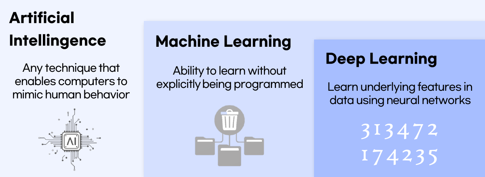

*그림 1. 인공지능, 기계 학습, 딥러닝의 포함 관계*

| 분야 | 정의 |
|:-----|:-----|
| 인공지능(artificial intelligence) | 컴퓨터가 인간의 행동을 흉내 낼 수 있게 하는 모든 기법이다. |
| 기계 학습(machine learning) | 명시적으로 프로그래밍하지 않아도 데이터로부터 학습하는 능력이며, 인공지능의 한 분야이다. |
| 딥러닝(deep learning) | 인공신경망을 이용해 데이터에 숨어 있는 특징을 학습하는 방법이며, 기계 학습의 한 분야이다. |

*표 1. 인공지능, 기계 학습, 딥러닝의 정의*

> **용어 정의:** **딥러닝(deep learning)** 은 기계 학습의 하위 집합으로, 여러 개의 계층(layer)을 쌓은 인공신경망을 사용하는 학습 방법이다. 계층이 깊게 쌓여 있다는 뜻에서 "deep"이라는 이름이 붙었다. 딥러닝 신경망은 이미지, 소리, 텍스트처럼 구조가 복잡한 데이터를 학습하고 이해하도록 설계된다.

그림의 딥러닝 칸에 있는 손글씨 숫자는 딥러닝의 대표적인 응용인 손글씨 인식을 나타낸다. 사람이 "숫자 3에는 오른쪽으로 볼록한 곡선이 위아래로 두 개 있다" 같은 규칙을 직접 프로그래밍하지 않아도, 신경망은 많은 예시로부터 숫자를 구별하는 특징을 스스로 찾아낸다.

### 1.2 인공신경망의 개념

> **용어 정의:** **인공신경망(artificial neural network, ANN)** 은 인간 두뇌의 생물학적 신경망의 구조와 기능에서 영감을 받은 계산 모델이다. 일반적으로 서로 연결된 수많은 인공뉴런(artificial neuron)으로 구성된다.

두뇌는 처리 요소인 뉴런이 거대한 네트워크를 이룬 기관이다. 인공신경망은 이 구조를 단순화하여, 단순한 계산만 하는 단위를 많이 연결하면 전체로서는 복잡한 계산을 할 수 있다는 아이디어를 수학적으로 구현한다.

> **참고:** 두뇌의 뉴런 수로 100억 개라는 수치가 흔히 인용되지만, 세포 수를 직접 측정한 연구에 따르면 성인 두뇌에는 평균 약 860억 개의 뉴런이 있다[1]. 어느 수치를 쓰든 두뇌가 매우 많은 처리 요소로 이루어진 네트워크라는 요점은 같다.

### 1.3 생물학적 뉴런과 시냅스

**뉴런(neuron)** 은 전기적, 화학적 신호를 통해 다른 세포와 통신하는 신경 세포이다. 그림 2처럼 뉴런은 정보 처리의 관점에서 입력, 처리, 출력을 맡는 세 부분으로 나누어 볼 수 있다.

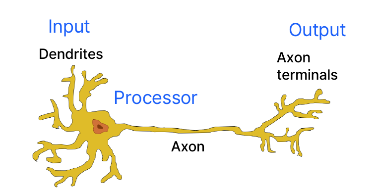

*그림 2. 생물학적 뉴런의 구조*

| 부분 | 역할 | 정보 처리의 관점 |
|:-----|:-----|:-----|
| 수상돌기(dendrite) | 다른 뉴런에서 오는 신호를 받는다. | 입력 |
| 세포체(cell body) | 받은 신호를 모으고, 신호가 충분히 크면 새 신호를 만든다. | 처리기 |
| 축삭(axon)과 축삭 말단(axon terminal) | 만들어진 신호를 다른 뉴런으로 전달한다. | 출력 |

*표 2. 생물학적 뉴런의 부분과 역할*

수상돌기는 신호를 받으며, 충분한 신호가 수신되면 신호가 축삭으로 전송된다. 이렇게 나가는 신호는 다른 뉴런으로 전달되어 그 뉴런의 입력으로 사용된다. 여기서 "충분한 신호가 수신되면"이라는 조건이 중요하다. 뉴런은 입력을 그대로 전달하지 않고, 모인 입력이 어떤 문턱(threshold)을 넘을 때만 신호를 내보낸다. 이 성질은 1.4절에서 인공뉴런의 활성화 함수로 모델링된다.

뉴런과 뉴런은 **시냅스(synapse)** 로 연결된다. 그림 3에서 왼쪽 뉴런의 축삭 말단은 두 뉴런과 맞닿아 있는데, 아래쪽 뉴런과의 시냅스는 활성 상태이고 위쪽(회색) 뉴런과의 시냅스는 비활성 상태이다. 활성 시냅스가 두 뉴런 사이의 실제 연결(link) 역할을 한다.

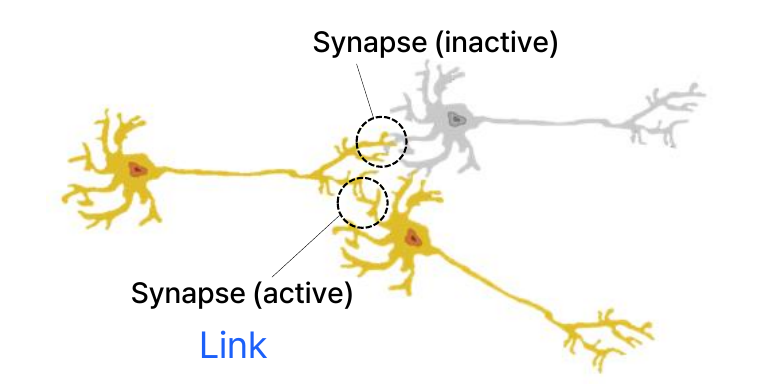

*그림 3. 활성 시냅스와 비활성 시냅스*

동시에 활성화된 뉴런 사이에는 시냅스가 생성되고, 자주 사용되는 시냅스는 강화되어 연결이 더욱 강해진다. 이 원리는 "Cells that fire together, wire together."라는 문장으로 요약되며, 이 문장은 헵(Hebb)이 1949년에 제시한 학습 가설[2]을 간결하게 표현한 말로 널리 쓰인다.

> **핵심:** 생물학적 학습은 뉴런 사이 연결의 세기가 경험에 따라 바뀌는 과정이다. 인공신경망은 연결의 세기를 **가중치(weight)** 라는 숫자로 나타내며, 인공신경망의 학습은 가중치의 값을 조정하는 과정이 된다.

### 1.4 인공뉴런

**인공뉴런(artificial neuron)** 은 생물학적 뉴런의 기본 과정을 수학적으로 모방한 계산 단위이다. 그림 4는 생물학적 뉴런의 그림 위에 인공뉴런의 요소를 겹쳐 그린 것이며, 인공뉴런은 다음 순서로 동작한다.

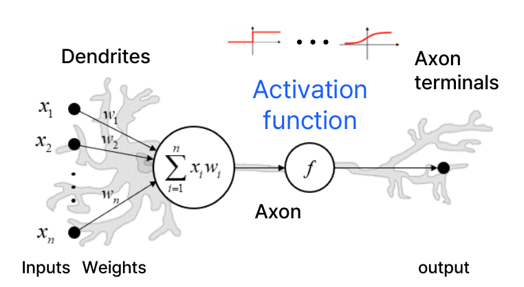

*그림 4. 생물학적 뉴런에 겹쳐 그린 인공뉴런*

1. 입력 $x_1, x_2, \dots, x_n$을 받는다.
2. 각 입력에 가중치 $w_1, w_2, \dots, w_n$을 곱해 더한 **가중합(weighted sum)** $\sum_{i=1}^{n} x_i w_i$를 구한다.
3. 가중합을 **활성화 함수(activation function)** $f$에 통과시켜 출력을 만든다.

$$
\text{output} = f\left(\sum_{i=1}^{n} x_i w_i\right)
$$

활성화 함수는 가중합이 출력에 전달되는 정도를 결정한다. 그림 위쪽의 작은 그래프 두 개는 활성화 함수의 예로, 왼쪽은 가중합이 문턱을 넘는 순간 출력이 0에서 1로 바뀌는 계단 함수이고 오른쪽은 출력이 부드럽게 바뀌는 S자 곡선이다. 생물학적 뉴런과 인공뉴런의 요소는 표 3처럼 대응한다.

| 생물학적 뉴런 | 인공뉴런 |
|:-----|:-----|
| 수상돌기로 들어오는 신호 | 입력 $x_i$ |
| 시냅스의 연결 세기 | 가중치 $w_i$ |
| 세포체에서 신호를 모음 | 가중합 $\sum_i x_i w_i$ |
| 모인 신호가 문턱을 넘을 때 신호를 냄 | 활성화 함수 $f$ |
| 축삭 말단으로 나가는 신호 | 출력 |

*표 3. 생물학적 뉴런과 인공뉴런의 대응*

> **주의:** 인공뉴런은 생물학적 뉴런에서 영감을 받은 단순한 모델일 뿐, 생물학적 뉴런의 동작을 충실히 재현하지 않는다. 실제 뉴런은 시간에 따라 변하는 전기 펄스로 통신하는 등 훨씬 복잡하며, 3절에서 다룰 인공신경망의 학습 방법도 두뇌의 학습 방식을 따른 것이 아니라 수학적 최적화로 설계된 것이다.

### 1.5 다층 인공신경망

인공뉴런 하나로 풀 수 있는 문제는 제한적이다(1.15절). 그래서 인공뉴런을 여러 층으로 쌓아 **다층 인공신경망(multi-layer artificial neural network)** 을 만든다. 그림 5의 신경망은 세 종류의 층으로 이루어진다.

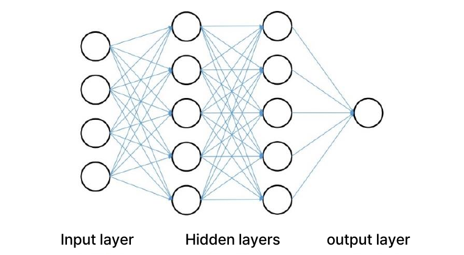

*그림 5. 다층 인공신경망*

- **입력층(input layer)** 은 데이터를 받아들이는 층이다. 그림에서는 뉴런 4개가 입력 데이터의 네 값을 받는다.
- **은닉층(hidden layer)** 은 입력층과 출력층 사이에 있는 층이다. 외부에서 값을 직접 관찰할 수 없어 은닉층이라 부른다. 그림에는 뉴런이 5개씩인 은닉층이 두 개 있다.
- **출력층(output layer)** 은 최종 결과를 내는 층이다. 그림에서는 뉴런 하나가 출력값 하나를 낸다.

다층 인공신경망은 여러 개의 은닉층으로 구성될 수 있고, 은닉층의 각 뉴런은 가중치를 통해 다음 층의 뉴런에 연결된다. 그림처럼 한 층의 모든 뉴런이 다음 층의 모든 뉴런과 연결된 층을 **완전 연결층(fully connected layer)** 이라 한다. 연결선마다 가중치가 하나씩 있으므로 그림의 신경망에는 $4 \times 5 + 5 \times 5 + 5 \times 1 = 50$개의 가중치가 있다. 1.8절에서 다룰 편향이 은닉층과 출력층의 뉴런마다 하나씩 더 있으므로, 학습할 매개변수는 모두 $50 + (5 + 5 + 1) = 61$개이다.

### 1.6 인공신경망의 역사

인공신경망은 80년 남짓한 기간 동안 여러 번의 전환점을 거쳐 발전했다. 표 4는 주요 사건을 시기별로 정리한 것이다.

| 시기 | 주요 사건 |
|:-----|:-----|
| 1943년 | 워런 매컬럭(Warren McCulloch)과 월터 피츠(Walter Pitts)가 최초의 인공뉴런 모델을 제안하여[3] 신경망의 기초 개념이 생겼다. 이를 계기로 인간 두뇌의 뉴런을 수학적으로 모델링하려는 시도가 시작되었다. |
| 1958년 | 프랭크 로젠블랫(Frank Rosenblatt)이 퍼셉트론(perceptron)을 제안하여[4] 신경망 연구에 혁신을 일으켰다. |
| 1980년대 | 제프리 힌턴(Geoffrey Hinton) 등이 역전파(backpropagation) 알고리즘으로 다층 퍼셉트론을 학습시키는 방법을 보이면서[5] 인공신경망의 성능과 적용 범위가 크게 확장되었다. |
| 2010년대 | 컴퓨팅 성능과 대규모 데이터의 발전으로 딥러닝이 본격적으로 연구되기 시작했고, CNN, RNN 같은 다양한 구조의 딥러닝 모델이 개발되었다. |
| 2012년 | 알렉스넷(AlexNet)이 이미지넷(ImageNet) 대회에서 우승하며[6] 이미지 인식에서 딥러닝의 가능성을 증명했다. 음성 인식에도 LSTM 같은 모델이 도입되면서 인공신경망이 산업계에 빠르게 적용되었다. |
| 2020년대 | GPT 같은 대규모 언어 모델이 등장하면서 자연어 처리 분야가 급격히 발전했다. 인공신경망은 다양한 실제 문제에 적용되며 AI 연구와 산업 전반으로 확산되었다. |

*표 4. 인공신경망의 역사*

1943년의 매컬럭-피츠 뉴런은 0 또는 1의 입력을 받아 그 합이 문턱 $T$ 이상이면 1을, 그렇지 않으면 0을 출력하는 논리 소자였으며, 흔히 다음과 같이 단순화하여 쓴다.

$$
y = \begin{cases} 1, & \sum_{i} w_i x_i \ge T \\ 0, & \text{otherwise} \end{cases}
$$

이 모델의 가중치와 문턱은 사람이 설계하는 값이었다. 로젠블랫의 퍼셉트론은 가중치를 예시 데이터로부터 학습할 수 있게 했다는 점에서 혁신적이었다[4]. 표에 나온 모델 이름의 뜻은 다음과 같다.

- **CNN(convolutional neural network, 합성곱 신경망)** 은 작은 필터를 이미지 위에서 이동시키며 국소적인 패턴을 찾는 구조로, 주로 이미지 처리에 쓰인다.
- **RNN(recurrent neural network, 순환 신경망)** 은 이전 시점의 계산 결과를 다음 시점에 다시 입력하는 구조로, 음성이나 문장처럼 순서가 있는 데이터를 다룬다. **LSTM(long short-term memory)** 은 긴 순서에서도 앞쪽의 정보를 잘 유지하도록 개선한 RNN이다.
- **GPT(generative pre-trained transformer)** 는 트랜스포머(transformer)라는 신경망 구조로 대량의 텍스트를 미리 학습한 대규모 언어 모델이다.

> **참고:** 표의 시기는 각 기술이 널리 쓰이기 시작한 때를 기준으로 한다. 역전파를 신경망 학습에 쓰는 아이디어는 웨어보스(Werbos)의 1974년 박사 학위 논문[7]에 이미 제시되었고, 1986년 루멜하트(Rumelhart), 힌턴, 윌리엄스(Williams)의 논문[5]으로 널리 알려졌다. 역전파로 학습하는 CNN은 1989년[8], LSTM은 1997년[9]에 제안되었으며, 2010년대에 GPU와 대규모 데이터 덕분에 큰 규모로 학습할 수 있게 되었다.

### 1.7 인공신경망이 다시 주목받은 이유

인공신경망은 한동안 연구가 침체되었다가 2010년대에 다시 크게 주목받았다. 이 부활에는 표 5의 네 요인이 함께 작용했다.

| 요인 | 내용 |
|:-----|:-----|
| 하드웨어의 발전 | GPU(graphics processing unit, 그래픽 처리 장치)를 포함한 강력한 컴퓨팅 자원을 쓸 수 있게 되어 대규모 신경망의 학습이 크게 빨라졌다. 신경망의 계산은 대부분 서로 독립적인 곱셈과 덧셈이라 대규모 병렬화로 효율적으로 학습할 수 있다. |
| 빅데이터 | 이미지, 텍스트, 오디오, 센서 데이터 등 여러 영역의 디지털 데이터가 폭발적으로 늘어나 신경망을 학습시킬 충분한 데이터가 제공되었다. |
| 알고리즘 혁신 | 최적화 알고리즘(3.6절), 활성화 함수(1.9절\~1.12절), 정규화 기법(3.8절\~3.10절)이 발전하여 신경망의 성능이 더욱 향상되었다. |
| 전이 학습 | 관련 작업이나 도메인에서 학습한 지식을 활용하여, 미리 학습된 신경망을 적은 데이터로 새로운 작업에 맞게 미세 조정할 수 있게 되었다. |

*표 5. 인공신경망이 다시 주목받은 요인*

> **용어 정의:** **전이 학습(transfer learning)** 은 한 작업에서 학습한 신경망의 지식을 다른 관련 작업에 옮겨 쓰는 방법이다. 예를 들어 수백만 장의 일반 사진으로 학습한 이미지 인식 신경망을 가져와, 수백 장의 의료 영상으로 마지막 몇 층만 다시 학습시키는 **미세 조정(fine-tuning)** 을 할 수 있다. 레이블(정답)이 붙은 데이터가 부족하거나 얻는 데 비용이 많이 드는 실제 응용 분야에서 신경망을 쓸 수 있게 해 준다.

### 1.8 퍼셉트론

**퍼셉트론(perceptron)** 은 1.4절의 인공뉴런에 상수 입력 1과 그 가중치를 더한 모델이다. 그림 6처럼 입력 $x_1, \dots, x_m$에 가중치 $\theta_1, \dots, \theta_m$을 곱하고, 항상 1인 입력에 곱하는 가중치 $\theta_0$을 함께 더한다.

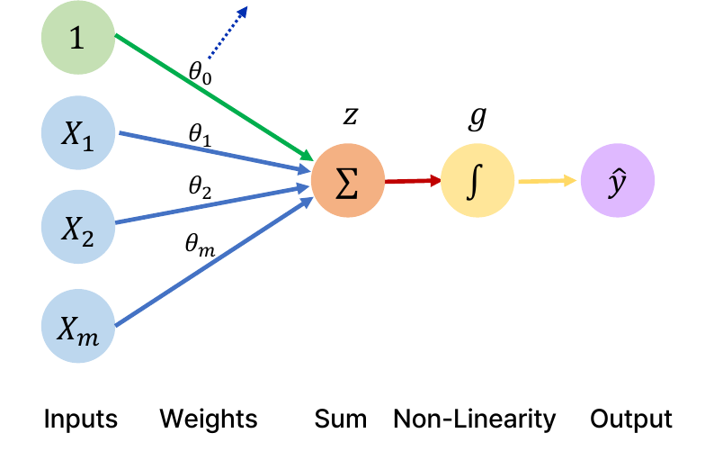

*그림 6. 퍼셉트론의 구조*

계산은 두 단계로 이루어진다. 먼저 입력의 선형 결합(linear combination) $z$를 구하고(그림의 Sum), 이를 비선형 활성화 함수 $g$에 통과시켜(그림의 Non-Linearity) 출력 $\hat{y}$를 얻는다.

$$
z = \theta_0 + \sum_{j=1}^{m} x_j \theta_j, \qquad \hat{y} = g\left(\theta_0 + \sum_{j=1}^{m} x_j \theta_j\right)
$$

$\hat{y}$("와이 햇")의 모자 기호는 모델이 추정한 값이라는 뜻이며, 실제 정답 $y$와 구별한다. 그림에서 $g$ 자리에 그려진 $\int$ 기호는 적분이 아니라 S자 모양의 활성화 함수를 나타내는 그림 기호이다.

> **용어 정의:** **편향(bias)** $\theta_0$은 입력과 무관하게 더해지는 상수항이다. 편향을 사용하면 가중합에 상수를 더해 활성화 함수를 좌우로 이동시킬 수 있다. 예를 들어 입력이 하나일 때 $g(\theta_0 + \theta_1 x)$의 중심($z = 0$이 되는 점)은 $x = -\theta_0/\theta_1$이므로, $\theta_0$을 바꾸면 곡선 전체가 옆으로 움직인다(2.8절의 그림 20). 편향이 없으면 $z = 0$이 되는 경계가 항상 원점을 지나야 하므로 모델의 표현력이 제한된다.

입력과 가중치를 벡터로 모으면 식을 간결하게 쓸 수 있다.

$$
\hat{y} = g\left(\theta_0 + \mathbf{X}^{T}\boldsymbol{\theta}\right), \qquad \mathbf{X} = \begin{bmatrix} x_1 \\ \vdots \\ x_m \end{bmatrix}, \quad \boldsymbol{\theta} = \begin{bmatrix} \theta_1 \\ \vdots \\ \theta_m \end{bmatrix}
$$

> **[선형대수학]** 두 열벡터 $\mathbf{X}$와 $\boldsymbol{\theta}$에 대해 $\mathbf{X}^{T}\boldsymbol{\theta}$는 $1 \times m$ 행벡터와 $m \times 1$ 열벡터의 곱이므로 $1 \times 1$, 즉 스칼라이며, 그 값은 같은 위치의 성분끼리 곱해 더한 내적 $\sum_{j=1}^{m} x_j\theta_j$이다. 따라서 위의 벡터 식은 합 기호로 쓴 식과 같다.

활성화 함수의 예로 다음의 **시그모이드 함수(sigmoid function)** $\sigma$를 쓸 수 있다(1.10절).

$$
g(z) = \sigma(z) = \frac{1}{1 + e^{-z}}
$$

예를 들어 $\theta_0 = 1$, $\boldsymbol{\theta} = [3, -2]^{T}$인 퍼셉트론에 $\mathbf{X} = [-1, 2]^{T}$를 넣으면 $z = 1 + (-1)(3) + (2)(-2) = -6$이고 $\hat{y} = \sigma(-6) = 1/(1 + e^{6}) \approx 0.0025$이다. $\mathbf{X} = [1, 1]^{T}$를 넣으면 $z = 1 + 3 - 2 = 2$이고 $\hat{y} = \sigma(2) \approx 0.8808$이다. 시그모이드의 출력은 항상 0과 1 사이이므로, 이 출력을 "입력이 어떤 부류에 속할 확률"로 해석할 수 있다.

### 1.9 활성화 함수의 개념

> **용어 정의:** **활성화 함수(activation function)** 는 신경망의 은닉층에 있는 각 뉴런의 출력(가중합)에 적용되는 수학적 함수이다. 네트워크에 비선형성을 도입하여 데이터의 복잡한 패턴을 학습할 수 있게 한다.

활성화 함수는 은닉층뿐 아니라 출력층에도 쓰이며, 출력층의 활성화 함수는 출력의 형태(확률, 실수 등)에 맞추어 고른다. 1.10절\~1.12절은 대표적인 세 가지 활성화 함수를 다루고, 1.13절은 비선형성이 왜 필요한지 설명한다. 3절의 학습에서는 활성화 함수의 도함수가 필요하므로, 함수마다 도함수도 함께 구한다.

### 1.10 시그모이드 함수

**시그모이드 함수(sigmoid function)** 는 모든 실수를 0과 1 사이의 값으로 바꾸어 뉴런을 활성화하는 S자 모양의 함수이다. 그림 7에서 파란 곡선이 $g(z)$, 주황 곡선이 도함수 $g'(z)$이다.

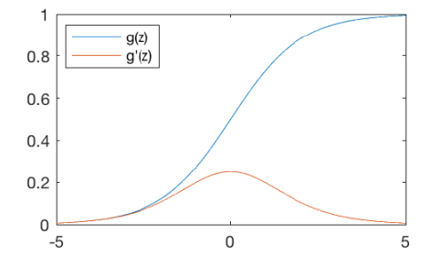

*그림 7. 시그모이드 함수와 그 도함수*

$$
g(z) = \frac{1}{1 + e^{-z}}, \qquad g'(z) = g(z)\bigl(1 - g(z)\bigr)
$$

도함수는 다음과 같이 유도한다. $g(z) = (1 + e^{-z})^{-1}$에 연쇄 법칙을 적용하면 바깥 함수 $u^{-1}$의 도함수 $-u^{-2}$와 안쪽 함수 $1 + e^{-z}$의 도함수 $-e^{-z}$를 곱하게 된다.

$$
g'(z) = -(1 + e^{-z})^{-2} \cdot (-e^{-z}) = \frac{e^{-z}}{(1 + e^{-z})^{2}} = \frac{1}{1 + e^{-z}} \cdot \frac{e^{-z}}{1 + e^{-z}}
$$

두 번째 인수는 $\dfrac{e^{-z}}{1 + e^{-z}} = \dfrac{(1 + e^{-z}) - 1}{1 + e^{-z}} = 1 - \dfrac{1}{1 + e^{-z}} = 1 - g(z)$이므로 $g'(z) = g(z)(1 - g(z))$이다. 이 형태 덕분에 순전파에서 이미 계산한 $g(z)$만으로 도함수를 바로 구할 수 있다.

시그모이드 함수에는 두 가지 단점이 있다.

- **기울기 소실(vanishing gradient):** 입력이 크거나 작을 때(대략 5 이상, -5 이하) 도함수가 0에 가까워져 학습이 잘 되지 않는다. $g(0) = 0.5$이므로 $g'(0) = 0.5 \times 0.5 = 0.25$가 도함수의 최댓값이고, $z = 5$에서는 $g(5) \approx 0.9933$이므로 $g'(5) \approx 0.9933 \times 0.0067 \approx 0.0066$에 불과하다. 3절의 역전파는 층마다 활성화 함수의 도함수를 곱해 나가므로, 시그모이드 층을 10개 지나면 기울기에 최대 $0.25^{10} \approx 9.5 \times 10^{-7}$이 곱해져 앞쪽 층의 가중치는 거의 바뀌지 않는다.
- **0이 중심이 아닌 출력(non-zero centered):** 출력이 항상 양수이므로 학습의 방향이 제한된다. 다음 층의 한 뉴런이 시그모이드 출력 $a_j > 0$들을 입력으로 받는다면, 그 뉴런의 가중치 $w_j$에 대한 기울기는 3.2절의 방법으로 $\partial L/\partial w_j = \delta \cdot a_j$가 된다($\delta$는 그 뉴런의 가중합에 대한 손실의 기울기로 모든 $j$에 공통이다). $a_j$가 모두 양수이므로 모든 기울기의 부호가 $\delta$의 부호와 같아, 한 번의 갱신에서 그 뉴런의 가중치는 모두 함께 커지거나 모두 함께 작아진다. 어떤 가중치는 커지고 어떤 가중치는 작아져야 최적점에 가는 경우 갱신 경로가 지그재그가 되어 학습이 느려진다.

### 1.11 하이퍼볼릭 탄젠트 함수

**하이퍼볼릭 탄젠트 함수(hyperbolic tangent, tanh)** 는 0을 중심으로 -1과 1 사이의 값으로 뉴런을 활성화하는 S자 함수이다(그림 8).

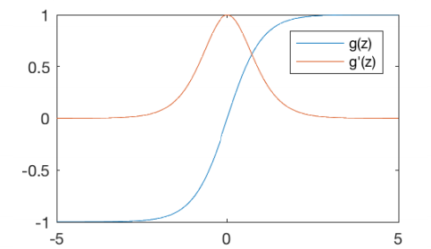

*그림 8. 하이퍼볼릭 탄젠트 함수와 그 도함수*

$$
g(z) = \frac{e^{z} - e^{-z}}{e^{z} + e^{-z}}, \qquad g'(z) = 1 - g(z)^{2}
$$

도함수는 몫의 미분법으로 구한다. 분자 $e^{z} - e^{-z}$의 도함수는 $e^{z} + e^{-z}$이고, 분모 $e^{z} + e^{-z}$의 도함수는 $e^{z} - e^{-z}$이다.

$$
g'(z) = \frac{(e^{z} + e^{-z})(e^{z} + e^{-z}) - (e^{z} - e^{-z})(e^{z} - e^{-z})}{(e^{z} + e^{-z})^{2}} = 1 - \left(\frac{e^{z} - e^{-z}}{e^{z} + e^{-z}}\right)^{2} = 1 - g(z)^{2}
$$

출력이 양수와 음수 모두 가능하므로 시그모이드의 non-zero centered 문제가 해결된다. 또 $g'(0) = 1$로 시그모이드의 최대 기울기 0.25보다 크다. 그러나 입력이 크거나 작을 때(대략 5 이상, -5 이하) 도함수가 작아져 학습이 잘 되지 않는 기울기 소실 문제는 그대로 남는다. $g(5) \approx 0.99991$이므로 $g'(5) \approx 1.8 \times 10^{-4}$이다.

> **참고:** 두 함수 사이에는 $\tanh(z) = 2\sigma(2z) - 1$의 관계가 있다. 오른쪽을 정리하면 $\dfrac{2}{1 + e^{-2z}} - 1 = \dfrac{1 - e^{-2z}}{1 + e^{-2z}}$이고, 분자와 분모에 $e^{z}$를 곱하면 $\dfrac{e^{z} - e^{-z}}{e^{z} + e^{-z}}$가 된다. 즉 tanh는 시그모이드를 가로로 절반 압축하고 세로로 두 배 늘려 아래로 1만큼 내린 함수이다.

### 1.12 ReLU 함수

**ReLU(rectified linear unit)** 는 입력이 0보다 큰 경우에만 뉴런을 활성화하는 함수이다(그림 9).

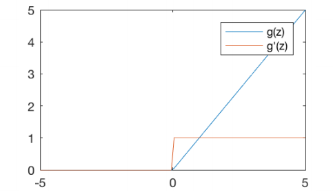

*그림 9. ReLU 함수와 그 도함수*

$$
g(z) = \max(0, z), \qquad g'(z) = \begin{cases} 1, & z > 0 \\ 0, & \text{otherwise} \end{cases}
$$

ReLU의 장단점은 다음과 같다.

- 입력이 양수이면 기울기가 1로 일정하므로 층을 여러 번 지나도 기울기가 줄어들지 않아 기울기 소실을 피할 수 있다.
- 지수 함수 계산이 없어 함수값과 도함수를 계산하기 쉬우므로 연산량이 줄어든다. CIFAR-10 데이터로 학습시킨 4층 합성곱 신경망 실험에서 ReLU를 쓴 신경망은 tanh를 쓴 같은 신경망보다 같은 학습 오차(25%)에 약 6배 빨리 도달했다[6].
- 입력이 음수이면 기울기가 무조건 0이 된다. 어떤 뉴런의 가중합이 모든 데이터에 대해 음수가 되면 그 뉴런의 가중치는 더 이상 갱신되지 않는다. 이 현상을 죽은 ReLU(dying ReLU) 문제라 하며, 음수 구간에 작은 기울기를 주는 Leaky ReLU $g(z) = \max(0.01z, z)$ 같은 변형[10]이 이를 완화한다.

> **참고:** $z = 0$에서 ReLU는 왼쪽 기울기(0)와 오른쪽 기울기(1)가 달라 미분할 수 없다. 위의 식처럼 이 점의 도함수를 0으로 정해 쓰는 것이 관례이며, 가중합이 정확히 0이 되는 경우는 드물어 어느 값을 쓰든 학습에 거의 영향이 없다.

| 함수 | 출력 범위 | 도함수 | 장점 | 단점 |
|:-----|:-----|:-----|:-----|:-----|
| 시그모이드 | $(0, 1)$ | $g(1 - g)$, 최댓값 0.25 | 출력을 확률로 해석할 수 있다. | 기울기 소실, 0이 중심이 아닌 출력 |
| tanh | $(-1, 1)$ | $1 - g^{2}$, 최댓값 1 | 0을 중심으로 한 출력 | 기울기 소실 |
| ReLU | $[0, \infty)$ | 양수에서 1, 그 밖에서 0 | 기울기 소실이 없고 계산이 빠르다. | 음수 입력에서 기울기 0 |

*표 6. 세 활성화 함수의 비교*

### 1.13 활성화 함수의 목적: 비선형성

활성화 함수의 목적은 네트워크에 **비선형성(nonlinearity)** 을 도입하는 것이다. 그림 10의 두 그래프는 빨간 점과 초록 점이 뒤섞인 같은 데이터를 두 부류로 나누려는 상황이다.

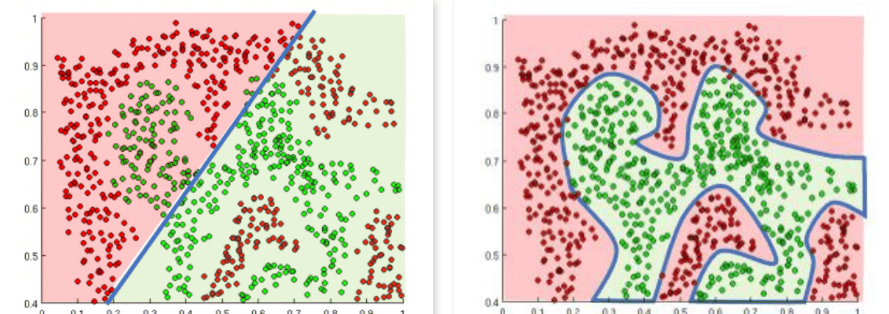

*그림 10. 선형 결정 경계와 비선형 결정 경계*

왼쪽처럼 선형 활성화 함수는 직선(고차원에서는 평면) 하나로 공간을 나누는 선형 결정만 도출하므로, 초록 점과 빨간 점이 섞인 영역을 제대로 나눌 수 없다. 오른쪽처럼 비선형 활성화 함수를 쓰면 신경망은 형상이 복잡한 함수에 대해서도 굽은 경계로 공간을 나누는 비선형적 결정을 도출할 수 있다. 데이터를 부류별로 나누는 이 경계를 **결정 경계(decision boundary)** 라 한다.

활성화 함수가 선형이면 층을 아무리 많이 쌓아도 소용이 없다. 활성화 함수가 항등 함수 $g(z) = z$인 2층 신경망을 생각하면, 은닉층 출력은 $\mathbf{h} = W_1\mathbf{x} + \mathbf{b}_1$이고 최종 출력은 다음과 같다.

$$
\hat{\mathbf{y}} = W_2\mathbf{h} + \mathbf{b}_2 = W_2(W_1\mathbf{x} + \mathbf{b}_1) + \mathbf{b}_2 = (W_2W_1)\mathbf{x} + (W_2\mathbf{b}_1 + \mathbf{b}_2)
$$

$W = W_2W_1$, $\mathbf{b} = W_2\mathbf{b}_1 + \mathbf{b}_2$로 두면 $\hat{\mathbf{y}} = W\mathbf{x} + \mathbf{b}$이므로, 2층 신경망이 층 하나짜리 선형 모델과 같아진다. 같은 논리로 몇 층을 쌓아도 결과는 선형 모델 하나이다. 반대로 시그모이드처럼 비선형 활성화 함수를 쓰는 은닉층이 하나라도 있으면, 은닉 뉴런이 충분히 많을 때 유계이고 닫힌 영역에서 정의된 연속 함수를 원하는 정밀도로 근사할 수 있다는 **보편 근사 정리(universal approximation theorem)** 가 알려져 있다[11].

> **주의:** 보편 근사 정리는 그런 신경망이 존재한다는 것만 보장한다. 은닉 뉴런이 몇 개 필요한지, 학습으로 그 가중치를 실제로 찾을 수 있는지는 알려 주지 않는다.

### 1.14 예제: 항공기 분류 퍼셉트론

최대 속도와 최대 이륙 중량에 따라 항공기를 폭격기(bomber) 또는 전투기(fighter)로 분류하는 문제를 생각한다. 그림 11에서 가로축 $x_1$은 속도(speed), 세로축 $x_2$는 중량(weight)이며, 두 값은 일정한 기준으로 나눈 상대적인 값이다. 마름모는 폭격기, 사각형은 전투기이다.

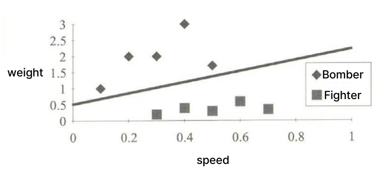

*그림 11. 속도와 중량에 따른 폭격기와 전투기의 분포*

폭격기는 느리고 무거우며 전투기는 빠르고 가볍다. 두 종류의 항공기를 나누는 직선은 다음과 같다.

$$
x_2 = 1.5x_1 + 0.5
$$

모든 항을 한쪽으로 옮겨 **결정 함수(decision function)** $f(x_1, x_2) = -x_2 + 1.5x_1 + 0.5$를 정의하면, 직선 위의 점에서 $f = 0$이고 직선 아래쪽(전투기 쪽)에서 $f > 0$, 위쪽(폭격기 쪽)에서 $f < 0$이다. 따라서 분류 규칙은 다음과 같다.

$$
d = \begin{cases} \text{Fighter}, & f(x_1, x_2) \ge 0 \\ \text{Bomber}, & f(x_1, x_2) < 0 \end{cases}
$$

예를 들어 $(0.4, 0.5)$에 있는 전투기는 $f(0.4, 0.5) = -0.5 + 1.5 \times 0.4 + 0.5 = -0.5 + 0.6 + 0.5 = 0.6 \ge 0$이므로 전투기로 바르게 분류된다. 그림에서 $(0.2, 2)$ 근처의 폭격기는 $f(0.2, 2) = -2 + 0.3 + 0.5 = -1.2 < 0$이므로 폭격기로 분류된다.

이 결정 함수는 퍼셉트론으로 모델링할 수 있다. 그림 12처럼 편향 입력 1의 가중치를 $w_0 = 0.5$, $x_1$의 가중치를 $w_1 = 1.5$, $x_2$의 가중치를 $w_2 = -1$로 두면 가중합이 결정 함수와 같아진다.

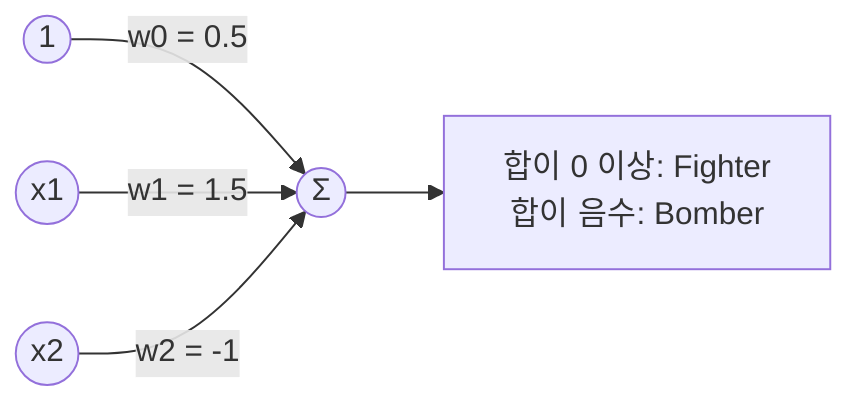

*그림 12. 항공기 분류 퍼셉트론*

$$
\text{summation} = w_0 + \sum_{i=1}^{2} x_i w_i = 0.5 + 1.5x_1 - x_2
$$

출력은 가중합이 0 이상이면 Fighter, 0보다 작으면 Bomber이다. 이 퍼셉트론의 활성화 함수는 0을 기준으로 출력이 바뀌는 **계단 함수(step function)** 이다. 계단 함수는 0이 아닌 모든 점에서 도함수가 0이라, 3절의 기울기 기반 학습에는 쓸 수 없다. 그래서 학습에는 시그모이드처럼 매끄러운 활성화 함수를 쓴다.

### 1.15 퍼셉트론의 한계: 선형 분리 가능성

1.14절의 항공기 데이터처럼 직선(고차원에서는 초평면) 하나로 두 부류를 완전히 나눌 수 있는 데이터를 **선형 분리 가능(linearly separable)** 하다고 한다. 퍼셉트론 하나의 결정 경계는 $\theta_0 + \mathbf{X}^{T}\boldsymbol{\theta} = 0$인 직선이므로, 퍼셉트론 하나는 선형 분리 가능한 문제만 풀 수 있다.

대표적인 반례는 배타적 논리합(XOR)이다. 네 점 $(0, 0)$, $(1, 1)$의 출력은 0이고 $(0, 1)$, $(1, 0)$의 출력은 1이다. 출력이 1인 점에서 $w_0 + w_1x_1 + w_2x_2 \ge 0$, 0인 점에서 $< 0$이 되는 가중치가 있다고 가정하면 다음 네 부등식이 성립해야 한다.

$$
w_0 < 0, \qquad w_0 + w_2 \ge 0, \qquad w_0 + w_1 \ge 0, \qquad w_0 + w_1 + w_2 < 0
$$

가운데 두 부등식을 더하면 $w_1 + w_2 + 2w_0 \ge 0$, 즉 $w_0 + w_1 + w_2 \ge -w_0$이다. 첫 부등식에서 $-w_0 > 0$이므로 $w_0 + w_1 + w_2 > 0$이 되어 마지막 부등식과 모순이다. 따라서 XOR을 푸는 퍼셉트론은 존재하지 않는다. 민스키(Minsky)와 페퍼트(Papert)는 1969년에 이런 한계를 분석했고[12], 이는 신경망 연구가 한동안 침체된 원인 중 하나가 되었다. 은닉층을 둔 다층 신경망은 이 문제를 풀 수 있으며, 다층 신경망을 학습시키는 방법이 1980년대의 역전파이다(표 4).

---

<br>

## 2. 인공신경망 학습 I: 손실 함수와 기울기

### 2.1 다중 출력 퍼셉트론

출력이 여러 개 필요하면 퍼셉트론을 출력 수만큼 나란히 둔다. 그림 13의 **다중 출력 퍼셉트론(multi-output perceptron)** 은 같은 입력 $1, x_1, x_2, \dots, x_m$을 두 뉴런이 함께 받아 각자의 가중합 $z_1$, $z_2$를 구하고, 활성화 함수를 거쳐 $y_1 = g(z_1)$, $y_2 = g(z_2)$를 낸다.

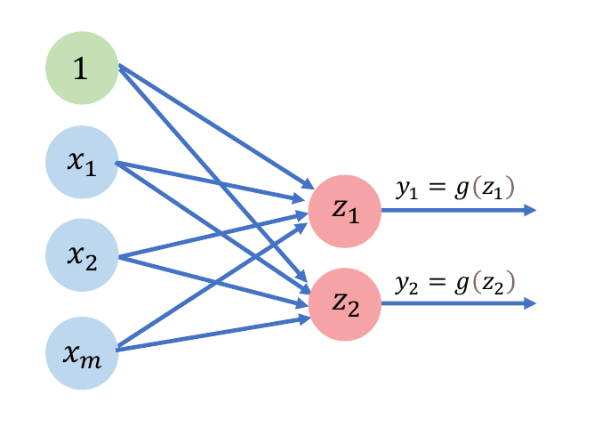

*그림 13. 다중 출력 퍼셉트론*

출력 뉴런 $i$는 자신만의 가중치 $\theta_{j,i}$(입력 $j$에서 출력 $i$로 가는 가중치)와 편향 $\theta_{0,i}$를 가진다.

$$
z_i = \theta_{0,i} + \sum_{j=1}^{m} x_j\theta_{j,i}, \qquad y_i = g(z_i), \qquad i = 1, 2
$$

모든 입력이 모든 출력에 연결되어 있으므로 이 층은 완전 연결층이며, 매개변수는 출력마다 $m + 1$개씩 모두 $2(m + 1)$개이다.

### 2.2 단일 은닉층 신경망

다중 출력 퍼셉트론 두 개를 이어 붙이면 그림 14의 **단일 은닉층 신경망(single layer neural network)** 이 된다. 신경망을 이루는 세 계층의 역할은 다음과 같다.

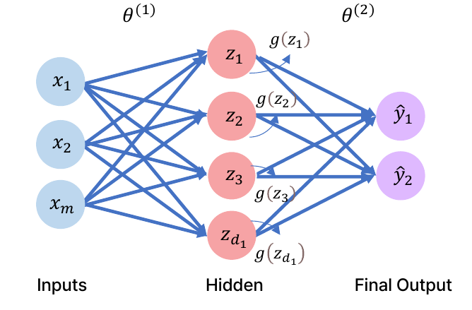

*그림 14. 단일 은닉층 신경망*

- **입력층(input layer)** 은 초기 데이터를 수신하는 계층이다. 이 계층의 각 뉴런은 데이터의 특징(feature)이나 속성을 나타낸다.
- **은닉층(hidden layer)** 은 입력층과 출력층 사이의 중간 계층이다. 은닉층은 입력에 가중치를 적용하고, 활성화 함수로 이를 변환하고, 결과를 다음 계층으로 전달하는 뉴런으로 구성된다.
- **출력층(output layer)** 은 예측이나 분류 결과를 생성하는 최종 계층이다. 이 계층의 뉴런 수는 가능한 출력의 수나 클래스(class) 수에 해당한다.

입력층에서 은닉층으로 가는 가중치를 $\theta^{(1)}$, 은닉층에서 출력층으로 가는 가중치를 $\theta^{(2)}$로 쓴다. 위첨자 $(1)$, $(2)$는 거듭제곱이 아니라 몇 번째 층의 가중치인지를 나타낸다. 은닉층에 뉴런이 $d_1$개 있을 때 은닉 뉴런 $i$의 가중합은 다음과 같다.

$$
z_i = \theta_{0,i}^{(1)} + \sum_{j=1}^{m} x_j\theta_{j,i}^{(1)}, \qquad i = 1, \dots, d_1
$$

예를 들어 두 번째 은닉 뉴런($i = 2$)에 대해 합을 풀어 쓰면 다음과 같다.

$$
z_2 = \theta_{0,2}^{(1)} + \sum_{j=1}^{m} x_j\theta_{j,2}^{(1)} = \theta_{0,2}^{(1)} + x_1\theta_{1,2}^{(1)} + x_2\theta_{2,2}^{(1)} + \cdots + x_m\theta_{m,2}^{(1)}
$$

은닉 뉴런은 $z_i$를 활성화 함수에 통과시킨 $g(z_i)$를 출력하고, 출력층은 이 값들을 입력으로 삼아 같은 계산을 한 번 더 한다.

$$
\hat{y}_i = g\left(\theta_{0,i}^{(2)} + \sum_{j=1}^{d_1} g(z_j)\,\theta_{j,i}^{(2)}\right), \qquad i = 1, 2
$$

입력에서 출력 방향으로 이렇게 차례로 계산하는 과정을 **순전파(forward propagation)** 라 한다. 행렬로 쓰면 $\boldsymbol{\Theta}^{(1)}$을 $(j, i)$ 성분이 $\theta_{j,i}^{(1)}$인 $m \times d_1$ 행렬, $\boldsymbol{\theta}_0^{(1)}$을 편향을 모은 $d_1$차원 벡터라 할 때 $\mathbf{z} = \boldsymbol{\theta}_0^{(1)} + (\boldsymbol{\Theta}^{(1)})^{T}\mathbf{x}$로 은닉층 전체를 한 번에 계산할 수 있다. 1.8절의 퍼셉트론 식 $\theta_0 + \mathbf{X}^{T}\boldsymbol{\theta}$를 뉴런 $d_1$개에 대해 한꺼번에 쓴 것이다. 매개변수의 수는 은닉층이 $(m + 1)d_1$개, 출력층이 $(d_1 + 1) \times 2$개이다.

> **참고:** 신경망의 층 수를 세는 방법은 문헌마다 다르다. 은닉층이 하나인 신경망을 단일 계층(single layer) 신경망이라 부르는 문헌이 있는가 하면, 은닉층 없이 입력이 출력에 바로 연결된 퍼셉트론을 단층 퍼셉트론(single-layer perceptron)이라 부르는 문헌도 있다. 두 용법이 섞이지 않도록 은닉층이 하나인 신경망은 "단일 은닉층 신경망"이라 부르는 편이 명확하다.

### 2.3 심층 신경망

> **용어 정의:** **심층 신경망(deep neural network, DNN)** 은 입력층과 출력층 사이에 여러 개의 은닉층이 있는 신경망이다. 은닉층을 여러 개 거치면서 네트워크는 데이터의 복잡한 패턴을 학습할 수 있다.

그림 15에서 X가 그려진 상자 하나는 완전 연결층 하나를 간략히 나타낸 기호이며, 가운데의 $z_{k,1}, \dots, z_{k,d_k}$는 $k$번째 은닉층의 뉴런 $d_k$개이다.

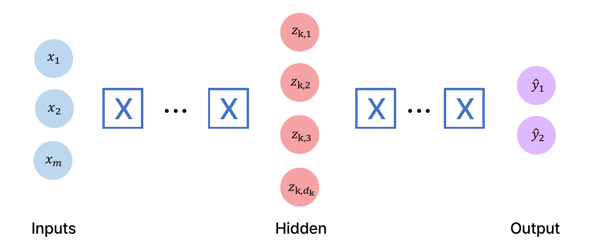

*그림 15. 심층 신경망*

$k$번째 은닉층의 뉴런 $i$는 바로 앞 층($k - 1$번째 층)의 출력을 입력으로 받는다. 2.2절의 식을 일반화하면 다음과 같다.

$$
z_{k,i} = \theta_{0,i}^{(k)} + \sum_{j=1}^{d_{k-1}} g(z_{k-1,j})\,\theta_{j,i}^{(k)}
$$

$k = 1$일 때는 앞 층의 출력 $g(z_{0,j})$ 자리에 입력 $x_j$를 넣는다. 이 계산을 첫 은닉층부터 출력층까지 반복하는 것이 심층 신경망의 순전파이다.

### 2.4 예제: 수업 통과 여부 예측

신경망을 학습시키는 과정을 간단한 분류 문제로 살펴본다. 학생이 어떤 수업을 통과할지 두 가지 특징으로 예측한다.

- $x_1$: 출석한 강의의 수
- $x_2$: 프로젝트에 들인 시간

그림 16은 과거 학생들의 데이터로, 초록 점은 통과(pass), 빨간 점은 낙제(fail)이다. 출석이 적고 시간을 적게 들인 왼쪽 아래의 학생들이 낙제했다. 새 학생의 특징은 $\mathbf{x} = [4, 5]^{T}$(강의 4회 출석, 프로젝트 5시간)이며, 이 학생의 통과 여부(보라색 점의 물음표)를 예측하려 한다.

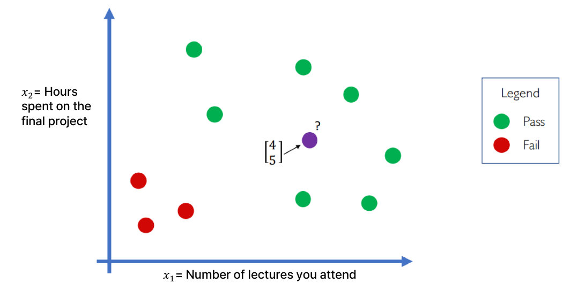

*그림 16. 출석 수와 프로젝트 시간에 따른 통과 여부*

그림 17처럼 입력 2개, 은닉 뉴런 3개, 출력 1개인 단일 은닉층 신경망에 $\mathbf{x}^{(1)} = [4, 5]^{T}$를 넣었더니 통과 확률이 0.1로 예측되었다. 그런데 이 학생은 실제로 통과했다(정답 1). 이 신경망은 아직 학습되지 않아 가중치가 임의의 값이므로 예측이 틀린 것이다.

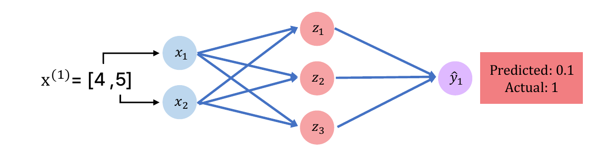

*그림 17. 학습되지 않은 신경망의 잘못된 예측*

이 신경망의 매개변수는 은닉층 $(2 + 1) \times 3 = 9$개와 출력층 $(3 + 1) \times 1 = 4$개를 합한 13개이다. 학습은 이 13개의 값을 조정하여 예측이 정답에 가까워지게 하는 과정이다. 이를 위해 먼저 예측이 얼마나 틀렸는지를 숫자로 나타내야 한다.

### 2.5 손실 함수와 경험적 손실

> **용어 정의:** **손실 함수(loss function)** $L$은 예측값(predicted value)과 실젯값(true value)의 차이로 정의되며, 잘못된 예측으로 발생하는 비용을 측정한다. $i$번째 데이터 $\mathbf{x}^{(i)}$에 대한 손실은 $L\bigl(f(\mathbf{x}^{(i)}; \boldsymbol{\theta}), y^{(i)}\bigr)$로 쓴다.

여기서 $f(\mathbf{x}^{(i)}; \boldsymbol{\theta})$는 매개변수가 $\boldsymbol{\theta}$인 신경망이 입력 $\mathbf{x}^{(i)}$에 대해 내는 예측값이고, $y^{(i)}$는 정답이다. 위첨자 $(i)$는 $i$번째 데이터라는 뜻이다. 세미콜론 뒤의 $\boldsymbol{\theta}$는 $f$가 $\mathbf{x}$의 함수이지만 그 모양이 $\boldsymbol{\theta}$에 따라 정해진다는 것을 나타낸다. 예측이 정답과 같으면 손실은 0이고, 차이가 클수록 손실도 커진다. 신경망은 손실 함수의 값이 작아지는 방향으로 학습한다.

데이터 하나의 손실만 줄이면 다른 데이터에 대한 예측이 나빠질 수 있으므로, 학습은 전체 데이터에 대한 손실을 기준으로 한다.

> **용어 정의:** **경험적 손실(empirical loss)** 은 데이터 집합 전체에 대한 손실의 평균이다. **목적 함수(objective function)**, **비용 함수(cost function)**, **경험적 위험(empirical risk)** 이라고도 한다.

$$
J(\boldsymbol{\theta}) = \frac{1}{n}\sum_{i=1}^{n} L\bigl(f(\mathbf{x}^{(i)}; \boldsymbol{\theta}), y^{(i)}\bigr)
$$

$n$은 데이터의 개수이다. 수업 통과 예제의 데이터 일부와 학습 전 신경망의 예측은 표 7과 같다. $\mathbf{X}$의 각 행이 학생 한 명의 $[x_1, x_2]$이다.

| $i$ | 입력 $\mathbf{x}^{(i)} = [x_1, x_2]$ | 예측 $f(\mathbf{x}^{(i)})$ | 정답 $y^{(i)}$ |
|:-----|:-----|:-----|:-----|
| 1 | $[4, 5]$ | 0.1 | 1 |
| 2 | $[2, 1]$ | 0.8 | 0 |
| 3 | $[5, 8]$ | 0.6 | 1 |

*표 7. 수업 통과 예제의 데이터와 학습 전의 예측*

경험적 손실은 $\boldsymbol{\theta}$만의 함수이다. 데이터 $\mathbf{x}^{(i)}$와 $y^{(i)}$는 주어져 고정되어 있고, 학습으로 바꿀 수 있는 것은 $\boldsymbol{\theta}$뿐이기 때문이다. 따라서 학습은 $J(\boldsymbol{\theta})$를 최소로 만드는 $\boldsymbol{\theta}$를 찾는 최적화 문제가 된다.

$$
\boldsymbol{\theta}^{*} = \arg\min_{\boldsymbol{\theta}} J(\boldsymbol{\theta})
$$

### 2.6 평균 제곱 오차와 교차 엔트로피

손실 함수는 문제의 종류에 맞게 고른다. **평균 제곱 오차(mean squared error, MSE)** 는 연속적인 실수를 출력하는 회귀(regression) 모델과 함께 사용할 수 있다.

$$
J(\boldsymbol{\theta}) = \frac{1}{n}\sum_{i=1}^{n}\bigl(y^{(i)} - f(\mathbf{x}^{(i)}; \boldsymbol{\theta})\bigr)^{2}
$$

예를 들어 같은 학생들의 기말 점수를 예측하는 회귀 문제에서 신경망의 예측과 실제 점수가 표 8과 같다고 가정한다. 앞의 두 학생은 예측이 크게 틀렸고 세 번째 학생은 비교적 잘 맞았다.

| $i$ | 예측 $f(\mathbf{x}^{(i)})$ | 정답 $y^{(i)}$ | 오차 $y^{(i)} - f(\mathbf{x}^{(i)})$ | 오차의 제곱 |
|:-----|:-----|:-----|:-----|:-----|
| 1 | 30 | 90 | 60 | 3600 |
| 2 | 80 | 20 | -60 | 3600 |
| 3 | 85 | 95 | 10 | 100 |

*표 8. 기말 점수 예측의 오차*

$$
J = \frac{3600 + 3600 + 100}{3} = \frac{7300}{3} \approx 2433.3
$$

오차를 제곱하는 이유는 세 가지이다. 첫째, 양의 오차와 음의 오차가 서로 상쇄되지 않는다(1번과 2번 학생의 오차 60과 -60을 그대로 더하면 0이 된다). 둘째, 큰 오차에 더 큰 벌점을 준다(오차 60의 제곱은 오차 10의 제곱의 36배이다). 셋째, 모든 점에서 미분할 수 있어 2.9절의 기울기를 구하기 쉽다.

> **참고:** 수업 통과 예제처럼 출력이 0과 1 사이의 확률인 이진 분류에서는 **이진 교차 엔트로피(binary cross-entropy, BCE)** 손실을 주로 쓴다[13].
>
> $$J(\boldsymbol{\theta}) = -\frac{1}{n}\sum_{i=1}^{n}\Bigl[y^{(i)}\log f(\mathbf{x}^{(i)}; \boldsymbol{\theta}) + \bigl(1 - y^{(i)}\bigr)\log\bigl(1 - f(\mathbf{x}^{(i)}; \boldsymbol{\theta})\bigr)\Bigr]$$
>
> 정답이 1이면 첫째 항 $-\log f$만, 정답이 0이면 둘째 항 $-\log(1 - f)$만 남는다(log는 자연로그이다). 표 7의 세 학생에 대해 각 항은 $-\ln 0.1 \approx 2.3026$, $-\ln(1 - 0.8) = -\ln 0.2 \approx 1.6094$, $-\ln 0.6 \approx 0.5108$이고 평균은 $4.4228/3 \approx 1.4743$이다. 같은 예측에 제곱 오차를 쓰면 $(0.81 + 0.64 + 0.16)/3 \approx 0.5367$이다. 교차 엔트로피는 정답에 0에 가까운 확률을 준 확신에 찬 오답에 매우 큰 손실을 주므로, 분류 문제에서 더 강한 학습 신호를 준다.

### 2.7 학습의 기본 개념

학습의 의미를 남자와 여자를 구별하는 문제로 정리한다. 그림 18처럼 키(height), 몸무게(weight), 발 크기(foot size)의 신체 정보를 입력 $\mathbf{x}$로 받아 인공신경망 $\hat{y} = f(\mathbf{x}, \boldsymbol{\theta})$가 성별을 출력한다. 출력은 남자이면 $\hat{y} = 0$, 여자이면 $\hat{y} = 1$이다.

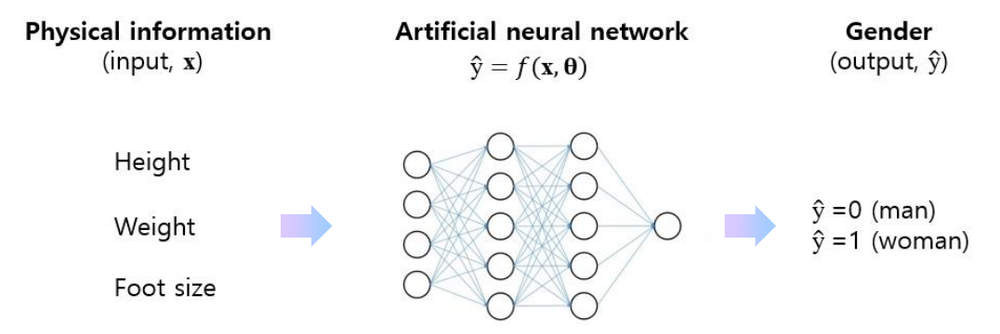

*그림 18. 신체 정보로 성별을 추정하는 인공신경망*

여러 사람의 데이터를 넣었을 때 결과가 표 9와 같다고 가정한다. 정답 $y$는 원하는(desired) 출력이다.

| 사람 | 입력 | 신경망의 계산 | 추정 $\hat{y}$ | 정답 $y$ | 판정 |
|:-----|:-----|:-----|:-----|:-----|:-----|
| 1 | $\mathbf{x}_1$ | $f(\mathbf{x}_1, \boldsymbol{\theta})$ | 0 | 0 | 맞음 |
| 2 | $\mathbf{x}_2$ | $f(\mathbf{x}_2, \boldsymbol{\theta})$ | 0 | 1 | 틀림 |
| 3 | $\mathbf{x}_3$ | $f(\mathbf{x}_3, \boldsymbol{\theta})$ | 1 | 1 | 맞음 |

*표 9. 성별 추정 결과와 정답의 비교*

2번 사람에 대한 추정이 틀렸다. 입력 데이터는 바꿀 수 없으므로, 추정 오차를 줄이려면 매개변수 벡터 $\boldsymbol{\theta}$를 변경해야 한다. 이렇게 정답이 있는 데이터를 이용해 오차가 줄어드는 방향으로 $\boldsymbol{\theta}$를 바꾸는 과정이 **학습(training, 훈련)** 이며, 정답을 함께 주고 학습시키는 방식이 12주차의 지도 학습(supervised learning)이다.

### 2.8 매개변수 벡터와 기울기 벡터

학습 과정을 가장 단순한 신경망으로 살펴본다. 그림 19의 신경망은 입력층, 은닉층, 출력층에 뉴런이 하나씩 있다. 입력 $x$에 가중치 $w_1$을 곱하고 편향 $b_1$을 더해 활성화 함수를 거치면 은닉층 출력 $A_1$이 되고, $A_1$에 $w_2$를 곱하고 $b_2$를 더해 활성화 함수를 거치면 출력 $A_2 = \hat{y}$가 된다.

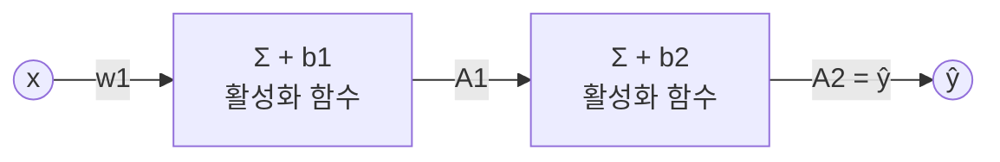

*그림 19. 뉴런이 층마다 하나인 신경망*

$w_1$, $w_2$는 가중치(weight), $b_1$, $b_2$는 편향(bias)이며, 이들을 모은 것이 **매개변수 벡터(parameter vector)** $\boldsymbol{\theta}$이다.

$$
\hat{y} = f(x; \boldsymbol{\theta}), \qquad \boldsymbol{\theta} = [w_1, b_1, w_2, b_2]
$$

인공신경망의 정확도는 이 $\boldsymbol{\theta}$의 함수인 손실 함수로 표현된다. 가중치는 입력이 출력에 미치는 영향의 크기를 정하고, 편향은 활성화 함수를 좌우로 이동시킨다. 그림 20의 굵은 파란 곡선은 $-10$에서 $10$ 사이에 그린 시그모이드이고, 점선은 편향을 바꾸어 이 곡선을 왼쪽과 오른쪽으로 평행 이동한 것이다. $\sigma(z + b)$의 중심은 $z = -b$이므로 $b > 0$이면 곡선이 왼쪽으로, $b < 0$이면 오른쪽으로 이동한다.

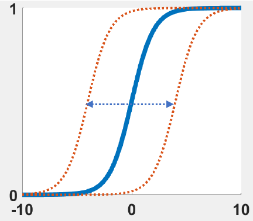

*그림 20. 편향에 따른 시그모이드 함수의 이동*

매개변수 벡터 $\boldsymbol{\theta}$를 변경하면 손실을 줄일 수 있다. 그런데 네 매개변수를 각각 어느 방향으로 얼마나 움직여야 하는지 결정하려면, 각 매개변수를 조금 바꿀 때 손실이 얼마나 변하는지 알아야 한다. 이 정보를 모은 것이 **기울기 벡터(gradient vector)** $\nabla_{\boldsymbol{\theta}}L$이다.

$$
\nabla_{\boldsymbol{\theta}}L = \begin{bmatrix} \dfrac{\partial L}{\partial w_1} & \dfrac{\partial L}{\partial b_1} & \dfrac{\partial L}{\partial w_2} & \dfrac{\partial L}{\partial b_2} \end{bmatrix}^{T}
$$

> **[미적분학]** 다변수 함수 $f(x_1, \dots, x_n)$의 **편미분(partial derivative)** $\partial f/\partial x_i$는 다른 변수를 상수로 고정하고 $x_i$로만 미분한 도함수이며, $x_i$만 조금 바꿀 때 $f$가 변하는 비율을 뜻한다. 모든 편미분을 모은 벡터 $\nabla f = [\partial f/\partial x_1, \dots, \partial f/\partial x_n]^{T}$를 **기울기(gradient)** 라 한다.

### 2.9 기울기와 경사 하강법

**기울기(gradient)** 는 함수가 가장 크게 증가하는 방향을 나타낸다. 따라서 함수를 최소화하려면 기울기의 반대 방향으로 이동해야 한다. 기울기가 가장 가파른 증가 방향인 이유는 방향 도함수로 설명할 수 있다. 점 $\mathbf{p}$에서 크기가 1인 방향 $\mathbf{u}$로 움직일 때 $f$의 변화율(방향 도함수)은 다음과 같다.

$$
D_{\mathbf{u}}f(\mathbf{p}) = \nabla f(\mathbf{p}) \cdot \mathbf{u} = \lVert \nabla f(\mathbf{p}) \rVert \cos\phi
$$

$\phi$는 $\nabla f$와 $\mathbf{u}$ 사이의 각이다. $\cos\phi$는 $\phi = 0$일 때 최댓값 1, $\phi = \pi$일 때 최솟값 $-1$을 가지므로, 기울기와 같은 방향으로 갈 때 $f$가 가장 빠르게 증가하고 기울기의 반대 방향 $-\nabla f$로 갈 때 가장 빠르게 감소한다. 이때의 변화율의 크기는 $\lVert \nabla f \rVert$이다.

> **용어 정의:** **경사 하강법(gradient descent method)** 은 손실 함수를 최소화하기 위해 기울기를 활용하여 모델의 매개변수를 반복적으로 업데이트하는 최적화 알고리즘이다.

그림 21은 매개변수가 두 개인 손실 함수를 3차원 곡면으로 그린 것이다. 높이가 손실이고, 빨간 봉우리는 손실이 큰 곳, 파란 골짜기는 손실이 작은 곳이다. 검은 경로는 높은 곳에서 출발하여 매 단계 그 자리의 기울기 반대 방향으로 조금씩 내려가 골짜기에 도착하는 경사 하강법의 궤적이고, 아래의 등고선 그림은 같은 경로를 위에서 내려다본 것이다.

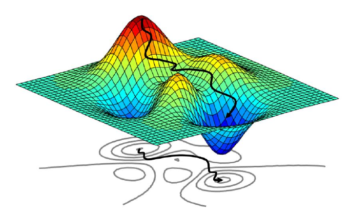

*그림 21. 손실 곡면 위의 경사 하강 경로*

기울기 반대 방향으로 조금 움직이면 손실이 줄어드는 이유는 1차 테일러 근사로 확인할 수 있다. 작은 양수 $\alpha$에 대해 $\boldsymbol{\theta}$를 $-\alpha\nabla J$만큼 움직이면 다음이 성립한다.

$$
J(\boldsymbol{\theta} - \alpha\nabla J) \approx J(\boldsymbol{\theta}) - \alpha\,\nabla J \cdot \nabla J = J(\boldsymbol{\theta}) - \alpha\lVert \nabla J \rVert^{2}
$$

$\nabla J \neq \mathbf{0}$이면 $\alpha\lVert \nabla J \rVert^{2} > 0$이므로 손실이 줄어든다. 다만 근사가 성립하려면 $\alpha$가 충분히 작아야 하며, 이 $\alpha$가 3.5절의 학습률이다. 경사 하강법은 11주차에서 PID 이득을 조정할 때도 쓰인 기울기 기반 최적화와 같은 원리이다.

> **주의:** 그림 21의 곡면처럼 골짜기가 여러 개인 손실 함수에서 경사 하강법은 출발점에서 가까운 골짜기, 즉 **국소 최솟값(local minimum)** 에 도달할 수 있으며, 그것이 전체에서 가장 낮은 **전역 최솟값(global minimum)** 이라는 보장은 없다.

### 2.10 예제: 기울기 계산

다음 세 함수의 기울기를 주어진 점에서 구한다. 각 변수에 대한 편미분을 구한 뒤 점의 좌표를 대입한다.

**(1)** $f(x, y, z) = 2x^{2} + 3y^{2} + z^{2}$, 점 $(1, 1, 1)$

$$
\frac{\partial f}{\partial x} = 4x, \quad \frac{\partial f}{\partial y} = 6y, \quad \frac{\partial f}{\partial z} = 2z \quad\Rightarrow\quad \nabla f(1, 1, 1) = [4, 6, 2]^{T}
$$

**(2)** $f(x, y, z) = x^{2}y + z$, 점 $(2, 2, 0)$

$$
\frac{\partial f}{\partial x} = 2xy, \quad \frac{\partial f}{\partial y} = x^{2}, \quad \frac{\partial f}{\partial z} = 1 \quad\Rightarrow\quad \nabla f(2, 2, 0) = [2 \cdot 2 \cdot 2,\ 2^{2},\ 1]^{T} = [8, 4, 1]^{T}
$$

$x$로 편미분할 때 $y$는 상수이므로 $x^{2}y$의 도함수는 $2x \cdot y$이고, $y$로 편미분할 때는 $x^{2}$이 상수 계수가 된다.

**(3)** $f(x, y, z) = e^{2x} + \sin y + \cos z$, 점 $(0, 0, 0)$

$$
\frac{\partial f}{\partial x} = 2e^{2x}, \quad \frac{\partial f}{\partial y} = \cos y, \quad \frac{\partial f}{\partial z} = -\sin z \quad\Rightarrow\quad \nabla f(0, 0, 0) = [2, 1, 0]^{T}
$$

$e^{2x}$의 도함수는 연쇄 법칙에 따라 $e^{2x} \cdot 2$이다.

기울기의 의미는 변수를 하나씩 조금 늘려 보며 확인할 수 있다. 표 10은 점에서 변수 하나만 1만큼 늘렸을 때의 함숫값과 증가량이다.

| 함수 | 점 | $f$ | $x$를 1 증가 | $y$를 1 증가 | $z$를 1 증가 | 증가량 | 정확한 기울기 |
|:-----|:-----|:-----|:-----|:-----|:-----|:-----|:-----|
| (1) | $(1, 1, 1)$ | 6 | 12 | 15 | 9 | $[6, 9, 3]$ | $[4, 6, 2]$ |
| (2) | $(2, 2, 0)$ | 8 | 18 | 12 | 9 | $[10, 4, 1]$ | $[8, 4, 1]$ |

*표 10. 변수를 하나씩 1 증가시켰을 때의 함숫값 변화*

예를 들어 (1)에서 $x$를 1에서 2로 늘리면 $f(2, 1, 1) = 8 + 3 + 1 = 12$가 되어 6만큼 증가한다. 증가량은 기울기와 방향이 비슷하지만 값이 정확히 같지는 않다. 이 증가량은 **전방 차분(forward difference)** $\bigl(f(x + h) - f(x)\bigr)/h$에서 $h = 1$로 둔 것인데, 기울기는 $h \to 0$일 때의 극한이기 때문이다. (1)의 $x$ 방향에서 $\bigl(2(x + h)^{2} - 2x^{2}\bigr)/h = 4x + 2h$이므로 $x = 1$, $h = 1$이면 $4 + 2 = 6$이고, $h$를 0.1, 0.01, 0.001로 줄이면 4.2, 4.02, 4.002로 정확한 값 4에 다가간다. 반면 (2)의 $z$ 방향과 $y$ 방향처럼 함수가 그 변수에 대해 1차식이면 $h$와 관계없이 증가량이 기울기와 같다.

> **핵심:** 기울기의 각 성분은 그 변수를 매우 조금 늘렸을 때 함수가 변하는 비율이다. 매개변수가 수백만 개인 신경망에서 매개변수마다 값을 조금씩 바꾸어 손실을 다시 계산하면 너무 느리므로, 실제 학습에서는 3절의 역전파로 모든 편미분을 한 번에 정확히 계산한다.

---

<br>

## 3. 인공신경망 학습 II: 역전파, 경사 하강법, 정규화

### 3.1 연쇄 법칙과 계산 그래프

> **용어 정의:** **역전파(backpropagation)** 는 손실 함수의 기울기 $\nabla_{\boldsymbol{\theta}}L$을 계산하는 데 사용되는 방법이다. 역전파에서는 출력에서 생긴 오차가 입력 쪽으로 거꾸로 전파되면서 기울기가 계산된다.

역전파의 원리를 가장 작은 예로 살펴본다. 그림 22는 $E = (x + y)z$를 덧셈과 곱셈 두 단계로 나누어 그린 **계산 그래프(computational graph)** 이다. 덧셈 노드가 중간값 $q = x + y$를 만들고, 곱셈 노드가 $E = qz$를 만든다. 목표는 $\partial E/\partial x$, $\partial E/\partial y$, $\partial E/\partial z$를 구하는 것이다.

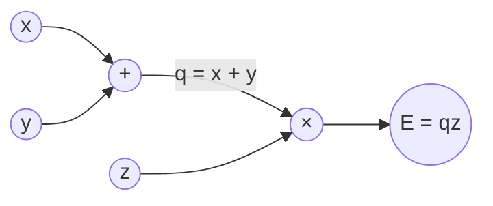

*그림 22. E = (x + y)z의 계산 그래프*

$E$는 $q$를 거쳐서만 $x$에 의존하므로 **연쇄 법칙(chain rule)** 을 쓴다.

$$
\frac{\partial E}{\partial x} = \frac{\partial q}{\partial x}\frac{\partial E}{\partial q} = 1 \cdot z = z, \qquad \frac{\partial E}{\partial y} = \frac{\partial q}{\partial y}\frac{\partial E}{\partial q} = 1 \cdot z = z, \qquad \frac{\partial E}{\partial z} = q
$$

각 곱의 두 인수에는 이름이 있다. $\partial q/\partial x$처럼 노드 하나가 자기 입력에 대해 갖는 도함수를 **지역 기울기(local gradient)** 라 하고, $\partial E/\partial q$처럼 최종 출력에서 그 노드의 출력까지 거꾸로 전달되어 온 기울기를 **상류 기울기(upstream gradient)** 라 한다. 각 노드는 자기의 지역 기울기만 알면 되고, 상류 기울기에 지역 기울기를 곱해 다음 노드로 넘긴다. 이 지역적인 계산의 반복이 역전파의 핵심이다.

수치로 따라가 본다. $x = 1$, $y = 3$, $z = -2$이면 순전파에서 $q = 1 + 3 = 4$, $E = 4 \times (-2) = -8$이다. 역전파는 출력에서 시작한다.

1. 출력 자신에 대한 기울기는 $\partial E/\partial E = 1$이다.
2. 곱셈 노드: $E = qz$이므로 지역 기울기는 $\partial E/\partial q = z = -2$, $\partial E/\partial z = q = 4$이다. 곱셈 노드는 상류 기울기에 상대 입력의 값을 곱해 넘긴다.
3. 덧셈 노드: $q = x + y$이므로 지역 기울기는 $\partial q/\partial x = \partial q/\partial y = 1$이다. 상류 기울기 $-2$에 1을 곱하므로 $\partial E/\partial x = \partial E/\partial y = -2$이다. 덧셈 노드는 상류 기울기를 그대로 나누어 준다.

검산으로 $x$를 1에서 1.01로 늘리면 $E = (4.01)(-2) = -8.02$가 되어 $-0.02 = -2 \times 0.01$만큼 변하므로 $\partial E/\partial x = -2$와 맞는다.

> **[미적분학]** 합성 함수 $y = f(g(x))$의 도함수는 $\dfrac{dy}{dx} = f'(g(x))\,g'(x)$로, 바깥 함수와 안쪽 함수의 도함수를 곱한다. 다변수에서 $E$가 중간 변수 $q$를 거쳐 $x$에 의존하면 $\dfrac{\partial E}{\partial x} = \dfrac{\partial E}{\partial q}\dfrac{\partial q}{\partial x}$이고, $x$가 여러 경로로 $E$에 영향을 주면 경로마다 구한 곱을 모두 더한다.

### 3.2 2층 신경망의 역전파

2.8절의 신경망(그림 19)에 역전파를 적용한다. 활성화 함수는 두 층 모두 시그모이드 $\sigma$이고, 손실은 제곱 오차이다. 순전파는 다음 다섯 식으로 이루어진다.

$$
S_1 = xw_1 + b_1, \qquad A_1 = \sigma(S_1), \qquad S_2 = A_1w_2 + b_2, \qquad A_2 = \sigma(S_2), \qquad L = (\hat{y} - y)^{2} = (A_2 - y)^{2}
$$

$S_1$, $S_2$는 각 층의 가중합이고 $A_1$, $A_2$는 활성화 함수를 거친 출력이다. 구할 것은 기울기 벡터 $\nabla_{\boldsymbol{\theta}}L = [\partial L/\partial w_1, \partial L/\partial b_1, \partial L/\partial w_2, \partial L/\partial b_2]^{T}$의 네 성분이다. 역전파라는 이름대로 출력에 가까운 $w_2$, $b_2$부터 구한다.

**1단계: $\partial L/\partial w_2$.** $w_2$는 $S_2 \to A_2 \to L$의 경로로 손실에 영향을 주므로, 연쇄 법칙으로 세 지역 기울기를 곱한다.

$$
\frac{\partial L}{\partial w_2} = \frac{\partial S_2}{\partial w_2}\frac{\partial A_2}{\partial S_2}\frac{\partial L}{\partial A_2} = A_1 \cdot \sigma'(S_2) \cdot 2(A_2 - y)
$$

세 인수는 각각 다음과 같이 구한다.

- $S_2 = A_1w_2 + b_2$를 $w_2$로 미분하면 $\partial S_2/\partial w_2 = A_1$이다.
- $A_2 = \sigma(S_2)$이므로 $\partial A_2/\partial S_2 = \sigma'(S_2) = A_2(1 - A_2)$이다(1.10절).
- $L = (A_2 - y)^{2}$이므로 $\partial L/\partial A_2 = 2(A_2 - y)$이다.

여기서 뒤의 두 인수의 곱을 출력층의 **오차 신호(error signal)** $\delta_2$로 정의한다. $\delta_2$는 출력층 가중합 $S_2$에 대한 손실의 기울기이다.

$$
\delta_2 = \frac{\partial L}{\partial S_2} = \frac{\partial A_2}{\partial S_2}\frac{\partial L}{\partial A_2} = \sigma'(S_2) \cdot 2(A_2 - y), \qquad \frac{\partial L}{\partial w_2} = A_1\,\delta_2
$$

**2단계: $\partial L/\partial b_2$.** $S_2$를 $b_2$로 미분하면 1이므로 다음과 같다.

$$
\frac{\partial L}{\partial b_2} = \frac{\partial S_2}{\partial b_2}\,\delta_2 = 1 \cdot \delta_2 = \delta_2
$$

**3단계: $\partial L/\partial w_1$.** $w_1$은 $S_1 \to A_1 \to S_2 \to A_2 \to L$의 긴 경로로 손실에 영향을 준다. 이 경로의 뒷부분 $S_2 \to A_2 \to L$의 곱은 이미 $\delta_2$로 계산해 두었으므로 다시 계산할 필요가 없다.

$$
\frac{\partial L}{\partial w_1} = \frac{\partial S_1}{\partial w_1}\frac{\partial A_1}{\partial S_1}\frac{\partial S_2}{\partial A_1}\underbrace{\frac{\partial A_2}{\partial S_2}\frac{\partial L}{\partial A_2}}_{\delta_2} = x \cdot \sigma'(S_1) \cdot w_2 \cdot \delta_2
$$

$S_2 = A_1w_2 + b_2$를 $A_1$로 미분하면 $w_2$이고, $\sigma'(S_1) = A_1(1 - A_1)$, $S_1 = xw_1 + b_1$을 $w_1$로 미분하면 $x$이다. 은닉층의 오차 신호를 $\delta_1 = \partial L/\partial S_1 = \sigma'(S_1)\,w_2\,\delta_2$로 정의하면 $\partial L/\partial w_1 = x\,\delta_1$이다.

**4단계: $\partial L/\partial b_1$.** $S_1$을 $b_1$로 미분하면 1이므로 $\partial L/\partial b_1 = \delta_1$이다.

| 매개변수 | 기울기 | 재사용하는 값 |
|:-----|:-----|:-----|
| $w_2$ | $A_1\,\sigma'(S_2)\,2(A_2 - y)$ | $\delta_2$ |
| $b_2$ | $\sigma'(S_2)\,2(A_2 - y)$ | $\delta_2$ |
| $w_1$ | $x\,\sigma'(S_1)\,w_2\,\sigma'(S_2)\,2(A_2 - y)$ | $\delta_2$, $\delta_1$ |
| $b_1$ | $\sigma'(S_1)\,w_2\,\sigma'(S_2)\,2(A_2 - y)$ | $\delta_2$, $\delta_1$ |

*표 11. 2층 신경망의 네 기울기*

> **핵심:** 모든 기울기에 공통으로 들어 있는 $\sigma'(S_2)\,2(A_2 - y) = \delta_2$를 한 번만 계산해 두고, 앞쪽 층으로 갈 때마다 지역 기울기를 하나씩 곱해 나간다. 출력에서 입력 쪽으로 오차 신호를 전달하며 기울기를 재사용하는 이 방식이 역전파이다.

### 3.3 역전파 계산 예제

3.2절의 신경망에 실제 숫자를 넣어 한 번의 학습 단계를 계산한다. 입력은 $x = 2$, 정답은 $y = 1$이고, 초기 매개변수는 $w_1 = 0.5$, $b_1 = -0.5$, $w_2 = 1.5$, $b_2 = -1.0$이다. 값은 소수점 아래 넷째 자리까지 반올림하여 적는다.

**1단계: 순전파.** 입력에서 출력 방향으로 계산한다.

| 양 | 계산 | 값 |
|:-----|:-----|:-----|
| $S_1$ | $xw_1 + b_1 = 2 \times 0.5 - 0.5$ | 0.5 |
| $A_1$ | $\sigma(0.5) = 1/(1 + e^{-0.5})$ | 0.6225 |
| $S_2$ | $A_1w_2 + b_2 = 0.6225 \times 1.5 - 1.0$ | -0.0663 |
| $A_2$ | $\sigma(-0.0663)$ | 0.4834 |
| $L$ | $(A_2 - y)^{2} = (0.4834 - 1)^{2}$ | 0.2668 |

*표 12. 순전파 계산*

신경망은 정답 1에 대해 0.4834를 출력했고, 손실은 0.2668이다.

**2단계: 역전파.** 출력에서 입력 방향으로 계산한다.

| 양 | 계산 | 값 |
|:-----|:-----|:-----|
| $\partial L/\partial A_2$ | $2(A_2 - y) = 2(0.4834 - 1)$ | -1.0331 |
| $\sigma'(S_2)$ | $A_2(1 - A_2) = 0.4834 \times 0.5166$ | 0.2497 |
| $\delta_2$ | $-1.0331 \times 0.2497$ | -0.2580 |
| $\partial L/\partial w_2$ | $A_1\,\delta_2 = 0.6225 \times (-0.2580)$ | -0.1606 |
| $\partial L/\partial b_2$ | $\delta_2$ | -0.2580 |
| $\partial L/\partial A_1$ | $w_2\,\delta_2 = 1.5 \times (-0.2580)$ | -0.3870 |
| $\sigma'(S_1)$ | $A_1(1 - A_1) = 0.6225 \times 0.3775$ | 0.2350 |
| $\delta_1$ | $-0.3870 \times 0.2350$ | -0.0909 |
| $\partial L/\partial w_1$ | $x\,\delta_1 = 2 \times (-0.0909)$ | -0.1819 |
| $\partial L/\partial b_1$ | $\delta_1$ | -0.0909 |

*표 13. 역전파 계산*

네 기울기가 모두 음수이다. 출력 0.4834가 정답 1보다 작으므로 출력을 키워야 하고, 이 신경망에서는 네 매개변수를 모두 늘리면 출력이 커지기 때문이다. 출력층 기울기의 크기($|\partial L/\partial b_2| = 0.2580$)가 은닉층 기울기의 크기($|\partial L/\partial b_1| = 0.0909$)보다 큰 것은 은닉층으로 가는 동안 $\sigma'(S_1) = 0.2350$과 $w_2 = 1.5$가 곱해졌기 때문이며, 1.10절에서 본 기울기 소실이 작은 규모로 나타난 것이다.

**3단계: 매개변수 갱신.** 경사 하강법(3.5절)으로 학습률 $\alpha = 1$을 써서 $\boldsymbol{\theta} \leftarrow \boldsymbol{\theta} - \alpha\nabla_{\boldsymbol{\theta}}L$을 계산한다.

| 매개변수 | 갱신 전 | 계산 | 갱신 후 |
|:-----|:-----|:-----|:-----|
| $w_1$ | 0.5 | $0.5 - 1 \times (-0.1819)$ | 0.6819 |
| $b_1$ | -0.5 | $-0.5 - 1 \times (-0.0909)$ | -0.4091 |
| $w_2$ | 1.5 | $1.5 - 1 \times (-0.1606)$ | 1.6606 |
| $b_2$ | -1.0 | $-1.0 - 1 \times (-0.2580)$ | -0.7420 |

*표 14. 경사 하강법에 의한 매개변수 갱신*

**4단계: 갱신 효과 확인.** 새 매개변수로 다시 순전파하면 $S_1 = 2 \times 0.6819 - 0.4091 = 0.9547$, $A_1 = \sigma(0.9547) = 0.7221$, $S_2 = 0.7221 \times 1.6606 - 0.7420 = 0.4571$, $A_2 = \sigma(0.4571) = 0.6123$이고, 손실은 $(0.6123 - 1)^{2} = 0.1503$이다. 한 번의 갱신으로 출력이 0.4834에서 0.6123으로 정답에 가까워졌고, 손실은 0.2668에서 0.1503으로 줄었다. 같은 단계를 반복하면 손실은 10회 후 약 0.0169, 100회 후 약 0.0014로 계속 줄어든다.

역전파로 구한 기울기가 맞는지는 **수치 미분(numerical differentiation)** 과 비교하여 확인할 수 있다. 매개변수 하나를 매우 작은 $\varepsilon$만큼 늘린 손실과 줄인 손실의 차이를 $2\varepsilon$으로 나누는 **중앙 차분(central difference)** 은 오차가 $\varepsilon^{2}$에 비례하여 매우 정확하다.

$$
\frac{\partial L}{\partial \theta_i} \approx \frac{L(\boldsymbol{\theta} + \varepsilon\mathbf{e}_i) - L(\boldsymbol{\theta} - \varepsilon\mathbf{e}_i)}{2\varepsilon}
$$

$\mathbf{e}_i$는 $i$번째 성분만 1이고 나머지가 0인 벡터이다. 수치 미분은 매개변수마다 순전파를 두 번씩 해야 하므로 학습에 쓰기에는 느리지만, 역전파 구현을 검사하는 **기울기 검사(gradient checking)** 에 널리 쓰인다. 다음 Python 코드는 위 예제의 순전파, 역전파, 기울기 검사, 한 번의 갱신을 수행한다.

```python
import numpy as np

def sigmoid(s):
    return 1.0 / (1.0 + np.exp(-s))

def forward(theta, x, y):
    w1, b1, w2, b2 = theta
    S1 = x * w1 + b1
    A1 = sigmoid(S1)
    S2 = A1 * w2 + b2
    A2 = sigmoid(S2)
    L = (A2 - y) ** 2
    return S1, A1, S2, A2, L

def backward(theta, x, y):
    w1, b1, w2, b2 = theta
    S1, A1, S2, A2, L = forward(theta, x, y)
    dS2 = 2 * (A2 - y) * A2 * (1 - A2)
    dS1 = dS2 * w2 * A1 * (1 - A1)
    return np.array([dS1 * x, dS1, dS2 * A1, dS2])

x, y = 2.0, 1.0
theta = np.array([0.5, -0.5, 1.5, -1.0])
grad = backward(theta, x, y)

eps = 1e-5
num = np.zeros(4)
for i in range(4):
    e = np.zeros(4)
    e[i] = eps
    num[i] = (forward(theta + e, x, y)[4] - forward(theta - e, x, y)[4]) / (2 * eps)

print("backprop :", np.round(grad, 4))
print("numerical:", np.round(num, 4))

alpha = 1.0
theta_new = theta - alpha * grad
print("theta_new:", np.round(theta_new, 4))
print("loss     :", round(forward(theta, x, y)[4], 4), "->", round(forward(theta_new, x, y)[4], 4))
```

| 코드 | 하는 일 |
|:-----|:-----|
| `sigmoid(s)` | 시그모이드 함수 $1/(1 + e^{-s})$를 계산한다. |
| `forward(theta, x, y)` | 매개변수 `theta` $= [w_1, b_1, w_2, b_2]$를 풀어 $S_1, A_1, S_2, A_2, L$을 3.2절의 순서대로 계산하여 돌려준다. |
| `backward`의 `dS2` | $\delta_2 = 2(A_2 - y) \cdot A_2(1 - A_2)$를 계산한다. |
| `backward`의 `dS1` | $\delta_1 = \delta_2 \cdot w_2 \cdot A_1(1 - A_1)$을 계산한다. |
| `backward`의 반환값 | 표 11에 따라 $[x\delta_1, \delta_1, A_1\delta_2, \delta_2]$, 즉 $[\partial L/\partial w_1, \partial L/\partial b_1, \partial L/\partial w_2, \partial L/\partial b_2]$를 배열로 돌려준다. |
| `x, y`, `theta` | 예제의 입력, 정답, 초기 매개변수를 정한다. |
| `for` 반복문 | 매개변수마다 `theta`를 $\pm\varepsilon$만큼 바꾼 두 손실의 중앙 차분으로 수치 기울기를 구한다. `forward(...)[4]`는 반환값의 다섯 번째 원소인 손실 $L$이다. |
| `print` 두 줄 | 역전파 기울기와 수치 기울기를 넷째 자리까지 출력하여 비교한다. |
| `theta_new` | 학습률 1로 경사 하강 갱신을 한 번 한다. |
| 마지막 `print` | 갱신 전과 후의 손실을 출력한다. |

*표 15. 역전파 예제 코드의 설명*

실행 결과는 다음과 같다. 두 기울기가 일치하고, 갱신된 매개변수와 손실의 감소가 표 14와 4단계의 계산과 같다. NumPy는 배열을 출력할 때 끝자리의 0을 생략하므로 $-0.2580$이 `-0.258`로 표시된다.

```text
backprop : [-0.1819 -0.0909 -0.1606 -0.258 ]
numerical: [-0.1819 -0.0909 -0.1606 -0.258 ]
theta_new: [ 0.6819 -0.4091  1.6606 -0.742 ]
loss     : 0.2668 -> 0.1503
```

### 3.4 일반적인 역전파 알고리즘

3.2절의 계산을 뉴런이 여러 개인 층 $K$개로 일반화한다[5][13]. $k$번째 층의 가중치 행렬을 $W^{(k)}$, 편향 벡터를 $\mathbf{b}^{(k)}$, 가중합을 $\mathbf{S}^{(k)}$, 출력을 $\mathbf{A}^{(k)}$라 하고 $\mathbf{A}^{(0)} = \mathbf{x}$로 둔다.

$$
\mathbf{S}^{(k)} = W^{(k)}\mathbf{A}^{(k-1)} + \mathbf{b}^{(k)}, \qquad \mathbf{A}^{(k)} = g\bigl(\mathbf{S}^{(k)}\bigr), \qquad k = 1, \dots, K
$$

역전파는 출력층의 오차 신호에서 출발하여 한 층씩 거꾸로 내려간다. $\odot$은 같은 위치의 성분끼리 곱하는 연산이다.

$$
\boldsymbol{\delta}^{(K)} = \nabla_{\mathbf{A}^{(K)}}L \odot g'\bigl(\mathbf{S}^{(K)}\bigr), \qquad \boldsymbol{\delta}^{(k)} = \bigl(W^{(k+1)}\bigr)^{T}\boldsymbol{\delta}^{(k+1)} \odot g'\bigl(\mathbf{S}^{(k)}\bigr)
$$

$$
\frac{\partial L}{\partial W^{(k)}} = \boldsymbol{\delta}^{(k)}\bigl(\mathbf{A}^{(k-1)}\bigr)^{T}, \qquad \frac{\partial L}{\partial \mathbf{b}^{(k)}} = \boldsymbol{\delta}^{(k)}
$$

뉴런이 하나씩이면 행렬이 스칼라가 되어 3.2절의 $\delta_2 = 2(A_2 - y)\sigma'(S_2)$, $\delta_1 = w_2\delta_2\sigma'(S_1)$, $\partial L/\partial w_1 = \delta_1 x$와 같아진다. 학습 한 단계는 다음 순서로 진행된다.

1. 순전파로 모든 층의 $\mathbf{S}^{(k)}$와 $\mathbf{A}^{(k)}$를 계산하고 저장한다.
2. 손실 $L$을 계산한다.
3. 출력층부터 $\boldsymbol{\delta}^{(k)}$를 차례로 구하고, 각 층의 가중치와 편향에 대한 기울기를 계산한다.
4. 경사 하강법으로 모든 매개변수를 갱신한다.

> **핵심:** 역전파는 순전파에서 저장한 값과 뒤쪽 층의 오차 신호를 재사용하므로, 모든 매개변수의 기울기를 순전파와 비슷한 규모의 계산량으로 한 번에 구한다[13]. 매개변수마다 손실을 다시 계산하는 수치 미분보다 훨씬 효율적이다.

### 3.5 경사 하강 알고리즘과 학습률

**경사 하강 알고리즘(gradient descent algorithm)** 은 손실 함수가 가장 빠르게 감소하는 방향, 즉 기울기의 음수 방향으로 매개변수를 업데이트한다.

$$
\boldsymbol{\theta}_{k+1} = \boldsymbol{\theta}_k - \alpha_k\nabla_{\boldsymbol{\theta}}L
$$

$k$는 반복 횟수이고, $\alpha_k$는 한 번에 얼마나 움직일지 정하는 **학습률(learning rate)** 이다. 학습률은 신경망을 훈련할 때 조정해야 하는 중요한 **하이퍼파라미터(hyperparameter)** 이다. 하이퍼파라미터란 가중치처럼 학습으로 정해지는 매개변수와 달리 학습 전에 사람이 정하는 값을 말한다. 아래첨자 $k$는 학습률이 반복마다 달라질 수 있음을 나타낸다(3.6절).

- 학습률이 너무 크면 최솟값을 지나쳐 반대편으로 넘어가며, 심하면 손실이 점점 커져 알고리즘이 발산한다.
- 학습률이 너무 작으면 한 번에 조금씩만 움직이므로 국소 최솟값에 수렴하는 데 너무 많은 시간이 걸린다.

그림 23은 한 가중치에 대한 손실 곡선 위에서 같은 출발점(검은 점)에서 시작한 세 경로를 보여 준다. 초록 경로는 학습률이 너무 작아 매우 짧은 걸음으로 조금밖에 내려가지 못했고(초록 점), 빨간 경로는 적절한 학습률로 최솟값(빨간 점)에 도달했다. 파란 경로는 학습률이 너무 커서 골짜기를 건너뛰며 반대편 더 높은 곳(파란 점)으로 올라가 발산한다.

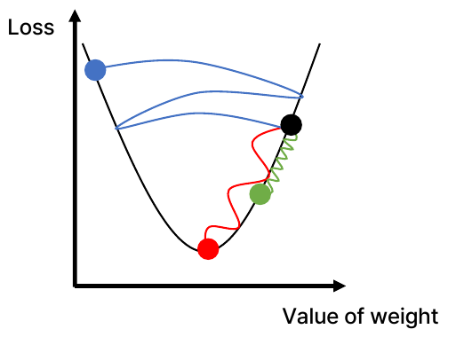

*그림 23. 학습률에 따른 경사 하강 경로*

학습률의 영향은 간단한 손실 함수 $L(w) = w^{2}$로 정확히 계산할 수 있다. 기울기는 $L'(w) = 2w$이므로 갱신 식은 다음과 같다.

$$
w_{k+1} = w_k - \alpha \cdot 2w_k = (1 - 2\alpha)\,w_k \quad\Rightarrow\quad w_k = (1 - 2\alpha)^{k}\,w_0
$$

최솟값은 $w = 0$이고, $w_k$가 0으로 수렴하려면 $|1 - 2\alpha| < 1$, 즉 $0 < \alpha < 1$이어야 한다. $w_0 = 1$에서 출발한 결과는 표 16과 같다.

| 학습률 $\alpha$ | $1 - 2\alpha$ | $w_1, w_2, w_3, w_4, w_5$ | 결과 |
|:-----|:-----|:-----|:-----|
| 0.1 | 0.8 | 0.8, 0.64, 0.512, 0.4096, 0.3277 | 수렴하지만 느리다. |
| 0.4 | 0.2 | 0.2, 0.04, 0.008, 0.0016, 0.0003 | 빠르게 수렴한다. |
| 1.0 | -1 | -1, 1, -1, 1, -1 | 양쪽을 오가며 수렴하지 않는다. |
| 1.1 | -1.2 | -1.2, 1.44, -1.728, 2.0736, -2.4883 | 진동하며 발산한다. |

*표 16. 손실 함수 $L(w) = w^{2}$에서 학습률에 따른 경사 하강의 결과*

학습은 정해진 횟수만큼 반복하거나, 손실이 더 이상 개선되지 않으면 중지한다. 학습 데이터 전체를 한 번 모두 사용하는 것을 **에포크(epoch)** 라 하며, 학습 과정 전체는 그림 24의 반복이다.

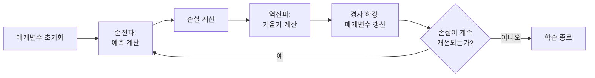

*그림 24. 신경망 학습의 반복 과정*

### 3.6 학습률의 결정과 적응형 학습률

적절한 학습률을 정하는 아이디어는 두 가지이다.

- **아이디어 I:** 다양한 학습률을 시도해 보고 어떤 값에서 적절하게 작동하는지 확인한다. 보통 0.1, 0.01, 0.001처럼 10배씩 다른 값을 시도한다.
- **아이디어 II:** 학습 상황에 적응하는 **적응형 학습률(adaptive learning rate)** 을 설계한다. 학습률은 고정되지 않고 기울기의 크기, 학습 속도, 특정 가중치의 크기 등에 따라 더 커지거나 작아질 수 있다.

아이디어 II를 구현한 대표적인 최적화 방법은 다음과 같다. 아래 식에서 $\mathbf{g}_k = \nabla_{\boldsymbol{\theta}}L(\boldsymbol{\theta}_k)$이고, 제곱, 제곱근, 나눗셈은 성분별 연산이다.

**모멘텀(momentum)** 은 이전 갱신 방향을 일정 비율 $\beta$만큼 기억하여 더한다[14]. 공이 비탈을 구르며 속도가 붙듯이, 기울기의 방향이 일정하면 점점 빨라지고 방향이 자꾸 바뀌는 진동은 서로 상쇄된다.

$$
\mathbf{v}_{k+1} = \beta\mathbf{v}_k + \mathbf{g}_k, \qquad \boldsymbol{\theta}_{k+1} = \boldsymbol{\theta}_k - \alpha\mathbf{v}_{k+1}
$$

**AdaGrad** 는 지금까지의 기울기 제곱을 누적한 $\mathbf{r}$로 학습률을 나눈다[15]. 기울기가 컸던 매개변수는 학습률이 작아지고, 기울기가 작았던 매개변수는 상대적으로 큰 학습률을 받는다. $\epsilon$은 0으로 나누는 것을 막는 작은 수이다.

$$
\mathbf{r}_{k+1} = \mathbf{r}_k + \mathbf{g}_k^{2}, \qquad \boldsymbol{\theta}_{k+1} = \boldsymbol{\theta}_k - \frac{\alpha}{\sqrt{\mathbf{r}_{k+1}} + \epsilon}\,\mathbf{g}_k
$$

**RMSProp** 은 AdaGrad의 누적 합 대신 최근 기울기에 더 큰 비중을 두는 지수 이동 평균을 써서, 학습률이 계속 줄어들기만 하는 문제를 막는다[16].

$$
\mathbf{r}_{k+1} = \rho\,\mathbf{r}_k + (1 - \rho)\,\mathbf{g}_k^{2}, \qquad \boldsymbol{\theta}_{k+1} = \boldsymbol{\theta}_k - \frac{\alpha}{\sqrt{\mathbf{r}_{k+1}} + \epsilon}\,\mathbf{g}_k
$$

**Adam(adaptive moment estimation)** 은 모멘텀과 RMSProp을 결합한 방법으로, 널리 쓰인다[17]. 기울기의 이동 평균 $\mathbf{m}$과 기울기 제곱의 이동 평균 $\mathbf{v}$를 함께 쓰고, 두 평균이 0에서 출발해 초기에 작게 치우치는 것을 $1 - \beta^{k}$로 나누어 보정한다. 제안된 기본값은 $\alpha = 0.001$, $\beta_1 = 0.9$, $\beta_2 = 0.999$, $\epsilon = 10^{-8}$이다.

$$
\mathbf{m}_{k} = \beta_1\mathbf{m}_{k-1} + (1 - \beta_1)\mathbf{g}_k, \qquad \mathbf{v}_{k} = \beta_2\mathbf{v}_{k-1} + (1 - \beta_2)\mathbf{g}_k^{2}
$$

$$
\hat{\mathbf{m}}_k = \frac{\mathbf{m}_k}{1 - \beta_1^{k}}, \qquad \hat{\mathbf{v}}_k = \frac{\mathbf{v}_k}{1 - \beta_2^{k}}, \qquad \boldsymbol{\theta}_{k} = \boldsymbol{\theta}_{k-1} - \frac{\alpha\,\hat{\mathbf{m}}_k}{\sqrt{\hat{\mathbf{v}}_k} + \epsilon}
$$

| 방법 | 학습률을 바꾸는 근거 | 효과 |
|:-----|:-----|:-----|
| 모멘텀 | 이전 갱신 방향(학습 속도) | 일정한 방향으로는 가속하고 진동은 줄인다. |
| AdaGrad | 매개변수별 기울기 크기의 누적 | 자주 크게 바뀐 매개변수의 학습률을 줄인다. |
| RMSProp | 매개변수별 최근 기울기의 크기 | 학습률이 0으로 줄어드는 AdaGrad의 문제를 막는다. |
| Adam | 기울기의 평균과 크기를 함께 사용 | 모멘텀과 매개변수별 학습률 조정을 함께 얻는다. |

*표 17. 적응형 최적화 방법의 비교*

### 3.7 배치, 확률적, 미니배치 경사 하강법

2.5절의 경험적 손실 $J(\boldsymbol{\theta}) = \frac{1}{n}\sum_{i} L_i$의 기울기는 데이터마다 구한 기울기의 평균이다. 데이터가 수백만 개이면 한 번 갱신할 때마다 모든 데이터의 기울기를 구하는 것은 비용이 매우 크다. 그래서 기울기를 계산하는 데 쓰는 데이터의 양에 따라 세 가지 방식을 구분한다[13].

| 방식 | 한 번 갱신에 쓰는 데이터 | 특징 |
|:-----|:-----|:-----|
| 배치 경사 하강법(batch gradient descent) | 전체 $n$개 | 기울기가 정확하지만 한 번 갱신하는 데 시간이 오래 걸린다. |
| 확률적 경사 하강법(stochastic gradient descent, SGD) | 무작위로 고른 1개 | 갱신이 빠르지만 기울기에 잡음이 많아 경로가 흔들린다. |
| 미니배치 경사 하강법(mini-batch gradient descent) | 무작위로 고른 $B$개(예: 32, 64) | 두 방식의 절충으로, GPU의 병렬 계산에 알맞아 가장 널리 쓰인다. |

*표 18. 경사 하강법의 세 가지 방식*

미니배치 $\mathcal{B}$로 구한 기울기 $\frac{1}{B}\sum_{i \in \mathcal{B}}\nabla L_i$는 전체 기울기의 추정값이며, 무작위로 뽑았으므로 평균적으로는 전체 기울기와 같다. 실무에서는 미니배치 방식을 흔히 SGD라 부르기도 한다.

### 3.8 과적합

> **용어 정의:** **과적합(overfitting)** 은 기계 학습과 통계 모델링에서 모델이 노이즈와 이상값을 포함한 학습 데이터를 너무 잘 학습하여, 새로운 데이터에 대해서는 제대로 예측하지 못하는 현상이다.

그림 25는 같은 데이터(주황 점)에 세 모델을 맞춘 결과이다.

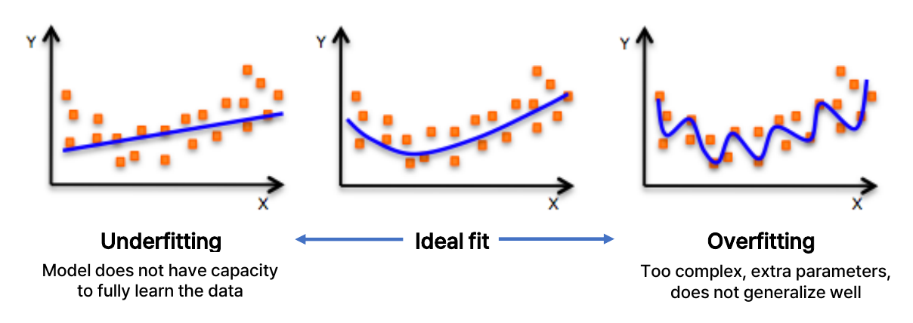

*그림 25. 과소적합, 이상적인 적합, 과적합*

| 상태 | 그림의 모습 | 원인 | 학습 오차 | 새 데이터의 오차 |
|:-----|:-----|:-----|:-----|:-----|
| 과소적합(underfitting) | 굽은 데이터에 직선을 맞춤 | 모델이 데이터를 충분히 학습할 능력(capacity)이 없다. | 크다 | 크다 |
| 이상적인 적합(ideal fit) | 데이터의 전체 경향을 따르는 완만한 곡선 | 모델의 복잡도가 데이터에 알맞다. | 작다 | 작다 |
| 과적합(overfitting) | 모든 점을 지나려고 심하게 구불거리는 곡선 | 모델이 너무 복잡하고 매개변수가 지나치게 많아 일반화되지 않는다. | 매우 작다 | 크다 |

*표 19. 적합 상태의 비교*

과적합된 모델은 데이터의 일반적인 경향이 아니라 우연한 노이즈까지 외워 버린다. 모델이 처음 보는 데이터에 대해서도 잘 예측하는 능력을 **일반화(generalization)** 라 하며, 학습의 목표는 학습 데이터의 오차가 아니라 일반화 성능을 높이는 것이다. 과적합은 12주차에서 다룬 것처럼 학습에 쓰지 않은 검증 데이터로 오차를 측정하여 진단한다. 학습 오차는 작은데 검증 오차가 크면 과적합이다.

과적합을 줄이기 위해 학습 알고리즘에 가하는 수정을 **정규화(regularization)** 라 한다. 정규화는 학습 오차가 아니라 일반화 오차를 줄이려는 목적의 수정이다[13]. 3.9절과 3.10절은 신경망에서 많이 쓰는 두 정규화 기법을 다룬다.

> **참고:** 널리 쓰이는 또 다른 정규화는 손실에 가중치 크기의 벌점을 더하는 **L2 정규화(가중치 감쇠, weight decay)** 이다[13]. $\tilde{J}(\boldsymbol{\theta}) = J(\boldsymbol{\theta}) + \frac{\lambda}{2}\lVert\mathbf{w}\rVert^{2}$을 최소화하면 기울기에 $\lambda\mathbf{w}$가 더해져 매 갱신마다 가중치가 0 쪽으로 조금씩 줄어들고, 가중치가 큰 복잡한 함수가 억제된다. $\lambda$는 벌점의 세기를 정하는 하이퍼파라미터이다.

### 3.9 정규화 I: 드롭아웃

> **용어 정의:** **드롭아웃(dropout)** 은 훈련 중에 일부 뉴런의 활성화(출력)를 무작위로 0으로 설정하는 정규화 기법이다[18]. 일반적으로 한 계층의 활성화 중 50%를 삭제한다.

그림 26은 입력 3개, 뉴런 4개짜리 은닉층 두 개, 출력 2개인 완전 연결 신경망에 드롭아웃을 적용한 한 순간이다. 점선 테두리의 뉴런은 현재 학습 단계에서 삭제되어 연결이 끊겼고, 남은 뉴런으로 이루어진 축소된 신경망만으로 순전파와 역전파를 한다.

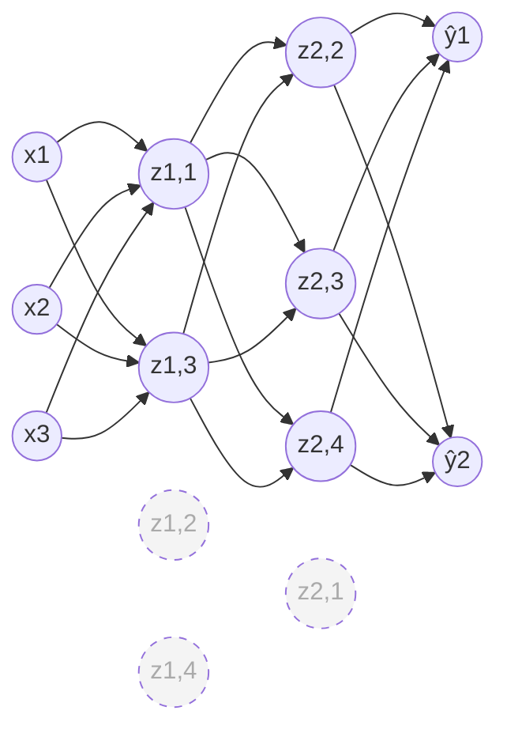

*그림 26. 드롭아웃으로 일부 뉴런이 삭제된 신경망*

드롭아웃이 과적합을 줄이는 이유는 두 가지로 설명된다[18].

- 어떤 뉴런이 다음 단계에 사라질지 모르므로, 뉴런들이 특정한 다른 뉴런에 의존하여 함께 노이즈를 외우는 공적응(co-adaptation)이 어려워진다. 각 뉴런은 혼자서도 쓸모 있는 특징을 학습해야 한다.
- 학습 단계마다 서로 다른 축소 신경망이 학습되므로, 많은 신경망을 학습시켜 평균하는 앙상블(ensemble)과 비슷한 효과를 낸다.

드롭아웃은 학습할 때만 적용하고, 예측(시험)할 때는 모든 뉴런을 사용한다. 이때 출력의 크기가 학습할 때와 달라지지 않도록 보정해야 한다. 흔히 쓰는 역 드롭아웃(inverted dropout)은 학습할 때 남은 뉴런의 출력을 유지 확률 $p$로 나누어 키운다. 예를 들어 삭제 비율이 50%이면 유지 확률도 $p = 0.5$이며, 네 뉴런의 출력이 $[0.8, 0.2, 0.6, 0.4]$일 때 두 번째와 네 번째가 삭제되면 출력은 $[0.8/0.5, 0, 0.6/0.5, 0] = [1.6, 0, 1.2, 0]$이 된다. 각 출력 $a$의 기댓값은 $0.5 \times 2a + 0.5 \times 0 = a$로 원래 값과 같으므로, 시험할 때는 아무 보정 없이 모든 뉴런을 그대로 쓴다. 원 논문은 반대로 학습할 때는 그대로 두고 시험할 때 가중치에 $p$를 곱하며, 두 방법은 기댓값의 관점에서 같다. 원 논문은 은닉 뉴런의 유지 확률 0.5가 넓은 범위의 신경망과 작업에서 최적에 가깝다고 보고했다[18].

### 3.10 정규화 II: 조기 종료

> **용어 정의:** **조기 종료(early stopping)** 는 과적합이 발생하기 전에 학습을 일찍 종료하는 정규화 기법이다.

그림 27은 학습 반복 횟수에 따른 두 손실의 전형적인 변화를 그린 것이다. 학습 데이터의 손실(초록)은 반복할수록 계속 줄어든다. 학습에 쓰지 않은 데이터의 손실(파랑)은 처음에는 함께 줄어들다가 어느 순간부터 다시 커지는데, 이때부터 모델이 학습 데이터의 노이즈를 외우기 시작한 것, 즉 과적합이 시작된 것이다. 조기 종료는 이 손실이 최소가 되는 지점(보라 점선)에서 학습을 멈추고 그때의 매개변수를 최종 모델로 쓴다.

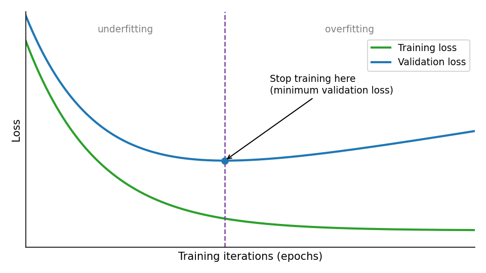

*그림 27. 조기 종료의 원리*

실제로는 검증 손실이 잠시 오르내릴 수 있으므로, 검증 손실이 정해진 횟수(인내, patience) 동안 연속으로 개선되지 않으면 학습을 멈추고 그동안 검증 손실이 가장 작았던 시점의 매개변수로 되돌린다[13]. 조기 종료는 학습 횟수 자체를 하이퍼파라미터로 보고 자동으로 정하는 방법이라 할 수 있다.

> **주의:** 조기 종료의 기준은 학습 데이터와 별도로 떼어 둔 **검증 데이터(validation data)** 의 손실이어야 한다. 최종 성능을 보고하는 시험 데이터(test data)로 멈출 시점을 고르면 시험 데이터의 정보가 학습에 쓰인 것이 되어, 시험 성능이 실제보다 좋게 측정된다(12주차).

### 3.11 예제: 배터리 모듈 데이터의 회귀

인공신경망으로 공학 문제를 푸는 예로, 배터리 모듈의 설계 변수로부터 구조 해석 결과를 예측하는 회귀 문제를 다룬다. 그림 28 (a)는 배터리 모듈의 구조이다. 셀(cell) 9개가 나란히 놓이고, 셀 사이에는 냉각 핀(cooling fin)과 압축 패드(compression pad)가 있으며, 위아래는 상판(top plate)과 하판(bottom plate), 양옆은 측판(side plate)이 감싸고 맨 아래에 방열판(heat sink)이 있다. 모듈의 길이는 $L_{\text{module}}$, 높이는 $H_{\text{module}}$이다. 그림 (b)는 모듈 안쪽에서 바깥쪽으로 압력(pressure)이 작용할 때의 변형 해석 결과로, 양쪽 측판이 바깥으로 휘고 상판이 아래로 처진다. 좌우 대칭인 하중에서 왼쪽 측판은 파랑, 오른쪽 측판은 빨강으로 색 범위의 양 끝을 띠고 크게 처진 상판은 중간인 초록이므로, 색은 변위의 크기가 아니라 가로 방향 변위의 부호 있는 값(왼쪽으로 가장 크게 움직인 곳이 파랑, 오른쪽으로 가장 크게 움직인 곳이 빨강)을 나타낸다.

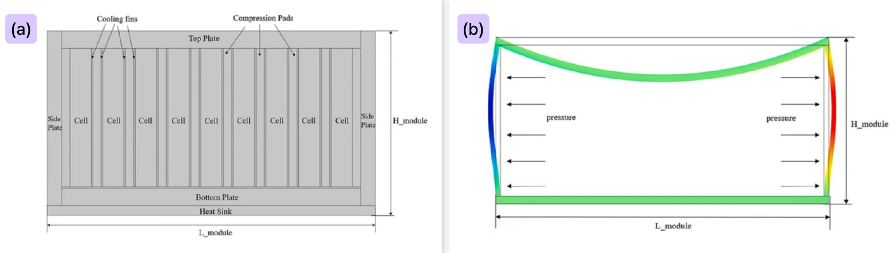

*그림 28. 배터리 모듈의 구조와 압력에 의한 변형*

입력 변수 6개와 출력 변수 2개는 표 20과 같다. 재료 물성과 치수에는 제조 편차 같은 불확실성이 있으므로, 입력값을 여러 가지로 바꾼 500개의 조합에 대해 출력을 구한 데이터(불확실성 데이터)를 쓴다.

| 구분 | 변수 | 뜻 |
|:-----|:-----|:-----|
| 입력 1 | 영률(Young's modulus) | 재료의 강성으로, 탄성 범위에서 응력을 변형률로 나눈 값이다. |
| 입력 2 | 모듈 길이(module length) | 모듈의 가로 길이 $L_{\text{module}}$이다. |
| 입력 3 | 푸아송 비(Poisson's ratio) | 재료를 한 방향으로 늘릴 때 가로 방향으로 줄어드는 변형률과 늘어나는 변형률의 비이다. |
| 입력 4 | 밀도(density) | 단위 부피당 질량이다. |
| 입력 5 | 상판 두께(top thickness) | 상판의 두께이다. |
| 입력 6 | 측판 두께(side thickness) | 측판의 두께이다. |
| 출력 1 | 폰 미제스 응력(von Mises stress) | 여러 방향의 응력을 재료의 항복 여부를 판단할 수 있는 하나의 값으로 환산한 등가 응력이다. |
| 출력 2 | 변위(displacement) | 하중을 받아 구조물의 점이 원래 위치에서 움직인 거리이다. |

*표 20. 배터리 모듈 예제의 입력과 출력*

> **참고:** 폰 미제스 응력은 세 주응력 $\sigma_1, \sigma_2, \sigma_3$로부터 $\sigma_{v} = \sqrt{\tfrac{1}{2}\bigl[(\sigma_1 - \sigma_2)^{2} + (\sigma_2 - \sigma_3)^{2} + (\sigma_3 - \sigma_1)^{2}\bigr]}$로 계산하며, 연성 재료는 이 값이 항복 강도에 이르면 항복한다고 판단한다. 이런 출력은 보통 유한 요소 해석 같은 시간이 오래 걸리는 수치 해석으로 구하므로, 이를 학습한 신경망은 새로운 설계 변수 조합의 결과를 즉시 예측하는 대리 모델(surrogate model)로 쓸 수 있다.

데이터는 입력 행렬 `x_input`($6 \times 500$)과 출력 벡터 `y_mises`($1 \times 500$), `y_disp`($1 \times 500$)로 저장되어 있다. MATLAB 신경망 함수는 행이 변수, 열이 샘플인 형식을 쓰므로[19] `x_input`의 각 열이 설계 하나의 입력 6개이다. 출력 두 개를 하나의 신경망으로 함께 예측할 수도 있지만, 여기서는 출력마다 입력 6개, 은닉 뉴런 10개, 출력 1개인 신경망을 따로 학습시킨다(그림 29).


*그림 29. 배터리 모듈 예제의 신경망 구조*

폰 미제스 응력을 예측하는 MATLAB 코드는 다음과 같다.

```matlab
%% mises
net_mises=feedforwardnet([10]);
% [net_mises, tr] = train(net_mises,x_input,y_mises(1,:),'useParallel','yes');
[net_mises, tr] = train(net_mises,x_input,log(y_mises(1,:)),'useParallel','yes');

input_weights = net_mises.IW{1,1};
layer_weights = net_mises.LW{2,1};
%
biases = net_mises.b;
biases1 = biases{1,1};
biases2 = biases{2,1};
```

| 코드 | 하는 일 |
|:-----|:-----|
| `%% mises` | 코드 구역(section)의 시작을 표시하는 주석이다. |
| `feedforwardnet([10])` | 뉴런 10개짜리 은닉층 하나를 둔 피드포워드 신경망(feedforward neural network, 신호가 입력에서 출력 쪽으로만 흐르고 되먹임이 없는 신경망)을 만든다. 은닉층 크기의 기본값도 10이며, 학습 함수의 기본값은 Levenberg-Marquardt 방법(`trainlm`)이다[20]. |
| `% [net_mises, tr] = ...` | 응력 값을 그대로 학습시키는 원래 코드로, 앞에 `%`를 붙여 주석 처리했다. |
| `train(net_mises, x_input, log(y_mises(1,:)), ...)` | 입력 `x_input`과 목표값으로 신경망을 학습시킨다. 목표값은 응력 `y_mises`의 첫째 행에 자연로그를 취한 값이다. `'useParallel','yes'`는 병렬 풀이 열려 있으면 계산을 병렬 작업자에서 수행하라는 옵션이다[19]. |
| `[net_mises, tr]` | 학습된 신경망과 학습 기록 `tr`(에포크별 성능, 학습, 검증, 시험 데이터의 분할 정보 등)을 받는다[19]. |
| `net_mises.IW{1,1}` | 입력에서 첫 층(은닉층)으로 가는 입력 가중치(input weight) 행렬($10 \times 6$)이다. |
| `net_mises.LW{2,1}` | 첫 층에서 둘째 층(출력층)으로 가는 층 가중치(layer weight) 행렬($1 \times 10$)이다. |
| `net_mises.b` | 층별 편향을 담은 셀 배열이며, `biases{1,1}`은 은닉층 편향($10 \times 1$), `biases{2,1}`은 출력층 편향($1 \times 1$)이다. |

*표 21. 응력 예측 코드의 설명*

변위를 예측하는 코드는 신경망 이름과 목표값만 다르다. 변위는 로그를 취하지 않고 그대로 학습시킨다.

```matlab
%% displacement
net_disp=feedforwardnet([10]);
[net_disp, tr] = train(net_disp,x_input,(y_disp(1,:)),'useParallel','yes');

input_weights = net_disp.IW{1,1};
layer_weights = net_disp.LW{2,1};

biases = net_disp.b;
biases1 = biases{1,1};
biases2 = biases{2,1};
```

추출한 가중치와 편향으로 신경망의 계산을 수식으로 쓸 수 있다. `feedforwardnet`의 은닉층은 기본적으로 tansig 활성화 함수를 쓰는데, 이는 수학적으로 tanh와 같다[21]. 출력층은 입력을 그대로 내보내는 선형 함수(purelin)를 쓴다.

$$
\hat{y} = \text{LW}\,\tanh\bigl(\text{IW}\,\mathbf{x} + \mathbf{b}_1\bigr) + b_2
$$

매개변수는 $\text{IW}$의 60개, $\mathbf{b}_1$의 10개, $\text{LW}$의 10개, $b_2$의 1개로 모두 81개이며, 2.2절의 공식 $(6 + 1) \times 10 + (10 + 1) \times 1 = 81$과 같다. 응력 신경망의 출력은 응력의 로그이므로 실제 응력은 $e^{\hat{y}}$로 되돌려 구한다. 응력처럼 항상 양수이고 크기의 범위가 넓은 값에 로그를 취하면 값의 범위가 좁아지고, 큰 값과 작은 값의 상대 오차를 비슷한 비중으로 학습하게 된다. 또 $e^{\hat{y}}$는 항상 양수이므로 음수 응력이라는 불가능한 예측도 나오지 않는다.

`train`은 학습 중에 검증 데이터의 성능을 감시하여 조기 종료(3.10절)를 수행한다. 기본 학습 함수 `trainlm`은 검증 성능이 개선되지 않는 에포크가 `max_fail`번(기본값 6) 연속되면 학습을 멈춘다[22].

> **주의:** `feedforwardnet`은 기본 설정에서 입력과 목표값의 각 행을 $[-1, 1]$ 범위로 바꾸는 `mapminmax` 전처리를 자동으로 적용한다[23]. 따라서 추출한 `IW`, `LW`, `b`는 정규화된 값에 대한 가중치이며, 위 식으로 직접 예측하려면 입력을 같은 방식으로 변환하고 출력을 원래 범위로 되돌려야 한다. 이 전처리의 정규화(normalization)는 데이터의 범위를 맞추는 것으로, 3.8절의 과적합을 줄이는 정규화(regularization)와 다른 개념이다.

> **참고:** 최근 MATLAB 문서는 `feedforwardnet`과 `train`을 이후 버전에서 제거될 예정(To be removed)인 함수로 표시하고 있다[20][19]. 신경망의 구조와 학습 원리는 같으므로 다른 도구에서도 같은 방식으로 구현할 수 있다.

---

<br>

## 개념 적용

| 상황 | 연결할 개념과 이유 |
|:-----|:-----|
| 은닉층이 10개인 신경망의 모든 층에 시그모이드를 썼더니 입력 쪽 층의 가중치가 거의 바뀌지 않는다. | **기울기 소실.** 시그모이드의 도함수는 최대 0.25이므로 역전파에서 층을 지날 때마다 기울기가 작아진다. 은닉층에 ReLU를 쓰면 완화된다. |
| 두 부류가 원 모양으로 섞인 데이터를 은닉층 없는 퍼셉트론으로 분류하려 한다. | **선형 분리 가능성.** 퍼셉트론 하나의 결정 경계는 직선이므로 풀 수 없다. 비선형 활성화 함수를 쓰는 은닉층이 필요하다. |
| 학습 손실은 매 에포크 줄어드는데 검증 손실은 30번째 에포크부터 늘어난다. | **과적합과 조기 종료.** 30번째 에포크 근처의 매개변수를 쓰고, 드롭아웃이나 L2 정규화를 추가할 수 있다. |
| 학습 중 손실이 점점 커지다가 `NaN`이 된다. | **학습률이 너무 크다.** 갱신이 최솟값을 지나쳐 발산한 것이므로 학습률을 줄인다. |
| 손실이 줄기는 하지만 1만 번을 반복해도 매우 조금씩만 줄어든다. | **학습률이 너무 작거나 기울기 소실.** 학습률을 키우거나 Adam 같은 적응형 방법을 쓴다. |
| 출력이 통과 확률인 이진 분류에서 손실 함수를 고른다. | **이진 교차 엔트로피.** 확신에 찬 오답에 큰 손실을 주어 분류 학습에 알맞다. 회귀에는 평균 제곱 오차를 쓴다. |
| 의료 영상이 300장뿐이라 신경망을 처음부터 학습시키기 어렵다. | **전이 학습.** 큰 데이터로 미리 학습한 신경망을 가져와 미세 조정한다. |

*표 22. 상황별로 연결할 개념*

**T/F 점검:**

| 문장 | 판단과 근거 |
|:-----|:-----|
| 활성화 함수가 모두 선형이면 층을 많이 쌓을수록 더 복잡한 결정 경계를 만들 수 있다. | **F.** 선형 변환의 합성은 다시 선형 변환이므로 층 수와 관계없이 선형 모델 하나와 같다. |
| 시그모이드 함수의 도함수는 $\sigma(z)(1 - \sigma(z))$이며 최댓값은 $z = 0$에서 0.25이다. | **T.** |
| 기울기는 함수가 가장 빠르게 감소하는 방향을 가리킨다. | **F.** 기울기는 가장 빠르게 증가하는 방향이며, 감소하려면 그 반대 방향 $-\nabla f$로 간다. |
| 역전파에서 출력층의 오차 신호 $\delta_2$는 은닉층의 기울기를 구할 때 다시 쓰인다. | **T.** $\delta_1 = \sigma'(S_1)\,w_2\,\delta_2$이다. |
| 드롭아웃은 예측(시험)할 때도 학습할 때와 같은 비율로 뉴런을 삭제한다. | **F.** 드롭아웃은 학습할 때만 적용하고 예측할 때는 모든 뉴런을 쓴다. |
| 조기 종료의 기준으로 시험 데이터의 손실을 쓰면 일반화 성능을 정확히 측정할 수 있다. | **F.** 시험 데이터가 학습 과정에 개입하여 성능이 낙관적으로 측정되므로, 검증 데이터를 써야 한다. |

---

<br>

## 요약

| 개념 | 핵심 요약 |
|:-----|:-----|
| 인공신경망 | 인간 두뇌의 생물학적 신경망에서 영감을 받은 계산 모델로, 서로 연결된 수많은 인공뉴런으로 구성된다. |
| 인공뉴런 | 입력의 가중합을 활성화 함수에 통과시켜 출력을 낸다. 가중치는 시냅스의 연결 세기에 해당한다. |
| 역사 | 1943년 매컬럭-피츠 뉴런, 1958년 퍼셉트론, 1980년대 역전파, 2012년 알렉스넷, 2020년대 대규모 언어 모델로 이어졌다. |
| 부활의 요인 | GPU 같은 하드웨어, 빅데이터, 알고리즘 혁신, 전이 학습이 2010년대의 부활을 이끌었다. |
| 퍼셉트론 | $\hat{y} = g(\theta_0 + \mathbf{X}^{T}\boldsymbol{\theta})$이며, 편향 $\theta_0$은 활성화 함수를 좌우로 이동시킨다. |
| 활성화 함수 | 네트워크에 비선형성을 도입한다. 선형 활성화 함수만 쓰면 층을 쌓아도 선형 모델 하나와 같다. |
| 시그모이드, tanh, ReLU | 시그모이드는 $(0, 1)$, tanh는 $(-1, 1)$의 출력을 내며 둘 다 기울기 소실이 있다. ReLU는 양수에서 기울기가 1이라 기울기 소실을 피하지만 음수에서 기울기가 0이다. |
| 선형 분리 가능성 | 퍼셉트론 하나는 직선 경계로 나눌 수 있는 문제만 풀며, XOR은 풀 수 없다. |
| 신경망의 구조 | 입력층, 은닉층, 출력층으로 이루어지며, 은닉층이 여러 개인 신경망이 심층 신경망이다. |
| 손실 함수 | 예측과 정답의 차이로 잘못된 예측의 비용을 측정하며, 경험적 손실은 전체 데이터에 대한 손실의 평균이다. |
| 평균 제곱 오차 | 회귀에 쓰는 손실로, 오차의 제곱의 평균이다. 이진 분류에는 이진 교차 엔트로피를 주로 쓴다. |
| 학습 | 정답이 있는 데이터를 이용해 손실이 줄어드는 방향으로 매개변수 벡터 $\boldsymbol{\theta}$를 바꾸는 과정이다. |
| 기울기 | 편미분을 모은 벡터로, 함수가 가장 크게 증가하는 방향을 가리킨다. |
| 역전파 | 연쇄 법칙으로 출력에서 입력 쪽으로 오차 신호를 전달하며 모든 매개변수의 기울기를 효율적으로 계산한다. |
| 경사 하강법 | $\boldsymbol{\theta}_{k+1} = \boldsymbol{\theta}_k - \alpha_k\nabla_{\boldsymbol{\theta}}L$로 기울기의 반대 방향으로 매개변수를 갱신한다. |
| 학습률 | 너무 크면 발산하고 너무 작으면 수렴이 느리다. 모멘텀, AdaGrad, RMSProp, Adam은 학습률을 상황에 맞게 조정한다. |
| 미니배치 | 무작위로 고른 일부 데이터로 기울기를 추정하여 갱신하는 방식으로, 가장 널리 쓰인다. |
| 과적합 | 모델이 노이즈까지 학습하여 새 데이터를 잘 예측하지 못하는 현상이며, 정규화로 줄인다. |
| 드롭아웃 | 학습 중 일부 뉴런의 출력을 무작위로 0으로 만들어 뉴런 사이의 공적응을 막는다. |
| 조기 종료 | 검증 손실이 가장 작은 시점에서 학습을 멈춘다. |
| 배터리 모듈 예제 | 설계 변수 6개로 폰 미제스 응력과 변위를 예측하는 은닉 뉴런 10개의 회귀 신경망을 MATLAB으로 학습시켰다. |

---

<br>

## 점검 문제

1. **퍼셉트론의 출력:** 편향 $\theta_0 = -1$, 가중치 $\boldsymbol{\theta} = [2, -1]^{T}$, 활성화 함수가 시그모이드인 퍼셉트론에 $\mathbf{X} = [1, 0.5]^{T}$를 넣었을 때의 가중합 $z$와 출력 $\hat{y}$를 구하라.

   <details>
   <summary>정답</summary>

   $z = \theta_0 + x_1\theta_1 + x_2\theta_2 = -1 + (1)(2) + (0.5)(-1) = -1 + 2 - 0.5 = 0.5$이다. 출력은 $\hat{y} = \sigma(0.5) = 1/(1 + e^{-0.5}) \approx 0.6225$이다.

   </details>

2. **시그모이드의 도함수:** $\sigma'(z) = \sigma(z)(1 - \sigma(z))$를 유도하고, 이 식을 이용해 $\sigma'$의 최댓값과 그때의 $z$를 구하라.

   <details>
   <summary>정답</summary>

   $\sigma(z) = (1 + e^{-z})^{-1}$을 연쇄 법칙으로 미분하면 $\sigma'(z) = e^{-z}/(1 + e^{-z})^{2} = \frac{1}{1 + e^{-z}} \cdot \frac{e^{-z}}{1 + e^{-z}}$이고, 두 번째 인수는 $1 - \frac{1}{1 + e^{-z}} = 1 - \sigma(z)$이므로 $\sigma'(z) = \sigma(z)(1 - \sigma(z))$이다. $s = \sigma(z) \in (0, 1)$이라 하면 $s(1 - s)$는 $s = 0.5$에서 최댓값 0.25를 가지며, $\sigma(z) = 0.5$가 되는 것은 $z = 0$일 때이다.

   </details>

3. **비선형성의 필요:** 은닉층의 활성화 함수를 항등 함수로 바꾸면 2층 신경망이 선형 모델 하나와 같아짐을 보여라.

   <details>
   <summary>정답</summary>

   은닉층 출력은 $\mathbf{h} = W_1\mathbf{x} + \mathbf{b}_1$이고 출력은 $W_2\mathbf{h} + \mathbf{b}_2 = W_2W_1\mathbf{x} + W_2\mathbf{b}_1 + \mathbf{b}_2$이다. $W = W_2W_1$, $\mathbf{b} = W_2\mathbf{b}_1 + \mathbf{b}_2$로 두면 $W\mathbf{x} + \mathbf{b}$이므로 층 하나짜리 선형 모델과 같고, 결정 경계도 직선(초평면)으로 제한된다.

   </details>

4. **항공기 분류:** 1.14절의 퍼셉트론으로 속도 0.8, 중량 1.5인 항공기를 분류하라.

   <details>
   <summary>정답</summary>

   가중합은 $0.5 + 1.5 \times 0.8 - 1.5 = 0.5 + 1.2 - 1.5 = 0.2$이다. 0 이상이므로 전투기(Fighter)로 분류된다. 직선 $x_2 = 1.5x_1 + 0.5$ 위의 중량은 $x_1 = 0.8$에서 1.7이고 이 항공기의 중량 1.5는 그보다 작아 직선 아래쪽(전투기 쪽)에 있다는 것과 같은 결론이다.

   </details>

5. **매개변수의 수:** 입력 3개, 은닉 뉴런 4개, 출력 2개인 단일 은닉층 신경망의 가중치와 편향은 모두 몇 개인가?

   <details>
   <summary>정답</summary>

   은닉층은 뉴런마다 가중치 3개와 편향 1개를 가지므로 $(3 + 1) \times 4 = 16$개, 출력층은 뉴런마다 가중치 4개와 편향 1개를 가지므로 $(4 + 1) \times 2 = 10$개이다. 모두 26개이다.

   </details>

6. **평균 제곱 오차:** 예측값이 $[2, 4, 7]$, 정답이 $[3, 4, 5]$일 때 평균 제곱 오차를 구하라.

   <details>
   <summary>정답</summary>

   오차는 $3 - 2 = 1$, $4 - 4 = 0$, $5 - 7 = -2$이고 제곱은 1, 0, 4이다. 평균 제곱 오차는 $(1 + 0 + 4)/3 = 5/3 \approx 1.667$이다.

   </details>

7. **기울기와 경사 하강:** $f(x, y) = x^{2}y + 3y$의 점 $(1, 2)$에서의 기울기를 구하고, 학습률 0.1로 경사 하강을 한 번 했을 때의 새 점과 함숫값의 변화를 구하라.

   <details>
   <summary>정답</summary>

   $\partial f/\partial x = 2xy = 4$, $\partial f/\partial y = x^{2} + 3 = 4$이므로 $\nabla f(1, 2) = [4, 4]^{T}$이다. 새 점은 $(1, 2) - 0.1 \times (4, 4) = (0.6, 1.6)$이다. 함숫값은 $f(1, 2) = 2 + 6 = 8$에서 $f(0.6, 1.6) = 0.36 \times 1.6 + 4.8 = 0.576 + 4.8 = 5.376$으로 줄었다.

   </details>

8. **계산 그래프:** $E = (x + y)z$에서 $x = 2$, $y = -1$, $z = 3$일 때 순전파 값과 $\partial E/\partial x$, $\partial E/\partial y$, $\partial E/\partial z$를 구하라.

   <details>
   <summary>정답</summary>

   순전파에서 $q = 2 + (-1) = 1$, $E = 1 \times 3 = 3$이다. 곱셈 노드에서 $\partial E/\partial q = z = 3$, $\partial E/\partial z = q = 1$이고, 덧셈 노드는 상류 기울기를 그대로 전달하므로 $\partial E/\partial x = \partial E/\partial y = 3$이다.

   </details>

9. **기울기의 부호:** 3.3절의 예제에서 정답만 $y = 0$으로 바꾸면 네 기울기의 부호는 어떻게 되며, 경사 하강법은 매개변수를 어느 쪽으로 바꾸는가?

   <details>
   <summary>정답</summary>

   순전파는 그대로이므로 $A_2 = 0.4834$이고 $\partial L/\partial A_2 = 2(0.4834 - 0) \approx 0.9669 > 0$이다. $\delta_2 = 0.9669 \times 0.2497 \approx 0.2414 > 0$이므로 $\partial L/\partial b_2 > 0$, $\partial L/\partial w_2 = A_1\delta_2 \approx 0.1503 > 0$이다. $w_2 = 1.5 > 0$이므로 $\delta_1 = \sigma'(S_1)\,w_2\,\delta_2 \approx 0.0851 > 0$이고, $\partial L/\partial b_1 > 0$, $\partial L/\partial w_1 = x\delta_1 \approx 0.1702 > 0$이다. 네 기울기가 모두 양수이므로 경사 하강법은 네 매개변수를 모두 줄여 출력을 0 쪽으로 낮춘다.

   </details>

10. **학습률:** 손실 함수 $L(w) = w^{2}$에서 $w_0 = 1$, 학습률 $\alpha = 0.75$로 경사 하강을 네 번 했을 때의 $w$를 차례로 쓰고, 수렴 여부를 판단하라.

    <details>
    <summary>정답</summary>

    갱신 식은 $w_{k+1} = (1 - 2 \times 0.75)w_k = -0.5\,w_k$이므로 $w$는 $-0.5$, $0.25$, $-0.125$, $0.0625$이다. 부호가 바뀌며 최솟값을 오가지만 $|1 - 2\alpha| = 0.5 < 1$이므로 0으로 수렴한다.

    </details>

11. **기울기 소실:** 은닉층 5개가 모두 시그모이드를 쓸 때, 역전파에서 활성화 함수의 도함수만으로 기울기에 곱해질 수 있는 최댓값을 구하고 ReLU와 비교하라.

    <details>
    <summary>정답</summary>

    시그모이드의 도함수는 최대 0.25이므로 5개 층을 지나면 최대 $0.25^{5} \approx 9.8 \times 10^{-4}$이 곱해져 입력 쪽 층의 기울기가 크게 줄어든다. ReLU는 양수 입력에서 도함수가 1이므로, 활성화된 뉴런을 지나는 경로에서는 활성화 함수 때문에 기울기가 줄어들지 않는다.

    </details>

12. **과적합의 진단:** 어떤 신경망의 학습 손실은 0.01, 검증 손실은 0.50이다. 어떤 상태인지 판단하고, 3.8절\~3.10절에서 다룬 해결 방법을 두 가지 이상 쓰라.

    <details>
    <summary>정답</summary>

    학습 데이터에는 매우 잘 맞지만 학습에 쓰지 않은 데이터에는 잘 맞지 않으므로 과적합이다. 학습 중 일부 뉴런을 무작위로 삭제하는 드롭아웃, 검증 손실이 가장 작을 때 학습을 멈추는 조기 종료, 가중치의 크기에 벌점을 주는 L2 정규화를 쓸 수 있고, 학습 데이터를 늘리거나 모델을 단순하게 하는 것도 도움이 된다.

    </details>

13. **드롭아웃:** 역 드롭아웃에서 삭제 비율이 50%일 때 남은 뉴런의 출력을 2배로 키우는 이유를 기댓값으로 설명하라.

    <details>
    <summary>정답</summary>

    출력이 $a$인 뉴런은 학습 중 확률 0.5로 0이 되고 확률 0.5로 남는다. 남을 때 $2a$로 키우면 기댓값은 $0.5 \times 2a + 0.5 \times 0 = a$가 되어, 모든 뉴런을 그대로 쓰는 시험 때의 출력 $a$와 같아진다. 이렇게 하면 시험할 때 따로 보정할 필요가 없다.

    </details>

14. **조기 종료의 기준:** 조기 종료로 멈출 시점을 정할 때 시험 데이터가 아니라 검증 데이터를 써야 하는 이유를 설명하라.

    <details>
    <summary>정답</summary>

    시험 데이터는 학습이 끝난 모델의 일반화 성능을 공정하게 측정하기 위해 학습 과정과 완전히 분리해 두어야 한다. 시험 손실을 보고 멈출 시점을 고르면 시험 데이터의 정보가 모델 선택에 쓰여, 측정된 시험 성능이 새로운 데이터에 대한 실제 성능보다 낙관적으로 나온다. 그래서 멈출 시점은 별도의 검증 데이터로 정한다.

    </details>

15. **배터리 모듈 신경망:** 3.11절의 응력 신경망에서 `IW`, `LW`, 두 편향의 크기를 쓰고, 목표값에 로그를 취한 경우 예측한 응력을 어떻게 원래 단위로 되돌리는지 설명하라.

    <details>
    <summary>정답</summary>

    입력이 6개, 은닉 뉴런이 10개, 출력이 1개이므로 `IW`는 $10 \times 6$, `LW`는 $1 \times 10$, 은닉층 편향은 $10 \times 1$, 출력층 편향은 $1 \times 1$이고 매개변수는 모두 81개이다. 신경망은 $\ln(\text{응력})$을 예측하도록 학습되었으므로 출력 $\hat{y}$에 지수 함수를 적용한 $e^{\hat{y}}$가 예측 응력이다. 이 변환은 항상 양수를 주므로 음수 응력이 예측되지 않는다.

    </details>

---

<br>

## 참고 문헌

1. F. A. C. Azevedo et al., "Equal numbers of neuronal and nonneuronal cells make the human brain an isometrically scaled-up primate brain," *Journal of Comparative Neurology*, vol. 513, no. 5, pp. 532-541, 2009.
2. D. O. Hebb, *The Organization of Behavior: A Neuropsychological Theory*. New York, NY, USA: Wiley, 1949.
3. W. S. McCulloch and W. Pitts, "A logical calculus of the ideas immanent in nervous activity," *Bulletin of Mathematical Biophysics*, vol. 5, no. 4, pp. 115-133, 1943.
4. F. Rosenblatt, "The perceptron: A probabilistic model for information storage and organization in the brain," *Psychological Review*, vol. 65, no. 6, pp. 386-408, 1958.
5. D. E. Rumelhart, G. E. Hinton, and R. J. Williams, "Learning representations by back-propagating errors," *Nature*, vol. 323, no. 6088, pp. 533-536, 1986.
6. A. Krizhevsky, I. Sutskever, and G. E. Hinton, "ImageNet classification with deep convolutional neural networks," in *Advances in Neural Information Processing Systems 25*, 2012, pp. 1097-1105.
7. P. J. Werbos, "Beyond regression: New tools for prediction and analysis in the behavioral sciences," Ph.D. dissertation, Harvard University, Cambridge, MA, USA, 1974.
8. Y. LeCun et al., "Backpropagation applied to handwritten zip code recognition," *Neural Computation*, vol. 1, no. 4, pp. 541-551, 1989.
9. S. Hochreiter and J. Schmidhuber, "Long short-term memory," *Neural Computation*, vol. 9, no. 8, pp. 1735-1780, 1997.
10. A. L. Maas, A. Y. Hannun, and A. Y. Ng, "Rectifier nonlinearities improve neural network acoustic models," in *Proc. ICML Workshop on Deep Learning for Audio, Speech and Language Processing*, 2013.
11. K. Hornik, M. Stinchcombe, and H. White, "Multilayer feedforward networks are universal approximators," *Neural Networks*, vol. 2, no. 5, pp. 359-366, 1989.
12. M. Minsky and S. Papert, *Perceptrons: An Introduction to Computational Geometry*. Cambridge, MA, USA: MIT Press, 1969.
13. I. Goodfellow, Y. Bengio, and A. Courville, *Deep Learning*. Cambridge, MA, USA: MIT Press, 2016.
14. B. T. Polyak, "Some methods of speeding up the convergence of iteration methods," *USSR Computational Mathematics and Mathematical Physics*, vol. 4, no. 5, pp. 1-17, 1964.
15. J. Duchi, E. Hazan, and Y. Singer, "Adaptive subgradient methods for online learning and stochastic optimization," *Journal of Machine Learning Research*, vol. 12, pp. 2121-2159, 2011.
16. T. Tieleman and G. Hinton, "Lecture 6.5-RmsProp: Divide the gradient by a running average of its recent magnitude," *COURSERA: Neural Networks for Machine Learning*, 2012.
17. D. P. Kingma and J. Ba, "Adam: A method for stochastic optimization," in *Proc. 3rd International Conference on Learning Representations (ICLR)*, 2015.
18. N. Srivastava, G. Hinton, A. Krizhevsky, I. Sutskever, and R. Salakhutdinov, "Dropout: A simple way to prevent neural networks from overfitting," *Journal of Machine Learning Research*, vol. 15, pp. 1929-1958, 2014.
19. MathWorks, "train: Train shallow neural network," *Deep Learning Toolbox Documentation*. https://www.mathworks.com/help/deeplearning/ref/network.train.html
20. MathWorks, "feedforwardnet: Generate feedforward neural network," *Deep Learning Toolbox Documentation*. https://www.mathworks.com/help/deeplearning/ref/feedforwardnet.html
21. MathWorks, "tansig: Hyperbolic tangent sigmoid transfer function," *Deep Learning Toolbox Documentation*. https://www.mathworks.com/help/deeplearning/ref/tansig.html
22. MathWorks, "trainlm: Levenberg-Marquardt backpropagation," *Deep Learning Toolbox Documentation*. https://www.mathworks.com/help/deeplearning/ref/trainlm.html
23. MathWorks, "mapminmax: Process matrices by mapping row minimum and maximum values to [-1 1]," *Deep Learning Toolbox Documentation*. https://www.mathworks.com/help/deeplearning/ref/mapminmax.html
