# Week 13 Lecture — Introduction to Artificial Neural Networks

[Repository Guide](../../README.md) | [English](Concepts_Lecture.md) | [한국어](Concepts_Lecture.ko.md)

> **Last Updated:** 2026-11-04

> **Learning Objectives:**
> 1. Explain the correspondence between biological neurons and artificial neurons, and compute the output of a perceptron from the weighted sum and the activation function
> 2. Compare the definitions, derivatives, strengths, and weaknesses of the sigmoid, hyperbolic tangent, and ReLU functions, and explain why activation functions must be nonlinear
> 3. Write the forward propagation of single-hidden-layer and deep neural networks as equations, and compute loss functions, the empirical loss, and the mean squared error
> 4. Explain the meaning of the gradient vector, and compute the gradients with respect to all parameters of a two-layer neural network step by step using backpropagation based on the chain rule
> 5. Explain the gradient descent update rule and the effect of the learning rate, and explain the ideas behind adaptive learning rates and mini-batch gradient descent
> 6. Distinguish overfitting from underfitting, and explain how dropout and early stopping reduce overfitting

---

## Table of Contents

- [1. Artificial Neurons](#1-artificial-neurons)
  - [1.1 Artificial Intelligence, Machine Learning, and Deep Learning](#11-artificial-intelligence-machine-learning-and-deep-learning)
  - [1.2 The Concept of an Artificial Neural Network](#12-the-concept-of-an-artificial-neural-network)
  - [1.3 Biological Neurons and Synapses](#13-biological-neurons-and-synapses)
  - [1.4 Artificial Neurons](#14-artificial-neurons)
  - [1.5 Multi-Layer Artificial Neural Networks](#15-multi-layer-artificial-neural-networks)
  - [1.6 History of Artificial Neural Networks](#16-history-of-artificial-neural-networks)
  - [1.7 Why Artificial Neural Networks Returned to Prominence](#17-why-artificial-neural-networks-returned-to-prominence)
  - [1.8 The Perceptron](#18-the-perceptron)
  - [1.9 The Concept of an Activation Function](#19-the-concept-of-an-activation-function)
  - [1.10 The Sigmoid Function](#110-the-sigmoid-function)
  - [1.11 The Hyperbolic Tangent Function](#111-the-hyperbolic-tangent-function)
  - [1.12 The ReLU Function](#112-the-relu-function)
  - [1.13 The Purpose of Activation Functions: Nonlinearity](#113-the-purpose-of-activation-functions-nonlinearity)
  - [1.14 Example: A Perceptron for Aircraft Classification](#114-example-a-perceptron-for-aircraft-classification)
  - [1.15 Limitation of the Perceptron: Linear Separability](#115-limitation-of-the-perceptron-linear-separability)
- [2. Training Artificial Neural Networks I: Loss Functions and Gradients](#2-training-artificial-neural-networks-i-loss-functions-and-gradients)
  - [2.1 The Multi-Output Perceptron](#21-the-multi-output-perceptron)
  - [2.2 Single-Hidden-Layer Neural Networks](#22-single-hidden-layer-neural-networks)
  - [2.3 Deep Neural Networks](#23-deep-neural-networks)
  - [2.4 Example: Predicting Whether a Student Passes a Class](#24-example-predicting-whether-a-student-passes-a-class)
  - [2.5 Loss Functions and the Empirical Loss](#25-loss-functions-and-the-empirical-loss)
  - [2.6 Mean Squared Error and Cross-Entropy](#26-mean-squared-error-and-cross-entropy)
  - [2.7 The Basic Concept of Training](#27-the-basic-concept-of-training)
  - [2.8 The Parameter Vector and the Gradient Vector](#28-the-parameter-vector-and-the-gradient-vector)
  - [2.9 Gradients and Gradient Descent](#29-gradients-and-gradient-descent)
  - [2.10 Example: Computing Gradients](#210-example-computing-gradients)
- [3. Training Artificial Neural Networks II: Backpropagation, Gradient Descent, and Regularization](#3-training-artificial-neural-networks-ii-backpropagation-gradient-descent-and-regularization)
  - [3.1 The Chain Rule and Computational Graphs](#31-the-chain-rule-and-computational-graphs)
  - [3.2 Backpropagation in a Two-Layer Neural Network](#32-backpropagation-in-a-two-layer-neural-network)
  - [3.3 A Worked Backpropagation Example](#33-a-worked-backpropagation-example)
  - [3.4 The General Backpropagation Algorithm](#34-the-general-backpropagation-algorithm)
  - [3.5 The Gradient Descent Algorithm and the Learning Rate](#35-the-gradient-descent-algorithm-and-the-learning-rate)
  - [3.6 Choosing the Learning Rate and Adaptive Learning Rates](#36-choosing-the-learning-rate-and-adaptive-learning-rates)
  - [3.7 Batch, Stochastic, and Mini-Batch Gradient Descent](#37-batch-stochastic-and-mini-batch-gradient-descent)
  - [3.8 Overfitting](#38-overfitting)
  - [3.9 Regularization I: Dropout](#39-regularization-i-dropout)
  - [3.10 Regularization II: Early Stopping](#310-regularization-ii-early-stopping)
  - [3.11 Example: Regression on Battery Module Data](#311-example-regression-on-battery-module-data)
- [Concept Applications](#concept-applications)
- [Summary](#summary)
- [Self-Check Questions](#self-check-questions)
- [References](#references)

---

<br>

## 1. Artificial Neurons

### 1.1 Artificial Intelligence, Machine Learning, and Deep Learning

To understand artificial neural networks, one first needs to know how artificial intelligence, machine learning, and deep learning are related. As Figure 1 shows, the three fields are nested from the outside in (Week 12).

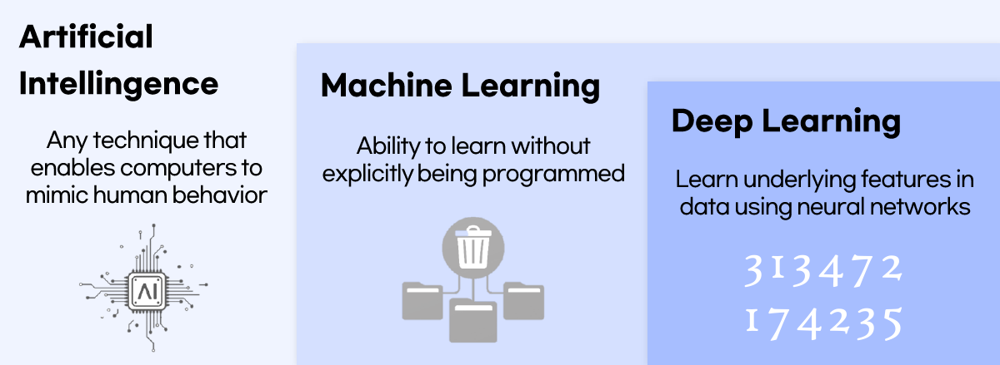

*Figure 1. Nesting of artificial intelligence, machine learning, and deep learning*

| Field | Definition |
|:-----|:-----|
| Artificial intelligence | Any technique that enables computers to mimic human behavior. |
| Machine learning | The ability to learn from data without being explicitly programmed; a subfield of artificial intelligence. |
| Deep learning | A way of learning the features hidden in data using artificial neural networks; a subfield of machine learning. |

*Table 1. Definitions of artificial intelligence, machine learning, and deep learning*

> **Definition:** **Deep learning** is a subset of machine learning that uses artificial neural networks with many stacked layers. The name "deep" refers to the depth of the stacked layers. Deep learning networks are designed to learn and understand data with complex structure, such as images, sound, and text.

The handwritten digits in the deep learning panel of the figure stand for handwriting recognition, a typical application of deep learning. Without anyone programming rules such as "the digit 3 has two curves bulging to the right, one above the other," a neural network finds the features that distinguish digits by itself from many examples.

### 1.2 The Concept of an Artificial Neural Network

> **Definition:** An **artificial neural network (ANN)** is a computational model inspired by the structure and function of the biological neural networks of the human brain. It generally consists of many interconnected artificial neurons.

The brain is an organ in which neurons, its processing elements, form a huge network. An artificial neural network simplifies this structure and implements mathematically the idea that connecting many units that each perform only a simple computation yields a whole that can perform complex computations.

> **Note:** The figure of 10 billion is often quoted for the number of neurons in the brain, but a study that measured cell numbers directly found that the adult brain contains about 86 billion neurons on average [1]. Whichever figure is used, the point is the same: the brain is a network of a very large number of processing elements.

### 1.3 Biological Neurons and Synapses

A **neuron** is a nerve cell that communicates with other cells through electrical and chemical signals. As Figure 2 shows, from the viewpoint of information processing a neuron can be divided into three parts responsible for input, processing, and output.

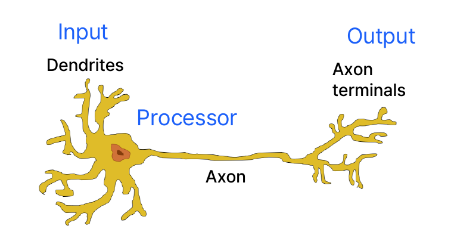

*Figure 2. Structure of a biological neuron*

| Part | Role | Information-processing view |
|:-----|:-----|:-----|
| Dendrites | Receive signals from other neurons. | Input |
| Cell body | Gathers the received signals and produces a new signal if they are strong enough. | Processor |
| Axon and axon terminals | Deliver the produced signal to other neurons. | Output |

*Table 2. Parts of a biological neuron and their roles*

The dendrites receive signals, and when enough signal has been received, a signal is sent down the axon. This outgoing signal is delivered to other neurons and used as their input. The condition "when enough signal has been received" is important here. A neuron does not pass its input on unchanged; it sends out a signal only when the gathered input exceeds a certain threshold. In Section 1.4 this property is modeled by the activation function of an artificial neuron.

Neurons are connected to each other through **synapses**. In Figure 3, the axon terminals of the neuron on the left touch two neurons; the synapse with the lower neuron is active, and the synapse with the upper (gray) neuron is inactive. The active synapse acts as the actual connection (link) between two neurons.

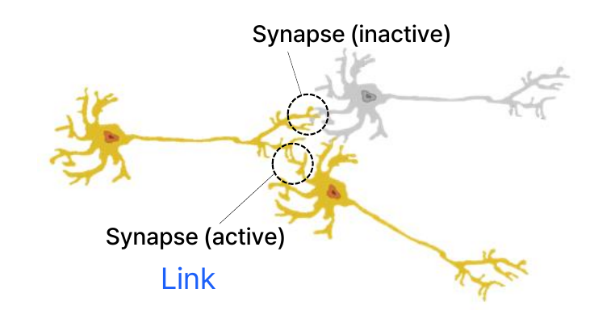

*Figure 3. Active and inactive synapses*

Synapses form between neurons that are activated at the same time, and frequently used synapses are reinforced so that the connection becomes stronger. This principle is summarized by the sentence "Cells that fire together, wire together.", which is widely used as a concise statement of the learning hypothesis proposed by Hebb in 1949 [2].

> **Key Point:** Biological learning is the process by which the strength of connections between neurons changes with experience. An artificial neural network represents the strength of a connection as a number called a **weight**, and training an artificial neural network becomes the process of adjusting the values of the weights.

### 1.4 Artificial Neurons

An **artificial neuron** is a computational unit that mathematically imitates the basic process of a biological neuron. Figure 4 overlays the elements of an artificial neuron on a drawing of a biological neuron, and an artificial neuron operates in the following order.

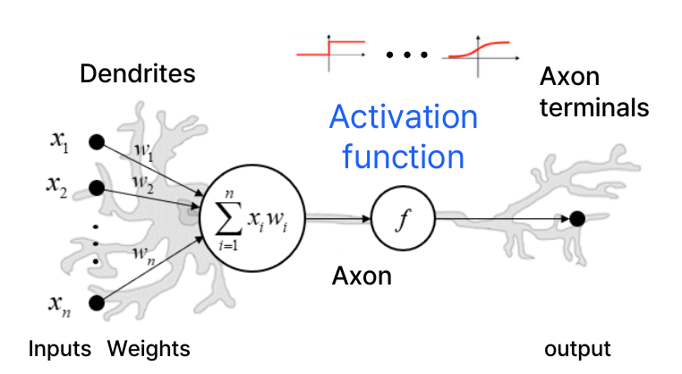

*Figure 4. An artificial neuron drawn over a biological neuron*

1. It receives the inputs $x_1, x_2, \dots, x_n$.
2. It multiplies each input by a weight $w_1, w_2, \dots, w_n$ and adds the products to obtain the **weighted sum** $\sum_{i=1}^{n} x_i w_i$.
3. It passes the weighted sum through an **activation function** $f$ to produce the output.

$$
\text{output} = f\left(\sum_{i=1}^{n} x_i w_i\right)
$$

The activation function determines how much of the weighted sum is passed on to the output. The two small graphs at the top of the figure are examples of activation functions: the left one is a step function whose output jumps from 0 to 1 the moment the weighted sum crosses a threshold, and the right one is an S-shaped curve whose output changes smoothly. The elements of a biological neuron and an artificial neuron correspond as in Table 3.

| Biological neuron | Artificial neuron |
|:-----|:-----|
| Signals entering through the dendrites | Inputs $x_i$ |
| Strength of a synaptic connection | Weights $w_i$ |
| Gathering of signals in the cell body | Weighted sum $\sum_i x_i w_i$ |
| Firing when the gathered signal exceeds a threshold | Activation function $f$ |
| Signal leaving through the axon terminals | Output |

*Table 3. Correspondence between a biological neuron and an artificial neuron*

> **Caution:** An artificial neuron is only a simple model inspired by biological neurons and does not faithfully reproduce their behavior. Real neurons are far more complex, for example communicating through electrical pulses that vary over time, and the training methods for artificial neural networks covered in Section 3 were designed through mathematical optimization rather than by following the way the brain learns.

### 1.5 Multi-Layer Artificial Neural Networks

The problems that a single artificial neuron can solve are limited (Section 1.15). Artificial neurons are therefore stacked in several layers to build a **multi-layer artificial neural network**. The network in Figure 5 consists of three kinds of layers.

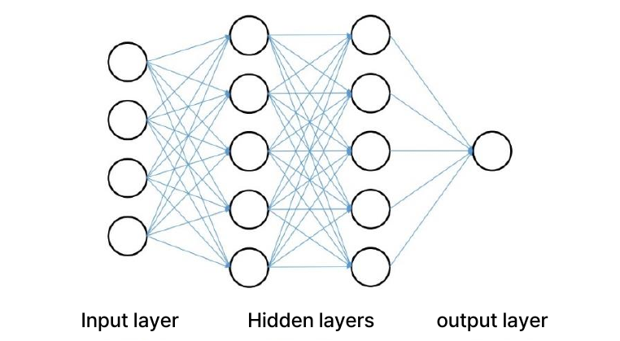

*Figure 5. A multi-layer artificial neural network*

- The **input layer** receives the data. In the figure, four neurons receive the four values of the input data.
- A **hidden layer** lies between the input layer and the output layer. It is called hidden because its values cannot be observed directly from outside. The figure has two hidden layers with five neurons each.
- The **output layer** produces the final result. In the figure, a single neuron produces one output value.

A multi-layer artificial neural network can consist of several hidden layers, and each neuron in a hidden layer is connected to the neurons of the next layer through weights. A layer in which every neuron is connected to every neuron of the next layer, as in the figure, is called a **fully connected layer**. Each connecting line carries one weight, so the network in the figure has $4 \times 5 + 5 \times 5 + 5 \times 1 = 50$ weights. Each neuron of the hidden and output layers also has one bias, introduced in Section 1.8, so the network has $50 + (5 + 5 + 1) = 61$ trainable parameters in total.

### 1.6 History of Artificial Neural Networks

Artificial neural networks have developed through several turning points over a little more than 80 years. Table 4 lists the main events by period.

| Period | Main events |
|:-----|:-----|
| 1943 | Warren McCulloch and Walter Pitts proposed the first artificial neuron model [3], establishing the basic concept of neural networks. This started attempts to model the neurons of the human brain mathematically. |
| 1958 | Frank Rosenblatt proposed the perceptron [4], revolutionizing neural network research. |
| 1980s | Geoffrey Hinton and colleagues showed how to train multi-layer perceptrons with the backpropagation algorithm [5], greatly expanding the performance and range of applications of artificial neural networks. |
| 2010s | Advances in computing power and large-scale data started serious research on deep learning, and deep learning models with various architectures, such as CNNs and RNNs, were developed. |
| 2012 | AlexNet won the ImageNet competition [6], proving the potential of deep learning in image recognition. Models such as LSTMs were also introduced in speech recognition, and artificial neural networks were rapidly adopted in industry. |
| 2020s | The arrival of large language models such as GPT rapidly advanced natural language processing. Artificial neural networks spread across AI research and industry as they were applied to a wide range of real problems. |

*Table 4. History of artificial neural networks*

The McCulloch-Pitts neuron of 1943 was a logic element that received inputs of 0 or 1 and output 1 if their sum was at least a threshold $T$ and 0 otherwise; it is often written in the following simplified form.

$$
y = \begin{cases} 1, & \sum_{i} w_i x_i \ge T \\ 0, & \text{otherwise} \end{cases}
$$

The weights and the threshold of this model were designed by a person. Rosenblatt's perceptron was revolutionary in that it allowed the weights to be learned from example data [4]. The model names in the table mean the following.

- A **CNN (convolutional neural network)** slides small filters over an image to find local patterns and is used mainly for image processing.
- An **RNN (recurrent neural network)** feeds the result computed at one time step back in at the next time step and handles ordered data such as speech or sentences. An **LSTM (long short-term memory)** is an improved RNN that retains information from early in a long sequence well.
- **GPT (generative pre-trained transformer)** is a large language model that has been pre-trained on a large amount of text with a neural network architecture called the transformer.

> **Note:** The periods in the table refer to when each technique came into wide use. The idea of using backpropagation to train neural networks had already been presented in Werbos's 1974 doctoral dissertation [7] and became widely known through the 1986 paper by Rumelhart, Hinton, and Williams [5]. CNNs trained by backpropagation were proposed in 1989 [8] and LSTMs in 1997 [9], and in the 2010s GPUs and large-scale data made it possible to train them at a large scale.

### 1.7 Why Artificial Neural Networks Returned to Prominence

After a period of stagnation, artificial neural networks drew great attention again in the 2010s. The four factors in Table 5 worked together in this revival.

| Factor | Description |
|:-----|:-----|
| Advances in hardware | The availability of powerful computing resources, including GPUs (graphics processing units), greatly accelerated the training of large neural networks. Most of the computation in a neural network consists of mutually independent multiplications and additions, so it can be trained efficiently with massive parallelization. |
| Big data | The explosive growth of digital data in many domains, such as images, text, audio, and sensor data, provided enough data to train neural networks. |
| Algorithmic innovation | Advances in optimization algorithms (Section 3.6), activation functions (Sections 1.9-1.12), and regularization techniques (Sections 3.8-3.10) further improved the performance of neural networks. |
| Transfer learning | Knowledge learned on a related task or domain can be used to fine-tune a pre-trained neural network for a new task with little data. |

*Table 5. Factors behind the return of artificial neural networks*

> **Definition:** **Transfer learning** carries knowledge that a neural network learned on one task over to another, related task. For example, an image recognition network trained on millions of everyday photographs can be taken and **fine-tuned** by retraining only its last few layers on a few hundred medical images. This makes neural networks usable in real applications where labeled data (data with correct answers) are scarce or expensive to obtain.

### 1.8 The Perceptron

The **perceptron** is the artificial neuron of Section 1.4 with an additional constant input of 1 and its weight. As Figure 6 shows, it multiplies the inputs $x_1, \dots, x_m$ by the weights $\theta_1, \dots, \theta_m$ and also adds the weight $\theta_0$, which multiplies an input that is always 1.

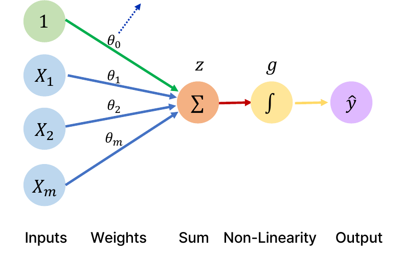

*Figure 6. Structure of the perceptron*

The computation takes two steps. First, the linear combination of the inputs $z$ is computed (Sum in the figure), and then it is passed through a nonlinear activation function $g$ (Non-Linearity in the figure) to obtain the output $\hat{y}$.

$$
z = \theta_0 + \sum_{j=1}^{m} x_j \theta_j, \qquad \hat{y} = g\left(\theta_0 + \sum_{j=1}^{m} x_j \theta_j\right)
$$

The hat on $\hat{y}$ ("y hat") means a value estimated by the model and distinguishes it from the true answer $y$. The $\int$ symbol drawn in place of $g$ in the figure is not an integral but a pictorial symbol for an S-shaped activation function.

> **Definition:** The **bias** $\theta_0$ is a constant term added regardless of the inputs. Using a bias adds a constant to the weighted sum, which shifts the activation function left or right. For example, with one input, the center of $g(\theta_0 + \theta_1 x)$ (the point where $z = 0$) is at $x = -\theta_0/\theta_1$, so changing $\theta_0$ moves the whole curve sideways (Figure 20 in Section 2.8). Without a bias, the boundary where $z = 0$ would always have to pass through the origin, which limits what the model can represent.

Collecting the inputs and weights into vectors gives a compact form.

$$
\hat{y} = g\left(\theta_0 + \mathbf{X}^{T}\boldsymbol{\theta}\right), \qquad \mathbf{X} = \begin{bmatrix} x_1 \\ \vdots \\ x_m \end{bmatrix}, \quad \boldsymbol{\theta} = \begin{bmatrix} \theta_1 \\ \vdots \\ \theta_m \end{bmatrix}
$$

> **[Linear Algebra]** For two column vectors $\mathbf{X}$ and $\boldsymbol{\theta}$, $\mathbf{X}^{T}\boldsymbol{\theta}$ is the product of a $1 \times m$ row vector and an $m \times 1$ column vector, so it is $1 \times 1$, that is, a scalar, and its value is the inner product $\sum_{j=1}^{m} x_j\theta_j$ obtained by multiplying entries in the same position and adding them. The vector form above is therefore the same as the form written with the summation sign.

The **sigmoid function** $\sigma$ below can be used as an example of an activation function (Section 1.10).

$$
g(z) = \sigma(z) = \frac{1}{1 + e^{-z}}
$$

For example, feeding $\mathbf{X} = [-1, 2]^{T}$ into a perceptron with $\theta_0 = 1$ and $\boldsymbol{\theta} = [3, -2]^{T}$ gives $z = 1 + (-1)(3) + (2)(-2) = -6$ and $\hat{y} = \sigma(-6) = 1/(1 + e^{6}) \approx 0.0025$. Feeding $\mathbf{X} = [1, 1]^{T}$ gives $z = 1 + 3 - 2 = 2$ and $\hat{y} = \sigma(2) \approx 0.8808$. Because the output of the sigmoid always lies between 0 and 1, it can be interpreted as "the probability that the input belongs to a certain class."

### 1.9 The Concept of an Activation Function

> **Definition:** An **activation function** is a mathematical function applied to the output (weighted sum) of each neuron in the hidden layers of a neural network. It introduces nonlinearity into the network so that it can learn complex patterns in the data.

Activation functions are used not only in hidden layers but also in the output layer, where the activation function is chosen to match the form of the output (a probability, a real number, and so on). Sections 1.10-1.12 cover three representative activation functions, and Section 1.13 explains why nonlinearity is needed. Training in Section 3 requires the derivatives of activation functions, so the derivative of each function is derived as well.

### 1.10 The Sigmoid Function

The **sigmoid function** is an S-shaped function that activates a neuron by mapping every real number to a value between 0 and 1. In Figure 7, the blue curve is $g(z)$ and the orange curve is the derivative $g'(z)$.

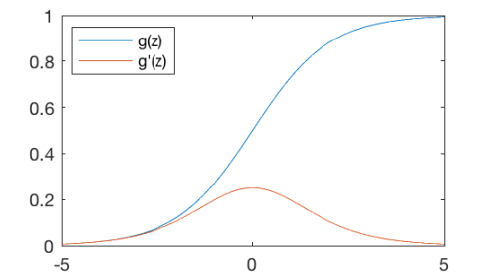

*Figure 7. The sigmoid function and its derivative*

$$
g(z) = \frac{1}{1 + e^{-z}}, \qquad g'(z) = g(z)\bigl(1 - g(z)\bigr)
$$

The derivative is derived as follows. Applying the chain rule to $g(z) = (1 + e^{-z})^{-1}$ multiplies the derivative $-u^{-2}$ of the outer function $u^{-1}$ by the derivative $-e^{-z}$ of the inner function $1 + e^{-z}$.

$$
g'(z) = -(1 + e^{-z})^{-2} \cdot (-e^{-z}) = \frac{e^{-z}}{(1 + e^{-z})^{2}} = \frac{1}{1 + e^{-z}} \cdot \frac{e^{-z}}{1 + e^{-z}}
$$

The second factor is $\dfrac{e^{-z}}{1 + e^{-z}} = \dfrac{(1 + e^{-z}) - 1}{1 + e^{-z}} = 1 - \dfrac{1}{1 + e^{-z}} = 1 - g(z)$, so $g'(z) = g(z)(1 - g(z))$. Thanks to this form, the derivative can be obtained directly from $g(z)$, which forward propagation has already computed.

The sigmoid function has two drawbacks.

- **Vanishing gradient:** When the input is large or small (roughly 5 or above, -5 or below), the derivative approaches 0 and training does not progress well. Since $g(0) = 0.5$, the maximum of the derivative is $g'(0) = 0.5 \times 0.5 = 0.25$, and at $z = 5$, $g(5) \approx 0.9933$, so $g'(5) \approx 0.9933 \times 0.0067 \approx 0.0066$ only. Backpropagation in Section 3 multiplies by the derivative of the activation function at every layer, so after ten sigmoid layers the gradient is multiplied by at most $0.25^{10} \approx 9.5 \times 10^{-7}$, and the weights of the early layers barely change.
- **Non-zero-centered output:** Because the output is always positive, the direction of learning is restricted. If a neuron in the next layer receives sigmoid outputs $a_j > 0$ as its inputs, the gradient with respect to its weight $w_j$ is $\partial L/\partial w_j = \delta \cdot a_j$ by the method of Section 3.2 ($\delta$ is the gradient of the loss with respect to that neuron's weighted sum and is common to all $j$). Since all $a_j$ are positive, every gradient has the same sign as $\delta$, so in a single update the weights of that neuron all increase together or all decrease together. When reaching the optimum requires some weights to increase and others to decrease, the update path zigzags and training slows down.

### 1.11 The Hyperbolic Tangent Function

The **hyperbolic tangent function (tanh)** is an S-shaped function that activates a neuron with a value between -1 and 1 centered at 0 (Figure 8).

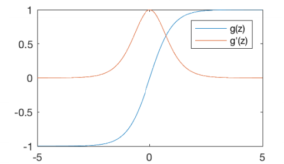

*Figure 8. The hyperbolic tangent function and its derivative*

$$
g(z) = \frac{e^{z} - e^{-z}}{e^{z} + e^{-z}}, \qquad g'(z) = 1 - g(z)^{2}
$$

The derivative follows from the quotient rule. The derivative of the numerator $e^{z} - e^{-z}$ is $e^{z} + e^{-z}$, and the derivative of the denominator $e^{z} + e^{-z}$ is $e^{z} - e^{-z}$.

$$
g'(z) = \frac{(e^{z} + e^{-z})(e^{z} + e^{-z}) - (e^{z} - e^{-z})(e^{z} - e^{-z})}{(e^{z} + e^{-z})^{2}} = 1 - \left(\frac{e^{z} - e^{-z}}{e^{z} + e^{-z}}\right)^{2} = 1 - g(z)^{2}
$$

Because the output can be both positive and negative, the non-zero-centered problem of the sigmoid is solved. In addition, $g'(0) = 1$, which is larger than the maximum slope 0.25 of the sigmoid. However, the vanishing gradient problem, in which the derivative becomes small and training does not progress well when the input is large or small (roughly 5 or above, -5 or below), remains. Since $g(5) \approx 0.99991$, $g'(5) \approx 1.8 \times 10^{-4}$.

> **Note:** The two functions are related by $\tanh(z) = 2\sigma(2z) - 1$. Simplifying the right-hand side gives $\dfrac{2}{1 + e^{-2z}} - 1 = \dfrac{1 - e^{-2z}}{1 + e^{-2z}}$, and multiplying the numerator and denominator by $e^{z}$ gives $\dfrac{e^{z} - e^{-z}}{e^{z} + e^{-z}}$. In other words, tanh is the sigmoid compressed horizontally by half, stretched vertically by a factor of two, and shifted down by 1.

### 1.12 The ReLU Function

The **ReLU (rectified linear unit)** activates a neuron only when the input is greater than 0 (Figure 9).

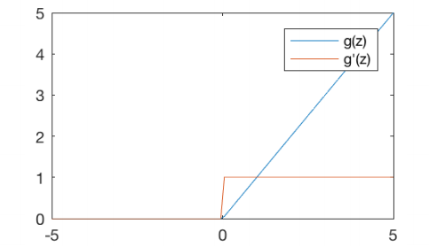

*Figure 9. The ReLU function and its derivative*

$$
g(z) = \max(0, z), \qquad g'(z) = \begin{cases} 1, & z > 0 \\ 0, & \text{otherwise} \end{cases}
$$

The strengths and weaknesses of ReLU are as follows.

- For positive inputs the gradient is a constant 1, so it does not shrink even after passing through many layers, and the vanishing gradient is avoided.
- There is no exponential to evaluate, so the function value and its derivative are easy to compute and the amount of computation decreases. In an experiment with a four-layer convolutional neural network trained on CIFAR-10 data, the network with ReLUs reached the same training error (25%) about six times faster than the same network with tanh [6].
- For negative inputs the gradient is always 0. If the weighted sum of a neuron is negative for all data, the weights of that neuron are never updated again. This is called the dying ReLU problem, and variants such as Leaky ReLU $g(z) = \max(0.01z, z)$ [10], which give a small slope on the negative side, alleviate it.

> **Note:** At $z = 0$, ReLU is not differentiable because its left slope (0) and right slope (1) differ. By convention the derivative at this point is set to 0 as in the equation above, and since the weighted sum is rarely exactly 0, the choice has almost no effect on training.

| Function | Output range | Derivative | Strength | Weakness |
|:-----|:-----|:-----|:-----|:-----|
| Sigmoid | $(0, 1)$ | $g(1 - g)$, maximum 0.25 | The output can be interpreted as a probability. | Vanishing gradient, non-zero-centered output |
| tanh | $(-1, 1)$ | $1 - g^{2}$, maximum 1 | Zero-centered output | Vanishing gradient |
| ReLU | $[0, \infty)$ | 1 for positive inputs, 0 otherwise | No vanishing gradient, fast to compute. | Zero gradient for negative inputs |

*Table 6. Comparison of three activation functions*

### 1.13 The Purpose of Activation Functions: Nonlinearity

The purpose of an activation function is to introduce **nonlinearity** into the network. The two plots in Figure 10 show the same data, with red and green points intermixed, to be divided into two classes.

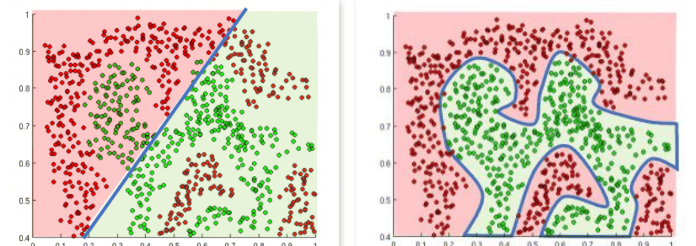

*Figure 10. A linear decision boundary and a nonlinear decision boundary*

As on the left, a linear activation function produces only linear decisions that divide the space with a single straight line (a plane in higher dimensions), so it cannot properly separate regions where green and red points are mixed. As on the right, with a nonlinear activation function the neural network can produce nonlinear decisions that divide the space with curved boundaries even for functions with complicated shapes. Such a boundary that separates the data by class is called a **decision boundary**.

If the activation function is linear, stacking more layers does not help. Consider a two-layer network whose activation function is the identity $g(z) = z$: the hidden layer output is $\mathbf{h} = W_1\mathbf{x} + \mathbf{b}_1$, and the final output is as follows.

$$
\hat{\mathbf{y}} = W_2\mathbf{h} + \mathbf{b}_2 = W_2(W_1\mathbf{x} + \mathbf{b}_1) + \mathbf{b}_2 = (W_2W_1)\mathbf{x} + (W_2\mathbf{b}_1 + \mathbf{b}_2)
$$

Setting $W = W_2W_1$ and $\mathbf{b} = W_2\mathbf{b}_1 + \mathbf{b}_2$ gives $\hat{\mathbf{y}} = W\mathbf{x} + \mathbf{b}$, so the two-layer network is equivalent to a single-layer linear model. By the same argument, any number of stacked layers is still a single linear model. Conversely, the **universal approximation theorem** states that a network with even one hidden layer using a nonlinear activation function such as the sigmoid can approximate a continuous function defined on a closed and bounded region to any desired accuracy, provided that it has enough hidden neurons [11].

> **Caution:** The universal approximation theorem only guarantees that such a network exists. It says nothing about how many hidden neurons are needed or whether training can actually find the weights.

### 1.14 Example: A Perceptron for Aircraft Classification

Consider the problem of classifying aircraft as bombers or fighters according to their maximum speed and maximum takeoff weight. In Figure 11, the horizontal axis $x_1$ is speed and the vertical axis $x_2$ is weight; both are relative values scaled by some reference. Diamonds are bombers and squares are fighters.

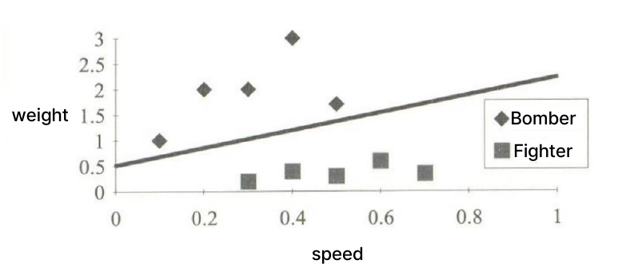

*Figure 11. Distribution of bombers and fighters by speed and weight*

Bombers are slow and heavy, while fighters are fast and light. The line that separates the two types of aircraft is the following.

$$
x_2 = 1.5x_1 + 0.5
$$

Moving all terms to one side defines the **decision function** $f(x_1, x_2) = -x_2 + 1.5x_1 + 0.5$, which is $f = 0$ on the line, $f > 0$ below the line (the fighter side), and $f < 0$ above it (the bomber side). The classification rule is therefore the following.

$$
d = \begin{cases} \text{Fighter}, & f(x_1, x_2) \ge 0 \\ \text{Bomber}, & f(x_1, x_2) < 0 \end{cases}
$$

For example, a fighter at $(0.4, 0.5)$ gives $f(0.4, 0.5) = -0.5 + 1.5 \times 0.4 + 0.5 = -0.5 + 0.6 + 0.5 = 0.6 \ge 0$, so it is correctly classified as a fighter. The bomber near $(0.2, 2)$ in the figure gives $f(0.2, 2) = -2 + 0.3 + 0.5 = -1.2 < 0$, so it is classified as a bomber.

This decision function can be modeled by a perceptron. As in Figure 12, setting the weight of the bias input 1 to $w_0 = 0.5$, the weight of $x_1$ to $w_1 = 1.5$, and the weight of $x_2$ to $w_2 = -1$ makes the weighted sum equal to the decision function.

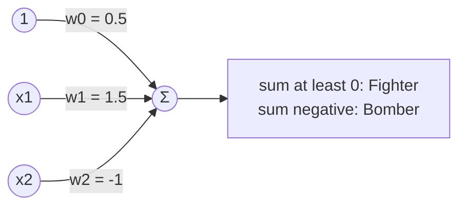

*Figure 12. Perceptron for aircraft classification*

$$
\text{summation} = w_0 + \sum_{i=1}^{2} x_i w_i = 0.5 + 1.5x_1 - x_2
$$

The output is Fighter if the weighted sum is at least 0 and Bomber if it is less than 0. The activation function of this perceptron is a **step function** whose output switches at 0. The derivative of a step function is 0 at every point other than 0, so it cannot be used with the gradient-based training of Section 3. Training therefore uses smooth activation functions such as the sigmoid.

### 1.15 Limitation of the Perceptron: Linear Separability

Data whose two classes can be completely separated by a single straight line (a hyperplane in higher dimensions), like the aircraft data of Section 1.14, are called **linearly separable**. The decision boundary of a single perceptron is the line $\theta_0 + \mathbf{X}^{T}\boldsymbol{\theta} = 0$, so a single perceptron can solve only linearly separable problems.

A classic counterexample is exclusive OR (XOR). The four points $(0, 0)$ and $(1, 1)$ have output 0, and $(0, 1)$ and $(1, 0)$ have output 1. Suppose there are weights such that $w_0 + w_1x_1 + w_2x_2 \ge 0$ at the points with output 1 and $< 0$ at the points with output 0; then the following four inequalities must hold.

$$
w_0 < 0, \qquad w_0 + w_2 \ge 0, \qquad w_0 + w_1 \ge 0, \qquad w_0 + w_1 + w_2 < 0
$$

Adding the middle two inequalities gives $w_1 + w_2 + 2w_0 \ge 0$, that is, $w_0 + w_1 + w_2 \ge -w_0$. From the first inequality $-w_0 > 0$, so $w_0 + w_1 + w_2 > 0$, which contradicts the last inequality. Therefore no perceptron solves XOR. Minsky and Papert analyzed such limitations in 1969 [12], which became one of the causes of a period of stagnation in neural network research. A multi-layer network with a hidden layer can solve this problem, and the method for training multi-layer networks is the backpropagation of the 1980s (Table 4).

---

<br>

## 2. Training Artificial Neural Networks I: Loss Functions and Gradients

### 2.1 The Multi-Output Perceptron

When several outputs are needed, as many perceptrons as outputs are placed side by side. In the **multi-output perceptron** of Figure 13, two neurons share the same inputs $1, x_1, x_2, \dots, x_m$, each computes its own weighted sum $z_1$ or $z_2$, and they produce $y_1 = g(z_1)$ and $y_2 = g(z_2)$ through the activation function.

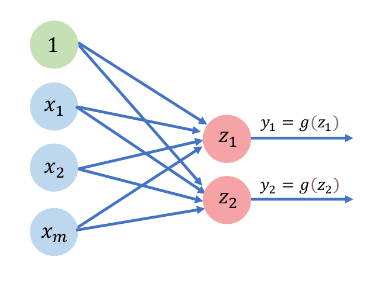

*Figure 13. The multi-output perceptron*

Output neuron $i$ has its own weights $\theta_{j,i}$ (the weight from input $j$ to output $i$) and its own bias $\theta_{0,i}$.

$$
z_i = \theta_{0,i} + \sum_{j=1}^{m} x_j\theta_{j,i}, \qquad y_i = g(z_i), \qquad i = 1, 2
$$

Every input is connected to every output, so this layer is fully connected, and it has $m + 1$ parameters per output, $2(m + 1)$ in total.

### 2.2 Single-Hidden-Layer Neural Networks

Joining two multi-output perceptrons gives the **single layer neural network** of Figure 14, which this note calls a single-hidden-layer neural network. The roles of its three layers are as follows.

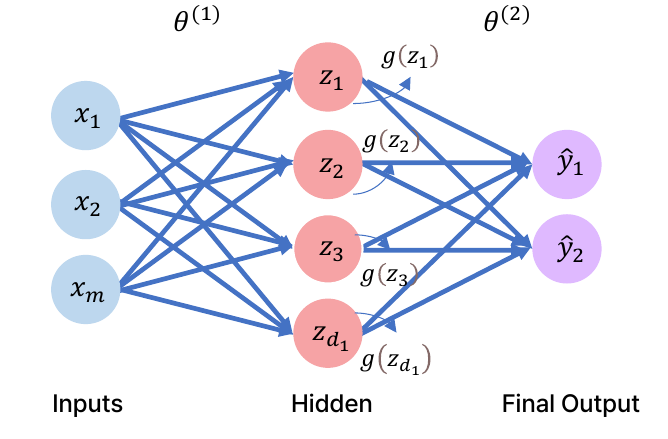

*Figure 14. A single-hidden-layer neural network*

- The **input layer** receives the initial data. Each neuron of this layer represents a feature or attribute of the data.
- The **hidden layer** is the intermediate layer between the input layer and the output layer. It consists of neurons that apply weights to their inputs, transform them through an activation function, and pass the result to the next layer.
- The **output layer** is the final layer that produces predictions or classifications. The number of neurons in this layer corresponds to the number of possible outputs or classes.

The weights from the input layer to the hidden layer are written $\theta^{(1)}$, and the weights from the hidden layer to the output layer $\theta^{(2)}$. The superscripts $(1)$ and $(2)$ are not powers; they indicate the layer to which the weights belong. With $d_1$ neurons in the hidden layer, the weighted sum of hidden neuron $i$ is the following.

$$
z_i = \theta_{0,i}^{(1)} + \sum_{j=1}^{m} x_j\theta_{j,i}^{(1)}, \qquad i = 1, \dots, d_1
$$

For example, writing out the sum for the second hidden neuron ($i = 2$) gives the following.

$$
z_2 = \theta_{0,2}^{(1)} + \sum_{j=1}^{m} x_j\theta_{j,2}^{(1)} = \theta_{0,2}^{(1)} + x_1\theta_{1,2}^{(1)} + x_2\theta_{2,2}^{(1)} + \cdots + x_m\theta_{m,2}^{(1)}
$$

Each hidden neuron outputs $g(z_i)$, obtained by passing $z_i$ through the activation function, and the output layer takes these values as its inputs and performs the same computation once more.

$$
\hat{y}_i = g\left(\theta_{0,i}^{(2)} + \sum_{j=1}^{d_1} g(z_j)\,\theta_{j,i}^{(2)}\right), \qquad i = 1, 2
$$

This process of computing step by step from the input toward the output is called **forward propagation**. In matrix form, letting $\boldsymbol{\Theta}^{(1)}$ be the $m \times d_1$ matrix whose $(j, i)$ entry is $\theta_{j,i}^{(1)}$ and $\boldsymbol{\theta}_0^{(1)}$ the $d_1$-dimensional vector of biases, the whole hidden layer is computed at once as $\mathbf{z} = \boldsymbol{\theta}_0^{(1)} + (\boldsymbol{\Theta}^{(1)})^{T}\mathbf{x}$. This is the perceptron formula $\theta_0 + \mathbf{X}^{T}\boldsymbol{\theta}$ of Section 1.8 written for $d_1$ neurons at once. The number of parameters is $(m + 1)d_1$ for the hidden layer and $(d_1 + 1) \times 2$ for the output layer.

> **Note:** Conventions for counting the layers of a neural network differ across the literature. Here a network with one hidden layer is called a single layer neural network, but some texts use the term single-layer perceptron for a perceptron without hidden layers, whose inputs connect directly to the outputs. To avoid confusion, this note uses the term "single-hidden-layer neural network."

### 2.3 Deep Neural Networks

> **Definition:** A **deep neural network (DNN)** is a neural network with several hidden layers between the input layer and the output layer. By passing through several hidden layers, the network can learn complex patterns in the data.

In Figure 15, each box marked X is a shorthand symbol for one fully connected layer, and $z_{k,1}, \dots, z_{k,d_k}$ in the middle are the $d_k$ neurons of the $k$-th hidden layer.

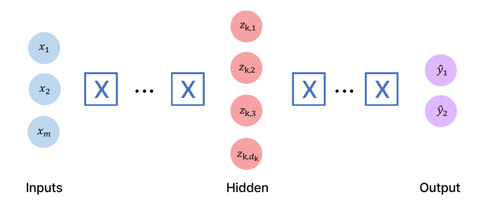

*Figure 15. A deep neural network*

Neuron $i$ of the $k$-th hidden layer takes the outputs of the immediately preceding layer (layer $k - 1$) as its inputs. Generalizing the equation of Section 2.2 gives the following.

$$
z_{k,i} = \theta_{0,i}^{(k)} + \sum_{j=1}^{d_{k-1}} g(z_{k-1,j})\,\theta_{j,i}^{(k)}
$$

For $k = 1$, the input $x_j$ takes the place of the previous layer's output $g(z_{0,j})$. Repeating this computation from the first hidden layer to the output layer is the forward propagation of a deep neural network.

### 2.4 Example: Predicting Whether a Student Passes a Class

The process of training a neural network is examined with a simple classification problem: predicting from two features whether a student will pass a class.

- $x_1$: the number of lectures attended
- $x_2$: the hours spent on the project

Figure 16 shows data from past students; green points passed and red points failed. The students in the lower left, who attended few lectures and spent little time, failed. A new student has features $\mathbf{x} = [4, 5]^{T}$ (attended 4 lectures, spent 5 hours on the project), and the goal is to predict whether this student (the purple point with a question mark) will pass.

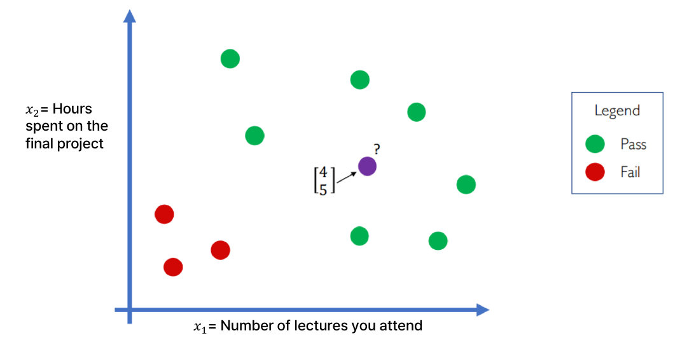

*Figure 16. Pass or fail by number of lectures attended and project hours*

As in Figure 17, feeding $\mathbf{x}^{(1)} = [4, 5]^{T}$ into a single-hidden-layer network with 2 inputs, 3 hidden neurons, and 1 output predicted a pass probability of 0.1. This student, however, actually passed (correct answer 1). The network has not been trained yet and its weights are arbitrary values, so its prediction is wrong.

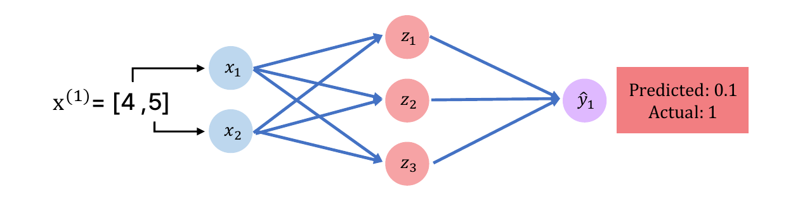

*Figure 17. A wrong prediction by an untrained neural network*

This network has $(2 + 1) \times 3 = 9$ parameters in the hidden layer and $(3 + 1) \times 1 = 4$ in the output layer, 13 in total. Training is the process of adjusting these 13 values so that the predictions approach the correct answers. To do so, one must first express as a number how wrong a prediction is.

### 2.5 Loss Functions and the Empirical Loss

> **Definition:** A **loss function** $L$ is defined by the difference between the predicted value and the true value and measures the cost incurred by a wrong prediction. The loss for the $i$-th data point $\mathbf{x}^{(i)}$ is written $L\bigl(f(\mathbf{x}^{(i)}; \boldsymbol{\theta}), y^{(i)}\bigr)$.

Here $f(\mathbf{x}^{(i)}; \boldsymbol{\theta})$ is the prediction that the network with parameters $\boldsymbol{\theta}$ makes for the input $\mathbf{x}^{(i)}$, and $y^{(i)}$ is the correct answer. The superscript $(i)$ means the $i$-th data point. The $\boldsymbol{\theta}$ after the semicolon indicates that $f$ is a function of $\mathbf{x}$ whose shape is determined by $\boldsymbol{\theta}$. If the prediction equals the correct answer the loss is 0, and the larger the difference, the larger the loss. A neural network learns in the direction that makes the value of the loss function smaller.

Reducing the loss for only one data point can make the predictions for other data worse, so training is based on the loss over all of the data.

> **Definition:** The **empirical loss** is the average of the loss over the whole data set. It is also called the **objective function**, the **cost function**, or the **empirical risk**.

$$
J(\boldsymbol{\theta}) = \frac{1}{n}\sum_{i=1}^{n} L\bigl(f(\mathbf{x}^{(i)}; \boldsymbol{\theta}), y^{(i)}\bigr)
$$

$n$ is the number of data points. Part of the data of the class example and the predictions of the untrained network are shown in Table 7. Each row of $\mathbf{X}$ is one student's $[x_1, x_2]$.

| $i$ | Input $\mathbf{x}^{(i)} = [x_1, x_2]$ | Prediction $f(\mathbf{x}^{(i)})$ | Answer $y^{(i)}$ |
|:-----|:-----|:-----|:-----|
| 1 | $[4, 5]$ | 0.1 | 1 |
| 2 | $[2, 1]$ | 0.8 | 0 |
| 3 | $[5, 8]$ | 0.6 | 1 |

*Table 7. Data of the class example and predictions before training*

The empirical loss is a function of $\boldsymbol{\theta}$ alone, because the data $\mathbf{x}^{(i)}$ and $y^{(i)}$ are given and fixed, and the only thing training can change is $\boldsymbol{\theta}$. Training therefore becomes the optimization problem of finding the $\boldsymbol{\theta}$ that minimizes $J(\boldsymbol{\theta})$.

$$
\boldsymbol{\theta}^{*} = \arg\min_{\boldsymbol{\theta}} J(\boldsymbol{\theta})
$$

### 2.6 Mean Squared Error and Cross-Entropy

The loss function is chosen to suit the type of problem. The **mean squared error (MSE)** can be used with regression models that output continuous real numbers.

$$
J(\boldsymbol{\theta}) = \frac{1}{n}\sum_{i=1}^{n}\bigl(y^{(i)} - f(\mathbf{x}^{(i)}; \boldsymbol{\theta})\bigr)^{2}
$$

For example, suppose that in a regression problem predicting the final scores of the same students, the network's predictions and the actual scores are as in Table 8. The predictions for the first two students are far off, and the third is fairly close.

| $i$ | Prediction $f(\mathbf{x}^{(i)})$ | Answer $y^{(i)}$ | Error $y^{(i)} - f(\mathbf{x}^{(i)})$ | Squared error |
|:-----|:-----|:-----|:-----|:-----|
| 1 | 30 | 90 | 60 | 3600 |
| 2 | 80 | 20 | -60 | 3600 |
| 3 | 85 | 95 | 10 | 100 |

*Table 8. Errors in predicting final scores*

$$
J = \frac{3600 + 3600 + 100}{3} = \frac{7300}{3} \approx 2433.3
$$

There are three reasons to square the errors. First, positive and negative errors do not cancel (adding the errors 60 and -60 of students 1 and 2 as they are gives 0). Second, large errors are penalized more heavily (the square of an error of 60 is 36 times the square of an error of 10). Third, the function is differentiable everywhere, which makes the gradient of Section 2.9 easy to compute.

> **Note:** For binary classification whose output is a probability between 0 and 1, like the class example, the **binary cross-entropy (BCE)** loss is mainly used [13].
>
> $$J(\boldsymbol{\theta}) = -\frac{1}{n}\sum_{i=1}^{n}\Bigl[y^{(i)}\log f(\mathbf{x}^{(i)}; \boldsymbol{\theta}) + \bigl(1 - y^{(i)}\bigr)\log\bigl(1 - f(\mathbf{x}^{(i)}; \boldsymbol{\theta})\bigr)\Bigr]$$
>
> If the answer is 1 only the first term $-\log f$ remains, and if the answer is 0 only the second term $-\log(1 - f)$ remains (log is the natural logarithm). For the three students of Table 7 the terms are $-\ln 0.1 \approx 2.3026$, $-\ln(1 - 0.8) = -\ln 0.2 \approx 1.6094$, and $-\ln 0.6 \approx 0.5108$, with mean $4.4228/3 \approx 1.4743$. Using the squared error for the same predictions gives $(0.81 + 0.64 + 0.16)/3 \approx 0.5367$. Cross-entropy assigns a very large loss to a confident wrong answer that gives the correct class a probability near 0, so it provides a stronger learning signal in classification problems.

### 2.7 The Basic Concept of Training

The meaning of training is summarized with the problem of distinguishing men from women. As in Figure 18, an artificial neural network $\hat{y} = f(\mathbf{x}, \boldsymbol{\theta})$ takes physical information (height, weight, foot size) as the input $\mathbf{x}$ and outputs a gender. The output is $\hat{y} = 0$ for a man and $\hat{y} = 1$ for a woman.

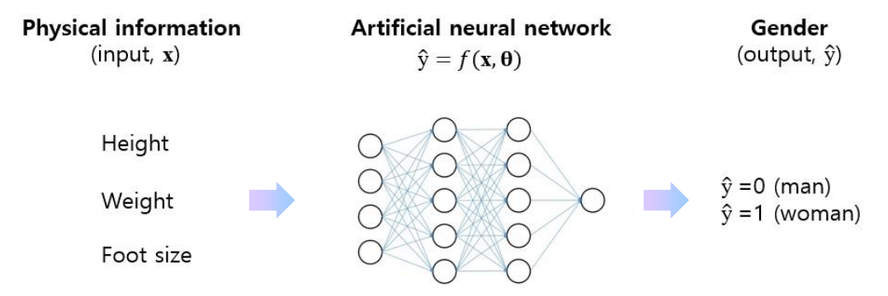

*Figure 18. A neural network that estimates gender from physical information*

Suppose that feeding in data from several people gives the results in Table 9. The answer $y$ is the desired output.

| Person | Input | Network computation | Estimate $\hat{y}$ | Answer $y$ | Verdict |
|:-----|:-----|:-----|:-----|:-----|:-----|
| 1 | $\mathbf{x}_1$ | $f(\mathbf{x}_1, \boldsymbol{\theta})$ | 0 | 0 | Correct |
| 2 | $\mathbf{x}_2$ | $f(\mathbf{x}_2, \boldsymbol{\theta})$ | 0 | 1 | Incorrect |
| 3 | $\mathbf{x}_3$ | $f(\mathbf{x}_3, \boldsymbol{\theta})$ | 1 | 1 | Correct |

*Table 9. Comparison of gender estimates with the answers*

The estimate for person 2 is wrong. The input data cannot be changed, so reducing the estimation error requires changing the parameter vector $\boldsymbol{\theta}$. This process of using data with correct answers to change $\boldsymbol{\theta}$ in the direction that reduces the error is **training**, and training with the correct answers provided is the supervised learning of Week 12.

### 2.8 The Parameter Vector and the Gradient Vector

The training process is examined with the simplest neural network. The network in Figure 19 has one neuron each in the input, hidden, and output layers. Multiplying the input $x$ by the weight $w_1$, adding the bias $b_1$, and applying the activation function gives the hidden output $A_1$; multiplying $A_1$ by $w_2$, adding $b_2$, and applying the activation function gives the output $A_2 = \hat{y}$.

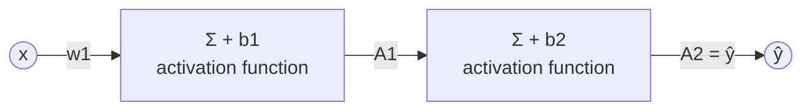

*Figure 19. A neural network with one neuron per layer*

$w_1$ and $w_2$ are weights, $b_1$ and $b_2$ are biases, and together they form the **parameter vector** $\boldsymbol{\theta}$.

$$
\hat{y} = f(x; \boldsymbol{\theta}), \qquad \boldsymbol{\theta} = [w_1, b_1, w_2, b_2]
$$

The accuracy of the neural network is expressed by a loss function of this $\boldsymbol{\theta}$. The weights determine how strongly the input affects the output, and the biases shift the activation function left or right. In Figure 20, the thick blue curve is a sigmoid drawn between $-10$ and $10$, and the dotted curves are that curve shifted left and right by changing the bias. The center of $\sigma(z + b)$ is at $z = -b$, so the curve moves left if $b > 0$ and right if $b < 0$.

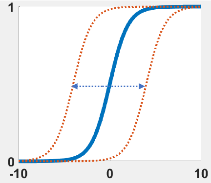

*Figure 20. Shifting the sigmoid function with the bias*

Changing the parameter vector $\boldsymbol{\theta}$ can reduce the loss. To decide in which direction and by how much each of the four parameters should move, however, one must know how much the loss changes when each parameter changes slightly. The vector that collects this information is the **gradient vector** $\nabla_{\boldsymbol{\theta}}L$.

$$
\nabla_{\boldsymbol{\theta}}L = \begin{bmatrix} \dfrac{\partial L}{\partial w_1} & \dfrac{\partial L}{\partial b_1} & \dfrac{\partial L}{\partial w_2} & \dfrac{\partial L}{\partial b_2} \end{bmatrix}^{T}
$$

> **[Calculus]** The **partial derivative** $\partial f/\partial x_i$ of a multivariable function $f(x_1, \dots, x_n)$ is the derivative with respect to $x_i$ alone with the other variables held constant, and it is the rate at which $f$ changes when only $x_i$ changes slightly. The vector of all partial derivatives, $\nabla f = [\partial f/\partial x_1, \dots, \partial f/\partial x_n]^{T}$, is called the **gradient**.

### 2.9 Gradients and Gradient Descent

The **gradient** points in the direction in which a function increases most. To minimize a function, one must therefore move in the direction opposite to the gradient. Why the gradient is the direction of steepest increase can be explained with the directional derivative. The rate of change of $f$ (the directional derivative) when moving from a point $\mathbf{p}$ in a direction $\mathbf{u}$ of length 1 is the following.

$$
D_{\mathbf{u}}f(\mathbf{p}) = \nabla f(\mathbf{p}) \cdot \mathbf{u} = \lVert \nabla f(\mathbf{p}) \rVert \cos\phi
$$

$\phi$ is the angle between $\nabla f$ and $\mathbf{u}$. Since $\cos\phi$ has its maximum 1 at $\phi = 0$ and its minimum $-1$ at $\phi = \pi$, $f$ increases fastest when moving in the direction of the gradient and decreases fastest when moving in the opposite direction $-\nabla f$. The magnitude of the rate of change is then $\lVert \nabla f \rVert$.

> **Definition:** The **gradient descent method** is an optimization algorithm that repeatedly updates the parameters of a model using the gradient in order to minimize the loss function.

Figure 21 draws a loss function of two parameters as a three-dimensional surface. The height is the loss; the red peaks are where the loss is large and the blue valleys are where it is small. The black path is the trajectory of gradient descent, which starts high and at each step moves a little in the direction opposite to the local gradient until it reaches a valley, and the contour plot below shows the same path seen from above.

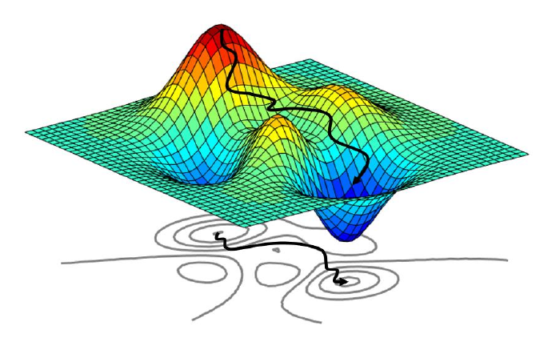

*Figure 21. A gradient descent path on a loss surface*

Why a small move against the gradient reduces the loss can be seen from a first-order Taylor approximation. Moving $\boldsymbol{\theta}$ by $-\alpha\nabla J$ for a small positive $\alpha$ gives the following.

$$
J(\boldsymbol{\theta} - \alpha\nabla J) \approx J(\boldsymbol{\theta}) - \alpha\,\nabla J \cdot \nabla J = J(\boldsymbol{\theta}) - \alpha\lVert \nabla J \rVert^{2}
$$

If $\nabla J \neq \mathbf{0}$, then $\alpha\lVert \nabla J \rVert^{2} > 0$, so the loss decreases. For the approximation to hold, however, $\alpha$ must be small enough, and this $\alpha$ is the learning rate of Section 3.5. Gradient descent follows the same principle as the gradient-based optimization used to tune PID gains in Week 11.

> **Caution:** On a loss function with several valleys, like the surface in Figure 21, gradient descent may reach the valley near its starting point, that is, a **local minimum**, and there is no guarantee that it is the lowest point overall, the **global minimum**.

### 2.10 Example: Computing Gradients

The gradients of the following three functions are computed at the given points. The partial derivative with respect to each variable is found first, and then the coordinates of the point are substituted.

**(1)** $f(x, y, z) = 2x^{2} + 3y^{2} + z^{2}$ at the point $(1, 1, 1)$

$$
\frac{\partial f}{\partial x} = 4x, \quad \frac{\partial f}{\partial y} = 6y, \quad \frac{\partial f}{\partial z} = 2z \quad\Rightarrow\quad \nabla f(1, 1, 1) = [4, 6, 2]^{T}
$$

**(2)** $f(x, y, z) = x^{2}y + z$ at the point $(2, 2, 0)$

$$
\frac{\partial f}{\partial x} = 2xy, \quad \frac{\partial f}{\partial y} = x^{2}, \quad \frac{\partial f}{\partial z} = 1 \quad\Rightarrow\quad \nabla f(2, 2, 0) = [2 \cdot 2 \cdot 2,\ 2^{2},\ 1]^{T} = [8, 4, 1]^{T}
$$

When differentiating with respect to $x$, $y$ is a constant, so the derivative of $x^{2}y$ is $2x \cdot y$; when differentiating with respect to $y$, $x^{2}$ becomes a constant coefficient.

**(3)** $f(x, y, z) = e^{2x} + \sin y + \cos z$ at the point $(0, 0, 0)$

$$
\frac{\partial f}{\partial x} = 2e^{2x}, \quad \frac{\partial f}{\partial y} = \cos y, \quad \frac{\partial f}{\partial z} = -\sin z \quad\Rightarrow\quad \nabla f(0, 0, 0) = [2, 1, 0]^{T}
$$

By the chain rule, the derivative of $e^{2x}$ is $e^{2x} \cdot 2$.

The meaning of the gradient can be checked by increasing the variables one at a time. Table 10 shows the function values and increases when only one variable is increased by 1 from the point.

| Function | Point | $f$ | $x$ increased by 1 | $y$ increased by 1 | $z$ increased by 1 | Increase | Exact gradient |
|:-----|:-----|:-----|:-----|:-----|:-----|:-----|:-----|
| (1) | $(1, 1, 1)$ | 6 | 12 | 15 | 9 | $[6, 9, 3]$ | $[4, 6, 2]$ |
| (2) | $(2, 2, 0)$ | 8 | 18 | 12 | 9 | $[10, 4, 1]$ | $[8, 4, 1]$ |

*Table 10. Change in function value when each variable is increased by 1*

For example, in (1), increasing $x$ from 1 to 2 gives $f(2, 1, 1) = 8 + 3 + 1 = 12$, an increase of 6. The increases point in a direction similar to the gradient but are not exactly equal to it. They are the **forward difference** $\bigl(f(x + h) - f(x)\bigr)/h$ with $h = 1$, whereas the gradient is the limit as $h \to 0$. In the $x$ direction of (1), $\bigl(2(x + h)^{2} - 2x^{2}\bigr)/h = 4x + 2h$, so with $x = 1$ and $h = 1$ it is $4 + 2 = 6$, and reducing $h$ to 0.1, 0.01, and 0.001 gives 4.2, 4.02, and 4.002, approaching the exact value 4. In contrast, when the function is linear in a variable, as in the $z$ and $y$ directions of (2), the increase equals the gradient regardless of $h$.

> **Key Point:** Each component of the gradient is the rate at which the function changes when that variable is increased very slightly. In a network with millions of parameters, changing each parameter slightly and recomputing the loss would be far too slow, so actual training computes all partial derivatives exactly in one pass with the backpropagation of Section 3.

---

<br>

## 3. Training Artificial Neural Networks II: Backpropagation, Gradient Descent, and Regularization

### 3.1 The Chain Rule and Computational Graphs

> **Definition:** **Backpropagation** is the method used to compute the gradient of the loss function $\nabla_{\boldsymbol{\theta}}L$. In backpropagation, the error produced at the output propagates backward toward the input, and the gradients are computed along the way.

The principle of backpropagation is examined with the smallest example. Figure 22 is a **computational graph** that splits $E = (x + y)z$ into two steps, an addition and a multiplication. The addition node produces the intermediate value $q = x + y$, and the multiplication node produces $E = qz$. The goal is to find $\partial E/\partial x$, $\partial E/\partial y$, and $\partial E/\partial z$.

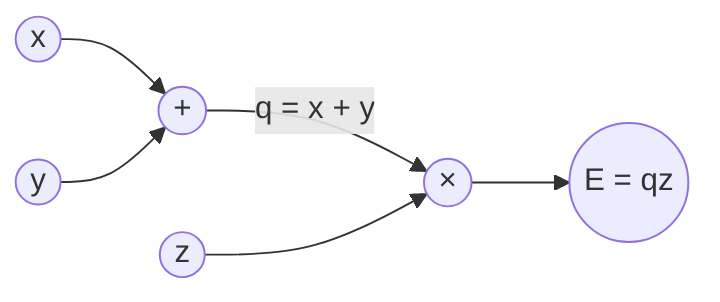

*Figure 22. Computational graph of E = (x + y)z*

$E$ depends on $x$ only through $q$, so the **chain rule** is used.

$$
\frac{\partial E}{\partial x} = \frac{\partial q}{\partial x}\frac{\partial E}{\partial q} = 1 \cdot z = z, \qquad \frac{\partial E}{\partial y} = \frac{\partial q}{\partial y}\frac{\partial E}{\partial q} = 1 \cdot z = z, \qquad \frac{\partial E}{\partial z} = q
$$

The two factors of each product have names. A derivative of a node with respect to its own input, such as $\partial q/\partial x$, is called a **local gradient**, and a gradient passed back from the final output to the output of that node, such as $\partial E/\partial q$, is called an **upstream gradient**. Each node needs to know only its own local gradient; it multiplies the upstream gradient by the local gradient and passes the result on to the next node. Repeating this local computation is the core of backpropagation.

Let us follow the numbers. With $x = 1$, $y = 3$, and $z = -2$, forward propagation gives $q = 1 + 3 = 4$ and $E = 4 \times (-2) = -8$. Backpropagation starts at the output.

1. The gradient of the output with respect to itself is $\partial E/\partial E = 1$.
2. Multiplication node: since $E = qz$, the local gradients are $\partial E/\partial q = z = -2$ and $\partial E/\partial z = q = 4$. A multiplication node passes on the upstream gradient multiplied by the value of the other input.
3. Addition node: since $q = x + y$, the local gradients are $\partial q/\partial x = \partial q/\partial y = 1$. The upstream gradient $-2$ is multiplied by 1, so $\partial E/\partial x = \partial E/\partial y = -2$. An addition node distributes the upstream gradient unchanged.

As a check, increasing $x$ from 1 to 1.01 gives $E = (4.01)(-2) = -8.02$, a change of $-0.02 = -2 \times 0.01$, which agrees with $\partial E/\partial x = -2$.

> **[Calculus]** The derivative of a composite function $y = f(g(x))$ is $\dfrac{dy}{dx} = f'(g(x))\,g'(x)$, the product of the derivatives of the outer and inner functions. With several variables, if $E$ depends on $x$ through an intermediate variable $q$, then $\dfrac{\partial E}{\partial x} = \dfrac{\partial E}{\partial q}\dfrac{\partial q}{\partial x}$, and if $x$ affects $E$ through several paths, the products found for each path are added.

### 3.2 Backpropagation in a Two-Layer Neural Network

Backpropagation is applied to the network of Section 2.8 (Figure 19). Both layers use the sigmoid $\sigma$ as the activation function, and the loss is the squared error. Forward propagation consists of the following five equations.

$$
S_1 = xw_1 + b_1, \qquad A_1 = \sigma(S_1), \qquad S_2 = A_1w_2 + b_2, \qquad A_2 = \sigma(S_2), \qquad L = (\hat{y} - y)^{2} = (A_2 - y)^{2}
$$

$S_1$ and $S_2$ are the weighted sums of the layers, and $A_1$ and $A_2$ are the outputs after the activation function. The goal is the four components of the gradient vector $\nabla_{\boldsymbol{\theta}}L = [\partial L/\partial w_1, \partial L/\partial b_1, \partial L/\partial w_2, \partial L/\partial b_2]^{T}$. As the name backpropagation suggests, $w_2$ and $b_2$, which are closest to the output, are found first.

**Step 1: $\partial L/\partial w_2$.** $w_2$ affects the loss along the path $S_2 \to A_2 \to L$, so by the chain rule the three local gradients are multiplied.

$$
\frac{\partial L}{\partial w_2} = \frac{\partial S_2}{\partial w_2}\frac{\partial A_2}{\partial S_2}\frac{\partial L}{\partial A_2} = A_1 \cdot \sigma'(S_2) \cdot 2(A_2 - y)
$$

The three factors are found as follows.

- Differentiating $S_2 = A_1w_2 + b_2$ with respect to $w_2$ gives $\partial S_2/\partial w_2 = A_1$.
- Since $A_2 = \sigma(S_2)$, $\partial A_2/\partial S_2 = \sigma'(S_2) = A_2(1 - A_2)$ (Section 1.10).
- Since $L = (A_2 - y)^{2}$, $\partial L/\partial A_2 = 2(A_2 - y)$.

The product of the last two factors is defined as the **error signal** $\delta_2$ of the output layer. $\delta_2$ is the gradient of the loss with respect to the output layer's weighted sum $S_2$.

$$
\delta_2 = \frac{\partial L}{\partial S_2} = \frac{\partial A_2}{\partial S_2}\frac{\partial L}{\partial A_2} = \sigma'(S_2) \cdot 2(A_2 - y), \qquad \frac{\partial L}{\partial w_2} = A_1\,\delta_2
$$

**Step 2: $\partial L/\partial b_2$.** Differentiating $S_2$ with respect to $b_2$ gives 1, so the following holds.

$$
\frac{\partial L}{\partial b_2} = \frac{\partial S_2}{\partial b_2}\,\delta_2 = 1 \cdot \delta_2 = \delta_2
$$

**Step 3: $\partial L/\partial w_1$.** $w_1$ affects the loss along the long path $S_1 \to A_1 \to S_2 \to A_2 \to L$. The product for the last part of this path, $S_2 \to A_2 \to L$, has already been computed as $\delta_2$, so it need not be computed again.

$$
\frac{\partial L}{\partial w_1} = \frac{\partial S_1}{\partial w_1}\frac{\partial A_1}{\partial S_1}\frac{\partial S_2}{\partial A_1}\underbrace{\frac{\partial A_2}{\partial S_2}\frac{\partial L}{\partial A_2}}_{\delta_2} = x \cdot \sigma'(S_1) \cdot w_2 \cdot \delta_2
$$

Differentiating $S_2 = A_1w_2 + b_2$ with respect to $A_1$ gives $w_2$, $\sigma'(S_1) = A_1(1 - A_1)$, and differentiating $S_1 = xw_1 + b_1$ with respect to $w_1$ gives $x$. Defining the error signal of the hidden layer as $\delta_1 = \partial L/\partial S_1 = \sigma'(S_1)\,w_2\,\delta_2$ gives $\partial L/\partial w_1 = x\,\delta_1$.

**Step 4: $\partial L/\partial b_1$.** Differentiating $S_1$ with respect to $b_1$ gives 1, so $\partial L/\partial b_1 = \delta_1$.

| Parameter | Gradient | Reused values |
|:-----|:-----|:-----|
| $w_2$ | $A_1\,\sigma'(S_2)\,2(A_2 - y)$ | $\delta_2$ |
| $b_2$ | $\sigma'(S_2)\,2(A_2 - y)$ | $\delta_2$ |
| $w_1$ | $x\,\sigma'(S_1)\,w_2\,\sigma'(S_2)\,2(A_2 - y)$ | $\delta_2$, $\delta_1$ |
| $b_1$ | $\sigma'(S_1)\,w_2\,\sigma'(S_2)\,2(A_2 - y)$ | $\delta_2$, $\delta_1$ |

*Table 11. The four gradients of the two-layer neural network*

> **Key Point:** The factor $\sigma'(S_2)\,2(A_2 - y) = \delta_2$, common to all the gradients, is computed only once, and one more local gradient is multiplied in each time the computation moves to an earlier layer. Passing the error signal from the output toward the input while reusing gradients in this way is backpropagation.

### 3.3 A Worked Backpropagation Example

One training step is computed by putting actual numbers into the network of Section 3.2. The input is $x = 2$, the answer is $y = 1$, and the initial parameters are $w_1 = 0.5$, $b_1 = -0.5$, $w_2 = 1.5$, and $b_2 = -1.0$. Values are rounded to four decimal places.

**Step 1: forward propagation.** Compute from the input toward the output.

| Quantity | Computation | Value |
|:-----|:-----|:-----|
| $S_1$ | $xw_1 + b_1 = 2 \times 0.5 - 0.5$ | 0.5 |
| $A_1$ | $\sigma(0.5) = 1/(1 + e^{-0.5})$ | 0.6225 |
| $S_2$ | $A_1w_2 + b_2 = 0.6225 \times 1.5 - 1.0$ | -0.0663 |
| $A_2$ | $\sigma(-0.0663)$ | 0.4834 |
| $L$ | $(A_2 - y)^{2} = (0.4834 - 1)^{2}$ | 0.2668 |

*Table 12. Forward propagation*

For the answer 1, the network output 0.4834, and the loss is 0.2668.

**Step 2: backpropagation.** Compute from the output toward the input.

| Quantity | Computation | Value |
|:-----|:-----|:-----|
| $\partial L/\partial A_2$ | $2(A_2 - y) = 2(0.4834 - 1)$ | -1.0331 |
| $\sigma'(S_2)$ | $A_2(1 - A_2) = 0.4834 \times 0.5166$ | 0.2497 |
| $\delta_2$ | $-1.0331 \times 0.2497$ | -0.2580 |
| $\partial L/\partial w_2$ | $A_1\,\delta_2 = 0.6225 \times (-0.2580)$ | -0.1606 |
| $\partial L/\partial b_2$ | $\delta_2$ | -0.2580 |
| $\partial L/\partial A_1$ | $w_2\,\delta_2 = 1.5 \times (-0.2580)$ | -0.3870 |
| $\sigma'(S_1)$ | $A_1(1 - A_1) = 0.6225 \times 0.3775$ | 0.2350 |
| $\delta_1$ | $-0.3870 \times 0.2350$ | -0.0909 |
| $\partial L/\partial w_1$ | $x\,\delta_1 = 2 \times (-0.0909)$ | -0.1819 |
| $\partial L/\partial b_1$ | $\delta_1$ | -0.0909 |

*Table 13. Backpropagation*

All four gradients are negative. The output 0.4834 is below the answer 1, so the output must grow, and in this network increasing any of the four parameters makes the output larger. The output-layer gradient is larger in magnitude ($|\partial L/\partial b_2| = 0.2580$) than the hidden-layer gradient ($|\partial L/\partial b_1| = 0.0909$) because $\sigma'(S_1) = 0.2350$ and $w_2 = 1.5$ were multiplied in on the way to the hidden layer; this is the vanishing gradient of Section 1.10 on a small scale.

**Step 3: parameter update.** Using gradient descent (Section 3.5) with the learning rate $\alpha = 1$, compute $\boldsymbol{\theta} \leftarrow \boldsymbol{\theta} - \alpha\nabla_{\boldsymbol{\theta}}L$.

| Parameter | Before | Computation | After |
|:-----|:-----|:-----|:-----|
| $w_1$ | 0.5 | $0.5 - 1 \times (-0.1819)$ | 0.6819 |
| $b_1$ | -0.5 | $-0.5 - 1 \times (-0.0909)$ | -0.4091 |
| $w_2$ | 1.5 | $1.5 - 1 \times (-0.1606)$ | 1.6606 |
| $b_2$ | -1.0 | $-1.0 - 1 \times (-0.2580)$ | -0.7420 |

*Table 14. Parameter update by gradient descent*

**Step 4: checking the effect of the update.** Forward propagation with the new parameters gives $S_1 = 2 \times 0.6819 - 0.4091 = 0.9547$, $A_1 = \sigma(0.9547) = 0.7221$, $S_2 = 0.7221 \times 1.6606 - 0.7420 = 0.4571$, and $A_2 = \sigma(0.4571) = 0.6123$, and the loss is $(0.6123 - 1)^{2} = 0.1503$. A single update moved the output from 0.4834 to 0.6123, closer to the answer, and reduced the loss from 0.2668 to 0.1503. Repeating the same step keeps reducing the loss, to about 0.0169 after 10 iterations and about 0.0014 after 100.

Whether the gradients obtained by backpropagation are correct can be checked by comparing them with **numerical differentiation**. The **central difference**, which divides the difference between the losses with one parameter increased and decreased by a very small $\varepsilon$ by $2\varepsilon$, has an error proportional to $\varepsilon^{2}$ and is very accurate.

$$
\frac{\partial L}{\partial \theta_i} \approx \frac{L(\boldsymbol{\theta} + \varepsilon\mathbf{e}_i) - L(\boldsymbol{\theta} - \varepsilon\mathbf{e}_i)}{2\varepsilon}
$$

$\mathbf{e}_i$ is the vector whose $i$-th component is 1 and whose other components are 0. Numerical differentiation needs two forward passes per parameter, so it is too slow for training, but it is widely used for **gradient checking**, which tests a backpropagation implementation. The following Python code performs the forward pass, backpropagation, gradient check, and one update of the example above.

```python
import numpy as np

def sigmoid(s):
    return 1.0 / (1.0 + np.exp(-s))

def forward(theta, x, y):
    w1, b1, w2, b2 = theta
    S1 = x * w1 + b1
    A1 = sigmoid(S1)
    S2 = A1 * w2 + b2
    A2 = sigmoid(S2)
    L = (A2 - y) ** 2
    return S1, A1, S2, A2, L

def backward(theta, x, y):
    w1, b1, w2, b2 = theta
    S1, A1, S2, A2, L = forward(theta, x, y)
    dS2 = 2 * (A2 - y) * A2 * (1 - A2)
    dS1 = dS2 * w2 * A1 * (1 - A1)
    return np.array([dS1 * x, dS1, dS2 * A1, dS2])

x, y = 2.0, 1.0
theta = np.array([0.5, -0.5, 1.5, -1.0])
grad = backward(theta, x, y)

eps = 1e-5
num = np.zeros(4)
for i in range(4):
    e = np.zeros(4)
    e[i] = eps
    num[i] = (forward(theta + e, x, y)[4] - forward(theta - e, x, y)[4]) / (2 * eps)

print("backprop :", np.round(grad, 4))
print("numerical:", np.round(num, 4))

alpha = 1.0
theta_new = theta - alpha * grad
print("theta_new:", np.round(theta_new, 4))
print("loss     :", round(forward(theta, x, y)[4], 4), "->", round(forward(theta_new, x, y)[4], 4))
```

| Code | What it does |
|:-----|:-----|
| `sigmoid(s)` | Computes the sigmoid function $1/(1 + e^{-s})$. |
| `forward(theta, x, y)` | Unpacks the parameters `theta` $= [w_1, b_1, w_2, b_2]$, computes $S_1, A_1, S_2, A_2, L$ in the order of Section 3.2, and returns them. |
| `dS2` in `backward` | Computes $\delta_2 = 2(A_2 - y) \cdot A_2(1 - A_2)$. |
| `dS1` in `backward` | Computes $\delta_1 = \delta_2 \cdot w_2 \cdot A_1(1 - A_1)$. |
| Return value of `backward` | Returns, following Table 11, the array $[x\delta_1, \delta_1, A_1\delta_2, \delta_2]$, that is, $[\partial L/\partial w_1, \partial L/\partial b_1, \partial L/\partial w_2, \partial L/\partial b_2]$. |
| `x, y`, `theta` | Set the input, the answer, and the initial parameters of the example. |
| `for` loop | For each parameter, computes the numerical gradient as the central difference of the two losses with `theta` changed by $\pm\varepsilon$. `forward(...)[4]` is the fifth element of the return value, the loss $L$. |
| Two `print` lines | Print the backpropagation gradient and the numerical gradient to four decimal places for comparison. |
| `theta_new` | Performs one gradient descent update with learning rate 1. |
| Last `print` | Prints the loss before and after the update. |

*Table 15. Explanation of the backpropagation example code*

The output is as follows. The two gradients agree, and the updated parameters and the decrease in the loss match Table 14 and the computation in Step 4. NumPy drops trailing zeros when printing arrays, so $-0.2580$ is shown as `-0.258`.

```text
backprop : [-0.1819 -0.0909 -0.1606 -0.258 ]
numerical: [-0.1819 -0.0909 -0.1606 -0.258 ]
theta_new: [ 0.6819 -0.4091  1.6606 -0.742 ]
loss     : 0.2668 -> 0.1503
```

### 3.4 The General Backpropagation Algorithm

The computation of Section 3.2 is generalized to $K$ layers with several neurons each [5][13]. Let the weight matrix of layer $k$ be $W^{(k)}$, its bias vector $\mathbf{b}^{(k)}$, its weighted sum $\mathbf{S}^{(k)}$, and its output $\mathbf{A}^{(k)}$, and let $\mathbf{A}^{(0)} = \mathbf{x}$.

$$
\mathbf{S}^{(k)} = W^{(k)}\mathbf{A}^{(k-1)} + \mathbf{b}^{(k)}, \qquad \mathbf{A}^{(k)} = g\bigl(\mathbf{S}^{(k)}\bigr), \qquad k = 1, \dots, K
$$

Backpropagation starts from the error signal of the output layer and moves back one layer at a time. $\odot$ denotes multiplication of entries in the same position.

$$
\boldsymbol{\delta}^{(K)} = \nabla_{\mathbf{A}^{(K)}}L \odot g'\bigl(\mathbf{S}^{(K)}\bigr), \qquad \boldsymbol{\delta}^{(k)} = \bigl(W^{(k+1)}\bigr)^{T}\boldsymbol{\delta}^{(k+1)} \odot g'\bigl(\mathbf{S}^{(k)}\bigr)
$$

$$
\frac{\partial L}{\partial W^{(k)}} = \boldsymbol{\delta}^{(k)}\bigl(\mathbf{A}^{(k-1)}\bigr)^{T}, \qquad \frac{\partial L}{\partial \mathbf{b}^{(k)}} = \boldsymbol{\delta}^{(k)}
$$

With one neuron per layer the matrices become scalars, and these equations reduce to $\delta_2 = 2(A_2 - y)\sigma'(S_2)$, $\delta_1 = w_2\delta_2\sigma'(S_1)$, and $\partial L/\partial w_1 = \delta_1 x$ of Section 3.2. One training step proceeds in the following order.

1. Compute and store $\mathbf{S}^{(k)}$ and $\mathbf{A}^{(k)}$ of every layer by forward propagation.
2. Compute the loss $L$.
3. Find $\boldsymbol{\delta}^{(k)}$ in turn starting from the output layer, and compute the gradients with respect to the weights and biases of each layer.
4. Update all parameters by gradient descent.

> **Key Point:** Backpropagation reuses the values stored during forward propagation and the error signals of later layers, so it obtains the gradients of all parameters at once with an amount of computation comparable to that of forward propagation [13]. It is far more efficient than numerical differentiation, which recomputes the loss for every parameter.

### 3.5 The Gradient Descent Algorithm and the Learning Rate

The **gradient descent algorithm** updates the parameters in the direction in which the loss function decreases fastest, that is, the direction of the negative gradient.

$$
\boldsymbol{\theta}_{k+1} = \boldsymbol{\theta}_k - \alpha_k\nabla_{\boldsymbol{\theta}}L
$$

$k$ is the iteration count, and $\alpha_k$ is the **learning rate**, which sets how far to move at each step. The learning rate is an important **hyperparameter** that must be tuned when training a neural network. A hyperparameter is a value that a person sets before training, unlike parameters such as weights that are determined by training. The subscript $k$ indicates that the learning rate can change from iteration to iteration (Section 3.6).

- If the learning rate is too large, the update overshoots the minimum to the other side, and in severe cases the loss grows steadily and the algorithm diverges.
- If the learning rate is too small, each step moves only a little, so converging to a local minimum takes too much time.

Figure 23 shows three paths on the loss curve of one weight, all starting from the same point (the black dot). The green path has too small a learning rate, takes very short steps, and gets only a little way down (the green dot); the red path reaches the minimum (the red dot) with an appropriate learning rate. The blue path has too large a learning rate, jumps across the valley, and climbs to a higher point on the other side (the blue dot), diverging.

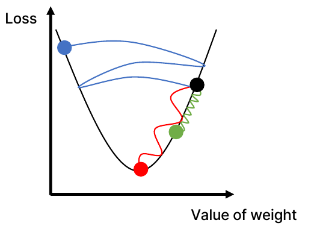

*Figure 23. Gradient descent paths for different learning rates*

The effect of the learning rate can be computed exactly for the simple loss function $L(w) = w^{2}$. Its gradient is $L'(w) = 2w$, so the update equation is the following.

$$
w_{k+1} = w_k - \alpha \cdot 2w_k = (1 - 2\alpha)\,w_k \quad\Rightarrow\quad w_k = (1 - 2\alpha)^{k}\,w_0
$$

The minimum is at $w = 0$, and for $w_k$ to converge to 0 one needs $|1 - 2\alpha| < 1$, that is, $0 < \alpha < 1$. The results starting from $w_0 = 1$ are shown in Table 16.

| Learning rate $\alpha$ | $1 - 2\alpha$ | $w_1, w_2, w_3, w_4, w_5$ | Result |
|:-----|:-----|:-----|:-----|
| 0.1 | 0.8 | 0.8, 0.64, 0.512, 0.4096, 0.3277 | Converges, but slowly. |
| 0.4 | 0.2 | 0.2, 0.04, 0.008, 0.0016, 0.0003 | Converges quickly. |
| 1.0 | -1 | -1, 1, -1, 1, -1 | Alternates between two values and does not converge. |
| 1.1 | -1.2 | -1.2, 1.44, -1.728, 2.0736, -2.4883 | Oscillates and diverges. |

*Table 16. Results of gradient descent on the loss function $L(w) = w^{2}$ for different learning rates*

Training is repeated a fixed number of times or stopped when the loss no longer improves. One pass that uses all of the training data once is called an **epoch**, and the whole training process is the loop in Figure 24.

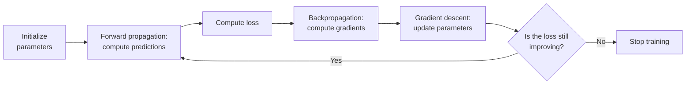

*Figure 24. The iterative process of training a neural network*

### 3.6 Choosing the Learning Rate and Adaptive Learning Rates

There are two ideas for choosing an appropriate learning rate.

- **Idea I:** Try various learning rates and check which value works appropriately. Values differing by factors of 10, such as 0.1, 0.01, and 0.001, are usually tried.
- **Idea II:** Design an **adaptive learning rate** that adapts to the training situation. The learning rate is not fixed and can become larger or smaller depending on factors such as the magnitude of the gradient, the speed of learning, and the size of particular weights.

Representative optimization methods that implement Idea II are the following. In the equations below, $\mathbf{g}_k = \nabla_{\boldsymbol{\theta}}L(\boldsymbol{\theta}_k)$, and squares, square roots, and divisions are taken entry by entry.

**Momentum** remembers the previous update direction and adds it with a fixed ratio $\beta$ [14]. Like a ball rolling down a slope and gaining speed, the update accelerates when the gradient keeps the same direction, and oscillations whose direction keeps changing cancel out.

$$
\mathbf{v}_{k+1} = \beta\mathbf{v}_k + \mathbf{g}_k, \qquad \boldsymbol{\theta}_{k+1} = \boldsymbol{\theta}_k - \alpha\mathbf{v}_{k+1}
$$

**AdaGrad** divides the learning rate by $\mathbf{r}$, the accumulated squares of all gradients so far [15]. Parameters whose gradients have been large get a smaller learning rate, and parameters whose gradients have been small get a relatively larger one. $\epsilon$ is a small number that prevents division by 0.

$$
\mathbf{r}_{k+1} = \mathbf{r}_k + \mathbf{g}_k^{2}, \qquad \boldsymbol{\theta}_{k+1} = \boldsymbol{\theta}_k - \frac{\alpha}{\sqrt{\mathbf{r}_{k+1}} + \epsilon}\,\mathbf{g}_k
$$

**RMSProp** replaces the cumulative sum of AdaGrad with an exponential moving average that weights recent gradients more, which prevents the learning rate from only ever shrinking [16].

$$
\mathbf{r}_{k+1} = \rho\,\mathbf{r}_k + (1 - \rho)\,\mathbf{g}_k^{2}, \qquad \boldsymbol{\theta}_{k+1} = \boldsymbol{\theta}_k - \frac{\alpha}{\sqrt{\mathbf{r}_{k+1}} + \epsilon}\,\mathbf{g}_k
$$

**Adam (adaptive moment estimation)** combines momentum and RMSProp and is currently the most widely used method [17]. It uses both a moving average $\mathbf{m}$ of the gradients and a moving average $\mathbf{v}$ of the squared gradients, and divides by $1 - \beta^{k}$ to correct the bias toward small values early on, which arises because both averages start at 0. The proposed default values are $\alpha = 0.001$, $\beta_1 = 0.9$, $\beta_2 = 0.999$, and $\epsilon = 10^{-8}$.

$$
\mathbf{m}_{k} = \beta_1\mathbf{m}_{k-1} + (1 - \beta_1)\mathbf{g}_k, \qquad \mathbf{v}_{k} = \beta_2\mathbf{v}_{k-1} + (1 - \beta_2)\mathbf{g}_k^{2}
$$

$$
\hat{\mathbf{m}}_k = \frac{\mathbf{m}_k}{1 - \beta_1^{k}}, \qquad \hat{\mathbf{v}}_k = \frac{\mathbf{v}_k}{1 - \beta_2^{k}}, \qquad \boldsymbol{\theta}_{k} = \boldsymbol{\theta}_{k-1} - \frac{\alpha\,\hat{\mathbf{m}}_k}{\sqrt{\hat{\mathbf{v}}_k} + \epsilon}
$$

| Method | Basis for changing the learning rate | Effect |
|:-----|:-----|:-----|
| Momentum | Previous update direction (speed of learning) | Accelerates in a consistent direction and damps oscillation. |
| AdaGrad | Accumulated gradient magnitude per parameter | Reduces the learning rate of parameters that have changed a lot. |
| RMSProp | Recent gradient magnitude per parameter | Prevents AdaGrad's learning rate from shrinking to 0. |
| Adam | Both the mean and the magnitude of the gradients | Combines momentum with per-parameter learning rates. |

*Table 17. Comparison of adaptive optimization methods*

### 3.7 Batch, Stochastic, and Mini-Batch Gradient Descent

The gradient of the empirical loss $J(\boldsymbol{\theta}) = \frac{1}{n}\sum_{i} L_i$ of Section 2.5 is the average of the gradients computed for each data point. With millions of data points, computing the gradients of all data for every single update is very expensive. Three approaches are therefore distinguished by how much data is used to compute the gradient [13].

| Approach | Data used per update | Characteristics |
|:-----|:-----|:-----|
| Batch gradient descent | All $n$ points | The gradient is exact, but each update takes a long time. |
| Stochastic gradient descent (SGD) | 1 randomly chosen point | Updates are fast, but the gradient is noisy and the path wobbles. |
| Mini-batch gradient descent | $B$ randomly chosen points (for example, 32 or 64) | A compromise between the two that suits the parallel computation of GPUs; the most widely used. |

*Table 18. Three approaches to gradient descent*

The gradient $\frac{1}{B}\sum_{i \in \mathcal{B}}\nabla L_i$ computed on a mini-batch $\mathcal{B}$ is an estimate of the full gradient, and because the mini-batch is drawn at random, it equals the full gradient on average. In practice the mini-batch approach is also often called SGD.

### 3.8 Overfitting

> **Definition:** **Overfitting** is the phenomenon in machine learning and statistical modeling in which a model learns the training data, including noise and outliers, too well and therefore fails to predict new data properly.

Figure 25 shows the results of fitting three models to the same data (orange points).

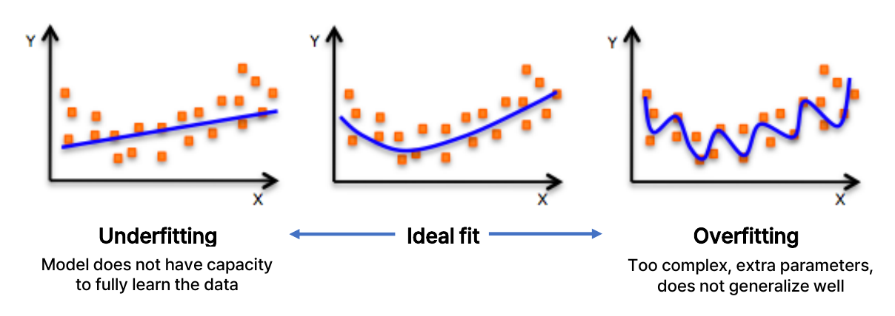

*Figure 25. Underfitting, ideal fit, and overfitting*

| State | Appearance in the figure | Cause | Training error | Error on new data |
|:-----|:-----|:-----|:-----|:-----|
| Underfitting | A straight line fitted to curved data | The model does not have the capacity to fully learn the data. | Large | Large |
| Ideal fit | A gentle curve that follows the overall trend of the data | The complexity of the model suits the data. | Small | Small |
| Overfitting | A curve that wiggles heavily to pass through every point | The model is too complex, with too many parameters, and does not generalize. | Very small | Large |

*Table 19. Comparison of fitting states*

An overfitted model memorizes not the general trend of the data but even its accidental noise. The ability of a model to predict well on data it has never seen is called **generalization**, and the goal of training is to improve generalization performance, not the error on the training data. As covered in Week 12, overfitting is diagnosed by measuring the error on validation data not used for training. If the training error is small but the validation error is large, the model is overfitting.

A modification to the learning algorithm intended to reduce overfitting is called **regularization**. Regularization is a modification aimed at reducing the generalization error rather than the training error [13]. Sections 3.9 and 3.10 cover two regularization techniques widely used in neural networks.

> **Note:** Another widely used form of regularization is **L2 regularization (weight decay)**, which adds a penalty on the size of the weights to the loss [13]. Minimizing $\tilde{J}(\boldsymbol{\theta}) = J(\boldsymbol{\theta}) + \frac{\lambda}{2}\lVert\mathbf{w}\rVert^{2}$ adds $\lambda\mathbf{w}$ to the gradient, so every update shrinks the weights slightly toward 0 and complex functions with large weights are suppressed. $\lambda$ is a hyperparameter that sets the strength of the penalty.

### 3.9 Regularization I: Dropout

> **Definition:** **Dropout** is a regularization technique that randomly sets the activations (outputs) of some neurons to 0 during training [18]. Typically 50% of the activations in a layer are dropped.

Figure 26 shows one moment of applying dropout to a fully connected network with 3 inputs, two hidden layers of 4 neurons each, and 2 outputs. The neurons with dashed borders have been dropped in the current training step and their connections removed, and forward and backward propagation use only the reduced network formed by the remaining neurons.

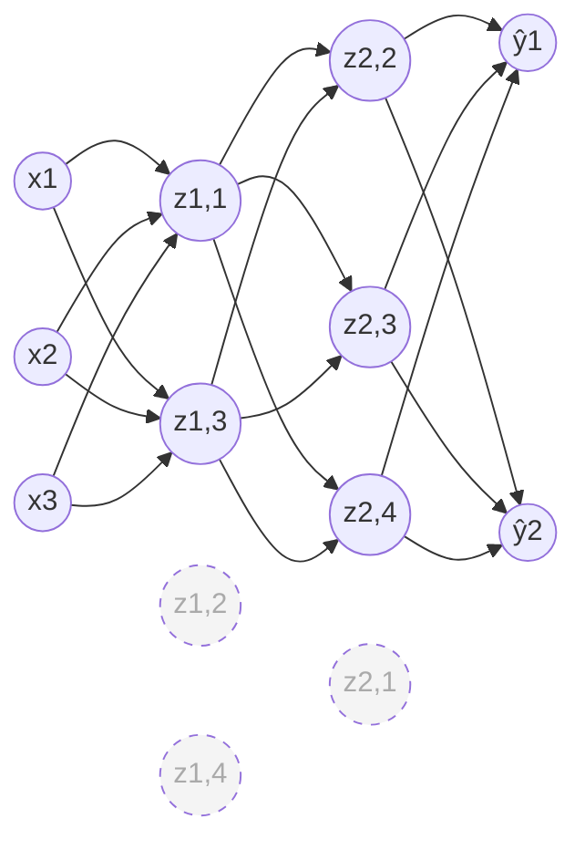

*Figure 26. A neural network with some neurons dropped out*

Two reasons are given for why dropout reduces overfitting [18].

- Since a neuron cannot know which neurons will disappear in the next step, co-adaptation, in which neurons rely on particular other neurons to memorize noise together, becomes difficult. Each neuron must learn features that are useful on their own.
- A different reduced network is trained at each training step, which has an effect similar to an ensemble that trains many networks and averages them.

Dropout is applied only during training; prediction (testing) uses all neurons. The size of the outputs must then be corrected so that it does not differ from training. The commonly used inverted dropout scales up the outputs of the remaining neurons during training by dividing them by the retention probability $p$. For example, with a dropout rate of 50%, the retention probability is also $p = 0.5$, and with four neuron outputs $[0.8, 0.2, 0.6, 0.4]$, if the second and fourth are dropped, the outputs become $[0.8/0.5, 0, 0.6/0.5, 0] = [1.6, 0, 1.2, 0]$. The expected value of each output $a$ is $0.5 \times 2a + 0.5 \times 0 = a$, the same as the original value, so at test time all neurons are used as they are without any correction. The original paper does the opposite, leaving outputs unchanged during training and multiplying the weights by $p$ at test time, and the two methods are equivalent in terms of expected values. The original paper reported that a retention probability of 0.5 for hidden neurons is close to optimal for a wide range of networks and tasks [18].

### 3.10 Regularization II: Early Stopping

> **Definition:** **Early stopping** is a regularization technique that ends training early, before overfitting occurs.

Figure 27 draws the typical behavior of two losses as the number of training iterations grows. The loss on the training data (green) keeps decreasing with more iterations. The loss on data not used for training (blue) decreases along with it at first but starts to grow again at some point; from then on the model has begun to memorize the noise in the training data, that is, overfitting has begun. Early stopping stops training at the point where this loss is minimal (the purple dashed line) and uses the parameters at that point as the final model.

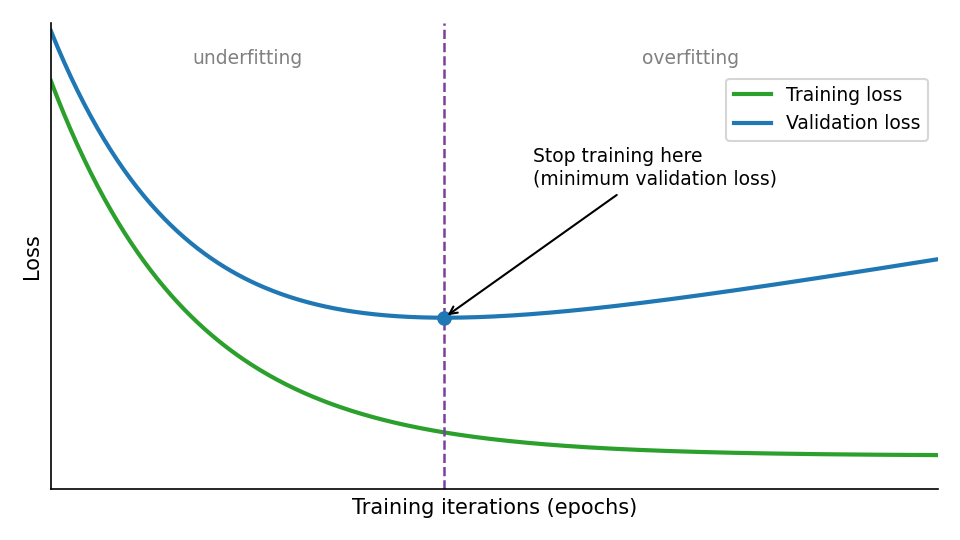

*Figure 27. The principle of early stopping*

In practice the validation loss can fluctuate briefly, so training is stopped when the validation loss has not improved for a set number of consecutive checks (the patience), and the parameters are restored to those at the point where the validation loss was smallest [13]. Early stopping can be seen as a method that treats the number of training iterations itself as a hyperparameter and chooses it automatically.

> **Caution:** The criterion for early stopping must be the loss on **validation data** held out separately from the training data. Choosing the stopping point with the test data used to report final performance means that information from the test data has been used in training, and the test performance is measured as better than it actually is (Week 12).

### 3.11 Example: Regression on Battery Module Data

As an example of solving an engineering problem with an artificial neural network, consider a regression problem that predicts the results of structural analysis from the design variables of a battery module. Figure 28 (a) shows the structure of the battery module. Nine cells sit side by side with cooling fins and compression pads between them; a top plate and a bottom plate cover the top and bottom, side plates cover both sides, and a heat sink lies at the very bottom. The length of the module is $L_{\text{module}}$ and its height $H_{\text{module}}$. Figure (b) is the deformation result when pressure acts from inside the module outward: both side plates bow outward and the top plate sags, and the colors show the magnitude of deformation (increasing from blue to red).

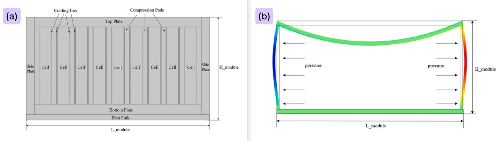

*Figure 28. Structure of the battery module and its deformation under pressure*

The six input variables and two output variables are listed in Table 20. Material properties and dimensions are uncertain because of manufacturing variation, for example, so the data used (uncertainty data) consist of outputs computed for 500 combinations of varied input values.

| Kind | Variable | Meaning |
|:-----|:-----|:-----|
| Input 1 | Young's modulus | The stiffness of the material, the ratio of stress to strain in the elastic range. |
| Input 2 | Module length | The horizontal length of the module, $L_{\text{module}}$. |
| Input 3 | Poisson's ratio | The ratio of the lateral contraction strain to the axial extension strain when a material is stretched in one direction. |
| Input 4 | Density | Mass per unit volume. |
| Input 5 | Top thickness | The thickness of the top plate. |
| Input 6 | Side thickness | The thickness of the side plates. |
| Output 1 | Von Mises stress | An equivalent stress that converts stresses in several directions into a single value from which yielding of the material can be judged. |
| Output 2 | Displacement | The distance a point of the structure moves from its original position under load. |

*Table 20. Inputs and outputs of the battery module example*

> **Note:** The von Mises stress is computed from the three principal stresses $\sigma_1, \sigma_2, \sigma_3$ as $\sigma_{v} = \sqrt{\tfrac{1}{2}\bigl[(\sigma_1 - \sigma_2)^{2} + (\sigma_2 - \sigma_3)^{2} + (\sigma_3 - \sigma_1)^{2}\bigr]}$, and a ductile material is judged to yield when this value reaches its yield strength. Such outputs are usually obtained by time-consuming numerical analyses such as finite element analysis, so a neural network trained on them can serve as a surrogate model that instantly predicts the results for new combinations of design variables.

The data are stored as the input matrix `x_input` ($6 \times 500$) and the output vectors `y_mises` ($1 \times 500$) and `y_disp` ($1 \times 500$). MATLAB neural network functions use a format in which rows are variables and columns are samples [19], so each column of `x_input` holds the six inputs of one design. The two outputs could be predicted together by one network, but here a separate network with 6 inputs, 10 hidden neurons, and 1 output is trained for each output (Figure 29).

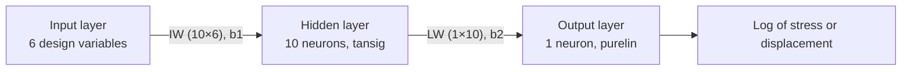

*Figure 29. Neural network architecture of the battery module example*

The MATLAB code that predicts the von Mises stress is the following.

```matlab
%% mises
net_mises=feedforwardnet([10]);
% [net_mises, tr] = train(net_mises,x_input,y_mises(1,:),'useParallel','yes');
[net_mises, tr] = train(net_mises,x_input,log(y_mises(1,:)),'useParallel','yes');

input_weights = net_mises.IW{1,1};
layer_weights = net_mises.LW{2,1};
%
biases = net_mises.b;
biases1 = biases{1,1};
biases2 = biases{2,1};
```

| Code | What it does |
|:-----|:-----|
| `%% mises` | A comment that marks the start of a code section. |
| `feedforwardnet([10])` | Creates a feedforward neural network (a network in which signals flow only from the input toward the output, without feedback) with one hidden layer of 10 neurons. The default hidden layer size is also 10, and the default training function is the Levenberg-Marquardt method (`trainlm`) [20]. |
| `% [net_mises, tr] = ...` | The original code that trains on the stress values as they are, commented out with a leading `%`. |
| `train(net_mises, x_input, log(y_mises(1,:)), ...)` | Trains the network with the inputs `x_input` and the targets. The targets are the natural logarithm of the first row of the stress `y_mises`. `'useParallel','yes'` is an option that performs the computation on parallel workers if a parallel pool is open [19]. |
| `[net_mises, tr]` | Receives the trained network and the training record `tr` (performance per epoch, the division into training, validation, and test data, and so on) [19]. |
| `net_mises.IW{1,1}` | The input weight matrix ($10 \times 6$) from the input to the first layer (the hidden layer). |
| `net_mises.LW{2,1}` | The layer weight matrix ($1 \times 10$) from the first layer to the second layer (the output layer). |
| `net_mises.b` | A cell array of the biases of each layer; `biases{1,1}` is the hidden layer bias ($10 \times 1$) and `biases{2,1}` is the output layer bias ($1 \times 1$). |

*Table 21. Explanation of the stress prediction code*

The code that predicts the displacement differs only in the network name and the targets. The displacement is trained as it is, without taking the logarithm.

```matlab
%% displacement
net_disp=feedforwardnet([10]);
[net_disp, tr] = train(net_disp,x_input,(y_disp(1,:)),'useParallel','yes');

input_weights = net_disp.IW{1,1};
layer_weights = net_disp.LW{2,1};

biases = net_disp.b;
biases1 = biases{1,1};
biases2 = biases{2,1};
```

With the extracted weights and biases, the computation of the network can be written as an equation. The hidden layer of `feedforwardnet` uses the tansig activation function by default, which is mathematically equivalent to tanh [21]. The output layer uses a linear function (purelin) that passes its input through unchanged.

$$
\hat{y} = \text{LW}\,\tanh\bigl(\text{IW}\,\mathbf{x} + \mathbf{b}_1\bigr) + b_2
$$

There are 60 parameters in $\text{IW}$, 10 in $\mathbf{b}_1$, 10 in $\text{LW}$, and 1 in $b_2$, 81 in total, which matches the formula of Section 2.2, $(6 + 1) \times 10 + (10 + 1) \times 1 = 81$. The output of the stress network is the logarithm of the stress, so the actual stress is recovered as $e^{\hat{y}}$. Taking the logarithm of a value that is always positive and spans a wide range, such as stress, narrows its range and makes training weigh the relative errors of large and small values similarly. Moreover, $e^{\hat{y}}$ is always positive, so the impossible prediction of a negative stress cannot occur.

During training, `train` monitors performance on the validation data and performs early stopping (Section 3.10). The default training function `trainlm` stops training when validation performance fails to improve for `max_fail` consecutive epochs (default 6) [22].

> **Caution:** By default, `feedforwardnet` automatically applies `mapminmax` preprocessing, which maps each row of the inputs and targets to the range $[-1, 1]$ [23]. The extracted `IW`, `LW`, and `b` are therefore weights for normalized values, and predicting directly with the equation above requires transforming the inputs in the same way and mapping the output back to its original range. The normalization in this preprocessing adjusts the range of the data and is a different concept from the regularization of Section 3.8, which reduces overfitting.

> **Note:** Recent MATLAB documentation marks `feedforwardnet` and `train` as functions to be removed in a future release (To be removed) [20][19]. The architecture and training principles of the network are the same, so it can be implemented in the same way with other tools.

---

<br>

## Concept Applications

| Situation | Concept to connect and why |
|:-----|:-----|
| A network with 10 hidden layers uses the sigmoid in every layer, and the weights of the layers near the input barely change. | **Vanishing gradient.** The derivative of the sigmoid is at most 0.25, so the gradient shrinks each time backpropagation passes through a layer. Using ReLU in the hidden layers alleviates this. |
| A perceptron without hidden layers is used to classify data whose two classes are mixed in a circular pattern. | **Linear separability.** The decision boundary of a single perceptron is a straight line, so it cannot solve the problem. A hidden layer with a nonlinear activation function is needed. |
| The training loss decreases every epoch, but the validation loss increases from the 30th epoch on. | **Overfitting and early stopping.** Use the parameters from around the 30th epoch, and consider adding dropout or L2 regularization. |
| During training the loss grows steadily and becomes `NaN`. | **The learning rate is too large.** The updates overshoot the minimum and diverge, so the learning rate should be reduced. |
| The loss does decrease, but only very slowly even after 10,000 iterations. | **The learning rate is too small, or the gradient vanishes.** Increase the learning rate or use an adaptive method such as Adam. |
| A loss function must be chosen for binary classification whose output is a pass probability. | **Binary cross-entropy.** It assigns a large loss to confident wrong answers and suits classification. Mean squared error is used for regression. |
| Only 300 medical images are available, which makes training a network from scratch difficult. | **Transfer learning.** Take a network pre-trained on a large data set and fine-tune it. |

*Table 22. Concepts to connect for each situation*

**True/False Check:**

| Statement | Verdict and reason |
|:-----|:-----|
| If all activation functions are linear, stacking more layers makes it possible to create more complex decision boundaries. | **F.** A composition of linear maps is again a linear map, so regardless of the number of layers the network is equivalent to a single linear model. |
| The derivative of the sigmoid function is $\sigma(z)(1 - \sigma(z))$, with maximum 0.25 at $z = 0$. | **T.** |
| The gradient points in the direction in which the function decreases fastest. | **F.** The gradient points in the direction of fastest increase; to decrease, move in the opposite direction $-\nabla f$. |
| In backpropagation, the output-layer error signal $\delta_2$ is reused to compute the gradients of the hidden layer. | **T.** $\delta_1 = \sigma'(S_1)\,w_2\,\delta_2$. |
| Dropout drops neurons at the same rate during prediction (testing) as during training. | **F.** Dropout is applied only during training, and all neurons are used for prediction. |
| Using the loss on the test data as the criterion for early stopping measures generalization performance accurately. | **F.** The test data then influence the training process and performance is measured optimistically, so validation data must be used. |

---

<br>

## Summary

| Concept | Key Summary |
|:-----|:-----|
| Artificial neural network | A computational model inspired by the biological neural networks of the human brain, consisting of many interconnected artificial neurons. |
| Artificial neuron | It passes the weighted sum of its inputs through an activation function to produce an output. Weights correspond to the strength of synaptic connections. |
| History | It progressed from the McCulloch-Pitts neuron of 1943 through the perceptron of 1958, backpropagation in the 1980s, and AlexNet in 2012 to the large language models of the 2020s. |
| Factors in the revival | Hardware such as GPUs, big data, algorithmic innovation, and transfer learning drove the revival of the 2010s. |
| Perceptron | $\hat{y} = g(\theta_0 + \mathbf{X}^{T}\boldsymbol{\theta})$, where the bias $\theta_0$ shifts the activation function left or right. |
| Activation function | It introduces nonlinearity into the network. With only linear activation functions, stacked layers are equivalent to a single linear model. |
| Sigmoid, tanh, ReLU | The sigmoid outputs values in $(0, 1)$ and tanh in $(-1, 1)$, and both suffer from vanishing gradients. ReLU has slope 1 for positive inputs and avoids vanishing gradients, but its slope is 0 for negative inputs. |
| Linear separability | A single perceptron solves only problems that a straight-line boundary can separate and cannot solve XOR. |
| Network structure | A network consists of input, hidden, and output layers, and a network with several hidden layers is a deep neural network. |
| Loss function | It measures the cost of a wrong prediction by the difference between the prediction and the answer, and the empirical loss is the average loss over all data. |
| Mean squared error | A loss for regression, the mean of the squared errors. Binary cross-entropy is mainly used for binary classification. |
| Training | The process of using data with correct answers to change the parameter vector $\boldsymbol{\theta}$ in the direction that reduces the loss. |
| Gradient | The vector of partial derivatives, pointing in the direction in which a function increases most. |
| Backpropagation | It uses the chain rule to pass error signals from the output toward the input and efficiently computes the gradients of all parameters. |
| Gradient descent | It updates the parameters in the direction opposite to the gradient by $\boldsymbol{\theta}_{k+1} = \boldsymbol{\theta}_k - \alpha_k\nabla_{\boldsymbol{\theta}}L$. |
| Learning rate | Too large a rate diverges and too small a rate converges slowly. Momentum, AdaGrad, RMSProp, and Adam adjust the learning rate to the situation. |
| Mini-batch | An approach that updates with the gradient estimated on a randomly chosen subset of the data; the most widely used. |
| Overfitting | The phenomenon in which a model learns even the noise and fails to predict new data well; it is reduced by regularization. |
| Dropout | It randomly sets the outputs of some neurons to 0 during training to prevent co-adaptation between neurons. |
| Early stopping | It stops training at the point where the validation loss is smallest. |
| Battery module example | A regression network with 10 hidden neurons that predicts the von Mises stress and displacement from six design variables was trained in MATLAB. |

---

<br>

## Self-Check Questions

1. **Perceptron output:** For a perceptron with bias $\theta_0 = -1$, weights $\boldsymbol{\theta} = [2, -1]^{T}$, and the sigmoid activation function, find the weighted sum $z$ and the output $\hat{y}$ for $\mathbf{X} = [1, 0.5]^{T}$.

   <details>
   <summary>Answer</summary>

   $z = \theta_0 + x_1\theta_1 + x_2\theta_2 = -1 + (1)(2) + (0.5)(-1) = -1 + 2 - 0.5 = 0.5$. The output is $\hat{y} = \sigma(0.5) = 1/(1 + e^{-0.5}) \approx 0.6225$.

   </details>

2. **Derivative of the sigmoid:** Derive $\sigma'(z) = \sigma(z)(1 - \sigma(z))$, and use it to find the maximum of $\sigma'$ and the $z$ at which it occurs.

   <details>
   <summary>Answer</summary>

   Differentiating $\sigma(z) = (1 + e^{-z})^{-1}$ with the chain rule gives $\sigma'(z) = e^{-z}/(1 + e^{-z})^{2} = \frac{1}{1 + e^{-z}} \cdot \frac{e^{-z}}{1 + e^{-z}}$, and the second factor is $1 - \frac{1}{1 + e^{-z}} = 1 - \sigma(z)$, so $\sigma'(z) = \sigma(z)(1 - \sigma(z))$. Letting $s = \sigma(z) \in (0, 1)$, $s(1 - s)$ has its maximum 0.25 at $s = 0.5$, and $\sigma(z) = 0.5$ when $z = 0$.

   </details>

3. **The need for nonlinearity:** Show that replacing the hidden-layer activation function with the identity makes a two-layer network equivalent to a single linear model.

   <details>
   <summary>Answer</summary>

   The hidden layer output is $\mathbf{h} = W_1\mathbf{x} + \mathbf{b}_1$, and the output is $W_2\mathbf{h} + \mathbf{b}_2 = W_2W_1\mathbf{x} + W_2\mathbf{b}_1 + \mathbf{b}_2$. Setting $W = W_2W_1$ and $\mathbf{b} = W_2\mathbf{b}_1 + \mathbf{b}_2$ gives $W\mathbf{x} + \mathbf{b}$, which is a single-layer linear model, and the decision boundary is also restricted to a straight line (hyperplane).

   </details>

4. **Aircraft classification:** Classify an aircraft with speed 0.8 and weight 1.5 using the perceptron of Section 1.14.

   <details>
   <summary>Answer</summary>

   The weighted sum is $0.5 + 1.5 \times 0.8 - 1.5 = 0.5 + 1.2 - 1.5 = 0.2$. It is at least 0, so the aircraft is classified as a fighter. This agrees with the fact that the weight on the line $x_2 = 1.5x_1 + 0.5$ at $x_1 = 0.8$ is 1.7, and the aircraft's weight 1.5 is below it, on the fighter side of the line.

   </details>

5. **Number of parameters:** How many weights and biases in total does a single-hidden-layer network with 3 inputs, 4 hidden neurons, and 2 outputs have?

   <details>
   <summary>Answer</summary>

   Each hidden neuron has 3 weights and 1 bias, so the hidden layer has $(3 + 1) \times 4 = 16$; each output neuron has 4 weights and 1 bias, so the output layer has $(4 + 1) \times 2 = 10$. The total is 26.

   </details>

6. **Mean squared error:** Find the mean squared error when the predictions are $[2, 4, 7]$ and the answers are $[3, 4, 5]$.

   <details>
   <summary>Answer</summary>

   The errors are $3 - 2 = 1$, $4 - 4 = 0$, and $5 - 7 = -2$, and their squares are 1, 0, and 4. The mean squared error is $(1 + 0 + 4)/3 = 5/3 \approx 1.667$.

   </details>

7. **Gradient and gradient descent:** Find the gradient of $f(x, y) = x^{2}y + 3y$ at the point $(1, 2)$, and find the new point and the change in the function value after one gradient descent step with learning rate 0.1.

   <details>
   <summary>Answer</summary>

   $\partial f/\partial x = 2xy = 4$ and $\partial f/\partial y = x^{2} + 3 = 4$, so $\nabla f(1, 2) = [4, 4]^{T}$. The new point is $(1, 2) - 0.1 \times (4, 4) = (0.6, 1.6)$. The function value decreased from $f(1, 2) = 2 + 6 = 8$ to $f(0.6, 1.6) = 0.36 \times 1.6 + 4.8 = 0.576 + 4.8 = 5.376$.

   </details>

8. **Computational graph:** For $E = (x + y)z$ with $x = 2$, $y = -1$, and $z = 3$, find the forward values and $\partial E/\partial x$, $\partial E/\partial y$, and $\partial E/\partial z$.

   <details>
   <summary>Answer</summary>

   Forward propagation gives $q = 2 + (-1) = 1$ and $E = 1 \times 3 = 3$. At the multiplication node, $\partial E/\partial q = z = 3$ and $\partial E/\partial z = q = 1$, and the addition node passes the upstream gradient through unchanged, so $\partial E/\partial x = \partial E/\partial y = 3$.

   </details>

9. **Signs of the gradients:** If only the answer in the example of Section 3.3 is changed to $y = 0$, what are the signs of the four gradients, and in which direction does gradient descent change the parameters?

   <details>
   <summary>Answer</summary>

   Forward propagation is unchanged, so $A_2 = 0.4834$ and $\partial L/\partial A_2 = 2(0.4834 - 0) \approx 0.9669 > 0$. Then $\delta_2 = 0.9669 \times 0.2497 \approx 0.2414 > 0$, so $\partial L/\partial b_2 > 0$ and $\partial L/\partial w_2 = A_1\delta_2 \approx 0.1503 > 0$. Since $w_2 = 1.5 > 0$, $\delta_1 = \sigma'(S_1)\,w_2\,\delta_2 \approx 0.0851 > 0$, so $\partial L/\partial b_1 > 0$ and $\partial L/\partial w_1 = x\delta_1 \approx 0.1702 > 0$. All four gradients are positive, so gradient descent decreases all four parameters and lowers the output toward 0.

   </details>

10. **Learning rate:** For the loss function $L(w) = w^{2}$ with $w_0 = 1$ and learning rate $\alpha = 0.75$, write the values of $w$ after each of four gradient descent steps, and decide whether it converges.

    <details>
    <summary>Answer</summary>

    The update is $w_{k+1} = (1 - 2 \times 0.75)w_k = -0.5\,w_k$, so $w$ takes the values $-0.5$, $0.25$, $-0.125$, and $0.0625$. The sign alternates and $w$ moves back and forth across the minimum, but $|1 - 2\alpha| = 0.5 < 1$, so it converges to 0.

    </details>

11. **Vanishing gradient:** When five hidden layers all use the sigmoid, find the largest factor by which the derivatives of the activation functions alone can multiply the gradient during backpropagation, and compare with ReLU.

    <details>
    <summary>Answer</summary>

    The derivative of the sigmoid is at most 0.25, so after five layers the gradient is multiplied by at most $0.25^{5} \approx 9.8 \times 10^{-4}$, which greatly shrinks the gradients of the layers near the input. ReLU has derivative 1 for positive inputs, so along paths through activated neurons the activation function does not shrink the gradient.

    </details>

12. **Diagnosing overfitting:** A network has a training loss of 0.01 and a validation loss of 0.50. Determine its state, and give at least two remedies covered in this note.

    <details>
    <summary>Answer</summary>

    It fits the training data very well but does not fit data unused in training, so it is overfitting. One can use dropout, which randomly drops some neurons during training; early stopping, which stops training when the validation loss is smallest; and L2 regularization, which penalizes the size of the weights. Increasing the training data or simplifying the model also helps.

    </details>

13. **Dropout:** Using expected values, explain why inverted dropout with a dropout rate of 50% doubles the outputs of the remaining neurons.

    <details>
    <summary>Answer</summary>

    During training, a neuron with output $a$ becomes 0 with probability 0.5 and remains with probability 0.5. Scaling it to $2a$ when it remains makes its expected value $0.5 \times 2a + 0.5 \times 0 = a$, the same as the output $a$ at test time, when all neurons are used as they are. This removes the need for a separate correction at test time.

    </details>

14. **Criterion for early stopping:** Explain why the stopping point for early stopping must be chosen with validation data rather than test data.

    <details>
    <summary>Answer</summary>

    The test data must be kept completely separate from the training process so that the generalization performance of the finished model can be measured fairly. Choosing the stopping point by looking at the test loss uses information from the test data in model selection, so the measured test performance comes out more optimistic than the actual performance on new data. The stopping point is therefore chosen with separate validation data.

    </details>

15. **Battery module network:** For the stress network of Section 3.11, state the sizes of `IW`, `LW`, and the two biases, and explain how a predicted stress is converted back to its original units when the targets were log-transformed.

    <details>
    <summary>Answer</summary>

    There are 6 inputs, 10 hidden neurons, and 1 output, so `IW` is $10 \times 6$, `LW` is $1 \times 10$, the hidden layer bias is $10 \times 1$, and the output layer bias is $1 \times 1$, 81 parameters in total. The network was trained to predict $\ln(\text{stress})$, so the predicted stress is $e^{\hat{y}}$, the exponential of the output $\hat{y}$. This transformation always gives a positive value, so a negative stress is never predicted.

    </details>

---

<br>

## References

1. F. A. C. Azevedo et al., "Equal numbers of neuronal and nonneuronal cells make the human brain an isometrically scaled-up primate brain," *Journal of Comparative Neurology*, vol. 513, no. 5, pp. 532-541, 2009.
2. D. O. Hebb, *The Organization of Behavior: A Neuropsychological Theory*. New York, NY, USA: Wiley, 1949.
3. W. S. McCulloch and W. Pitts, "A logical calculus of the ideas immanent in nervous activity," *Bulletin of Mathematical Biophysics*, vol. 5, no. 4, pp. 115-133, 1943.
4. F. Rosenblatt, "The perceptron: A probabilistic model for information storage and organization in the brain," *Psychological Review*, vol. 65, no. 6, pp. 386-408, 1958.
5. D. E. Rumelhart, G. E. Hinton, and R. J. Williams, "Learning representations by back-propagating errors," *Nature*, vol. 323, no. 6088, pp. 533-536, 1986.
6. A. Krizhevsky, I. Sutskever, and G. E. Hinton, "ImageNet classification with deep convolutional neural networks," in *Advances in Neural Information Processing Systems 25*, 2012, pp. 1097-1105.
7. P. J. Werbos, "Beyond regression: New tools for prediction and analysis in the behavioral sciences," Ph.D. dissertation, Harvard University, Cambridge, MA, USA, 1974.
8. Y. LeCun et al., "Backpropagation applied to handwritten zip code recognition," *Neural Computation*, vol. 1, no. 4, pp. 541-551, 1989.
9. S. Hochreiter and J. Schmidhuber, "Long short-term memory," *Neural Computation*, vol. 9, no. 8, pp. 1735-1780, 1997.
10. A. L. Maas, A. Y. Hannun, and A. Y. Ng, "Rectifier nonlinearities improve neural network acoustic models," in *Proc. ICML Workshop on Deep Learning for Audio, Speech and Language Processing*, 2013.
11. K. Hornik, M. Stinchcombe, and H. White, "Multilayer feedforward networks are universal approximators," *Neural Networks*, vol. 2, no. 5, pp. 359-366, 1989.
12. M. Minsky and S. Papert, *Perceptrons: An Introduction to Computational Geometry*. Cambridge, MA, USA: MIT Press, 1969.
13. I. Goodfellow, Y. Bengio, and A. Courville, *Deep Learning*. Cambridge, MA, USA: MIT Press, 2016.
14. B. T. Polyak, "Some methods of speeding up the convergence of iteration methods," *USSR Computational Mathematics and Mathematical Physics*, vol. 4, no. 5, pp. 1-17, 1964.
15. J. Duchi, E. Hazan, and Y. Singer, "Adaptive subgradient methods for online learning and stochastic optimization," *Journal of Machine Learning Research*, vol. 12, pp. 2121-2159, 2011.
16. T. Tieleman and G. Hinton, "Lecture 6.5-RmsProp: Divide the gradient by a running average of its recent magnitude," *COURSERA: Neural Networks for Machine Learning*, 2012.
17. D. P. Kingma and J. Ba, "Adam: A method for stochastic optimization," in *Proc. 3rd International Conference on Learning Representations (ICLR)*, 2015.
18. N. Srivastava, G. Hinton, A. Krizhevsky, I. Sutskever, and R. Salakhutdinov, "Dropout: A simple way to prevent neural networks from overfitting," *Journal of Machine Learning Research*, vol. 15, pp. 1929-1958, 2014.
19. MathWorks, "train: Train shallow neural network," *Deep Learning Toolbox Documentation*. https://www.mathworks.com/help/deeplearning/ref/network.train.html
20. MathWorks, "feedforwardnet: Generate feedforward neural network," *Deep Learning Toolbox Documentation*. https://www.mathworks.com/help/deeplearning/ref/feedforwardnet.html
21. MathWorks, "tansig: Hyperbolic tangent sigmoid transfer function," *Deep Learning Toolbox Documentation*. https://www.mathworks.com/help/deeplearning/ref/tansig.html
22. MathWorks, "trainlm: Levenberg-Marquardt backpropagation," *Deep Learning Toolbox Documentation*. https://www.mathworks.com/help/deeplearning/ref/trainlm.html
23. MathWorks, "mapminmax: Process matrices by mapping row minimum and maximum values to [-1 1]," *Deep Learning Toolbox Documentation*. https://www.mathworks.com/help/deeplearning/ref/mapminmax.html
