# 14주차 이론 — 인공신경망 기반 제어시스템

[레포지토리 안내](../../README.ko.md) | [English](Concepts_Lecture.md) | [한국어](Concepts_Lecture.ko.md)

> **최종 수정일:** 2026-11-04

> **학습 목표:**
> 1. 인공신경망을 제어에 쓰는 이유를 설명하고, 간접 방식과 직접 방식을 시스템 식별과 제어기의 관점에서 구분할 수 있다
> 2. 모방 제어, 개루프 역 제어, 역 매핑, 역동역학의 원리를 설명하고 간단한 예에서 제어 입력을 계산할 수 있다
> 3. 신경망 예측 제어의 시스템 식별 단계, 성능 지표 $J$, 이동 구간 방식을 설명하고 작은 예에서 $J$를 최소로 하는 입력을 구할 수 있다
> 4. NARMA-L2 모델에서 피드백 선형화 제어 입력을 유도하고, 자기 부상 시스템에서 그 특징을 설명할 수 있다
> 5. 모델 기준 제어의 두 신경망과 학습 순서를 설명하고, 기준 모델의 응답을 계산할 수 있다
> 6. 세 신경망 제어기를 온라인 계산량, 학습 부담, 적용 범위, 제어 신호의 특성으로 비교할 수 있다

---

## 목차

- [1. 인공신경망 제어 개요](#1-인공신경망-제어-개요)
  - [1.1 제어에 인공신경망을 쓰는 이유](#11-제어에-인공신경망을-쓰는-이유)
  - [1.2 간접 방식과 시스템 식별](#12-간접-방식과-시스템-식별)
  - [1.3 간접 방식의 예: 밸브와 창문을 이용한 실내 온도 조절](#13-간접-방식의-예-밸브와-창문을-이용한-실내-온도-조절)
  - [1.4 직접 방식](#14-직접-방식)
  - [1.5 모방 제어](#15-모방-제어)
  - [1.6 개루프 역 제어](#16-개루프-역-제어)
  - [1.7 역 매핑](#17-역-매핑)
  - [1.8 역동역학](#18-역동역학)
- [2. 인공신경망 제어기 I: 역동역학 제어와 신경망 예측 제어](#2-인공신경망-제어기-i-역동역학-제어와-신경망-예측-제어)
  - [2.1 역동역학 예제](#21-역동역학-예제)
  - [2.2 피드백 제어](#22-피드백-제어)
  - [2.3 대표적인 세 신경망 제어기와 두 단계](#23-대표적인-세-신경망-제어기와-두-단계)
  - [2.4 신경망 예측 제어의 시스템 식별](#24-신경망-예측-제어의-시스템-식별)
  - [2.5 예측 제어와 성능 지표](#25-예측-제어와-성능-지표)
  - [2.6 응용: 연속 교반 탱크 반응기](#26-응용-연속-교반-탱크-반응기)
- [3. 인공신경망 제어기 II: NARMA-L2 제어와 모델 기준 제어](#3-인공신경망-제어기-ii-narma-l2-제어와-모델-기준-제어)
  - [3.1 NARMA-L2 모델과 피드백 선형화](#31-narma-l2-모델과-피드백-선형화)
  - [3.2 NARMA-L2 제어기](#32-narma-l2-제어기)
  - [3.3 응용: 자기 부상 시스템](#33-응용-자기-부상-시스템)
  - [3.4 모델 기준 제어](#34-모델-기준-제어)
  - [3.5 응용: 로봇 팔 제어](#35-응용-로봇-팔-제어)
  - [3.6 세 제어기의 비교](#36-세-제어기의-비교)
- [개념 적용](#개념-적용)
- [요약](#요약)
- [점검 문제](#점검-문제)
- [참고 문헌](#참고-문헌)

---

<br>

## 1. 인공신경망 제어 개요

### 1.1 제어에 인공신경망을 쓰는 이유

**플랜트(plant)** 는 제어하려는 대상 시스템이고, **동역학(dynamics)** 은 입력에 따라 플랜트의 상태와 출력이 시간에 따라 변하는 규칙이다. 4\~6주차에서는 뉴턴의 법칙과 키르히호프의 법칙 같은 물리 법칙으로 플랜트의 미분방정식, 전달함수, 상태 변수 방정식을 세우고 그 모델로 제어기를 설계했다. 그러나 화학 반응기처럼 동역학이 복잡하거나 매개변수를 알 수 없는 플랜트는 정확한 수학적 모델을 세우기 어렵다.

인공신경망은 이런 상황에서 제어기 설계의 대안이 된다. 제어시스템에 인공신경망을 쓰는 대표적인 초기 연구로 Werbos(1989)[1]와 Narendra와 Parthasarathy(1990)[2]가 있으며, 그 핵심 생각은 다음과 같다.

- 플랜트 동역학의 수학적 모델을 쓸 수 없을 때, 인공신경망은 입력-출력 데이터로 주어진 시스템 동작의 수치 정보만으로 제어기를 설계하는 방법을 제공한다.
- 인공신경망은 플랜트의 **블랙박스 모델(black-box model)**, 즉 내부 구조는 모른 채 입력과 출력의 관계만 재현하는 모델로 쓸 수 있다.
- 인공신경망 기반 제어기는 플랜트나 환경이 바뀔 때 제어기가 스스로 매개변수를 조정해야 하는 **적응 제어(adaptive control)** 에 알맞다.
- 플랜트가 원하는 방식으로 동작하도록 하는 인공신경망 제어기를 만들려면, 관찰한 오차를 바탕으로 신경망의 매개변수(가중치와 편향)를 조정해야 한다.

> **핵심:** 인공신경망은 제어시스템에서 두 가지 역할을 한다. 하나는 플랜트를 흉내 내는 **모델**이고, 다른 하나는 플랜트에 입력을 주는 **제어기**이다. 신경망을 플랜트 모델로 쓰고 그 모델로 제어기를 만드는 방식을 간접 방식, 신경망이 제어기 자체가 되는 방식을 직접 방식이라 한다. 이 구분을 **인공신경망 제어 토폴로지(topology)** 라 한다.

### 1.2 간접 방식과 시스템 식별

**간접 방식(indirect method)** 은 제어 대상 시스템의 인공신경망 모델에 기반한다. 먼저 플랜트의 입력과 출력으로 인공신경망 모델을 만들고, 제어기는 그 모델을 바탕으로 설계한다. 제어기 자체는 인공신경망이 아닐 수도 있지만, 인공신경망으로 모델링한 플랜트로부터 도출된다.

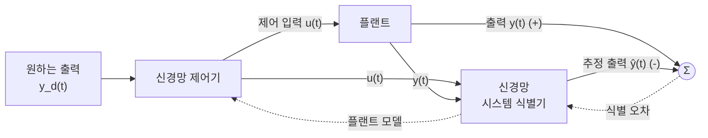

*그림 1. 간접 방식의 구조: 신경망 시스템 식별기가 플랜트를 학습하고 그 모델로 제어기를 조정한다*

실선은 신호의 흐름이고 점선은 학습(매개변수 조정)의 흐름이다. 신경망 시스템 식별기는 플랜트와 같은 제어 입력 $u(t)$를 받아 출력을 추정하고, 실제 출력 $y(t)$와 추정 출력 $\hat{y}(t)$의 차이인 **식별 오차(identification error)** 가 줄어들도록 학습한다. 학습을 마친 식별기는 플랜트의 모델 역할을 하며, 신경망 제어기는 이 모델을 써서 조정된다.

> **용어 정의:** **시스템 식별(system identification)** 은 시스템의 입력과 출력의 측정 데이터로부터 그 시스템의 동작을 재현하는 수학적 모델을 만드는 과정이다. 인공신경망 제어에서는 플랜트의 입출력 데이터로 신경망을 학습하여 플랜트 모델을 얻는다.

간접 방식에서 인공신경망은 **함수 근사기(function approximator)** 로 쓰인다. 근사하려는 블랙박스 함수와 인공신경망에 같은 입력을 넣고, 신경망이 블랙박스 함수와 같은 응답을 내도록 신경망의 매개변수를 조정한다.

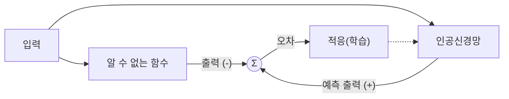

*그림 2. 함수 근사기로서의 인공신경망*

입력 $x_i$에 대한 실제 출력을 $y_i$, 신경망의 예측 출력을 $\hat{y}_i$라 하면 오차는 $e_i = \hat{y}_i - y_i$이다. 적응 블록은 $N$개의 학습 데이터에 대한 평균 제곱 오차(MSE)

$$
E = \frac{1}{N}\sum_{i=1}^{N} e_i^2 = \frac{1}{N}\sum_{i=1}^{N}\big(\hat{y}_i - y_i\big)^2
$$

를 최소로 하도록 13주차의 역전파와 경사 하강법으로 가중치를 갱신한다. 시그모이드 같은 활성화 함수를 쓰는 은닉층 하나짜리 신경망도 은닉 뉴런이 충분히 많으면 닫힌 유계 영역 위의 연속 함수를 원하는 정확도로 근사할 수 있다는 **보편 근사 정리(universal approximation theorem)** [3]가 이 방식의 이론적 근거이다. 다만 이 정리는 그런 가중치가 존재함을 보장할 뿐, 학습으로 그 가중치를 찾을 수 있다거나 학습 데이터의 범위 밖에서도 근사가 맞는다는 뜻은 아니다.

### 1.3 간접 방식의 예: 밸브와 창문을 이용한 실내 온도 조절

뜨거운 물이 흐르는 배관의 밸브와 창문으로 실내 온도를 조절하는 집을 생각한다. 밸브를 많이 열수록 난방이 강해지고, 창문을 많이 열수록 바깥 공기가 들어와 실내가 식는다. 밸브가 열린 정도(밸브 개도, %)와 창문이 열린 정도(창문 개도, %)를 바꾸며 실내 온도(°C)를 측정한 20개의 데이터는 표 1과 같다.

| 밸브 (%) | 창문 (%) | 온도 (°C) |
|:-----|:-----|:-----|
| 25 | 44 | 21.8 |
| 69 | 52 | 26.1 |
| 69 | 45 | 26.1 |
| 64 | 60 | 25.5 |
| 29 | 58 | 21.2 |
| 60 | 37 | 26.5 |
| 51 | 46 | 24.8 |
| 79 | 20 | 28.3 |
| 59 | 80 | 24.0 |
| 68 | 30 | 27.0 |
| 47 | 26 | 25.5 |
| 46 | 42 | 25.1 |
| 70 | 32 | 27.6 |
| 25 | 49 | 21.0 |
| 28 | 40 | 22.8 |
| 30 | 78 | 21.3 |
| 43 | 76 | 22.7 |
| 70 | 23 | 27.9 |
| 69 | 65 | 25.4 |
| 23 | 36 | 22.0 |

*표 1. 밸브 개도, 창문 개도와 실내 온도의 측정 데이터*

온도는 밸브 79%, 창문 20%에서 28.3 °C로 가장 높고 밸브 25%, 창문 49%에서 21.0 °C로 가장 낮다. 밸브는 온도와 같은 방향으로, 창문은 반대 방향으로 움직이지만 그 관계가 정확히 어떤 식인지는 모른다. 그래서 두 개도를 입력, 온도를 출력으로 하는 인공신경망을 학습하여 이 집의 블랙박스 모델로 쓴다. MATLAB의 Deep Learning Toolbox로 학습하는 코드는 다음과 같다.

```matlab
load('data.mat')
rng('default')
net=feedforwardnet([3]);
[net, tr] = train(net,[x1,x2]',y','useParallel','yes');

input_weights = net.IW{1,1};
layer_weights = net.LW{2,1};

biases = net.b;
biases1 = biases{1,1};
biases2 = biases{2,1};

y = net(x);
```

- `load('data.mat')`: 측정 데이터를 불러온다. 밸브 개도 `x1`, 창문 개도 `x2`, 온도 `y`가 각각 열 벡터로 들어 있다.
- `rng('default')`: 난수 생성기를 기본 상태로 초기화한다. 가중치의 초깃값과 데이터 분할이 난수로 정해지므로, 이렇게 하면 실행할 때마다 같은 결과를 얻는다.
- `net=feedforwardnet([3]);`: 은닉 뉴런이 3개인 은닉층 하나를 가진 순방향 신경망을 만든다. 괄호 안 벡터의 길이가 은닉층의 수이고 각 원소가 그 층의 뉴런 수이다[4].
- `[net, tr] = train(...)`: 입력 행렬 `[x1,x2]'`(2행 20열, 열마다 한 표본)과 목표 `y'`(1행 20열)로 신경망을 학습한다. MATLAB에서 `'`는 전치를 뜻하며, 신경망 함수는 표본을 열 방향으로 받으므로 전치가 필요하다. `'useParallel','yes'`는 병렬 계산을 쓰라는 선택 사항이고 `tr`에는 학습 기록이 담긴다. 학습 알고리즘은 기본값인 Levenberg-Marquardt(`trainlm`)이다[4].
- `input_weights = net.IW{1,1};`: 입력에서 첫째 층(은닉층)으로 가는 입력 가중치 행렬(3×2)이다.
- `layer_weights = net.LW{2,1};`: 첫째 층에서 둘째 층(출력층)으로 가는 층 가중치 행렬(1×3)이다.
- `biases = net.b;` 이하 세 줄: 층마다의 편향 벡터를 담은 셀 배열에서 은닉층 편향(3×1)과 출력층 편향(1×1)을 꺼낸다.
- `y = net(x);`: 학습한 신경망에 새 입력을 넣어 온도를 예측한다. `x`는 예측할 표본을 열마다 하나씩 담은 2행 행렬이다.

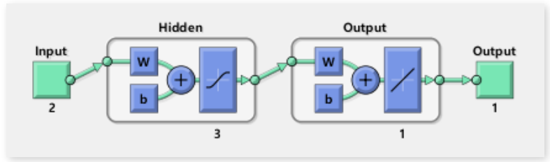

*그림 3. MATLAB이 보여 주는 2-3-1 신경망의 구조: 입력 2개, S자형 활성화 함수의 은닉 뉴런 3개, 선형 활성화 함수의 출력 뉴런 1개*

은닉층의 활성화 함수는 S자 모양의 쌍곡탄젠트 시그모이드(`tansig`, 수학적으로 $\tanh$와 같다)이고 출력층은 선형 함수(`purelin`)이다. 또한 `feedforwardnet`은 기본적으로 입력과 목표를 각각 학습 데이터의 최솟값과 최댓값을 써서 $[-1, 1]$ 구간으로 바꾸는 **최소-최대 스케일링(`mapminmax`)** 을 적용하고, 신경망의 출력을 다시 원래 단위로 되돌린다[5]. 따라서 입력 $\mathbf{x} = [x_1, x_2]^T$에서 예측 온도 $\hat{y}$를 얻는 계산은 다음과 같다.

$$
\tilde{x}_j = 2\,\frac{x_j - x_{j,\min}}{x_{j,\max} - x_{j,\min}} - 1, \qquad \mathbf{n}^1 = \mathbf{W}^1\tilde{\mathbf{x}} + \mathbf{b}^1, \qquad \mathbf{a}^1 = \tanh(\mathbf{n}^1)
$$

$$
z = \mathbf{W}^2\mathbf{a}^1 + b^2, \qquad \hat{y} = \frac{(z + 1)(y_{\max} - y_{\min})}{2} + y_{\min}
$$

$\mathbf{W}^1$은 `input_weights`, $\mathbf{b}^1$은 `biases1`, $\mathbf{W}^2$는 `layer_weights`, $b^2$는 `biases2`이며, 학습한 값은 다음과 같다.

$$
\mathbf{W}^1 = \begin{bmatrix} -1.6032 & 1.9398 \\ 1.3721 & -0.8252 \\ 0.9718 & -0.6760 \end{bmatrix}, \quad \mathbf{b}^1 = \begin{bmatrix} -2.7235 \\ 1.4603 \\ -0.5197 \end{bmatrix}, \quad \mathbf{W}^2 = \begin{bmatrix} 0.6126 & 1.1971 & 0.5306 \end{bmatrix}, \quad b^2 = -0.1687
$$

**예제: 첫 번째 표본의 예측.** 밸브 25%, 창문 44%일 때의 온도를 계산한다. 표 1에서 밸브는 23\~79, 창문은 20\~80, 온도는 21.0\~28.3의 범위에 있다.

1단계(스케일링): 두 입력을 $[-1, 1]$ 구간으로 바꾼다.

$$
\tilde{x}_1 = 2\cdot\frac{25 - 23}{79 - 23} - 1 = -0.9286, \qquad \tilde{x}_2 = 2\cdot\frac{44 - 20}{80 - 20} - 1 = -0.2000
$$

2단계(은닉층의 순입력): $\mathbf{W}^1$의 각 행과 $\tilde{\mathbf{x}}$를 곱해 더하고 편향을 더한다.

$$
\begin{aligned}
n^1_1 &= (-1.6032)(-0.9286) + (1.9398)(-0.2000) - 2.7235 = 1.4887 - 0.3880 - 2.7235 = -1.6228 \\
n^1_2 &= (1.3721)(-0.9286) + (-0.8252)(-0.2000) + 1.4603 = -1.2741 + 0.1650 + 1.4603 = 0.3512 \\
n^1_3 &= (0.9718)(-0.9286) + (-0.6760)(-0.2000) - 0.5197 = -0.9024 + 0.1352 - 0.5197 = -1.2869
\end{aligned}
$$

3단계(은닉층의 활성화): $\mathbf{a}^1 = \tanh(\mathbf{n}^1) = [-0.9250, 0.3375, -0.8583]^T$이다.

4단계(출력층): 선형 출력 뉴런의 값은 다음과 같다.

$$
z = 0.6126(-0.9250) + 1.1971(0.3375) + 0.5306(-0.8583) - 0.1687 = -0.5667 + 0.4040 - 0.4554 - 0.1687 = -0.7868
$$

5단계(원래 단위로 되돌리기): 온도의 범위로 되돌린다.

$$
\hat{y} = \frac{(-0.7868 + 1)(28.3 - 21.0)}{2} + 21.0 = 0.2132 \times 3.65 + 21.0 = 21.78\ ^\circ\mathrm{C}
$$

측정값 21.8 °C와 거의 같다. 같은 계산을 20개 표본 모두에 하면 예측 오차의 RMSE(12주차)는 약 0.28 °C이다.

> **주의:** 학습한 가중치는 스케일링한 값에 대한 것이다. 밸브 25, 창문 44를 그대로 $\mathbf{W}^1$에 곱하면 전혀 다른 값이 나오므로, 학습 데이터의 최솟값과 최댓값으로 입력을 바꾸고 출력을 되돌리는 과정을 빠뜨리면 안 된다.

간접 방식에서는 이렇게 얻은 모델로 제어기를 만든다. 1.7절은 이 온도 모델을 써서 원하는 온도를 내는 밸브와 창문의 조합을 찾는다.

### 1.4 직접 방식

**직접 방식(direct method)** 에서는 제어기 자체가 인공신경망이다. 즉 인공신경망이 제어기를 직접 구현한다. 이 신경망은 숫자로 된 입력-출력 데이터나 시스템의 수학적 모델을 써서, 추적 오차를 줄이는 것 같은 어떤 기준에 따라 학습되어야 한다.

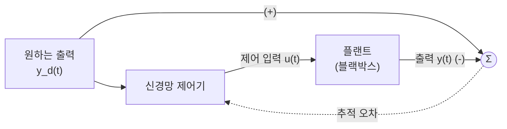

*그림 4. 직접 방식의 구조: 추적 오차로 신경망 제어기를 학습한다*

**추적 오차(tracking error)** 는 원하는 출력과 실제 출력의 차이 $e(t) = y_d(t) - y(t)$이다. 제어기의 출력 $u$는 플랜트를 거친 뒤에야 $y$가 되므로, 추적 오차를 줄이도록 제어기의 가중치를 바꾸려면 $u$가 $y$에 미치는 영향을 알아야 한다. 이 정보를 데이터나 수학적 모델에서 얻어야 하는 이유는 1.6절에서 다룬다. 직접 방식에는 모방 제어, 개루프 역 제어, 역 매핑, 역동역학이 있다.

### 1.5 모방 제어

**모방(emulation)을 이용한 제어**는 이미 잘 동작하는 제어기가 있을 때 그 제어기를 인공신경망으로 흉내 내는 방법이다. 기존 제어기와 신경망 $G$에 같은 기준 신호 $r$과 측정 상태 $x$를 넣고, 두 출력의 차이 $e$가 줄어들도록 신경망을 학습한다.

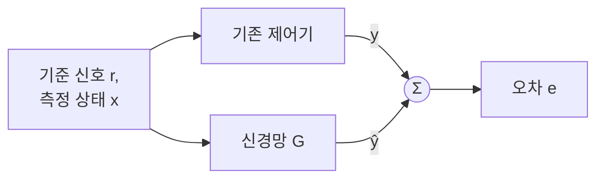

*그림 5. 모방 제어: 기존 제어기의 출력을 신경망이 흉내 내도록 학습한다*

여기서 $y$는 플랜트의 출력이 아니라 기존 제어기가 내는 제어 명령이고, $\hat{y}$는 신경망의 출력이며, 오차는 $e = y - \hat{y}$이다. 기존 제어기의 입력을 특성으로, 출력을 목표로 하는 지도 학습(12주차)과 같다. 이 방법은 제어기가 사람이고 그 작업을 자동화하려 할 때 유용하다. 예를 들어 숙련된 운전자가 공정을 조작할 때의 측정값과 조작량을 기록해 두면, 신경망이 그 조작을 흉내 내어 운전자를 대신할 수 있다. 다만 신경망은 기록된 상황 안에서만 운전자의 행동을 배우므로, 기록에 없는 상황에서의 동작은 보장되지 않고 원래 제어기보다 나은 성능도 기대하기 어렵다.

### 1.6 개루프 역 제어

**개루프 역 제어(open-loop inverse control)** 는 인공신경망 제어기로 제어할 플랜트의 역(inverse)을 근사하는 방법이다. 플랜트가 입력 $u$를 출력 $y = P(u)$로 보낼 때 제어기 $C$가 $P$의 역함수 $P^{-1}$에 가까우면, 기준 신호 $r$을 넣었을 때 $y = P(C(r)) \approx P(P^{-1}(r)) = r$이 되어 출력이 기준을 따른다.

제어기를 학습하려면 출력 오차가 제어기의 가중치 $w$에 따라 어떻게 변하는지 알아야 한다. 오차 함수를 $E = \frac{1}{2}(r - y)^2$로 두면 연쇄 법칙으로

$$
\frac{\partial E}{\partial w} = \frac{\partial E}{\partial y}\cdot\frac{\partial y}{\partial u}\cdot\frac{\partial u}{\partial w} = -(r - y)\cdot\frac{\partial y}{\partial u}\cdot\frac{\partial u}{\partial w}
$$

이다. $\partial u/\partial w$는 제어기 신경망의 역전파로 구할 수 있지만, 가운데 인수 $\partial y/\partial u$는 실제 플랜트의 성질이므로 알 수 없다. 그래서 먼저 **플랜트 에뮬레이터(plant emulator)**, 즉 신경망 플랜트 모델 $\hat{y} = \hat{P}(u)$를 만들고, 오차를 이 모델을 거쳐 거꾸로 전파하여 $\partial y/\partial u \approx \partial\hat{y}/\partial u$로 제어기의 매개변수를 학습한다.

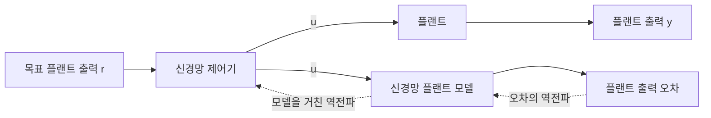

*그림 6. 플랜트 모델을 거쳐 출력 오차를 제어기로 역전파하는 개루프 역 제어의 학습*

> **[미적분학]** 연쇄 법칙(chain rule)은 합성함수의 도함수가 각 단계 도함수의 곱이라는 법칙이다. $E$는 $y$를 거쳐, $y$는 $u$를 거쳐 $w$에 의존하므로 $\partial E/\partial w$는 세 도함수의 곱이 된다. 플랜트 모델은 이 곱의 가운데 인수 $\partial y/\partial u$를 미분할 수 있는 신경망으로 대신하는 역할을 한다.

인공신경망은 기준 신호 $r$ 쪽으로 시스템 출력 $y$를 이끄는 입력 $u$를 찾는 방법을 학습한다. 또한 신경망은 실제로 작동할 영역에서 학습해야 한다. 학습 데이터가 없는 영역에서는 신경망이 근사한 역이 맞는다는 보장이 없기 때문이다.

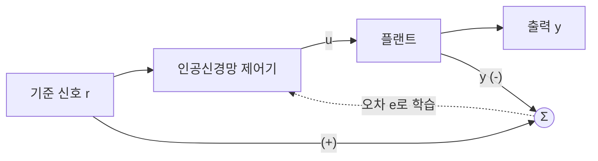

*그림 7. 기준 신호와 출력의 오차로 학습하는 역 제어기*

**예제: 정적 플랜트의 역 학습.** 플랜트와 그 모델이 모두 $\hat{y} = 2u$인 정적 시스템이고, 제어기는 가중치 하나인 $u = wr$이라 하자. 기준 $r = 1$, 학습률 $\eta = 0.1$, 초기 가중치 $w = 0.3$에서 시작한다. 연쇄 법칙의 세 인수는 $\partial E/\partial \hat{y} = -(r - \hat{y}) = -e$, $\partial\hat{y}/\partial u = 2$, $\partial u/\partial w = r$이므로

$$
\frac{\partial E}{\partial w} = -e \cdot 2 \cdot r = -2er, \qquad w \leftarrow w - \eta\frac{\partial E}{\partial w} = w + 0.2\,e
$$

이다. 이를 반복하면 표 2와 같다.

| 반복 | $w$ | $u = wr$ | $\hat{y} = 2u$ | $e = r - \hat{y}$ | $\partial E/\partial w$ | 새 $w$ |
|:-----|:-----|:-----|:-----|:-----|:-----|:-----|
| 0 | 0.3000 | 0.3000 | 0.6000 | 0.4000 | $-0.8000$ | 0.3800 |
| 1 | 0.3800 | 0.3800 | 0.7600 | 0.2400 | $-0.4800$ | 0.4280 |
| 2 | 0.4280 | 0.4280 | 0.8560 | 0.1440 | $-0.2880$ | 0.4568 |
| 3 | 0.4568 | 0.4568 | 0.9136 | 0.0864 | $-0.1728$ | 0.4741 |

*표 2. 정적 플랜트의 역 제어기를 경사 하강법으로 학습하는 과정*

한 번 갱신할 때마다 $e$는 $1 - 2(w + 0.2e) = e - 0.4e = 0.6e$로 줄어들므로, $w$는 플랜트 이득 2의 역수인 0.5로 수렴한다. 이때 $u = 0.5r$, $y = 2u = r$이 되어 제어기가 플랜트의 역이 된다.

> **주의:** 개루프 역 제어는 출력을 되먹임하지 않으므로 외란이나 모델 오차를 보정하지 못한다. 또한 여러 입력이 같은 출력을 내어 플랜트의 역이 하나로 정해지지 않거나, 전달함수의 영점이 우반평면에 있어 역 시스템이 불안정하면 이 방법을 그대로 쓸 수 없다.

### 1.7 역 매핑

**역 매핑(inverse mapping)** 은 특정 출력으로 이어질 수 있는 입력을 도출하는 방법이다. 1.3절처럼 입력 $x$에서 출력 $y$를 계산하는 신경망 $y = f(x)$가 주어졌을 때, 거꾸로 출력이 원하는 값이 되는 입력을 구한다.

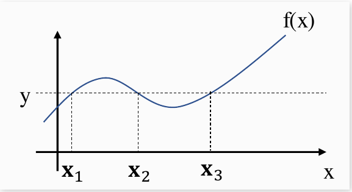

*그림 8. 같은 출력 y를 내는 서로 다른 세 입력*

그림 8의 $f$는 일대일 함수가 아니어서, 높이 $y$의 수평선이 곡선과 세 점에서 만나고 세 입력 $x_1$, $x_2$, $x_3$이 모두 같은 출력을 낸다. 이처럼 역은 하나로 정해지지 않을 수 있으며, 신경망은 보통 식으로 역함수를 구할 수 없으므로 수치적으로 찾는다. 신경망이 주어졌을 때의 역 매핑 절차는 다음과 같다.

1. 설계 공간(입력이 가질 수 있는 범위)에서 입력 표본의 모집단을 만든다.
2. 인공신경망으로 모집단의 출력값을 얻는다.
3. 의도한 출력 $y$를 만족하는 입력 표본을 찾는다.

**예제: 25 °C를 만드는 제어 조치 찾기.** 1.3절의 실내 온도 문제에서, 실내 온도를 25 °C로 만드는 밸브와 창문의 개도를 찾는다.

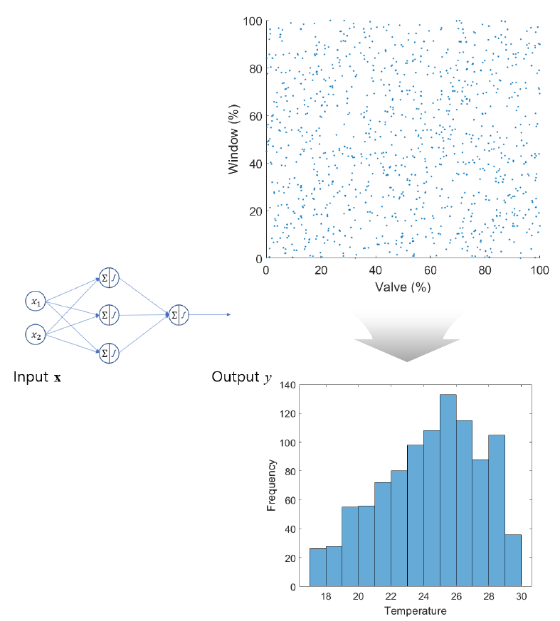

*그림 9. 0~100% 범위에서 무작위로 뽑은 밸브와 창문 개도의 표본과 신경망이 예측한 온도의 히스토그램*

그림 9의 위쪽은 설계 공간 $[0, 100] \times [0, 100]$에서 균등하게 뽑은 입력 표본이고, 아래쪽은 그 표본을 신경망에 넣어 얻은 예측 온도의 히스토그램이다. 예측 온도는 약 17\~30 °C에 퍼져 있고 24\~29 °C 부근에 많다. 이 절차를 MATLAB으로 구현한 코드는 다음과 같다.

```matlab
%% prediction (inverse)

input = 100*rand(10^6,2);
output = net(input');

temperature = 25;
selected_id = find(abs(output-temperature)<0.00001);

input(selected_id,:)
output(selected_id)
```

- `%% prediction (inverse)`: `%%`로 시작하는 줄은 MATLAB 스크립트를 코드 섹션으로 나누는 주석이다.
- `input = 100*rand(10^6,2);`: `rand(10^6,2)`는 0과 1 사이의 균등 난수로 된 $10^6$행 2열 행렬을 만들고, 여기에 100을 곱해 밸브와 창문 개도를 0\~100%에서 무작위로 고른 $10^6$개의 표본을 만든다(1단계).
- `output = net(input');`: 표본을 열 방향으로 바꾸어 신경망에 넣고 1행 $10^6$열의 예측 온도를 얻는다(2단계).
- `temperature = 25;`: 목표 온도이다.
- `selected_id = find(abs(output-temperature)<0.00001);`: 예측 온도와 목표의 차이의 절댓값이 $10^{-5}$보다 작은 표본의 번호를 찾는다(3단계). 연속값이 정확히 25가 될 확률은 0이므로 허용 오차를 둔다.
- `input(selected_id,:)`, `output(selected_id)`: 고른 표본의 입력(제어 조치)과 그 예측 온도를 출력한다.

| 번호 | 밸브 (%) | 창문 (%) | 예측 온도 (°C) |
|:-----|:-----|:-----|:-----|
| 1 | 62.3687 | 89.8677 | 25.0000 |
| 2 | 59.2480 | 60.4150 | 25.0000 |
| 3 | 56.9321 | 94.5670 | 25.0000 |
| 4 | 71.1097 | 70.7905 | 25.0000 |

*표 3. 역 매핑으로 찾은 25 °C의 제어 조치*

서로 다른 네 조합이 모두 25 °C를 낸다. 그림 8처럼 해가 여럿이므로 다른 기준으로 하나를 고른다. 예를 들어 난방비를 줄이려면 밸브 개도가 가장 작은 3번을, 아래 주의 상자처럼 신뢰할 수 있는 해만 쓰려면 학습 데이터 범위 안에 있는 2번이나 4번을 고른다. 허용 오차를 줄이면 더 정확하지만 찾는 해가 적어지고, 늘리면 후보가 많아지는 대신 목표에서 조금 벗어난 해도 섞인다.

> **주의:** 표 1의 학습 데이터에서 창문 개도는 20\~80% 범위에만 있다. 1번과 3번 해는 창문 개도가 80%를 넘으므로 학습 데이터 밖에서 신경망을 **외삽(extrapolation)** 한 결과이고, 그 예측을 그대로 믿기 어렵다. 역 매핑의 설계 공간은 학습 데이터가 덮는 범위로 제한하는 편이 안전하다.

> **참고:** 표 3과 그림 9는 1.3절에 적은 가중치와 다른 학습 결과의 신경망에서 얻은 것이다. 1.3절의 가중치로 계산하면 표 3의 네 조합의 예측 온도는 차례로 약 24.23, 24.99, 24.06, 25.45 °C이고, 설계 공간 전체에서 예측 온도는 약 18\~28 °C에 퍼진다. 신경망의 학습 결과는 가중치의 초깃값과 데이터 분할에 따라 달라지므로, 역 매핑으로 찾는 해도 학습한 신경망마다 다르다. 역 매핑은 반드시 실제로 제어에 쓸 바로 그 신경망으로 수행해야 한다.

### 1.8 역동역학

정적 함수 $y = f(x)$의 역은 출력에서 입력을 구하는 $f^{-1}(y) = x$이다. 동적 시스템에서는 출력이 현재 입력뿐 아니라 현재 상태에도 의존하므로, 역도 상태를 함께 써야 한다. 이산 시간 시스템에서 상태 $\mathbf{x}(k)$와 입력 $u(k)$가 다음 상태를 정한다고 하자.

$$
\mathbf{x}(k+1) = F\big(\mathbf{x}(k), u(k)\big)
$$

**역동역학(inverse dynamics)** 은 이 관계를 거꾸로 써서, 시스템의 출력(다음 상태)으로부터 그 출력을 만든 입력을 역으로 추정하는 것이다.

$$
u(k) = F^{-1}\big(\mathbf{x}(k), \mathbf{x}(k+1)\big)
$$

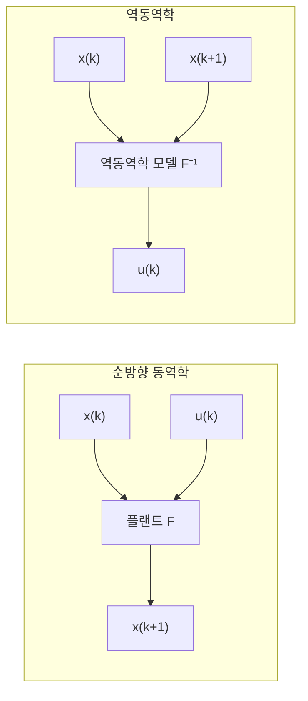

*그림 10. 순방향 동역학 모델과 역동역학 모델의 입력과 출력*

역동역학 모델은 지도 학습으로 얻는다. 플랜트에 다양한 입력을 가해 $(\mathbf{x}(k), u(k), \mathbf{x}(k+1))$의 묶음을 기록한 뒤, $\mathbf{x}(k)$와 $\mathbf{x}(k+1)$을 신경망의 입력으로, $u(k)$를 목표로 학습한다. 학습한 모델을 제어기로 쓸 때는 $\mathbf{x}(k+1)$ 자리에 원하는 다음 상태 $\mathbf{x}_d(k+1)$을 넣어 $u(k) = F^{-1}(\mathbf{x}(k), \mathbf{x}_d(k+1))$을 플랜트에 가한다. 2.1절에서 구체적인 예를 계산한다.

---

<br>

## 2. 인공신경망 제어기 I: 역동역학 제어와 신경망 예측 제어

### 2.1 역동역학 예제

차수가 $n = 3$이고 상태가 $\mathbf{x} = [x_1, x_2, x_3]^T$인 다음 선형 시스템의 역동역학을 구한다.

$$
\dot{\mathbf{x}} = \mathbf{A}\mathbf{x} + \mathbf{B}u, \qquad \mathbf{A} = \begin{bmatrix} 0 & 1 & 0 \\ 0 & 0 & 1 \\ -5 & -2 & -3 \end{bmatrix}, \qquad \mathbf{B} = \begin{bmatrix} 0 \\ 0 \\ 9 \end{bmatrix}
$$

6주차의 상태 변수 방정식을 성분별로 쓰면 다음과 같다.

$$
\dot{x}_1 = x_2, \qquad \dot{x}_2 = x_3, \qquad \dot{x}_3 = -5x_1 - 2x_2 - 3x_3 + 9u
$$

출력을 $y = x_1$로 두면 $x_2 = \dot{y}$, $x_3 = \ddot{y}$이므로 셋째 식은 $\dddot{y} + 3\ddot{y} + 2\dot{y} + 5y = 9u$이고, 초기 조건이 0일 때의 전달함수는 $G(s) = 9/(s^3 + 3s^2 + 2s + 5)$이다. $\mathbf{A}$처럼 대각선 위에 1이 놓이고 마지막 행에 특성방정식의 계수가 부호를 바꾸어 놓인 형태를 **동반 형식(companion form)** 이라 한다. 특성방정식 $s^3 + 3s^2 + 2s + 5 = 0$의 Routh 표(9주차)는 첫 열이 $1$, $3$, $(3 \cdot 2 - 1 \cdot 5)/3 = 1/3$, $5$로 모두 양수이므로 이 시스템은 안정하며, 극점은 $-2.904$와 $-0.048 \pm j1.311$이다.

$\mathbf{B} = [0, 0, 9]^T$이므로 입력 $u$는 셋째 식에만 들어 있다. 셋째 식을 $u$에 대해 풀면 연속 시간의 역동역학을 얻는다.

$$
u = \frac{\dot{x}_3 + 5x_1 + 2x_2 + 3x_3}{9}
$$

샘플링 간격 $T$로 이산화할 때 도함수를 전진 차분 $\dot{\mathbf{x}} \approx (\mathbf{x}(k+1) - \mathbf{x}(k))/T$로 근사하면(오일러 방법) $\mathbf{x}(k+1) \approx \mathbf{x}(k) + T[\mathbf{A}\mathbf{x}(k) + \mathbf{B}u(k)]$이고, 셋째 성분은

$$
x_3(k+1) = x_3(k) + T\big[-5x_1(k) - 2x_2(k) - 3x_3(k) + 9u(k)\big]
$$

이다. 이를 $u(k)$에 대해 풀면 이산 시간의 역동역학 모델이 된다.

$$
u(k) = \frac{1}{9}\left[\frac{x_3(k+1) - x_3(k)}{T} + 5x_1(k) + 2x_2(k) + 3x_3(k)\right]
$$

**순방향 계산.** $T = 0.1$, $\mathbf{x}(k) = [1, 2, -1]^T$, $u(k) = 2$이면

$$
\mathbf{A}\mathbf{x}(k) + \mathbf{B}u(k) = \begin{bmatrix} 2 \\ -1 \\ -5(1) - 2(2) - 3(-1) + 9(2) \end{bmatrix} = \begin{bmatrix} 2 \\ -1 \\ 12 \end{bmatrix}, \qquad \mathbf{x}(k+1) = \begin{bmatrix} 1 + 0.1(2) \\ 2 + 0.1(-1) \\ -1 + 0.1(12) \end{bmatrix} = \begin{bmatrix} 1.2 \\ 1.9 \\ 0.2 \end{bmatrix}
$$

이다. **역방향 계산.** 이번에는 $\mathbf{x}(k)$와 $\mathbf{x}(k+1)$만 알고 입력을 추정한다.

$$
u(k) = \frac{1}{9}\left[\frac{0.2 - (-1)}{0.1} + 5(1) + 2(2) + 3(-1)\right] = \frac{12 + 6}{9} = 2
$$

입력 2가 정확히 복원된다. **제어기로 쓰기.** 같은 상태에서 다음 시각에 $x_3$을 0으로 만들고 싶으면 $x_3(k+1)$ 자리에 원하는 값 0을 넣는다.

$$
u(k) = \frac{1}{9}\left[\frac{0 - (-1)}{0.1} + 6\right] = \frac{16}{9} \approx 1.778
$$

한 단계에서 입력으로 바꿀 수 있는 것은 $x_3$뿐이다. $x_1(k+1) = x_1(k) + Tx_2(k) = 1.2$와 $x_2(k+1) = x_2(k) + Tx_3(k) = 1.9$는 $u$와 관계없이 현재 상태로 정해지므로, 원하는 다음 상태는 이 두 값과 모순되지 않게 정해야 한다. 이 예의 역동역학은 $(\mathbf{x}(k), x_3(k+1))$의 선형 함수이므로 선형 뉴런 하나로도 학습할 수 있다. 3.5절의 로봇 팔처럼 플랜트가 비선형이면 역동역학도 비선형이 되므로, 기록한 데이터로 다층 신경망을 학습하여 근사한다.

> **참고:** 오일러 방법은 근사이다. 입력이 샘플링 구간 동안 일정하다고 보는 영차 유지(zero-order hold)로 정확히 이산화하면 $\mathbf{x}(k+1) = \mathbf{\Phi}\mathbf{x}(k) + \mathbf{\Gamma}u(k)$, $\mathbf{\Phi} = e^{\mathbf{A}T}$, $\mathbf{\Gamma} = \int_0^T e^{\mathbf{A}\tau}d\tau\,\mathbf{B}$이고, $T = 0.1$에서 $\mathbf{\Gamma} \approx [0.00139, 0.04075, 0.77479]^T$이다. 이 경우 입력은 세 상태에 모두 영향을 주며, 역동역학은 아래의 최소제곱 해로 구한다.

> **[선형대수학]** $\mathbf{\Gamma}u = \mathbf{x}(k+1) - \mathbf{\Phi}\mathbf{x}(k)$는 미지수가 하나이고 식이 셋인 연립방정식이다. 잔차의 제곱합 $\lVert \mathbf{x}(k+1) - \mathbf{\Phi}\mathbf{x}(k) - \mathbf{\Gamma}u \rVert^2$을 최소로 하는 최소제곱 해는 $u = (\mathbf{\Gamma}^T\mathbf{\Gamma})^{-1}\mathbf{\Gamma}^T\big(\mathbf{x}(k+1) - \mathbf{\Phi}\mathbf{x}(k)\big)$이며, $\mathbf{x}(k+1)$이 실제로 이 시스템에서 나온 값이면 잔차가 0이 되어 입력이 정확히 복원된다.

### 2.2 피드백 제어

피드백을 고려하면 신경망 시스템도 기존 제어에서와 비슷한 목표와 비용 함수로 학습할 수 있다. 다만 기존 제어 이론에서는 해를 식으로 구하는 경우가 많은 데 비해, 신경망의 해는 반복적인 학습으로 얻는 근사해이다. 그림 11은 플랜트를 추정하면서 제어기를 다시 설계하는 피드백 제어 구조이다.

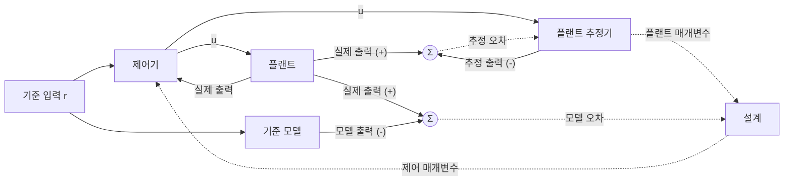

*그림 11. 플랜트 추정기와 기준 모델을 쓰는 피드백 제어 구조*

- **기준 모델(reference model)** 은 기준 입력 $r$에 대해 바라는 응답(모델 출력)을 만든다.
- **제어기**는 $r$과 플랜트의 실제 출력을 받아 입력 $u$를 낸다. 실제 출력을 되먹임하므로 피드백 제어기이다.
- **플랜트 추정기(plant estimator)** 는 플랜트와 같은 $u$를 받아 출력을 추정하고, 실제 출력과의 차이(추정 오차)로 자신의 매개변수를 갱신한다. 이것은 1.2절의 시스템 식별이다.
- **설계(design)** 블록은 추정한 플랜트 매개변수와 모델 오차(실제 출력과 모델 출력의 차이)를 써서 제어기의 매개변수를 다시 계산한다.

추정과 설계가 운전 중에 계속 되풀이되므로 이 구조는 플랜트가 바뀌어도 제어기가 따라가는 적응 제어이다. 플랜트 추정기나 제어기를 신경망으로 만들면 설계 단계는 신경망의 학습이 된다.

### 2.3 대표적인 세 신경망 제어기와 두 단계

인공신경망은 제어시스템의 식별에 성공적으로 적용되어 왔으며, 잘 알려진 일반적인 인공신경망 제어기에는 다음 세 가지가 있다[6], [7].

1. 신경망 예측 제어(neural network predictive control)
2. NARMA-L2 제어(NARMA-L2 control)
3. 모델 기준 제어(model reference control)

제어에 인공신경망을 쓸 때는 두 단계를 거친다.

- **시스템 식별(system identification):** 제어하려는 플랜트의 인공신경망 모델을 만든다. 이 단계는 세 제어기에서 같다[6].
- **제어기 설계(control design):** 인공신경망 플랜트 모델을 써서 제어기를 설계하거나 학습한다. 이 단계는 제어기마다 다르다.

세 제어기와 이 노트의 세 응용 예(연속 교반 탱크 반응기, 자기 부상 시스템, 로봇 팔)는 Hagan, Demuth, De Jesús의 해설 논문[7]에서 함께 다룬다. 2절의 나머지는 신경망 예측 제어를, 3절은 NARMA-L2 제어와 모델 기준 제어를 다룬다.

### 2.4 신경망 예측 제어의 시스템 식별

**신경망 예측 제어(neural network predictive control)** 는 비선형 플랜트의 신경망 모델로 미래의 플랜트 성능을 예측하는 제어 방법이며[8], 다음 세 단계로 이루어진다.

1. 신경망 플랜트 모델을 정한다(시스템 식별).
2. 제어기는 플랜트 모델을 써서 미래 성능을 예측한다.
3. 제어기는 지정한 미래 기간 동안의 플랜트 성능을 최적화하는 제어 입력을 계산한다.

시스템 식별 단계에서는 플랜트의 순방향 동역학을 나타내도록 인공신경망을 학습한다. 플랜트 출력과 인공신경망 출력 사이의 예측 오차가 신경망의 학습 신호로 쓰이며, 신경망 플랜트 모델은 이전 입력과 이전 플랜트 출력으로 플랜트 출력의 미래 값을 예측한다. 비선형 시스템의 식별에는 다음 **NARMA(nonlinear autoregressive-moving average) 모델**을 쓴다.

$$
y(k+d) = N\big[y(k), y(k-1), \ldots, y(k-n+1), u(k), u(k-1), \ldots, u(k-m+1)\big]
$$

- **자기회귀(autoregressive):** 다음 출력이 자신의 과거 출력 $y(k), \ldots, y(k-n+1)$에 의존한다.
- **이동 평균(moving average):** 다음 출력이 과거 입력 $u(k), \ldots, u(k-m+1)$에 의존한다.
- **비선형(nonlinear):** 둘을 묶는 함수 $N$이 비선형이며, 인공신경망이 이 $N$을 근사한다.
- $d \ge 1$은 입력이 출력에 영향을 주기까지 걸리는 샘플 수이고, $n$과 $m$은 모델에 넣는 과거 출력과 과거 입력의 개수이다.

$N$이 선형이면 이 모델은 $y(k+1) = a_1y(k) + \cdots + a_ny(k-n+1) + b_1u(k) + \cdots + b_mu(k-m+1)$ 꼴의 차분방정식이 되며, 이는 전달함수 모델의 이산 시간 판이다. NARMA 모델은 이 선형 관계를 비선형으로 일반화한 것이다.

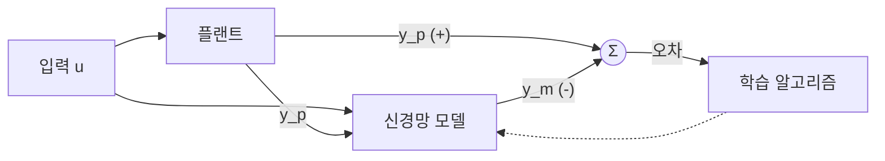

*그림 12. 신경망 예측 제어를 위한 플랜트 식별*

그림 12에서 신경망 모델은 자신의 예측값 $y_m$이 아니라 실제 플랜트 출력 $y_p$의 과거 값을 입력으로 받는다. 이런 식별 구조를 **직렬-병렬(series-parallel) 구조**라 한다[2]. 모델의 입력이 모두 측정값이므로 식별은 정적인 지도 학습 문제가 되고, 미리 기록한 데이터로 오프라인에서 일괄 학습할 수 있다[8].

### 2.5 예측 제어와 성능 지표

예측 제어는 **이동 구간(receding horizon)** 방식에 기반한다[8]. 신경망 모델은 지정한 기간 동안의 플랜트 응답을 예측하고, 수치 최적화 프로그램은 그 예측을 써서 다음 **성능 지표(performance index)** $J$를 최소로 하는 제어 신호를 정한다.

$$
J = \sum_{j=N_1}^{N_2}\big(y_r(k+j) - y_m(k+j)\big)^2 + \rho\sum_{j=1}^{N_u}\big(u'(k+j-1) - u'(k+j-2)\big)^2
$$

- $N_1$, $N_2$, $N_u$는 추적 오차와 제어 증분을 평가하는 구간을 정한다. 추적 오차는 $N_1$에서 $N_2$까지의 미래 시각에서 평가하며(MATLAB의 구현에서는 $N_1 = 1$로 고정한다[8]), $N_u$는 입력을 바꿀 수 있는 제어 구간으로, 그 뒤에는 입력의 증분을 0으로 보아 입력을 유지한다.
- $u'$은 **잠정 제어 신호(tentative control signal)** 이다. 최적화가 시험하는 후보 입력이며, 최적화가 끝나기 전까지는 플랜트에 가하지 않는다.
- $y_r$은 원하는 응답이고 $y_m$은 신경망 모델의 응답이다.
- $\rho$는 제어 증분의 제곱합이 성능 지표에 기여하는 정도를 정한다. $\rho$가 클수록 입력을 급하게 바꾸는 데 큰 벌점이 붙는다.

첫째 항은 미래의 추적 오차를, 둘째 항은 입력의 변화량을 벌한다. 최적화는 매 샘플마다 $u'(k), \ldots, u'(k+N_u-1)$을 구하지만 그 가운데 첫 입력 $u(k) = u'(k)$만 플랜트에 가한다. 다음 샘플에서는 새로 측정한 출력으로 예측 구간을 한 칸 옮겨 같은 최적화를 되풀이한다. 이처럼 예측 구간이 시간과 함께 앞으로 이동하므로 이동 구간 방식이라 하며, 매번 새 측정값에서 다시 출발하므로 모델 오차와 외란이 피드백으로 보정된다.

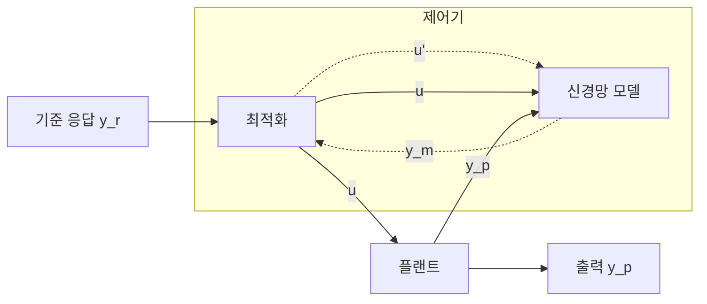

*그림 13. 신경망 예측 제어의 구조*

**예제: 성능 지표의 최소화.** 계산을 손으로 따라갈 수 있도록 신경망 모델 대신 선형 모델 $y_m(k+1) = 0.5\,y(k) + u(k)$를 쓴다. 현재 출력 $y(k) = 0$, 직전 입력 $u(k-1) = 0$, 원하는 응답 $y_r = 1$(일정)이고 $N_1 = 1$, $N_2 = 2$, $N_u = 1$이다. $N_u = 1$이므로 $u'(k+1) = u'(k)$이고, 최적화할 변수는 $u = u'(k)$ 하나뿐이다.

1단계(예측): $y_m(k+1) = 0.5(0) + u = u$이고, $y_m(k+2) = 0.5\,y_m(k+1) + u'(k+1) = 0.5u + u = 1.5u$이다.

2단계(성능 지표): 증분 항은 $j = 1$인 $(u'(k) - u(k-1))^2 = u^2$ 하나이다.

$$
J(u) = (1 - u)^2 + (1 - 1.5u)^2 + \rho\,u^2
$$

3단계(최소화): 도함수를 0으로 놓는다.

$$
\frac{dJ}{du} = -2(1 - u) - 3(1 - 1.5u) + 2\rho u = (6.5 + 2\rho)u - 5 = 0 \quad\Longrightarrow\quad u^* = \frac{5}{6.5 + 2\rho}
$$

이차 도함수 $6.5 + 2\rho$가 양수이므로 $u^*$는 최소점이다. $\rho$에 따른 결과는 표 4와 같다.

| $\rho$ | $u^*$ | $y_m(k+1)$ | $y_m(k+2)$ | 추적 오차 항 | 증분 항 | $J$ |
|:-----|:-----|:-----|:-----|:-----|:-----|:-----|
| 0 | 0.7692 | 0.7692 | 1.1538 | 0.0769 | 0 | 0.0769 |
| 0.1 | 0.7463 | 0.7463 | 1.1194 | 0.0786 | 0.0557 | 0.1343 |
| 1 | 0.5882 | 0.5882 | 0.8824 | 0.1834 | 0.3460 | 0.5294 |

*표 4. 제어 가중치에 따른 예측 제어의 최적 입력과 성능 지표*

$\rho$가 커질수록 최적 입력이 작아져 입력 변화가 부드러워지는 대신 추적 오차 항이 커진다. $\rho = 0$에서도 $J$가 0이 되지 않는 것은 자유 변수 하나로 두 시각의 오차를 모두 없앨 수 없기 때문이다. 이렇게 구한 $u^*$만 플랜트에 가하고, 다음 샘플에서 새 출력으로 같은 계산을 되풀이한다. 실제 신경망 모델은 비선형이므로 $J$가 이차식이 아니고, 매 샘플마다 반복적인 수치 최적화로 $u'$을 찾아야 한다. 그래서 신경망 예측 제어는 온라인 계산량이 많다.

### 2.6 응용: 연속 교반 탱크 반응기

**촉매 연속 교반 탱크 반응기(continuous stirred tank reactor, CSTR)** 는 원료를 계속 넣고 생성물을 계속 빼내면서 내용물을 고르게 섞어 반응시키는 장치이다. 동적 모델이 다음과 같이 주어지고, 제어기의 목적은 유량 $w_2(t)$를 조정하여 제품 농도 $C_b(t)$를 유지하는 것이다.

$$
\frac{dh(t)}{dt} = w_1(t) + w_2(t) - 0.2\sqrt{h(t)}
$$

$$
\frac{dC_b(t)}{dt} = \big(C_{b1} - C_b(t)\big)\frac{w_1(t)}{h(t)} + \big(C_{b2} - C_b(t)\big)\frac{w_2(t)}{h(t)} - \frac{k_1C_b(t)}{\big(1 + k_2C_b(t)\big)^2}
$$

- $h(t)$: 액체 수위(제어하지 않음)
- $C_b(t)$: 공정 출력에서의 제품 농도
- $w_1(t)$: 농도 $C_{b1}$인 공급 원료의 유입량($0.1\ \mathrm{cm^3/s}$)
- $w_2(t)$: 농도 $C_{b2}$인 공급 원료의 유입량
- 상수: $C_{b1} = 24.9$, $C_{b2} = 0.1$, $k_1 = 1$, $k_2 = 1$

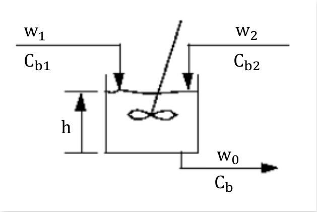

*그림 14. 연속 교반 탱크 반응기의 두 공급 흐름과 배출 흐름*

**모델의 유도.** 탱크의 단면적을 1로 두면 액체의 부피는 $h$이고, 내용물이 완전히 섞인다고 보면 배출 흐름의 농도는 탱크 안의 농도 $C_b$와 같다. 배출 유량은 수위의 제곱근에 비례하여 $w_0 = 0.2\sqrt{h}$이다. 부피의 수지(들어온 양에서 나간 양을 뺀 것이 늘어난 양)에서 첫째 식 $dh/dt = w_1 + w_2 - w_0$을 얻는다. 생성물의 양 $hC_b$의 수지는 반응으로 단위 부피당 $r(C_b) = k_1C_b/(1 + k_2C_b)^2$의 속도로 소모되는 것까지 포함하여

$$
\frac{d(hC_b)}{dt} = w_1C_{b1} + w_2C_{b2} - w_0C_b - h\,r(C_b)
$$

이다. 왼쪽을 곱의 미분으로 펼쳐 $h\,\dot{C}_b + C_b\,\dot{h}$로 쓰고 $\dot{h} = w_1 + w_2 - w_0$을 대입하면 $w_0C_b$ 항이 소거되어

$$
h\frac{dC_b}{dt} = w_1(C_{b1} - C_b) + w_2(C_{b2} - C_b) - h\,r(C_b)
$$

이 되고, 양변을 $h$로 나누면 둘째 식이 된다.

**예제: 정상 상태.** $w_1 = w_2 = 0.1$로 일정할 때의 정상 상태를 구한다. 첫째 식에서 $dh/dt = 0$이면 $0.2\sqrt{h} = 0.2$이므로 $h = 1$이다. 둘째 식에서 $dC_b/dt = 0$이면

$$
(24.9 - C_b)(0.1) + (0.1 - C_b)(0.1) = \frac{C_b}{(1 + C_b)^2} \quad\Longrightarrow\quad 2.5 - 0.2C_b = \frac{C_b}{(1 + C_b)^2}
$$

이다. 양변에 $(1 + C_b)^2$을 곱하면 삼차방정식이 되므로 수치적으로 풀면 $C_b \approx 12.15$이다(검산: 왼쪽 $2.5 - 2.430 = 0.070$, 오른쪽 $12.15/13.15^2 = 0.070$). 정상 상태를 구하는 데에도 비선형 방정식을 풀어야 할 만큼 이 플랜트는 비선형이다.

> **참고:** 이 응용은 $w_1 = 0.1$로 두고 묽은 원료의 유량 $w_2$를 조정하는 문제로 소개되기도 한다. 그러나 $w_2$를 늘리면 탱크가 묽어져, 정상 상태 농도는 위 예제의 $w_2 = 0.1$일 때 약 12.15이고 $w_2$가 커질수록 더 낮아진다. 아래 그림 16과 그림 18의 플랜트 출력은 20\~23 범위에 있으며, 이는 MATLAB 예제처럼 진한 원료의 유량 $w_1$을 조정하고 $w_2 = 0.1$로 고정한 구성에 해당한다[8]. 따라서 이후 그림의 플랜트 입력은 진한 원료의 유량으로 읽는 것이 맞다.

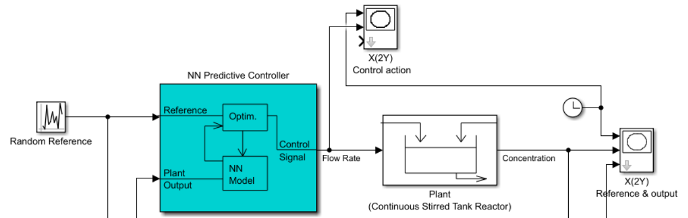

*그림 15. Simulink로 구성한 연속 교반 탱크 반응기의 신경망 예측 제어*

그림 15에서 Random Reference 블록이 무작위 계단 모양의 기준 농도를 만들고, NN Predictive Controller 블록이 기준(Reference)과 플랜트 출력(Plant Output)을 받아 제어 신호(Control Signal)를 낸다. 이 블록 안에는 최적화(Optim.)와 신경망 모델(NN Model)이 들어 있다. 제어 신호는 유량(Flow Rate)으로 플랜트(CSTR)에 들어가고, 플랜트는 농도(Concentration)를 내보낸다. X(2Y) 블록은 제어 동작과 기준 및 출력을 시간에 대해 그리는 그래프 창이다.

**학습 데이터.** 무작위 진폭과 지속 시간을 갖는 일련의 펄스로 이루어진 무작위 입력을 플랜트에 가해 학습 데이터를 만든다. 입력 유량의 진폭은 0\~4 $\mathrm{cm^3/s}$, 펄스 폭은 5\~20초이다.

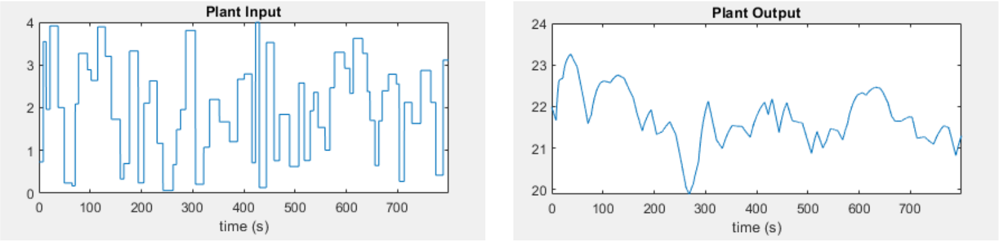

*그림 16. 연속 교반 탱크 반응기의 식별용 입력 데이터와 출력 데이터*

**신경망 플랜트 모델.** 입력 유량의 지연 값 3개($m = 3$)와 $C_b(t)$의 지연 값 3개($n = 3$)를 네트워크 입력으로 쓰고, 은닉층에는 뉴런 3개를 쓴다. 즉 입력 6개, 은닉 뉴런 3개, 출력 1개인 신경망이다. 학습 기록은 표 5와 같다.

| 항목 | 초깃값 | 멈춘 값 | 목표값 |
|:-----|:-----|:-----|:-----|
| 에포크 | 0 | 6 | 200 |
| 경과 시간 | - | 00:00:00 | - |
| 성능(MSE) | $1.95\times10^{-6}$ | $1.03\times10^{-6}$ | 0 |
| 기울기 | 0.0273 | 0.0185 | $10^{-10}$ |
| $\mu$ | 0.001 | $10^{-7}$ | $10^{10}$ |
| 검증 실패 횟수 | 0 | 6 | 6 |

*표 5. 연속 교반 탱크 반응기의 신경망 플랜트 모델 학습 기록*

데이터는 지정한 번호로 학습, 검증, 시험 구간을 나누는 방식(`divideind`)으로 분할했고, 학습 알고리즘은 Levenberg-Marquardt(`trainlm`), 성능 함수는 평균 제곱 오차(`mse`)이다. 표의 목표값 열은 학습을 멈추는 조건이다. `trainlm`은 에포크가 최댓값에 이르거나, 성능이 목표에 이르거나, 기울기가 최솟값보다 작아지거나, $\mu$가 최댓값을 넘거나, 검증 오차가 마지막으로 줄어든 뒤 늘어난 횟수가 정해진 값(`max_fail`, 기본값 6)에 이르면 멈춘다[9]. 여기서는 검증 실패 횟수가 6에 이르러 6 에포크에서 멈추었다.

Levenberg-Marquardt 알고리즘은 가중치 벡터 $\mathbf{w}$를 다음과 같이 갱신한다[9]. $\mathbf{J}_e$는 오차 벡터 $\mathbf{e}$를 가중치로 미분한 야코비 행렬이며, 2.5절의 성능 지표 $J$와는 다른 기호이다.

$$
\Delta\mathbf{w} = -\big(\mathbf{J}_e^T\mathbf{J}_e + \mu\mathbf{I}\big)^{-1}\mathbf{J}_e^T\mathbf{e}
$$

$\mu$가 작으면 이차 근사를 쓰는 Gauss-Newton 방법에 가까워져 최솟값 근처에서 빠르게 수렴하고, $\mu$가 크면 보폭이 작은 경사 하강법에 가까워져 안정적이다. 갱신으로 성능이 나빠지면 $\mu$를 10배씩 키워 다시 시도하고, 성능이 좋아지면 갱신을 받아들인 뒤 $\mu$를 0.1배로 줄인다[9]. 표 5에서 $\mu$가 0.001에서 $10^{-7}$로 줄어든 것은 갱신이 계속 성공하여 Gauss-Newton 방법에 가까워졌음을 뜻한다.

> **[기계학습]** 조기 종료(early stopping)는 학습 데이터와 별도로 떼어 둔 검증 데이터의 오차를 에포크마다 확인하다가, 검증 오차가 일정 횟수 연속으로 줄지 않으면 학습을 멈추는 정규화 기법이다. 학습 오차는 계속 줄어도 검증 오차가 늘기 시작하면 과적합이 시작된 것이므로, 그 직전의 가중치를 쓴다.

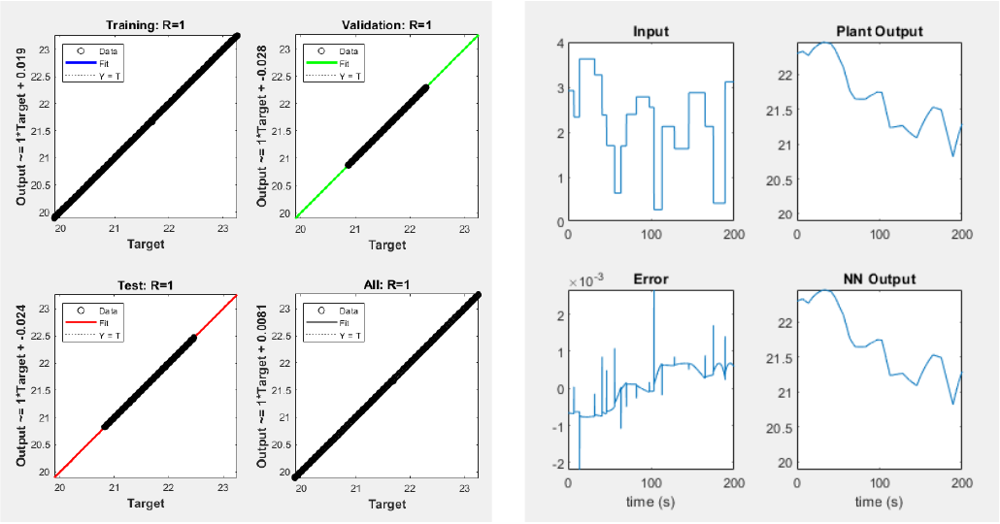

*그림 17. 학습, 검증, 시험 데이터에서 신경망 출력과 목표의 회귀 그림과 시험 데이터의 시간 응답*

그림 17의 왼쪽 네 회귀 그림은 가로축이 목표, 세로축이 신경망 출력이며, 학습, 검증, 시험, 전체 데이터에서 모두 $R = 1$(12주차의 R 값)이다. 맞춘 직선도 `Output ~= 1*Target + 0.019`처럼 기울기가 1이고 절편이 0에 가깝다. 오른쪽은 시험 데이터의 입력, 플랜트 출력, 신경망 출력, 오차이며, 플랜트 출력과 신경망 출력이 거의 같고 오차는 대부분 $\pm 2\times10^{-3}$ 안에 있다.

**제어 결과.** 제어기 매개변수는 $N_2 = 7$, $N_u = 3$, $\rho = 0.01$로 설정하고, 제어기의 샘플링 간격은 0.1초이다.

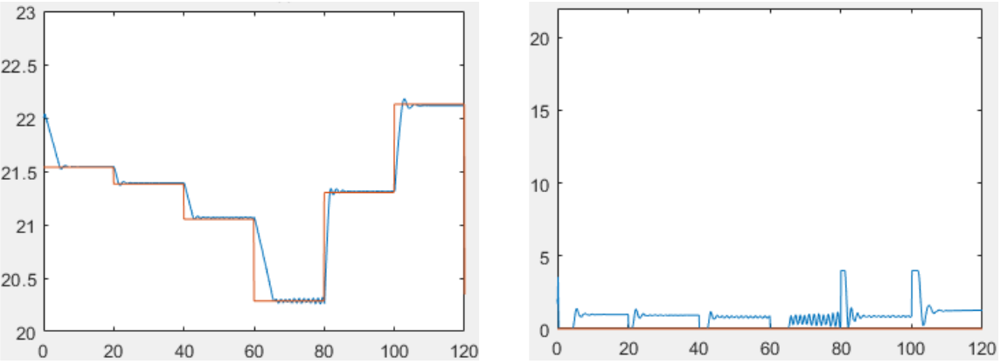

*그림 18. 신경망 예측 제어의 기준과 출력, 제어 동작*

그림 18의 왼쪽에서 주황색 기준은 20초마다 약 20.3\~22.1 사이의 값으로 바뀌고, 파란색 출력은 매번 빠르게 기준을 따라간다. 정상 상태 오차는 작으며 시험한 모든 영역에서 과도 성능이 적절하다. 오른쪽의 제어 동작은 대부분 0.5\~1.5 $\mathrm{cm^3/s}$ 범위에 있고, 기준이 올라가는 80초와 100초에서 잠깐 약 4까지 커진다. $\rho$로 입력 증분에 벌점을 주므로 제어 신호가 비교적 매끄럽다.

---

<br>

## 3. 인공신경망 제어기 II: NARMA-L2 제어와 모델 기준 제어

### 3.1 NARMA-L2 모델과 피드백 선형화

NARMA-L2 제어도 첫 번째 단계는 제어할 시스템을 식별하는 것이다. 2.4절의 NARMA 모델로 $y(k+d) = y_r(k+d)$가 되는 입력 $u(k)$를 구하려면 매 샘플마다 비선형 방정식 $N[\ldots, u(k), \ldots] = y_r(k+d)$를 풀어야 한다. 예측 제어처럼 반복 계산이 필요하므로, NARMA-L2는 플랜트 모델을 입력에 대해 풀기 쉬운 특정 형태로 근사한다.

> **용어 정의:** **피드백 선형화(feedback linearization)** 는 측정한 상태나 출력을 써서 플랜트의 비선형성을 상쇄하는 입력을 계산함으로써, 비선형 시스템의 동역학을 선형 동역학으로 바꾸는 제어 방법이다. 플랜트 모델이 특정 형태(동반 형식, companion form)를 가질 때 이 방법을 쓸 수 있다.

NARMA-L2 근사 모델은 다음과 같다[10], [11].

$$
\hat{y}(k+d) = f\big[y(k), \ldots, y(k-n+1), u(k-1), \ldots, u(k-m+1)\big] + g\big[y(k), \ldots, y(k-n+1), u(k-1), \ldots, u(k-m+1)\big]\cdot u(k)
$$

두 함수 $f$와 $g$는 과거 출력과 과거 입력에만 의존하고 다음 제어기 입력 $u(k)$를 포함하지 않는다. 즉 $u(k)$가 비선형 함수 안에 들어 있지 않고 $g$와 곱해질 뿐이므로, 출력은 $u(k)$에 대해 일차식이다. 이것이 NARMA-L2의 동반 형식이며, NARMA-L2는 Narendra와 Mukhopadhyay가 제안한 NARMA 모델의 근사 모델 가운데 하나이다[11]. 이 형태에서는 $\hat{y}(k+d) = y_r(k+d)$로 놓고 $u(k)$를 바로 풀 수 있다.

$$
u(k) = \frac{y_r(k+d) - f\big[y(k), \ldots, y(k-n+1), u(k-1), \ldots, u(k-m+1)\big]}{g\big[y(k), \ldots, y(k-n+1), u(k-1), \ldots, u(k-m+1)\big]}
$$

이 입력을 모델에 다시 넣으면 $\hat{y}(k+d) = f + g\cdot(y_r(k+d) - f)/g = y_r(k+d)$이다. $f$와 $g$가 아무리 비선형이어도 모델의 출력은 $\hat{y}(k+d) = y_r(k+d)$, 즉 $d$샘플 지연이라는 선형 관계가 되며, 모델이 플랜트를 정확히 근사할수록 실제 출력 $y(k+d)$도 이 관계에 가까워진다. $y_r$을 선형 기준 모델이 만들게 하면 전체 폐루프는 그 선형 기준 모델처럼 동작한다. 이것이 피드백 선형화의 핵심 아이디어인 비선형성의 제거이다.

**예제: 피드백 선형화 입력의 계산.** 플랜트가 이미 동반 형식인 $y(k+1) = 0.5\sin y(k) + \big(1 + 0.5\,y(k)^2\big)u(k)$라 하자($d = 1$). $f = 0.5\sin y(k)$, $g = 1 + 0.5\,y(k)^2$이며 $g \ge 1$이므로 분모가 0이 되지 않는다. 현재 출력 $y(k) = 1$에서 다음 출력을 $y_r(k+1) = 0.5$로 만들려면

$$
f = 0.5\sin 1 = 0.4207, \qquad g = 1 + 0.5(1)^2 = 1.5, \qquad u(k) = \frac{0.5 - 0.4207}{1.5} = 0.0528
$$

이고, 검산하면 $y(k+1) = 0.4207 + 1.5 \times 0.0528 = 0.5$이다.

**구현할 수 있는 형태.** 위 제어 법칙은 $u(k)$를 계산하는 데 같은 시각의 출력 $y(k)$가 필요하므로, 측정과 계산이 순간적으로 끝나야 한다는 구현상의 문제가 있다. 그래서 실제 구현에서는 $d \ge 2$인 다음 모델을 쓰고 한 샘플 뒤의 입력 $u(k+1)$을 계산한다[10].

$$
y(k+d) = f\big[y(k), \ldots, y(k-n+1), u(k), \ldots, u(k-n+1)\big] + g\big[y(k), \ldots, y(k-n+1), u(k), \ldots, u(k-n+1)\big]\cdot u(k+1)
$$

$$
u(k+1) = \frac{y_r(k+d) - f\big[y(k), \ldots, y(k-n+1), u(k), \ldots, u(k-n+1)\big]}{g\big[y(k), \ldots, y(k-n+1), u(k), \ldots, u(k-n+1)\big]}, \qquad d \ge 2
$$

> **용어 정의:** **탭 지연선(tapped delay line, TDL)** 은 입력 신호의 이전 값을 저장해 두었다가 현재와 과거의 값을 벡터로 한꺼번에 내보내는 블록이다. 신경망이 과거 입력과 과거 출력을 받을 수 있게 해 준다.

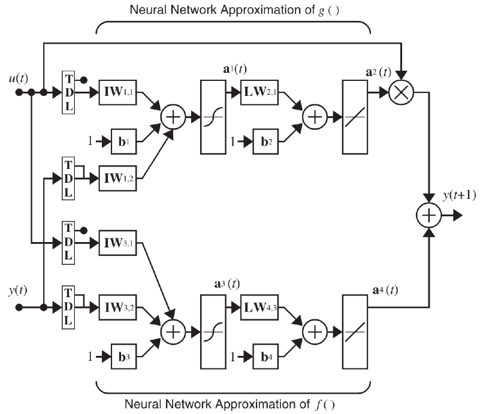

*그림 19. NARMA-L2 플랜트 모델: 위쪽 신경망이 g를, 아래쪽 신경망이 f를 근사한다*

그림 19에서 $t$는 이산 시각 $k$와 같은 뜻이고, $\mathbf{IW}$는 입력 가중치, $\mathbf{LW}$는 층 가중치, $\mathbf{b}$는 편향, $\mathbf{a}$는 층의 출력이다. 입력 $u(t)$와 출력 $y(t)$는 각각 TDL을 거쳐 두 부분 신경망에 들어가며, 식에 맞게 $u$ 쪽 TDL은 과거 입력을, $y$ 쪽 TDL은 현재와 과거 출력을 내보낸다. 위쪽 부분 신경망(1층과 2층)은 S자형 은닉층 $\mathbf{a}^1(t)$와 선형 출력층을 거쳐 $\mathbf{a}^2(t) \approx g$를 내고, 아래쪽 부분 신경망(3층과 4층)은 같은 구조로 $\mathbf{a}^4(t) \approx f$를 낸다. 마지막으로 곱셈 블록이 $\mathbf{a}^2(t)$와 $u(t)$를 곱하고 덧셈 블록이 $\mathbf{a}^4(t)$를 더해 $\hat{y}(t+1) = \mathbf{a}^4(t) + \mathbf{a}^2(t)\,u(t)$를 만든다.

### 3.2 NARMA-L2 제어기

플랜트 인공신경망 모델의 장점은 시스템 출력이 기준 신호 $y(k+d) = y_r(k+d)$를 따르도록 하는 제어 입력을 바로 제공할 수 있다는 것이다. NARMA-L2 제어기는 학습한 $f$와 $g$ 부분 신경망을 3.1절의 제어 법칙대로 재배열한 것이다.

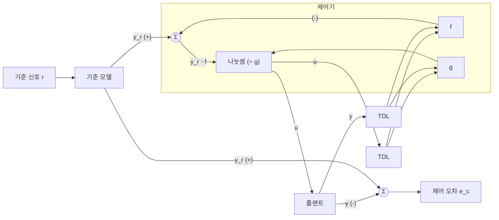

*그림 20. NARMA-L2 제어기의 구조*

기준 모델은 기준 신호 $r$에서 원하는 응답 $y_r$을 만든다. 제어기 안에서는 TDL이 저장한 과거 입력과 출력으로 $f$와 $g$를 계산하고, $y_r - f$를 $g$로 나누어 입력 $u$를 낸다. 별도의 제어기 신경망을 학습할 필요가 없고, 온라인에서는 두 부분 신경망의 순전파와 나눗셈만 하면 되므로 세 제어기 가운데 계산량이 가장 적다[6]. 다만 플랜트가 동반 형식이거나 그 형식으로 근사할 수 있을 때만 쓸 수 있다[6].

> **주의:** $g$가 0에 가까우면 나눗셈으로 입력이 매우 커지고, $g$의 추정 오차도 그만큼 크게 증폭된다. 실제 구현에서는 입력에 상한과 하한을 두므로, 계산한 입력이 그 한계에 자주 걸릴 수 있다.

### 3.3 응용: 자기 부상 시스템

**자기 부상 시스템(magnetic levitation system)** 의 목적은 전자석 위에 떠 있는 자석의 위치를 제어하는 것이다. 자석은 수직 방향으로만 움직일 수 있으며, 제어기의 샘플링 간격은 0.01초이다. 운동방정식은 다음과 같다.

$$
\frac{d^2y(t)}{dt^2} = -g + \frac{\alpha}{M}\frac{i^2(t)\,\mathrm{sgn}[i(t)]}{y(t)} - \frac{\beta}{M}\frac{dy(t)}{dt}
$$

- $y(t)$: 전자석 위에 있는 자석까지의 거리
- $i(t)$: 전자석에 흐르는 전류
- $M$: 자석의 질량(3)
- $g$: 중력가속도(9.8). 3.1절의 함수 $g$와는 다른 기호이다.
- $\alpha$: 전계 강도 상수(15)
- $\beta$: 점성 마찰 계수(12)

> **참고:** $\alpha$를 점성 마찰 계수, $\beta$를 전계 강도 상수로 반대로 적는 경우가 있다. 운동방정식에서 $\alpha$는 자기력 항에, $\beta$는 속도 항에 곱해지므로 $\alpha$가 전자석의 감은 횟수와 자석의 세기로 정해지는 전계 강도 상수이고, $\beta$가 자석이 움직이는 매질로 정해지는 점성 마찰 계수이다[10]. 수치(15와 12)는 그대로이다.

오른쪽의 세 항은 차례로 아래로 당기는 중력, 전류의 제곱에 비례하고 거리에 반비례하여 자석을 위로 미는 자기력, 속도에 비례하여 운동을 막는 마찰력을 단위 질량당 값으로 나타낸다. $\mathrm{sgn}[i(t)]$는 전류의 부호이며, 전류가 0\~4 A의 양수 범위에서만 쓰이므로 여기서는 1이다.

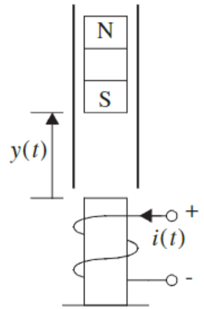

*그림 21. 자기 부상 시스템: 전자석과 그 위에 떠 있는 자석*

**예제: 평형 전류.** 자석을 $y = 2$에 정지시켜 두려면 $\ddot{y} = 0$, $\dot{y} = 0$이어야 한다. 운동방정식에 대입하면

$$
0 = -9.8 + \frac{15}{3}\cdot\frac{i^2}{2} \quad\Longrightarrow\quad 2.5\,i^2 = 9.8 \quad\Longrightarrow\quad i = \sqrt{3.92} = 1.980\ \mathrm{A}
$$

이다. 일반적으로 위치 $y$의 평형 전류는 $i = \sqrt{gMy/\alpha}$이고, 전류의 상한 4 A로 유지할 수 있는 가장 높은 위치는 $y = \alpha i^2/(Mg) = 15 \cdot 16/(3 \cdot 9.8) = 8.16$이다. 힘이 $i$가 아니라 $i^2$에 비례하므로, 출력이 현재 입력에 대해 일차식이라는 NARMA-L2의 가정은 이 플랜트에서 근사이다.

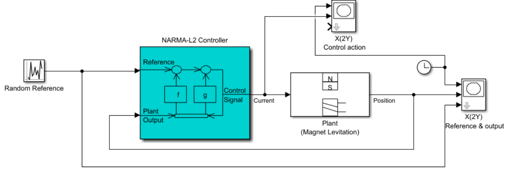

*그림 22. Simulink로 구성한 자기 부상 시스템의 NARMA-L2 제어*

그림 22의 NARMA-L2 Controller 블록 안에는 $f$와 $g$ 부분 신경망, 기준에서 $f$를 빼는 가합점, $g$로 나누는 블록이 있다. 제어 신호는 전류(Current)로 플랜트(Magnet Levitation)에 들어가고, 플랜트는 위치(Position)를 내보낸다.

**학습 데이터.** 무작위 진폭과 지속 시간을 갖는 펄스로 이루어진 무작위 입력을 가해 학습 데이터를 만든다. 전류 $i(t)$의 진폭은 0\~4 A, 펄스 폭은 0.01\~5초이다.

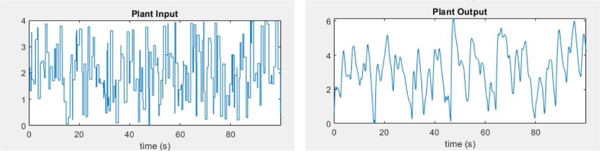

*그림 23. 자기 부상 시스템의 식별용 입력 데이터와 출력 데이터*

**신경망 플랜트 모델.** 지연된 전류 값 3개($m = 3$)와 지연된 자석 위치 2개($n = 2$)를 네트워크 입력으로 쓰고, 은닉층에는 뉴런 9개를 쓴다. 샘플링 간격은 0.01초이다. 학습 기록은 표 6과 같다.

| 항목 | 초깃값 | 멈춘 값 | 목표값 |
|:-----|:-----|:-----|:-----|
| 에포크 | 0 | 100 | 100 |
| 경과 시간 | - | 00:00:03 | - |
| 성능(MSE) | 0.16 | $2.63\times10^{-7}$ | 0 |
| 기울기 | 0.679 | $7.48\times10^{-4}$ | $10^{-10}$ |
| $\mu$ | 0.001 | $10^{-7}$ | $10^{10}$ |
| 검증 실패 횟수 | 0 | 0 | 6 |

*표 6. 자기 부상 시스템의 신경망 플랜트 모델 학습 기록*

데이터 분할은 `divideind`, 학습 알고리즘은 Levenberg-Marquardt(`trainlm`), 성능 함수는 `mse`이다. 이번에는 검증 실패 없이 에포크의 최댓값 100에 이르러 멈추었고, 그동안 성능이 0.16에서 $2.63\times10^{-7}$로 약 60만 분의 1로 줄었다.

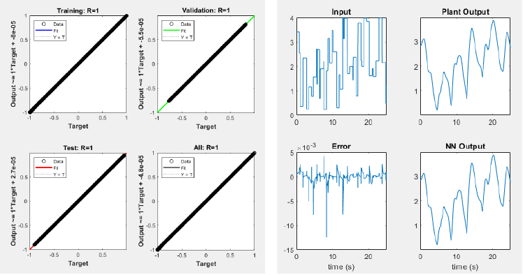

*그림 24. 자기 부상 시스템 플랜트 모델의 회귀 그림과 시험 데이터의 시간 응답*

그림 24의 회귀 그림은 스케일링한 단위($-1$\~$1$)로 그려져 있으며 네 데이터 집합에서 모두 $R = 1$이다. 시험 데이터에서 신경망 출력은 플랜트 출력과 거의 같고, 오차는 몇 번의 짧은 튐을 빼면 대부분 $\pm 5\times10^{-3}$ 안에 있다.

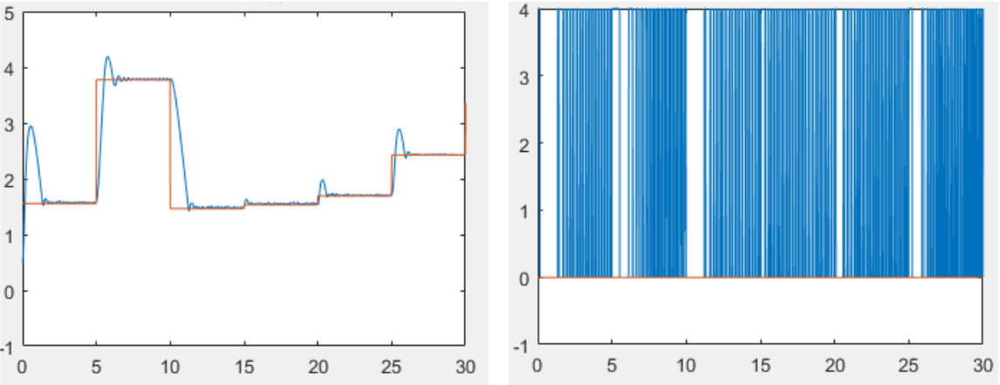

*그림 25. NARMA-L2 제어의 기준과 출력, 제어 동작*

그림 25의 왼쪽에서 출력은 심각한 초과 없이 기준을 정확하게 추적한다. 기준이 바뀌는 순간에 짧은 초과가 나타나지만 곧 기준 값에 머문다. 그러나 오른쪽의 제어 신호는 입력의 하한 0과 상한 4 사이를 매우 빠르게 오가며, 이처럼 진동이 많은 제어 신호는 NARMA-L2 제어기에서 일반적으로 나타나는 현상이다. 그 이유는 다음과 같다.

- 제어 법칙 $u = (y_r - f)/g$는 출력이 $d$샘플 뒤에 바로 기준과 같아지도록 입력을 정하며, 예측 제어의 $\rho$처럼 입력의 크기나 변화에 벌점을 주는 항이 없다.
- $g$로 나누므로 $f$와 $g$의 작은 추정 오차가 입력에서 크게 증폭된다.
- 계산한 입력이 입력의 한계(0 A와 4 A)를 넘으면 한계값으로 잘리므로, 제어 신호가 두 한계 사이를 오가는 모양이 된다.

### 3.4 모델 기준 제어

**모델 기준 제어(model reference control)** 는 두 개의 인공신경망, 즉 플랜트 모델 네트워크와 제어기 네트워크를 쓴다. 플랜트 모델을 먼저 식별한 다음, 플랜트 출력이 기준 모델의 출력을 따르도록 제어기를 학습시킨다[12]. NARMA-L2 제어와 달리 이 구조에서는 인공신경망 플랜트 모델 외에도 별도의 신경망 제어기를 학습해야 한다.

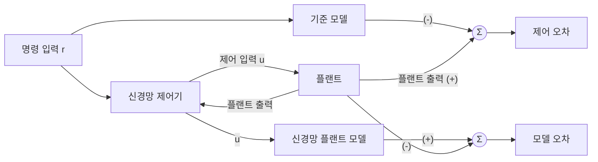

*그림 26. 모델 기준 제어의 구조*

모델 오차(신경망 플랜트 모델의 출력과 플랜트 출력의 차이)는 플랜트 모델을 식별하는 데 쓰고, 제어 오차(플랜트 출력과 기준 모델 출력의 차이)는 제어기를 학습하는 데 쓴다. 제어기는 플랜트 출력을 되먹임받는 피드백 제어기이다. 두 신경망의 입력은 표 7과 같다[12].

| 신경망 | 입력 집합 |
|:-----|:-----|
| 신경망 제어기 | 1. 지연된 기준 입력(delayed reference inputs)<br>2. 지연된 제어기 출력(플랜트 입력)<br>3. 지연된 플랜트 출력(delayed plant outputs) |
| 신경망 플랜트 모델 | 1. 지연된 제어기 출력(delayed controller outputs)<br>2. 지연된 플랜트 출력(delayed plant outputs) |

*표 7. 신경망 제어기와 신경망 플랜트 모델의 입력*

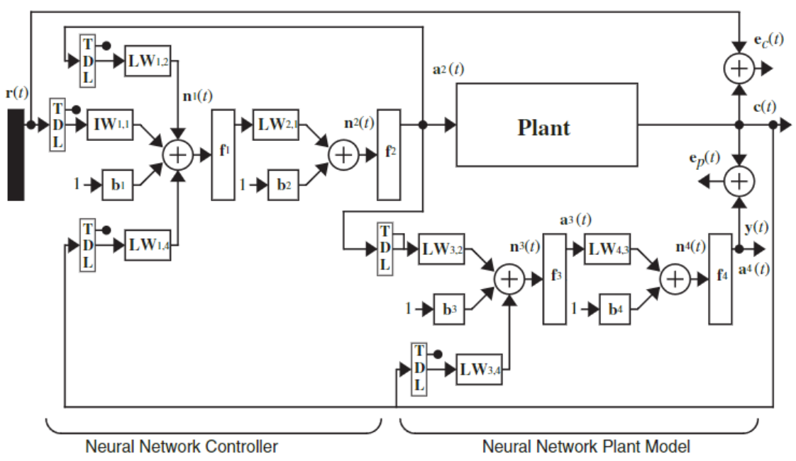

*그림 27. 모델 기준 제어의 상세 구조: 왼쪽은 신경망 제어기, 오른쪽 아래는 신경망 플랜트 모델*

그림 27에서 1층과 2층이 신경망 제어기이다. 1층은 기준 $\mathbf{r}(t)$의 지연 값($\mathbf{IW}^{1,1}$), 제어기 출력의 지연 값($\mathbf{LW}^{1,2}$), 플랜트 출력 $\mathbf{c}(t)$의 지연 값($\mathbf{LW}^{1,4}$)과 편향을 더해 순입력 $\mathbf{n}^1(t)$를 만들고 전달 함수 $\mathbf{f}^1$을 거친다. 2층의 출력 $\mathbf{a}^2(t)$가 플랜트에 가하는 제어 입력이다. 3층과 4층은 신경망 플랜트 모델로, 제어 입력의 지연 값($\mathbf{LW}^{3,2}$)과 플랜트 출력의 지연 값($\mathbf{LW}^{3,4}$)을 받아 모델 출력 $\mathbf{y}(t) = \mathbf{a}^4(t)$를 낸다. 오른쪽의 두 가합점은 제어 오차 $\mathbf{e}_c(t)$와 플랜트 모델의 오차 $\mathbf{e}_p(t)$를 만든다.

**제어기의 학습.** 제어 오차를 줄이도록 제어기의 가중치를 바꾸려면 1.6절처럼 플랜트의 미분이 필요하므로, 가중치를 고정한 신경망 플랜트 모델을 플랜트 대신 써서 제어 오차를 모델을 거쳐 제어기까지 역전파한다. 그런데 제어기와 플랜트 모델은 모두 자신과 상대의 지연된 출력을 입력으로 받는 되먹임 구조이다. 제어기의 가중치 $w$를 바꾸면 현재 출력뿐 아니라 과거 출력도 바뀌고, 과거 출력이 다시 현재 출력에 영향을 준다. 그래서 모델 출력 $c(k)$의 $w$에 대한 전미분은

$$
\frac{dc(k)}{dw} = \sum_{i}\frac{\partial c(k)}{\partial u(k-i)}\frac{du(k-i)}{dw} + \sum_{i}\frac{\partial c(k)}{\partial c(k-i)}\frac{dc(k-i)}{dw}
$$

처럼 과거 시각의 미분 $du(k-i)/dw$와 $dc(k-i)/dw$를 포함하며, 이 미분들도 같은 방식으로 더 과거의 미분에 의존한다. 이렇게 시간을 따라 재귀적으로 미분을 계산하는 방법을 **동적 역전파(dynamic backpropagation)** 라 하며, 계산량이 많아 제어기의 학습은 플랜트 모델의 학습보다 훨씬 느리다[6], [12].

> **[딥러닝]** 순환 신경망(RNN)은 과거의 출력이나 은닉 상태를 다시 입력으로 받는 신경망이며, 시간 축으로 펼쳐 역전파하는 시간 펼침 역전파(backpropagation through time, BPTT)로 학습한다. 펼친 단계가 많을수록 미분이 여러 번 곱해져 기울기가 폭발하거나 소실될 수 있다. 모델 기준 제어의 제어기 학습은 제어기와 플랜트 모델로 이루어진 폐루프 전체를 하나의 순환 신경망으로 보고 이런 방식으로 미분을 구하는 것과 같다.

### 3.5 응용: 로봇 팔 제어

목적은 단일 링크 로봇 팔이 기준 모델을 추적하도록 하는 것이다. 첫 번째 신경망(플랜트 모델)은 팔의 운동방정식을, 두 번째 신경망(제어기)은 폐루프가 기준 모델처럼 동작하게 하는 입력을 학습한다. 팔의 운동방정식(왼쪽)과 기준 모델(오른쪽)은 다음과 같다.

$$
\frac{d^2\phi}{dt^2} = -10\sin\phi - 2\frac{d\phi}{dt} + u, \qquad \frac{d^2y_r}{dt^2} = -9y_r - 6\frac{dy_r}{dt} + 9r
$$

- $\phi$: 팔의 각도(rad), $u$: 직류 모터가 공급하는 토크
- $y_r$: 기준 모델의 출력, $r$: 입력 기준 신호

팔의 식에서 $-10\sin\phi$는 팔을 아래로 되돌리려는 중력 토크, $-2\dot{\phi}$는 마찰 토크이며, 계수는 팔의 관성 모멘트로 나눈 값이다.

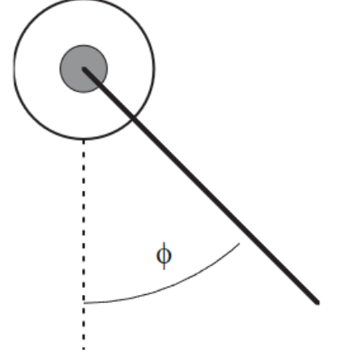

*그림 28. 단일 링크 로봇 팔과 팔의 각도*

**예제 1: 기준 모델의 응답.** 초기 조건을 0으로 두고 기준 모델을 라플라스 변환(3주차)하면 $s^2Y_r + 6sY_r + 9Y_r = 9R$이므로

$$
\frac{Y_r(s)}{R(s)} = \frac{9}{s^2 + 6s + 9} = \frac{9}{(s + 3)^2}
$$

이다. 7주차의 2차 시스템 표준형 $\omega_n^2/(s^2 + 2\zeta\omega_ns + \omega_n^2)$와 비교하면 $\omega_n^2 = 9$에서 고유 진동수 $\omega_n = 3\ \mathrm{rad/s}$, $2\zeta\omega_n = 6$에서 감쇠비 $\zeta = 1$이다. 극점이 $-3$에 중복되어 있는 임계 감쇠이므로, 기준 모델은 고유 진동수가 $3\ \mathrm{rad/s}$로 주어졌을 때 초과 없이 가장 빠르게 기준에 도달하는 응답을 지정한다. 단위 계단 입력 $R(s) = 1/s$에 대한 응답을 부분분수로 전개하면

$$
Y_r(s) = \frac{9}{s(s + 3)^2} = \frac{A}{s} + \frac{B}{s + 3} + \frac{C}{(s + 3)^2}
$$

$$
A = \left.\frac{9}{(s + 3)^2}\right|_{s=0} = 1, \qquad C = \left.\frac{9}{s}\right|_{s=-3} = -3
$$

이고, $9 = A(s + 3)^2 + Bs(s + 3) + Cs$의 $s^2$ 계수를 비교하면 $0 = A + B$이므로 $B = -1$이다. 역라플라스 변환하면

$$
y_r(t) = 1 - e^{-3t} - 3te^{-3t} = 1 - (1 + 3t)e^{-3t}, \qquad t \ge 0
$$

이다. $y_r(0.5) = 1 - 2.5e^{-1.5} = 1 - 2.5(0.2231) = 0.4422$, $y_r(1) = 1 - 4e^{-3} = 1 - 4(0.0498) = 0.8009$, $y_r(2) = 1 - 7e^{-6} = 1 - 7(0.00248) = 0.9826$이다. $(1 + 3t)e^{-3t} = 0.02$를 풀면 2% 정착 시간은 약 1.94초이고, 10%에서 90%까지의 상승 시간은 약 1.12초이다. 기준이 0.5 rad만큼 계단으로 바뀌면 팔의 목표 각도는 $0.5\,y_r(t)$를 따른다.

**예제 2: 제어하지 않은 팔의 응답.** $\phi$가 0 근처이면 $\sin\phi \approx \phi$이므로 팔의 식은 $\ddot{\phi} + 2\dot{\phi} + 10\phi = u$로 선형화된다. $\omega_n = \sqrt{10} \approx 3.162$, $2\zeta\omega_n = 2$에서 $\zeta = 1/\sqrt{10} \approx 0.316$인 부족 감쇠 시스템이다. 최대 초과량은 $\zeta/\sqrt{1 - \zeta^2} = (1/\sqrt{10})/(3/\sqrt{10}) = 1/3$이므로

$$
M_p = e^{-\zeta\pi/\sqrt{1 - \zeta^2}} = e^{-\pi/3} \approx 0.351
$$

로 약 35.1%이다. 즉 일정한 토크를 계단으로 가하면 팔은 크게 출렁이므로, 제어기는 이 응답을 예제 1의 임계 감쇠 응답으로 바꾸어야 한다. 또한 각도 $\phi$에서 정지해 있으려면 $\ddot{\phi} = \dot{\phi} = 0$이므로 $u = 10\sin\phi$의 토크가 계속 필요하다. 예를 들어 $\phi = \pi/6$(30°)을 유지하려면 $u = 10\sin(\pi/6) = 5$, $\phi = -0.4$ rad를 유지하려면 $u = 10\sin(-0.4) = -3.89$이다.

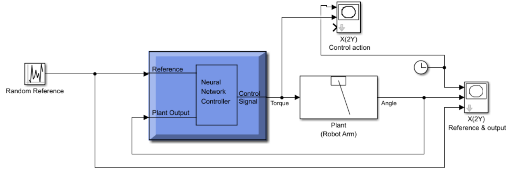

*그림 29. Simulink로 구성한 로봇 팔의 모델 기준 제어*

그림 29에서 Neural Network Controller 블록은 기준(Reference)과 플랜트 출력(Plant Output)을 받아 제어 신호를 내며, 제어 신호는 토크(Torque)로 플랜트(Robot Arm)에 들어가고 플랜트는 각도(Angle)를 내보낸다.

**플랜트 모델의 식별.** 플랜트 모델을 먼저 식별한다. 0.1\~2초 간격으로 바뀌고 진폭이 $-15$\~$15\ \mathrm{N\cdot m}$인 입력 펄스로 시스템을 식별한다.

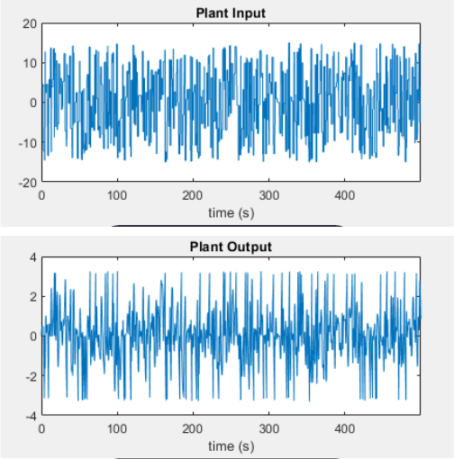

*그림 30. 로봇 팔의 식별용 입력 데이터와 출력 데이터*

신경망 플랜트 모델은 토크의 지연 값 2개($m = 2$)와 팔 위치의 지연 값 2개($n = 2$)를 네트워크 입력으로 쓰고, 은닉층에는 뉴런 10개를 쓴다. 샘플링 간격은 0.05초이다. 학습 기록은 표 8과 같다.

| 항목 | 초깃값 | 멈춘 값 | 목표값 |
|:-----|:-----|:-----|:-----|
| 에포크 | 0 | 6 | 300 |
| 경과 시간 | - | 00:00:00 | - |
| 성능(MSE) | $3.71\times10^{-10}$ | $2.83\times10^{-10}$ | 0 |
| 기울기 | $6.22\times10^{-5}$ | $3.03\times10^{-5}$ | $10^{-10}$ |
| $\mu$ | 0.001 | $10^{-8}$ | $10^{10}$ |
| 검증 실패 횟수 | 0 | 6 | 6 |

*표 8. 로봇 팔의 신경망 플랜트 모델 학습 기록*

데이터 분할은 `divideind`, 학습 알고리즘은 `trainlm`, 성능 함수는 `mse`이며, 검증 실패 횟수가 6에 이르러 6 에포크에서 멈추었다. 성능이 처음부터 $10^{-10}$ 수준이어서 모델이 매우 정확하다.

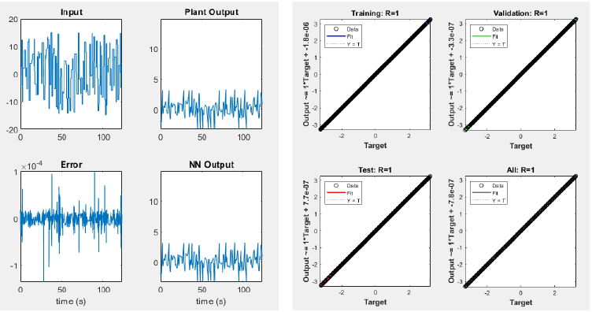

*그림 31. 로봇 팔 플랜트 모델의 시험 데이터 응답과 회귀 그림*

그림 31에서 신경망 출력은 플랜트 출력과 겹치고, 오차는 $10^{-4}$ 수준이며, 네 데이터 집합의 회귀 그림에서 모두 $R = 1$이다.

**제어기의 학습.** 다음으로 모델 기준 제어기를 학습한다. 0.1\~2초 간격으로 바뀌고 값이 $-0.7$\~$0.7$ rad인 기준 입력 펄스를 기준 모델에 넣어, 제어기가 따라야 할 기준 모델의 출력을 만든다.

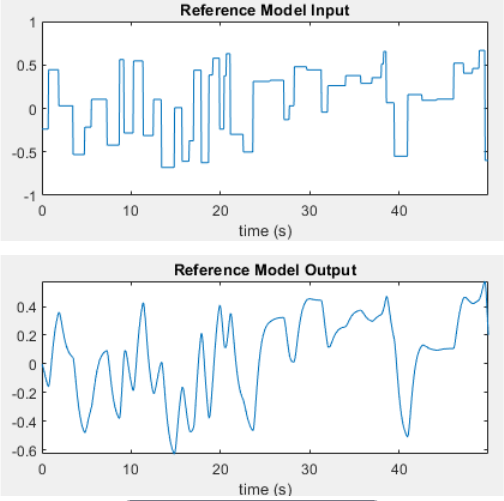

*그림 32. 제어기 학습에 쓰는 기준 모델의 입력과 출력*

제어기 인공신경망은 지연된 기준 입력 2개, 지연된 플랜트 출력 2개, 지연된 제어기 출력 1개를 입력으로 쓰고, 은닉층에는 뉴런 13개를 쓴다. 즉 입력 5개, 은닉 뉴런 13개, 출력 1개인 신경망이다[12]. 샘플링 간격은 0.05초이다. 학습 기록은 표 9와 같다.

| 항목 | 초깃값 | 멈춘 값 | 목표값 |
|:-----|:-----|:-----|:-----|
| 에포크 | 0 | 1 | 10 |
| 경과 시간 | - | 00:00:00 | - |
| 성능(MSE) | 0.00307 | 0.00307 | 0 |
| 기울기 | $4.49\times10^{10}$ | $4.49\times10^{10}$ | $10^{-7}$ |
| $\mu$ | 0.001 | $10^{11}$ | $10^{10}$ |
| 검증 실패 횟수 | 0 | 0 | 6 |

*표 9. 로봇 팔의 신경망 제어기 학습 기록*

데이터는 무작위로 분할했고(`dividerand`), 학습 알고리즘은 `trainlm`, 성능 함수는 `mse`이다.

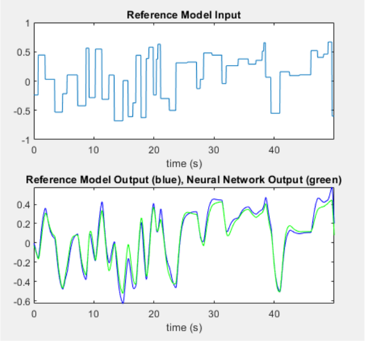

*그림 33. 같은 기준 입력에 대한 기준 모델의 출력(파란색)과 신경망 제어 폐루프의 출력(초록색)*

그림 33에서 신경망 제어기를 쓴 폐루프의 출력(초록색)은 기준 모델의 출력(파란색)과 거의 겹친다.

> **참고:** 표 9에서 기울기가 $4.49\times10^{10}$으로 매우 크고, 갱신이 성공하지 못해 $\mu$가 최댓값 $10^{10}$을 넘으면서 1 에포크 만에 학습이 멈추었으며 성능도 0.00307에서 줄지 않았다. 3.4절에서 본 재귀적인 미분 계산에서는 이처럼 기울기가 매우 커질 수 있다. MATLAB의 예제는 학습 데이터를 여러 구간으로 나누어 구간마다 몇 번씩 학습하며, 성능이 충분하지 않으면 같은 데이터나 새 데이터로 학습을 이어 갈 수 있다[12].

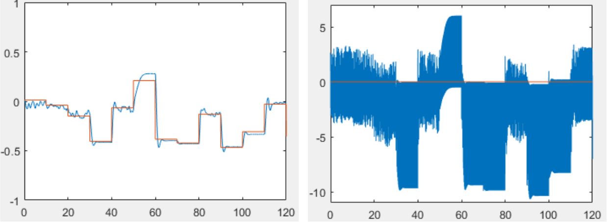

*그림 34. 모델 기준 제어를 적용한 로봇 팔의 기준과 출력, 제어 동작*

그림 34의 왼쪽에서 팔의 각도(파란색)는 약 $-0.45$\~$0.3$ rad 사이에서 계단 모양으로 바뀌는 기준(주황색)을 따라가며, 기준이 바뀔 때의 응답이 출렁임 없이 기준 모델과 비슷한 모양이다. 즉 시스템은 기준을 따를 수 있다.

> **참고:** 이 결과의 제어 동작은 원활하다고 평가되기도 한다. 그러나 그림 34 오른쪽의 제어 신호는 넓은 띠(약 $-10$\~$6\ \mathrm{N\cdot m}$) 안에서 매우 빠르게 진동하므로 매끄럽다고 보기 어렵다. 표 9처럼 제어기 학습이 1 에포크 만에 멈춘 결과이므로, 제어기 학습을 더 진행하여 제어 신호를 개선할 여지가 있다.

### 3.6 세 제어기의 비교

| 항목 | 신경망 예측 제어 | NARMA-L2 제어 | 모델 기준 제어 |
|:-----|:-----|:-----|:-----|
| 쓰는 신경망 | 플랜트 모델 하나 | $f$와 $g$를 근사하는 플랜트 모델 하나 | 플랜트 모델과 제어기 두 개 |
| 제어 입력을 정하는 방법 | 매 샘플마다 $J$를 수치 최적화 | 플랜트 모델을 재배열한 식 $u = (y_r - f)/g$ | 학습한 제어기 신경망의 순전파 |
| 온라인 계산량 | 가장 많음 | 가장 적음 | 적음 |
| 오프라인 학습 | 플랜트 모델만 | 플랜트 모델만 | 플랜트 모델과 제어기(제어기는 동적 역전파로 계산량이 많음) |
| 적용 범위 | 일반적인 비선형 플랜트 | 동반 형식이거나 그렇게 근사할 수 있는 플랜트 | NARMA-L2보다 넓은 범위의 플랜트 |
| 응용 예의 제어 신호 | 비교적 매끄러움($\rho$로 조절) | 입력의 상한과 하한 사이에서 크게 진동 | 넓은 띠 안에서 빠르게 진동 |

*표 10. 세 신경망 제어기의 비교*

계산량과 적용 범위의 비교는 MATLAB 문서[6]를 따랐고, 마지막 행은 2.6절, 3.3절, 3.5절의 응용 예에서 관찰한 것이다. 계산 자원이 넉넉하고 입력의 변화를 조절하고 싶으면 예측 제어, 계산 자원이 적고 플랜트가 동반 형식에 가까우면 NARMA-L2 제어, 계산 자원은 적지만 플랜트가 동반 형식으로 근사되지 않으면 모델 기준 제어가 알맞다.

---

<br>

## 개념 적용

| 상황 | 알맞은 방법 | 이유 |
|:-----|:-----|:-----|
| 숙련된 운전자가 손으로 조작하던 공정을 자동화하려 한다 | 모방 제어 | 운전자의 조작량과 그때의 측정값을 기록하면 신경망이 운전자의 조작을 흉내 내도록 학습할 수 있다 |
| 원하는 실내 온도를 내는 밸브와 창문의 조합을 한 번 찾으면 된다 | 역 매핑 | 순방향 모델에 많은 후보 입력을 넣어 목표 출력을 만족하는 입력을 고르면 된다 |
| 계산 자원이 충분하고 입력을 급하게 바꾸면 구동기가 손상된다 | 신경망 예측 제어 | $\rho$로 입력 증분에 벌점을 주어 제어 신호를 부드럽게 만들 수 있다 |
| 탑재 컴퓨터의 계산 능력이 낮고 플랜트가 동반 형식에 가깝다 | NARMA-L2 제어 | 온라인 계산이 두 부분 신경망의 순전파와 나눗셈뿐이다 |
| 플랜트가 동반 형식으로 근사되지 않고 온라인 계산은 적어야 한다 | 모델 기준 제어 | 제어기를 오프라인에서 학습해 두면 온라인에서는 순전파만 한다 |

*표 11. 상황별로 알맞은 신경망 제어 방법*

**T/F 점검:**

| 문장 | 판단과 근거 |
|:-----|:-----|
| 간접 방식에서는 제어기 자체가 반드시 인공신경망이어야 한다. | **F.** 간접 방식의 제어기는 신경망이 아닐 수도 있으며, 신경망으로 만든 플랜트 모델에서 도출된다는 점이 핵심이다. |
| 신경망 예측 제어는 최적화로 얻은 입력열을 모두 차례로 플랜트에 가한다. | **F.** 첫 입력만 가하고, 다음 샘플에서 새 측정값으로 최적화를 되풀이하는 이동 구간 방식이다. |
| NARMA-L2 제어는 별도의 제어기 신경망을 학습할 필요가 없다. | **T.** 제어기는 학습한 플랜트 모델의 $f$와 $g$를 제어 법칙대로 재배열한 것이다. |
| 모델 기준 제어에서는 제어기를 먼저 학습한 뒤 플랜트 모델을 식별한다. | **F.** 플랜트 모델을 먼저 식별하고, 그 모델을 거쳐 제어 오차를 역전파하여 제어기를 학습한다. |
| 예측 제어에서 $\rho$를 크게 하면 입력의 변화가 작아지는 대신 추적 오차가 커질 수 있다. | **T.** 표 4에서 $\rho$가 0에서 1로 커지면 최적 입력이 0.769에서 0.588로 줄고 추적 오차 항은 0.077에서 0.183으로 커진다. |
| 역 매핑으로 찾은 해는 학습 데이터 범위 밖에 있어도 믿을 수 있다. | **F.** 학습 데이터 밖은 외삽이므로 신경망의 예측이 맞는다는 보장이 없다. |

---

<br>

## 요약

| 개념 | 핵심 요약 |
|:-----|:-----|
| 인공신경망 제어의 동기 | 수학적 모델 없이 입출력 데이터로 플랜트를 모델링하거나 제어기를 만들 수 있으며, 적응 제어에 알맞다. |
| 간접 방식 | 신경망으로 플랜트 모델을 식별하고(시스템 식별) 그 모델로 제어기를 설계하며, 제어기 자체는 신경망이 아닐 수도 있다. |
| 직접 방식 | 신경망이 제어기 자체이며 모방 제어, 개루프 역 제어, 역 매핑, 역동역학이 이에 속한다. |
| 개루프 역 제어 | 플랜트의 역을 근사하는 제어기이며, 플랜트의 미분을 알 수 없으므로 신경망 플랜트 모델을 거쳐 오차를 역전파하여 학습한다. |
| 역 매핑 | 많은 입력 표본을 신경망에 넣어 출력이 목표를 만족하는 입력을 찾으며, 해는 여러 개일 수 있고 학습 범위 밖의 해는 외삽이다. |
| 역동역학 | 현재 상태와 다음 상태에서 입력을 추정하는 모델이며, 다음 상태 자리에 원하는 상태를 넣으면 제어기가 된다. |
| 신경망 예측 제어 | 신경망 플랜트 모델로 미래 출력을 예측하고 매 샘플마다 $J$를 최소로 하는 입력을 수치 최적화로 구하며, 첫 입력만 가하는 이동 구간 방식이다. |
| 성능 지표 $J$ | $N_1$부터 $N_2$까지의 추적 오차 제곱합과, $N_u$ 동안의 입력 증분 제곱합에 $\rho$를 곱한 항의 합이다. |
| NARMA-L2 제어 | 출력을 $f + g\cdot u$로 근사한 동반 형식 모델에서 $u = (y_r - f)/g$로 입력을 구하는 피드백 선형화 제어이며, 계산량이 가장 적지만 제어 신호가 크게 진동하기 쉽다. |
| 모델 기준 제어 | 플랜트 모델과 제어기의 두 신경망을 쓰며, 플랜트 출력이 기준 모델 출력을 따르도록 동적 역전파로 제어기를 학습한다. |
| 응용 예 | 연속 교반 탱크 반응기의 농도 제어에 예측 제어, 자기 부상 시스템의 위치 제어에 NARMA-L2 제어, 로봇 팔의 각도 제어에 모델 기준 제어를 적용했다. |

---

<br>

## 점검 문제

1. **간접 방식과 직접 방식:** 두 방식에서 인공신경망이 맡는 역할을 각각 쓰고, 직접 방식에서도 신경망 플랜트 모델이 필요한 경우가 있는 이유를 설명하라.

   <details>
   <summary>정답</summary>

   간접 방식에서 신경망은 플랜트의 모델(시스템 식별기)이고, 제어기는 그 모델로부터 설계되며 신경망이 아닐 수도 있다. 직접 방식에서는 신경망이 제어기 자체이다. 직접 방식에서 추적 오차로 제어기의 가중치를 학습하려면 연쇄 법칙의 인수 $\partial y/\partial u$가 필요한데, 실제 플랜트에서는 이 값을 알 수 없다. 그래서 미분할 수 있는 신경망 플랜트 모델을 만들어 오차를 그 모델을 거쳐 제어기까지 역전파한다(1.6절).

   </details>

2. **순전파 계산:** 1.3절의 신경망으로 밸브 60%, 창문 37%일 때의 실내 온도를 예측하라.

   <details>
   <summary>정답</summary>

   스케일링하면 $\tilde{x}_1 = 2(60 - 23)/56 - 1 = 0.3214$, $\tilde{x}_2 = 2(37 - 20)/60 - 1 = -0.4333$이다. 은닉층 순입력은 $n^1_1 = -0.5153 - 0.8405 - 2.7235 = -4.079$, $n^1_2 = 0.4410 + 0.3576 + 1.4603 = 2.259$, $n^1_3 = 0.3123 + 0.2929 - 0.5197 = 0.086$이고, $\tanh$를 거치면 $\mathbf{a}^1 \approx [-0.9994, 0.9784, 0.0854]^T$이다. 출력층은 $z = 0.6126(-0.9994) + 1.1971(0.9784) + 0.5306(0.0854) - 0.1687 = -0.6122 + 1.1712 + 0.0453 - 0.1687 = 0.4356$이고, 되돌리면 $\hat{y} = 1.4356 \times 3.65 + 21.0 = 26.24$ °C이다. 측정값은 26.5 °C이다.

   </details>

3. **역 매핑의 해 고르기:** 표 3의 네 해 가운데 하나를 고를 때 쓸 수 있는 기준을 두 가지 들고, 각 기준에서 어떤 해를 고르는지 쓰라.

   <details>
   <summary>정답</summary>

   첫째, 신뢰성을 기준으로 하면 학습 데이터 범위(창문 20\~80%) 안에 있는 2번(창문 60.4%)이나 4번(창문 70.8%)을 고른다. 1번과 3번은 창문 개도가 80%를 넘어 외삽이다. 둘째, 에너지를 기준으로 하면 난방에 쓰는 밸브 개도가 가장 작은 해를 고르며, 네 해 가운데서는 3번(56.9%), 신뢰할 수 있는 2번과 4번 가운데서는 2번(59.2%)이다.

   </details>

4. **역동역학:** 2.1절의 시스템에서 $T = 0.1$, $\mathbf{x}(k) = [0, 1, 2]^T$이고 다음 시각에 $x_3(k+1) = 2.5$가 되었다. 오일러 근사로 가한 입력 $u(k)$를 구하고, $x_1(k+1)$과 $x_2(k+1)$도 쓰라.

   <details>
   <summary>정답</summary>

   $u(k) = \frac{1}{9}\left[\frac{2.5 - 2}{0.1} + 5(0) + 2(1) + 3(2)\right] = \frac{5 + 8}{9} = \frac{13}{9} \approx 1.444$이다. 검산하면 $\dot{x}_3 = -0 - 2 - 6 + 9(13/9) = 5$이고 $x_3(k+1) = 2 + 0.1(5) = 2.5$이다. 나머지 두 상태는 입력과 관계없이 $x_1(k+1) = 0 + 0.1(1) = 0.1$, $x_2(k+1) = 1 + 0.1(2) = 1.2$이다.

   </details>

5. **성능 지표의 최소화:** 2.5절의 예제에서 $\rho = 0.5$일 때 최적 입력 $u^*$, 두 예측 출력, $J$의 값을 구하라.

   <details>
   <summary>정답</summary>

   $u^* = 5/(6.5 + 2 \times 0.5) = 5/7.5 = 0.6667$이다. $y_m(k+1) = 0.6667$, $y_m(k+2) = 1.5 \times 0.6667 = 1.0$이므로 $J = (1 - 0.6667)^2 + (1 - 1.0)^2 + 0.5(0.6667)^2 = 0.1111 + 0 + 0.2222 = 0.3333$이다. 둘째 시각의 오차는 0이지만 입력 증분의 벌점 때문에 첫째 시각의 오차가 남는다.

   </details>

6. **이동 구간:** 예측 제어가 최적화로 $u'(k), \ldots, u'(k+N_u-1)$을 모두 구하고도 첫 입력만 플랜트에 가하는 이유를 설명하라.

   <details>
   <summary>정답</summary>

   최적화는 신경망 모델의 예측에 근거하므로, 모델 오차나 외란이 있으면 실제 출력이 예측과 달라진다. 첫 입력만 가하고 다음 샘플에서 새로 측정한 출력으로 다시 최적화하면 그 차이가 매번 반영되어 피드백 제어가 된다. 나머지 입력을 미리 정해 두고 그대로 가하면 개루프가 되어 오차를 보정할 수 없다.

   </details>

7. **NARMA-L2 제어 입력:** 어떤 시각에 $f = 0.3$, $g = 0.5$, $y_r(k+d) = 1.3$이다. 제어 입력을 구하라. 실제 $g$는 0.5인데 신경망이 $\hat{g} = 0.4$로 추정했다면 출력은 얼마가 되는가?

   <details>
   <summary>정답</summary>

   $u = (1.3 - 0.3)/0.5 = 2$이다. $\hat{g} = 0.4$로 계산하면 $u = 1.0/0.4 = 2.5$이고, 실제 출력은 $0.3 + 0.5 \times 2.5 = 1.55$가 되어 목표보다 0.25 크다. $g$의 추정 오차 20%가 입력 오차 25%와 출력 오차로 이어지며, $g$가 작을수록 이 증폭은 더 커진다.

   </details>

8. **자기 부상 시스템:** 자석을 $y = 3$에 정지시키는 평형 전류를 구하라.

   <details>
   <summary>정답</summary>

   $\ddot{y} = \dot{y} = 0$이므로 $0 = -9.8 + (15/3)(i^2/3)$, 즉 $i^2 = 9.8 \times 3 \times 3/15 = 5.88$이고 $i = 2.425$ A이다. 일반식 $i = \sqrt{gMy/\alpha}$에 대입한 것과 같다.

   </details>

9. **기준 모델:** 기준 모델을 $\ddot{y}_r = -16y_r - 8\dot{y}_r + 16r$로 바꾸면 고유 진동수, 감쇠비, 단위 계단 응답, 2% 정착 시간은 어떻게 되는가?

   <details>
   <summary>정답</summary>

   전달함수는 $16/(s^2 + 8s + 16) = 16/(s + 4)^2$이므로 $\omega_n = 4$, $\zeta = 1$로 여전히 임계 감쇠이다. 3.5절과 같은 부분분수 전개로 $y_r(t) = 1 - (1 + 4t)e^{-4t}$이다. 응답이 $\omega_nt$의 함수이므로 정착 시간은 $1.94 \times 3/4 \approx 1.46$초로 짧아진다. 더 빠른 기준 모델을 따르려면 제어기가 더 큰 토크를 내야 한다.

   </details>

10. **동적 역전파:** 모델 기준 제어에서 제어기의 학습이 플랜트 모델의 학습보다 훨씬 오래 걸리는 이유를 설명하라.

    <details>
    <summary>정답</summary>

    플랜트 모델은 직렬-병렬 구조로 측정한 과거 값을 입력으로 받으므로 정적인 지도 학습으로 학습한다. 반면 제어기는 자신의 과거 출력과 플랜트(모델)의 과거 출력을 입력으로 받는 폐루프 안에 있어서, 가중치를 바꾸면 과거 출력도 바뀌고 그 변화가 현재 출력에 다시 영향을 준다. 따라서 미분을 시간을 따라 재귀적으로 계산하는 동적 역전파가 필요하고 계산량이 많다.

    </details>

11. **제어기 선택:** 계산 능력이 낮은 마이크로컨트롤러로 비선형 플랜트를 제어해야 한다. 세 제어기 가운데 무엇을 고르겠는가? 플랜트가 동반 형식에 가까운 경우와 그렇지 않은 경우로 나누어 답하라.

    <details>
    <summary>정답</summary>

    예측 제어는 매 샘플마다 수치 최적화를 해야 하므로 알맞지 않다. 플랜트가 동반 형식에 가까우면 온라인 계산이 순전파와 나눗셈뿐인 NARMA-L2 제어를 고른다. 동반 형식으로 근사되지 않으면 제어기를 오프라인에서 동적 역전파로 학습해 두고 온라인에서는 순전파만 하는 모델 기준 제어를 고른다.

    </details>

---

<br>

## 참고 문헌

1. P. J. Werbos, "Neural networks for control and system identification," in *Proceedings of the 28th IEEE Conference on Decision and Control*, 1989, pp. 260-265.
2. K. S. Narendra and K. Parthasarathy, "Identification and control of dynamical systems using neural networks," *IEEE Transactions on Neural Networks*, vol. 1, no. 1, pp. 4-27, 1990.
3. K. Hornik, M. Stinchcombe, and H. White, "Multilayer feedforward networks are universal approximators," *Neural Networks*, vol. 2, no. 5, pp. 359-366, 1989.
4. MathWorks, "feedforwardnet," *Deep Learning Toolbox Documentation*, R2024a. https://www.mathworks.com/help/releases/R2024a/deeplearning/ref/feedforwardnet.html
5. MathWorks, "Choose Neural Network Input-Output Processing Functions," *Deep Learning Toolbox Documentation*, R2024a. https://www.mathworks.com/help/releases/R2024a/deeplearning/ug/choose-neural-network-input-output-processing-functions.html
6. MathWorks, "Introduction to Neural Network Control Systems," *Deep Learning Toolbox Documentation*, R2024a. https://www.mathworks.com/help/releases/R2024a/deeplearning/ug/introduction-to-neural-network-control-systems.html
7. M. T. Hagan, H. B. Demuth, and O. De Jesús, "An introduction to the use of neural networks in control systems," *International Journal of Robust and Nonlinear Control*, vol. 12, no. 11, pp. 959-985, 2002.
8. MathWorks, "Design Neural Network Predictive Controller in Simulink," *Deep Learning Toolbox Documentation*, R2024a. https://www.mathworks.com/help/releases/R2024a/deeplearning/ug/design-neural-network-predictive-controller-in-simulink.html
9. MathWorks, "trainlm," *Deep Learning Toolbox Documentation*, R2024a. https://www.mathworks.com/help/releases/R2024a/deeplearning/ref/trainlm.html
10. MathWorks, "Design NARMA-L2 Neural Controller in Simulink," *Deep Learning Toolbox Documentation*, R2024a. https://www.mathworks.com/help/releases/R2024a/deeplearning/ug/design-narma-l2-neural-controller-in-simulink.html
11. K. S. Narendra and S. Mukhopadhyay, "Adaptive control using neural networks and approximate models," *IEEE Transactions on Neural Networks*, vol. 8, no. 3, pp. 475-485, 1997.
12. MathWorks, "Design Model-Reference Neural Controller in Simulink," *Deep Learning Toolbox Documentation*, R2024a. https://www.mathworks.com/help/releases/R2024a/deeplearning/ug/design-model-reference-neural-controller-in-simulink.html
