# Week 14 Lecture — Neural-Network-Based Control Systems

[Repository Guide](../../README.md) | [English](Concepts_Lecture.md) | [한국어](Concepts_Lecture.ko.md)

> **Last Updated:** 2026-11-04

> **Learning Objectives:**
> 1. Explain why neural networks are used in control, and distinguish the indirect method and the direct method from the viewpoints of system identification and the controller
> 2. Explain the principles of control by emulation, open-loop inverse control, inverse mapping, and inverse dynamics, and compute control inputs in simple examples
> 3. Explain the system identification stage, the performance index $J$, and the receding horizon method of neural network predictive control, and find the input that minimizes $J$ in a small example
> 4. Derive the feedback linearizing control input from the NARMA-L2 model and explain its characteristics in the magnetic levitation system
> 5. Explain the two neural networks of model reference control and their training order, and compute the response of the reference model
> 6. Compare the three neural network controllers in terms of online computation, training burden, range of application, and control signal characteristics

---

## Table of Contents

- [1. Overview of Neural Network Control](#1-overview-of-neural-network-control)
  - [1.1 Why Neural Networks Are Used in Control](#11-why-neural-networks-are-used-in-control)
  - [1.2 The Indirect Method and System Identification](#12-the-indirect-method-and-system-identification)
  - [1.3 Example of the Indirect Method: Indoor Temperature Control with a Valve and a Window](#13-example-of-the-indirect-method-indoor-temperature-control-with-a-valve-and-a-window)
  - [1.4 The Direct Method](#14-the-direct-method)
  - [1.5 Control by Emulation](#15-control-by-emulation)
  - [1.6 Open-Loop Inverse Control](#16-open-loop-inverse-control)
  - [1.7 Inverse Mapping](#17-inverse-mapping)
  - [1.8 Inverse Dynamics](#18-inverse-dynamics)
- [2. Neural Network Controllers I: Inverse Dynamics Control and Neural Network Predictive Control](#2-neural-network-controllers-i-inverse-dynamics-control-and-neural-network-predictive-control)
  - [2.1 An Inverse Dynamics Example](#21-an-inverse-dynamics-example)
  - [2.2 Feedback Control](#22-feedback-control)
  - [2.3 Three Representative Neural Network Controllers and the Two Stages](#23-three-representative-neural-network-controllers-and-the-two-stages)
  - [2.4 System Identification in Neural Network Predictive Control](#24-system-identification-in-neural-network-predictive-control)
  - [2.5 Predictive Control and the Performance Index](#25-predictive-control-and-the-performance-index)
  - [2.6 Application: Continuous Stirred Tank Reactor](#26-application-continuous-stirred-tank-reactor)
- [3. Neural Network Controllers II: NARMA-L2 Control and Model Reference Control](#3-neural-network-controllers-ii-narma-l2-control-and-model-reference-control)
  - [3.1 The NARMA-L2 Model and Feedback Linearization](#31-the-narma-l2-model-and-feedback-linearization)
  - [3.2 The NARMA-L2 Controller](#32-the-narma-l2-controller)
  - [3.3 Application: Magnetic Levitation System](#33-application-magnetic-levitation-system)
  - [3.4 Model Reference Control](#34-model-reference-control)
  - [3.5 Application: Robot Arm Control](#35-application-robot-arm-control)
  - [3.6 Comparison of the Three Controllers](#36-comparison-of-the-three-controllers)
- [Concept Applications](#concept-applications)
- [Summary](#summary)
- [Self-Check Questions](#self-check-questions)
- [References](#references)

---

<br>

## 1. Overview of Neural Network Control

### 1.1 Why Neural Networks Are Used in Control

The **plant** is the system to be controlled, and its **dynamics** are the rules by which the state and output of the plant change over time in response to the input. In Weeks 4-6, physical laws such as Newton's laws and Kirchhoff's laws were used to derive the differential equations, transfer functions, and state variable equations of plants, and in Weeks 7-11 those models were used to analyze system performance and to design PID controllers. For plants whose dynamics are complex or whose parameters are unknown, such as chemical reactors, an accurate mathematical model is hard to derive.

In such situations, neural networks offer an alternative way to design controllers. Representative early studies on using neural networks in control systems are Werbos (1989) [1] and Narendra and Parthasarathy (1990) [2], and their key ideas are as follows.

- When no mathematical model of the plant dynamics is available, a neural network provides a way to design a controller from only the numerical information about system behavior given as input-output data.
- A neural network can serve as a **black-box model** of the plant, that is, a model that reproduces only the relationship between the input and the output without knowing the internal structure.
- Neural-network-based controllers suit **adaptive control**, in which the controller must adjust its own parameters when the plant or the environment changes.
- To build a neural network controller that makes the plant behave in the desired way, the parameters of the network (weights and biases) must be adjusted based on the observed error.

> **Key Point:** A neural network plays two roles in a control system. One is a **model** that imitates the plant, and the other is a **controller** that gives inputs to the plant. Using a network as a plant model and building the controller from that model is called the indirect method, and making the network the controller itself is called the direct method. This classification is called the **neural network control topology**.

### 1.2 The Indirect Method and System Identification

The **indirect method** is based on a neural network model of the system to be controlled. A neural network model is first built from the inputs and outputs of the plant, and the controller is then designed based on that model. The controller itself may not be a neural network, but it is derived from the plant modeled by the neural network.

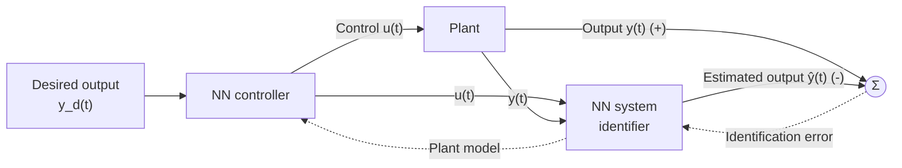

*Figure 1. Structure of the indirect method*

Solid lines are signal flows, and dotted lines are learning (parameter adjustment) flows. The neural network system identifier receives the same control input $u(t)$ as the plant, estimates the output, and learns so that the **identification error**, the difference between the actual output $y(t)$ and the estimated output $\hat{y}(t)$, decreases. Once trained, the identifier acts as a model of the plant, and the neural network controller is adjusted using this model.

> **Definition:** **System identification** is the process of building, from measured input and output data of a system, a mathematical model that reproduces the behavior of that system. In neural network control, a plant model is obtained by training a neural network on the input-output data of the plant.

In the indirect method, the neural network is used as a **function approximator**. The same input is applied to the black-box function to be approximated and to the neural network, and the parameters of the network are adjusted so that the network produces the same response as the black-box function.

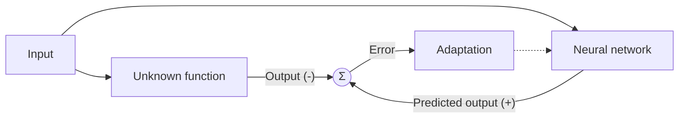

*Figure 2. The neural network as a function approximator*

If the actual output for input $x_i$ is $y_i$ and the predicted output of the network is $\hat{y}_i$, the error is $e_i = \hat{y}_i - y_i$. The adaptation block updates the weights with the backpropagation and gradient descent of Week 13 so as to minimize the mean squared error (MSE) over $N$ training data,

$$
E = \frac{1}{N}\sum_{i=1}^{N} e_i^2 = \frac{1}{N}\sum_{i=1}^{N}\big(\hat{y}_i - y_i\big)^2
$$

The theoretical basis of this approach is the **universal approximation theorem** [3]: a network with a single hidden layer that uses an activation function such as a sigmoid can approximate any continuous function on a closed and bounded region to any desired accuracy if it has enough hidden neurons. However, the theorem only guarantees that such weights exist; it does not mean that training can find them or that the approximation holds outside the range of the training data.

### 1.3 Example of the Indirect Method: Indoor Temperature Control with a Valve and a Window

Consider a house whose indoor temperature is controlled with the valve of a pipe carrying hot water and with a window. The wider the valve is opened, the stronger the heating, and the wider the window is opened, the more outside air enters and cools the room. Table 1 lists 20 measurements of the indoor temperature (°C) taken while changing how far the valve is open (valve opening, %) and how far the window is open (window opening, %).

| Valve (%) | Window (%) | Temperature (°C) |
|:-----|:-----|:-----|
| 25 | 44 | 21.8 |
| 69 | 52 | 26.1 |
| 69 | 45 | 26.1 |
| 64 | 60 | 25.5 |
| 29 | 58 | 21.2 |
| 60 | 37 | 26.5 |
| 51 | 46 | 24.8 |
| 79 | 20 | 28.3 |
| 59 | 80 | 24.0 |
| 68 | 30 | 27.0 |
| 47 | 26 | 25.5 |
| 46 | 42 | 25.1 |
| 70 | 32 | 27.6 |
| 25 | 49 | 21.0 |
| 28 | 40 | 22.8 |
| 30 | 78 | 21.3 |
| 43 | 76 | 22.7 |
| 70 | 23 | 27.9 |
| 69 | 65 | 25.4 |
| 23 | 36 | 22.0 |

*Table 1. Measured data of valve opening, window opening, and indoor temperature*

The temperature is highest, 28.3 °C, at a valve opening of 79% and a window opening of 20%, and lowest, 21.0 °C, at 25% and 49%. The valve moves in the same direction as the temperature and the window in the opposite direction, but the exact form of the relationship is unknown. Therefore a neural network with the two openings as inputs and the temperature as output is trained and used as a black-box model of the house. The code that trains it with the MATLAB Deep Learning Toolbox is as follows.

```matlab
load('data.mat')
rng('default')
net=feedforwardnet([3]);
[net, tr] = train(net,[x1,x2]',y','useParallel','yes');

input_weights = net.IW{1,1};
layer_weights = net.LW{2,1};

biases = net.b;
biases1 = biases{1,1};
biases2 = biases{2,1};

y = net(x);
```

- `load('data.mat')`: Loads the measured data. The valve opening `x1`, the window opening `x2`, and the temperature `y` are stored as column vectors.
- `rng('default')`: Resets the random number generator to its default state. Because the initial weights and the data division are determined by random numbers, this gives the same result on every run.
- `net=feedforwardnet([3]);`: Creates a feedforward network with one hidden layer of 3 neurons. The length of the vector in brackets is the number of hidden layers, and each element is the number of neurons in that layer [4].
- `[net, tr] = train(...)`: Trains the network with the input matrix `[x1,x2]'` (2 rows by 20 columns, one sample per column) and the target `y'` (1 row by 20 columns). In MATLAB, `'` denotes the transpose, which is needed because network functions take samples along columns. `'useParallel','yes'` is an option that requests parallel computation, and `tr` stores the training record. The training algorithm is the default Levenberg-Marquardt (`trainlm`) [4].
- `input_weights = net.IW{1,1};`: The input weight matrix (3×2) from the input to the first layer (the hidden layer).
- `layer_weights = net.LW{2,1};`: The layer weight matrix (1×3) from the first layer to the second layer (the output layer).
- `biases = net.b;` and the next two lines: Take the hidden-layer bias (3×1) and the output-layer bias (1×1) out of the cell array that holds the bias vector of each layer.
- `y = net(x);`: Feeds a new input to the trained network to predict the temperature. `x` is a two-row matrix that holds one sample to predict per column.

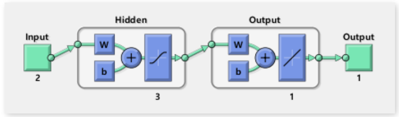

*Figure 3. Structure of the 2-3-1 network displayed by MATLAB*

The activation function of the hidden layer is the S-shaped hyperbolic tangent sigmoid (`tansig`, mathematically the same as $\tanh$), and the output layer is linear (`purelin`). In addition, `feedforwardnet` by default applies **min-max scaling (`mapminmax`)**, which maps the inputs and the targets to the interval $[-1, 1]$ using the minimum and maximum of the training data, and converts the network output back to the original units [5]. The computation that gives the predicted temperature $\hat{y}$ from the input $\mathbf{x} = [x_1, x_2]^T$ is therefore as follows.

$$
\tilde{x}_j = 2\,\frac{x_j - x_{j,\min}}{x_{j,\max} - x_{j,\min}} - 1, \qquad \mathbf{n}^1 = \mathbf{W}^1\tilde{\mathbf{x}} + \mathbf{b}^1, \qquad \mathbf{a}^1 = \tanh(\mathbf{n}^1)
$$

$$
z = \mathbf{W}^2\mathbf{a}^1 + b^2, \qquad \hat{y} = \frac{(z + 1)(y_{\max} - y_{\min})}{2} + y_{\min}
$$

$\mathbf{W}^1$ is `input_weights`, $\mathbf{b}^1$ is `biases1`, $\mathbf{W}^2$ is `layer_weights`, and $b^2$ is `biases2`, and the trained values are as follows.

$$
\mathbf{W}^1 = \begin{bmatrix} -1.6032 & 1.9398 \\ 1.3721 & -0.8252 \\ 0.9718 & -0.6760 \end{bmatrix}, \quad \mathbf{b}^1 = \begin{bmatrix} -2.7235 \\ 1.4603 \\ -0.5197 \end{bmatrix}, \quad \mathbf{W}^2 = \begin{bmatrix} 0.6126 & 1.1971 & 0.5306 \end{bmatrix}, \quad b^2 = -0.1687
$$

**Example: prediction for the first sample.** Compute the temperature for a valve opening of 25% and a window opening of 44%. In Table 1, the valve ranges over 23-79, the window over 20-80, and the temperature over 21.0-28.3.

Step 1 (scaling): Map the two inputs to the interval $[-1, 1]$.

$$
\tilde{x}_1 = 2\cdot\frac{25 - 23}{79 - 23} - 1 = -0.9286, \qquad \tilde{x}_2 = 2\cdot\frac{44 - 20}{80 - 20} - 1 = -0.2000
$$

Step 2 (net input of the hidden layer): Multiply each row of $\mathbf{W}^1$ by $\tilde{\mathbf{x}}$, sum, and add the bias.

$$
\begin{aligned}
n^1_1 &= (-1.6032)(-0.9286) + (1.9398)(-0.2000) - 2.7235 = 1.4887 - 0.3880 - 2.7235 = -1.6228 \\
n^1_2 &= (1.3721)(-0.9286) + (-0.8252)(-0.2000) + 1.4603 = -1.2741 + 0.1650 + 1.4603 = 0.3512 \\
n^1_3 &= (0.9718)(-0.9286) + (-0.6760)(-0.2000) - 0.5197 = -0.9024 + 0.1352 - 0.5197 = -1.2869
\end{aligned}
$$

Step 3 (activation of the hidden layer): $\mathbf{a}^1 = \tanh(\mathbf{n}^1) = [-0.9250, 0.3375, -0.8583]^T$.

Step 4 (output layer): The value of the linear output neuron is as follows.

$$
z = 0.6126(-0.9250) + 1.1971(0.3375) + 0.5306(-0.8583) - 0.1687 = -0.5667 + 0.4040 - 0.4554 - 0.1687 = -0.7868
$$

Step 5 (back to the original units): Map back to the temperature range.

$$
\hat{y} = \frac{(-0.7868 + 1)(28.3 - 21.0)}{2} + 21.0 = 0.2132 \times 3.65 + 21.0 = 21.78\ ^\circ\mathrm{C}
$$

This is almost the same as the measured 21.8 °C. Doing the same computation for all 20 samples gives an RMSE (Week 12) of the prediction error of about 0.28 °C.

> **Caution:** The trained weights apply to scaled values. Multiplying the raw values 25 and 44 by $\mathbf{W}^1$ gives a completely different result, so the steps that transform the inputs with the minimum and maximum of the training data and convert the output back must not be skipped.

In the indirect method, a controller is built from the model obtained in this way. Section 1.7 uses this temperature model to find combinations of the valve and the window that produce a desired temperature.

### 1.4 The Direct Method

In the **direct method**, the controller itself is a neural network; that is, the neural network implements the controller directly. The network must be trained according to some criterion, such as reducing the tracking error, using numerical input-output data or a mathematical model of the system.

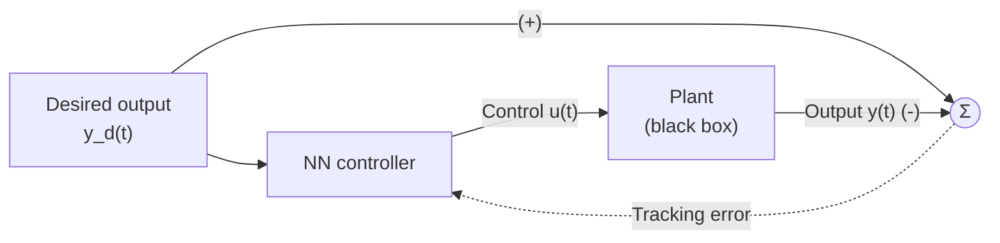

*Figure 4. Structure of the direct method*

The **tracking error** is the difference between the desired output and the actual output, $e(t) = y_d(t) - y(t)$. The controller output $u$ becomes $y$ only after passing through the plant, so changing the controller weights to reduce the tracking error requires knowing how $u$ affects $y$. Section 1.6 explains why this information must come from data or a mathematical model. The direct method includes control by emulation, open-loop inverse control, inverse mapping, and inverse dynamics.

### 1.5 Control by Emulation

**Control by emulation** is a method that imitates an existing, well-performing controller with a neural network. The same reference signal $r$ and measured state $x$ are applied to the existing controller and to the neural network $G$, and the network is trained so that the difference $e$ between the two outputs decreases.

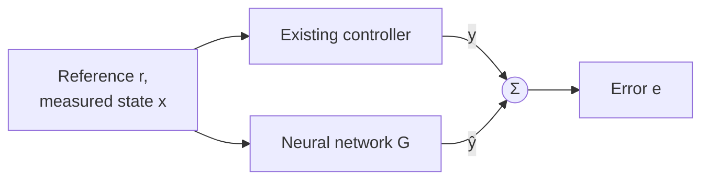

*Figure 5. Training structure of control by emulation*

Here $y$ is not the plant output but the control command produced by the existing controller, $\hat{y}$ is the network output, and the error is $e = y - \hat{y}$. This is the same as supervised learning (Week 12) with the inputs of the existing controller as features and its outputs as targets. The method is useful when the controller is a human and the task is to be automated. For example, if the measurements and the manipulated values are recorded while a skilled operator runs a process, a neural network can imitate those actions and replace the operator. However, the network learns the operator's behavior only in the recorded situations, so its behavior in unrecorded situations is not guaranteed, and performance better than that of the original controller is hard to expect.

### 1.6 Open-Loop Inverse Control

**Open-loop inverse control** uses a neural network controller to approximate the inverse of the plant to be controlled. If the plant maps the input $u$ to the output $y = P(u)$ and the controller $C$ is close to the inverse function $P^{-1}$, then applying a reference signal $r$ gives $y = P(C(r)) \approx P(P^{-1}(r)) = r$, so the output follows the reference.

Training the controller requires knowing how the output error changes with the controller weight $w$. With the error function $E = \frac{1}{2}(r - y)^2$, the chain rule gives

$$
\frac{\partial E}{\partial w} = \frac{\partial E}{\partial y}\cdot\frac{\partial y}{\partial u}\cdot\frac{\partial u}{\partial w} = -(r - y)\cdot\frac{\partial y}{\partial u}\cdot\frac{\partial u}{\partial w}
$$

$\partial u/\partial w$ can be obtained by backpropagation through the controller network, but the middle factor $\partial y/\partial u$ is a property of the real plant and is unknown. Therefore a **plant emulator**, that is, a neural network plant model $\hat{y} = \hat{P}(u)$, is built first, and the error is propagated backward through this model so that the controller parameters are trained with $\partial y/\partial u \approx \partial\hat{y}/\partial u$.

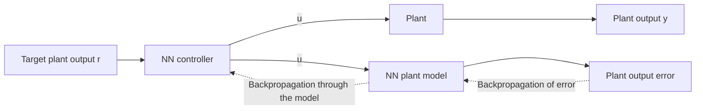

*Figure 6. Training of the open-loop inverse controller through the plant model*

> **[Calculus]** The chain rule states that the derivative of a composite function is the product of the derivatives of its stages. $E$ depends on $w$ through $y$, and $y$ through $u$, so $\partial E/\partial w$ is the product of three derivatives. The plant model replaces the middle factor $\partial y/\partial u$ of this product with a differentiable neural network.

The neural network learns how to find the input $u$ that drives the system output $y$ toward the reference signal $r$. The network must also be trained in the region where it will actually operate, because there is no guarantee that the inverse approximated by the network is correct in regions without training data.

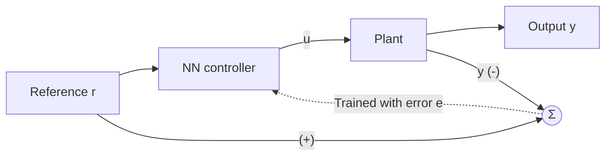

*Figure 7. An inverse controller trained with the error between the reference signal and the output*

**Example: learning the inverse of a static plant.** Let the plant and its model both be the static system $\hat{y} = 2u$, and let the controller have a single weight, $u = wr$. Start from the reference $r = 1$, the learning rate $\eta = 0.1$, and the initial weight $w = 0.3$. The three factors of the chain rule are $\partial E/\partial \hat{y} = -(r - \hat{y}) = -e$, $\partial\hat{y}/\partial u = 2$, and $\partial u/\partial w = r$, so

$$
\frac{\partial E}{\partial w} = -e \cdot 2 \cdot r = -2er, \qquad w \leftarrow w - \eta\frac{\partial E}{\partial w} = w + 0.2\,e
$$

Repeating this gives Table 2.

| Iteration | $w$ | $u = wr$ | $\hat{y} = 2u$ | $e = r - \hat{y}$ | $\partial E/\partial w$ | New $w$ |
|:-----|:-----|:-----|:-----|:-----|:-----|:-----|
| 0 | 0.3000 | 0.3000 | 0.6000 | 0.4000 | $-0.8000$ | 0.3800 |
| 1 | 0.3800 | 0.3800 | 0.7600 | 0.2400 | $-0.4800$ | 0.4280 |
| 2 | 0.4280 | 0.4280 | 0.8560 | 0.1440 | $-0.2880$ | 0.4568 |
| 3 | 0.4568 | 0.4568 | 0.9136 | 0.0864 | $-0.1728$ | 0.4741 |

*Table 2. Training the inverse controller of a static plant with gradient descent*

Each update reduces $e$ to $1 - 2(w + 0.2e) = e - 0.4e = 0.6e$, so $w$ converges to 0.5, the reciprocal of the plant gain 2. Then $u = 0.5r$ and $y = 2u = r$, and the controller becomes the inverse of the plant.

> **Caution:** Open-loop inverse control does not feed the output back, so it cannot correct disturbances or model errors. It also cannot be used as is when several inputs produce the same output so that the inverse of the plant is not unique, or when the inverse system is unstable because the transfer function has zeros in the right half-plane.

### 1.7 Inverse Mapping

**Inverse mapping** is a method that derives the input that can lead to a particular output. Given a neural network $y = f(x)$ that computes the output $y$ from the input $x$, as in Section 1.3, it finds the input that makes the output equal to a desired value.

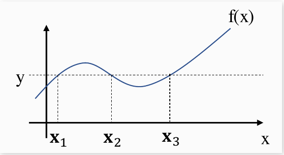

*Figure 8. Three different inputs that produce the same output y*

The function $f$ in Figure 8 is not one-to-one: the horizontal line at height $y$ meets the curve at three points, and the three inputs $x_1$, $x_2$, and $x_3$ all produce the same output. The inverse may therefore not be unique, and because the inverse of a neural network usually cannot be found in closed form, it is searched for numerically. The inverse mapping procedure for a given neural network is as follows.

1. Generate a population of input samples in the design space (the range the inputs can take).
2. Obtain the output values of the population with the neural network.
3. Find the input samples that satisfy the intended output $y$.

**Example: finding control actions that give 25 °C.** For the indoor temperature problem of Section 1.3, find the valve and window openings that make the indoor temperature 25 °C.

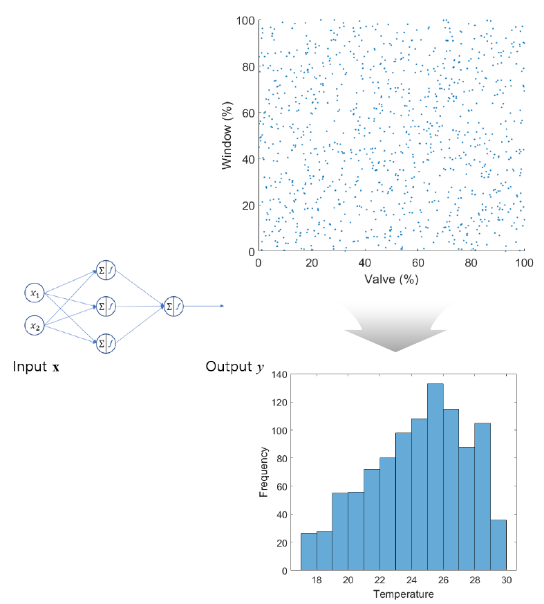

*Figure 9. Random input samples and a histogram of the predicted temperatures*

The upper part of Figure 9 shows input samples drawn uniformly from the design space $[0, 100] \times [0, 100]$, and the lower part shows the histogram of the temperatures predicted by feeding those samples to the network. The predicted temperatures spread over about 17-30 °C and are concentrated around 24-29 °C. The MATLAB code that implements this procedure is as follows.

```matlab
%% prediction (inverse)

input = 100*rand(10^6,2);
output = net(input');

temperature = 25;
selected_id = find(abs(output-temperature)<0.00001);

input(selected_id,:)
output(selected_id)
```

- `%% prediction (inverse)`: A line that starts with `%%` is a comment that divides a MATLAB script into code sections.
- `input = 100*rand(10^6,2);`: `rand(10^6,2)` creates a $10^6$-by-2 matrix of uniform random numbers between 0 and 1, and multiplying by 100 gives $10^6$ samples whose valve and window openings are chosen at random from 0-100% (step 1).
- `output = net(input');`: Feeds the samples to the network along columns and obtains a 1-by-$10^6$ row of predicted temperatures (step 2).
- `temperature = 25;`: The target temperature.
- `selected_id = find(abs(output-temperature)<0.00001);`: Finds the indices of the samples whose predicted temperature differs from the target by less than $10^{-5}$ in absolute value (step 3). A tolerance is needed because the probability that a continuous value is exactly 25 is zero.
- `input(selected_id,:)`, `output(selected_id)`: Print the inputs (control actions) of the selected samples and their predicted temperatures.

| No. | Valve (%) | Window (%) | Predicted temperature (°C) |
|:-----|:-----|:-----|:-----|
| 1 | 62.3687 | 89.8677 | 25.0000 |
| 2 | 59.2480 | 60.4150 | 25.0000 |
| 3 | 56.9321 | 94.5670 | 25.0000 |
| 4 | 71.1097 | 70.7905 | 25.0000 |

*Table 3. Control actions for 25 °C found by inverse mapping*

Four different combinations all give 25 °C. Since there are several solutions, as in Figure 8, one is chosen by another criterion. For example, to reduce heating costs, choose No. 3, which has the smallest valve opening; to use only trustworthy solutions, as explained in the caution box below, choose No. 2 or No. 4, which lie inside the range of the training data. A smaller tolerance is more precise but finds fewer solutions, and a larger tolerance gives more candidates but also admits solutions slightly off the target.

> **Caution:** In the training data of Table 1, the window opening lies only in the range 20-80%. Solutions No. 1 and No. 3 have window openings above 80%, so they are the results of **extrapolation** of the network outside the training data, and their predictions are hard to trust as they are. It is safer to restrict the design space of inverse mapping to the range covered by the training data.

> **Note:** Table 3 and Figure 9 come from a network obtained in a different training run from the weights given in Section 1.3. With the weights of Section 1.3, the predicted temperatures of the four combinations in Table 3 are about 24.23, 24.99, 24.06, and 25.45 °C, and over the whole design space the predicted temperature spreads over about 18-28 °C. The result of training depends on the initial weights and the data division, so the solutions found by inverse mapping also differ from one trained network to another. Inverse mapping must be carried out with the very network that will be used for control.

### 1.8 Inverse Dynamics

The inverse of a static function $y = f(x)$ is $f^{-1}(y) = x$, which recovers the input from the output. In a dynamic system, the output depends not only on the current input but also on the current state, so the inverse must use the state as well. Suppose that in a discrete-time system the state $\mathbf{x}(k)$ and the input $u(k)$ determine the next state.

$$
\mathbf{x}(k+1) = F\big(\mathbf{x}(k), u(k)\big)
$$

**Inverse dynamics** uses this relation in reverse to estimate, from the output of the system (the next state), the input that produced that output.

$$
u(k) = F^{-1}\big(\mathbf{x}(k), \mathbf{x}(k+1)\big)
$$

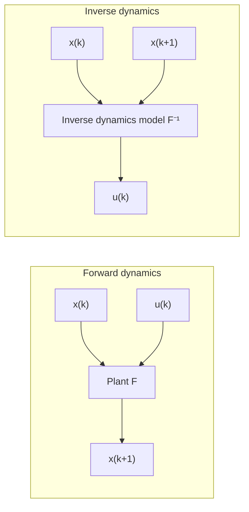

*Figure 10. Inputs and outputs of the forward dynamics model and the inverse dynamics model*

The inverse dynamics model is obtained by supervised learning. After applying various inputs to the plant and recording tuples $(\mathbf{x}(k), u(k), \mathbf{x}(k+1))$, a neural network is trained with $\mathbf{x}(k)$ and $\mathbf{x}(k+1)$ as inputs and $u(k)$ as the target. To use the trained model as a controller, the desired next state $\mathbf{x}_d(k+1)$ is put in place of $\mathbf{x}(k+1)$, and $u(k) = F^{-1}(\mathbf{x}(k), \mathbf{x}_d(k+1))$ is applied to the plant. Section 2.1 works out a concrete example.

---

<br>

## 2. Neural Network Controllers I: Inverse Dynamics Control and Neural Network Predictive Control

### 2.1 An Inverse Dynamics Example

Find the inverse dynamics of the following linear system of order $n = 3$ with the state $\mathbf{x} = [x_1, x_2, x_3]^T$.

$$
\dot{\mathbf{x}} = \mathbf{A}\mathbf{x} + \mathbf{B}u, \qquad \mathbf{A} = \begin{bmatrix} 0 & 1 & 0 \\ 0 & 0 & 1 \\ -5 & -2 & -3 \end{bmatrix}, \qquad \mathbf{B} = \begin{bmatrix} 0 \\ 0 \\ 9 \end{bmatrix}
$$

Written component by component, the state variable equations of Week 6 are as follows.

$$
\dot{x}_1 = x_2, \qquad \dot{x}_2 = x_3, \qquad \dot{x}_3 = -5x_1 - 2x_2 - 3x_3 + 9u
$$

With the output $y = x_1$, we have $x_2 = \dot{y}$ and $x_3 = \ddot{y}$, so the third equation is $\dddot{y} + 3\ddot{y} + 2\dot{y} + 5y = 9u$, and the transfer function with zero initial conditions is $G(s) = 9/(s^3 + 3s^2 + 2s + 5)$. A form like $\mathbf{A}$, with ones above the diagonal and the coefficients of the characteristic equation with reversed signs in the last row, is called the **companion form**. The first column of the Routh array (Week 9) of the characteristic equation $s^3 + 3s^2 + 2s + 5 = 0$ is $1$, $3$, $(3 \cdot 2 - 1 \cdot 5)/3 = 1/3$, $5$, all positive, so the system is stable, and its poles are $-2.904$ and $-0.048 \pm j1.311$.

Since $\mathbf{B} = [0, 0, 9]^T$, the input $u$ appears only in the third equation. Solving the third equation for $u$ gives the continuous-time inverse dynamics.

$$
u = \frac{\dot{x}_3 + 5x_1 + 2x_2 + 3x_3}{9}
$$

When discretizing with sampling interval $T$, approximating the derivative by the forward difference $\dot{\mathbf{x}} \approx (\mathbf{x}(k+1) - \mathbf{x}(k))/T$ (the Euler method) gives $\mathbf{x}(k+1) \approx \mathbf{x}(k) + T[\mathbf{A}\mathbf{x}(k) + \mathbf{B}u(k)]$, whose third component is

$$
x_3(k+1) = x_3(k) + T\big[-5x_1(k) - 2x_2(k) - 3x_3(k) + 9u(k)\big]
$$

Solving this for $u(k)$ gives the discrete-time inverse dynamics model.

$$
u(k) = \frac{1}{9}\left[\frac{x_3(k+1) - x_3(k)}{T} + 5x_1(k) + 2x_2(k) + 3x_3(k)\right]
$$

**Forward computation.** With $T = 0.1$, $\mathbf{x}(k) = [1, 2, -1]^T$, and $u(k) = 2$,

$$
\mathbf{A}\mathbf{x}(k) + \mathbf{B}u(k) = \begin{bmatrix} 2 \\ -1 \\ -5(1) - 2(2) - 3(-1) + 9(2) \end{bmatrix} = \begin{bmatrix} 2 \\ -1 \\ 12 \end{bmatrix}, \qquad \mathbf{x}(k+1) = \begin{bmatrix} 1 + 0.1(2) \\ 2 + 0.1(-1) \\ -1 + 0.1(12) \end{bmatrix} = \begin{bmatrix} 1.2 \\ 1.9 \\ 0.2 \end{bmatrix}
$$

**Backward computation.** Now estimate the input knowing only $\mathbf{x}(k)$ and $\mathbf{x}(k+1)$.

$$
u(k) = \frac{1}{9}\left[\frac{0.2 - (-1)}{0.1} + 5(1) + 2(2) + 3(-1)\right] = \frac{12 + 6}{9} = 2
$$

The input 2 is recovered exactly. **Use as a controller.** To make $x_3$ zero at the next time step from the same state, put the desired value 0 in place of $x_3(k+1)$.

$$
u(k) = \frac{1}{9}\left[\frac{0 - (-1)}{0.1} + 6\right] = \frac{16}{9} \approx 1.778
$$

In one step, only $x_3$ can be changed by the input. $x_1(k+1) = x_1(k) + Tx_2(k) = 1.2$ and $x_2(k+1) = x_2(k) + Tx_3(k) = 1.9$ are determined by the current state regardless of $u$, so the desired next state must be chosen consistently with these two values. The inverse dynamics in this example is a linear function of $(\mathbf{x}(k), x_3(k+1))$, so even a single linear neuron can learn it. When the plant is nonlinear, like the robot arm of Section 3.5, the inverse dynamics is also nonlinear, so a multilayer neural network is trained on recorded data to approximate it.

> **Note:** The Euler method is an approximation. Exact discretization with a zero-order hold, which assumes the input is constant over each sampling interval, gives $\mathbf{x}(k+1) = \mathbf{\Phi}\mathbf{x}(k) + \mathbf{\Gamma}u(k)$ with $\mathbf{\Phi} = e^{\mathbf{A}T}$ and $\mathbf{\Gamma} = \int_0^T e^{\mathbf{A}\tau}d\tau\,\mathbf{B}$, and at $T = 0.1$, $\mathbf{\Gamma} \approx [0.00139, 0.04075, 0.77479]^T$. In this case the input affects all three states, and the inverse dynamics is obtained from the least-squares solution below.

> **[Linear Algebra]** $\mathbf{\Gamma}u = \mathbf{x}(k+1) - \mathbf{\Phi}\mathbf{x}(k)$ is a system of three equations in one unknown. The least-squares solution that minimizes the sum of squared residuals $\lVert \mathbf{x}(k+1) - \mathbf{\Phi}\mathbf{x}(k) - \mathbf{\Gamma}u \rVert^2$ is $u = (\mathbf{\Gamma}^T\mathbf{\Gamma})^{-1}\mathbf{\Gamma}^T\big(\mathbf{x}(k+1) - \mathbf{\Phi}\mathbf{x}(k)\big)$, and if $\mathbf{x}(k+1)$ actually came from this system, the residual is zero and the input is recovered exactly.

### 2.2 Feedback Control

When feedback is considered, a neural network system can also be trained with goals and cost functions similar to those of conventional control. However, whereas conventional control theory often obtains the solution as a formula, the solution of a neural network is an approximate solution obtained by iterative training. Figure 11 shows a feedback control structure that redesigns the controller while estimating the plant.

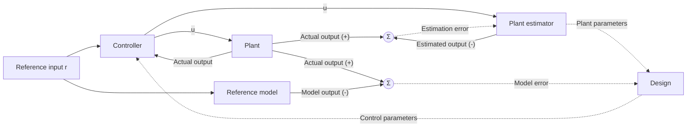

*Figure 11. A feedback control structure with a plant estimator and a reference model*

- The **reference model** produces the desired response (the model output) to the reference input $r$.
- The **controller** receives $r$ and the actual output of the plant and produces the input $u$. Because it feeds back the actual output, it is a feedback controller.
- The **plant estimator** receives the same $u$ as the plant, estimates the output, and updates its own parameters with the difference from the actual output (the estimation error). This is the system identification of Section 1.2.
- The **design** block recomputes the controller parameters using the estimated plant parameters and the model error (the difference between the actual output and the model output).

Because estimation and design are repeated continuously during operation, this structure is a form of adaptive control in which the controller follows the plant even when the plant changes. If the plant estimator or the controller is a neural network, the design step becomes the training of that network.

### 2.3 Three Representative Neural Network Controllers and the Two Stages

Neural networks have been applied successfully to the identification of control systems, and the three well-known, general neural network controllers are the following [6], [7].

1. Neural network predictive control
2. NARMA-L2 control
3. Model reference control

Using neural networks for control involves two stages.

- **System identification:** Build a neural network model of the plant to be controlled. This stage is the same for all three controllers [6].
- **Control design:** Design or train the controller using the neural network plant model. This stage differs for each controller.

The three controllers and the three applications of Sections 2.6, 3.3, and 3.5 (a continuous stirred tank reactor, a magnetic levitation system, and a robot arm) are treated together in the tutorial paper by Hagan, Demuth, and De Jesús [7]. The rest of Section 2 covers neural network predictive control, and Section 3 covers NARMA-L2 control and model reference control.

### 2.4 System Identification in Neural Network Predictive Control

**Neural network predictive control** is a control method that uses a neural network model of a nonlinear plant to predict future plant performance [8], and it consists of the following three steps.

1. Determine the neural network plant model (system identification).
2. The controller uses the plant model to predict future performance.
3. The controller computes the control input that optimizes the plant performance over a specified future time horizon.

In the system identification stage, a neural network is trained to represent the forward dynamics of the plant. The prediction error between the plant output and the network output is used as the training signal, and the neural network plant model predicts future values of the plant output from previous inputs and previous plant outputs. For the identification of nonlinear systems, the following **nonlinear autoregressive-moving average (NARMA) model** is used.

$$
y(k+d) = N\big[y(k), y(k-1), \ldots, y(k-n+1), u(k), u(k-1), \ldots, u(k-m+1)\big]
$$

- **Autoregressive:** The next output depends on its own past outputs $y(k), \ldots, y(k-n+1)$.
- **Moving average:** The next output depends on past inputs $u(k), \ldots, u(k-m+1)$.
- **Nonlinear:** The function $N$ that combines the two is nonlinear, and the neural network approximates this $N$.
- $d \ge 1$ is the number of samples before the input affects the output, and $n$ and $m$ are the numbers of past outputs and past inputs fed to the model.

If $N$ is linear, the model becomes a difference equation of the form $y(k+1) = a_1y(k) + \cdots + a_ny(k-n+1) + b_1u(k) + \cdots + b_mu(k-m+1)$, the discrete-time counterpart of a transfer function model. The NARMA model generalizes this linear relationship to a nonlinear one.

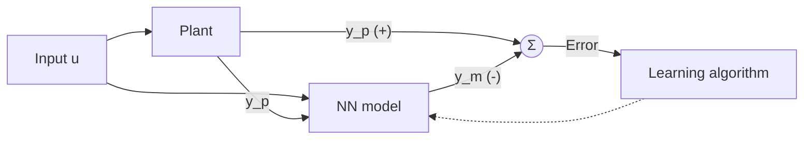

*Figure 12. Plant identification for neural network predictive control*

In Figure 12, the neural network model receives as inputs past values of the actual plant output $y_p$, not its own predictions $y_m$. This identification structure is called the **series-parallel structure** [2]. Because all inputs of the model are measured values, identification becomes a static supervised learning problem, and the model can be trained offline in batch mode on previously recorded data [8].

### 2.5 Predictive Control and the Performance Index

Predictive control is based on the **receding horizon** technique [8]. The neural network model predicts the plant response over a specified horizon, and a numerical optimization program uses those predictions to determine the control signal that minimizes the following **performance index** $J$.

$$
J = \sum_{j=N_1}^{N_2}\big(y_r(k+j) - y_m(k+j)\big)^2 + \rho\sum_{j=1}^{N_u}\big(u'(k+j-1) - u'(k+j-2)\big)^2
$$

- $N_1$, $N_2$, and $N_u$ define the horizons over which the tracking error and the control increments are evaluated. The tracking error is evaluated at the future time steps from $N_1$ to $N_2$ (the MATLAB implementation fixes $N_1 = 1$ [8]), and $N_u$ is the control horizon over which the input may change; after it, the input increments are taken as zero and the input is held.
- $u'$ is the **tentative control signal**. It is a candidate input tried by the optimization and is not applied to the plant until the optimization ends.
- $y_r$ is the desired response, and $y_m$ is the response of the network model.
- $\rho$ determines the contribution of the sum of squared control increments to the performance index. The larger $\rho$ is, the heavier the penalty on changing the input abruptly.

The first term penalizes future tracking errors, and the second term penalizes changes in the input. At every sample, the optimization finds $u'(k), \ldots, u'(k+N_u-1)$, but only the first input $u(k) = u'(k)$ is applied to the plant. At the next sample, the prediction horizon is shifted by one step using the newly measured output, and the same optimization is repeated. Because the prediction horizon moves forward with time, this is called the receding horizon method, and because it restarts from a new measurement each time, model errors and disturbances are corrected through feedback.

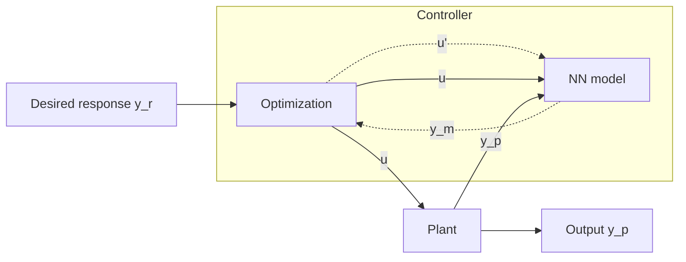

*Figure 13. Structure of neural network predictive control*

**Example: minimizing the performance index.** So that the computation can be followed by hand, the linear model $y_m(k+1) = 0.5\,y(k) + u(k)$ is used instead of a neural network model. The current output is $y(k) = 0$, the previous input is $u(k-1) = 0$, the desired response is $y_r = 1$ (constant), and $N_1 = 1$, $N_2 = 2$, $N_u = 1$. Since $N_u = 1$, $u'(k+1) = u'(k)$, and the only variable to optimize is $u = u'(k)$.

Step 1 (prediction): $y_m(k+1) = 0.5(0) + u = u$, and $y_m(k+2) = 0.5\,y_m(k+1) + u'(k+1) = 0.5u + u = 1.5u$.

Step 2 (performance index): The increment term has the single term $(u'(k) - u(k-1))^2 = u^2$ for $j = 1$.

$$
J(u) = (1 - u)^2 + (1 - 1.5u)^2 + \rho\,u^2
$$

Step 3 (minimization): Set the derivative to zero.

$$
\frac{dJ}{du} = -2(1 - u) - 3(1 - 1.5u) + 2\rho u = (6.5 + 2\rho)u - 5 = 0 \quad\Longrightarrow\quad u^* = \frac{5}{6.5 + 2\rho}
$$

The second derivative $6.5 + 2\rho$ is positive, so $u^*$ is a minimum. The results for several values of $\rho$ are in Table 4.

| $\rho$ | $u^*$ | $y_m(k+1)$ | $y_m(k+2)$ | Tracking error term | Increment term | $J$ |
|:-----|:-----|:-----|:-----|:-----|:-----|:-----|
| 0 | 0.7692 | 0.7692 | 1.1538 | 0.0769 | 0 | 0.0769 |
| 0.1 | 0.7463 | 0.7463 | 1.1194 | 0.0786 | 0.0557 | 0.1343 |
| 1 | 0.5882 | 0.5882 | 0.8824 | 0.1834 | 0.3460 | 0.5294 |

*Table 4. Optimal input and performance index of predictive control for different control weights*

As $\rho$ grows, the optimal input becomes smaller and the change in the input gentler, at the cost of a larger tracking error term. $J$ does not reach zero even at $\rho = 0$ because a single free variable cannot remove the errors at both time steps. Only this $u^*$ is applied to the plant, and the same computation is repeated with the new output at the next sample. A real neural network model is nonlinear, so $J$ is not quadratic, and $u'$ must be found by iterative numerical optimization at every sample. This is why neural network predictive control requires a large amount of online computation.

### 2.6 Application: Continuous Stirred Tank Reactor

A **catalytic continuous stirred tank reactor (CSTR)** is a device in which feed is supplied and product is withdrawn continuously while the contents are kept uniformly mixed for the reaction. The dynamic model is given as follows, and the objective of the controller is to maintain the product concentration $C_b(t)$ by adjusting the flow $w_2(t)$.

$$
\frac{dh(t)}{dt} = w_1(t) + w_2(t) - 0.2\sqrt{h(t)}
$$

$$
\frac{dC_b(t)}{dt} = \big(C_{b1} - C_b(t)\big)\frac{w_1(t)}{h(t)} + \big(C_{b2} - C_b(t)\big)\frac{w_2(t)}{h(t)} - \frac{k_1C_b(t)}{\big(1 + k_2C_b(t)\big)^2}
$$

- $h(t)$: liquid level (not controlled)
- $C_b(t)$: product concentration at the process output
- $w_1(t)$: inflow of the feed with concentration $C_{b1}$ ($0.1\ \mathrm{cm^3/s}$)
- $w_2(t)$: inflow of the feed with concentration $C_{b2}$
- Constants: $C_{b1} = 24.9$, $C_{b2} = 0.1$, $k_1 = 1$, $k_2 = 1$

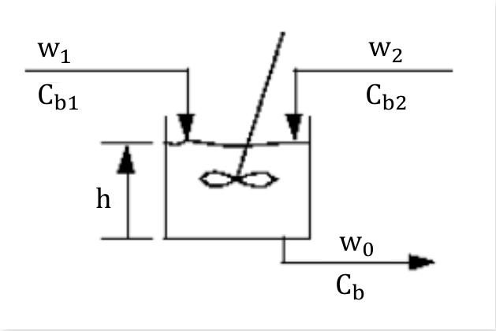

*Figure 14. The two feed streams and the outlet stream of a continuous stirred tank reactor*

**Derivation of the model.** Taking the cross-sectional area of the tank as 1, the liquid volume is $h$, and assuming perfect mixing, the concentration of the outlet stream equals the concentration $C_b$ in the tank. The outflow is proportional to the square root of the level, $w_0 = 0.2\sqrt{h}$. The volume balance (what flows in minus what flows out equals the accumulation) gives the first equation, $dh/dt = w_1 + w_2 - w_0$. The balance of the amount of product $hC_b$, including its consumption by the reaction at the rate $r(C_b) = k_1C_b/(1 + k_2C_b)^2$ per unit volume, is

$$
\frac{d(hC_b)}{dt} = w_1C_{b1} + w_2C_{b2} - w_0C_b - h\,r(C_b)
$$

Expanding the left side by the product rule as $h\,\dot{C}_b + C_b\,\dot{h}$ and substituting $\dot{h} = w_1 + w_2 - w_0$ cancels the $w_0C_b$ terms, which gives

$$
h\frac{dC_b}{dt} = w_1(C_{b1} - C_b) + w_2(C_{b2} - C_b) - h\,r(C_b)
$$

and dividing both sides by $h$ gives the second equation.

**Example: steady state.** Find the steady state when $w_1 = w_2 = 0.1$ are constant. From the first equation, $dh/dt = 0$ gives $0.2\sqrt{h} = 0.2$, so $h = 1$. From the second equation, $dC_b/dt = 0$ gives

$$
(24.9 - C_b)(0.1) + (0.1 - C_b)(0.1) = \frac{C_b}{(1 + C_b)^2} \quad\Longrightarrow\quad 2.5 - 0.2C_b = \frac{C_b}{(1 + C_b)^2}
$$

Multiplying both sides by $(1 + C_b)^2$ gives a cubic equation, and solving it numerically gives $C_b \approx 12.15$ (check: left side $2.5 - 2.430 = 0.070$, right side $12.15/13.15^2 = 0.070$). The plant is nonlinear enough that even finding its steady state requires solving a nonlinear equation.

> **Note:** This application is sometimes presented as fixing $w_1 = 0.1$ and adjusting the flow $w_2$ of the dilute feed. However, increasing $w_2$ dilutes the tank: the steady-state concentration is about 12.15 at $w_2 = 0.1$ as in the example above and becomes even lower as $w_2$ grows. The plant outputs in Figures 16 and 18 below lie in the range 20-23, which corresponds to the configuration of the MATLAB example, where the flow $w_1$ of the concentrated feed is adjusted and $w_2 = 0.1$ is fixed [8]. The plant input in the following figures should therefore be read as the flow of the concentrated feed.

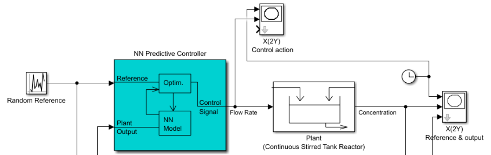

*Figure 15. Neural network predictive control of the continuous stirred tank reactor built in Simulink*

In Figure 15, the Random Reference block produces a reference concentration shaped like random steps, and the NN Predictive Controller block receives the reference (Reference) and the plant output (Plant Output) and produces the control signal (Control Signal). This block contains the optimization (Optim.) and the neural network model (NN Model). The control signal enters the plant (CSTR) as the flow rate (Flow Rate), and the plant outputs the concentration (Concentration). The X(2Y) blocks are graph windows that plot the control action and the reference and output against time.

**Training data.** The training data are generated by applying to the plant a random input consisting of a series of pulses of random amplitude and duration. The amplitude of the input flow ranges from 0 to 4 $\mathrm{cm^3/s}$, and the pulse width ranges from 5 to 20 seconds.

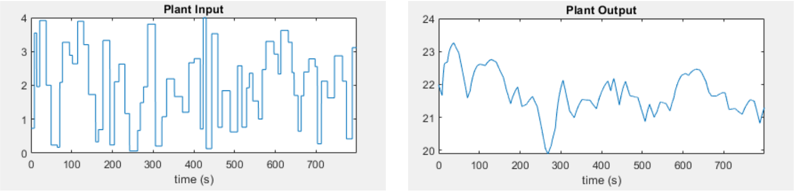

*Figure 16. Input data and output data for the identification of the continuous stirred tank reactor*

**Neural network plant model.** Three delayed values of the input flow ($m = 3$) and three delayed values of $C_b(t)$ ($n = 3$) are used as network inputs, and three neurons are used in the hidden layer. That is, the network has 6 inputs, 3 hidden neurons, and 1 output. The training record is in Table 5.

| Item | Initial value | Stopped value | Target value |
|:-----|:-----|:-----|:-----|
| Epoch | 0 | 6 | 200 |
| Elapsed time | - | 00:00:00 | - |
| Performance (MSE) | $1.95\times10^{-6}$ | $1.03\times10^{-6}$ | 0 |
| Gradient | 0.0273 | 0.0185 | $10^{-10}$ |
| $\mu$ | 0.001 | $10^{-7}$ | $10^{10}$ |
| Validation checks | 0 | 6 | 6 |

*Table 5. Training record of the neural network plant model of the continuous stirred tank reactor*

The data were divided into training, validation, and test segments by specified indices (`divideind`), the training algorithm is Levenberg-Marquardt (`trainlm`), and the performance function is the mean squared error (`mse`). The target value column of the table gives the conditions that stop training. `trainlm` stops when the epoch count reaches its maximum, the performance reaches the goal, the gradient falls below its minimum, $\mu$ exceeds its maximum, or the number of times the validation error has increased since its last decrease reaches a specified value (`max_fail`, 6 by default) [9]. Here training stopped at epoch 6 because the validation checks reached 6.

The Levenberg-Marquardt algorithm updates the weight vector $\mathbf{w}$ as follows [9]. $\mathbf{J}_e$ is the Jacobian matrix of the error vector $\mathbf{e}$ with respect to the weights, a symbol different from the performance index $J$ of Section 2.5.

$$
\Delta\mathbf{w} = -\big(\mathbf{J}_e^T\mathbf{J}_e + \mu\mathbf{I}\big)^{-1}\mathbf{J}_e^T\mathbf{e}
$$

When $\mu$ is small, the update approaches the Gauss-Newton method, which uses a quadratic approximation and converges quickly near the minimum; when $\mu$ is large, it approaches gradient descent with a small step, which is stable. If an update worsens the performance, $\mu$ is multiplied by 10 and the step is retried, and if the performance improves, the update is accepted and $\mu$ is multiplied by 0.1 [9]. The decrease of $\mu$ from 0.001 to $10^{-7}$ in Table 5 means that updates kept succeeding and the algorithm moved toward the Gauss-Newton method.

> **[Machine Learning]** Early stopping is a regularization technique that checks, at every epoch, the error on validation data set aside from the training data and stops training when the validation error fails to decrease a given number of consecutive times. If the validation error starts to rise while the training error keeps falling, overfitting has begun, so the weights from just before that point are used.

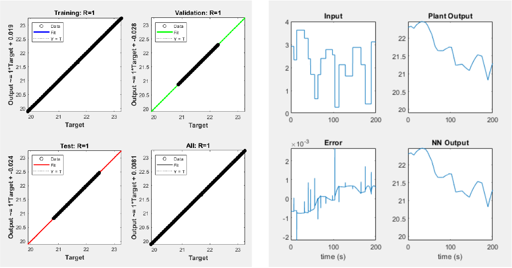

*Figure 17. Regression plots of network output against target on the training, validation, and test data, and time responses on the test data*

The four regression plots on the left of Figure 17 have the target on the horizontal axis and the network output on the vertical axis, and $R = 1$ (the R value of Week 12) on the training, validation, test, and all data. The fitted lines, such as `Output ~= 1*Target + 0.019`, also have slope 1 and intercepts close to 0. The right side shows the input, the plant output, the network output, and the error on the test data; the plant output and the network output are almost the same, and the error is mostly within $\pm 2\times10^{-3}$.

**Control results.** The controller parameters are set to $N_2 = 7$, $N_u = 3$, and $\rho = 0.01$, and the sampling interval of the controller is 0.1 seconds.

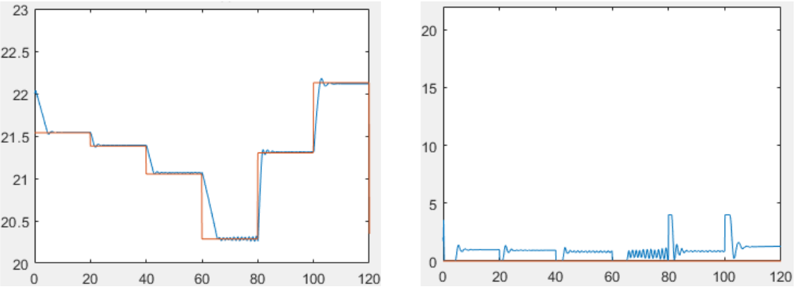

*Figure 18. Reference and output, and control action, of neural network predictive control*

On the left of Figure 18, the orange reference changes every 20 seconds to a value between about 20.3 and 22.1, and the blue output follows the reference quickly each time. The steady-state error is small, and the transient performance is adequate in all tested regions. The control action on the right lies mostly in the range of about 0.8-1.3 $\mathrm{cm^3/s}$. During the first few seconds, when the output is above the reference, and right after the reference steps down at 20, 40, and 60 seconds, the input briefly drops to 0 while the concentration falls, and at 80 and 100 seconds, when the reference steps up, the input briefly rises to about 4. In the interval from 60 to 80 seconds, where the output is lowest, the input oscillates slightly. Because $\rho$ penalizes the input increments, the control signal is smoother than the results of Sections 3.3 and 3.5.

---

<br>

## 3. Neural Network Controllers II: NARMA-L2 Control and Model Reference Control

### 3.1 The NARMA-L2 Model and Feedback Linearization

In NARMA-L2 control, the first step is also to identify the system to be controlled. Finding the input $u(k)$ that gives $y(k+d) = y_r(k+d)$ with the NARMA model of Section 2.4 requires solving the nonlinear equation $N[\ldots, u(k), \ldots] = y_r(k+d)$ at every sample. Since this needs iterative computation, as in predictive control, NARMA-L2 approximates the plant model with a particular form that is easy to solve for the input.

> **Definition:** **Feedback linearization** is a control method that transforms nonlinear system dynamics into linear dynamics by computing, from the measured state or output, an input that cancels the nonlinearities of the plant. It can be used when the plant model has a particular form (the companion form).

The NARMA-L2 approximate model is as follows [10], [11].

$$
\hat{y}(k+d) = f\big[y(k), \ldots, y(k-n+1), u(k-1), \ldots, u(k-m+1)\big] + g\big[y(k), \ldots, y(k-n+1), u(k-1), \ldots, u(k-m+1)\big]\cdot u(k)
$$

The two functions $f$ and $g$ depend only on past outputs and past inputs and do not contain the next controller input $u(k)$. Since $u(k)$ is not inside the nonlinear functions and is only multiplied by $g$, the output is of first degree in $u(k)$. This is the companion form of NARMA-L2, and NARMA-L2 is one of the approximate models of the NARMA model proposed by Narendra and Mukhopadhyay [11]. In this form, setting $\hat{y}(k+d) = y_r(k+d)$ lets us solve for $u(k)$ directly.

$$
u(k) = \frac{y_r(k+d) - f\big[y(k), \ldots, y(k-n+1), u(k-1), \ldots, u(k-m+1)\big]}{g\big[y(k), \ldots, y(k-n+1), u(k-1), \ldots, u(k-m+1)\big]}
$$

Substituting this input back into the model gives $\hat{y}(k+d) = f + g\cdot(y_r(k+d) - f)/g = y_r(k+d)$. However nonlinear $f$ and $g$ are, the model output becomes the linear relationship $\hat{y}(k+d) = y_r(k+d)$, a delay of $d$ samples, and the more accurately the model approximates the plant, the closer the actual output $y(k+d)$ comes to this relationship. If $y_r$ is generated by a linear reference model, the whole closed loop behaves like that linear reference model. This removal of the nonlinearity is the key idea of feedback linearization.

**Example: computing the feedback linearizing input.** Let the plant already be in the companion form $y(k+1) = 0.5\sin y(k) + \big(1 + 0.5\,y(k)^2\big)u(k)$ ($d = 1$). Here $f = 0.5\sin y(k)$ and $g = 1 + 0.5\,y(k)^2$, and since $g \ge 1$, the denominator is never zero. To make the next output $y_r(k+1) = 0.5$ from the current output $y(k) = 1$,

$$
f = 0.5\sin 1 = 0.4207, \qquad g = 1 + 0.5(1)^2 = 1.5, \qquad u(k) = \frac{0.5 - 0.4207}{1.5} = 0.0528
$$

and the check gives $y(k+1) = 0.4207 + 1.5 \times 0.0528 = 0.5$.

**A realizable form.** The control law above needs the output $y(k)$ at the same time step to compute $u(k)$, which poses an implementation problem: measurement and computation would have to finish instantaneously. In practice, therefore, the following model with $d \ge 2$ is used, and the input one sample later, $u(k+1)$, is computed [10].

$$
y(k+d) = f\big[y(k), \ldots, y(k-n+1), u(k), \ldots, u(k-n+1)\big] + g\big[y(k), \ldots, y(k-n+1), u(k), \ldots, u(k-n+1)\big]\cdot u(k+1)
$$

$$
u(k+1) = \frac{y_r(k+d) - f\big[y(k), \ldots, y(k-n+1), u(k), \ldots, u(k-n+1)\big]}{g\big[y(k), \ldots, y(k-n+1), u(k), \ldots, u(k-n+1)\big]}, \qquad d \ge 2
$$

> **Definition:** A **tapped delay line (TDL)** is a block that stores previous values of its input signal and outputs the current and past values together as a vector. It lets a neural network receive past inputs and past outputs.

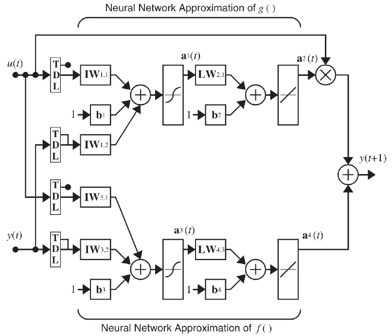

*Figure 19. Structure of the NARMA-L2 plant model*

In Figure 19, $t$ means the same as the discrete time $k$; $\mathbf{IW}$ denotes input weights, $\mathbf{LW}$ layer weights, $\mathbf{b}$ biases, and $\mathbf{a}$ layer outputs. The input $u(t)$ and the output $y(t)$ each pass through TDLs into the two subnetworks; consistent with the equation, the TDLs on the $u$ side output past inputs, and those on the $y$ side output the current and past outputs. The upper subnetwork (layers 1 and 2) passes through an S-shaped hidden layer $\mathbf{a}^1(t)$ and a linear output layer to give $\mathbf{a}^2(t) \approx g$, and the lower subnetwork (layers 3 and 4) gives $\mathbf{a}^4(t) \approx f$ with the same structure. Finally, the multiplication block multiplies $\mathbf{a}^2(t)$ by $u(t)$, and the addition block adds $\mathbf{a}^4(t)$ to give $\hat{y}(t+1) = \mathbf{a}^4(t) + \mathbf{a}^2(t)\,u(t)$.

### 3.2 The NARMA-L2 Controller

The advantage of the neural network plant model is that it directly provides the control input that makes the system output follow the reference signal, $y(k+d) = y_r(k+d)$. The NARMA-L2 controller is a rearrangement of the trained $f$ and $g$ subnetworks according to the control law of Section 3.1.

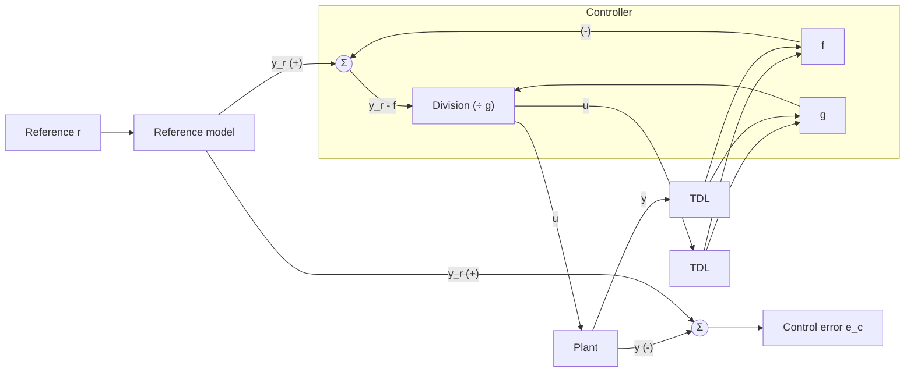

*Figure 20. Structure of the NARMA-L2 controller*

The reference model produces the desired response $y_r$ from the reference signal $r$. Inside the controller, $f$ and $g$ are computed from the past inputs and outputs stored in the TDLs, and $y_r - f$ is divided by $g$ to produce the input $u$. No separate controller network has to be trained, and online only the forward passes of the two subnetworks and one division are needed, so it requires the least computation of the three controllers [6]. However, it can be used only when the plant is in companion form or can be approximated by that form [6].

> **Caution:** When $g$ is close to zero, the division makes the input very large, and the estimation error of $g$ is amplified just as much. Practical implementations put upper and lower limits on the input, so the computed input may hit those limits frequently.

### 3.3 Application: Magnetic Levitation System

The objective of the **magnetic levitation system** is to control the position of a magnet suspended above an electromagnet. The magnet can move only vertically, and the sampling interval of the controller is 0.01 seconds. The equation of motion is as follows.

$$
\frac{d^2y(t)}{dt^2} = -g + \frac{\alpha}{M}\frac{i^2(t)\,\mathrm{sgn}[i(t)]}{y(t)} - \frac{\beta}{M}\frac{dy(t)}{dt}
$$

- $y(t)$: distance of the magnet above the electromagnet
- $i(t)$: current flowing in the electromagnet
- $M$: mass of the magnet (3)
- $g$: gravitational acceleration (9.8). This is a different symbol from the function $g$ of Section 3.1.
- $\alpha$: field strength constant (15)
- $\beta$: viscous friction coefficient (12)

> **Note:** $\alpha$ and $\beta$ are sometimes labeled the other way round, as the viscous friction coefficient and the field strength constant. In the equation of motion, $\alpha$ multiplies the magnetic force term and $\beta$ multiplies the velocity term, so $\alpha$ is the field strength constant determined by the number of turns of wire on the electromagnet and the strength of the magnet, and $\beta$ is the viscous friction coefficient determined by the material in which the magnet moves [10]. The values (15 and 12) are unchanged.

The three terms on the right side are, per unit mass, gravity pulling downward, the magnetic force that pushes the magnet upward in proportion to the square of the current and in inverse proportion to the distance, and the friction force that opposes the motion in proportion to the velocity. $\mathrm{sgn}[i(t)]$ is the sign of the current, which is 1 here because the current is used only in the positive range 0-4 A.

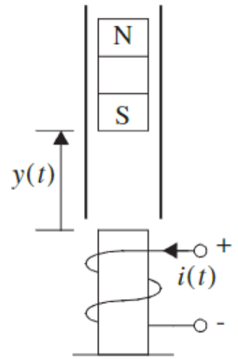

*Figure 21. The magnetic levitation system: an electromagnet and a magnet floating above it*

**Example: equilibrium current.** Holding the magnet still at $y = 2$ requires $\ddot{y} = 0$ and $\dot{y} = 0$. Substituting into the equation of motion gives

$$
0 = -9.8 + \frac{15}{3}\cdot\frac{i^2}{2} \quad\Longrightarrow\quad 2.5\,i^2 = 9.8 \quad\Longrightarrow\quad i = \sqrt{3.92} = 1.980\ \mathrm{A}
$$

In general, the equilibrium current at position $y$ is $i = \sqrt{gMy/\alpha}$, and the highest position that can be held with the current limit of 4 A is $y = \alpha i^2/(Mg) = 15 \cdot 16/(3 \cdot 9.8) = 8.16$. Because the force is proportional to $i^2$ rather than $i$, the NARMA-L2 assumption that the output is of first degree in the current input is an approximation for this plant.

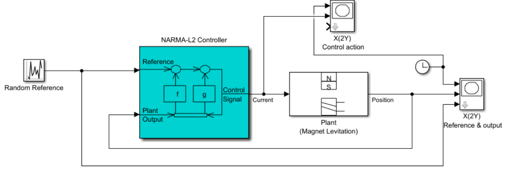

*Figure 22. NARMA-L2 control of the magnetic levitation system built in Simulink*

The NARMA-L2 Controller block in Figure 22 contains the $f$ and $g$ subnetworks, a summing point that subtracts $f$ from the reference, and a block that divides by $g$. The control signal enters the plant (Magnet Levitation) as the current (Current), and the plant outputs the position (Position).

**Training data.** The training data are generated by applying a random input consisting of pulses of random amplitude and duration. The amplitude of the current $i(t)$ ranges from 0 to 4 A, and the pulse width ranges from 0.01 to 5 seconds.

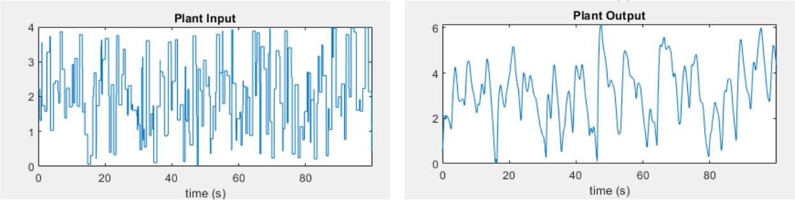

*Figure 23. Input data and output data for the identification of the magnetic levitation system*

**Neural network plant model.** Three delayed current values ($m = 3$) and two delayed magnet positions ($n = 2$) are used as network inputs, and nine neurons are used in the hidden layer. The sampling interval is 0.01 seconds. The training record is in Table 6.

| Item | Initial value | Stopped value | Target value |
|:-----|:-----|:-----|:-----|
| Epoch | 0 | 100 | 100 |
| Elapsed time | - | 00:00:03 | - |
| Performance (MSE) | 0.16 | $2.63\times10^{-7}$ | 0 |
| Gradient | 0.679 | $7.48\times10^{-4}$ | $10^{-10}$ |
| $\mu$ | 0.001 | $10^{-7}$ | $10^{10}$ |
| Validation checks | 0 | 0 | 6 |

*Table 6. Training record of the neural network plant model of the magnetic levitation system*

The data division is `divideind`, the training algorithm is Levenberg-Marquardt (`trainlm`), and the performance function is `mse`. This time training stopped when it reached the maximum of 100 epochs without validation failures, and during that time the performance fell from 0.16 to $2.63\times10^{-7}$, by a factor of about 600,000.

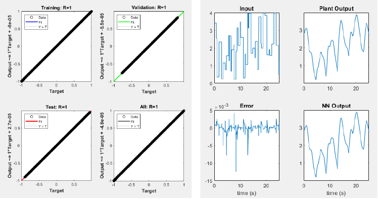

*Figure 24. Regression plots and time responses on the test data of the magnetic levitation plant model*

The regression plots in Figure 24 are drawn in scaled units ($-1$ to $1$), and $R = 1$ on all four data sets. On the test data, the network output is almost the same as the plant output, and apart from a few short spikes the error is mostly within $\pm 5\times10^{-3}$.

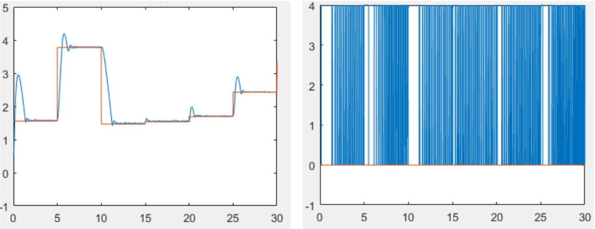

*Figure 25. Reference and output, and control action, of NARMA-L2 control*

On the left of Figure 25, the output tracks the reference accurately without significant overshoot. Short overshoots appear at the moments the reference changes, but the output soon settles at the reference value. However, the control signal on the right switches very rapidly between the lower input limit 0 and the upper limit 4, and such an oscillatory control signal is a phenomenon generally seen in NARMA-L2 controllers. The reasons are as follows.

- The control law $u = (y_r - f)/g$ chooses the input so that the output equals the reference right after $d$ samples, and it has no term that penalizes the size or change of the input, like $\rho$ in predictive control.
- Because of the division by $g$, small estimation errors in $f$ and $g$ are greatly amplified in the input.
- When the computed input exceeds the input limits (0 A and 4 A), it is clipped to the limit, so the control signal ends up switching between the two limits.

### 3.4 Model Reference Control

**Model reference control** uses two neural networks: a plant model network and a controller network. The plant model is identified first, and then the controller is trained so that the plant output follows the output of the reference model [12]. Unlike NARMA-L2 control, this architecture requires training a separate neural network controller in addition to the neural network plant model.

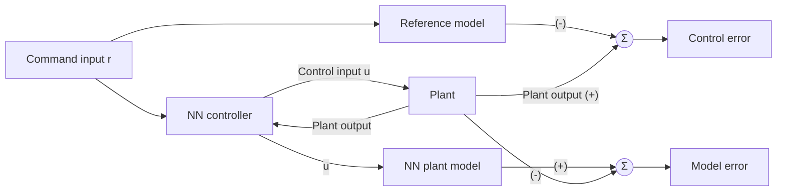

*Figure 26. Architecture of model reference control*

The model error (the difference between the output of the neural network plant model and the plant output) is used to identify the plant model, and the control error (the difference between the plant output and the reference model output) is used to train the controller. The controller is a feedback controller that receives the plant output. The inputs of the two networks are listed in Table 7 [12].

| Network | Input sets |
|:-----|:-----|
| Neural network controller | 1. Delayed reference inputs<br>2. Delayed controller outputs (plant inputs)<br>3. Delayed plant outputs |
| Neural network plant model | 1. Delayed controller outputs<br>2. Delayed plant outputs |

*Table 7. Inputs of the neural network controller and the neural network plant model*

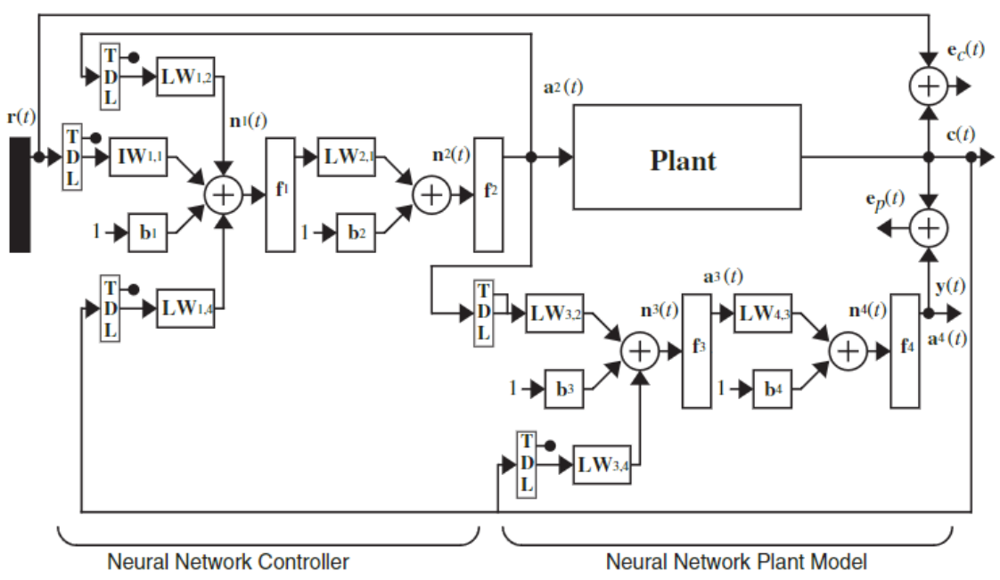

*Figure 27. Detailed structure of model reference control*

In Figure 27, layers 1 and 2 are the neural network controller. Layer 1 adds the delayed values of the reference $\mathbf{r}(t)$ ($\mathbf{IW}^{1,1}$), the delayed values of the controller output ($\mathbf{LW}^{1,2}$), the delayed values of the plant output $\mathbf{c}(t)$ ($\mathbf{LW}^{1,4}$), and the bias to form the net input $\mathbf{n}^1(t)$, which passes through the transfer function $\mathbf{f}^1$. The output $\mathbf{a}^2(t)$ of layer 2 is the control input applied to the plant. Layers 3 and 4 are the neural network plant model, which receives the delayed values of the control input ($\mathbf{LW}^{3,2}$) and of the plant output ($\mathbf{LW}^{3,4}$) and produces the model output $\mathbf{y}(t) = \mathbf{a}^4(t)$. The two summing points on the right form the control error $\mathbf{e}_c(t)$ and the plant model error $\mathbf{e}_p(t)$.

**Training the controller.** Changing the controller weights to reduce the control error requires the derivative of the plant, as in Section 1.6, so the neural network plant model with fixed weights is used in place of the plant, and the control error is backpropagated through the model to the controller. However, both the controller and the plant model are feedback structures that take delayed outputs of themselves and of each other as inputs. Changing a controller weight $w$ changes not only the current output but also past outputs, and the past outputs in turn affect the current output. The total derivative of the model output $c(k)$ with respect to $w$ is therefore

$$
\frac{dc(k)}{dw} = \sum_{i}\frac{\partial c(k)}{\partial u(k-i)}\frac{du(k-i)}{dw} + \sum_{i}\frac{\partial c(k)}{\partial c(k-i)}\frac{dc(k-i)}{dw}
$$

which contains the derivatives $du(k-i)/dw$ and $dc(k-i)/dw$ at past time steps, and these derivatives in turn depend on derivatives further in the past in the same way. This method of computing derivatives recursively along time is called **dynamic backpropagation**, and because it is computationally expensive, training the controller is much slower than training the plant model [6], [12].

> **[Deep Learning]** A recurrent neural network (RNN) is a network that takes its own past outputs or hidden states as inputs again, and it is trained by backpropagation through time (BPTT), which unrolls the network along the time axis and backpropagates through it. The more steps are unrolled, the more derivatives are multiplied together, so gradients can explode or vanish. Training the controller in model reference control is the same as regarding the whole closed loop of the controller and the plant model as one recurrent network and computing derivatives in this way.

### 3.5 Application: Robot Arm Control

The objective is to make a single-link robot arm track a reference model. The first neural network (the plant model) learns the equation of motion of the arm, and the second neural network (the controller) learns the input that makes the closed loop behave like the reference model. The equation of motion of the arm (left) and the reference model (right) are as follows.

$$
\frac{d^2\phi}{dt^2} = -10\sin\phi - 2\frac{d\phi}{dt} + u, \qquad \frac{d^2y_r}{dt^2} = -9y_r - 6\frac{dy_r}{dt} + 9r
$$

- $\phi$: angle of the arm (rad), $u$: torque supplied by the DC motor
- $y_r$: output of the reference model, $r$: input reference signal

In the arm equation, $-10\sin\phi$ is the gravity torque that tries to bring the arm back down and $-2\dot{\phi}$ is the friction torque, with the coefficients divided by the moment of inertia of the arm.

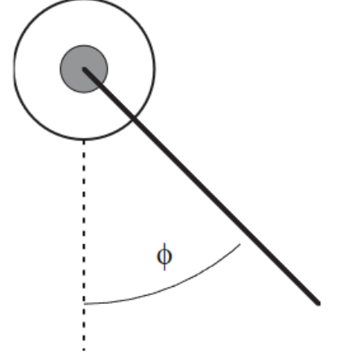

*Figure 28. A single-link robot arm and the angle of the arm*

**Example 1: response of the reference model.** Taking the Laplace transform (Week 3) of the reference model with zero initial conditions gives $s^2Y_r + 6sY_r + 9Y_r = 9R$, so

$$
\frac{Y_r(s)}{R(s)} = \frac{9}{s^2 + 6s + 9} = \frac{9}{(s + 3)^2}
$$

Comparing with the standard second-order form $\omega_n^2/(s^2 + 2\zeta\omega_ns + \omega_n^2)$ of Week 7, $\omega_n^2 = 9$ gives the natural frequency $\omega_n = 3\ \mathrm{rad/s}$, and $2\zeta\omega_n = 6$ gives the damping ratio $\zeta = 1$. With a double pole at $-3$, the system is critically damped, so the reference model specifies the fastest response that reaches the reference without overshoot for the given natural frequency of $3\ \mathrm{rad/s}$. Expanding the response to the unit step input $R(s) = 1/s$ into partial fractions,

$$
Y_r(s) = \frac{9}{s(s + 3)^2} = \frac{A}{s} + \frac{B}{s + 3} + \frac{C}{(s + 3)^2}
$$

$$
A = \left.\frac{9}{(s + 3)^2}\right|_{s=0} = 1, \qquad C = \left.\frac{9}{s}\right|_{s=-3} = -3
$$

and comparing the $s^2$ coefficients of $9 = A(s + 3)^2 + Bs(s + 3) + Cs$ gives $0 = A + B$, so $B = -1$. The inverse Laplace transform is

$$
y_r(t) = 1 - e^{-3t} - 3te^{-3t} = 1 - (1 + 3t)e^{-3t}, \qquad t \ge 0
$$

$y_r(0.5) = 1 - 2.5e^{-1.5} = 1 - 2.5(0.2231) = 0.4422$, $y_r(1) = 1 - 4e^{-3} = 1 - 4(0.0498) = 0.8009$, and $y_r(2) = 1 - 7e^{-6} = 1 - 7(0.00248) = 0.9826$. Solving $(1 + 3t)e^{-3t} = 0.02$ gives a 2% settling time of about 1.94 seconds, and the 10%-to-90% rise time is about 1.12 seconds. If the reference changes by a step of 0.5 rad, the target angle of the arm follows $0.5\,y_r(t)$.

**Example 2: response of the uncontrolled arm.** If $\phi$ is near 0, $\sin\phi \approx \phi$, so the arm equation linearizes to $\ddot{\phi} + 2\dot{\phi} + 10\phi = u$. With $\omega_n = \sqrt{10} \approx 3.162$ and $2\zeta\omega_n = 2$, $\zeta = 1/\sqrt{10} \approx 0.316$, an underdamped system. Since $\zeta/\sqrt{1 - \zeta^2} = (1/\sqrt{10})/(3/\sqrt{10}) = 1/3$, the maximum overshoot is

$$
M_p = e^{-\zeta\pi/\sqrt{1 - \zeta^2}} = e^{-\pi/3} \approx 0.351
$$

about 35.1%. That is, applying a constant step of torque makes the arm swing widely, so the controller must turn this response into the critically damped response of Example 1. Also, to stay at rest at angle $\phi$, $\ddot{\phi} = \dot{\phi} = 0$, so a torque $u = 10\sin\phi$ is needed continuously. For example, holding $\phi = \pi/6$ (30°) requires $u = 10\sin(\pi/6) = 5$, and holding $\phi = -0.4$ rad requires $u = 10\sin(-0.4) = -3.89$.

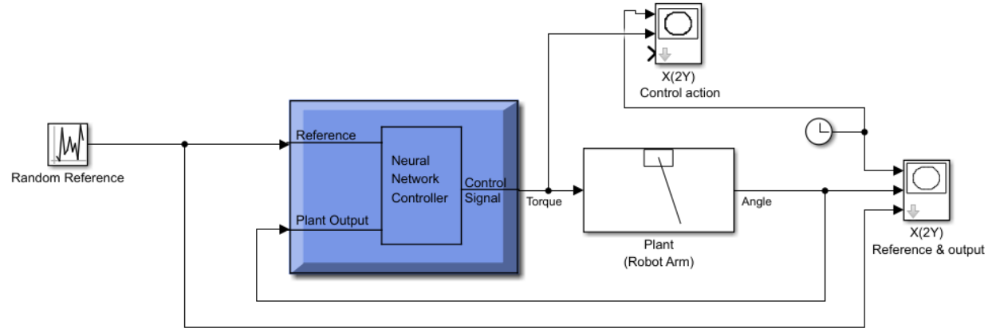

*Figure 29. Model reference control of the robot arm built in Simulink*

In Figure 29, the Neural Network Controller block receives the reference (Reference) and the plant output (Plant Output) and produces the control signal, which enters the plant (Robot Arm) as the torque (Torque), and the plant outputs the angle (Angle).

**Identification of the plant model.** The plant model is identified first. The system is identified with input pulses that change at intervals of 0.1 to 2 seconds and have amplitudes from $-15$ to $15\ \mathrm{N\cdot m}$.

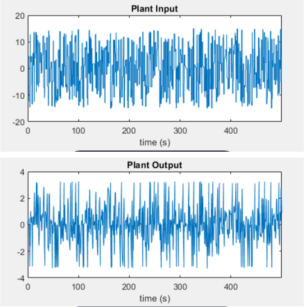

*Figure 30. Input data and output data for the identification of the robot arm*

The neural network plant model uses two delayed values of the torque ($m = 2$) and two delayed values of the arm position ($n = 2$) as network inputs, and ten neurons in the hidden layer. The sampling interval is 0.05 seconds. The training record is in Table 8.

| Item | Initial value | Stopped value | Target value |
|:-----|:-----|:-----|:-----|
| Epoch | 0 | 6 | 300 |
| Elapsed time | - | 00:00:00 | - |
| Performance (MSE) | $3.71\times10^{-10}$ | $2.83\times10^{-10}$ | 0 |
| Gradient | $6.22\times10^{-5}$ | $3.03\times10^{-5}$ | $10^{-10}$ |
| $\mu$ | 0.001 | $10^{-8}$ | $10^{10}$ |
| Validation checks | 0 | 6 | 6 |

*Table 8. Training record of the neural network plant model of the robot arm*

The data division is `divideind`, the training algorithm is `trainlm`, and the performance function is `mse`; training stopped at epoch 6 because the validation checks reached 6. The performance was at the $10^{-10}$ level from the start, so the model is very accurate.

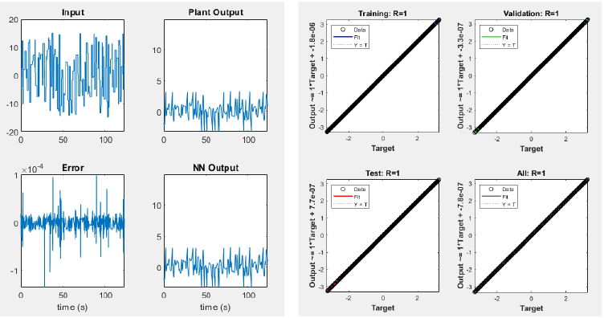

*Figure 31. Responses on the test data and regression plots of the robot arm plant model*

In Figure 31, the network output overlaps the plant output, the error is at the $10^{-4}$ level, and $R = 1$ in the regression plots of all four data sets.

**Training the controller.** Next, the model reference controller is trained. Reference input pulses that change at intervals of 0.1 to 2 seconds and take values from $-0.7$ to $0.7$ rad are fed to the reference model to produce the reference model output that the controller must follow.

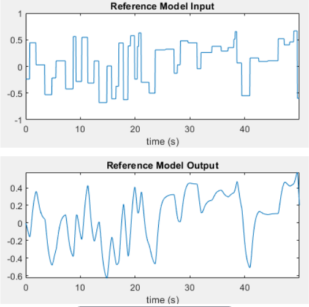

*Figure 32. Input and output of the reference model used to train the controller*

The controller network uses two delayed reference inputs, two delayed plant outputs, and one delayed controller output as inputs, and 13 neurons in the hidden layer. That is, the network has 5 inputs, 13 hidden neurons, and 1 output [12]. The sampling interval is 0.05 seconds. The training record is in Table 9.

| Item | Initial value | Stopped value | Target value |
|:-----|:-----|:-----|:-----|
| Epoch | 0 | 1 | 10 |
| Elapsed time | - | 00:00:00 | - |
| Performance (MSE) | 0.00307 | 0.00307 | 0 |
| Gradient | $4.49\times10^{10}$ | $4.49\times10^{10}$ | $10^{-7}$ |
| $\mu$ | 0.001 | $10^{11}$ | $10^{10}$ |
| Validation checks | 0 | 0 | 6 |

*Table 9. Training record of the neural network controller of the robot arm*

The data were divided at random (`dividerand`), the training algorithm is `trainlm`, and the performance function is `mse`.

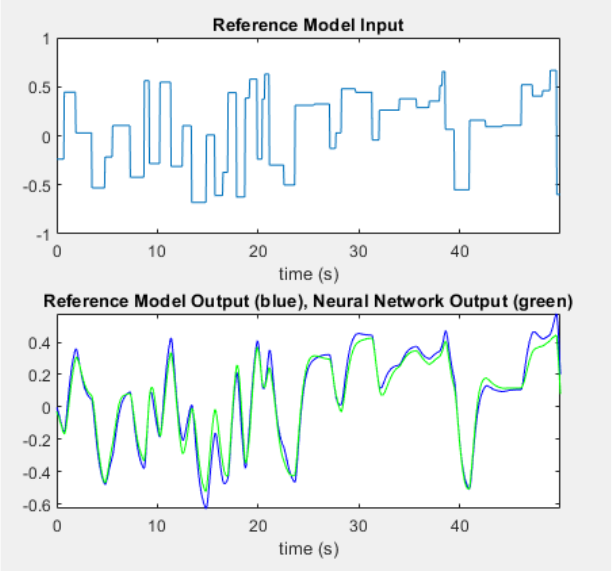

*Figure 33. Output of the reference model and output of the closed loop with the neural network controller*

In Figure 33, the output of the closed loop with the neural network controller (green) almost overlaps the output of the reference model (blue).

> **Note:** In Table 9, the gradient is very large at $4.49\times10^{10}$, updates did not succeed, and training stopped after a single epoch when $\mu$ exceeded its maximum of $10^{10}$, with no decrease in performance from 0.00307. Gradients can become very large like this in the recursive derivative computation of Section 3.4. The MATLAB example trains the controller on several segments of the training data, a few iterations per segment, and training can be continued with the same or new data if the performance is not adequate [12].

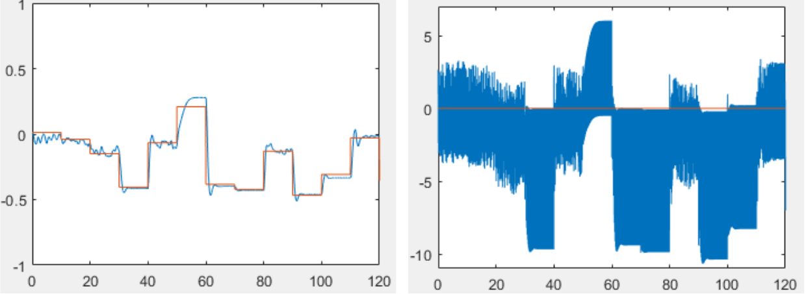

*Figure 34. Reference and output, and control action, of the robot arm under model reference control*

On the left of Figure 34, the arm angle (blue) follows the reference (orange), which changes like a staircase between about $-0.45$ and $0.3$ rad, and the response at each change of the reference has a shape similar to that of the reference model, without swinging. That is, the system can follow the reference.

> **Note:** The control action in this result is sometimes described as smooth. However, the control signal on the right of Figure 34 oscillates very rapidly within a wide band (about $-10$ to $6\ \mathrm{N\cdot m}$), so it can hardly be called smooth. This is the result of controller training that stopped after one epoch, as shown in Table 9, so there is room to improve the control signal by training the controller further.

### 3.6 Comparison of the Three Controllers

| Item | Neural network predictive control | NARMA-L2 control | Model reference control |
|:-----|:-----|:-----|:-----|
| Networks used | One plant model | One plant model that approximates $f$ and $g$ | Two: a plant model and a controller |
| How the control input is determined | Numerical optimization of $J$ at every sample | Rearrangement of the plant model, $u = (y_r - f)/g$ | Forward pass of the trained controller network |
| Online computation | Largest | Smallest | Small |
| Offline training | Plant model only | Plant model only | Plant model and controller (the controller is expensive because of dynamic backpropagation) |
| Range of application | General nonlinear plants | Plants in companion form or approximable by it | A wider range of plants than NARMA-L2 |
| Control signal in the applications | Relatively smooth (adjusted by $\rho$) | Strong oscillation between the upper and lower input limits | Rapid oscillation within a wide band |

*Table 10. Comparison of the three neural network controllers*

The comparison of computation and range of application is based on the MATLAB documentation [6], and the last row summarizes the results of the applications in Sections 2.6, 3.3, and 3.5. Predictive control suits cases with ample computing resources where the change of the input should be regulated, NARMA-L2 control suits cases with scarce computing resources and a plant close to companion form, and model reference control suits cases with scarce computing resources and a plant that cannot be approximated in companion form.

---

<br>

## Concept Applications

| Situation | Suitable method | Reason |
|:-----|:-----|:-----|
| A process that a skilled operator has run by hand is to be automated | Control by emulation | If the operator's manipulated values and the measurements at those times are recorded, a neural network can be trained to imitate the operator's actions |
| A combination of the valve and the window that gives a desired indoor temperature needs to be found once | Inverse mapping | Feed many candidate inputs to the forward model and pick the inputs that satisfy the target output |
| Computing resources are ample, and abrupt input changes damage the actuator | Neural network predictive control | Penalizing the input increments with $\rho$ makes the control signal smooth |
| The onboard computer has little computing power, and the plant is close to companion form | NARMA-L2 control | The online computation is only the forward passes of two subnetworks and one division |
| The plant cannot be approximated in companion form, and the online computation must be small | Model reference control | Once the controller is trained offline, only a forward pass is needed online |

*Table 11. Suitable neural network control methods for different situations*

**True/False Check:**

| Statement | Judgment and Reason |
|:-----|:-----|
| In the indirect method, the controller itself must be a neural network. | **F.** The controller of the indirect method may not be a neural network; the key point is that it is derived from a plant model built with a neural network. |
| Neural network predictive control applies the whole input sequence obtained by optimization to the plant in order. | **F.** It applies only the first input and repeats the optimization with a new measurement at the next sample, which is the receding horizon method. |
| NARMA-L2 control does not need to train a separate controller network. | **T.** The controller is a rearrangement of $f$ and $g$ of the trained plant model according to the control law. |
| In model reference control, the controller is trained first, and then the plant model is identified. | **F.** The plant model is identified first, and the controller is trained by backpropagating the control error through that model. |
| In predictive control, increasing $\rho$ makes the input change smaller but can increase the tracking error. | **T.** In Table 4, as $\rho$ increases from 0 to 1, the optimal input decreases from 0.769 to 0.588 and the tracking error term increases from 0.077 to 0.183. |
| A solution found by inverse mapping can be trusted even if it lies outside the range of the training data. | **F.** Outside the training data is extrapolation, so there is no guarantee that the network prediction is correct. |

---

<br>

## Summary

| Concept | Key Summary |
|:-----|:-----|
| Motivation for neural network control | Without a mathematical model, the plant can be modeled or a controller built from input-output data, and the approach suits adaptive control. |
| Indirect method | A plant model is identified with a neural network (system identification), the controller is designed from that model, and the controller itself may not be a neural network. |
| Direct method | The neural network is the controller itself; control by emulation, open-loop inverse control, inverse mapping, and inverse dynamics belong to it. |
| Open-loop inverse control | A controller that approximates the inverse of the plant; since the derivative of the plant is unknown, it is trained by backpropagating the error through a neural network plant model. |
| Inverse mapping | Many input samples are fed to the network to find inputs whose outputs satisfy the target; there may be several solutions, and solutions outside the training range are extrapolations. |
| Inverse dynamics | A model that estimates the input from the current state and the next state; putting the desired state in place of the next state turns it into a controller. |
| Neural network predictive control | It predicts future outputs with a neural network plant model and finds the input that minimizes $J$ by numerical optimization at every sample, applying only the first input in the receding horizon manner. |
| Performance index $J$ | The sum of the squared tracking errors from $N_1$ to $N_2$ and $\rho$ times the sum of the squared input increments over $N_u$. |
| NARMA-L2 control | A feedback linearization control that finds the input as $u = (y_r - f)/g$ from a companion-form model approximating the output as $f + g\cdot u$; it needs the least computation, but its control signal tends to oscillate strongly. |
| Model reference control | It uses two networks, a plant model and a controller, and trains the controller with dynamic backpropagation so that the plant output follows the reference model output. |
| Applications | Predictive control was applied to concentration control of a continuous stirred tank reactor, NARMA-L2 control to position control of a magnetic levitation system, and model reference control to angle control of a robot arm. |

---

<br>

## Self-Check Questions

1. **Indirect and direct methods:** State the role of the neural network in each method, and explain why a neural network plant model may be needed even in the direct method.

   <details>
   <summary>Answer</summary>

   In the indirect method, the neural network is a model of the plant (a system identifier), and the controller is designed from that model and may not be a neural network. In the direct method, the neural network is the controller itself. Training the controller weights with the tracking error in the direct method requires the chain-rule factor $\partial y/\partial u$, which is unknown for the real plant. Therefore a differentiable neural network plant model is built, and the error is backpropagated through that model to the controller (Section 1.6).

   </details>

2. **Forward pass:** Use the network of Section 1.3 to predict the indoor temperature for a valve opening of 60% and a window opening of 37%.

   <details>
   <summary>Answer</summary>

   Scaling gives $\tilde{x}_1 = 2(60 - 23)/56 - 1 = 0.3214$ and $\tilde{x}_2 = 2(37 - 20)/60 - 1 = -0.4333$. The net inputs of the hidden layer are $n^1_1 = -0.5153 - 0.8405 - 2.7235 = -4.079$, $n^1_2 = 0.4410 + 0.3576 + 1.4603 = 2.259$, and $n^1_3 = 0.3123 + 0.2929 - 0.5197 = 0.086$, and after $\tanh$, $\mathbf{a}^1 \approx [-0.9994, 0.9784, 0.0854]^T$. The output layer gives $z = 0.6126(-0.9994) + 1.1971(0.9784) + 0.5306(0.0854) - 0.1687 = -0.6122 + 1.1712 + 0.0453 - 0.1687 = 0.4356$, and converting back gives $\hat{y} = 1.4356 \times 3.65 + 21.0 = 26.24$ °C. The measured value is 26.5 °C.

   </details>

3. **Choosing an inverse mapping solution:** Give two criteria for choosing one of the four solutions in Table 3, and state which solution each criterion selects.

   <details>
   <summary>Answer</summary>

   First, by reliability, choose No. 2 (window 60.4%) or No. 4 (window 70.8%), which lie within the range of the training data (window 20-80%). Nos. 1 and 3 have window openings above 80% and are extrapolations. Second, by energy, choose the solution with the smallest valve opening, which is used for heating: No. 3 (56.9%) among all four, or No. 2 (59.2%) among the trustworthy Nos. 2 and 4.

   </details>

4. **Inverse dynamics:** For the system of Section 2.1 with $T = 0.1$ and $\mathbf{x}(k) = [0, 1, 2]^T$, the next state has $x_3(k+1) = 2.5$. Find the applied input $u(k)$ with the Euler approximation, and also give $x_1(k+1)$ and $x_2(k+1)$.

   <details>
   <summary>Answer</summary>

   $u(k) = \frac{1}{9}\left[\frac{2.5 - 2}{0.1} + 5(0) + 2(1) + 3(2)\right] = \frac{5 + 8}{9} = \frac{13}{9} \approx 1.444$. As a check, $\dot{x}_3 = -0 - 2 - 6 + 9(13/9) = 5$ and $x_3(k+1) = 2 + 0.1(5) = 2.5$. The other two states are $x_1(k+1) = 0 + 0.1(1) = 0.1$ and $x_2(k+1) = 1 + 0.1(2) = 1.2$ regardless of the input.

   </details>

5. **Minimizing the performance index:** In the example of Section 2.5, find the optimal input $u^*$, the two predicted outputs, and the value of $J$ for $\rho = 0.5$.

   <details>
   <summary>Answer</summary>

   $u^* = 5/(6.5 + 2 \times 0.5) = 5/7.5 = 0.6667$. Since $y_m(k+1) = 0.6667$ and $y_m(k+2) = 1.5 \times 0.6667 = 1.0$, $J = (1 - 0.6667)^2 + (1 - 1.0)^2 + 0.5(0.6667)^2 = 0.1111 + 0 + 0.2222 = 0.3333$. The error at the second time step is zero, but the error at the first time step remains because of the penalty on the input increment.

   </details>

6. **Receding horizon:** Explain why predictive control applies only the first input to the plant even though the optimization finds all of $u'(k), \ldots, u'(k+N_u-1)$.

   <details>
   <summary>Answer</summary>

   The optimization relies on the predictions of the neural network model, so model errors or disturbances make the actual output differ from the prediction. Applying only the first input and optimizing again with the newly measured output at the next sample reflects that difference every time, which makes the scheme a feedback control. Fixing the remaining inputs in advance and applying them as they are would be open loop and could not correct errors.

   </details>

7. **NARMA-L2 control input:** At some time step, $f = 0.3$, $g = 0.5$, and $y_r(k+d) = 1.3$. Find the control input. If the true $g$ is 0.5 but the network estimates $\hat{g} = 0.4$, what is the output?

   <details>
   <summary>Answer</summary>

   $u = (1.3 - 0.3)/0.5 = 2$. Computing with $\hat{g} = 0.4$ gives $u = 1.0/0.4 = 2.5$, and the actual output becomes $0.3 + 0.5 \times 2.5 = 1.55$, which is 0.25 above the target. A 20% estimation error in $g$ leads to a 25% input error and an output error, and the smaller $g$ is, the larger this amplification becomes.

   </details>

8. **Magnetic levitation system:** Find the equilibrium current that holds the magnet still at $y = 3$.

   <details>
   <summary>Answer</summary>

   Since $\ddot{y} = \dot{y} = 0$, $0 = -9.8 + (15/3)(i^2/3)$, that is, $i^2 = 9.8 \times 3 \times 3/15 = 5.88$ and $i = 2.425$ A. This is the same as substituting into the general formula $i = \sqrt{gMy/\alpha}$.

   </details>

9. **Reference model:** If the reference model is changed to $\ddot{y}_r = -16y_r - 8\dot{y}_r + 16r$, what are the natural frequency, the damping ratio, the unit step response, and the 2% settling time?

   <details>
   <summary>Answer</summary>

   The transfer function is $16/(s^2 + 8s + 16) = 16/(s + 4)^2$, so $\omega_n = 4$ and $\zeta = 1$, still critically damped. The same partial fraction expansion as in Section 3.5 gives $y_r(t) = 1 - (1 + 4t)e^{-4t}$. Since the response is a function of $\omega_nt$, the settling time shortens to $1.94 \times 3/4 \approx 1.46$ seconds. To follow a faster reference model, the controller must produce larger torques.

   </details>

10. **Dynamic backpropagation:** Explain why training the controller in model reference control takes much longer than training the plant model.

    <details>
    <summary>Answer</summary>

    The plant model takes measured past values as inputs in the series-parallel structure, so it is trained by static supervised learning. The controller, on the other hand, sits inside a closed loop where it takes its own past outputs and the past outputs of the plant (model) as inputs, so changing a weight also changes past outputs, and those changes affect the current output again. Dynamic backpropagation, which computes derivatives recursively along time, is therefore needed, and its computation is expensive.

    </details>

11. **Choosing a controller:** A nonlinear plant must be controlled with a microcontroller of low computing power. Which of the three controllers would you choose? Answer separately for a plant close to companion form and for one that is not.

    <details>
    <summary>Answer</summary>

    Predictive control is unsuitable because it requires numerical optimization at every sample. If the plant is close to companion form, choose NARMA-L2 control, whose online computation is only forward passes and one division. If it cannot be approximated in companion form, choose model reference control, which trains the controller offline with dynamic backpropagation and needs only a forward pass online.

    </details>

---

<br>

## References

1. P. J. Werbos, "Neural networks for control and system identification," in *Proceedings of the 28th IEEE Conference on Decision and Control*, 1989, pp. 260-265.
2. K. S. Narendra and K. Parthasarathy, "Identification and control of dynamical systems using neural networks," *IEEE Transactions on Neural Networks*, vol. 1, no. 1, pp. 4-27, 1990.
3. K. Hornik, M. Stinchcombe, and H. White, "Multilayer feedforward networks are universal approximators," *Neural Networks*, vol. 2, no. 5, pp. 359-366, 1989.
4. MathWorks, "feedforwardnet," *Deep Learning Toolbox Documentation*, R2024a. https://www.mathworks.com/help/releases/R2024a/deeplearning/ref/feedforwardnet.html
5. MathWorks, "Choose Neural Network Input-Output Processing Functions," *Deep Learning Toolbox Documentation*, R2024a. https://www.mathworks.com/help/releases/R2024a/deeplearning/ug/choose-neural-network-input-output-processing-functions.html
6. MathWorks, "Introduction to Neural Network Control Systems," *Deep Learning Toolbox Documentation*, R2024a. https://www.mathworks.com/help/releases/R2024a/deeplearning/ug/introduction-to-neural-network-control-systems.html
7. M. T. Hagan, H. B. Demuth, and O. De Jesús, "An introduction to the use of neural networks in control systems," *International Journal of Robust and Nonlinear Control*, vol. 12, no. 11, pp. 959-985, 2002.
8. MathWorks, "Design Neural Network Predictive Controller in Simulink," *Deep Learning Toolbox Documentation*, R2024a. https://www.mathworks.com/help/releases/R2024a/deeplearning/ug/design-neural-network-predictive-controller-in-simulink.html
9. MathWorks, "trainlm," *Deep Learning Toolbox Documentation*, R2024a. https://www.mathworks.com/help/releases/R2024a/deeplearning/ref/trainlm.html
10. MathWorks, "Design NARMA-L2 Neural Controller in Simulink," *Deep Learning Toolbox Documentation*, R2024a. https://www.mathworks.com/help/releases/R2024a/deeplearning/ug/design-narma-l2-neural-controller-in-simulink.html
11. K. S. Narendra and S. Mukhopadhyay, "Adaptive control using neural networks and approximate models," *IEEE Transactions on Neural Networks*, vol. 8, no. 3, pp. 475-485, 1997.
12. MathWorks, "Design Model-Reference Neural Controller in Simulink," *Deep Learning Toolbox Documentation*, R2024a. https://www.mathworks.com/help/releases/R2024a/deeplearning/ug/design-model-reference-neural-controller-in-simulink.html
